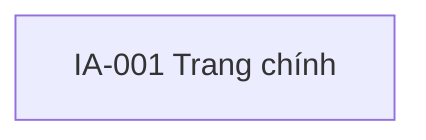

# [Tên dự án] — Sitemap

## 0. Đọc nhanh

| Câu hỏi | Trả lời ngắn |
| --- | --- |
| **Tài liệu này là gì** | |
| **Ai cần đọc** | |
| **Đọc xong phải biết gì** | |
| **Quyết định nào chốt ở đây** | |

> Bốn dòng này viết **không dùng một thuật ngữ nào**, kể cả thuật ngữ của chính nghề mình. Người mới vào dự
> án — hoặc người ở vai trò khác — đọc bốn dòng là biết có cần đọc tiếp hay không. Để trống hoặc chép lại
> tên tài liệu là chưa làm.

## 1. Sơ đồ

## 2. Bảng node
| `IA` | Nhãn | Cấp | Vào từ đâu | Đi tới đâu | Màn hình dự kiến |
| --- | --- | --- | --- | --- | --- |

> Cột "màn hình dự kiến" là **dự kiến**. Mã `SCR` chính thức do `08-01` cấp, không cấp ở đây.

## 3. Điểm vào ngoài điều hướng
| Điểm vào | Dẫn tới `IA` | Ghi chú |
| --- | --- | --- |
| Thông báo đẩy | | |
| Deep link | | |
| Widget | | |
| Mở lại app sau khi bị dừng | | |

## 4. Nguồn phương pháp

## Thuật ngữ dùng trong tài liệu này

Chép nghĩa một câu từ `docs/_GLOSSARY.md` mục *Thuật ngữ chuyên môn*, và nghĩa của tiền tố mã từ
`docs/_ID_REGISTRY.md`. Chỉ liệt kê thứ **thật sự xuất hiện** trong tài liệu này.

| Thuật ngữ / tiền tố mã | Nghĩa một câu |
| --- | --- |
| | |

> Bảng này không phải để người trong nghề đọc — nó dành cho người ở vai trò khác đang phải duyệt tài liệu
> này. `validate_docs.py` đối chiếu: dùng mà không liệt kê là **LỖI**; liệt kê mà không dùng là cảnh báo.

<!-- QUALITY-GATE-MANIFEST:START
# Nguồn chân lý DUY NHẤT cho G6 phần tài liệu này. KHÔNG chép khối này vào file đầu ra ở docs/.
doc: 07-03_SITEMAP
gate: G6
required_major:
  - "0. Đọc nhanh"
  - "1. Sơ đồ"
  - "2. Bảng node"
  - "3. Điểm vào ngoài điều hướng"
  - "4. Nguồn phương pháp"
  - "Thuật ngữ dùng trong tài liệu này"
required_minor:
  {}
quality_checks:
  - "Sitemap khớp cây IA ở 07-02"
  - "Không cấp mã SCR ở đây — SCR do 08-01 cấp"
  - "Mục 3 có ít nhất điểm vào từ thông báo và từ mở lại app"
QUALITY-GATE-MANIFEST:END -->
