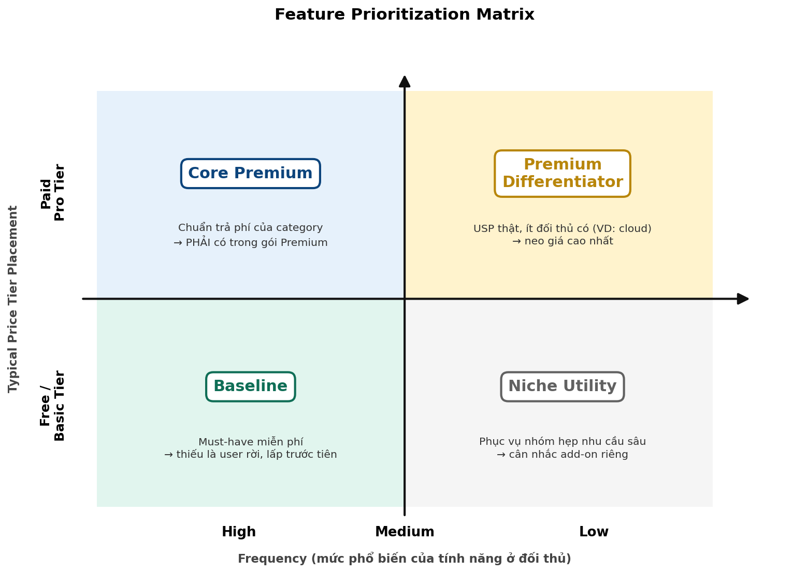
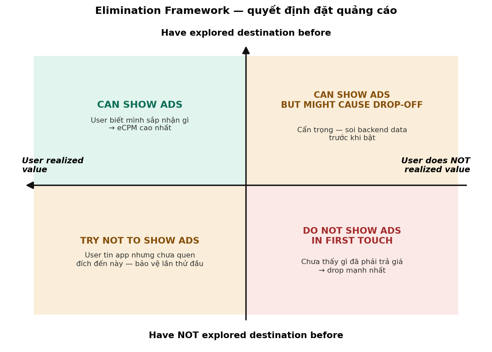

<!-- PROVENANCE — do người dùng cung cấp, KHÔNG sửa tay
nguồn      : Tài liệu Feature – Paywall/Ads Strategy.docx
nhập ngày  : 2026-08-10
trạng thái : chép nguyên văn, không tóm tắt, không diễn giải
ghi chú    : hai sơ đồ F1 và F2 được trích ra thành .png cùng thư mục
cập nhật   : thay file này khi có bản .docx mới, rồi chạy lại build_kit.py
-->

**Feature -- Paywall -- Ads Strategy**

Tài liệu cung cấp các tư duy liên quan áp dụng cho phát triến App

# A · 1 số nguyên tắc áp dụng cho các Apps

**1. Đan xen IAA và IAP**

Tối ưu cách hiển thị IAA cho Free tier bằng cách cho reward ads nhiều
hơn, để user hiểu rõ vì sao họ phải xem ads, sau khi xem ads họ đạt được
gì (Tạo cho họ nhận thức chủ động). User quen "xem ad đổi giá trị" sẽ dễ
chuyển thành user trả tiền hơn -\> IAP tăng dần tỷ trọng qua tier hóa.

**2. Cấu trúc subscription phải khớp tần suất nhu cầu**

Trước khi chọn duration cho các gói sub, đặt câu hỏi: **"user cần tính
năng này bao nhiêu lần trong chu kỳ gói?"** Multi-duration chỉ có nghĩa
khi hệ tính năng đủ dày để tạo giá trị lặp lại. Ví dụ bán gói yearly cho
app nhu cầu sử dụng tần suất thấp như app cleaner là không hợp lý -- vì
user chỉ sử dụng số lần thấp theo tháng/năm để dọn dẹp, không phải liên
tục hàng ngày.

**3. Value first --- user phải thấy giá trị trước khi gặp ads hoặc
paywall**

Số liệu tham chiếu từ case thực tế: \>50% user abandon tại paywall trước
khi kịp thấy value . Mọi khoảnh khắc monetization đặt trước khoảnh khắc
giá trị đều trả giá bằng drop-off. Nguyên tắc thứ tự: **thấy được gì →
hiểu giá trị → mới gặp lời mời trả tiền/xem ads**.

**4. First-time activation là thời điểm quan trọng nhất**

Chưa nhìn thấy value của app thì không popup ads lên, tránh trường hợp
đang chuyển tab hoặc bấm vào vùng mà user chưa rõ nó mang lại gì cho
user mà đã show ads. Có thể show tổng quan "what your app can do" ngay
Home: user có cái nhìn tổng quan, để khi bấm vào dùng mà gặp ads thì họ
cũng đã biết mình đang đi đến cái gì.

**5. Show ads đúng thời điểm rất quan trọng**

Ads ở ngữ cảnh user đã hiểu giá trị có eCPM cao hơn; ads rơi vào vùng
user chưa hiểu giá trị vừa gây ra sự rời bỏ app, vừa kéo average eCPM
xuống. Đặt ads đúng chỗ (khi user đã thấy app hữu ích) thì user vừa
không bỏ app, tiền mỗi lượt ad vừa cao hơn - làm đúng thì được cả hai,
không phải hy sinh cái này để lấy cái kia.

**6. Paywall phải bán giá trị, không chỉ báo giá**

"Sale Off" không có nghĩa nếu user không biết mình nhận được gì sau khi
mở khóa. Cân bằng giá ↔ danh sách giá trị nhận được (thể hiện các giá
trị mà gói sub mang lại khác gì so với không sub). Paywall nên hiển thị
sau khi trải nghiệm tính năng. Đối với offer ngắn hạn, có thể đặt nút
CTA kèm offer ngay trên Home.

**7. User có xu hướng không tương tác với paywall**

User có xu hướng không tương tác nhiều với màn Paywall, vì vậy cần tạo
ra nhiều điểm chạm trong app để user tiếp cận subscription tự nhiên qua
nhiều cửa. Ví dụ trường hợp lock Feature (Cho họ biết tính năng làm được
gì để kích thích hành động của user) và đưa offer khi user bấm vào sử
dụng tính năng đặc biệt nào đó.

**8. Thông tin tạo ra sự tin cậy với user**

"Trusted by N users" chỉ dùng khi kiểm chứng được con số. Không đảm bảo
được thì không gắn lên sản phẩm, vì thông tin sai làm mất niềm tin đúng
chỗ user chuẩn bị trả tiền (dữ liệu nhạy cảm như cloud lại càng cẩn thận
hơn). Hoặc đối với các thông tin được kiểm chứng hoặc vấn đề bảo mật cần
có dẫn nguồn vào để tăng độ tin câỵ với user.

**9. Tránh sử dụng Dark Pattern**

Dark Button tạo ra những kết quả trái với kỳ vọng của user, dẫn đến việc
user mất thiện cảm và cảm hứng khi sử dụng app. Ví dụ trường hợp: Khi
onboarding họ kỳ vọng nút Continue bên dưới để đi tiếp nhưng thực ra đấy
là nút mở ads.

**10. Quảng cáo tính năng phải khớp trải nghiệm thật**

Phần giới thiệu tính năng (VD ở onboarding) cần thể hiện đúng những gì
user sẽ dùng --- tránh để user vào dùng thật phải làm thêm các bước phức
tạp không có trong giới thiệu (trái kỳ vọng của user).

# B · CÁC FRAMEWORK

## F1 · Feature Prioritization Matrix

**Mục đích:** quyết định phát triển nhóm tính năng nào và đặt vào tier
nào, dựa trên vị trí của tính năng trong thị trường. Tùy dòng sản phẩm
mà chọn nhóm tính năng để phát triển.

{width="6.458333333333333in"
height="4.635416666666667in"}

Trục dọc --- **Typical Price Tier Placement**: Paid Pro Tier (trên) /
Free Basic Tier (dưới). Trục ngang --- **Frequency**: mức phổ biến của
tính năng ở đối thủ, High → Medium → Low (khảo sát trên \~5--6
competitor).

  -----------------------------------------------------------------------
  **Vùng**            **Định nghĩa & quy tắc**
  ------------------- ---------------------------------------------------
  **Baseline**        Tính năng "phải có" --- cửa vào cho free user trải
  (Free + High)       nghiệm. Thiếu baseline thì user không ở lại đủ lâu
                      để khám phá phần còn lại. Đây là nền, có baseline +
                      data user rồi mới mở rộng lên
                      premium/differentiator.

  **Core Premium**    Thị trường thường đặt trong gói trả phí → định vị
  (Paid + High)       tier thương mại.

  **Premium           Vừa đặc biệt vừa khác biệt. Cần nhấn mạnh tính năng
  Differentiator**    mà competitor KHÔNG có và bán các gói liên quan.
  (Paid + Low)        

  **Niche Utility**   Phục vụ nhóm hẹp có nhu cầu sâu.
  (Free + Low)        
  -----------------------------------------------------------------------

-   **Không cần làm tất cả** --- chọn nhóm tự tin nhất, nhưng đảm bảo
    tính hệ thống: value proposition truyền tải thống nhất từ marketing,
    creative đến sản phẩm.

-   **Khi một tính năng là core của sản phẩm**: cần đẩy về cả quảng cáo,
    marketing\... thống nhất để user nhận biết đấy là tính năng lõi của
    app.

-   **Cách research:** tự vào từng app đối thủ dùng thử để biết tính
    năng free hay trả phí (thủ công); có thể dùng AI phân tích nhanh hơn
    nhưng vẫn cần trực tiếp vào app đối thủ.

**Cách Áp Dụng:**

1.  Lấy 5--6 app cùng loại với mình, cùng thị trường mình nhắm tới (đừng
    lấy app cùng loại nhưng ở thị trường khác --- cách họ thu tiền sẽ
    khác).

2.  Vào từng app, bấm thử từng tính năng, ghi lại: tính năng này họ cho
    dùng free hay bắt trả tiền. Có thể nhờ AI tổng hợp cho nhanh, nhưng
    vẫn phải tự vào app --- đọc mô tả trên store không đủ, vì store
    không nói cái gì bị khóa sau paywall.

3.  Gom tính năng của mình + của đối thủ + ý tưởng mới định làm, đặt
    từng cái vào ma trận: nó thuộc Free hay Paid? Nhiều app có hay ít
    app có? → mỗi tính năng rơi vào 1 trong 4 vùng.

4.  **Nhìn ma trận để tìm 2 thứ:\
    Lỗ hổng:** tính năng ở vùng Baseline (ai cũng có, ai cũng cho free)
    mà app mình *chưa có* → cần bổ sung ngay, vì thiếu nó user vào rồi
    đi luôn.\
    **Tiền bỏ quên:** tính năng mình đang *cho free* trong khi cả thị
    trường đang *thu tiền* → cân nhắc dời lên gói trả phí. Nhưng phải
    khéo với user cũ (giữ free cho người đang dùng, chỉ khóa với user
    mới; hoặc để bản giới hạn ở free, bản full lên Premium) --- và kiểm
    tra xem nó có phải lý do chính user tải app không, nếu đúng thì đang
    free có chủ đích, tránh chạm vào.

5.  Từ vùng ít đối thủ có, chọn 1--2 tính năng làm điểm khác biệt (khớp
    với giá trị cốt lõi của app). Đã chọn cái nào là tính năng lõi thì
    quảng cáo, marketing, ASO, trong app\... tất cả phải cùng nói về nó
    --- để user nhận ra ngay \"app này là app của tính năng đó\".

6.  Thị trường đổi nhanh: cái hôm nay là khác biệt, vài tháng sau đối
    thủ copy là thành hàng phổ thông. Ma trận có hạn sử dụng nên cần
    audit lại định kỳ (VD mỗi quý).

## F2 · Elimination Framework (quyết định đặt quảng cáo)

**Mục đích:** show ads đúng thời điểm. Framework KHÔNG nhằm bỏ ads, mà
nhằm show ads đúng cách để user vẫn xem, chấp nhận tốt hơn, không rời bỏ
app.

{width="6.458333333333333in"
height="4.635416666666667in"}

  -------------------------------------------------------------------------------
  **Quadrant**   **Trạng thái user**         **Quyết định ads**
  -------------- --------------------------- ------------------------------------
  **Q1**         Đã khám phá đích đến + đã   "Can show ads" --- trước hoặc sau
                 nhận ra giá trị             hành động đều được. eCPM vùng này
                                             cao nhất.

  **Q2**         Đã khám phá nhưng chưa nhận "Can show ads but might cause drop
                 ra giá trị                  off" --- phải soi backend data trước
                                             khi bật.

  **Q3**         Chưa khám phá + chưa nhận   "Do not show ads in first touch" ---
                 ra giá trị                  VD lỗi thật: đang chuyển tab bình
                                             thường đã show ads.

  **Q4**         Đã nhận ra giá trị nhưng    "Try not to show ads" --- bảo vệ lần
                 chưa khám phá đích này      chạm đầu vào tính năng mới.
  -------------------------------------------------------------------------------

-   Liên kết eCPM: hai vùng "tốt" có eCPM cao hơn hai vùng "xấu"; ad
    show rơi nhiều vào vùng xấu kéo average eCPM toàn app xuống → đặt
    ads đúng chỗ vừa bảo vệ retention vừa tối ưu eCPM.

## F3 · Cấu trúc tier thương mại

**Nguyên tắc:** thiết kế nhiều tầng tính năng để phục vụ nhiều segment
với price point khác nhau. Mỗi tier có thể thay đổi gói sub để thu tối
đa giá trị từ nhiều tệp khác nhau (điều chỉnh giá trị gói).

-   **Free / Basic:** cho user bước đầu trải nghiệm; diagnostic-driven
    (Ví dụ app cleaner cho user thấy tình trạng bộ nhớ máy trước khi
    clean); usage limits; IAA-driven. Thay popup ads bằng **rewarded
    ads** để user chủ động hiểu vì sao phải xem ads và xem thì được gì.

-   **Premium:** Basic + tính năng trả phí, kèm trial để tăng cảm nhận
    giá trị.

-   **Pro / AI + Cloud:** dùng AI tạo tier cao hơn hoặc bán AI riêng như
    add-on. Với điều kiện: **định nghĩa rõ AI đối với sản phẩm** --- AI
    phải đứng trước trong brand và có thật trong tính năng, không chỉ là
    tên gọi. Điểm khác biệt độc nhất → khai thác như USP trong cách bán
    gói ("show the value and get the value").

**Khung bảng thiết kế tier** và **Cách dùng:** (1) điền bảng TRƯỚC khi
thiết kế paywall --- paywall chỉ là cách trình bày bảng này cho user;
(2) mỗi ô Purpose phải khác nhau rõ rệt, hai tier trùng purpose thì gộp;
(3) mỗi tier chỉ nên có MỘT cơ chế thu chính; (4) giá từng tier điều
chỉnh theo segment/thị trường --- giá là biến, cấu trúc là hằng.

**Bảng mẫu với app cleaner:**

  ---------------------------------------------------------------------------
                   **Free / Basic       **Premium Tier**   **Pro / AI + Cloud
                   Tier**                                  Tier**
  ---------------- -------------------- ------------------ ------------------
  **Purpose**      Cửa vào:             Thu tiền trên giá  Tối đa ARPU từ
                   acquisition, cho     trị đã được chứng  power user; tạo
                   user nếm giá trị đầu minh: bỏ giới hạn, lock-in bằng tài
                   tiên, tạo thói quen  mở full trải       sản khó rời (dữ
                   quay lại             nghiệm             liệu trên cloud)

  **Features /     Baseline (quick      Toàn bộ Basic      Premium + năng lực
  Capabilities**   clean, duplicates,   không giới hạn +   AI thật (smart
                   diagnostic scan) +   tính năng Premium  organize, AI
                   usage limits         chuẩn              dedupe\...) +
                                        (compression,      cloud storage
                                        email/calendar     (+GB) + đa thiết
                                        mgmt) + không ads  bị

  **Core           IAA --- ưu tiên      Subscription đa    Tier cao hơn hoặc
  Monetization**   rewarded ads thay    duration (khớp tần add-on rời; bundle
                   popup/interstitial   suất nhu cầu) +    offer gắn USP (VD
                                        trial              "+50GB storage")
  ---------------------------------------------------------------------------

## F4 · Nguyên tắc FTUE & paywall theo hành trình

**Bảng trả lời câu hỏi:** đặt quảng cáo, paywall, xin quyền\... vào thời
điểm nào trên hành trình của user thì không làm họ rời đi?

  ------------------------------------------------------------------------
  **Điểm       **Anti-pattern thường      **Hướng xử lý**
  chạm**       gặp**                      
  ------------ -------------------------- --------------------------------
  Mở app lần   Tap navigation đã gặp ad;  Home có khung overview tính năng
  đầu          chưa thấy app làm được gì  chính → 5 giây đầu biết "app làm
                                          được gì"; không ảnh hưởng lượng
                                          ads hiện tại

  Launch lặp   Mỗi lần mở lại gặp chuỗi   paywall hiển thị sau khi trải
  lại          trial + paywall            nghiệm tính năng
               (aggressive launch         
               paywall)                   

  Trong tính   Onboarding thú vị nhưng    Nhất quán onboarding ↔ in-app;
  năng         vào trong không như kỳ     đưa khối tương tác lên bề mặt,
               vọng, không CTA, thêm bước giảm nested action
               không có trong giới thiệu  

  Xin quyền    Popup permission ngẫu      Xin đúng ngữ cảnh: tại màn quyền
               nhiên                      đó mở ra giá trị nhìn thấy được

  Gặp tính     Chưa kịp bật đã show       Preview trước: cho user biết
  năng khóa    paywall                    tính năng làm được gì (chỉ cần
                                          biết, chưa cần dùng) rồi mới
                                          offer

  Điểm bán     Paywall là nơi duy nhất,   Offer cùng màn giá trị + có thể
               bật sang màn riêng         kèm timer urgency; lock
                                          feature + offer tạo thêm điểm
                                          chạm; CTA kèm offer ngay Home
                                          cho gói ngắn hạn
  ------------------------------------------------------------------------
