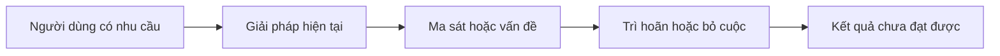
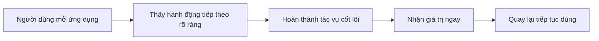
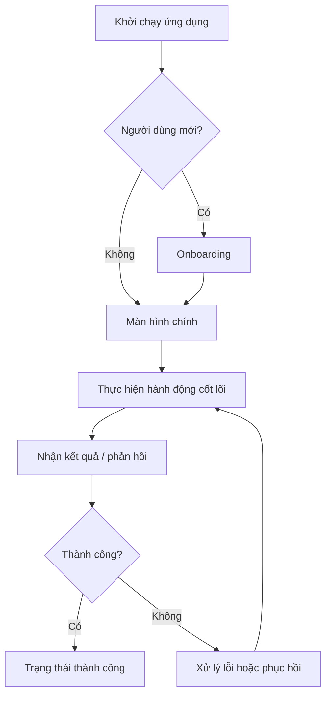
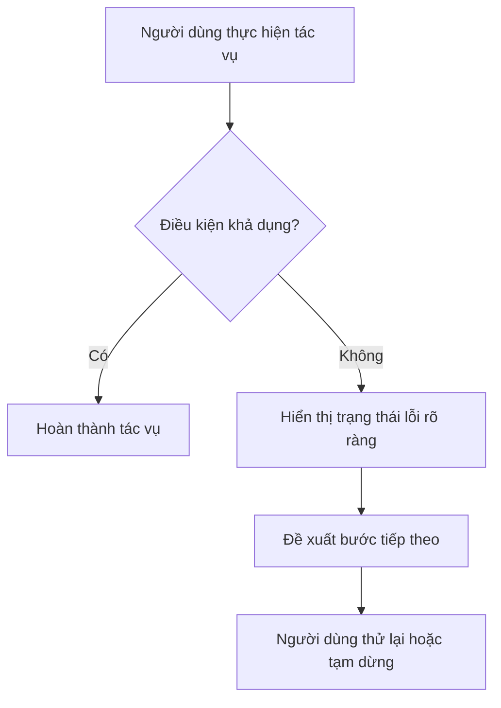
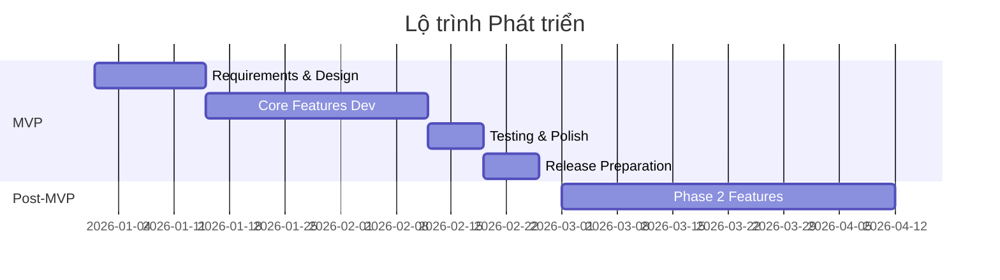

# [Tên Ứng dụng] - Tài liệu Yêu cầu Sản phẩm

**Version**: 1.0  
**Date**: [Ngày hiện tại]  
**Author**: AI Research Agent  
**Mode**: Full PRD  
**Status**: Bản nháp để PO rà soát

## Các bên liên quan

| Vai trò | Tên | Trách nhiệm | Liên kết |
|---|---|---|---|
| Project Manager |  | Quản lý toàn bộ dự án, quyết định cuối cùng |  |
| Product Owner |  | Nghiên cứu phân tích dự án, chốt các tính năng và các phase phát triển dự án |  |
| Developer |  | Triển khai code xây dựng dự án |  |
| UI/UX |  | Thiết kế dự án |  |
| Data Analytic |  | Viết tài liệu tracking và tracking số liệu hằng tuần |  |
| BE |  | Viết API để ứng dụng lấy dữ liệu |  |
| AI |  | Tạo các model AI xử lý tính năng trong app |  |
| Graphic |  | Thiết kế icon và screenshot cho app |  |
| ASO |  | Tạo tên app, description, keyword, localization và các thông tin giới thiệu về app trên Store |  |
| Tester |  | Kiểm tra app, đảm bảo chất lượng app trước khi lên store |  |
| Marketing (UA) |  | Kinh doanh sản phẩm |  |

## Lịch sử phiên bản

| Ngày | Phiên bản | Nội dung | Tác giả |
|---|---|---|---|
| [Ngày hiện tại] | 1.0 | Tạo bản nháp PRD đầu tiên cho [Tên Ứng dụng] | AI Research Agent |

## Liên kết quan trọng

| Nội dung | Liên kết |
|---|---|
| UI/UX | www.figma.com |
| Diagram |  |
| Api |  |
| Monet |  |

---

## 1. Tóm tắt Điều hành

### Phát biểu Vấn đề
[Mô tả rõ vấn đề người dùng đang gặp phải, tại sao vấn đề này quan trọng, và vì sao các giải pháp hiện tại chưa giải quyết tốt. Viết theo ngôn ngữ sản phẩm, không chỉ mô tả tính năng.]

### Giải pháp
[Tóm tắt ngắn gọn cách sản phẩm giải quyết vấn đề. Nêu giá trị cốt lõi, cách tiếp cận chính, và vì sao giải pháp này đáng để xây dựng.]

### Tại sao là lúc này
- [Tín hiệu thị trường, hành vi người dùng, thay đổi công nghệ hoặc xu hướng giúp việc ra mắt sản phẩm này phù hợp ở thời điểm hiện tại]
- [Khoảng trống cạnh tranh hoặc thay đổi hành vi tiêu dùng tạo cơ hội]
- [Lợi thế của đội ngũ / kênh phân phối / timing nếu có]

### Thị trường Mục tiêu
- **Primary Users**: [Nhóm người dùng chính theo độ tuổi, bối cảnh, quốc gia hoặc nhu cầu]
- **Positioning**: [Ứng dụng được định vị như thế nào trong tâm trí người dùng]
- **Market Size Framing**: [Mô tả ngắn quy mô thị trường hoặc tín hiệu cho thấy nhu cầu đủ lớn]
- **Market Trend**: [Đang tăng trưởng / ổn định / phân mảnh / mới nổi]

### Tiêu chí Thành công
- [Kết quả kinh doanh hoặc hành vi người dùng cần đạt được để xem dự án là thành công]
- [Các dấu hiệu chứng minh product-market fit ban đầu]
- [Các điều kiện cần trước khi mở rộng phạm vi hoặc đầu tư thêm]

---

## 2. Mục tiêu và Bối cảnh

### Mục tiêu Sản phẩm
[Mô tả mục tiêu sản phẩm ở cấp chiến lược: sản phẩm này được xây dựng để thắng bằng điều gì, cho ai, và trong khung thời gian nào.]

### Liên kết với Mục tiêu Kinh doanh
- [Sản phẩm đóng góp như thế nào vào tăng trưởng, doanh thu, retention, mở rộng thị trường hoặc chiến lược công ty]
- [Các giả định kinh doanh chính đang được kiểm chứng qua MVP]
- [Mốc kinh doanh nào sản phẩm này cần hỗ trợ]

### Nguyên tắc Sản phẩm
1. [Nguyên tắc ra quyết định sản phẩm số 1]
2. [Nguyên tắc ra quyết định sản phẩm số 2]
3. [Nguyên tắc ra quyết định sản phẩm số 3]
4. [Nguyên tắc ra quyết định sản phẩm số 4]
5. [Nguyên tắc ra quyết định sản phẩm số 5]

---

## 3. Vấn đề Người dùng và Đối tượng Mục tiêu

### Persona Chính
- **Profile**: [Nhóm người dùng chính, đặc điểm nhân khẩu học hoặc hành vi]
- **Context**: [Khi nào họ gặp vấn đề này, trong hoàn cảnh nào]
- **Pain Points**:
  - [Khó khăn chính 1]
  - [Khó khăn chính 2]
  - [Khó khăn chính 3]
- **Need**: [Nhu cầu cốt lõi mà sản phẩm phải đáp ứng]

### Persona Thứ cấp
- **Profile**: [Nhóm người dùng quan trọng thứ hai]
- **Context**: [Bối cảnh sử dụng]
- **Pain Points**:
  - [Khó khăn chính 1]
  - [Khó khăn chính 2]
- **Need**: [Nhu cầu cốt lõi]

### Persona Thứ ba (nếu có)
- **Profile**: [Nhóm người dùng bổ sung, chỉ thêm khi thực sự cần]
- **Context**: [Bối cảnh sử dụng]
- **Pain Points**:
  - [Khó khăn chính 1]
  - [Khó khăn chính 2]
- **Need**: [Nhu cầu cốt lõi]

### Hành trình Người dùng Hiện tại

### Hành trình Người dùng Mong muốn

---

## 4. Phân tích Cạnh tranh

### Tổng quan Thị trường
[Tóm tắt bối cảnh thị trường, các mô thức đối thủ chính, cách người dùng hiện đang được phục vụ, và khoảng trống nổi bật có thể khai thác.]

### Ghi chú Phương pháp luận
[Nêu rõ nguồn dữ liệu nào là công khai, dữ liệu nào là ước tính, và mục đích của phân tích là so sánh tương đối để ra quyết định sản phẩm chứ không phải dự báo tài chính chính xác.]

### Ma trận Đối thủ

| App | Tín hiệu quy mô | Đánh giá | Mô hình giá | Điểm mạnh | Điểm yếu / Phàn nàn | Hàm ý cho chúng ta |
|-----|----------------|----------|-------------|-----------|---------------------|--------------------|
| [Đối thủ 1] | [Quy mô công khai hoặc ước tính] | [Rating / review] | [Free / freemium / subscription / one-time] | [Điểm mạnh nổi bật] | [Điểm yếu hoặc than phiền phổ biến] | [Bài học chiến lược] |
| [Đối thủ 2] | [Quy mô công khai hoặc ước tính] | [Rating / review] | [Mô hình giá] | [Điểm mạnh] | [Điểm yếu] | [Hàm ý] |
| [Đối thủ 3] | [Quy mô công khai hoặc ước tính] | [Rating / review] | [Mô hình giá] | [Điểm mạnh] | [Điểm yếu] | [Hàm ý] |
| [Đối thủ 4] | [Quy mô công khai hoặc ước tính] | [Rating / review] | [Mô hình giá] | [Điểm mạnh] | [Điểm yếu] | [Hàm ý] |
| [Đối thủ 5] | [Quy mô công khai hoặc ước tính] | [Rating / review] | [Mô hình giá] | [Điểm mạnh] | [Điểm yếu] | [Hàm ý] |

### Bảng 1. Chỉ số Thị trường & Thương mại

| Chỉ số | Đối thủ 1 | Đối thủ 2 | Đối thủ 3 | Đối thủ 4 | Đối thủ 5 |
|---|---|---|---|---|---|
| Tên app | [Tên app] | [Tên app] | [Tên app] | [Tên app] | [Tên app] |
| Link cài app | [URL storefront] | [URL storefront] | [URL storefront] | [URL storefront] | [URL storefront] |
| Quy mô tải/người dùng | [Số công khai hoặc ước tính] | [Số công khai hoặc ước tính] | [Số công khai hoặc ước tính] | [Số công khai hoặc ước tính] | [Số công khai hoặc ước tính] |
| Rating | [Điểm / số review] | [Điểm / số review] | [Điểm / số review] | [Điểm / số review] | [Điểm / số review] |
| DAU | [Ước tính nếu có] | [Ước tính nếu có] | [Ước tính nếu có] | [Ước tính nếu có] | [Ước tính nếu có] |
| IAP revenue | [Ước tính nếu có] | [Ước tính nếu có] | [Ước tính nếu có] | [Ước tính nếu có] | [Ước tính nếu có] |
| RPD | [Ước tính nếu có] | [Ước tính nếu có] | [Ước tính nếu có] | [Ước tính nếu có] | [Ước tính nếu có] |
| Engagement time | [Ước tính nếu có] | [Ước tính nếu có] | [Ước tính nếu có] | [Ước tính nếu có] | [Ước tính nếu có] |
| Sessions/ngày | [Ước tính nếu có] | [Ước tính nếu có] | [Ước tính nếu có] | [Ước tính nếu có] | [Ước tính nếu có] |
| Retention D1/D7/D14/D30/D60 | [Ước tính nếu có] | [Ước tính nếu có] | [Ước tính nếu có] | [Ước tính nếu có] | [Ước tính nếu có] |
| Mô hình giá | [Free / freemium / subscription / one-time] | [Mô hình giá] | [Mô hình giá] | [Mô hình giá] | [Mô hình giá] |
| Top country/top countries | [Thị trường mạnh nhất] | [Thị trường mạnh nhất] | [Thị trường mạnh nhất] | [Thị trường mạnh nhất] | [Thị trường mạnh nhất] |

### Bảng 2. Chỉ số Sản phẩm & Kỹ thuật

| Chỉ số | Đối thủ 1 | Đối thủ 2 | Đối thủ 3 | Đối thủ 4 | Đối thủ 5 |
|---|---|---|---|---|---|
| Main features | [Tính năng nổi bật] | [Tính năng nổi bật] | [Tính năng nổi bật] | [Tính năng nổi bật] | [Tính năng nổi bật] |
| App size | [Dung lượng app] | [Dung lượng app] | [Dung lượng app] | [Dung lượng app] | [Dung lượng app] |
| Minimum iOS | [Phiên bản iOS tối thiểu] | [Phiên bản iOS tối thiểu] | [Phiên bản iOS tối thiểu] | [Phiên bản iOS tối thiểu] | [Phiên bản iOS tối thiểu] |
| Version hiện tại | [Version] | [Version] | [Version] | [Version] | [Version] |
| Lần cập nhật gần nhất | [Ngày hoặc khoảng thời gian] | [Ngày hoặc khoảng thời gian] | [Ngày hoặc khoảng thời gian] | [Ngày hoặc khoảng thời gian] | [Ngày hoặc khoảng thời gian] |
| Dấu hiệu tuổi đời app | [Tín hiệu về thời gian hiện diện trên thị trường] | [Tín hiệu] | [Tín hiệu] | [Tín hiệu] | [Tín hiệu] |

### Phụ lục gọn: IAP, release và ghi chú storefront

| Trường | Đối thủ 1 | Đối thủ 2 | Đối thủ 3 | Đối thủ 4 | Đối thủ 5 |
|---|---|---|---|---|---|
| IAP product names & prices | [Tên gói và giá] | [Tên gói và giá] | [Tên gói và giá] | [Tên gói và giá] | [Tên gói và giá] |
| Ngày phát hành đầu tiên | [Nếu tìm được] | [Nếu tìm được] | [Nếu tìm được] | [Nếu tìm được] | [Nếu tìm được] |
| Ghi chú dữ liệu | [Lưu ý về storefront, website, vùng, nguồn hoặc độ tin cậy] | [Ghi chú] | [Ghi chú] | [Ghi chú] | [Ghi chú] |

### Diễn giải nhanh cho chiến lược sản phẩm
- [Đối thủ dẫn đầu đang thắng nhờ điều gì, và vì sao chúng ta không nên sao chép toàn bộ chiến lược đó trong MVP]
- [Nhóm đối thủ mới nổi đang chứng minh nhu cầu nào là thật, và điều đó hàm ý gì cho wedge của chúng ta]
- [Tín hiệu pricing hoặc monetization cho thấy willingness-to-pay nằm ở phân khúc nào]
- [Các tín hiệu từ sản phẩm và storefront cho thấy cơ hội rõ nhất để khác biệt hóa là gì]
- [Kết luận chiến lược cho PO: nên thắng bằng focus nào, không nên sa đà vào phạm vi nào trong giai đoạn đầu]

### Insight Chính từ Review và Định vị của Đối thủ
- **Điều người dùng yêu thích**: [Các đặc điểm được nhắc đến tích cực lặp lại]
- **Phàn nàn phổ biến**: [Các điểm gây ma sát hoặc mất niềm tin]
- **Khoảng trống cơ hội**: [Những nhu cầu chưa được giải quyết tốt]

### Khác biệt hóa của Chúng ta
1. [Khác biệt chiến lược số 1]
2. [Khác biệt chiến lược số 2]
3. [Khác biệt chiến lược số 3]

---

## 5. Tầm nhìn và Mục tiêu Sản phẩm

### Tuyên bố Tầm nhìn
[Một câu ngắn gọn: sản phẩm này muốn trở thành gì trong tâm trí người dùng.]

### Mục tiêu & KPI trong 6 tháng

| Mục tiêu | KPI | Mục tiêu 3 tháng | Mục tiêu 6 tháng | Cách đo lường |
|----------|-----|------------------|------------------|----------------|
| Thu hút người dùng | [Installs / signups / activated users] | [#] | [#] | [Nguồn dữ liệu] |
| Tương tác | [DAU/MAU / số phiên / completion rate] | [# hoặc %] | [# hoặc %] | [Nguồn dữ liệu] |
| Giữ chân | [D1 / D7 / D30 retention] | [# hoặc %] | [# hoặc %] | [Analytics / cohort] |
| Kiếm tiền | [Trial-to-paid / ARPU / paid conversion] | [# hoặc %] | [# hoặc %] | [Billing / analytics] |
| Doanh thu | [MRR / paid users / revenue] | [#] | [#] | [Billing / finance] |
| Hài lòng | [Rating / NPS / CSAT] | [#] | [#] | [Store / survey] |
| Chất lượng | [Crash-free sessions / error rate / p95 latency] | [#] | [#] | [Crash reporting / monitoring] |

---

## 6. Phạm vi và Những gì nằm ngoài Phạm vi

### Phạm vi MVP (In Scope)
- [Nhóm capability bắt buộc để kiểm chứng bài toán cốt lõi]
- [Tính năng cốt lõi số 1]
- [Tính năng cốt lõi số 2]
- [Tính năng cốt lõi số 3]
- [Các khả năng vận hành tối thiểu: auth, sync, offline, notifications, analytics... nếu cần]

### Sau MVP (Giai đoạn tiếp theo)
- [Mở rộng hợp lý sau khi MVP chứng minh tín hiệu tốt]
- [Tính năng giai đoạn 2]
- [Tính năng giai đoạn 2]

### Những gì Rõ ràng nằm ngoài Phạm vi MVP
- [Tính năng hoặc nền tảng chủ động loại khỏi MVP]
- [Tính năng hoặc nền tảng chủ động loại khỏi MVP]
- [Tính năng hoặc nền tảng chủ động loại khỏi MVP]

### Lý do
[Giải thích vì sao cần giữ phạm vi hẹp: để kiểm chứng retention, pricing, use case cốt lõi, thị trường ưu tiên hoặc khả năng vận hành.]

---

## 7. Yêu cầu và Tính năng

### Bảng Tính năng MVP

| # | Tính năng | User Story | Acceptance Criteria | Ưu tiên |
|---|-----------|------------|---------------------|---------|
| 1 | [Tên tính năng] | Với vai trò [người dùng], tôi muốn [hành động] để có thể [lợi ích] | - [ ] Điều kiện chấp nhận 1 - [ ] Điều kiện chấp nhận 2 - [ ] Điều kiện chấp nhận 3 | P0 |
| 2 | [Tên tính năng] | Với vai trò [người dùng], tôi muốn [hành động] để có thể [lợi ích] | - [ ] Điều kiện chấp nhận 1 - [ ] Điều kiện chấp nhận 2 | P0 |
| 3 | [Tên tính năng] | Với vai trò [người dùng], tôi muốn [hành động] để có thể [lợi ích] | - [ ] Điều kiện chấp nhận 1 - [ ] Điều kiện chấp nhận 2 | P0 |
| 4 | [Tên tính năng] | Với vai trò [người dùng], tôi muốn [hành động] để có thể [lợi ích] | - [ ] Điều kiện chấp nhận 1 | P1 |
| 5 | [Tên tính năng] | Với vai trò [người dùng], tôi muốn [hành động] để có thể [lợi ích] | - [ ] Điều kiện chấp nhận 1 | P1 |

### Gợi ý khi viết Acceptance Criteria
- [Mô tả hành vi observable, không mô tả implementation nội bộ]
- [Ưu tiên điều kiện hoàn thành, trạng thái lỗi và ràng buộc hiệu năng nếu liên quan]
- [Nếu có entitlement free/premium, cần viết rõ trong điều kiện chấp nhận]

### Sau MVP (Backlog định hướng)
- [Tính năng mở rộng nên xem xét sau khi có dữ liệu MVP]
- [Tính năng mở rộng]
- [Tính năng mở rộng]

---

## 8. Luồng Người dùng

### Luồng Chính: [Tên hành động cốt lõi]

### Luồng Phục hồi / Lỗi

### Luồng Phụ
- [Tên luồng phụ]: [Mô tả ngắn mục tiêu của luồng]
- [Tên luồng phụ]: [Mô tả ngắn mục tiêu của luồng]

---

## 9. Ràng buộc Sản phẩm và Kỹ thuật

### Ma trận Nền tảng
- **Platform**: [iOS / Android / Web / đa nền tảng]
- **Minimum Version**: [Ví dụ: iOS 16.0]
- **Devices**: [iPhone / iPad / tablet / desktop / responsive web]
- **Orientation**: [Portrait / landscape / cả hai]

### Kiến trúc
- **UI Framework**: [SwiftUI / UIKit / React / Flutter / ...]
- **Architecture Pattern**: [MVVM / TCA / MVC / Clean / ...]
- **Dependency Injection**: [Cách quản lý phụ thuộc]
- **Navigation**: [NavigationStack / router / tab / nested flow]

### Backend và Dịch vụ
- **Backend**: [Firebase / Supabase / custom API / không có backend riêng]
- **Authentication**: [Email / Apple / Google / guest / không yêu cầu]
- **Database**: [Loại lưu trữ chính]
- **Storage**: [Giải pháp lưu file hoặc media nếu cần]
- **Analytics**: [Công cụ theo dõi]
- **Crash Reporting**: [Công cụ theo dõi lỗi]

### Tích hợp Bên thứ ba
| Dịch vụ | Mục đích | Chi phí |
|---------|----------|---------|
| [Dịch vụ 1] | [Mục đích sử dụng] | [Free / Paid / TBD] |
| [Dịch vụ 2] | [Mục đích sử dụng] | [Free / Paid / TBD] |

### Mục tiêu Hiệu năng và Độ tin cậy
- **Cold launch**: [Ví dụ: < 2.0s trên thiết bị mục tiêu]
- **Screen-to-content render**: [Ví dụ: < 1.0s với dữ liệu đã cache]
- **API p95**: [Ví dụ: < 800ms]
- **Crash-free sessions**: [Ví dụ: >= 99.5%]

### Offline và Đồng bộ
- **Offline**: [Không hỗ trợ / hỗ trợ một phần / hỗ trợ đầy đủ với nội dung đã tải]
- **Sync**: [Real-time / gần real-time / theo phiên / thủ công]
- **Conflict Handling**: [Nguyên tắc xử lý xung đột dữ liệu]

### Thông báo
- [Có hay không dùng push notifications]
- [Opt-in hay mặc định bật]
- [Giới hạn tần suất gửi]
- [Nguyên tắc dùng notification cho retention hoặc re-engagement]

### Khả năng Trợ năng
- [Hỗ trợ Dynamic Type / VoiceOver / TalkBack / keyboard navigation / contrast]
- [Vùng chạm tối thiểu hoặc chuẩn tiếp cận chính]
- [Các yêu cầu accessibility bắt buộc cho MVP]

### Quyền riêng tư và Bảo mật
- [Loại dữ liệu cá nhân được thu thập]
- [Mục đích thu thập dữ liệu]
- [Yêu cầu consent, privacy policy, xóa tài khoản, export dữ liệu nếu cần]
- [Ràng buộc pháp lý hoặc compliance liên quan]

### Mức độ Sẵn sàng Phát hành
- [Yêu cầu metadata store / legal review / licensing / QA coverage]
- [Các luồng bắt buộc phải test trước khi phát hành]
- [Những điều kiện release-blocker rõ ràng]

---

## 10. Danh sách Màn hình

| # | Tên màn hình | Mô tả | Ưu tiên | Phụ thuộc |
|---|--------------|-------|---------|-----------|
| 1 | [Màn hình 1] | [Chức năng chính của màn hình] | P0 | [None / phụ thuộc cụ thể] |
| 2 | [Màn hình 2] | [Chức năng chính của màn hình] | P0 | [Phụ thuộc cụ thể] |
| 3 | [Màn hình 3] | [Chức năng chính của màn hình] | P1 | [Phụ thuộc cụ thể] |
| 4 | [Màn hình 4] | [Chức năng chính của màn hình] | P1 | [Phụ thuộc cụ thể] |

---

## 11. Kiếm tiền

### Mô hình Doanh thu
**[Subscription / freemium / ads / one-time purchase / marketplace / lead-gen / không kiếm tiền ở giai đoạn này]**

### Gói Miễn phí
- [Những gì người dùng miễn phí nhận được]
- [Giới hạn chính của free tier nếu có]
- [Mức giá trị free cần đủ để tạo adoption]

### Gói Premium
- [Những gì premium mở khóa]
- [Lợi ích phải mang tính bổ sung rõ ràng chứ không làm free tier vô dụng]
- [Cơ chế trial hoặc restore purchases nếu có]

### Khuyến nghị Định giá
- Gói tháng: [Mức giá hoặc khoảng giá]
- Gói năm: [Mức giá hoặc khoảng giá]
- Free trial: [Số ngày hoặc không áp dụng]

### Cơ sở Định giá
[Giải thích mức neo giá theo đối thủ, willingness-to-pay, phân khúc người dùng và định vị sản phẩm.]

### Cấu trúc Chi phí (nếu cần)
| Hạng mục | Chi phí hàng tháng | Ghi chú |
|----------|--------------------|--------|
| [Backend / hosting] | [$X] | [Ghi chú] |
| [3rd party APIs] | [$X] | [Ghi chú] |
| [Store / pháp lý / license] | [$X] | [Ghi chú] |
| **Tổng** | **[$X]** | |

### Phân tích Hòa vốn (nếu cần)
- **Người dùng trả phí cần thiết**: [#]
- **Mốc thời gian hòa vốn**: [X tháng]

---

## 12. Chỉ số Thành công và Analytics

### Định nghĩa KPI
- **[KPI 1]**: [Định nghĩa để tránh hiểu khác nhau giữa product, growth và engineering]
- **[KPI 2]**: [Định nghĩa]
- **[KPI 3]**: [Định nghĩa]
- **[KPI 4]**: [Định nghĩa]

### Sự kiện Cốt lõi

| Event | Trigger | Mục đích |
|-------|---------|----------|
| app_opened | [Ứng dụng được mở / foreground] | [Theo dõi DAU / session] |
| onboarding_completed | [Người dùng hoàn thành onboarding] | [Funnel conversion] |
| [core_action_started] | [Người dùng bắt đầu hành động cốt lõi] | [Activation] |
| [core_action_completed] | [Người dùng hoàn thành hành động cốt lõi] | [Engagement / retention] |
| paywall_viewed | [Người dùng thấy paywall] | [Monetization funnel] |
| subscription_started | [Người dùng bắt đầu trả phí] | [Revenue] |
| error_occurred | [Lỗi nghiệp vụ hoặc lỗi hệ thống] | [Quality monitoring] |
| crash_occurred | [Ứng dụng crash] | [Stability] |

### Dashboard cần theo dõi
1. **Acquisition**: [Installs, nguồn người dùng, chi phí, activation]
2. **Engagement**: [DAU, session length, feature usage, completion]
3. **Retention**: [D1, D7, D30, cohort theo kênh hoặc quốc gia]
4. **Revenue**: [MRR, ARPU, conversion, trial performance]
5. **Quality**: [Crash rate, error rate, performance, sync failures]

---

## 13. Giả định, Phụ thuộc, Rủi ro

### Giả định Chính
1. [Giả định sản phẩm hoặc thị trường cần được kiểm chứng]
2. [Giả định về hành vi người dùng]
3. [Giả định về pricing / willingness-to-pay]
4. [Giả định về khả năng thực thi hoặc licensing]
5. [Giả định về độ ưu tiên của use case cốt lõi]

### Các Phụ thuộc
- [Đối tác nội dung / licensing / đối tác phân phối nếu có]
- [Hạ tầng backend / analytics / billing / push notification]
- [Pháp lý / bảo mật / compliance]
- [Nguồn lực nội bộ: design / content / growth / QA]

### Rủi ro Chính và Hướng Giảm thiểu

| Rủi ro | Xác suất | Tác động | Giảm thiểu |
|--------|----------|----------|------------|
| [Rủi ro 1] | High / Medium / Low | High / Medium / Low | [Kế hoạch giảm thiểu] |
| [Rủi ro 2] | High / Medium / Low | High / Medium / Low | [Kế hoạch giảm thiểu] |
| [Rủi ro 3] | High / Medium / Low | High / Medium / Low | [Kế hoạch giảm thiểu] |
| [Rủi ro 4] | High / Medium / Low | High / Medium / Low | [Kế hoạch giảm thiểu] |

---

## 14. Câu hỏi Mở

| Câu hỏi | Chủ quyết định | Cần trước |
|----------|----------------|-----------|
| [Quyết định mở cần chốt] | [Product / Design / Engineering / Legal / Growth] | [Mốc thời gian hoặc giai đoạn] |
| [Quyết định mở cần chốt] | [Chủ quyết định] | [Mốc thời gian hoặc giai đoạn] |
| [Quyết định mở cần chốt] | [Chủ quyết định] | [Mốc thời gian hoặc giai đoạn] |
| [Quyết định mở cần chốt] | [Chủ quyết định] | [Mốc thời gian hoặc giai đoạn] |

---

## 15. Điều phối Triển khai

| Hạng mục | Chi tiết |
|----------|----------|
| Chủ sở hữu | [Product Owner / PM] |
| Participants / Stakeholders | [Product, Design, Engineering, Backend, QA, Growth, Legal, ...] |
| Status | [Draft / In review / Approved] |
| Target Release Window | [Khung thời gian phát hành MVP hoặc beta] |

### Các mốc đề xuất
1. [Phê duyệt PRD]
2. [Khóa phạm vi MVP]
3. [Phê duyệt thiết kế / prototype]
4. [Alpha build]
5. [Beta có analytics và monetization]
6. [Gửi store / phát hành công khai]

### Timeline trực quan (tùy chọn)

---

## 16. Phụ lục

### Nguồn Nghiên cứu
- [Link nghiên cứu thị trường]
- [Link nghiên cứu đối thủ]
- [Link dữ liệu người dùng / khảo sát / phỏng vấn]
- [Link tài liệu nội bộ hoặc benchmark]

### Thuật ngữ
- **DAU**: Daily Active Users
- **MAU**: Monthly Active Users
- **MRR**: Monthly Recurring Revenue
- **ARPU**: Average Revenue Per User
- **LTV**: Lifetime Value
- **Retention**: Tỷ lệ người dùng quay lại theo mốc thời gian

### Nhật ký Thay đổi
| Version | Date | Changes | Author |
|---------|------|---------|--------|
| 1.0 | [Ngày] | PRD ban đầu | AI Research Agent |

## Bảng Bằng chứng
| Nhận định | Source URL | Date | Độ tin cậy (High/Med/Low) |
|----------|------------|------|----------------------------|
| [Khẳng định cần dẫn chứng] | [URL nguồn] | [Ngày] | [High/Med/Low] |
| [Khẳng định cần dẫn chứng] | [URL nguồn] | [Ngày] | [High/Med/Low] |
| [Khẳng định cần dẫn chứng] | [URL nguồn] | [Ngày] | [High/Med/Low] |

## Cổng Chất lượng PRD
- Core-8 Completeness: [Pass / Needs Work]
- Evidence Quality: [Pass / Needs Work]
- Mobile-Specific Coverage: [Pass / Needs Work / N/A]
- Scope Clarity: [Pass / Needs Work]
- Metrics Readiness: [Pass / Needs Work]

## Vướng mắc
- [Không có hoặc liệt kê các điểm đang chặn tài liệu]

## Điều chỉnh Bắt buộc
1. [Các điều chỉnh cần thực hiện trước khi xem PRD là sẵn sàng cho bước tiếp theo]
2. [Nếu không có, ghi rõ "Không có đối với baseline hiện tại"]

## Tóm tắt Bàn giao
- Đã cập nhật file: .opencode/specs/[ten-du-an]/PRD.md
- Chế độ: Full
- Số đối thủ đã phân tích: N
- Số nguồn đã rà soát: N
- Số giả định đang mở: N
- Hành động tiếp theo được khuyến nghị: project-docs-orchestrator

<!-- QUALITY-GATE-MANIFEST:START
# Nguồn chân lý DUY NHẤT cho gate-prd. KHÔNG chép khối này vào PRD.md đầu ra ở specs/.
# Gate khớp mục theo TÊN, bỏ qua khác biệt số thứ tự và phần placeholder ở đuôi heading.
doc: PRD
gate: gate-prd
required_major:
  - "Các bên liên quan"
  - "Lịch sử phiên bản"
  - "Liên kết quan trọng"
  - "1. Tóm tắt Điều hành"
  - "2. Mục tiêu và Bối cảnh"
  - "3. Vấn đề Người dùng và Đối tượng Mục tiêu"
  - "4. Phân tích Cạnh tranh"
  - "5. Tầm nhìn và Mục tiêu Sản phẩm"
  - "6. Phạm vi và Những gì nằm ngoài Phạm vi"
  - "7. Yêu cầu và Tính năng"
  - "8. Luồng Người dùng"
  - "9. Ràng buộc Sản phẩm và Kỹ thuật"
  - "10. Danh sách Màn hình"
  - "11. Kiếm tiền"
  - "12. Chỉ số Thành công và Analytics"
  - "13. Giả định, Phụ thuộc, Rủi ro"
  - "14. Câu hỏi Mở"
  - "15. Điều phối Triển khai"
  - "16. Phụ lục"
  - "Bảng Bằng chứng"
  - "Cổng Chất lượng PRD"
  - "Vướng mắc"
  - "Điều chỉnh Bắt buộc"
  - "Tóm tắt Bàn giao"
required_minor:
  "1. Tóm tắt Điều hành": ["Phát biểu Vấn đề", "Giải pháp", "Tại sao là lúc này", "Thị trường Mục tiêu", "Tiêu chí Thành công"]
  "2. Mục tiêu và Bối cảnh": ["Mục tiêu Sản phẩm", "Liên kết với Mục tiêu Kinh doanh", "Nguyên tắc Sản phẩm"]
  "3. Vấn đề Người dùng và Đối tượng Mục tiêu": ["Persona Chính", "Persona Thứ cấp", "Persona Thứ ba (nếu có)", "Hành trình Người dùng Hiện tại", "Hành trình Người dùng Mong muốn"]
  "4. Phân tích Cạnh tranh": ["Tổng quan Thị trường", "Ghi chú Phương pháp luận", "Ma trận Đối thủ", "Bảng 1. Chỉ số Thị trường & Thương mại", "Bảng 2. Chỉ số Sản phẩm & Kỹ thuật", "Phụ lục gọn: IAP, release và ghi chú storefront", "Diễn giải nhanh cho chiến lược sản phẩm", "Insight Chính từ Review và Định vị của Đối thủ", "Khác biệt hóa của Chúng ta"]
  "5. Tầm nhìn và Mục tiêu Sản phẩm": ["Tuyên bố Tầm nhìn", "Mục tiêu & KPI trong 6 tháng"]
  "6. Phạm vi và Những gì nằm ngoài Phạm vi": ["Phạm vi MVP (In Scope)", "Sau MVP (Giai đoạn tiếp theo)", "Những gì Rõ ràng nằm ngoài Phạm vi MVP", "Lý do"]
  "7. Yêu cầu và Tính năng": ["Bảng Tính năng MVP", "Gợi ý khi viết Acceptance Criteria", "Sau MVP (Backlog định hướng)"]
  "8. Luồng Người dùng": ["Luồng Chính", "Luồng Phục hồi / Lỗi", "Luồng Phụ"]
  "9. Ràng buộc Sản phẩm và Kỹ thuật": ["Ma trận Nền tảng", "Kiến trúc", "Backend và Dịch vụ", "Tích hợp Bên thứ ba", "Mục tiêu Hiệu năng và Độ tin cậy", "Offline và Đồng bộ", "Thông báo", "Khả năng Trợ năng", "Quyền riêng tư và Bảo mật", "Mức độ Sẵn sàng Phát hành"]
  "11. Kiếm tiền": ["Mô hình Doanh thu", "Gói Miễn phí", "Gói Premium", "Khuyến nghị Định giá", "Cơ sở Định giá", "Cấu trúc Chi phí (nếu cần)", "Phân tích Hòa vốn (nếu cần)"]
  "12. Chỉ số Thành công và Analytics": ["Định nghĩa KPI", "Sự kiện Cốt lõi", "Dashboard cần theo dõi"]
  "13. Giả định, Phụ thuộc, Rủi ro": ["Giả định Chính", "Các Phụ thuộc", "Rủi ro Chính và Hướng Giảm thiểu"]
  "15. Điều phối Triển khai": ["Các mốc đề xuất", "Timeline trực quan (tùy chọn)"]
  "16. Phụ lục": ["Nguồn Nghiên cứu", "Thuật ngữ", "Nhật ký Thay đổi"]
quality_checks:
  - "Bảng Bằng chứng: >=28 nguồn thật; mỗi claim high-impact có URL + ngày + độ tin cậy; không bịa số liệu"
  - "Mỗi feature MVP có user story + acceptance criteria + priority (P0/P1/P2)"
  - "Metrics đo được: acquisition, engagement, retention D1/D7/D30, revenue/conversion, quality (crash/error) + bảng event tracking"
  - "Mobile-specific: platform matrix, performance targets, offline/sync, push, accessibility (VoiceOver/Dynamic Type), privacy, release readiness"
  - "Ngôn ngữ đo được: từ chối 'nhanh/thân thiện/bảo mật' nếu không có tiêu chí định lượng"
  - "Câu hỏi Mở (§14): mọi giá trị bị downstream (BR/AC/NFR/FR) tham chiếu PHẢI được chốt Default kèm cờ (ASSUMPTION) — không để trống giá trị mà downstream phụ thuộc (vd free scan/ngày, độ dài trial, AI vendor)"
QUALITY-GATE-MANIFEST:END -->

