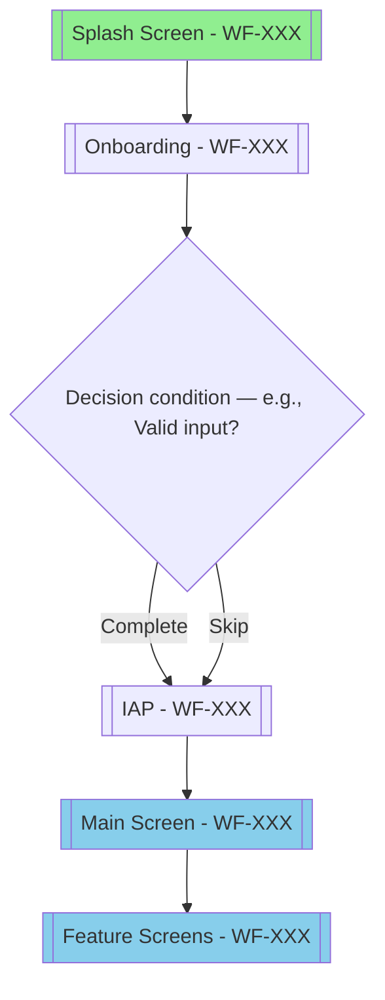
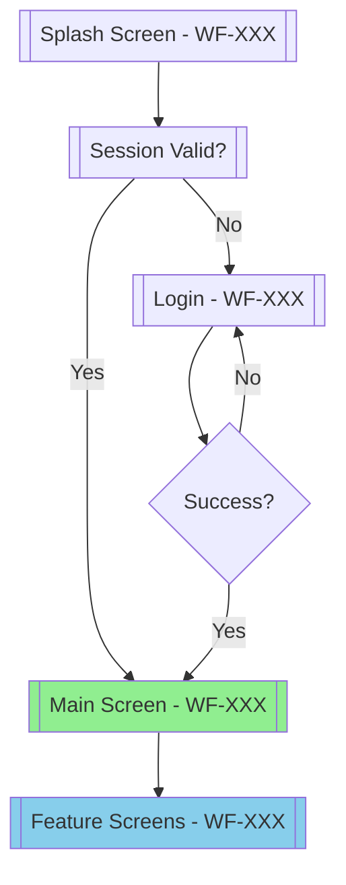
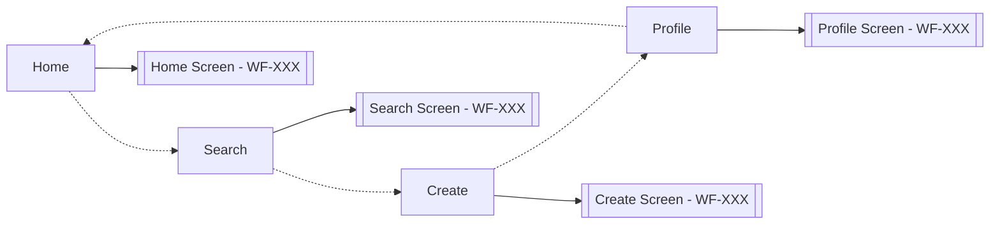
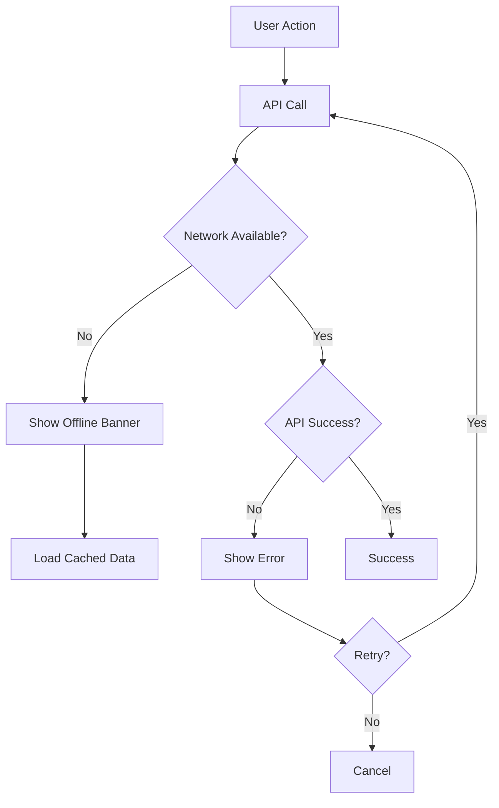

# [Project Name] - UX Flows

## 1. Introduction

### 1.1 Purpose
This document maps user journeys and interaction flows for [Project Name],
showing how users navigate between screens and complete tasks.

### 1.2 Scope
Maps navigation between all screens in Wireframes.md.
Every screen (WF-XXX) must appear in at least one flow.

### 1.3 Flow Notation
- **Rectangle**: Screen/View
- **Diamond**: Decision point
- **Arrow**: Navigation/Transition
- **Stadium** `([text])`: Action/Process *(Mermaid rounded node — the closest valid shape to a "rounded rectangle")*
- **Dashed Arrow**: Optional path
- **Bold Arrow**: Primary path

---

## 2. High-Level User Journeys

**DYNAMIC:** Generate based on app type and screens in Wireframes.md.

### 2.1 [Journey Name - e.g., New User Onboarding]

**Based on**: User type (New/Returning) + App type



**Description**:
- User starts from [Splash/Entry point - WF-XXX]
- Completes [key action - onboarding]
- Navigates to [main destination - WF-XXX]

**Screens from Wireframes**: List all WF-XXX involved in this journey

**Duration**: [Estimated time]

---

### 2.2 [Journey Name - e.g., Returning User Daily Use]



**Description**:
- User opens app
- Session validation
- Lands on main screen
- Uses features

**Screens from Wireframes**: List all WF-XXX involved

**Duration**: < 10 seconds to dashboard

---

**Scaling guidance:**
- Small project (< 10 screens): 2-3 high-level journeys
- Medium project (10-20 screens): 3-5 journeys
- Large project (20+ screens): 5+ journeys, group by user type

---

## 3. Screen Navigation Flows

**DYNAMIC:** Generate flows for each screen in Wireframes.md.

### 3.1 [Screen Name - from WF-XXX]

**Source**: [WF-XXX from Wireframes.md]

```mermaid
graph TD
    A[[Entry Point]] --> B[[[Screen Name]]]
    B --> C{Decision condition — e.g., Valid input?}
    C -->|Action 1| D[[Next Screen 1]]
    C -->|Action 2| E[[Next Screen 2]]
    C -->|Error| F[[Error State]]

    style B fill:#87CEEB
    style D fill:#90EE90
    style F fill:#FFB6C1
```

**User Flow**:
- **Entry**: From [previous screen/WF-XXX]
- **Actions**: [List from Wireframes components and UX Enhancements]
- **Exit**: To [next screens/WF-XXX]
- **Error handling**: [Error states from Wireframes]

---

**Scaling guidance:**
- Small project (< 10 screens): 3-5 detailed flows
- Medium project (10-20 screens): 6-10 flows, group related screens
- Large project (20+ screens): 10+ flows, focus on critical paths

---

## 3.5 UX Enhancement Flows

**DYNAMIC:** Map UX Enhancements from Wireframes.md to specific interaction flows.
Every screen's UX Enhancements must be implemented as a documented flow.

<!-- NOTE: Detailed UX Enhancement patterns (Pull-to-Refresh, Skeleton Loading, Empty State, Error+Retry, Haptic Feedback, Swipe Gestures, Onboarding Animation, IAP Purchase, Alert Presentation, Dialog Presentation, Bottom Sheet, Snackbar) are available in the ios-ui-ux skill. Reference it for implementation specs. -->

For each UX Enhancement listed in Wireframes.md, create a flow showing:
1. **Trigger**: What initiates the enhancement
2. **User Action**: What the user does
3. **System Response**: What the system does
4. **Resolution**: How the interaction completes or recovers

Example flow format:
```
### 3.5.X [Enhancement Name] Flow
**Source**: UX Enhancement from [WF-XXX] screens with [context]

Flow:
1. [Trigger event]
2. {Decision point}
3. [System response based on decision]
4. [Resolution]

Reference ios-ui-ux skill for detailed Mermaid diagrams and specs.
```

**UX Enhancement Coverage Rule:** Every UX Enhancement listed in Wireframes.md must have a corresponding flow in this section.

---

## 4. Navigation Patterns

**DYNAMIC:** Apply patterns from Wireframes to connect screens.

### 4.1 Tab Navigation
**For**: Main sections defined in Wireframes tab bar



### 4.2 Modal Presentation
**For**: Create/Edit forms, confirmations from Wireframes

### 4.3 Navigation Stack
**For**: Drill-down flows (list → detail) from Wireframes

---

## 5. Error Handling Flows

**DYNAMIC:** Based on screens from Wireframes.md.

### 5.1 Network Error Flow
**Applies to**: All screens with network requests ([WF-XXX])



### 5.2 Validation Error Flow
**Applies to**: Forms in [WF-XXX] screens

---

## 6. Loading States

**DYNAMIC:** Based on screens from Wireframes.md.

### 6.1 Initial Load
**Applies to**: [WF-XXX] screens

### 6.2 Pull to Refresh
**Applies to**: [WF-XXX] screens with dynamic content

### 6.3 Skeleton Loading
**Applies to**: [WF-XXX] screens with lists

---

## 7. Offline Support

**DYNAMIC:** Based on screens from Wireframes with offline capability.

### 7.1 Offline Mode Flow
- Detect network changes
- Show offline banner
- Load cached data
- Queue write actions
- Auto-sync when online

---

## 8. Accessibility Flows

### 8.1 VoiceOver Navigation
- All elements have accessibility labels
- Logical reading order
- Custom actions for gestures
- Announcements for state changes

---

## 9. Onboarding & Tutorials

### 9.1 First-Time User Experience
**Based on**: Onboarding flow from Wireframes [WF-XXX]

---

## 10. Performance Considerations

### 10.1 Optimistic UI Updates
- Update UI immediately
- Send API request
- Revert if failed
- Show error with retry

---

## 11. Flow Summary

**DYNAMIC:** Generate based on actual flows created.

### 11.1 Critical Paths

| Flow | Screens (WF-XXX) | Priority |
|------|-----------------|----------|
| [Journey name] | WF-XXX → WF-XXX → WF-XXX | High |

### 11.2 Screen Coverage

| Screen (WF-XXX) | Flows Count | Critical Path |
|-----------------|-------------|---------------|
| [Screen name] | X | Yes/No |

**Coverage rule:** Every screen in Wireframes must appear in at least one flow.

---

## 12. Future Enhancements

### 12.1 Planned Flows
- Social login flows
- Advanced search flows
- Batch operations

---

**Document Version**: 1.0
**Last Updated**: 2026
**Status**: Draft / In Review / Approved
**Dependencies**: PRD.md, Use_Cases.md, Functional_Requirements.md, Wireframes.md

<!-- QUALITY-GATE-MANIFEST:START
# Nguồn chân lý DUY NHẤT cho gate-flows. KHÔNG chép khối này vào file đầu ra ở specs/.
doc: UX_Flows
gate: gate-flows
required_major:
  - "1. Introduction"
  - "2. High-Level User Journeys"
  - "3. Screen Navigation Flows"
  - "3.5 UX Enhancement Flows"
  - "4. Navigation Patterns"
  - "5. Error Handling Flows"
  - "6. Loading States"
  - "7. Offline Support"
  - "8. Accessibility Flows"
  - "9. Onboarding & Tutorials"
  - "10. Performance Considerations"
  - "11. Flow Summary"
  - "12. Future Enhancements"
required_minor:
  "1. Introduction": ["1.1 Purpose", "1.2 Scope", "1.3 Flow Notation"]
  "4. Navigation Patterns": ["4.1 Tab Navigation", "4.2 Modal Presentation", "4.3 Navigation Stack"]
  "5. Error Handling Flows": ["5.1 Network Error Flow", "5.2 Validation Error Flow"]
  "6. Loading States": ["6.1 Initial Load", "6.2 Pull to Refresh", "6.3 Skeleton Loading"]
  "7. Offline Support": ["7.1 Offline Mode Flow"]
  "8. Accessibility Flows": ["8.1 VoiceOver Navigation"]
  "9. Onboarding & Tutorials": ["9.1 First-Time User Experience"]
  "10. Performance Considerations": ["10.1 Optimistic UI Updates"]
  "11. Flow Summary": ["11.1 Critical Paths", "11.2 Screen Coverage"]
  "12. Future Enhancements": ["12.1 Planned Flows"]
quality_checks:
  - "Journey Coverage: mọi màn hình WF-XXX xuất hiện trong ít nhất 1 flow"
  - "Error Recovery: có định nghĩa failure/recovery path"
  - "Navigation Consistency: nhất quán tên màn hình với Wireframes"
  - "Traceability: liên kết tới screens/requirements"
QUALITY-GATE-MANIFEST:END -->
