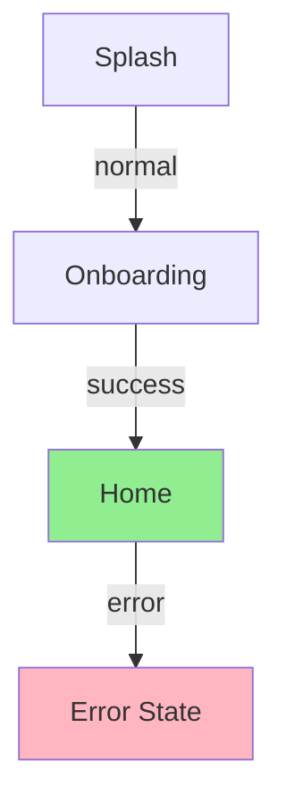

# Required Skills & Files

Before executing this skill, you MUST read these files:

1. `{{IDE_CONFIG_DIR}}doc-templates/UX_Flows.md` — UX Flows template
2. `{{IDE_CONFIG_DIR}}skills/project-docs-lifecycle/SKILL.md` — Lifecycle (dir setup, file safety, user confirmation)
3. `{{IDE_CONFIG_DIR}}skills/project-docs-contract/SKILL.md` — Workflow contract
4. `{{IDE_CONFIG_DIR}}skills/project-docs-quality-gates/SKILL.md` — Quality gate skill
5. `{{IDE_CONFIG_DIR}}skills/ios-ui-ux/SKILL.md` — 12 UX enhancement patterns (Pull-to-refresh, Skeleton, Empty, Error+Retry, Haptic, Swipe, Onboarding, IAP, Alert, Dialog, Bottom Sheet, Snackbar)

## Non-Negotiable Rules

- Every WF-XXX from Wireframes.md MUST appear in at least one flow. No orphaned screens.
- Every critical user goal MUST have a success path AND a recovery path. No dead ends.
- All Mermaid diagrams MUST use the same syntax and color coding.
- UX Enhancement Flows MUST cover every enhancement listed in Wireframes. If a screen lists "skeleton loading" as an enhancement, there is a flow for it.
- MUST NOT include placeholder flows. Every flow has real screens, real transitions, real outcomes.
- Write files only under `{{IDE_CONFIG_DIR}}specs/[project-name]/`.

# Project Docs: UX Flows

## When to Use

- Wireframes.md is approved
- Need to define how screens connect into user journeys
- Need to document state transitions and recovery paths

## Objective

Create `UX_Flows.md` that maps how users navigate between screens, documenting every journey, state transition, and recovery path. This document connects Wireframes screens into coherent user journeys.

## Prerequisites

- `{{IDE_CONFIG_DIR}}specs/[project-name]/PRD.md` exists
- `{{IDE_CONFIG_DIR}}specs/[project-name]/Use_Cases.md` exists
- `{{IDE_CONFIG_DIR}}specs/[project-name]/Wireframes.md` exists and is approved
- `ios-ui-ux` skill loaded (for 12 enhancement pattern specs)

---

## Workflow

### Step 1: Read Context

Gather all source documents before writing:

- **PRD** for product goals and user personas
- **Use Cases (UC)** for actor interactions and steps
- **Functional Requirements (FR)** for feature scope (supplemental — read if available; flows can be built from Wireframes alone)
- **Wireframes.md** for screen IDs (WF-XXX), layouts, and UX enhancements listed per screen

List all WF-XXX screen IDs from Wireframes. Each one must appear in at least one flow.

### Step 2: Create Directory

Follow `project-docs-lifecycle` to create the project docs directory structure if it doesn't exist.

### Step 3: Write UX_Flows.md

Use the template at `{{IDE_CONFIG_DIR}}doc-templates/UX_Flows.md` as the structural foundation. Its `QUALITY-GATE-MANIFEST` (end of template) is the authoritative list of required sections — reproduce them, do NOT copy the manifest block into the output. `gate-flows` validates against that manifest.

#### Document Sections

1. **Introduction**: Purpose, scope, how to read flows
2. **High-Level Journeys**: Main user goals as end-to-end paths (3-5 sentence summaries)
3. **Screen Navigation Flows**: Mermaid diagrams for screen-to-screen navigation
4. **UX Enhancement Flows**: Flows for every UX enhancement listed in Wireframes.md. Reference the `ios-ui-ux` skill for detailed interaction specs on Pull-to-refresh, Skeleton loading, Empty State, Error+Retry, Haptic, Swipe, Onboarding, IAP, Alert, Dialog, Bottom Sheet, and Snackbar patterns. **Do NOT reproduce all 12 pattern specs here.** Point to the skill.
5. **Navigation Patterns**: Tab bar, modal, push, sheet patterns
6. **Error Handling**: Error recovery flows per screen
7. **Loading States**: Skeleton and spinner patterns per flow
8. **Offline Support**: Offline detection, queue, sync flows
9. **Accessibility**: VoiceOver navigation, Dynamic Type, reduced motion
10. **Flow Summary**: Table mapping every WF-XXX to its flows
11. **Onboarding & Tutorials** *(conditional — include if Wireframes lists an onboarding flow)*
12. **Performance Considerations** *(conditional — include if Wireframes lists optimistic UI, lazy load, or animation-heavy screens)*
13. **Future Enhancements** *(optional — list planned/deferred flows for future iterations)*

#### UX Enhancement Flows

For each UX Enhancement listed in Wireframes.md screens, create a dedicated flow section. Reference `ios-ui-ux` skill for the full pattern specification:

- Pull-to-refresh flow
- Skeleton loading flow
- Empty state flow
- Error + retry flow
- Haptic feedback flow
- Swipe action flow
- Onboarding enhancement flow
- IAP enhancement flow
- Alert flow
- Dialog flow
- Bottom sheet flow
- Snackbar flow

Each flow: trigger → action → feedback → resolution. Defer the detailed component-level specs to `ios-ui-ux`.

#### Mermaid Diagrams

Use Mermaid flowchart syntax with color-coded nodes:

- **Green `#90EE90`**: Success / happy path
- **Red `#FFB6C1`**: Error / failure states
- **Blue `#87CEEB`**: Normal navigation
- **Yellow `#FFE4B5`**: Warning / confirmation

Example:

#### Flow ID Format

Reference screens by their Wireframes IDs (`WF-XXX`). Flow steps use the same IDs so Wireframes and Flows stay linked.

#### Scaling Guidelines

- **Small apps (<10 screens)**: 2-3 high-level journeys, essential flows only
- **Medium apps (10-20 screens)**: 3-5 journeys, include secondary and error flows
- **Large apps (20+ screens)**: 5+ journeys grouped by user type, exhaustive flow coverage

### Step 4: Quality Gate

Run the `project-docs-quality-gates` skill with gate `gate-flows`. Fix any failures.

Then follow `project-docs-lifecycle` for user confirmation before marking complete.

---

## Quality Gates

| Gate | Skill | Pass Criteria |
|------|-------|---------------|
| `gate-flows` | `project-docs-quality-gates` | Every WF-XXX appears in ≥1 flow; every critical goal has success + recovery path; Mermaid diagrams consistent color coding |

---

## Error Handling

- **Missing Wireframes.md**: stop. Direct user to complete wireframes step first.
- **Orphaned WF-XXX**: add a flow covering the screen or flag for removal.
- **Critical goal with no recovery path**: add explicit recovery flow before approval.
- **Quality gate failure**: revise document, re-run gate.

---

## Output Contract

- File: `{{IDE_CONFIG_DIR}}specs/[project-name]/UX_Flows.md`
- Sections: 1-10 always; 11 (Onboarding) + 12 (Performance) conditional on Wireframes content; 13 (Future) optional
- Mermaid diagrams with consistent color coding
- Flow Summary table mapping WF-XXX → flows
- All 12 UX enhancement flows present if any screen lists those enhancements
