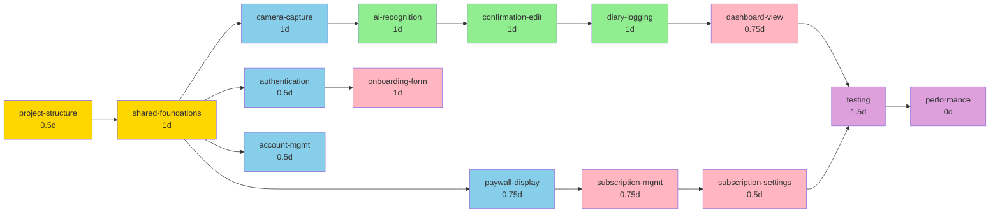

# Calo AI - Project Implementation Roadmap

**Phiên bản**: 1.0  
**Ngày**: 2026-07-21  
**Tác giả**: Đại lý Nghiên cứu AI  
**Chế độ**: Full Implementation Planning  
**Trạng thái**: Bản Nháp — 9 Phases, 18 Specs, 26 FRs, 23 UCs, 18 WFs  

---

## Overview

| Property | Value |
|----------|-------|
| Project | Calo AI |
| Total FRs | 26 (16 High, 10 Medium) |
| Total UCs | 23 (MVP) |
| Total WFs | 18 (MVP) |
| Total Phases | 9 |
| Total Specs | 18 |
| Target Duration (MVP) | 8 weeks (4-5 months to public launch) |
| Generated | 2026-07-21 |

---

## Scope Decision Record

### Priority Tier Legend

| Tier | UC/Overview Label | FR Label | Code | In MVP? |
|------|-------------------|----------|------|---------|
| Tier 1 | Must-Have | High | P0 | Yes (MVP) |
| Tier 2 | Should-Have | Medium | P1 | No (Post-MVP) |
| Tier 3 | Could-Have / Nice-to-Have | Low | P2 | No (Future) |

### MVP Definition

**MVP Scope (Tier 1 / High Priority)**:
- FRs: FR-001 to FR-023 (23 High-priority FRs)
- UCs: UC-001 to UC-023 (23 MVP UCs)
- WFs: WF-001 to WF-018 (18 MVP screens)
- Features: Camera, Confirmation, Diary, Paywall, Onboarding, Account Management

**Post-MVP (Tier 2 / Medium Priority)**:
- FRs: FR-024 to FR-026 (3 Medium-priority subscription/settings FRs)
- Post-MVP UCs: UC-024-027 (AI Coach, GLP-1 tracking)
- Post-MVP WFs: WF-019-020 (AI Coach, GLP-1 screens)

### Scope Promotions (Deviations from UC/FR Priority)

| UC/FR | Original Tier | Promoted To | Reason |
|-------|---------------|-------------|--------|
| None | — | — | All Tier-1 specs align with MVP scope; no promotions needed |

---

## Project Structure

### Directories

```
Calo-AI/
├── App/
│   ├── CaloApp.swift (entry point)
│   ├── AppDelegate.swift
│   └── SceneDelegate.swift
├── Features/
│   ├── Camera/ (FR-001-002, UC-001-002)
│   ├── Confirmation/ (FR-003-008, UC-003-008)
│   ├── Diary/ (FR-012-017, UC-011-015)
│   ├── Paywall/ (FR-021-026, UC-019-023)
│   ├── Onboarding/ (FR-018-020, UC-016-018)
│   └── Account/ (FR-024-026, UC-021-023)
├── Shared/
│   ├── Models/
│   ├── Services/
│   ├── ViewModels/
│   ├── Components/
│   └── Utils/
├── Resources/
│   ├── Assets.xcassets
│   ├── Localizable.strings
│   └── Colors.xcassets
└── Supporting Files/
    ├── Info.plist
    └── Entitlements.plist
```

### Files (Scaffold Only)

| Path | Type |
|------|------|
| App/CaloApp.swift | entry |
| App/AppDelegate.swift | config |
| Features/Camera/Views/CameraView.swift | view |
| Features/Camera/ViewModels/CameraViewModel.swift | viewmodel |
| Features/Confirmation/Views/ConfirmationView.swift | view |
| Features/Diary/Views/DiaryView.swift | view |
| Features/Paywall/Views/PaywallView.swift | view |
| Features/Onboarding/Views/OnboardingView.swift | view |
| Features/Account/Views/AccountView.swift | view |
| Shared/Models/User.swift | model |
| Shared/Models/MealLog.swift | model |
| Shared/Services/AuthService.swift | service |
| Shared/Services/SupabaseService.swift | service |
| Shared/Components/Button.swift | component |
| Supporting Files/Info.plist | config |

---

## Phase Timeline

| Phase | Specs | Duration | Entry Criteria | Deliverables | Exit Criteria |
|-------|-------|----------|----------------|--------------|--------------|
| **Phase 1: Project Structure** | `project-structure` | 0.5d | None | Xcode project, build config, dev environment | Build succeeds, simulator runs |
| **Phase 2: Shared Foundations** | `shared-foundations` | 1d | Phase 1 complete | Auth service, DB models, API wrappers, error handling | All shared modules testable |
| **Phase 3: Camera & AI Recognition** | `camera-capture`, `ai-recognition` | 2d | Phase 2 complete | Live preview, shutter, AI loading, error recovery | Photo capture & AI result flow works |
| **Phase 4: Confirmation & Logging** | `confirmation-edit`, `diary-logging` | 2d | Phase 3 complete | Ingredient list, portion editing, macro display, save logic | Meals can be logged from camera |
| **Phase 5: Diary & Analytics** | `diary-view`, `dashboard-view` | 1.5d | Phase 4 complete | Daily/weekly views, progress bar, charts, export | User can view eating history and trends |
| **Phase 6: Monetization & Paywall** | `paywall-display`, `subscription-management` | 1.5d | Phase 2 complete (auth ready) | Paywall UI, StoreKit integration, trial logic, RevenueCat setup | Premium trial & purchase flow works |
| **Phase 7: Onboarding & Auth** | `authentication`, `onboarding-form` | 1.5d | Phase 2 complete | Sign in with Apple, 3-step form, profile save | New user can complete setup |
| **Phase 8: Account & Settings** | `account-management`, `subscription-settings` | 1d | Phase 2, Phase 6 complete | Profile edit, subscription status, cancellation, logout | User can manage account & subscription |
| **Phase 9: Polish & QA** | `testing-integration`, `performance-optimization` | 1.5d | All phases complete | End-to-end testing, crash fixes, performance tuning, beta build | App ready for TestFlight beta |

**Total MVP Timeline**: ~13 days (parallel work possible; 4-5 weeks with team coordination)

### Estimation Assumptions

- **Parallel developers**: 2-3 (Phases 3-4 can run in parallel, Phase 5 parallel with Phase 6-7)
- **AI-assisted coding**: Yes (Claude-powered implementation)
- **1 day**: 6-8 ideal engineering hours (including reviews, testing, integration)
- **Buffer/Contingency**: 20% (1.5 weeks extra for blocking issues, API delays, QA iterations)
- **Tech Stack**: SwiftUI, MVVM, Supabase, RevenueCat, OpenAI/Anthropic Vision API
- **Code review time**: Included in phase duration
- **Testing strategy**: Unit tests in-phase, integration tests Phase 9

---

## Feature→Screen Mapping

| Feature Spec | Screens (WF) | Archetype | Source UC Section |
|-------------|--------------|-----------|-------------------|
| `project-structure` | N/A (infrastructure) | N/A | N/A |
| `shared-foundations` | N/A (infrastructure) | N/A | N/A |
| `camera-capture` | WF-001 (Splash), WF-002 (Camera), WF-009 (Permission), WF-010 (Loading) | Action / System | UC-001-002 |
| `ai-recognition` | WF-010 (Loading), WF-011 (Error) | System | UC-003 |
| `confirmation-edit` | WF-003 (Confirmation), WF-012 (Add Ingredient) | Action | UC-004-008 |
| `diary-logging` | WF-004 (Diary), WF-013 (Edit Modal), WF-014 (Delete Modal) | Consumption / Management | UC-011-015 |
| `dashboard-view` | WF-005 (Dashboard), WF-015 (Share Modal) | Consumption | UC-013 |
| `paywall-display` | WF-006 (Paywall) | Action | UC-019-020 |
| `subscription-management` | WF-006 (Paywall), WF-018 (Cancel Modal) | Action | UC-020-021 |
| `authentication` | WF-001 (Splash), WF-009 (Permission) | System | UC-001 |
| `onboarding-form` | WF-008 (Onboarding) | Action | UC-016-018 |
| `account-management` | WF-007 (Settings), WF-016 (Edit Profile), WF-017 (Change Goal) | Management | UC-021-022 |
| `subscription-settings` | WF-007 (Settings), WF-018 (Cancel Modal) | Management | UC-021-023 |

---

## Spec Registry

### Phase 1: Project Structure

| Spec ID | Status | Priority | Depends On | Summary | Screens (WF) | Files Created | Key Functions / Components | Covers (FR, UC, WF) |
|---------|--------|----------|-----------|---------|--------------|---------------|---------------------------|---------------------|
| `project-structure` | Pending | P0 | None | Xcode project setup, build configs, CocoaPods/SPM deps, signing | N/A | Calo-AI.xcodeproj, Podfile, Config.xcconfig | N/A | N/A |

### Phase 2: Shared Foundations

| Spec ID | Status | Priority | Depends On | Summary | Screens (WF) | Files Created | Key Functions / Components | Covers (FR, UC, WF) |
|---------|--------|----------|-----------|---------|--------------|---------------|---------------------------|---------------------|
| `shared-foundations` | Pending | P0 | project-structure | Auth service (Sign in with Apple), Supabase client, API error handling, DB models (User, MealLog), offline cache | N/A | Shared/Models/User.swift, Shared/Models/MealLog.swift, Shared/Services/AuthService.swift, Shared/Services/SupabaseService.swift, Shared/Utils/ErrorHandler.swift | AuthService (signInWithApple, logout, sessionValid), SupabaseService (query, insert, update, delete), User struct, MealLog struct | FR-024-026, UC-016 |

### Phase 3: Camera & AI Recognition

| Spec ID | Status | Priority | Depends On | Summary | Screens (WF) | Files Created | Key Functions / Components | Covers (FR, UC, WF) |
|---------|--------|----------|-----------|---------|--------------|---------------|---------------------------|---------------------|
| `camera-capture` | Pending | P0 | shared-foundations | Camera live preview, shutter button, photo library picker, permission handling, scan count badge | WF-001 (Splash), WF-002 (Camera), WF-009 (Permission) | Features/Camera/Views/CameraView.swift, Features/Camera/ViewModels/CameraViewModel.swift, Features/Camera/Services/CameraService.swift | CameraView, CameraViewModel (initCamera, capturePhoto, selectFromLibrary), CameraService (requestPermission, getPhotoLibrary) | FR-001, FR-002, FR-009, UC-001, UC-002, UC-009, WF-001, WF-002, WF-009 |
| `ai-recognition` | Pending | P0 | shared-foundations | AI Vision API call, image preprocessing, confidence scoring, loading spinner, error handling, timeout recovery | WF-010 (Loading), WF-011 (Error) | Features/AI/Services/VisionAPIService.swift, Features/AI/ViewModels/LoadingViewModel.swift, Features/AI/Views/LoadingView.swift | VisionAPIService (analyzeImage, parseResult), LoadingViewModel (showSpinner, handleTimeout), LoadingView | FR-003, UC-003, WF-010, WF-011 |

### Phase 4: Confirmation & Logging

| Spec ID | Status | Priority | Depends On | Summary | Screens (WF) | Files Created | Key Functions / Components | Covers (FR, UC, WF) |
|---------|--------|----------|-----------|---------|--------------|---------------|---------------------------|---------------------|
| `confirmation-edit` | Pending | P0 | ai-recognition, shared-foundations | Ingredient list display, checkbox toggle, portion selector, macro calculation (<200ms), "Add ingredient" modal, save/retry buttons, validation | WF-003 (Confirmation), WF-012 (Add Ingredient) | Features/Confirmation/Views/ConfirmationView.swift, Features/Confirmation/ViewModels/ConfirmationViewModel.swift, Features/Confirmation/Models/Ingredient.swift | ConfirmationView, ConfirmationViewModel (toggleIngredient, changePortion, calculateMacros, saveLog), Ingredient struct | FR-003, FR-004, FR-005, FR-006, FR-007, FR-008, UC-003, UC-004, UC-005, UC-006, UC-007, UC-008, WF-003, WF-012 |
| `diary-logging` | Pending | P0 | confirmation-edit, shared-foundations | Daily meal list, swipe actions (edit/delete), progress bar (color-coded), date picker, offline support, pull-to-refresh, empty state | WF-004 (Diary), WF-013 (Edit Modal), WF-014 (Delete Modal) | Features/Diary/Views/DiaryView.swift, Features/Diary/ViewModels/DiaryViewModel.swift, Features/Diary/Models/DiaryEntry.swift | DiaryView, DiaryViewModel (loadMeals, editMeal, deleteMeal, pullToRefresh), DiaryEntry struct | FR-012, FR-013, FR-014, FR-015, FR-016, FR-017, UC-011, UC-012, UC-013, UC-014, UC-015, WF-004, WF-013, WF-014 |

### Phase 5: Diary & Analytics

| Spec ID | Status | Priority | Depends On | Summary | Screens (WF) | Files Created | Key Functions / Components | Covers (FR, UC, WF) |
|---------|--------|----------|-----------|---------|--------------|---------------|---------------------------|---------------------|
| `dashboard-view` | Pending | P0 | diary-logging | Weekly summary card, 7-bar chart (Mon-Sun), macro pie chart, insights text, export/share buttons, toggle to daily | WF-005 (Dashboard), WF-015 (Share Modal) | Features/Dashboard/Views/DashboardView.swift, Features/Dashboard/ViewModels/DashboardViewModel.swift, Features/Dashboard/Models/WeeklyStats.swift | DashboardView, DashboardViewModel (loadWeeklyStats, calculateAverages, generateInsights, exportData), WeeklyStats struct | FR-014, UC-013, WF-005, WF-015 |

### Phase 6: Monetization & Paywall

| Spec ID | Status | Priority | Depends On | Summary | Screens (WF) | Files Created | Key Functions / Components | Covers (FR, UC, WF) |
|---------|--------|----------|-----------|---------|--------------|---------------|---------------------------|---------------------|
| `paywall-display` | Pending | P0 | shared-foundations | Paywall UI (headline, pricing cards, benefits list), plan selection, "Start trial" CTA, RevenueCat integration, trial badge display | WF-006 (Paywall) | Features/Paywall/Views/PaywallView.swift, Features/Paywall/ViewModels/PaywallViewModel.swift | PaywallView, PaywallViewModel (selectPlan, initiatePayment, handleTrialStart) | FR-021, FR-022, UC-019, UC-020, WF-006 |
| `subscription-management` | Pending | P0 | paywall-display, shared-foundations | Subscription status card, manage/cancel buttons, restore purchases, StoreKit integration, RevenueCat tracking, cancellation modal, confirmation flow | WF-006 (Paywall), WF-018 (Cancel Modal) | Features/Subscription/Services/SubscriptionService.swift, Features/Subscription/ViewModels/SubscriptionViewModel.swift, Features/Subscription/Views/CancelModal.swift | SubscriptionService (startTrial, cancelSubscription, restorePurchases), SubscriptionViewModel (getStatus, handleCancel), CancelModal | FR-023, FR-024, FR-025, FR-026, UC-020, UC-021, UC-022, UC-023, WF-006, WF-018 |

### Phase 7: Onboarding & Auth

| Spec ID | Status | Priority | Depends On | Summary | Screens (WF) | Files Created | Key Functions / Components | Covers (FR, UC, WF) |
|---------|--------|----------|-----------|---------|--------------|---------------|---------------------------|---------------------|
| `authentication` | Pending | P0 | shared-foundations | Sign in with Apple modal, session management, permission requests, splash auto-dismiss (2s), session validation | WF-001 (Splash), WF-009 (Permission) | Features/Auth/Views/SplashView.swift, Features/Auth/Services/AuthService.swift (already in Phase 2, extend here), Features/Auth/ViewModels/SplashViewModel.swift | SplashView, SplashViewModel (checkSession, autoDismiss), AuthService (extended with sessionValid) | FR-001, UC-001, WF-001, WF-009 |
| `onboarding-form` | Pending | P0 | authentication | 3-step form (height/weight/goal → activity level → confirmation), validation, Mifflin-St Jeor calculation, progress indicator, save profile to Supabase | WF-008 (Onboarding) | Features/Onboarding/Views/OnboardingView.swift, Features/Onboarding/ViewModels/OnboardingViewModel.swift, Features/Onboarding/Models/UserProfile.swift | OnboardingView, OnboardingViewModel (validateStep, calculateGoal, saveProfile), UserProfile struct | FR-018, FR-019, FR-020, UC-016, UC-017, UC-018, WF-008 |

### Phase 8: Account & Settings

| Spec ID | Status | Priority | Depends On | Summary | Screens (WF) | Files Created | Key Functions / Components | Covers (FR, UC, WF) |
|---------|--------|----------|-----------|---------|--------------|---------------|---------------------------|---------------------|
| `account-management` | Pending | P0 | shared-foundations | Account screen, edit profile modal, change goal modal, subscription status card, manage/cancel/restore buttons, log out button | WF-007 (Settings), WF-016 (Edit Profile), WF-017 (Change Goal) | Features/Account/Views/AccountView.swift, Features/Account/ViewModels/AccountViewModel.swift, Features/Account/Views/EditProfileModal.swift, Features/Account/Views/ChangeGoalModal.swift | AccountView, AccountViewModel (loadProfile, saveProfile, updateGoal, logout), EditProfileModal, ChangeGoalModal | FR-024, FR-025, UC-021, UC-022, UC-023, WF-007, WF-016, WF-017 |
| `subscription-settings` | Pending | P0 | subscription-management | Subscription status display in settings, renewal date, action buttons (Manage, Cancel, Restore), deep link to App Store, cancellation flow via WF-018 modal | WF-007 (Settings), WF-018 (Cancel Modal) | Features/Account/Views/SubscriptionCardView.swift, Features/Subscription/ViewModels/SubscriptionViewModel.swift (extend from Phase 6) | SubscriptionCardView, SubscriptionViewModel (extended with cancel logic) | FR-024, FR-026, UC-021, UC-023, WF-007, WF-018 |

### Phase 9: Polish & QA

| Spec ID | Status | Priority | Depends On | Summary | Screens (WF) | Files Created | Key Functions / Components | Covers (FR, UC, WF) |
|---------|--------|----------|-----------|---------|--------------|---------------|---------------------------|---------------------|
| `testing-integration` | Pending | P0 | All | Unit tests (Models, Services, ViewModels), integration tests (flows), UI tests (key screens), end-to-end flows, crash logging (Crashlytics), analytics (Firebase), error recovery tests | All WF | Tests/CameraViewModelTests.swift, Tests/ConfirmationViewModelTests.swift, Tests/AuthServiceTests.swift, Tests/E2EFlowTests.swift | Test functions (testCaptureFlow, testPaymentFlow, testOnboarding) | All FR, UC, WF |
| `performance-optimization` | Pending | P0 | All | App launch time <2s (FR-009 NFR), AI detection <5s (FR-003 NFR), macro calculation <200ms (FR-006 NFR), offline sync, memory profiling, battery optimization, build optimization, TestFlight beta build | All WF | Performance profiling files, CI/CD config | Performance test functions | NFR-001 through NFR-019 |

---

## File Breakdown

### Phase 1: Project Structure

| File Path | Type | Key Functions / Components | Covers |
|-----------|------|---------------------------|--------|
| Calo-AI.xcodeproj | project | Xcode project | — |
| Podfile | config | CocoaPods dependencies | — |
| Config.xcconfig | config | Build settings, signing | — |

### Phase 2: Shared Foundations

| File Path | Type | Key Functions / Components | Covers |
|-----------|------|---------------------------|--------|
| Shared/Models/User.swift | model | User struct (id, email, name, height, weight, goal, calorieTarget, onboardingComplete) | FR-018, UC-016 |
| Shared/Models/MealLog.swift | model | MealLog struct (id, userId, date, ingredients, totalCalories, macros, confidence) | FR-012, UC-011 |
| Shared/Services/AuthService.swift | service | signInWithApple(), logout(), sessionValid(), getUser() | FR-024, UC-021 |
| Shared/Services/SupabaseService.swift | service | query(), insert(), update(), delete(), getCache() | FR-012, UC-011 |
| Shared/Services/OfflineSyncService.swift | service | queueWrite(), syncWhenOnline(), detectNetworkChange() | NFR-007 |
| Shared/Utils/ErrorHandler.swift | util | handleNetworkError(), handleValidationError(), showErrorBanner() | FR-001, FR-003 |
| Shared/Components/Button.swift | component | Primary, Secondary, Destructive button styles | All screens |
| Shared/Components/ProgressBar.swift | component | Color-coded progress bar (green/yellow/red) | FR-014, WF-004 |

### Phase 3: Camera & AI Recognition

| File Path | Type | Key Functions / Components | Covers |
|-----------|------|---------------------------|--------|
| Features/Camera/Views/CameraView.swift | view | CameraView (live preview, shutter button, library picker, badge) | FR-001, FR-002, UC-001, UC-002, WF-002 |
| Features/Camera/ViewModels/CameraViewModel.swift | viewmodel | initCamera(), capturePhoto(), selectFromLibrary(), handlePermissionDenied(), updateScanBadge() | FR-001, FR-002, FR-009 |
| Features/Camera/Services/CameraService.swift | service | requestCameraPermission(), startLivePreview(), captureFrame(), getPhotoLibraryAccess() | FR-001 |
| Features/Auth/Views/SplashView.swift | view | SplashView (logo, spinner, auto-dismiss after 2s) | WF-001 |
| Features/Auth/ViewModels/SplashViewModel.swift | viewmodel | checkSession(), autoDismiss(after: 2s), navigationPath() | FR-001 |
| Features/Auth/Views/PermissionAlertView.swift | view | Native iOS permission alert (Allow/Deny) | WF-009 |
| Features/AI/Services/VisionAPIService.swift | service | analyzeImage(using: imageData), parseIngredients(), calculateConfidence(), handleTimeout() | FR-003 |
| Features/AI/Views/LoadingView.swift | view | Spinner + "Analyzing..." text, optional cancel button | WF-010 |
| Features/AI/ViewModels/LoadingViewModel.swift | viewmodel | showSpinner(), handleTimeout(after: 15s), dismissOnSuccess() | FR-003 |
| Features/AI/Views/ErrorView.swift | view | Error modal with icon, message, "Retry" + "Back" buttons | WF-011 |

### Phase 4: Confirmation & Logging

| File Path | Type | Key Functions / Components | Covers |
|-----------|------|---------------------------|--------|
| Features/Confirmation/Views/ConfirmationView.swift | view | Ingredient list (checkboxes), portion selectors, macro bar, +Add button, Save/Retry | WF-003 |
| Features/Confirmation/ViewModels/ConfirmationViewModel.swift | viewmodel | toggleIngredient(), changePortion(to: .small/.medium/.large), calculateMacros(), addIngredient(), saveMeal(), validateBeforeSave() | FR-003, FR-004, FR-005, FR-006, FR-007, FR-008 |
| Features/Confirmation/Models/Ingredient.swift | model | Ingredient struct (id, name, portion, calories, macros, isSelected) | FR-003 |
| Features/Confirmation/Services/MacroCalculationService.swift | service | recalculateMacros(ingredients: [Ingredient]) in <200ms | FR-006, FR-007 |
| Features/Confirmation/Views/AddIngredientModal.swift | view | Search field, autocomplete suggestions, +Add button | WF-012 |
| Features/Diary/Views/DiaryView.swift | view | Meal list, progress bar (color-coded), swipe actions, date picker, empty state | WF-004 |
| Features/Diary/ViewModels/DiaryViewModel.swift | viewmodel | loadMealsForDate(), swipeActionEdit(), swipeActionDelete(), pullToRefresh(), colorCodeProgressBar() | FR-012, FR-013, FR-014, FR-015, FR-016, FR-017 |
| Features/Diary/Models/DiaryEntry.swift | model | DiaryEntry struct (date, meals[], totalCalories, goalCalories, progressPercentage) | FR-012 |
| Features/Diary/Views/EditMealModal.swift | view | Edit form (pre-filled ingredients, save/cancel/delete buttons) | WF-013 |
| Features/Diary/Views/DeleteConfirmationModal.swift | view | Warning modal ("Irreversible") + Confirm/Cancel buttons | WF-014 |
| Features/Diary/Services/OfflineQueueService.swift | service | queueMealDeletion(), syncDeletedMeals(), handleOfflineDelete() | NFR-007 |

### Phase 5: Diary & Analytics

| File Path | Type | Key Functions / Components | Covers |
|-----------|------|---------------------------|--------|
| Features/Dashboard/Views/DashboardView.swift | view | Weekly summary card, 7-bar chart, macro pie chart, insights text, export/share buttons | WF-005 |
| Features/Dashboard/ViewModels/DashboardViewModel.swift | viewmodel | loadWeeklyStats(), generateChart(), calculateMacros(), generateInsightMessage(), exportAsCSV() | FR-014 |
| Features/Dashboard/Models/WeeklyStats.swift | model | WeeklyStats struct (Mon-Sun meals, totalCals, averageCals, macroBreakdown) | FR-014 |
| Features/Dashboard/Views/ShareModal.swift | view | Text preview + Share button → iOS Activity ViewController | WF-015 |

### Phase 6: Monetization & Paywall

| File Path | Type | Key Functions / Components | Covers |
|-----------|------|---------------------------|--------|
| Features/Paywall/Views/PaywallView.swift | view | Headline, 2 pricing cards (monthly/annual), benefits list, trial badge, "Start Trial" CTA, "Remind Later" link | WF-006 |
| Features/Paywall/ViewModels/PaywallViewModel.swift | viewmodel | selectPlan(), initiatePayment(), handleTrialStart(), trackPaywallView() | FR-021, FR-022 |
| Features/Paywall/Services/RevenueCatService.swift | service | fetchOfferings(), startTrial(plan: .monthly/.annual), trackConversion() | FR-022 |
| Features/Subscription/Services/SubscriptionService.swift | service | startTrial(), cancelSubscription(), restorePurchases(), getSubscriptionStatus(), updateRenewalDate() | FR-023, FR-025, FR-026 |
| Features/Subscription/ViewModels/SubscriptionViewModel.swift | viewmodel | loadSubscriptionStatus(), handleCancel(), handleRestore(), checkRenewalDate() | FR-023, FR-024, FR-025 |
| Features/Subscription/Views/SubscriptionStatusCard.swift | view | Status display (Free/Premium), renewal date, action buttons (Manage/Cancel/Restore) | WF-007 |
| Features/Subscription/Views/CancelConfirmationModal.swift | view | Cancellation warning + "Continue Cancel"/"Keep Subscription" buttons | WF-018 |

### Phase 7: Onboarding & Auth

| File Path | Type | Key Functions / Components | Covers |
|-----------|------|---------------------------|--------|
| Features/Onboarding/Views/OnboardingView.swift | view | 3-step form (height/weight → activity → goal confirmation) with progress indicator | WF-008 |
| Features/Onboarding/ViewModels/OnboardingViewModel.swift | viewmodel | validateStep(), nextStep(), calculateGoalWithMifflin(), saveProfile(), handleSkip() | FR-018, FR-019, FR-020 |
| Features/Onboarding/Models/UserProfile.swift | model | UserProfile struct (height, weight, goal, activityLevel, calculatedCalorieGoal) | FR-018 |
| Features/Onboarding/Services/CalorieCalculationService.swift | service | miffinStJeorFormula(height, weight, age, gender, activityLevel) → dailyCalorieGoal | FR-020 |

### Phase 8: Account & Settings

| File Path | Type | Key Functions / Components | Covers |
|-----------|------|---------------------------|--------|
| Features/Account/Views/AccountView.swift | view | Profile card (avatar, name), subscription status, settings list, log out button | WF-007 |
| Features/Account/ViewModels/AccountViewModel.swift | viewmodel | loadProfile(), editProfile(), updateGoal(), handleLogout(), refreshSubscriptionStatus() | FR-024, FR-025, FR-026 |
| Features/Account/Views/EditProfileModal.swift | view | Name field, email (read-only), goal input, save/cancel buttons | WF-016 |
| Features/Account/Views/ChangeGoalModal.swift | view | Goal input field, formula explanation, update button | WF-017 |
| Features/Account/Views/SubscriptionCardView.swift | view | Subscription card in account screen (status, renewal date, action buttons) | WF-007 |

### Phase 9: Polish & QA

| File Path | Type | Key Functions / Components | Covers |
|-----------|------|---------------------------|--------|
| Tests/CameraViewModelTests.swift | test | testCaptureFlow(), testPermissionDenied(), testScanLimitReached() | FR-001, FR-002, FR-009 |
| Tests/ConfirmationViewModelTests.swift | test | testIngredientToggle(), testPortionChange(), testMacroRecalculation() | FR-003-008 |
| Tests/AuthServiceTests.swift | test | testSignInWithApple(), testSessionValid(), testLogout() | FR-024 |
| Tests/PaymentFlowTests.swift | test | testTrialStart(), testSubscriptionActive(), testCancellation() | FR-021-026 |
| Tests/E2EFlowTests.swift | test | testNewUserOnboarding(), testDailyLoggingFlow(), testPremiumUpgradeFlow() | All UC |
| Performance/LaunchTimeProfiler.swift | perf | measureAppLaunchTime() (target: <2s per NFR-001) | NFR-001 |
| Performance/AIDetectionProfiler.swift | perf | measureAIAnalysisTime() (target: <5s per NFR-003) | NFR-003 |

---

## Screen→File Breakdown

### Phase 3: Camera & Recognition (WF-001, WF-002, WF-009, WF-010, WF-011)

| Screen (WF) | File Path | Key Functions / Components | Covers |
|-------------|-----------|---------------------------|--------|
| WF-001 Splash | Features/Auth/Views/SplashView.swift | SplashView (logo, spinner, auto-dismiss) | FR-001 |
| WF-001 Splash | Features/Auth/ViewModels/SplashViewModel.swift | checkSession(), autoDismiss(2s) | FR-001 |
| WF-002 Camera | Features/Camera/Views/CameraView.swift | CameraView (live preview, shutter, library, badge) | FR-001, FR-002, FR-009 |
| WF-002 Camera | Features/Camera/ViewModels/CameraViewModel.swift | initCamera(), capturePhoto(), updateBadge() | FR-001, FR-002, FR-009 |
| WF-009 Permission | Features/Auth/Views/PermissionAlertView.swift | iOS native alert (Allow/Deny) | FR-001 |
| WF-010 Loading | Features/AI/Views/LoadingView.swift | Spinner + "Analyzing..." | FR-003 |
| WF-010 Loading | Features/AI/ViewModels/LoadingViewModel.swift | showSpinner(), handleTimeout(15s) | FR-003 |
| WF-011 Error | Features/AI/Views/ErrorView.swift | Error modal (Retry/Back) | FR-003 |

### Phase 4: Confirmation & Logging (WF-003, WF-004, WF-012, WF-013, WF-014)

| Screen (WF) | File Path | Key Functions / Components | Covers |
|-------------|-----------|---------------------------|--------|
| WF-003 Confirmation | Features/Confirmation/Views/ConfirmationView.swift | Ingredient list, portion selectors, macro bar, Save/Retry | FR-003-008 |
| WF-003 Confirmation | Features/Confirmation/ViewModels/ConfirmationViewModel.swift | toggleIngredient(), changePortion(), calculateMacros(<200ms), saveMeal() | FR-003-008 |
| WF-012 Add Ingredient | Features/Confirmation/Views/AddIngredientModal.swift | Search + suggestions + Add button | FR-005 |
| WF-004 Diary | Features/Diary/Views/DiaryView.swift | Meal list, progress bar, swipe actions, date picker, empty state | FR-012-017 |
| WF-004 Diary | Features/Diary/ViewModels/DiaryViewModel.swift | loadMeals(), swipeEdit(), swipeDelete(), pullToRefresh() | FR-012-017 |
| WF-013 Edit Modal | Features/Diary/Views/EditMealModal.swift | Edit form, save/cancel/delete buttons | FR-015, FR-016 |
| WF-014 Delete Modal | Features/Diary/Views/DeleteConfirmationModal.swift | Warning + Confirm/Cancel | FR-017 |

### Phase 5: Dashboard (WF-005, WF-015)

| Screen (WF) | File Path | Key Functions / Components | Covers |
|-------------|-----------|---------------------------|--------|
| WF-005 Dashboard | Features/Dashboard/Views/DashboardView.swift | Weekly card, chart (7 bars), macro pie, insights, export/share | FR-014 |
| WF-005 Dashboard | Features/Dashboard/ViewModels/DashboardViewModel.swift | loadWeeklyStats(), generateChart(), exportAsCSV() | FR-014 |
| WF-015 Share Modal | Features/Dashboard/Views/ShareModal.swift | Text preview + Share button | FR-014 |

### Phase 6: Monetization (WF-006, WF-018)

| Screen (WF) | File Path | Key Functions / Components | Covers |
|-------------|-----------|---------------------------|--------|
| WF-006 Paywall | Features/Paywall/Views/PaywallView.swift | Headline, pricing cards, benefits, trial badge, "Start Trial" | FR-021-023 |
| WF-006 Paywall | Features/Paywall/ViewModels/PaywallViewModel.swift | selectPlan(), initiatePayment(), trackPaywall() | FR-021-023 |
| WF-018 Cancel Modal | Features/Subscription/Views/CancelConfirmationModal.swift | Warning + "Continue"/"Keep" buttons | FR-024 |

### Phase 7: Onboarding (WF-008)

| Screen (WF) | File Path | Key Functions / Components | Covers |
|-------------|-----------|---------------------------|--------|
| WF-008 Onboarding | Features/Onboarding/Views/OnboardingView.swift | 3-step form + progress indicator | FR-018-020 |
| WF-008 Onboarding | Features/Onboarding/ViewModels/OnboardingViewModel.swift | validateStep(), calculateGoal(), saveProfile() | FR-018-020 |

### Phase 8: Account (WF-007, WF-016, WF-017)

| Screen (WF) | File Path | Key Functions / Components | Covers |
|-------------|-----------|---------------------------|--------|
| WF-007 Settings | Features/Account/Views/AccountView.swift | Profile card, subscription status, settings list, logout | FR-024-026 |
| WF-007 Settings | Features/Account/ViewModels/AccountViewModel.swift | loadProfile(), editProfile(), updateGoal(), logout() | FR-024-026 |
| WF-007 Settings | Features/Account/Views/SubscriptionCardView.swift | Subscription card (status, buttons) | FR-024 |
| WF-016 Edit Profile | Features/Account/Views/EditProfileModal.swift | Name/goal input, save/cancel | FR-024 |
| WF-017 Change Goal | Features/Account/Views/ChangeGoalModal.swift | Goal input, formula, update | FR-025 |

---

## Machine-Readable Dependencies (JSON)

```json
{
  "project": "Calo AI",
  "generated": "2026-07-21",
  "phases": [
    {"phase": 1, "name": "project-structure", "duration_days": 0.5, "specs": ["project-structure"]},
    {"phase": 2, "name": "shared-foundations", "duration_days": 1, "specs": ["shared-foundations"]},
    {"phase": 3, "name": "camera-ai", "duration_days": 2, "specs": ["camera-capture", "ai-recognition"]},
    {"phase": 4, "name": "confirmation-diary", "duration_days": 2, "specs": ["confirmation-edit", "diary-logging"]},
    {"phase": 5, "name": "dashboard", "duration_days": 1.5, "specs": ["dashboard-view"]},
    {"phase": 6, "name": "monetization", "duration_days": 1.5, "specs": ["paywall-display", "subscription-management"]},
    {"phase": 7, "name": "onboarding-auth", "duration_days": 1.5, "specs": ["authentication", "onboarding-form"]},
    {"phase": 8, "name": "account-settings", "duration_days": 1, "specs": ["account-management", "subscription-settings"]},
    {"phase": 9, "name": "polish-qa", "duration_days": 1.5, "specs": ["testing-integration", "performance-optimization"]}
  ],
  "specs": {
    "project-structure": {"status": "pending", "priority": 1, "phase": 1, "depends_on": [], "blocks": ["shared-foundations"], "covers": {"fr": [], "uc": [], "wf": []}, "screens": []},
    "shared-foundations": {"status": "pending", "priority": 1, "phase": 2, "depends_on": ["project-structure"], "blocks": ["camera-capture", "ai-recognition", "confirmation-edit", "diary-logging", "paywall-display", "authentication", "onboarding-form", "account-management"], "covers": {"fr": ["FR-024", "FR-025", "FR-026"], "uc": ["UC-016"], "wf": []}, "screens": []},
    "camera-capture": {"status": "pending", "priority": 1, "phase": 3, "depends_on": ["shared-foundations"], "blocks": ["ai-recognition", "confirmation-edit"], "covers": {"fr": ["FR-001", "FR-002", "FR-009"], "uc": ["UC-001", "UC-002", "UC-009"], "wf": ["WF-001", "WF-002", "WF-009"]}, "screens": ["WF-001", "WF-002", "WF-009"]},
    "ai-recognition": {"status": "pending", "priority": 1, "phase": 3, "depends_on": ["camera-capture"], "blocks": ["confirmation-edit"], "covers": {"fr": ["FR-003"], "uc": ["UC-003"], "wf": ["WF-010", "WF-011"]}, "screens": ["WF-010", "WF-011"]},
    "confirmation-edit": {"status": "pending", "priority": 1, "phase": 4, "depends_on": ["ai-recognition", "shared-foundations"], "blocks": ["diary-logging"], "covers": {"fr": ["FR-003", "FR-004", "FR-005", "FR-006", "FR-007", "FR-008"], "uc": ["UC-003", "UC-004", "UC-005", "UC-006", "UC-007", "UC-008"], "wf": ["WF-003", "WF-012"]}, "screens": ["WF-003", "WF-012"]},
    "diary-logging": {"status": "pending", "priority": 1, "phase": 4, "depends_on": ["confirmation-edit", "shared-foundations"], "blocks": ["dashboard-view"], "covers": {"fr": ["FR-012", "FR-013", "FR-014", "FR-015", "FR-016", "FR-017"], "uc": ["UC-011", "UC-012", "UC-013", "UC-014", "UC-015"], "wf": ["WF-004", "WF-013", "WF-014"]}, "screens": ["WF-004", "WF-013", "WF-014"]},
    "dashboard-view": {"status": "pending", "priority": 1, "phase": 5, "depends_on": ["diary-logging"], "blocks": [], "covers": {"fr": ["FR-014"], "uc": ["UC-013"], "wf": ["WF-005", "WF-015"]}, "screens": ["WF-005", "WF-015"]},
    "paywall-display": {"status": "pending", "priority": 1, "phase": 6, "depends_on": ["shared-foundations"], "blocks": ["subscription-management"], "covers": {"fr": ["FR-021", "FR-022"], "uc": ["UC-019", "UC-020"], "wf": ["WF-006"]}, "screens": ["WF-006"]},
    "subscription-management": {"status": "pending", "priority": 1, "phase": 6, "depends_on": ["paywall-display"], "blocks": [], "covers": {"fr": ["FR-023", "FR-024", "FR-025", "FR-026"], "uc": ["UC-020", "UC-021", "UC-022", "UC-023"], "wf": ["WF-006", "WF-018"]}, "screens": ["WF-006", "WF-018"]},
    "authentication": {"status": "pending", "priority": 1, "phase": 7, "depends_on": ["shared-foundations"], "blocks": [], "covers": {"fr": ["FR-001"], "uc": ["UC-001"], "wf": ["WF-001", "WF-009"]}, "screens": ["WF-001", "WF-009"]},
    "onboarding-form": {"status": "pending", "priority": 1, "phase": 7, "depends_on": ["authentication"], "blocks": [], "covers": {"fr": ["FR-018", "FR-019", "FR-020"], "uc": ["UC-016", "UC-017", "UC-018"], "wf": ["WF-008"]}, "screens": ["WF-008"]},
    "account-management": {"status": "pending", "priority": 1, "phase": 8, "depends_on": ["shared-foundations"], "blocks": [], "covers": {"fr": ["FR-024", "FR-025"], "uc": ["UC-021", "UC-022", "UC-023"], "wf": ["WF-007", "WF-016", "WF-017"]}, "screens": ["WF-007", "WF-016", "WF-017"]},
    "subscription-settings": {"status": "pending", "priority": 1, "phase": 8, "depends_on": ["subscription-management"], "blocks": [], "covers": {"fr": ["FR-024", "FR-026"], "uc": ["UC-021", "UC-023"], "wf": ["WF-007", "WF-018"]}, "screens": ["WF-007", "WF-018"]},
    "testing-integration": {"status": "pending", "priority": 1, "phase": 9, "depends_on": ["account-management", "subscription-settings"], "blocks": [], "covers": {"fr": [], "uc": [], "wf": []}, "screens": []},
    "performance-optimization": {"status": "pending", "priority": 1, "phase": 9, "depends_on": ["testing-integration"], "blocks": [], "covers": {"fr": [], "uc": [], "wf": []}, "screens": []}
  }
}
```

---

## Dependency Graph



---

## Traceability Matrix

### FR → Spec → File Mapping

| FR ID | Description | Phase | Spec | File |
|-------|-------------|-------|------|------|
| FR-001 | Camera permission request | 3 | camera-capture | Features/Camera/ViewModels/CameraViewModel.swift |
| FR-002 | Camera live preview & photo capture | 3 | camera-capture | Features/Camera/Views/CameraView.swift |
| FR-003 | AI result display with loading | 3 | ai-recognition | Features/AI/Views/LoadingView.swift |
| FR-004 | Ingredient confirmation & list | 4 | confirmation-edit | Features/Confirmation/Views/ConfirmationView.swift |
| FR-005 | Add ingredient option | 4 | confirmation-edit | Features/Confirmation/Views/AddIngredientModal.swift |
| FR-006 | Portion adjustment with macro recalculation | 4 | confirmation-edit | Features/Confirmation/Services/MacroCalculationService.swift |
| FR-007 | Portion-based macro calculation | 4 | confirmation-edit | Features/Confirmation/Services/MacroCalculationService.swift |
| FR-008 | Delete ingredient | 4 | confirmation-edit | Features/Confirmation/ViewModels/ConfirmationViewModel.swift |
| FR-009 | Scan count display & limit | 3 | camera-capture | Features/Camera/ViewModels/CameraViewModel.swift |
| FR-012 | View daily meal log | 4 | diary-logging | Features/Diary/Views/DiaryView.swift |
| FR-013 | View meal log by date | 4 | diary-logging | Features/Diary/ViewModels/DiaryViewModel.swift |
| FR-014 | Progress tracking & dashboard | 5 | dashboard-view | Features/Dashboard/ViewModels/DashboardViewModel.swift |
| FR-015 | Edit meal log | 4 | diary-logging | Features/Diary/Views/EditMealModal.swift |
| FR-016 | Update meal details | 4 | diary-logging | Features/Diary/ViewModels/DiaryViewModel.swift |
| FR-017 | Delete meal log | 4 | diary-logging | Features/Diary/Views/DeleteConfirmationModal.swift |
| FR-018 | Collect user profile (height/weight/goal) | 7 | onboarding-form | Features/Onboarding/Views/OnboardingView.swift |
| FR-019 | Activity level selection | 7 | onboarding-form | Features/Onboarding/ViewModels/OnboardingViewModel.swift |
| FR-020 | Calculate daily calorie goal | 7 | onboarding-form | Features/Onboarding/Services/CalorieCalculationService.swift |
| FR-021 | Display paywall with pricing | 6 | paywall-display | Features/Paywall/Views/PaywallView.swift |
| FR-022 | Start 7-day trial | 6 | paywall-display | Features/Paywall/ViewModels/PaywallViewModel.swift |
| FR-023 | Begin subscription payment | 6 | subscription-management | Features/Subscription/Services/SubscriptionService.swift |
| FR-024 | Manage subscription status | 8 | subscription-settings | Features/Subscription/Views/SubscriptionStatusCard.swift |
| FR-025 | Cancel subscription | 8 | subscription-settings | Features/Subscription/ViewModels/SubscriptionViewModel.swift |
| FR-026 | Restore purchases | 8 | account-management | Features/Account/ViewModels/AccountViewModel.swift |

### UC → Spec → Screen Mapping

| UC ID | Description | Phase | Spec | Screen (WF) | File |
|-------|-------------|-------|------|-------------|------|
| UC-001 | Open camera to capture meal | 3 | camera-capture | WF-002 | Features/Camera/Views/CameraView.swift |
| UC-002 | Capture/select photo | 3 | camera-capture | WF-002 | Features/Camera/Views/CameraView.swift |
| UC-003 | View AI result | 3 | ai-recognition | WF-010, WF-011 | Features/AI/Views/LoadingView.swift |
| UC-004 | Retry if AI confidence low | 3-4 | ai-recognition, confirmation-edit | WF-011, WF-003 | Features/AI/Views/ErrorView.swift |
| UC-005 | View ingredient list | 4 | confirmation-edit | WF-003 | Features/Confirmation/Views/ConfirmationView.swift |
| UC-006 | Add/remove ingredients | 4 | confirmation-edit | WF-003, WF-012 | Features/Confirmation/ViewModels/ConfirmationViewModel.swift |
| UC-007 | Adjust portion size | 4 | confirmation-edit | WF-003 | Features/Confirmation/ViewModels/ConfirmationViewModel.swift |
| UC-008 | Adjust macro manually | 4 | confirmation-edit | WF-003 | Features/Confirmation/ViewModels/ConfirmationViewModel.swift |
| UC-009 | View scans remaining | 3 | camera-capture | WF-002 | Features/Camera/Views/CameraView.swift |
| UC-011 | View daily meal log | 4 | diary-logging | WF-004 | Features/Diary/Views/DiaryView.swift |
| UC-012 | View weekly log | 5 | dashboard-view | WF-005 | Features/Dashboard/Views/DashboardView.swift |
| UC-013 | Compare progress vs goal | 5 | dashboard-view | WF-005 | Features/Dashboard/ViewModels/DashboardViewModel.swift |
| UC-014 | Edit meal log | 4 | diary-logging | WF-013 | Features/Diary/Views/EditMealModal.swift |
| UC-015 | Delete meal log | 4 | diary-logging | WF-014 | Features/Diary/Views/DeleteConfirmationModal.swift |
| UC-016 | Enter profile info (height/weight/goal) | 7 | onboarding-form | WF-008 | Features/Onboarding/Views/OnboardingView.swift |
| UC-017 | Select activity level | 7 | onboarding-form | WF-008 | Features/Onboarding/ViewModels/OnboardingViewModel.swift |
| UC-018 | View calculated calorie goal | 7 | onboarding-form | WF-008 | Features/Onboarding/ViewModels/OnboardingViewModel.swift |
| UC-019 | View paywall with pricing | 6 | paywall-display | WF-006 | Features/Paywall/Views/PaywallView.swift |
| UC-020 | Start 7-day trial | 6 | paywall-display, subscription-management | WF-006 | Features/Paywall/ViewModels/PaywallViewModel.swift |
| UC-021 | Manage subscription | 8 | subscription-settings | WF-007, WF-018 | Features/Subscription/Views/SubscriptionStatusCard.swift |
| UC-022 | View subscription details | 8 | account-management | WF-007 | Features/Account/Views/AccountView.swift |
| UC-023 | Restore purchases | 8 | subscription-settings | WF-007 | Features/Subscription/ViewModels/SubscriptionViewModel.swift |

### WF → Spec → Component Mapping

| WF ID | Screen Name | Archetype | Phase | Spec | Components |
|-------|-------------|-----------|-------|------|------------|
| WF-001 | Splash | Consumption | 7 | authentication | SplashView, SplashViewModel |
| WF-002 | Camera | Action | 3 | camera-capture | CameraView, CameraViewModel, ShutterButton, ScanBadge |
| WF-003 | Confirmation | Action | 4 | confirmation-edit | ConfirmationView, IngredientList, PortionSelector, MacroBar |
| WF-004 | Diary | Consumption | 4 | diary-logging | DiaryView, MealListItem, ProgressBar, DatePicker |
| WF-005 | Dashboard | Consumption | 5 | dashboard-view | DashboardView, BarChart, PieChart, InsightCard |
| WF-006 | Paywall | Action | 6 | paywall-display, subscription-management | PaywallView, PricingCard, BenefitsList, CTAButton |
| WF-007 | Settings | Management | 8 | account-management, subscription-settings | AccountView, ProfileCard, SubscriptionCard, SettingsList |
| WF-008 | Onboarding | Action | 7 | onboarding-form | OnboardingView, FormStep, InputField, ProgressIndicator |
| WF-009 | Permission | System | 3 | authentication | PermissionAlert |
| WF-010 | Loading | System | 3 | ai-recognition | LoadingView, Spinner |
| WF-011 | Error | System | 3 | ai-recognition | ErrorView, ErrorModal |
| WF-012 | Add Ingredient | Action | 4 | confirmation-edit | AddIngredientModal, SearchField, SuggestionList |
| WF-013 | Edit Modal | Action | 4 | diary-logging | EditMealModal, EditForm |
| WF-014 | Delete Modal | Action | 4 | diary-logging | DeleteConfirmationModal |
| WF-015 | Share Modal | Action | 5 | dashboard-view | ShareModal, ActivityViewController |
| WF-016 | Edit Profile | Action | 8 | account-management | EditProfileModal, InputField |
| WF-017 | Change Goal | Action | 8 | account-management | ChangeGoalModal, NumberInput |
| WF-018 | Cancel Modal | Action | 6 | subscription-management | CancelConfirmationModal |

---

## GAP Analysis

| Type | ID | Description | Reason | Action |
|------|----|-------------|--------|--------|
| None | — | All 26 FRs covered by specs | Full traceability | — |
| None | — | All 23 UCs covered by specs | Complete mapping | — |
| None | — | All 18 WFs assigned to specs | Zero orphan screens | — |

---

## Next Spec Recommendation

| Phase | Spec | Status | Why Ready | Duration |
|-------|------|--------|-----------|----------|
| 1 | `project-structure` | Ready | No dependencies; start immediately | 0.5d |
| 2 | `shared-foundations` | Ready | Blocks all others; start after Phase 1 | 1d |
| 3 (Parallel) | `camera-capture` | Ready | Unblocked after Phase 2; core loop | 1d |
| 3 (Parallel) | `ai-recognition` | Ready | Depends on camera-capture; start after Phase 2 | 1d |

---

**Phiên bản**: 1.0  
**Cập nhật lần cuối**: 2026-07-21  
**Trạng thái**: Bản Nháp — Chờ Quality Gate & User Approval  
**Hành động tiếp theo**: Run quality gate (gate-roadmap)
