# Calo AI - UX Flows

**Phiên bản**: 1.0  
**Ngày**: 2026-07-21  
**Tác giả**: Đại lý Nghiên cứu AI  
**Chế độ**: Interactive User Journeys & State Flows  
**Trạng thái**: Bản Nháp — 5 Journeys + 18 Screens + 12 UX Enhancements  

---

## 1. Giới Thiệu

### 1.1 Mục Đích

Tài liệu này định nghĩa **cách người dùng điều hướng** giữa các màn hình trong Calo AI, bao gồm:
- High-level user journeys (new user, returning user, premium user)
- Screen-to-screen navigation flows với Mermaid diagrams
- State transitions (loading, error, success)
- UX enhancement patterns (pull-to-refresh, skeleton loading, error recovery, v.v.)
- Accessibility flows (VoiceOver, Dynamic Type)
- Error handling & recovery paths

Mỗi flow kết nối trực tiếp đến wireframe screens (WF-XXX) từ Wireframes.md.

### 1.2 Phạm Vi

- **Screens Coverage**: Tất cả 18 WF-XXX từ Wireframes MVP phải xuất hiện trong ≥1 flow
- **Journeys**: 5 main user journeys (New User Onboarding, Returning User Core Loop, Premium Upgrade, Edit/Share, Settings)
- **UX Enhancements**: 12 patterns (Pull-to-Refresh, Skeleton, Empty State, Error+Retry, Haptic, Swipe, Onboarding, IAP, Alert, Dialog, Bottom Sheet, Snackbar)
- **Error Recovery**: Mọi error state có explicit recovery path

### 1.3 Ký Hiệu Luồng

**Mermaid Diagram Conventions**:
- **Hộp tròn `([...])` hoặc `[[...]]`**: Screen/View (WF-XXX)
- **Hình thoi `{...}`**: Decision point (condition)
- **Mũi tên `-->`**: Chuyển cơ bản (normal navigation)
- **Mũi tên `-..->`**: Optional path hoặc edge case
- **Mũi tên `==>`**: Primary / happy path

**Color Coding**:
- 🟢 `#90EE90` (Xanh lá): Success / happy path
- 🔴 `#FFB6C1` (Hồng): Error / failure / recovery
- 🔵 `#87CEEB` (Xanh dương): Normal navigation
- 🟡 `#FFE4B5` (Vàng): Warning / confirmation

---

## 2. High-Level User Journeys

### 2.1 New User Onboarding Journey

**Actor**: Mass-Market Diet Novice (người dùng lần đầu)  
**Mục tiêu**: Khởi tạo hồ sơ, hiểu core loop, hoàn thành onboarding

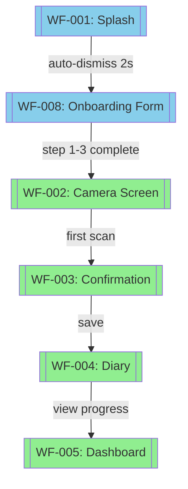

**Luồng Chi Tiết**:
1. App khởi động → WF-001 Splash (auto-dismiss sau 2s)
2. Hiển thị WF-008 Onboarding (Bước 1: chiều cao/cân → Bước 2: mức hoạt động → Bước 3: xác nhận mục tiêu)
3. User nhấn "Sẵn sàng bắt đầu" → Điều hướng đến WF-002 Camera
4. Chụp ảnh bữa ăn → WF-003 Confirmation (xác nhận nguyên liệu, adjust portions)
5. Save → WF-004 Diary (log hôm nay)
6. Optional: Xem WF-005 Dashboard (tuần tổng hợp)

**Trạng Thái Điều Hướng**: 
- Success: Mỗi bước hoàn thành → next step
- Error (Onboarding): Invalid input → show error hint, stay on step
- Error (Photo): AI không nhận diện → WF-011 Error modal → WF-002 Retry

**Thời gian ước tính**: 2-3 phút (onboarding + 1 scan)

**Screens từ Wireframes**: WF-001, WF-008, WF-002, WF-003, WF-004, WF-005, WF-011

---

### 2.2 Returning User Daily Core Loop

**Actor**: Người dùng quay lại (có dữ liệu)  
**Mục tiêu**: Ghi log bữa ăn nhanh, xem tiến độ

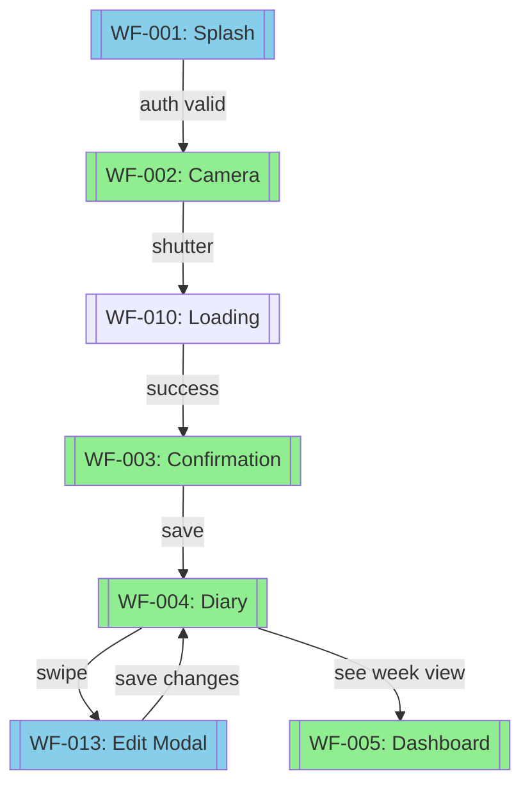

**Luồng Chi Tiết**:
1. App khởi động → WF-001 Splash (2s) → Session valid → WF-002 Camera
2. User bấm shutter → WF-010 Loading (spinner, "Đang phân tích...")
3. AI trả kết quả → WF-003 Confirmation (ingredient list, portions)
4. Người dùng điều chỉnh (nếu cần) hoặc nhấn Save → WF-004 Diary (log được thêm)
5. Xem danh sách bữa ăn hôm nay → có thể vuốt để Edit → WF-013 Edit Modal
6. Điều chỉnh log trong modal → Save → quay lại WF-004
7. Optional: Toggle sang WF-005 Dashboard để xem tổng hợp tuần

**Trạng Thái Điều Hướng**:
- Success: Mỗi action → next screen
- Error (AI): Confidence < 30% → WF-011 Error modal → "Thử lại" → WF-002
- Timeout (AI >15s): WF-010 → WF-011 Error

**Thời gian ước tính**: 30s - 1 phút mỗi lần ghi log

**Screens**: WF-001, WF-002, WF-010, WF-003, WF-004, WF-013, WF-005, WF-011

---

### 2.3 Free User Hit Limit → Premium Upgrade

**Actor**: Người dùng free đã dùng hết 3 lượt scan  
**Mục tiêu**: Nhận ra giới hạn, nâng cấp subscription

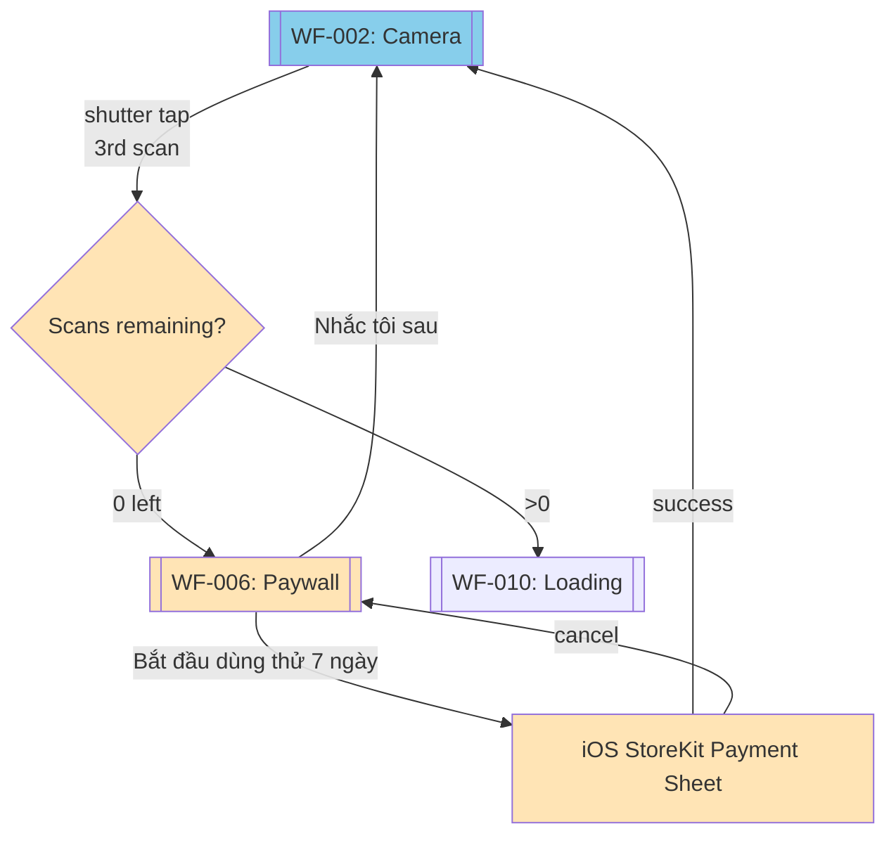

**Luồng Chi Tiết**:
1. User ở WF-002 Camera, đã dùng 2/3 scan hôm nay
2. Bấm shutter lần 3 → System check "scans remaining?"
3. If 0 left → Hiển thị WF-006 Paywall overlay (full-screen modal)
4. Paywall shows: "Unlock Unlimited Scans", 7-day free badge, 2 pricing options ($9.99/mo, $39.99/yr)
5. User tap "Bắt đầu dùng thử 7 ngày" → Trigger iOS StoreKit Payment Sheet
6. Payment success → Dismiss Paywall, return to WF-002 (unlimited scans now)
7. Payment cancel → Stay on WF-006, allow "Remind me later" → Back to WF-002 (limited scans still)

**Trạng Thái Điều Hướng**:
- Payment success: WF-006 dismiss → WF-002 with premium flag
- Payment cancel: WF-006 persist, show "Remind me" option
- "Remind me later": WF-006 dismiss → WF-002, limit remains

**Thời gian ước tính**: 30s - 2 min (payment sheet varies)

**Screens**: WF-002, WF-006, WF-010

---

### 2.4 Edit/Manage Past Logs

**Actor**: Người dùng muốn chỉnh sửa/xoá bữa ăn trước đó  
**Mục tiêu**: Sửa nguyên liệu/portions hoặc xoá log sai

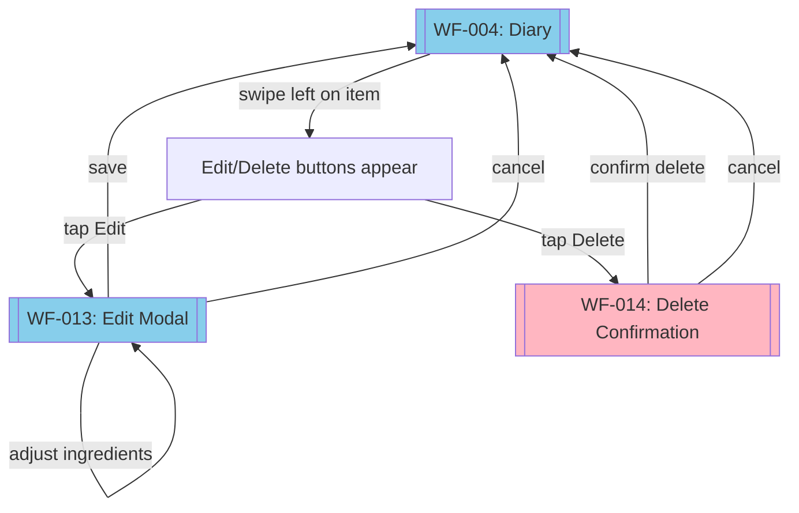

**Luồng Chi Tiết**:
1. User ở WF-004 Diary, xem danh sách bữa ăn hôm nay/quá khứ
2. Vuốt trái trên meal item → Reveal "Edit" & "Delete" buttons
3. Path A (Edit):
   - Tap Edit → WF-013 Edit Modal opens (pre-filled form)
   - Adjust ingredients (add/remove/portion change)
   - Tap Save → Validate → Update DB → Dismiss modal → Refresh WF-004
   - Tap Cancel → Dismiss modal, discard changes
4. Path B (Delete):
   - Tap Delete → WF-014 Delete Confirmation (warning modal)
   - Tap "Xoá" → Delete from DB → Dismiss → Refresh WF-004 with toast "Deleted"
   - Tap "Huỷ" → Dismiss, keep meal

**Trạng Thái Điều Hướng**:
- Edit save success: WF-013 close → WF-004 refresh
- Edit cancel: WF-013 close → WF-004 no change
- Delete confirm: WF-014 close → WF-004 refresh with toast
- Delete cancel: WF-014 close → WF-004 no change

**Thời gian ước tính**: 15-30s mỗi action

**Screens**: WF-004, WF-013, WF-014, WF-015 (optional share after edit)

---

### 2.5 Settings & Account Management

**Actor**: Người dùng muốn quản lý hồ sơ, subscription, hoặc logout  
**Mục tiêu**: Chỉnh sửa profile, quản lý subscription, huỷ account

```mermaid
flowchart TD
    TAB["Tab Bar: Account"] -->|tap| WF007[["WF-007: Settings"]]
    WF007 -->|tap avatar| WF016[["WF-016: Edit Profile Modal"]]
    WF016 -->|save| WF007
    WF007 -->|tap "Change Goal"| WF017[["WF-017: Change Goal Modal"]]
    WF017 -->|update| WF007
    WF007 -->|tap "Manage Subscription"| APPSTORE["Open App Store (deep link)"]
    WF007 -->|tap "Cancel"| WF018[["WF-018: Cancel Confirmation Modal"]]
    WF018 -->|confirm cancel| WF007
    WF007 -->|tap "Log out"| CONFIRM["Confirm dialog"]
    CONFIRM -->|yes| WF001[["WF-001: Splash (logged out)"]]
    CONFIRM -->|no| WF007
    
    style WF007 fill:#87CEEB
    style WF016 fill:#87CEEB
    style WF017 fill:#87CEEB
    style WF018 fill:#FFB6C1
    style APPSTORE fill:#FFE4B5
```

**Luồng Chi Tiết**:
1. User ở main tabs (Camera/Diary) → Tap Account tab → WF-007 Settings
2. WF-007 displays: Avatar + Name, Subscription status card, Settings sections
3. Actions:
   - Tap avatar → WF-016 Edit Profile modal (edit name/goal) → Save → WF-007
   - Tap "Change Goal" → WF-017 Change Goal modal (input new calo) → Update → WF-007
   - Tap "Manage Subscription" → Deep link to App Store subscription page (external, doesn't close app)
   - Tap "Cancel subscription" → WF-018 Cancel Confirmation (warning: will lose premium) → Confirm → Update subscription status → WF-007
   - Tap "Log out" → Show iOS alert "Are you sure?" → Confirm → Clear auth → Navigate to WF-001

**Trạng Thái Điều Hướng**:
- Edit success: modal close → WF-007 refresh
- Edit cancel: modal close → WF-007 no change
- Cancel subscription confirm: WF-018 close → WF-007 subscription status updated
- Logout confirm: Clear session → WF-001

**Thời gian ước tính**: 30s-1min

**Screens**: WF-007, WF-016, WF-017, WF-018, WF-001 (logout)

---

## 3. Screen Navigation Flows

### 3.1 WF-001: Splash Screen Flow

**Nguồn**: Wireframes.md WF-001

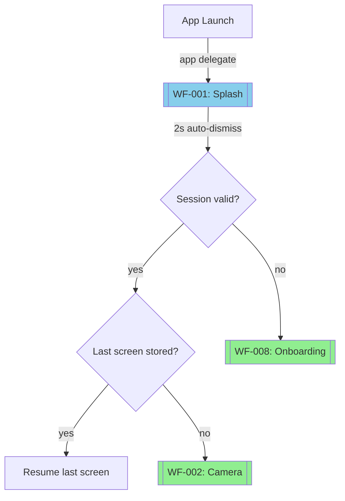

**User Actions**:
- None (automatic flow)

**Entry**: App launch  
**Exit**: WF-008 (new user) | WF-002 (returning user, no stored screen) | Last screen (returning user with session)

**Error Handling**:
- Auth check fails (corrupted token) → Force to WF-008 Onboarding
- Network unavailable during splash → Continue with cached session if available, else WF-008

---

### 3.2 WF-002: Camera Screen Flow

**Nguồn**: Wireframes.md WF-002

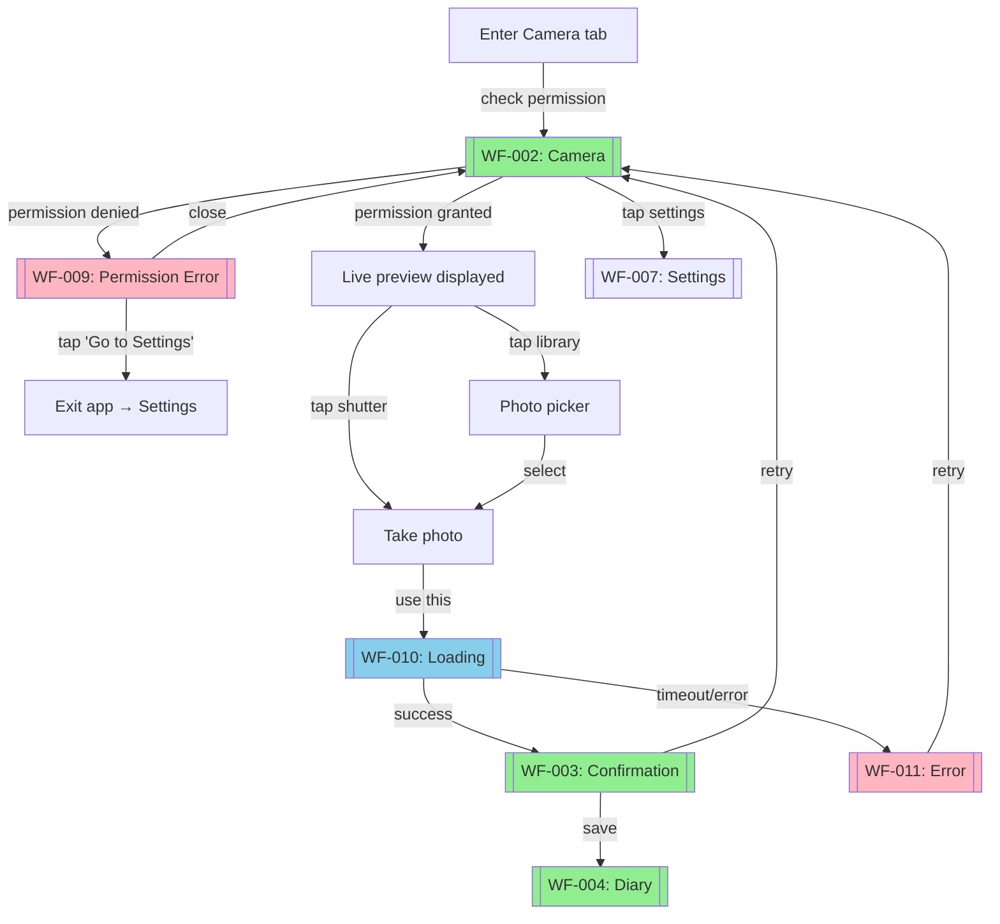

**User Actions**:
- Tap shutter button → Capture photo
- Tap photo library icon → Pick from Photos
- Tap settings icon → Go to WF-007
- Tap badge "2/3 scans" → Show tooltip "Unlimited with Premium"

**Entry**: User taps Camera tab OR comes back from WF-003/WF-011  
**Exit**: WF-003 (photo captured) | WF-010 (loading AI) | WF-007 (settings) | WF-009 (permission denied)

**States**:
- Permission not granted → Show permission error
- Scans limit approaching (2/3) → Badge highlighted yellow
- Scans over limit (3/3) → Shutter disabled, show "Upgrade" overlay → WF-006 Paywall

---

### 3.3 WF-003: Confirmation Screen Flow

**Nguồn**: Wireframes.md WF-003

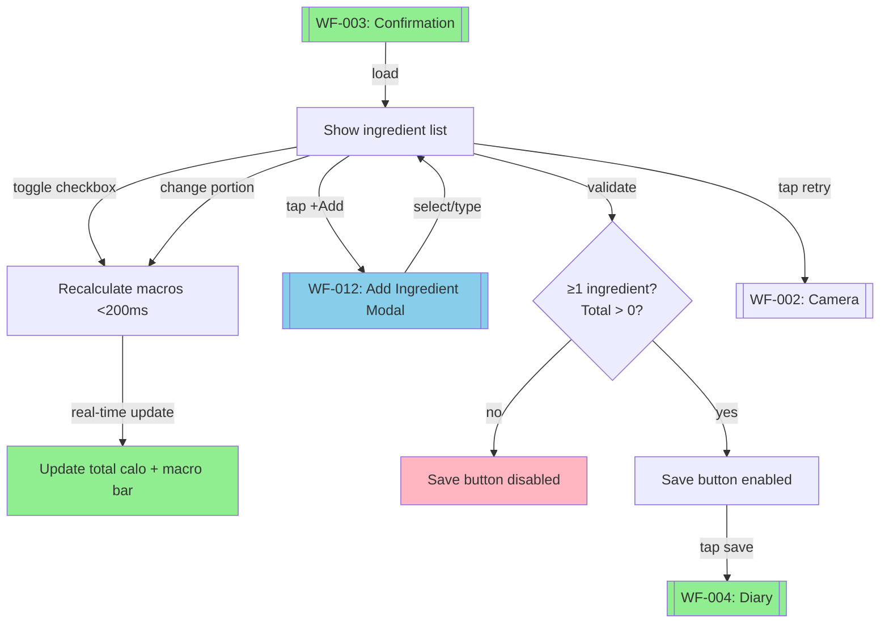

**User Actions**:
- Toggle ingredient checkbox → Remove/add from total
- Change portion (Small/Medium/Large) → Adjust multiplier (0.75x/1.0x/1.25x)
- Tap "+Add ingredient" → Open WF-012 modal to add custom ingredient
- Tap Save → Validate (≥1 ingredient, total > 0) → Store in DB → Navigate to WF-004
- Tap "Retry photo" → Back to WF-002 (discard current)

**Entry**: WF-010 Loading completes → AI returns result  
**Exit**: WF-004 (save) | WF-002 (retry)

**States**:
- High confidence (>80%) → No warning banner
- Low confidence (<70%) → Yellow warning "Not confident. Please verify."
- All ingredients unchecked → Save disabled
- Empty total → Save disabled

---

### 3.4 WF-004: Diary Screen Flow

**Nguồn**: Wireframes.md WF-004

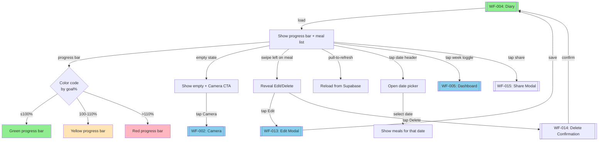

**User Actions**:
- View progress bar (color-coded)
- Swipe left on meal → Edit or Delete
- Pull-to-refresh → Reload meals
- Tap date → Pick different date
- Tap share icon → WF-015 Share modal
- Tap "Week view" → Toggle to WF-005 Dashboard

**Entry**: WF-003 Save completes | Return from other screens | App launch (if last screen)  
**Exit**: WF-013 (edit) | WF-014 (delete) | WF-005 (week view) | WF-015 (share) | WF-002 (add meal)

**States**:
- Empty → Show "No meals logged" + Camera CTA
- Has meals ≤100% goal → Green bar, encouraging message
- 100-110% → Yellow bar, "Getting close to goal"
- >110% → Red bar, "Over goal"
- Offline → Show "Last synced X min ago" banner

---

### 3.5 WF-005: Dashboard Screen Flow

**Nguồn**: Wireframes.md WF-005

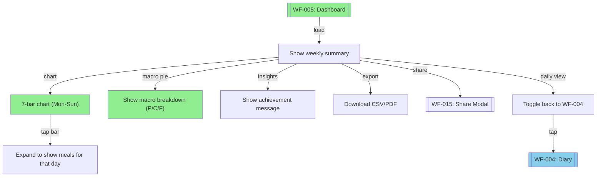

**User Actions**:
- View weekly summary chart
- Tap bar → Expand to see daily meals
- View macro pie chart
- Tap export → Download CSV or PDF
- Tap share → WF-015 Share modal
- Tap "Daily view" → Back to WF-004

**Entry**: WF-004 tap week toggle | Swipe right (if implemented)  
**Exit**: WF-004 (daily toggle) | WF-015 (share)

**States**:
- First week (no data) → Empty state "Log meals to see weekly trends"
- On track → Green indicators, congratulatory message
- Over average → Orange indicators, gentle caution

---

### 3.6 WF-006: Paywall Screen Flow

**Nguồn**: Wireframes.md WF-006

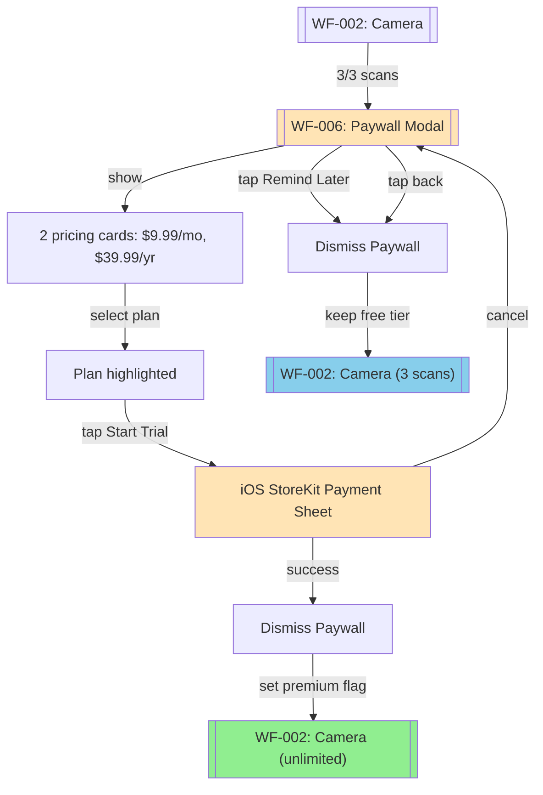

**User Actions**:
- View pricing options
- Select plan (monthly or annual, defaults to monthly)
- Tap "Start 7-day trial" → Trigger StoreKit payment
- Tap "Remind me later" → Close paywall, keep using free tier
- Tap back button → Close paywall

**Entry**: WF-002 shutter tap when scans exhausted  
**Exit**: WF-002 (premium after payment) | WF-002 (free tier after cancel)

**States**:
- Initial → Monthly plan selected by default
- After payment success → Premium user, scans reset to unlimited
- After payment cancel → Free user, limited scans remain
- Already premium → Show "Manage subscription" button instead

---

### 3.7 WF-007: Settings Screen Flow

**Nguồn**: Wireframes.md WF-007

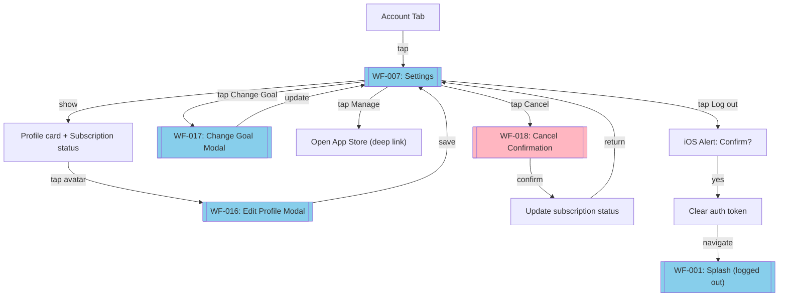

**User Actions**:
- Tap profile avatar → Edit profile (WF-016)
- Tap "Change Goal" → Edit goal (WF-017)
- Tap "Manage subscription" → External (App Store)
- Tap "Cancel" → Confirm cancellation (WF-018)
- Tap "Log out" → Confirm logout

**Entry**: Tap Account tab from anywhere  
**Exit**: WF-016/017/018 modals (return to WF-007) | APPSTORE (external) | WF-001 (logout)

**States**:
- Premium user → Show renewal date, Manage/Cancel buttons
- Free user → Show "Upgrade to Premium" button
- No subscription (restored from backup) → Show "Restore purchases" option

---

### 3.8 WF-008: Onboarding Flow

**Nguồn**: Wireframes.md WF-008

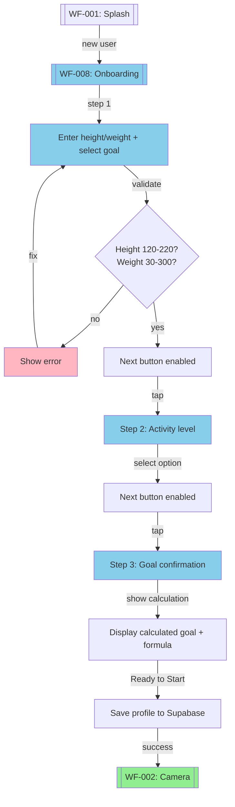

**User Actions (3-Step Form)**:
- Step 1: Enter height (numeric), weight (numeric), select goal (Lose/Maintain/Gain)
- Step 2: Select activity level (Sedentary/Light/Moderate/Very Active)
- Step 3: Review calculated daily goal, tap "Ready to start"

**Entry**: WF-001 Splash (new user after first launch)  
**Exit**: WF-002 (complete onboarding)

**States**:
- Step invalid → Error message, Next disabled
- Step valid → Next enabled
- Calculating goal → Spinner on Step 3
- Form complete → Ready to start enabled

---

### 3.9 WF-009: Permission Request Modal Flow

**Nguồn**: Wireframes.md WF-009

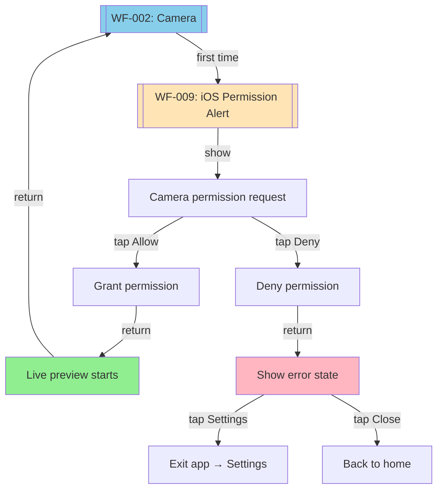

**User Actions**:
- Allow → Permission granted, camera preview starts
- Deny → Permission denied, show error

**Entry**: First tap on Camera tab (permission not yet requested)  
**Exit**: Permission alert dismisses (system native)

**States**:
- Permission granted → WF-002 with live preview
- Permission denied → WF-002 with error state "Camera access required"

---

### 3.10 WF-010: AI Loading Modal Flow

**Nguồn**: Wireframes.md WF-010

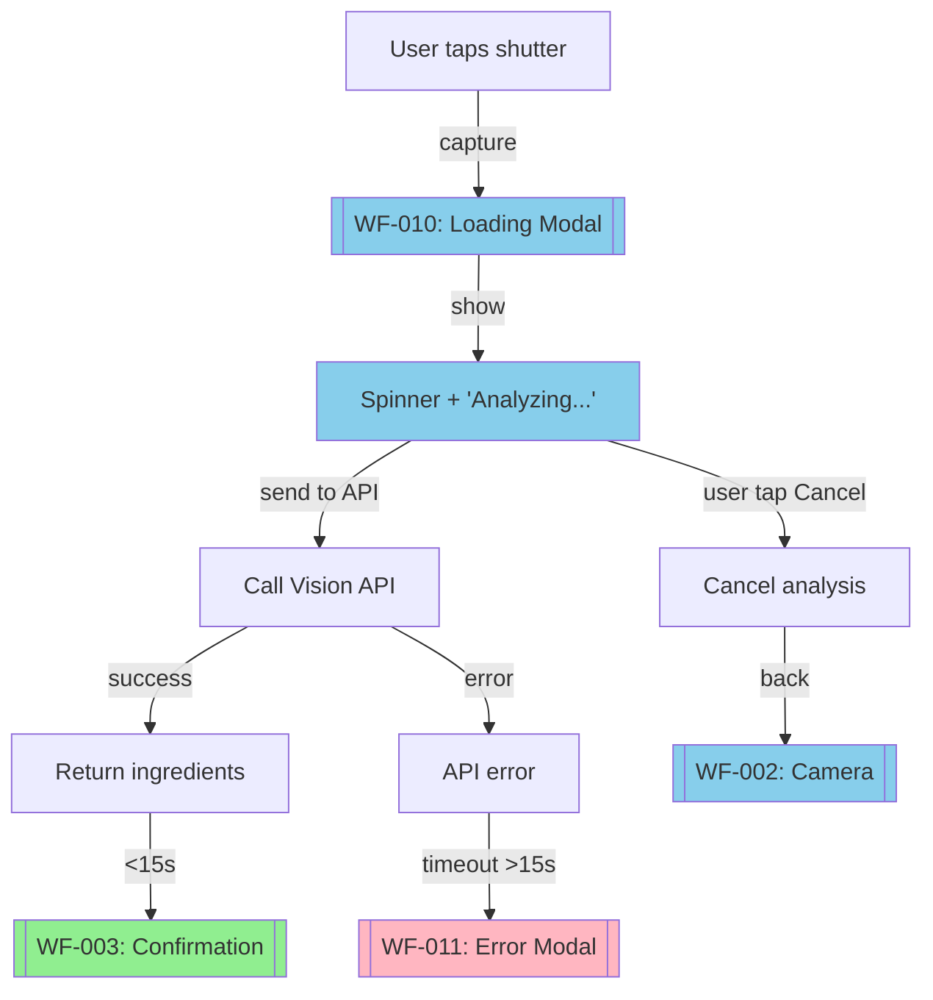

**User Actions**:
- Wait for analysis (auto-dismiss on success)
- Tap "Cancel" → Abort analysis, return to WF-002

**Entry**: WF-002 Shutter/Photo library → Photo selected  
**Exit**: WF-003 (success) | WF-011 (error/timeout) | WF-002 (cancel)

**States**:
- Processing → Spinner visible, indeterminate
- Timeout (>15s) → Show error, suggest retry
- Success → Dismiss modal, show WF-003

---

### 3.11 WF-011: Error Modal Flow

**Nguồn**: Wireframes.md WF-011

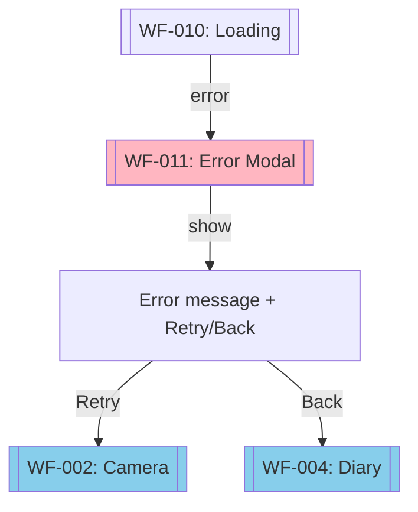

**User Actions**:
- Tap "Thử lại" → Return to WF-002 (don't consume scan)
- Tap "Quay lại" → Return to WF-004 (diary)

**Entry**: WF-010 error (confidence < 30%, timeout, API failure)  
**Exit**: WF-002 (retry) | WF-004 (back)

---

### 3.12 WF-012: Add Ingredient Modal Flow

**Nguồn**: Wireframes.md WF-012

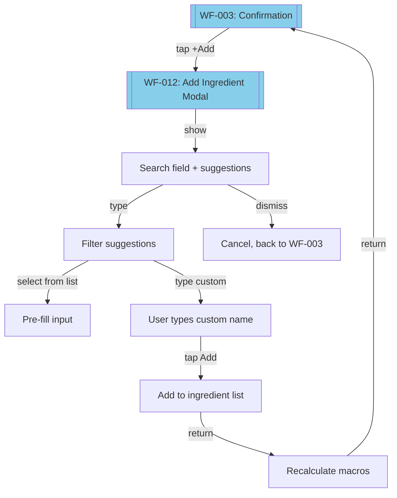

**User Actions**:
- Type ingredient name → Filter suggestions
- Select suggestion → Pre-fill
- Type custom ingredient → Add
- Tap Add → Add to list, recalculate, close modal

**Entry**: WF-003 tap "+Add ingredient"  
**Exit**: WF-003 (ingredient added) | WF-003 (cancel)

---

### 3.13 WF-013: Edit Modal Flow

**Nguồn**: Wireframes.md WF-013

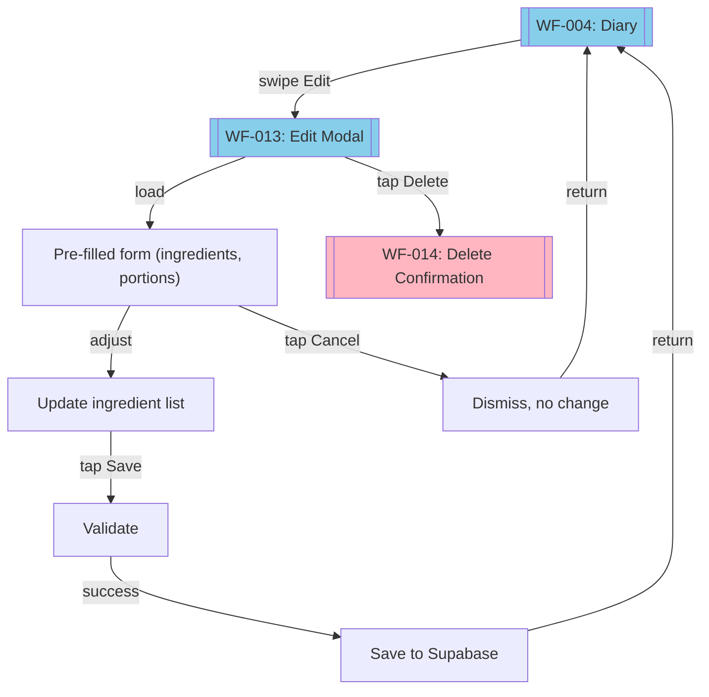

**User Actions**:
- Adjust ingredients (add/remove/portions)
- Tap Save → Validate → Update → Close
- Tap Cancel → Dismiss
- Tap "Delete Meal" → WF-014 Delete confirmation

**Entry**: WF-004 swipe Edit  
**Exit**: WF-004 (save) | WF-004 (cancel) | WF-014 (delete)

---

### 3.14 WF-014: Delete Confirmation Modal Flow

**Nguồn**: Wireframes.md WF-014

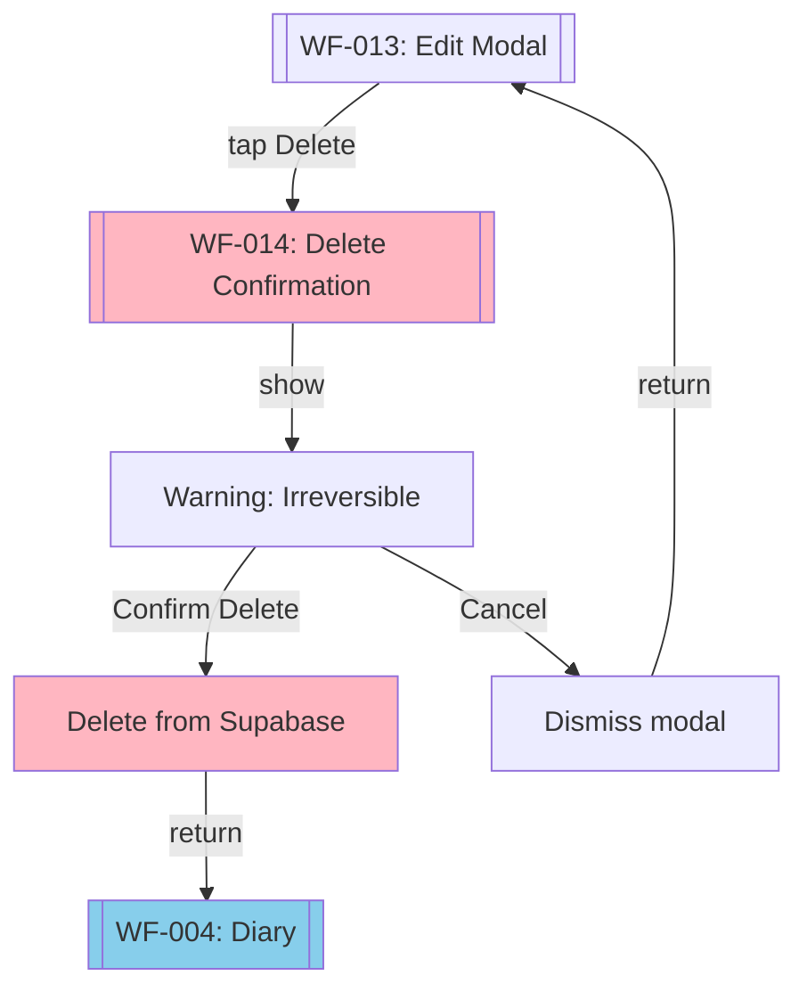

**User Actions**:
- Tap "Xoá" → Delete, show toast, close all modals
- Tap "Huỷ" → Cancel, return to WF-013

**Entry**: WF-013 tap Delete button  
**Exit**: WF-004 (delete success, show toast) | WF-013 (cancel)

---

### 3.15 WF-015: Share Modal Flow

**Nguồn**: Wireframes.md WF-015

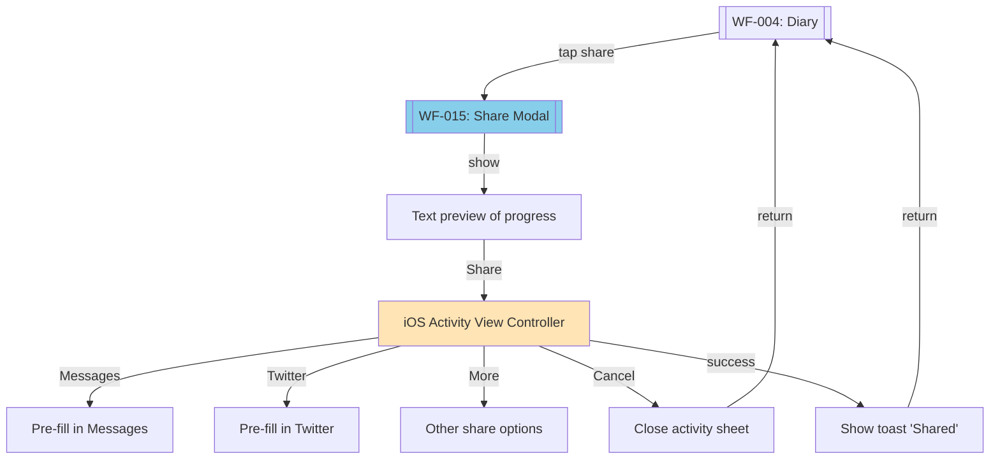

**User Actions**:
- View progress text preview
- Tap Share → OS activity sheet appears
- Select app (Messages, Twitter, etc.)
- Confirm → Share posted
- Cancel → Close sheet

**Entry**: WF-004 or WF-005 tap share icon  
**Exit**: WF-004/WF-005 (share complete or cancel)

---

### 3.16 WF-016: Edit Profile Modal Flow

**Nguồn**: Wireframes.md WF-016

```mermaid
flowchart TD
    WF007[["WF-007: Settings"]] -->|tap avatar| WF016[["WF-016: Edit Profile Modal"]]
    WF016 -->|show| FORM["Name field (editable), Email (read-only), Goal (editable)"]
    FORM -->|edit| UPDATE["Update fields"]
    UPDATE -->|tap Save| VALIDATE["Validate"]
    VALIDATE -->|success| SAVE["Save to Supabase"]
    SAVE -->|return| WF007
    FORM -->|tap Cancel| CANCEL["Dismiss, no change"]
    CANCEL -->|return| WF007
    
    style WF007 fill:#87CEEB
    style WF016 fill:#87CEEB
```

**User Actions**:
- Edit name, goal
- Tap Save → Validate → Update
- Tap Cancel → Discard

**Entry**: WF-007 tap avatar  
**Exit**: WF-007 (save) | WF-007 (cancel)

---

### 3.17 WF-017: Change Goal Modal Flow

**Nguồn**: Wireframes.md WF-017

```mermaid
flowchart TD
    WF007[["WF-007: Settings"]] -->|tap Change Goal| WF017[["WF-017: Change Goal Modal"]]
    WF017 -->|show| FORM["Input new daily goal + formula explanation"]
    FORM -->|enter value| INPUT["Number input"]
    INPUT -->|validate| CHECK{>0 & <10000?}
    CHECK -->|no| ERROR["Show error"]
    ERROR -->|fix| INPUT
    CHECK -->|yes| ENABLED["Update button enabled"]
    ENABLED -->|tap| SAVE["Save new goal"]
    SAVE -->|return| WF007
    FORM -->|tap Cancel| CANCEL["Dismiss, no change"]
    CANCEL -->|return| WF007
    
    style WF007 fill:#87CEEB
    style WF017 fill:#87CEEB
```

**User Actions**:
- Enter new goal value
- Tap Update → Save
- Tap Cancel → Discard

**Entry**: WF-007 tap "Change Goal"  
**Exit**: WF-007 (update) | WF-007 (cancel)

---

### 3.18 WF-018: Cancel Subscription Modal Flow

**Nguồn**: Wireframes.md WF-018

```mermaid
flowchart TD
    WF007[["WF-007: Settings"]] -->|tap Cancel| WF018[["WF-018: Cancel Confirmation"]]
    WF018 -->|show| WARNING["Warning: Lose Premium, keep access until renewal date"]
    WARNING -->|Continue Cancel| CALL["Call StoreKit API"]
    CALL -->|success| UPDATE["Update subscription status"]
    UPDATE -->|return| WF007
    UPDATE -->|show toast| TOAST["'Subscription cancelled'"]
    WARNING -->|Keep Subscription| CANCEL["Dismiss modal"]
    CANCEL -->|return| WF007
    
    style WF018 fill:#FFB6C1
    style WARNING fill:#FFB6C1
    style UPDATE fill:#FFB6C1
```

**User Actions**:
- Review cancellation details (loses premium, keeps until renewal)
- Tap "Tiếp tục Huỷ" → Process cancellation via StoreKit
- Tap "Giữ Subscription" → Cancel modal, keep subscription

**Entry**: WF-007 tap "Cancel" button  
**Exit**: WF-007 (cancel subscription success) | WF-007 (keep subscription)

---

## 3.5 UX Enhancement Flows

### 3.5.1 Pull-to-Refresh Flow (WF-004, WF-005)

**Trigger**: User pulls down on scrollable content  
**Screens**: WF-004 Diary, WF-005 Dashboard

```mermaid
flowchart TD
    SCROLL["User pulls down"] -->|spring refresh| HAPTIC["Light haptic feedback"]
    HAPTIC -->|trigger| REFRESH["Spinner appears"]
    REFRESH -->|fetch| API["Fetch from Supabase"]
    API -->|success| UPDATE["Update meal list"]
    UPDATE -->|dismiss| DONE["Spinner disappears"]
    API -->|error| ERROR["Show error toast"]
    ERROR -->|retry available| DONE
    
    style REFRESH fill:#87CEEB
    style UPDATE fill:#90EE90
    style ERROR fill:#FFB6C1
```

**Implementation**: SwiftUI `.refreshable` modifier on ScrollView

---

### 3.5.2 Skeleton Loading Flow (WF-004, WF-005, WF-010)

**Trigger**: Screens loading with placeholder  
**Screens**: WF-004 Diary (meal list), WF-005 Dashboard (chart, stats), WF-010 Loading (AI analysis)

**Pattern**: 
- Show placeholder card (shimmer gray background)
- Animate shimmer left-to-right 1.5s loop
- On data arrive, replace skeleton with real content

**Implementation**: Gradient animation using SwiftUI `.mask()` with animated gradient

---

### 3.5.3 Empty State Flow (WF-004 no meals, WF-005 first week)

**Trigger**: Screen loaded with no data  
**Screens**: WF-004 (no meals), WF-005 (first week, no logs)

```mermaid
flowchart TD
    LOAD["Screen loads"] -->|check data| EMPTY{Data empty?}
    EMPTY -->|yes| PLACEHOLDER["Show empty illustration"]
    PLACEHOLDER -->|show| MSG["'No meals logged yet'"]
    MSG -->|show| CTA["Tap Camera to add one"]
    CTA -->|tap| WF002[["WF-002: Camera"]]
    EMPTY -->|no| CONTENT["Show content normally"]
    
    style EMPTY fill:#FFE4B5
    style PLACEHOLDER fill:#FFE4B5
    style WF002 fill:#87CEEB
```

---

### 3.5.4 Error + Retry Flow (WF-011, Network errors)

**Trigger**: API fails, AI analysis fails, network error  
**Screens**: WF-011 Error modal, WF-004 offline banner, WF-010 timeout

```mermaid
flowchart TD
    ERROR["Error occurs"] -->|show| MSG["Error message"]
    MSG -->|show| RETRY["Retry button"]
    RETRY -->|tap| ATTEMPT["Retry action"]
    ATTEMPT -->|success| SUCCESS["Show success toast"]
    ATTEMPT -->|error again| MSG
    MSG -->|no retry| BACK["Back button"]
    BACK -->|tap| PREV["Return to previous"]
    
    style ERROR fill:#FFB6C1
    style RETRY fill:#FFB6C1
    style SUCCESS fill:#90EE90
```

---

### 3.5.5 Swipe Actions Flow (WF-004 edit/delete)

**Trigger**: User swipes left on meal item  
**Screens**: WF-004 Diary

```mermaid
flowchart TD
    SWIPE["Swipe left on meal"] -->|reveal| BUTTONS["Edit/Delete buttons appear"]
    BUTTONS -->|Edit| WF013[["WF-013: Edit Modal"]]
    BUTTONS -->|Delete| WF014[["WF-014: Delete Confirmation"]]
    BUTTONS -->|swipe right/tap elsewhere| HIDE["Hide buttons"]
    
    style BUTTONS fill:#87CEEB
    style WF013 fill:#87CEEB
    style WF014 fill:#FFB6C1
```

**Implementation**: SwiftUI `.swipeActions()` modifier on List rows

---

### 3.5.6 Onboarding Animation Flow (WF-001, WF-008)

**Trigger**: App launch (WF-001), Onboarding step transitions (WF-008)  
**Screens**: WF-001 Splash, WF-008 Onboarding

**Pattern**:
- WF-001: Fade-out animation 0.3s after 2s delay
- WF-008: Slide-up transition 0.3s on step change, spring damping 0.8

**Implementation**: SwiftUI transition modifiers (`.transition(.opacity)`, `.transition(.move())`)

---

### 3.5.7 IAP Purchase Flow (WF-006 Paywall)

**Trigger**: User taps "Start 7-day trial" on Paywall  
**Screens**: WF-006 Paywall

```mermaid
flowchart TD
    PAYWALL[["WF-006: Paywall"]] -->|tap trial| PAYMENT["iOS StoreKit Sheet"]
    PAYMENT -->|show| PRODUCTS["Load subscription products"]
    PRODUCTS -->|display| PRICES["Monthly & Annual options"]
    PRICES -->|user select| SELECT["Plan selected"]
    SELECT -->|confirm| PURCHASE["Process purchase"]
    PURCHASE -->|success| SUCCESS["Dismiss paywall, grant premium"]
    PURCHASE -->|error| ERROR["Show error, allow retry"]
    PURCHASE -->|cancel| CANCEL["Keep paywall, user cancels"]
    CANCEL -->|return| PAYWALL
    
    style PAYWALL fill:#FFE4B5
    style PAYMENT fill:#FFE4B5
    style SUCCESS fill:#90EE90
    style ERROR fill:#FFB6C1
```

---

### 3.5.8 Alert / Dialog Flow (Confirmations)

**Trigger**: User action requires confirmation (logout, delete, cancel)  
**Screens**: Various (WF-007 logout, WF-014 delete, WF-018 cancel)

**Pattern**: iOS native UIAlertController or SwiftUI .alert() with 2-3 buttons (Confirm, Cancel, optional secondary)

---

### 3.5.9 Bottom Sheet Modal Flow (WF-013 Edit, WF-016 Profile, WF-017 Goal)

**Trigger**: User taps edit action  
**Screens**: WF-013, WF-016, WF-017

**Pattern**: Slide-up from bottom, 0.3s transition, dismiss with swipe-down or cancel button

**Implementation**: SwiftUI `.sheet()` or custom modal presentation

---

### 3.5.10 Snackbar / Toast Flow (Action feedback)

**Trigger**: Action completes (save, delete, share)  
**Screens**: All screens with async actions

**Pattern**: Short message appears bottom-center or top, auto-dismiss after 3s or manual dismiss

**Implementation**: Custom Toast view with animation

---

### 3.5.11 Haptic Feedback Flow

**Trigger**: Key interactions (pull-to-refresh, shutter tap, delete confirm)  
**Screens**: Multiple

**Pattern**: 
- Light haptic on pull-to-refresh
- Medium haptic on shutter tap
- Heavy haptic on delete confirm

**Implementation**: `UIImpactFeedbackGenerator` or SwiftUI `.sensoryFeedback()`

---

### 3.5.12 Dynamic Type Support Flow

**Trigger**: User changes text size in settings  
**Screens**: All screens

**Pattern**: All text scales with `.font(.system(.body))` or named styles, supporting 75% - 200% size

**Implementation**: SwiftUI automatically adapts with `.font()` scaling

---

## 4. Navigation Patterns

### 4.1 Tab Navigation

**Screens**: WF-002 (Camera), WF-004 (Diary), WF-007 (Account)

```mermaid
flowchart LR
    CAMERA[["Camera<br/>WF-002"]] -.->|tab switch| DIARY[["Diary<br/>WF-004"]]
    DIARY -.->|tab switch| ACCOUNT[["Account<br/>WF-007"]]
    ACCOUNT -.->|tab switch| CAMERA
```

**Rules**:
- 3 persistent tabs at bottom (Tab Bar 49pt)
- Each tab maintains its own navigation stack
- Badge on Camera shows scan count
- Badge on Account shows subscription status

---

### 4.2 Modal Presentation

**Modals**: WF-009 (permission), WF-010 (loading), WF-011 (error), WF-012 (add ingredient), WF-013 (edit), WF-014 (delete), WF-015 (share), WF-016 (profile), WF-017 (goal), WF-018 (cancel)

**Rules**:
- Most modals: Bottom sheet (half-screen) with dismiss swipe-down
- System alerts (permission, logout): iOS native
- Loading overlay (WF-010): Full-screen modal, can't dismiss (must wait or tap cancel)
- Error modals (WF-011, WF-014): Centered modal with confirm buttons

---

### 4.3 Navigation Stack (Push-based)

**Applies to**: Single-screen journeys where forward navigation dominates

- WF-001 → WF-008 → WF-002 (onboarding flow)
- WF-002 → WF-010 → WF-003 (photo capture flow)

**Rules**:
- Back button navigates to parent screen
- Tab switch from within clears stack to root

---

## 5. Error Handling Flows

### 5.1 Network Error Flow

**Applies to**: WF-004 Diary (pull-to-refresh), WF-010 AI loading, WF-003 save

```mermaid
flowchart TD
    ACTION["User action triggers network call"] -->|check| NET{Network available?}
    NET -->|no| OFFLINE["Show offline banner"]
    OFFLINE -->|load cached| DATA["Load cached data from DB"]
    DATA -->|display| VIEW["Show screen with cached data"]
    NET -->|yes| CALL["Make API call"]
    CALL -->|timeout| RETRY["Show retry + details"]
    CALL -->|success| SHOW["Show fresh data"]
    
    style OFFLINE fill:#FFE4B5
    style DATA fill:#87CEEB
    style RETRY fill:#FFB6C1
```

---

### 5.2 Validation Error Flow

**Applies to**: WF-008 Onboarding, WF-003 Confirmation (save), WF-017 Change Goal

```mermaid
flowchart TD
    USER["User enters data"] -->|submit| VALIDATE["Validate input"]
    VALIDATE -->|invalid| ERROR["Show error message"]
    ERROR -->|explain| HINT["Specific error hint"]
    HINT -->|fix| USER
    VALIDATE -->|valid| SUCCESS["Enable submit button"]
    
    style ERROR fill:#FFB6C1
    style HINT fill:#FFB6C1
    style SUCCESS fill:#90EE90
```

---

## 6. Loading States

### 6.1 Initial Load

**Applies to**: WF-004, WF-005 on first open

**Pattern**: Skeleton loading for ~1-2s, then replace with content

---

### 6.2 Pull-to-Refresh

**Applies to**: WF-004 Diary, WF-005 Dashboard

**Pattern**: Spinner during refresh, light haptic on pull, dismiss on completion

---

### 6.3 Skeleton Loading

**Applies to**: WF-004 meal list, WF-005 charts, WF-010 AI loading

**Pattern**: Gray placeholder shapes, shimmer animation, replace on load

---

## 7. Offline Support

### 7.1 Offline Mode Flow

```mermaid
flowchart TD
    ACTION["User action"] -->|check| NET{Network?}
    NET -->|no| BANNER["Show offline banner"]
    BANNER -->|read| CACHE["Load cached data"]
    ACTION -->|write| QUEUE["Queue write to local DB"]
    QUEUE -->|monitor| ONLINE{Network restored?}
    ONLINE -->|yes| SYNC["Auto-sync queued writes"]
    SYNC -->|success| CLEAR["Clear queue"]
    SYNC -->|error| RETRY["Show retry"]
    
    style BANNER fill:#FFE4B5
    style QUEUE fill:#87CEEB
    style SYNC fill:#90EE90
```

**Rules**:
- Show "Last synced X min ago" banner on WF-004/WF-005 when offline
- Cache meal logs locally (SQLite)
- Queue all writes (insert, update, delete) in SQLite
- Auto-sync when network returns
- Show toast on sync complete/error

---

## 8. Accessibility Flows

### 8.1 VoiceOver Navigation

**Applies to**: All screens

**Pattern**:
- All buttons/inputs have `.accessibilityLabel()` and `.accessibilityHint()`
- Reading order: top-to-bottom, left-to-right
- Custom actions for gestures (swipe-left → Edit/Delete)
- State announcements (progress bar percentage, loading state)

**Examples**:
- WF-002 shutter: "Capture photo" (label) + "Double-tap to capture meal photo" (hint)
- WF-004 progress bar: "Progress: 1800 out of 2000 calories, 90 percent" (announcement)

---

## 9. Onboarding & Tutorials

### 9.1 First-Time User Experience

**Based on**: WF-001 Splash → WF-008 Onboarding → WF-002 Camera

**Flow**:
1. Splash screen with brand (2s auto-dismiss)
2. Onboarding form collects profile data
3. Completes → Lands on Camera screen with hint "Chụp từ trên xuống cho kết quả tốt nhất"
4. First scan → AI result → Confirmation with hint "Điều chỉnh khẩu phần nếu cần"
5. Save → Diary with congratulatory message "Bữa ăn đầu tiên của bạn được ghi log!"

---

## 10. Performance Considerations

### 10.1 Optimistic UI Updates

**Applies to**: WF-003 save, WF-004 edit/delete, WF-013 edit

**Pattern**:
1. Update UI immediately (optimistic)
2. Send API request in background
3. If successful → No change (UI already updated)
4. If failed → Revert UI, show error with retry

**Example** (WF-004 delete):
1. User taps Delete → Meal disappears from list immediately
2. Send delete request to Supabase
3. Success → Toast "Xoá thành công", list stays updated
4. Failure → Toast "Xoá thất bại, thử lại", meal reappears, show retry

---

## 11. Flow Summary

### 11.1 Critical Paths

| Journey | Screens | Priority | Duration |
|---------|---------|----------|----------|
| New User Onboarding | WF-001 → WF-008 → WF-002 → WF-003 → WF-004 | High | 2-3 min |
| Daily Core Loop | WF-002 → WF-010 → WF-003 → WF-004 | High | 30-60s |
| Premium Upgrade | WF-002 → WF-006 → Payment → WF-002 | High | 30-120s |
| Edit/Delete Logs | WF-004 → WF-013 → WF-004 | Medium | 15-30s |
| Settings/Account | WF-007 → WF-016/017/018 | Medium | 30-60s |

### 11.2 Screen Coverage

| Screen | Journeys | Role | Critical Path |
|--------|----------|------|----------------|
| WF-001 Splash | All (entry point) | System initialization | Yes |
| WF-002 Camera | Daily Core, New User, Upgrade | Core action | Yes |
| WF-003 Confirmation | Daily Core, New User | Confirmation before log | Yes |
| WF-004 Diary | Daily Core, Edit/Delete, Share | Main consumption view | Yes |
| WF-005 Dashboard | Daily Core (optional), View trends | Analytics & insights | Medium |
| WF-006 Paywall | Premium Upgrade | Monetization gate | Yes |
| WF-007 Settings | Account Management | User preferences & subscription | Medium |
| WF-008 Onboarding | New User | Profile setup | Yes |
| WF-009 Permission | Camera access | System gating | Yes |
| WF-010 Loading | Daily Core, New User | AI processing | Yes |
| WF-011 Error | Daily Core, Error recovery | Error state | Yes |
| WF-012 Add Ingredient | Edit workflows | Ingredient management | Medium |
| WF-013 Edit Modal | Edit/Delete, Daily Core | Log editing | Medium |
| WF-014 Delete Confirmation | Edit/Delete | Destructive confirmation | Medium |
| WF-015 Share | Optional engagement | Social sharing | Low |
| WF-016 Edit Profile | Account Management | Profile editing | Low |
| WF-017 Change Goal | Account Management | Goal management | Low |
| WF-018 Cancel Subscription | Account Management | Subscription management | Low |

**Coverage Rule**: ✅ All 18 screens present in ≥1 flow

---

## 12. Future Enhancements

### 12.1 Planned Flows (Post-MVP)

- **Social Login Flow**: Sign in with Apple, Google (vs. current Apple-only)
- **AI Coach Chat Flow**: Interactive meal recommendations & coaching (WF-019)
- **GLP-1 Tracking Flow**: Medication reminder & symptom logging (WF-020)
- **Advanced Search Flow**: Filter meals by ingredient, date range
- **Batch Operations Flow**: Select multiple meals, bulk delete/export
- **Share to Social Flow**: Direct sharing to Instagram, Twitter, WhatsApp
- **Integration Flow**: Apple HealthKit data sync, fitness app integrations

---

**Phiên bản**: 1.0  
**Cập nhật lần cuối**: 2026-07-21  
**Trạng thái**: Bản Nháp — Chờ Quality Gate & User Approval  
**Hành động tiếp theo**: Run quality gate (gate-flows)
