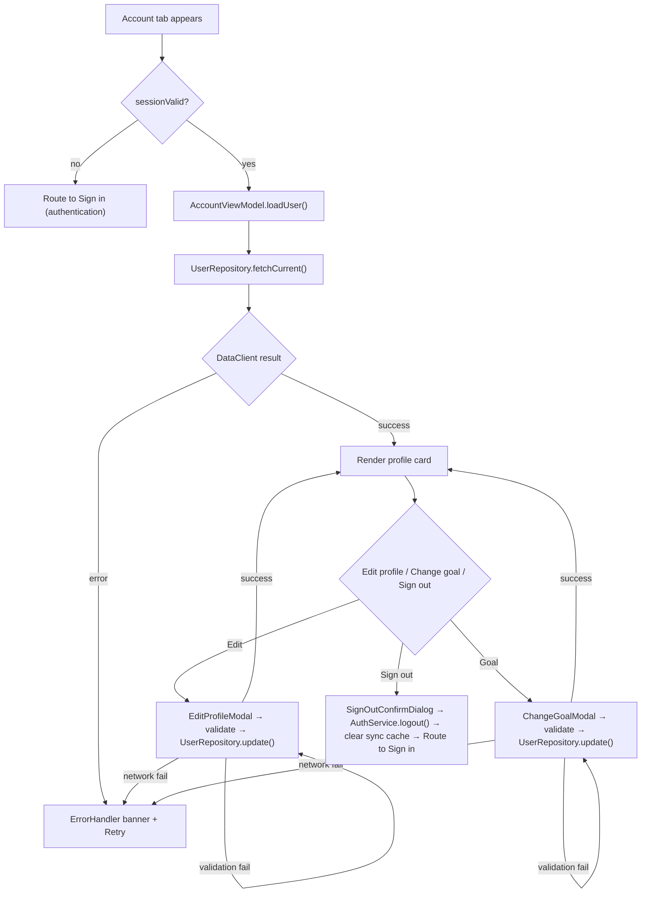
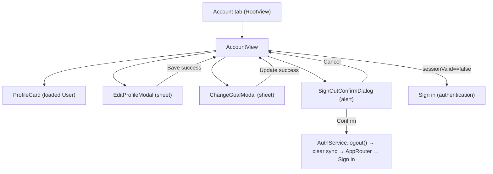

# account-management - Technical Design

> **Implementation intent:** *Hybrid* — UI-heavy (Account screen + 2 modals + sign-out confirm) over a thin `UserRepository` that wraps `DataClient`. Order: `UserRepository` → `AccountViewModel` → `AccountView` + `EditProfileModal` + `ChangeGoalModal` → assembly into `RootView`. Reuses `User` model, `AuthService`, `DataClient`, `ErrorHandler`, `CaloButton` from `shared-foundations`; no new SPM dependency.

## 1. Overview

### Goals
- Account screen (WF-007 profile portion) reads `User` and shows name, height, weight, activity level, daily calorie goal.
- Edit Profile modal (WF-016): edit height, weight, activity level with validation (BR-018.1/2/3, VR-018.1/2/3) and persist via `UserRepository.update()`.
- Change Goal modal (WF-017): edit `User.calorieTarget` with validation (BR-020.3, VR-020.1) and persist.
- Sign Out: confirmation → `AuthService.logout()` → clear `OfflineSyncService` cache → navigate to Sign in.
- Error handling: any save/auth failure surfaces via shared `ErrorHandler`; the spec MUST NOT introduce a parallel error path.

### In-scope / out-of-scope
**In-scope:** Account screen, Edit Profile modal (WF-016), Change Goal modal (WF-017), Sign Out confirmation + flow, `UserRepository` (DataClient wrapper for `User` reads/updates), ViewModels + assembly.
**Out-of-scope:** Subscription status / cancel / restore (owned by `subscription-settings`); preferences (units/theme/notifications/privacy) (owned by `settings-management`); sign-in screen itself (owned by `authentication`); onboarding form (owned by `onboarding-form`).

### AC Coverage Summary
Addresses **all 19 acceptance criteria** across 4 requirements:
- **REQ-001 → §7.1:** AC-001.1, AC-001.2, AC-001.3, AC-001.4
- **REQ-002 → §7.2:** AC-002.1, AC-002.2, AC-002.3, AC-002.4, AC-002.5
- **REQ-003 → §7.3:** AC-003.1, AC-003.2, AC-003.3, AC-003.4, AC-003.5
- **REQ-004 → §7.4:** AC-004.1, AC-004.2, AC-004.3, AC-004.4, AC-004.5

## 2. Architecture

### Runtime boundaries
```
RootView (Account tab) ─▶ AccountView ─▶ AccountViewModel
                                          │  ├─ UserRepository (User via DataClient)
                                          │  ├─ AuthService (sessionValid, logout)
                                          │  ├─ OfflineSyncService (clear cache on sign-out)
                                          │  └─ AppEnvironment.errors (ErrorHandler)
AccountView ── presents ──▶ EditProfileModal  (sheet over Account)
AccountView ── presents ──▶ ChangeGoalModal    (sheet over Account)
AccountView ── presents ──▶ SignOutConfirmDialog (alert over Account)
AccountViewModel ── onLogout ──▶ AppRouter.routeToSignIn()
AccountViewModel ── onProfileSaved ──▶ AccountView refresh (reload User)
```

### Module responsibilities
| Module | Responsibility |
|--------|----------------|
| `UserRepository` | `fetchCurrent() async throws -> User`; `update(_ patch: UserPatch) async throws -> User`; uses `DataClient` over PostgREST, table `users` (RLS-scoped by JWT) |
| `AccountViewModel` | Loads `User`; owns `editingProfile`, `editingGoal`, `confirmingSignOut` state; validates inputs; orchestrates save; handles sign-out flow |
| `AccountView` | Renders profile card; "Edit profile" / "Change goal" / "Sign out" buttons; presents modals/dialogs |
| `EditProfileModal` | Form for height, weight, activity level; Save/Cancel; `CaloButton` |
| `ChangeGoalModal` | Form for new goal value + formula note; Update/Cancel; `CaloButton` |
| `SignOutConfirmDialog` | System-style confirmation alert (Cancel / Sign out destructive) |

### Data flow


## 3. Components and Interfaces

| Component | Type | Contract | File |
|-----------|------|----------|------|
| `UserRepository` | protocol + class | `fetchCurrent() async throws -> User`; `update(_ patch: UserPatch) async throws -> User` | `Features/Account/Services/UserRepository.swift` |
| `UserPatch` | struct | `height: Double?`, `weight: Double?`, `activityLevel: ActivityLevel?`, `calorieTarget: Int?` — all optional; only non-nil fields sent to backend | `Features/Account/Models/UserPatch.swift` |
| `AccountViewModel` | `@MainActor ObservableObject` | `@Published user: User?`; `@Published state: AccountState`; `loadUser()`; `openEditProfile()`, `closeEditProfile()`; `openChangeGoal()`, `closeChangeGoal()`; `saveProfile(patch: UserPatch) async`; `saveGoal(_ value: Int) async`; `requestSignOut()`, `confirmSignOut() async`; callback `onLogout` | `Features/Account/ViewModels/AccountViewModel.swift` |
| `AccountState` | enum | `idle / loading(User?) / loaded(User) / error(AppError)` | `Features/Account/ViewModels/AccountViewModel.swift` |
| `AccountView` | SwiftUI `View` | renders profile card + 3 actions; presents sheets/alert | `Features/Account/Views/AccountView.swift` |
| `ProfileCard` | SwiftUI `View` | name, height, weight, activity, calorie goal | `Features/Account/Views/ProfileCard.swift` |
| `EditProfileModal` | SwiftUI `View` | height/weight/activity form; Save/Cancel; inline validation | `Features/Account/Views/EditProfileModal.swift` |
| `ChangeGoalModal` | SwiftUI `View` | goal input + formula note; Update/Cancel; inline validation | `Features/Account/Views/ChangeGoalModal.swift` |

### Reuse Plan (ios-components Reuse-First Gate)
- **Reuse:** `CaloButton` (shared-foundations) for Edit / Save / Cancel / Sign out / Update; `ErrorHandler` for recoverable errors; `AuthService` for session + logout; `DataClient` for `User` read/write; `User` model from shared-foundations; `OfflineSyncService` for cache clear on sign-out.
- **New (justified):** `UserRepository` (DataClient wrapper for User CRUD; no generic repository exists in shared-foundations), `AccountViewModel`, `AccountView`, `ProfileCard`, `EditProfileModal`, `ChangeGoalModal`, `SignOutConfirmDialog` (alert). No SPM dependency.

## 4. Data Models and Contracts

- `UserPatch`: `{ height: Double? (cm), weight: Double? (kg), activityLevel: ActivityLevel?, calorieTarget: Int? }`. Used for partial updates so each modal sends only the fields it owns.
- `AccountState`: enum `idle / loading(User?) / loaded(User) / error(AppError)`. Drives the profile card render.
- Validation (delegates to `User.validate()` from shared-foundations where possible):
  - Height: 120–220 cm (VR-018.1)
  - Weight: 30–300 kg (VR-018.2)
  - ActivityLevel: required, one of `{sedentary, light, moderate, veryActive}` (VR-018.3)
  - CalorieTarget: integer in [1000, 3500] (VR-020.1, BR-020.3)
- Persistence: `UserRepository.update(_:)` builds a PostgREST PATCH body containing only the non-nil patch fields, sends to `users` table scoped by current `AuthService.currentAccessToken()` (RLS guarantees user can only update own row); on success returns the updated `User`.

## 5. Error Handling

| Failure mode | Detection | User-visible behavior | Recovery |
|--------------|-----------|-----------------------|----------|
| Profile load fail (network/5xx) | `UserRepository.fetchCurrent()` throws | `ErrorHandler` banner + Retry; keep prior data if present | Retry (AC-001.3) |
| Validation fail (height/weight/activity) | `User.validate()` returns error | Inline field message ("Height must be between 120 and 220 cm") | Block save (AC-002.4) |
| Save call fail (network/5xx) | `UserRepository.update(_:)` throws | `ErrorHandler` recoverable banner; modal stays open with user input preserved | Retry from modal (AC-002.5, AC-003.5) |
| Validation fail (goal) | `value` out of [1000,3500] | Inline "Goal must be between 1000 and 3500 kcal" | Block save (AC-003.4) |
| Sign-out fail | `AuthService.logout()` throws | `ErrorHandler` banner; user remains signed in | Retry from Account (AC-004.4) |
| Not signed in on tab open | `AuthService.sessionValid() == false` | Route to Sign in screen | Sign in (AC-001.4) |

## 6. Testing Strategy

Unit tests under `calo-ai-testTests/` (test target from `shared-foundations` task 4.1.1):

- `UserRepositoryTests.swift` — `fetchCurrent()` returns mapped `User`; `update()` sends PATCH with only non-nil patch fields; 401 → throw `AppError.unauthenticated`; network → throw `AppError.network` (AC-002.3, AC-003.3; P5, P6, P10).
- `AccountViewModelTests.swift` — with fake `UserRepository`, `AuthService`, `OfflineSyncService`:
  - load → profile loaded; fail → error state (AC-001.1/.2/.3; P1, P2, P3)
  - sign-out flow: confirm clears keychain + sync cache + invokes onLogout (AC-004.2/.5; P11, P13)
  - sign-out cancel keeps state (AC-004.3; P12)
  - sign-out failure keeps user signed in (AC-004.4; P14)
  - edit-profile validation out-of-range blocks save (AC-002.4; P7)
  - edit-profile save success refreshes `user` (AC-002.3; P6)
  - change-goal out-of-range blocks save (AC-003.4; P9)
  - change-goal save success refreshes `user` (AC-003.3; P8)
  - sessionValid==false triggers onAuthRequired (AC-001.4; P4)
- `UserPatchTests.swift` — `UserPatch` encodes only non-nil fields (AC-002.3; P5).

Build checkpoint: XcodeBuildMCP `build_sim` after each phase. Account flow verified manually on device/sim.

## 7. Feature Breakdown (iOS-first)

### 7.1 View Profile (Account Screen)
- **ACs Implemented:** AC-001.1, AC-001.2, AC-001.3, AC-001.4
- **Source:** FR-018, FR-020, UC-022 (profile portion), WF-007
- **What:** `AccountView` reads `User` via `AccountViewModel.loadUser()`; `ProfileCard` renders name/height/weight/activity/calorie goal. If `AuthService.sessionValid() == false` → emit `onAuthRequired`. Errors via `ErrorHandler`; recoverable banner with Retry.
- **States:** loading / loaded / error.
- **UX expectations:** `CaloButton` for actions; VoiceOver labels; Dynamic Type; Dark Mode.
- **Files:** `Features/Account/Views/AccountView.swift`, `Features/Account/Views/ProfileCard.swift`, `Features/Account/ViewModels/AccountViewModel.swift`.

### 7.2 Edit Profile Modal (Height / Weight / Activity)
- **ACs Implemented:** AC-002.1, AC-002.2, AC-002.3, AC-002.4, AC-002.5
- **Source:** FR-018 (BR-018.1/2/3, VR-018.1/2/3), UC-022, WF-016
- **What:** `EditProfileModal` pre-fills from current `User`; Save validates via `User.validate()` ranges (height 120–220, weight 30–300, activityLevel required); on success calls `UserRepository.update(UserPatch{ height, weight, activityLevel })`. Inline error messages; modal stays open on validation/network failure.
- **States:** pristine / editing / validating / saving / error.
- **UX expectations:** height/weight numeric keyboard with unit suffix; segmented activity picker; `CaloButton` Save/Cancel; ≥44pt tap targets; VoiceOver.
- **Files:** `Features/Account/Views/EditProfileModal.swift`, `Features/Account/ViewModels/AccountViewModel.swift`, `Features/Account/Services/UserRepository.swift`, `Features/Account/Models/UserPatch.swift`.

### 7.3 Change Goal Modal
- **ACs Implemented:** AC-003.1, AC-003.2, AC-003.3, AC-003.4, AC-003.5
- **Source:** FR-020 (BR-020.3, VR-020.1), UC-022, WF-017
- **What:** `ChangeGoalModal` shows current goal + Mifflin-St Jeor formula note; input new value (integer); validate ∈[1000,3500]; on success calls `UserRepository.update(UserPatch{ calorieTarget })`; Account screen refreshes; Diary progress bar consumes next appearance. Inline error; modal stays open on failure.
- **States:** pristine / editing / saving / error.
- **UX expectations:** numeric keyboard (numberPad); formula note in caption style; `CaloButton` Update/Cancel; VoiceOver "Enter new daily calorie goal".
- **Files:** `Features/Account/Views/ChangeGoalModal.swift`, `Features/Account/ViewModels/AccountViewModel.swift`.

### 7.4 Sign Out Flow
- **ACs Implemented:** AC-004.1, AC-004.2, AC-004.3, AC-004.4, AC-004.5
- **Source:** PRD §9 (privacy — user controls data); UC-022; WF-007
- **What:** Tap "Sign out" → `SignOutConfirmDialog` (Cancel / Sign out destructive). On confirm: `AuthService.logout()` → `OfflineSyncService.clearUserCache()` → invoke `onLogout` (routed to Sign in). On cancel: dismiss dialog, no change. On logout fail: `ErrorHandler` banner, user remains signed in.
- **States:** idle / confirming / signingOut / signedOut / error.
- **UX expectations:** destructive `CaloButton` red; confirmation copy explicit ("You'll need to sign in again with Apple").
- **Files:** `Features/Account/Views/AccountView.swift` (alert presentation), `Features/Account/ViewModels/AccountViewModel.swift`.

## 8. Navigation and Integration

### Flow diagram


### Navigation table
| From | To | Trigger | Data |
|------|----|---------|------|
| RootView Account tab | AccountView | tab select | AppEnvironment (auth, data, errors) |
| AccountView | EditProfileModal | tap "Edit profile" | current `User` (pre-fill) |
| EditProfileModal | AccountView | Save success / Cancel | updated / no-op |
| AccountView | ChangeGoalModal | tap "Change goal" | current `User.calorieTarget` (pre-fill) |
| ChangeGoalModal | AccountView | Update success / Cancel | updated / no-op |
| AccountView | SignOutConfirmDialog | tap "Sign out" | — |
| SignOutConfirmDialog | Sign in screen | confirm | `AuthService.logout()` clears state |
| AccountView | Sign in screen | `sessionValid()==false` | — |

### Integration rules
- `AccountView` replaces `PlaceholderView("Settings")` (or whichever placeholder the Account tab uses) in `RootView`. Account tab is one of the 4 tabs from `project-structure`; the **Profile portion** of WF-007 lands here, while **Subscription/Preferences** sections land in `subscription-settings` / `settings-management` (assembled into the same screen or composed via NavigationStack — the spec leaves that composition to the integrator; this spec only owns the Profile card + Edit/Change/Sign Out).
- Sign-out uses the **already-present** `AuthService.logout()` from shared-foundations; the spec does not re-implement auth.
- `UserRepository` uses `DataClient`; `AppEnvironment.data` is the injected instance (constructor injection per MVVM/DI from `project-structure`).
- Errors flow through `AppEnvironment.errors` (`ErrorHandler`); no second error path.

## 9. Correctness Properties

| Property | Type | Validates AC | Statement |
|---|---|---|---|
| P1 | Invariant | AC-001.1, AC-001.2 | `AccountViewModel.user` becomes non-nil after a successful `loadUser()`; before that, view renders loading state and no stale empty fields. |
| P2 | Invariant | AC-001.3 | A failed `loadUser()` produces `state == .error(...)` and the view renders `ErrorHandler` banner with Retry; previous `user` is preserved. |
| P3 | Invariant | AC-001.4 | When `AuthService.sessionValid() == false` on tab open, `onAuthRequired` fires exactly once and the view never renders the profile card. |
| P4 | Round-trip | AC-002.3 | A valid `UserPatch{ height, weight, activityLevel }` produces exactly one PATCH call with only those fields and the returned `User` reflects the patched values. |
| P5 | Invariant | AC-002.4 | `UserPatch` with height∉[120,220], weight∉[30,300], or activityLevel==nil causes `saveProfile()` to set validation error state, no PATCH is sent, modal stays open. |
| P6 | Invariant | AC-002.5 | A save failure leaves modal open, preserves the typed values, and emits an `ErrorHandler` banner. |
| P7 | Round-trip | AC-003.3 | A valid `UserPatch{ calorieTarget }` produces exactly one PATCH call and the next `loadUser()` reflects the new goal. |
| P8 | Invariant | AC-003.4 | A goal value outside [1000,3500] sets validation error and never triggers PATCH. |
| P9 | Invariant | AC-003.5 | A save failure on Change Goal leaves modal open with input preserved. |
| P10 | Invariant | AC-004.2 | On sign-out confirm, `AuthService.logout()` is called exactly once; on success, `OfflineSyncService.clearUserCache()` is invoked and `onLogout` fires. |
| P11 | Invariant | AC-004.3 | On sign-out cancel, `AuthService.logout()` is NOT called and `onLogout` does NOT fire. |
| P12 | Invariant | AC-004.4 | A failed `AuthService.logout()` does not invoke `onLogout` and does not clear `OfflineSyncService` cache. |
| P13 | Invariant | AC-004.5 | After successful sign-out, `OfflineSyncService` user-scoped cache is cleared and a subsequent `fetchCurrent()` would throw `AppError.unauthenticated`. |
