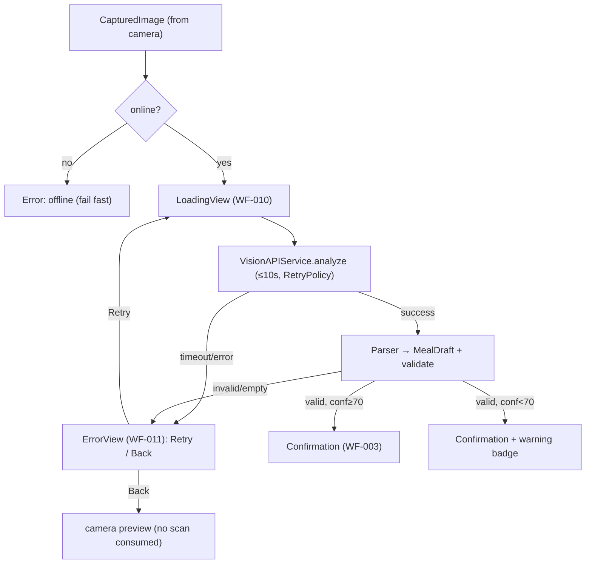
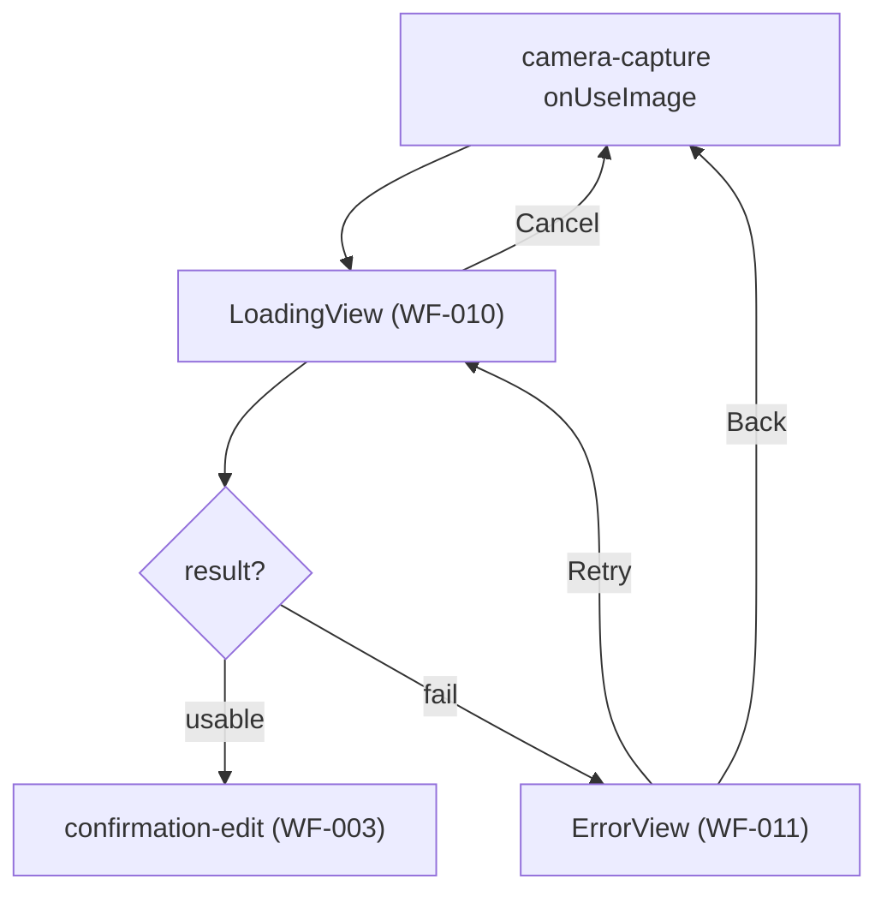

# ai-recognition - Technical Design

> **Implementation intent:** *Logic-first* — service + parsing + validation, then the two thin screens
> (Loading WF-010, Error WF-011). `VisionAPIService` is **URLSession-based** against the OpenAI/Anthropic
> multimodal REST endpoint — **no SPM dependency**; reuses shared `RetryPolicy`/`AppError`/`ErrorHandler`.

## 1. Overview

### Goals
- Send the handed-off meal image to the AI Vision API with a structured prompt; parse a JSON result into a `MealDraft` (`MealLog` + `Ingredient[]` + `confidence`).
- Present WF-010 loading and WF-011 error; route to Confirmation (WF-003) on a usable result, or Error on failure.
- Enforce validation (calories/confidence ranges, macro↔calorie tolerance, ≥1 ingredient), the 70% confidence warning, a 10s timeout, bounded retry, offline fail-fast, and HTTPS-only transport with a config-sourced key.

### In-scope / out-of-scope
**In-scope:** `VisionAPIServicing` + `VisionAPIService` (request build, HTTPS call, timeout, parse), prompt builder, response DTO→`MealDraft` mapping + validation, confidence handling, `AIRecognitionViewModel`, `LoadingView` (WF-010), `ErrorView` (WF-011), retry/back/cancel, offline fail-fast.
**Out-of-scope:** photo capture (`camera-capture`), ingredient confirmation/editing + save (`confirmation-edit`), scan increment (done on save), paywall.

### AC Coverage Summary
Addresses **all 17 acceptance criteria**:
- **REQ-001 → §7.1:** AC-001.1, AC-001.2, AC-001.3, AC-001.4
- **REQ-002 → §7.2:** AC-002.1, AC-002.2, AC-002.3, AC-002.4
- **REQ-003 → §7.3:** AC-003.1, AC-003.2, AC-003.3, AC-003.4
- **REQ-004 → §7.4:** AC-004.1, AC-004.2, AC-004.3, AC-004.4, AC-004.5

## 2. Architecture

### Runtime boundaries
```
camera-capture (onUseImage: CapturedImage)
        │
        ▼
AIRecognitionViewModel ──▶ VisionAPIService (URLSession → AI Vision REST, HTTPS)
        │   ├─ RetryPolicy (shared)      ├─ AppEnvironment.errors (ErrorHandler)
        │   └─ Reachability (shared)     └─ VisionResponseParser → MealDraft (validate)
        ├─ success(≥70%) ─▶ confirmation-edit (WF-003)  [injected callback]
        ├─ success(<70%) ─▶ confirmation-edit + warning flag
        └─ failure ───────▶ ErrorView (WF-011)
```

### Module responsibilities
| Module | Responsibility |
|--------|----------------|
| `VisionAPIService` | Build multipart/base64 request + prompt; HTTPS call with 10s timeout; return raw response or throw `AppError` |
| `VisionResponseParser` | Decode API JSON → `MealDraft`; run validation + confidence classification |
| `AIRecognitionViewModel` | Orchestrate loading/success/error; retry/cancel/back; offline fail-fast; route via callbacks |
| `LoadingView` / `ErrorView` | WF-010 / WF-011 UI |

### Data flow


## 3. Components and Interfaces

| Component | Type | Contract | File |
|-----------|------|----------|------|
| `VisionAPIServicing` | protocol | `analyze(_ image: Data) async throws -> VisionResult` | `Features/AI/Services/VisionAPIService.swift` |
| `VisionAPIService` | class | URLSession impl; 10s timeout; HTTPS; key from config; throws `AppError` | same |
| `VisionPromptBuilder` | struct | builds the structured JSON-request prompt | `Features/AI/Services/VisionPromptBuilder.swift` |
| `VisionResponseParser` | struct | `parse(_:) throws -> MealDraft`; validation + confidence class | `Features/AI/Services/VisionResponseParser.swift` |
| `AIRecognitionViewModel` | `@MainActor ObservableObject` | `@Published phase`; `start(_:)`; `retry()`; `cancel()`; `back()`; callbacks `onConfirm(MealDraft)`, `onBack` | `Features/AI/ViewModels/AIRecognitionViewModel.swift` |
| `LoadingView` | SwiftUI `View` | spinner + "Analyzing your meal…" + Cancel | `Features/AI/Views/LoadingView.swift` |
| `ErrorView` | SwiftUI `View` | icon + message + Retry/Back | `Features/AI/Views/ErrorView.swift` |

### Reuse Plan (ios-components Reuse-First Gate)
- **Reuse:** `RetryPolicy`, `AppError`, `ErrorHandler`, `Reachability`, `MealLog`/`Ingredient`/`Macros` (shared-foundations); `CaloButton` for Retry/Back/Cancel; `AppEnvironment` injection; `CapturedImage` (camera-capture).
- **New (justified):** `VisionAPIService`, `VisionPromptBuilder`, `VisionResponseParser`, `AIRecognitionViewModel`, `LoadingView`, `ErrorView` — all AI-specific; no generic component duplicated.

## 4. Data Models and Contracts

- `VisionResult` (raw decode of AI JSON): `{ mealName: String, servingSize: String?, calories: Double, protein: Double, carbs: Double, fat: Double, ingredients: [VisionIngredient], confidence: Double }`.
- `MealDraft`: `{ mealLog: MealLog (unsaved, no id/date yet), lowConfidence: Bool, lowQuality: Bool }` — handed to `confirmation-edit`.
- Mapping: `VisionResult` → `MealLog` (macros→`Macros`, ingredients→`[Ingredient]` all `isSelected=true` per FR-003 AC-003.3 default-checked).
- Validation rules (VR-003.*): calories∈[0,5000]; confidence∈[0,100]; macros≥0; ingredients.count≥1; macro-kcal (`4P+4C+9F`) within ±10% of calories → else `lowQuality=true`. `confidence<70` → `lowConfidence=true`.
- API key + endpoint read from `AppConfiguration` (xcconfig); never hardcoded (NFR-AR-003).

## 5. Error Handling

| Failure mode | Detection | User-visible behavior | Recovery |
|--------------|-----------|-----------------------|----------|
| Offline at submit | `Reachability` down | "You're offline — AI scan needs a connection." | Fail fast, no retries (AC-004.5) |
| Timeout >10s | URLSession/task timeout | "Connection error. Please try again." + Retry (WF-011) | RetryPolicy already tried ≤3 (AC-004.1/.2) |
| Transient network / 5xx | status/error | (silent during retries) then WF-011 | `RetryPolicy` ≤3/≤10s (AC-004.2) |
| API error (4xx/parse) | decode/status | "Could not analyze image. Please try again." (WF-011) | Retry/Back (ERR-003.2) |
| Null/empty / 0 ingredients | parsed result | "No food detected. Please take a clearer photo." (WF-011) | Retry/Back (AC-001.4) |
| Hard validation fail | validator | Treated as no usable result → WF-011 | Not routed to Confirmation (AC-003.4, NFR-AR-004) |
| Low confidence <70% | classifier | Confirmation + warning badge | User verifies/edits (AC-003.3) |
| User cancel | Cancel tap | Abort request, back to camera | No draft created (AC-002.4) |

## 6. Testing Strategy

Unit tests under `calo-ai-testTests/` (test target from shared-foundations 4.1.1):
- `VisionResponseParserTests.swift` — valid JSON→`MealDraft`; ranges; macro±10% → lowQuality; empty ingredients/out-of-range → throw (AC-001.2, AC-003.1/.2/.4; P2, P8–P11).
- `VisionAPIServiceTests.swift` — `URLProtocol` stub: HTTPS-only, key from config, 10s timeout aborts, transient→retry≤3, decode-or-throw (AC-001.1, AC-004.1/.2; NFR-AR-002/003; P1, P12–P14).
- `AIRecognitionViewModelTests.swift` — offline fail-fast; success≥70→onConfirm; success<70→onConfirm+warning; invalid→error; cancel aborts; retry re-submits; back no-scan (AC-001.3/.4, AC-002.*, AC-003.3, AC-004.3/.4/.5; P3–P7, P15–P17).

Build checkpoint: XcodeBuildMCP `build_sim` per phase. Live API smoke deferred until a key is configured (uses stub in tests).

## 7. Feature Breakdown (iOS-first)

### 7.1 AI Vision Analysis Request
- **ACs Implemented:** AC-001.1, AC-001.2, AC-001.3, AC-001.4
- **Source:** FR-003, UC-003, NFR-002
- **What:** `VisionPromptBuilder` + `VisionAPIService.analyze` (base64/multipart, HTTPS, key from config), `VisionResponseParser` → `MealDraft`; route to Confirmation on usable result; empty/no-food → Error.
- **States:** requesting / parsed / no-food.
- **UX expectations:** none beyond WF-010/011 (below); a11y handled in views.
- **Files:** `Features/AI/Services/VisionAPIService.swift`, `Features/AI/Services/VisionPromptBuilder.swift`, `Features/AI/Services/VisionResponseParser.swift`.

### 7.2 Loading State (WF-010)
- **ACs Implemented:** AC-002.1, AC-002.2, AC-002.3, AC-002.4
- **Source:** FR-003 AC-003.1, WF-010, NFR-002
- **What:** `LoadingView` spinner + "Analyzing your meal…"; VM keeps loading until result/error; blocks duplicate submit; Cancel aborts task.
- **States:** Loading / (transition out).
- **UX expectations:** spinner announced by VoiceOver ("Analyzing your meal"); Cancel is a ≥44pt `CaloButton`; Dynamic Type; Dark Mode.
- **Files:** `Features/AI/Views/LoadingView.swift`, `Features/AI/ViewModels/AIRecognitionViewModel.swift`.

### 7.3 Result Validation & Confidence Handling
- **ACs Implemented:** AC-003.1, AC-003.2, AC-003.3, AC-003.4
- **Source:** FR-003 (BR-003.2/.3/.4, VR-003.*), UC-003 AF-003.1
- **What:** `VisionResponseParser` validation (ranges, ≥1 ingredient, macro±10%→lowQuality); confidence<70→lowConfidence; hard-fail→Error, else Confirmation (with warning if flagged).
- **States:** valid / low-confidence / low-quality / invalid.
- **UX expectations:** warning badge text "Not confident — please verify" carried into Confirmation.
- **Files:** `Features/AI/Services/VisionResponseParser.swift`.

### 7.4 Timeout, Error & Retry (WF-011)
- **ACs Implemented:** AC-004.1, AC-004.2, AC-004.3, AC-004.4, AC-004.5
- **Source:** FR-003 (BR-003.1, ERR-003.*), WF-011, NFR-002, NFR-016
- **What:** 10s timeout; shared `RetryPolicy` (≤3/≤10s) for transient; `ErrorView` with mapped message + Retry/Back; offline fail-fast via `Reachability`; Retry re-submits same image; Back returns to camera without consuming a scan.
- **States:** error(offline) / error(timeout) / error(api) / error(no-food).
- **UX expectations:** `ErrorView` icon+message+`CaloButton` Retry/Back; VoiceOver reads message; Dark Mode.
- **Files:** `Features/AI/Views/ErrorView.swift`, `Features/AI/ViewModels/AIRecognitionViewModel.swift`.

## 8. Navigation and Integration

### Flow diagram


### Navigation table
| From | To | Trigger | Data |
|------|----|---------|------|
| camera-capture | LoadingView | onUseImage | CapturedImage (JPEG data) |
| LoadingView | Confirmation (WF-003) | usable result | `MealDraft` (+warning flags) |
| LoadingView | ErrorView | failure/invalid | mapped `AppError` |
| LoadingView | camera | Cancel | — (no draft) |
| ErrorView | LoadingView | Retry | same image |
| ErrorView | camera | Back | — (no scan consumed) |

### Integration rules
- Entry is the `onUseImage` callback stubbed by `camera-capture` §8 — this spec provides the real `AIRecognitionViewModel.start(_:)` target; wiring replaces the stub.
- Exit `onConfirm(MealDraft)` is stubbed until `confirmation-edit` lands.
- Uses shared services from `AppEnvironment` (RetryPolicy via DataClient-style helper, ErrorHandler, Reachability); API key/endpoint from `AppConfiguration`.
- Scan count is NOT incremented here (only on successful save in `confirmation-edit`), so Back/error never consumes a scan (AC-004.4).

## 9. Correctness Properties

| Property | Type | Validates AC | Statement |
|---|---|---|---|
| P1 | Invariant | AC-001.1 | Every analysis request is HTTPS, carries a config-sourced key, and includes the structured prompt + image. |
| P2 | Round-trip | AC-001.2 | A well-formed API JSON parses into a `MealDraft` whose fields equal the JSON values. |
| P3 | Invariant | AC-001.3 | A valid result with confidence ≥70 invokes `onConfirm` exactly once and shows no error. |
| P4 | Invariant | AC-001.4 | A null/empty/zero-ingredient result routes to ErrorView with the "No food detected" message, never to Confirmation. |
| P5 | Invariant | AC-002.1, AC-002.3 | The loading state is shown while in-flight and dismissed exactly when a result/error resolves. |
| P6 | Invariant | AC-002.2 | While loading, a second submit of the same image is ignored (no duplicate request). |
| P7 | Invariant | AC-002.4 | Cancel aborts the in-flight task and produces no `MealDraft`. |
| P8 | Invariant | AC-003.1 | Parser rejects calories∉[0,5000], confidence∉[0,100], any macro<0, or 0 ingredients. |
| P9 | Invariant | AC-003.2 | If `|4P+4C+9F − calories| > 10%·calories`, the draft is marked `lowQuality`. |
| P10 | Invariant | AC-003.3 | confidence<70 ⇒ routes to Confirmation with `lowConfidence=true` (warning), still not an error. |
| P11 | Invariant | AC-003.4 | A hard-validation failure routes to ErrorView and never yields a Confirmation draft. |
| P12 | Invariant | AC-004.1 | A request exceeding 10s is aborted and yields the timeout error state. |
| P13 | Invariant | AC-004.2 | Transient failures trigger ≤3 retries within ≤10s before the error surfaces. |
| P14 | Invariant | AC-004.2, NFR | No request uses a non-HTTPS scheme. |
| P15 | Round-trip | AC-004.3 | Retry re-submits the identical image bytes and re-enters the loading state. |
| P16 | Invariant | AC-004.4 | Back from error returns to camera and does not increment the scan count. |
| P17 | Invariant | AC-004.5 | When offline at submit, the flow fails fast (offline message) without running the retry loop. |
