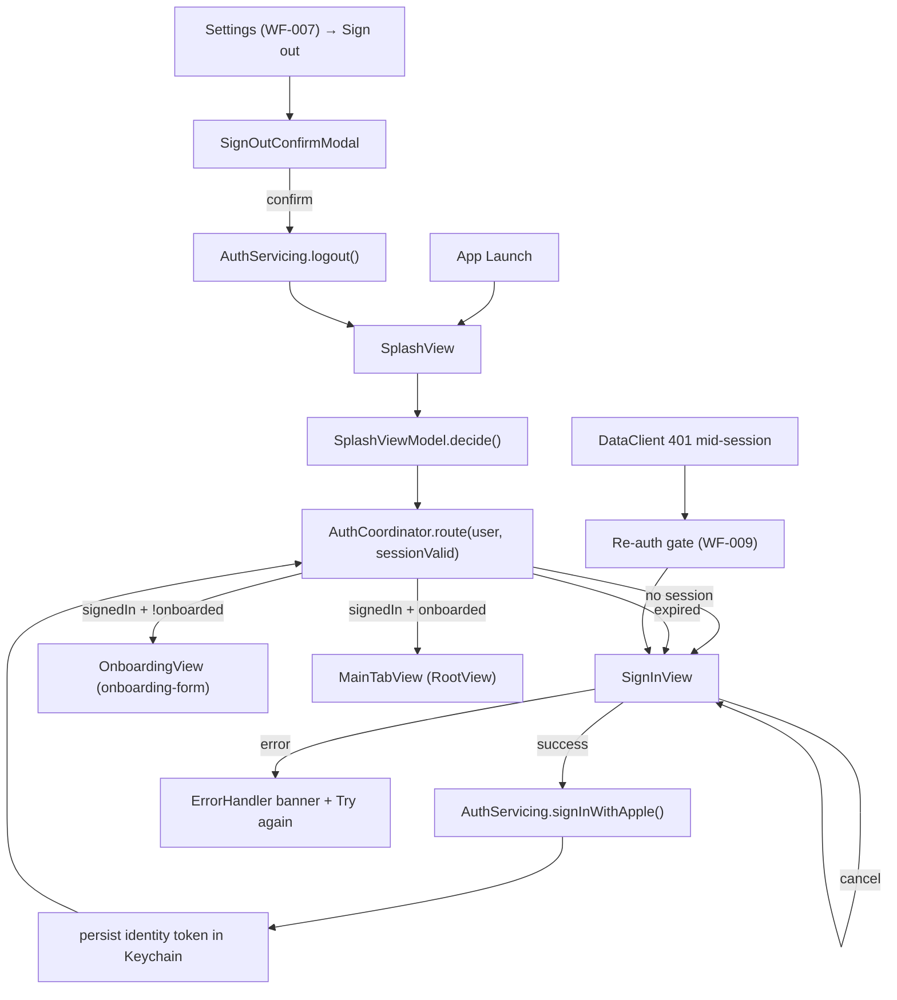
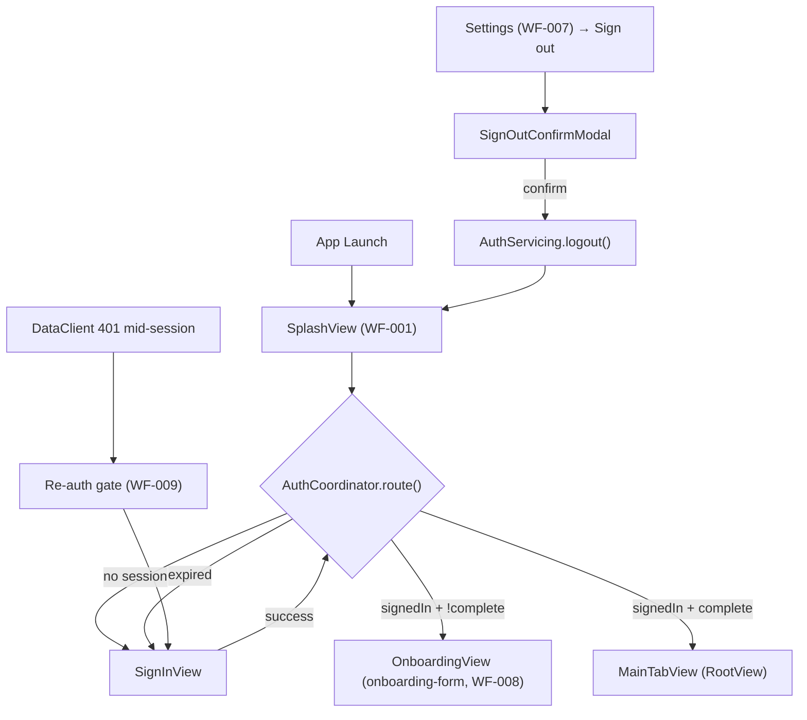

# authentication - Technical Design

> **Implementation intent:** *Hybrid*. UI-first on the existing `AuthServicing` protocol from `shared-foundations`. Order: routing logic (`AuthCoordinator`) → `SplashViewModel` + `SplashView` → `SignInView` + `SignInViewModel` + `SignInWithAppleButton` → `SignOutConfirmModal` + `SignOutViewModel` → RootView/CaloApp wiring. `ASAuthorizationAppleIDProvider` is an Apple framework — **no SPM dependency**, build stays green.

## 1. Overview

### Goals
- Splash screen (WF-001) shows app logo + spinner and decides first-routing within 2 seconds.
- Sign in with Apple flow on first-launch (no Keychain token) and on session-expiry / sign-out (REQ-001, REQ-003).
- Session restoration on launch using `AuthService.sessionValid()` and `AuthService.getUser()` (REQ-002).
- Settings sign-out clears Keychain and routes back to Splash (REQ-003).
- Re-auth preserves `User.id` when the same Apple ID is reused (REQ-003, NFR-004).

### In-scope / out-of-scope
**In-scope:** `AuthCoordinator` (pure routing logic), `SplashView` + `SplashViewModel`, `SignInView` + `SignInViewModel`, `SignInWithAppleButton` (UIKit→SwiftUI bridge), `SignOutConfirmModal` + `SignOutViewModel`, integration of `AuthService` from `shared-foundations`, re-auth gate when `DataClient` returns 401 mid-session.
**Out-of-scope:** Camera permission flow (camera-capture owns the WF-009 camera dialog), onboarding multi-step form (onboarding-form), Account/Settings detail screens beyond sign-out (account-management), subscription flows (paywall-display / subscription-management).

### AC Coverage Summary
Addresses **all 12 acceptance criteria**:
- **REQ-001 → §7.1:** AC-001.1, AC-001.2, AC-001.3, AC-001.4
- **REQ-002 → §7.2:** AC-002.1, AC-002.2, AC-002.3, AC-002.4
- **REQ-003 → §7.3:** AC-003.1, AC-003.2, AC-003.3, AC-003.4

## 2. Architecture

### Runtime boundaries
```
App Launch → RootView (project-structure)
                 │
                 ▼
            SplashView (WF-001) ─▶ SplashViewModel ─▶ AuthCoordinator
                                                          │
                                                          ├─► AuthServicing.sessionValid() / getUser()
                                                          │     (shared-foundations: AppleAuthService)
                                                          ├─► ErrorPresenting (shared-foundations)
                                                          ▼
                                                 Route Decision:
                                                     ├─► SignInView            (no / expired session)
                                                     ├─► OnboardingView        (signedIn, !onboardingComplete) — onboarding-form
                                                     └─► MainTabView (RootView) (signedIn, onboardingComplete)
```

### Module responsibilities
| Module | Responsibility |
|--------|----------------|
| `AuthCoordinator` | Pure routing logic: given `User?` + `sessionValid()` + `onboardingComplete`, decide next screen. Consumed by `SplashViewModel` and re-auth callers. No side effects. |
| `SplashView` | Logo, spinner (≤2s), animated cross-fade to next route; respects Dynamic Type / Dark Mode / a11y. |
| `SplashViewModel` | `@MainActor ObservableObject`; `@Published phase`; `decide()` queries `AuthServicing` and emits terminal `phase` via `AuthCoordinator`. |
| `SignInView` | Marketing headline + `SignInWithAppleButton` + retry state + error banner. |
| `SignInViewModel` | Wraps `AuthService.signInWithApple()`; surfaces cancel/error via `ErrorHandler`; on success emits a `Route` via `AuthCoordinator`. |
| `SignInWithAppleButton` | `UIViewRepresentable` wrapping `ASAuthorizationAppleIDProvider` (SwiftUI has no first-class equivalent). |
| `SignOutConfirmModal` | Warning modal "Sign out?" + Confirm/Cancel (uses `CaloButton`). |
| `SignOutViewModel` | Confirms, calls `AuthService.logout()`, never navigates on failure (AC-003.4). |

### Data flow


## 3. Components and Interfaces

| Component | Type | Contract | File |
|-----------|------|----------|------|
| `AuthCoordinator` | enum + static func | `enum Route { case signIn, onboarding, main }`; `static func route(user: User?, sessionValid: Bool) -> Route` | `Features/Authentication/Services/AuthCoordinator.swift` |
| `SplashViewModel` | `@MainActor ObservableObject` | `@Published phase: Phase`; `decide()`; deps: `AuthServicing` injected | `Features/Authentication/ViewModels/SplashViewModel.swift` |
| `SplashView` | SwiftUI `View` | logo + spinner + cross-fade on `phase` change | `Features/Authentication/Views/SplashView.swift` |
| `SignInViewModel` | `@MainActor ObservableObject` | `startSignIn()`, `cancel()`, `retry()`; state `idle / presenting / signedIn / cancelled / error(AppError)`; deps: `AuthServicing`, `ErrorPresenting` injected | `Features/Authentication/ViewModels/SignInViewModel.swift` |
| `SignInView` | SwiftUI `View` | marketing copy + `SignInWithAppleButton` + error banner + retry `CaloButton` | `Features/Authentication/Views/SignInView.swift` |
| `SignInWithAppleButton` | `UIViewRepresentable` | wraps `ASAuthorizationAppleIDProvider` button; callback on success / cancel | `Features/Authentication/Views/SignInWithAppleButton.swift` |
| `SignOutConfirmModal` | SwiftUI `View` | confirmation modal with Confirm/Cancel `CaloButton`s | `Features/Authentication/Views/SignOutConfirmModal.swift` |
| `SignOutViewModel` | `@MainActor ObservableObject` | `confirm()` / `cancel()`; state `idle / confirming / signingOut / signedOut / error(AppError)`; deps: `AuthServicing` injected | `Features/Authentication/ViewModels/SignOutViewModel.swift` |

### Reuse Plan (ios-components Reuse-First Gate)
- **Reuse:** `AuthServicing` / `AppleAuthService` (shared-foundations) — concrete provider + Keychain; `CaloButton` (shared-foundations) for retry / confirm / cancel; `ErrorHandler` / `ErrorPresenting` (shared-foundations) for sign-in + sign-out failure banner; `AppEnvironment` (project-structure + shared-foundations) for DI; `User` model (shared-foundations).
- **New (justified):** `SignInWithAppleButton` (wraps `ASAuthorizationAppleIDProvider` — no SwiftUI equivalent); `AuthCoordinator` (routing logic specific to auth); `SignInView` / `SplashView` / `SignOutConfirmModal` (auth-specific UI). No generic component duplicated.

## 4. Data Models and Contracts

- Reuse `User` from `shared-foundations` (`id`, `email`, `name`, `height`, `weight`, `goal`, `activityLevel`, `calorieTarget`, `onboardingComplete`). This spec only reads/writes `User.id`, `User.email`, `User.name`, `User.onboardingComplete`; profile fields are owned by `onboarding-form`.
- `SplashPhase` enum: `loading / routing / fading`. Drives SwiftUI animation between splash and next screen.
- `SignInState` enum: `idle / presenting / signedIn / cancelled / error(AppError)`. Drives `SignInView`.
- `SignOutState` enum: `idle / confirming / signingOut / signedOut / error(AppError)`. Drives `SignOutConfirmModal`.
- `AuthCoordinator.Route` enum: `signIn / onboarding / main`. Pure value, no side effects.
- `AuthCoordinator.route(user: User?, sessionValid: Bool) -> Route` decision matrix:

| `sessionValid` | `user` | `onboardingComplete` | Route |
|---|---|---|---|
| `false` (no token / expired / corrupt) | nil OR non-nil | (any) | `.signIn` |
| `true` | non-nil | `true` | `.main` |
| `true` | non-nil | `false` | `.onboarding` |
| `true` | nil (degenerate) | (any) | `.signIn` |

- `SignInError` mapping: `ASAuthorizationError` → `AppError.unauthenticated` (cancel) / `AppError.network` (transient) / `AppError.unknown` (other). No token bytes in any error message (NFR-AUTH-003).

## 5. Error Handling

| Failure mode | Detection | User-visible behavior | Recovery |
|--------------|-----------|-----------------------|----------|
| Sign in with Apple cancelled | `ASAuthorizationError.canceled` | Stay on `SignInView`, no toast (silent cancel) | Tap button again (AC-001.3) |
| Sign in network error | `ASAuthorizationError` network code or thrown | `ErrorHandler` banner "Couldn't sign in. Try again." | "Try again" `CaloButton` → re-present sheet (AC-001.4) |
| Keychain token corrupt on launch | `sessionValid()==false` despite prior token | Route to `SignInView` | Sign in fresh (AC-002.3) |
| Keychain clear fails on sign-out | `AuthServicing.logout()` throws | "Couldn't sign out. Retry." via `ErrorHandler` | Retry; never partial state (AC-003.4) |
| Token expired mid-session | `DataClient` returns 401 (handled by shared-foundations error mapping) | `AuthCoordinator` presents `SignInView` over current screen (re-auth gate) | Re-sign-in restores session |
| Apple ID mismatch on re-auth | `User.id` differs from prior session | Treat as new session; route to `onboarding-form` (fresh profile) | First-time setup |

## 6. Testing Strategy

Unit tests under `calo-ai-testTests/` (test target from `shared-foundations` task 4.1.1):
- `AuthCoordinatorTests.swift` — route decision matrix: (no user, signed-in + !complete, signed-in + complete, expired) → SignIn / Onboarding / Main (AC-001.1, AC-002.1, AC-002.2, AC-002.3, AC-002.4; P1, P3, P4, P5).
- `SplashViewModelTests.swift` — `decide()` invokes coordinator and emits correct terminal `phase`; never hangs in `loading` (AC-001.1, AC-002.1; P1, P3).
- `SignInViewModelTests.swift` — fake `AuthServicing`: success → routes via coordinator; cancel → stays in idle (no token written); error → `error(AppError)` (AC-001.2, AC-001.3, AC-001.4; P2, P3, P4).
- `SignOutViewModelTests.swift` — fake `AuthServicing`: confirm → `logout()` clears state and emits `signedOut`; Keychain-clear failure surfaces error and does NOT emit `signedOut` (AC-003.2, AC-003.4; P7, P8).
- `ReauthIdentityTests.swift` — same Apple ID after sign-out yields same `User.id`; different Apple ID yields fresh `User.id` (AC-003.3; P6).

Build checkpoint: XcodeBuildMCP `build_sim` after each phase. Sign in with Apple is exercised manually on a real device (sim sign-in flow differs from device).

## 7. Feature Breakdown (iOS-first)

### 7.1 First-Launch Sign In with Apple
- **ACs Implemented:** AC-001.1, AC-001.2, AC-001.3, AC-001.4
- **Source:** NFR-004, UC-001 (first-launch), WF-001, WF-009
- **What:** `SignInView` + `SignInViewModel` + `SignInWithAppleButton`; delegates to `AuthService.signInWithApple()` (shared-foundations); cancellation silent; errors surfaced via `ErrorHandler` + retry `CaloButton`.
- **States:** idle / presenting / signedIn / cancelled / error.
- **UX expectations:** "Sign in with Apple" button prominent (≥44pt tap target, Dynamic Type); cancellation silent; errors recoverable; VoiceOver labels for button + state.
- **Files:** `Features/Authentication/Views/SignInView.swift`, `Features/Authentication/Views/SignInWithAppleButton.swift`, `Features/Authentication/ViewModels/SignInViewModel.swift`.

### 7.2 Session Restoration & Routing
- **ACs Implemented:** AC-002.1, AC-002.2, AC-002.3, AC-002.4
- **Source:** NFR-004, NFR-006, UC-001 (returning), WF-001
- **What:** `SplashViewModel` reads `AuthServicing.sessionValid()` + `AuthServicing.getUser()`; `AuthCoordinator.route()` decides SignIn / Onboarding / Main; expired-token detection; corrupt-token fallback; Splash cross-fades to the chosen route.
- **States:** loading → routing → fading.
- **UX expectations:** Splash cross-fade to chosen route; never a blank screen >2s; no flicker between routes.
- **Files:** `Features/Authentication/ViewModels/SplashViewModel.swift`, `Features/Authentication/Services/AuthCoordinator.swift`, `Features/Authentication/Views/SplashView.swift`.

### 7.3 Sign Out & Re-Authentication
- **ACs Implemented:** AC-003.1, AC-003.2, AC-003.3, AC-003.4
- **Source:** NFR-004, NFR-006, UC-001 (re-auth), WF-007, WF-009
- **What:** Settings → "Sign out" → `SignOutConfirmModal` → on confirm, `AuthService.logout()` clears Keychain + in-memory `User` → `AuthCoordinator` re-decides route (now `.signIn`); re-auth flow preserves `User.id`; failure modes surfaced via `ErrorHandler` with retry.
- **States:** idle / confirming / signingOut / signedOut / error.
- **UX expectations:** confirmation modal prevents accidental sign-out; "Retry" on failure; VoiceOver for all CTAs; never navigates on failure (AC-003.4).
- **Files:** `Features/Authentication/Views/SignOutConfirmModal.swift`, `Features/Authentication/ViewModels/SignOutViewModel.swift`, integration hook in `App/RootView.swift` (the entry-point consumed by `account-management`).

## 8. Navigation and Integration

### Flow diagram


### Navigation table
| From | To | Trigger | Data |
|------|----|---------|------|
| App launch | `SplashView` | `CaloApp` scene init | none |
| `SplashView` | `SignInView` | coordinator: no/expired session | none |
| `SplashView` | `OnboardingView` (onboarding-form) | coordinator: signedIn + !onboardingComplete | `User` |
| `SplashView` | `MainTabView` (RootView) | coordinator: signedIn + onboardingComplete | `User` |
| `SignInView` | `SplashView` → re-route | `signInWithApple()` success | `User` |
| Settings (WF-007) | `SignOutConfirmModal` | tap "Sign out" | none |
| `SignOutConfirmModal` | `SplashView` (re-route) | tap "Confirm" | none |
| Any screen | `SignInView` (modal re-auth) | `DataClient` 401 mid-session | none |

### Integration rules
- This spec does NOT replace `RootView`; it provides `SplashView` + `SignInView` that the app root hosts while `SplashViewModel.decide()` runs (one-line seam in `CaloApp` from `project-structure`).
- `account-management` (Phase 8) is the primary caller of sign-out: it presents `SignOutConfirmModal` from Settings. This spec ships the modal + VM; `account-management` wires the Settings list and triggers `SignOutViewModel.confirm()`.
- `onboarding-form` is the next-screen consumer of `SignInView` success (REQ-001 → onboarding-form, REQ-002 → onboarding-form for `!onboardingComplete`).
- `AuthServicing` is injected via `AppEnvironment.auth`; no concrete instantiations in this spec (NFR-AUTH-004).
- Re-auth gate listens for `DataClient.unauthenticated` notifications (shared-foundowns) and presents `SignInView` over the current screen without dismissing local state.

## 9. Correctness Properties

| Property | Type | Validates AC | Statement |
|---|---|---|---|
| P1 | Invariant | AC-001.1, AC-002.1 | On app launch, `SplashView` runs `decide()` exactly once and reaches a terminal `phase` (`routing` or `fading`) within 2 seconds; never stuck in `loading`. |
| P2 | Invariant | AC-001.2 | A successful Sign in with Apple writes the identity token to Keychain, emits `signedIn`, and routes via coordinator within one tick; no half-state. |
| P3 | Invariant | AC-001.3, AC-002.3 | Cancellation of Sign in with Apple and corrupt-token on launch both leave the user on `SignInView` with NO token written to Keychain and NO `User` cached. |
| P4 | Invariant | AC-001.4, AC-003.4 | Any thrown error from `signInWithApple()` or `logout()` maps to an `AppError` via `ErrorHandler` and produces a recoverable banner; no silent failure and no inconsistent signed-in state. |
| P5 | Decision | AC-002.1, AC-002.2, AC-002.4 | `AuthCoordinator.route(user, sessionValid)` returns `signIn` / `onboarding` / `main` exactly matching the (sessionValid × onboardingComplete) matrix in §4. |
| P6 | Identity | AC-003.3 | Re-auth with the same Apple ID after sign-out yields the same `User.id`; a different Apple ID yields a fresh `User.id`. |
| P7 | Invariant | AC-003.2, AC-003.4 | On confirmed sign-out, Keychain token is cleared AND in-memory `User` is nil; if either fails, the VM stays in `error` and does NOT emit `signedOut`. |
| P8 | Invariant | AC-003.1 | "Sign out" tap presents `SignOutConfirmModal` first; the modal CANNOT be bypassed by the first tap (state must transition `idle → confirming → signingOut`). |
| P9 | Security | NFR-AUTH-003, NFR-AUTH-004 | No identity token bytes appear in `print`, `os_log`, `NSLog`, or UserDefaults anywhere on the auth path; all `DataClient` calls fail-fast when `sessionValid()==false`. |