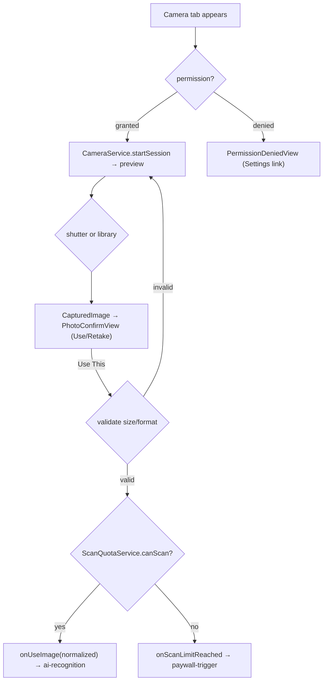
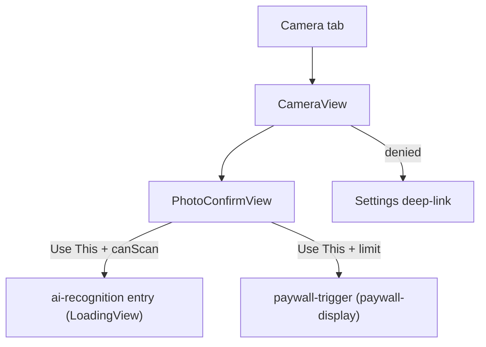

# camera-capture - Technical Design

> **Implementation intent:** *Hybrid* — camera is inherently UI+service coupled. Order: `CameraService`
> (AVFoundation) + `ScanQuotaService` → `CameraViewModel` → `CameraView`/permission/confirm UI.
> AVFoundation + PhotosUI + AVCaptureSession are Apple frameworks — **no SPM dependency**, build stays green.

## 1. Overview

### Goals
- Camera screen (WF-002): permission handling, live rear-camera preview, shutter capture, photo-library pick, Use/Retake confirm, image validation, and hand-off of a normalized image to `ai-recognition`.
- Free-tier scan quota: "X/3 scans" badge, daily reset, Premium "Unlimited", block the 4th scan and emit a paywall-trigger signal.
- Correct session lifecycle (start on appear / stop on disappear) and recoverable error surfacing via shared `ErrorHandler`.

### In-scope / out-of-scope
**In-scope:** `CameraService` (AVCaptureSession), permission flow (WF-009), capture + PhotosUI picker, `PhotoConfirmView`, image validation/normalization, `ScanQuotaService` (count/reset/increment/limit), scan badge, paywall-trigger handoff, AI hand-off entry.
**Out-of-scope:** AI analysis (`ai-recognition`), paywall modal UI + purchase (`paywall-display`/`subscription-management`), meal save/increment call site (`confirmation-edit` calls `ScanQuotaService.increment()`), Splash/auth (`authentication`).

### AC Coverage Summary
Addresses **all 17 acceptance criteria**:
- **REQ-001 → §7.1:** AC-001.1, AC-001.2, AC-001.3, AC-001.4
- **REQ-002 → §7.2:** AC-002.1, AC-002.2, AC-002.3, AC-002.4, AC-002.5
- **REQ-003 → §7.3:** AC-003.1, AC-003.2, AC-003.3, AC-003.4, AC-003.5
- **REQ-004 → §7.4:** AC-004.1, AC-004.2, AC-004.3

## 2. Architecture

### Runtime boundaries
```
RootView (Camera tab) ─▶ CameraView ─▶ CameraViewModel
                                          │  ├─ CameraService (AVCaptureSession, PhotosUI)
                                          │  ├─ ScanQuotaService (local persisted count)
                                          │  └─ AppEnvironment.errors (ErrorHandler)
CameraViewModel ── onUseImage(CapturedImage) ──▶ AI recognition entry (ai-recognition)
CameraViewModel ── onScanLimitReached ─────────▶ paywall-trigger (paywall-display)
```

### Module responsibilities
| Module | Responsibility |
|--------|----------------|
| `CameraService` | Permission query/request, AVCaptureSession start/stop, frame capture, PhotosUI selection |
| `ScanQuotaService` | Track scans used today, midnight reset, `remaining`, `canScan`, `increment()`, Premium=unlimited |
| `CameraViewModel` | Orchestrate state (permission/preview/captured), validate image, enforce quota, hand off / trigger paywall |
| `CameraView` + subviews | Preview layer, shutter, library button, badge, permission state, `PhotoConfirmView` |

### Data flow


## 3. Components and Interfaces

| Component | Type | Contract | File |
|-----------|------|----------|------|
| `CameraServicing` | protocol | `permissionStatus`; `requestPermission() async -> Bool`; `startSession()`; `stopSession()`; `capturePhoto() async throws -> CapturedImage`; `previewLayer` | `Features/Camera/Services/CameraService.swift` |
| `CameraService` | class (AVFoundation) | concrete impl of `CameraServicing` | same |
| `ScanQuotaServicing` | protocol | `remaining: Int?` (nil=unlimited); `canScan: Bool`; `increment()`; `resetIfNewDay()` | `Features/Camera/Services/ScanQuotaService.swift` |
| `CameraViewModel` | `@MainActor ObservableObject` | `@Published state`; `onAppear()/onDisappear()`; `capture()`; `selectFromLibrary(_:)`; `useCapturedImage()`; `retake()`; callbacks `onUseImage`, `onScanLimitReached` | `Features/Camera/ViewModels/CameraViewModel.swift` |
| `CameraView` | SwiftUI `View` | hosts preview/permission/confirm states + badge | `Features/Camera/Views/CameraView.swift` |
| `CameraPreviewRepresentable` | `UIViewRepresentable` | wraps `AVCaptureVideoPreviewLayer` | `Features/Camera/Views/CameraPreviewRepresentable.swift` |
| `PhotoConfirmView` | SwiftUI `View` | shows captured image + Use/Retake | `Features/Camera/Views/PhotoConfirmView.swift` |
| `ScanBadge` | SwiftUI `View` | "X/3 scans" or "Unlimited" | `Features/Camera/Views/ScanBadge.swift` |

### Reuse Plan (ios-components Reuse-First Gate)
- **Reuse:** `CaloButton` (shared-foundations) for Use/Retake/Settings buttons; `ErrorHandler` for hardware errors; `AppEnvironment` for injection; `PlaceholderView` replaced by `CameraView` in `RootView`.
- **New (justified):** `CameraPreviewRepresentable` (AVFoundation bridge — no SwiftUI equivalent), `PhotoConfirmView`, `ScanBadge` (camera-specific). No generic component duplicated.

## 4. Data Models and Contracts

- `CapturedImage`: `{ image: UIImage, data: Data (JPEG), width: Int, height: Int, source: .camera/.library }`. Normalized to up orientation; JPEG-encoded for hand-off (AC-004.2).
- `CameraState` enum: `checkingPermission / denied / noCamera / preview / captured(CapturedImage) / error(AppError)`.
- `ScanQuota` (persisted): `{ dateKey: String (yyyy-MM-dd local), used: Int }`; free max = 3 (BR-009.1); Premium ⇒ unlimited.
- Validation: reject if `width<640 || height<480`, format ∉ {jpg,png}, or bytes>10MB → `AppError.validation` with specific message (AC-002.5, NFR-CC-004).

## 5. Error Handling

| Failure mode | Detection | User-visible behavior | Recovery |
|--------------|-----------|-----------------------|----------|
| Permission denied | `permissionStatus == .denied` | "Camera access required" + Settings deep-link | Re-check on tab re-appear (AC-001.3) |
| No camera hardware | session config fails | "Camera not available" + library still usable | Library path (AC-001.4) |
| Permission no response ≤30s | timeout | Treat as denied | Denied state (NFR-CC-003) |
| Image too small / wrong format | validation | Specific message; back to preview | Retake (AC-002.5) |
| Capture hardware error | `capturePhoto()` throws | Recoverable banner via `ErrorHandler` | Return to preview (AC-004.3) |
| Scan limit reached | `canScan == false` | Blocked; paywall-trigger emitted | Upgrade/next day (AC-003.4) |

## 6. Testing Strategy

Unit tests under `calo-ai-testTests/` (test target from `shared-foundations` task 4.1.1):
- `ScanQuotaServiceTests.swift` — remaining/canScan for free vs premium; midnight reset; increment only via explicit call; 4th scan blocked (AC-003.1/.2/.3/.4/.5; P4–P7).
- `CameraViewModelTests.swift` — with fake `CameraServicing`/`ScanQuotaServicing`: permission-denied state; invalid image rejected; valid image → `onUseImage`; limit → `onScanLimitReached`; session start/stop on appear/disappear (AC-001.*, AC-002.4/.5, AC-003.4, AC-004.1/.2; P1–P3, P8–P11).
- `ImageValidationTests.swift` — size/format/byte thresholds (AC-002.5, NFR-CC-004; P9).

Build checkpoint: XcodeBuildMCP `build_sim` after each phase. Camera preview/hardware verified manually on device/sim (AVCapture limited on sim → library path used for sim smoke).

## 7. Feature Breakdown (iOS-first)

### 7.1 Camera Permission
- **ACs Implemented:** AC-001.1, AC-001.2, AC-001.3, AC-001.4
- **Source:** FR-001, UC-001, WF-009
- **What:** `CameraService.permissionStatus/requestPermission`; `CameraViewModel` maps to `checkingPermission/denied/noCamera/preview`; `PermissionDeniedView` with Settings deep-link.
- **States:** checkingPermission / denied / noCamera / preview.
- **UX expectations:** denied state uses `CaloButton`; VoiceOver reads reason + Settings action; Dynamic Type; Dark Mode.
- **Files:** `Features/Camera/Services/CameraService.swift`, `Features/Camera/Views/CameraView.swift` (permission sub-state).

### 7.2 Live Preview, Capture & Photo Selection
- **ACs Implemented:** AC-002.1, AC-002.2, AC-002.3, AC-002.4, AC-002.5
- **Source:** FR-002, UC-002, WF-002
- **What:** `CameraPreviewRepresentable` (AVCaptureVideoPreviewLayer), shutter → `capturePhoto()`, PhotosUI picker, `PhotoConfirmView` (Use/Retake), image validation, hand-off `onUseImage`.
- **States:** Loading (session warmup) / Success (preview) / captured / Error (invalid image).
- **UX expectations:** full-screen preview; large shutter (≥44pt); library button; a11y labels ("Shutter", "Choose from library", "Use this photo", "Retake").
- **Files:** `Features/Camera/Views/CameraPreviewRepresentable.swift`, `Features/Camera/Views/PhotoConfirmView.swift`, `Features/Camera/ViewModels/CameraViewModel.swift`.

### 7.3 Scan Quota Display & Enforcement
- **ACs Implemented:** AC-003.1, AC-003.2, AC-003.3, AC-003.4, AC-003.5
- **Source:** FR-009, UC-009; FR-010 (trigger)
- **What:** `ScanQuotaService` (persisted `{dateKey, used}`, midnight reset, free max 3, Premium unlimited, `increment()` public for save flow); `ScanBadge`; VM blocks 4th scan → `onScanLimitReached`.
- **States:** hasScans / unlimited / limitReached.
- **UX expectations:** badge legible in Dynamic Type; VoiceOver "2 of 3 scans remaining".
- **Files:** `Features/Camera/Services/ScanQuotaService.swift`, `Features/Camera/Views/ScanBadge.swift`.

### 7.4 Camera Screen Lifecycle & Handoff
- **ACs Implemented:** AC-004.1, AC-004.2, AC-004.3
- **Source:** FR-002 (→FR-003), UC-002, PRD §9
- **What:** start/stop session on appear/disappear; normalize image (orientation + JPEG) before hand-off; hardware errors → `ErrorHandler` and back to preview.
- **States:** active / inactive / error.
- **UX expectations:** no frozen frame when returning to tab; battery-safe.
- **Files:** `Features/Camera/ViewModels/CameraViewModel.swift`, `Features/Camera/Services/CameraService.swift`.

## 8. Navigation and Integration

### Flow diagram


### Navigation table
| From | To | Trigger | Data |
|------|----|---------|------|
| RootView Camera tab | CameraView | tab select | AppEnvironment |
| CameraView | PhotoConfirmView | shutter / library pick | CapturedImage |
| PhotoConfirmView | ai-recognition | "Use This" + canScan | normalized image |
| PhotoConfirmView | paywall-trigger | "Use This" + limit reached | trigger event |
| CameraView | Settings app | tap Settings (denied) | URL |

### Integration rules
- `CameraView` replaces `PlaceholderView("Camera")` in `RootView` (the one-line seam from `project-structure`).
- `onUseImage`/`onScanLimitReached` are injected callbacks; wiring to `ai-recognition` / `paywall-display` happens when those specs land (until then, camera-capture can be exercised with stub callbacks).
- `ScanQuotaService.increment()` is called by `confirmation-edit` on successful save (BR-009.4), not here.
- Premium state read from `AuthService.getUser()`/subscription status via `AppEnvironment`.

## 9. Correctness Properties

| Property | Type | Validates AC | Statement |
|---|---|---|---|
| P1 | Invariant | AC-001.1, AC-001.2 | First Camera-tab open with no prior grant requests permission; on grant, preview state reached. |
| P2 | Invariant | AC-001.3 | Denied permission yields `denied` state exposing a Settings action; never a crash/black screen. |
| P3 | Invariant | AC-001.4 | No-camera device yields `noCamera` state and the library button remains usable. |
| P4 | Invariant | AC-003.1, AC-003.2 | Badge shows `remaining/3` for free tier and "Unlimited" for Premium, matching `ScanQuotaService`. |
| P5 | Invariant | AC-003.3 | On a new local day, `remaining` resets to 3 before any scan. |
| P6 | Invariant | AC-003.4 | With `used==3` free tier, a scan attempt sets no captured hand-off and emits exactly one `onScanLimitReached`. |
| P7 | Invariant | AC-003.5 | `remaining` decreases only via `increment()`; capturing/using a photo alone does not change `used`. |
| P8 | Invariant | AC-002.1, AC-002.2, AC-002.3 | Preview offers shutter + library; both paths reach a `captured` state with Use/Retake. |
| P9 | Invariant | AC-002.5 | An image <640×480, non-JPG/PNG, or >10MB is rejected and never handed off. |
| P10 | Invariant | AC-002.4, AC-004.2 | "Use This" on a valid image invokes `onUseImage` exactly once with an up-oriented JPEG. |
| P11 | Invariant | AC-004.1 | Session is running while the tab is visible and stopped once it disappears. |
| P12 | Invariant | AC-004.3 | A capture hardware error produces an `AppError` via `ErrorHandler` and returns to preview (no stuck state). |
