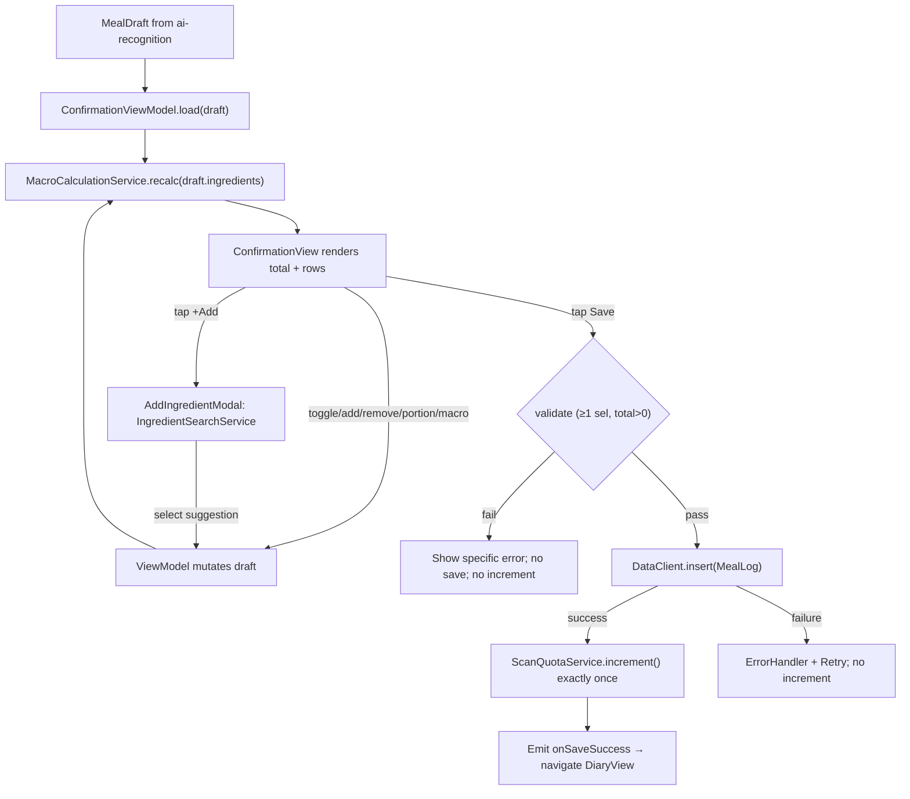
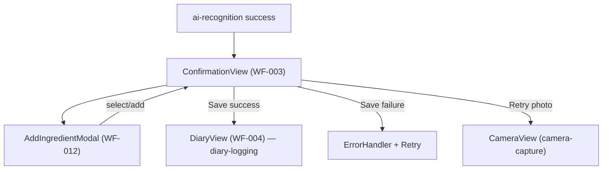

# confirmation-edit - Technical Design

> **Implementation intent:** *Logic-first*. Order: domain → service → view-model → views → integration. The view-model is the single source of truth for the live draft; `MacroCalculationService` is a pure function on the draft (no I/O) so it is property-testable. Save is a single transactional path that funnels through `DataClient` + `ScanQuotaService.increment()` to satisfy `camera-capture` AC-003.5. Reuses `CaloButton` + `ErrorHandler` + `AppEnvironment` from `shared-foundations`; no new SPM deps.

## 1. Overview

### Goals
- Render `MealDraft` from `ai-recognition` as an editable Confirmation (WF-003) and Add Ingredient modal (WF-012).
- Support toggle / add / remove / portion / manual macro edit on the draft, with `<200ms` total recalculation.
- Persist the log via `DataClient.insert` and trigger `ScanQuotaService.increment()` exactly once on a successful save (handoff from `camera-capture` AC-003.5).
- Navigate to the Diary screen (`diary-logging`, WF-004) on success.

### In-scope / out-of-scope
**In-scope:** `Ingredient`/`Portion`/`MealDraft` value types, `MacroCalculationService` (pure), `ConfirmationViewModel` (state machine + draft mutations), `AddIngredientModalViewModel` (search + suggestions), `ConfirmationView` (WF-003), `AddIngredientModal` (WF-012), `IngredientRow`, `PortionSelector`, `MacroBar`, validation + error surfacing, `ScanQuotaService.increment()` call site, navigation to Diary.

**Out-of-scope:** photo capture (`camera-capture`), AI call + loading/error screens (`ai-recognition`), Diary list & edit/delete (`diary-logging`), paywall trigger, subscription / onboarding.

### AC Coverage Summary
This design addresses **all 31 acceptance criteria** from `requirements.md`:
- **REQ-001 → §7.1:** AC-001.1, AC-001.2, AC-001.3, AC-001.4
- **REQ-002 → §7.2:** AC-002.1, AC-002.2, AC-002.3, AC-002.4, AC-002.5
- **REQ-003 → §7.3:** AC-003.1, AC-003.2, AC-003.3, AC-003.4, AC-003.5
- **REQ-004 → §7.4:** AC-004.1, AC-004.2, AC-004.3, AC-004.4, AC-004.5
- **REQ-005 → §7.5:** AC-005.1, AC-005.2, AC-005.3, AC-005.4
- **REQ-006 → §7.6:** AC-006.1, AC-006.2, AC-006.3
- **REQ-007 → §7.7:** AC-007.1, AC-007.2, AC-007.3, AC-007.4, AC-007.5

## 2. Architecture

### Runtime boundaries
```
ai-recognition (success callback: MealDraft)
        │
        ▼
ConfirmationView (WF-003) ──▶ ConfirmationViewModel (@MainActor)
                                  │  ├─ MacroCalculationService (pure)
                                  │  ├─ IngredientSearchService (local DB)
                                  │  ├─ DataClient (shared-foundations) [insert MealLog]
                                  │  ├─ ScanQuotaService (camera-capture) [increment()]
                                  │  └─ AppEnvironment.errors (ErrorHandler)
                                  ├─ tap "+ Add ingredient" ──▶ AddIngredientModal (WF-012)
                                  └─ save success ──▶ DiaryView (diary-logging)
```

### Module responsibilities
| Module | Responsibility |
|--------|----------------|
| `Ingredient` / `Portion` / `MealDraft` / `MealLog` (extensions) | Value types + Codable; shared with `ai-recognition` / `shared-foundations` |
| `MacroCalculationService` | Pure recalc: `recalculate(ingredients) -> (totalCal, P, C, F)`; applies portion multipliers, supports manual macro override |
| `IngredientSearchService` | Local autocomplete (max 5 results, <500ms); returns `(name, caloriesPer100g)` |
| `ScanQuotaServicing` (reuse from `camera-capture`) | `increment()` — single call site on save success |
| `ConfirmationViewModel` | Owns draft; mutates (toggle/add/remove/portion/macro); validates; saves; emits `onSaveSuccess(MealLog)` callback |
| `ConfirmationView` + subviews | WF-003 layout; subviews: `IngredientRow`, `PortionSelector`, `MacroBar`, `MacroEditor` |
| `AddIngredientModal` | WF-012 layout + search field + suggestions + "Add as custom" |

### Data flow


## 3. Components and Interfaces

| Component | Type | Contract | File |
|-----------|------|----------|------|
| `Ingredient` (extend) | struct | `{ id: UUID, name: String, caloriesPer100g: Double, proteinPer100g, carbsPer100g, fatPer100g, portion: Portion, grams: Double?, isSelected: Bool, isCustom: Bool }` | `Features/Confirmation/Models/Ingredient.swift` (reuse from `shared-foundations`) |
| `Portion` | enum | `.small(0.75) / .medium(1.0) / .large(1.25) / .grams(Double)` | same |
| `MealDraft` (reuse) | struct | `{ mealName: String, totalCalories, macros, ingredients: [Ingredient], confidence: Double, imageRef: UUID? }` | `Features/Confirmation/Models/MealDraft.swift` (matches `ai-recognition` shape) |
| `MacroCalculationService` | struct (pure) | `recalculate(ingredients: [Ingredient]) -> (calories: Int, P: Double, C: Double, F: Double)`; honours `manualOverrideMacros` if set | `Features/Confirmation/Services/MacroCalculationService.swift` |
| `IngredientSearchService` | protocol | `search(query: String) async -> [IngredientSuggestion]`; max 5 results, ≤500ms | `Features/Confirmation/Services/IngredientSearchService.swift` |
| `IngredientSearchServiceImpl` | class (local DB) | concrete, backed by bundled JSON | same |
| `ScanQuotaServicing` (reuse) | protocol | `increment()` from `camera-capture` | `Features/Camera/Services/ScanQuotaService.swift` |
| `ConfirmationViewModel` | `@MainActor ObservableObject` | `load(draft:)`; `toggle(id:)`; `remove(id:)`; `setPortion(id:, portion:)`; `setManualMacros(P:C:F:)`; `addCustom(name:)`; `addSuggestion(_:)`; `save()`; published `state: ConfirmationState`; callbacks `onSaveSuccess(MealLog)`, `onCancel` | `Features/Confirmation/ViewModels/ConfirmationViewModel.swift` |
| `ConfirmationState` | enum | `.loading / .editing(draft, totals) / .saving / .error(AppError)` | same |
| `ConfirmationView` | SwiftUI `View` | Hosts `MacroBar`, list of `IngredientRow`, `AddIngredientModal`, Save/Retry toolbar | `Features/Confirmation/Views/ConfirmationView.swift` |
| `IngredientRow` | SwiftUI `View` | Checkbox + name + `PortionSelector` + per-row calo | `Features/Confirmation/Views/IngredientRow.swift` |
| `PortionSelector` | SwiftUI `View` | Segmented small/medium/large + "Enter grams" sheet | `Features/Confirmation/Views/PortionSelector.swift` |
| `MacroBar` | SwiftUI `View` | Inline P/C/F bar with total label | `Features/Confirmation/Views/MacroBar.swift` |
| `MacroEditor` | SwiftUI `View` | 3 numeric fields + Reset button | `Features/Confirmation/Views/MacroEditor.swift` |
| `AddIngredientModal` | SwiftUI `View` | Search field + suggestion list + "Add as custom" | `Features/Confirmation/Views/AddIngredientModal.swift` |

### Reuse Plan (ios-components Reuse-First Gate)
- **Reuse:** `CaloButton` (Primary/Secondary/Destructive styles from `shared-foundations`) for Save / Retry / Add / Remove / portion chips; `ErrorHandler` + `AppError` for save + validation failures; `AppEnvironment` for DI (`DataClient`, `ScanQuotaServicing`, `ErrorPresenting`); `ScanQuotaService.increment()` from `camera-capture`; `Ingredient` / `MealLog` models from `shared-foundations`.
- **New (justified):** `MacroCalculationService` (pure domain logic, not in shared-foundations), `ConfirmationViewModel` (feature orchestration), `ConfirmationView` + subviews, `AddIngredientModal` (WF-012). No generic component duplicated.

## 4. Data Models and Contracts

- `Ingredient` (extended): `id`, `name`, `caloriesPer100g`, macros per 100g, `portion: Portion` (default `.medium`), `grams: Double?` (set when `.grams`), `isSelected: Bool` (default `true`), `isCustom: Bool`, `manualOverrideMacros: Macros?` (per-ingredient override; not used in this spec — see global override below).
- `ConfirmationDraft` (in-memory only): wraps `MealDraft` + `manualMacros: Macros?` (whole-meal override per FR-007).
- `Portion.multiplier`: `small=0.75, medium=1.0, large=1.25`; `.grams(g)` uses `caloriesPer100g * g / 100` (BR-006.2, BR-006.3).
- `MealLog` write shape: `{ id, userId, date(Date()), mealName, totalCalories, macros(P,C,F), ingredients[], photoRef? }` — persisted via `DataClient.insert` (`shared-foundations`).
- Validation: save rejected if `selectedIngredients.isEmpty` OR `totalCalories < 1` (BR-004.1, BR-004.2, VR-004.1). Save-time macro override: if all of P, C, F = 0 → reject (VR-007.2, ERR-007.1). Custom calories default `0` (BR-005.2) and is unchecked (BR-005.3).
- `AddIngredient` input: must satisfy `query.trimmingCharacters(...).count >= 2` (VR-005.1); custom kcal clamped 0–2000 (VR-005.2); grams 10–500 (VR-006.1).
- `MealDraft` hand-off contract: must contain `mealName, totalCalories, ingredients, confidence`; missing → `AppError.validation("Draft missing required field")` (AC-001.4).

## 5. Error Handling

| Failure mode | Detection | User-visible behavior | Recovery |
|--------------|-----------|-----------------------|----------|
| `MealDraft` missing field | `ConfirmationViewModel.load` validation | Recoverable banner via `ErrorHandler` ("Draft missing required field") + back to camera | Re-take photo (AC-001.4) |
| Toggle/portion/remove leaves 0 selected | view-model guard | Disable Save, show "Select at least one ingredient" | Add/toggle another (AC-002.4, AC-007.3) |
| Total = 0 | `MacroCalculationService` + view-model | Disable Save, show "Total must be > 0" | Adjust portions or remove unchecked custom (AC-006.3) |
| Custom-ingredient calories out of range | view-model validation | "Enter calorie value between 0 and 2000" inline | Re-enter (ERR-005.3) |
| Grams out of [10, 500] | view-model validation | "Enter weight between 10 and 500 grams" | Re-enter (ERR-006.1) |
| All macros 0 (manual override) | view-model validation | "At least one macro must be > 0"; revert | Re-edit (ERR-007.1) |
| `DataClient.insert` network/DB error | `try await` throws | `ErrorHandler.showRecoverable` with "Retry" CTA; draft preserved | Tap Retry (AC-007.4) |
| `ScanQuotaService.increment()` failure (rare; persisted counter) | `try?` | Log warning, proceed (save already succeeded); quota re-tried on next save | Automatic on next save (AC-007.5) |
| Autocomplete >500ms or empty | `IngredientSearchService` timeout | Suggestion list shows "No matches — Add as custom" | Custom path (AC-003.4) |

## 6. Testing Strategy

Unit + property tests under `calo-ai-testTests/`:
- `MacroCalculationServiceTests.swift` — portion multipliers (small/medium/large), grams conversion in [10,500], manual override formula `(P×4)+(C×4)+(F×9)`, zero-override rejected (P1, P2, P3, P4; AC-004.2, AC-005.2, AC-005.3, NFR-CE-006, NFR-CE-007).
- `ConfirmationViewModelTests.swift` (fakes for `DataClient`, `ScanQuotaServicing`, `IngredientSearchService`) — load draft; toggle/remove/portion/macro mutate draft; invalid draft rejected; 0-selected blocks save; total=0 blocks save; save → `DataClient.insert` once + `increment()` once; save failure → no increment; retry after failure → exactly one increment on first success (P5, P6, P7, P8, P9, P10, P11, P12, P13; AC-001.4, AC-002.*, AC-003.5, AC-004.*, AC-005.*, AC-006.*, AC-007.*; NFR-CE-004, NFR-CE-005).
- `IngredientSearchServiceTests.swift` — empty query → no results; ≥2 chars → up to 5 results; missing match → empty + custom affordance (AC-003.2, AC-003.4, AC-003.5; NFR-CE-002).
- `PortionValidationTests.swift` — grams bounds, custom calories bounds (PBT) (AC-004.4; NFR-CE-006).

Build checkpoint: XcodeBuildMCP `discover_projs -> list_schemes -> build_sim` after each phase. Manual smoke on simulator for tap→recalc and Save→Diary transition; modals verified via preview snapshots.

## 7. Feature Breakdown (iOS-first)

### 7.1 Confirmation Draft Render
- **ACs Implemented:** AC-001.1, AC-001.2, AC-001.3, AC-001.4
- **Source:** FR-003, UC-003, WF-003
- **What:** `ConfirmationViewModel.load(draft:)` validates and stores draft; `ConfirmationView` renders hero (meal name + total calo + `MacroBar`), warning banner when `confidence < 0.7`, and the ingredient list.
- **States:** `loading / editing / saving / error`.
- **UX expectations:** `CaloButton` for Save/Retry; a11y labels "Confirm and save meal log"; Dynamic Type; Dark Mode; high-contrast totals.
- **Files:** `Features/Confirmation/Views/ConfirmationView.swift`, `Features/Confirmation/ViewModels/ConfirmationViewModel.swift`.

### 7.2 Ingredient Toggle, Delete & Re-Add
- **ACs Implemented:** AC-002.1, AC-002.2, AC-002.3, AC-002.4, AC-002.5
- **Source:** FR-004, UC-004, FR-008, UC-008
- **What:** `ConfirmationViewModel.toggle(id:)`, `remove(id:)` mutate the draft; `MacroCalculationService.recalculate` updates totals; `IngredientRow` exposes checkbox + swipe-to-delete via SwiftUI `.swipeActions`. Last-ingredient guard blocks removal with a non-blocking warning.
- **States:** `editing` (default); disabled Save on `selectedCount == 0`.
- **UX expectations:** Haptic `.light` on toggle; VoiceOver "Pasta, selected, 200 kcal, medium portion".
- **Files:** `Features/Confirmation/Views/IngredientRow.swift`, `Features/Confirmation/ViewModels/ConfirmationViewModel.swift`.

### 7.3 Add Ingredient Modal (WF-012)
- **ACs Implemented:** AC-003.1, AC-003.2, AC-003.3, AC-003.4, AC-003.5
- **Source:** FR-005, UC-005, WF-012
- **What:** `AddIngredientModal` hosts search field; debounced (250ms) call to `IngredientSearchService.search`; up to 5 suggestions; on select → VM `addSuggestion` (unchecked, medium); on "Add as custom" → VM `addCustom(name:)` with 0 kcal.
- **States:** `empty / typing / suggestions / no-results / adding`.
- **UX expectations:** "Add as custom" appears only when no match; a11y "Add ingredient, custom"; keyboard return adds.
- **Files:** `Features/Confirmation/Views/AddIngredientModal.swift`, `Features/Confirmation/Services/IngredientSearchService.swift`, `Features/Confirmation/ViewModels/AddIngredientModalViewModel.swift`.

### 7.4 Portion Adjustment
- **ACs Implemented:** AC-004.1, AC-004.2, AC-004.3, AC-004.4, AC-004.5
- **Source:** FR-006, UC-006
- **What:** `PortionSelector` segmented small/medium/large; "Enter grams" opens a numeric sheet; on commit `setPortion(id:, portion:)` → recalc; out-of-range grams rejected inline.
- **States:** `idle / entering-grams / invalid-grams / committed`.
- **UX expectations:** a11y "Portion size, currently medium"; keyboard numeric for grams.
- **Files:** `Features/Confirmation/Views/PortionSelector.swift`.

### 7.5 Manual Macro Edit
- **ACs Implemented:** AC-005.1, AC-005.2, AC-005.3, AC-005.4
- **Source:** FR-007, UC-007
- **What:** `MacroEditor` shows three numeric fields + "Reset to AI estimate" link; on edit `setManualMacros(P:C:F:)` updates draft + recalc; all-zero rejected with revert.
- **States:** `collapsed / editing / invalid / reset`.
- **UX expectations:** Inline error; keyboard numeric; a11y "Edit protein grams".
- **Files:** `Features/Confirmation/Views/MacroEditor.swift`, `Features/Confirmation/ViewModels/ConfirmationViewModel.swift`.

### 7.6 Real-Time Total Recalculation
- **ACs Implemented:** AC-006.1, AC-006.2, AC-006.3
- **Source:** FR-006 (AC-006.2/.3), FR-004 (AC-004.2), UC-004/006/007/008
- **What:** `MacroCalculationService` is invoked synchronously from each VM mutation; `ConfirmationView` observes `state.totals` and animates the `MacroBar`; Save button enabled state derived from `selectedCount > 0 && totals.calories > 0`.
- **States:** always-on; latency budget <200ms (NFR-CE-001).
- **UX expectations:** Spring animation on bar fill; no rebuild of list rows.
- **Files:** `Features/Confirmation/Services/MacroCalculationService.swift`, `Features/Confirmation/Views/MacroBar.swift`.

### 7.7 Save, Validation, Scan Increment, Diary Navigation
- **ACs Implemented:** AC-007.1, AC-007.2, AC-007.3, AC-007.4, AC-007.5
- **Source:** FR-004, UC-004, camera-capture AC-003.5
- **What:** `ConfirmationViewModel.save()`: validate (≥1 selected, total>0, macro override valid) → `DataClient.insert(MealLog)` → on success `ScanQuotaService.increment()` → `onSaveSuccess(MealLog)` callback navigates to `DiaryView`. On failure, ErrorHandler + Retry; no increment. Retry-after-failure: increment only on first success.
- **States:** `saving / saved / failed`.
- **UX expectations:** Spinner on Save; success toast on Diary arrival; offline → "Saved locally — will sync" via `OfflineSyncService`.
- **Files:** `Features/Confirmation/ViewModels/ConfirmationViewModel.swift`, `Features/Diary/Views/DiaryView.swift` (owned by `diary-logging`; navigation seam).

## 8. Navigation and Integration

### Flow diagram


### Navigation table
| From | To | Trigger | Data |
|------|----|---------|------|
| `ai-recognition` success | `ConfirmationView` | `onAnalysisSuccess(MealDraft)` | `MealDraft` |
| `ConfirmationView` | `AddIngredientModal` | tap "+ Add ingredient" | none |
| `ConfirmationView` | `DiaryView` | Save success | `MealLog` (top of list) |
| `ConfirmationView` | `CameraView` | tap "Retry photo" | discard draft |
| `ConfirmationView` | (error banner) | Save failure | `AppError` + Retry |

### Integration rules
- `ConfirmationView` replaces `PlaceholderView("Confirmation")` in `RootView` (the one-line seam from `project-structure`).
- `ConfirmationViewModel` is constructed by `RootView` with `AppEnvironment.data`, `AppEnvironment.scanQuota`, `AppEnvironment.errors`; callbacks `onSaveSuccess(MealLog)` and `onRetryPhoto` are injected.
- The `ScanQuotaService.increment()` call site is **exclusively** inside `ConfirmationViewModel.save()` on the success branch — no other spec calls it.
- Persisted via `DataClient.insert` from `shared-foundations`; `OfflineSyncService` handles queued writes (NFR-007, NFR-008). Local `MealLog` mirror is updated synchronously so `DiaryView` shows the new entry immediately.
- `Ingredient` / `MealLog` shapes align with `ai-recognition` (hand-off contract) and `shared-foundations` (persistence contract); no schema divergence.

## 9. Correctness Properties

| Property | Type | Validates AC | Statement |
|---|---|---|---|
| P1 | Invariant | AC-001.1, AC-001.3 | A loaded `MealDraft` with `ingredients.isEmpty == false` renders every ingredient with checkbox checked, portion `medium`, and per-row calories equal to `caloriesPer100g`. |
| P2 | Invariant | AC-001.4 | `ConfirmationViewModel.load(draft:)` with a missing required field throws `AppError.validation` and never mutates published state. |
| P3 | Round-trip | AC-002.1, AC-002.3, AC-006.1 | For any ingredient, toggling `isSelected` flips it; deleting removes it; `MacroCalculationService.recalculate` returns the sum of the remaining selected ingredients' portions, and re-runs produce the same totals. |
| P4 | Invariant | AC-002.2, AC-002.4, AC-006.3, AC-007.3 | Save button is enabled iff `selectedCount >= 1` AND `totalCalories >= 1` AND `manualMacros != (0,0,0)`; otherwise disabled with a specific message. |
| P5 | Invariant | AC-003.3, AC-003.4 | `addSuggestion` appends with `isSelected == false`, `portion == .medium`, `isCustom == false`; `addCustom` appends with `calories == 0`, `isSelected == false`, `isCustom == true`. |
| P6 | Invariant | AC-003.5, AC-004.4 | `addIngredient` rejects `query.count < 2`; `setPortion(.grams(g))` rejects `g ∉ [10, 500]`. |
| P7 | Round-trip | AC-004.2, AC-004.5, NFR-CE-006 | For any portion, `recalculate` multiplies base by `multiplier`; `.grams(g)` uses `caloriesPer100g * g / 100`; switching back and forth between portions yields the same total. |
| P8 | Round-trip | AC-005.2, AC-005.3, AC-005.4, NFR-CE-007 | `setManualMacros(P:C:F:)` sets `total = (P×4)+(C×4)+(F×9)`; if all three are 0 the prior values are restored; "Reset to AI estimate" returns P/C/F to the loaded values. |
| P9 | Invariant | AC-007.1, AC-007.4, AC-007.5, NFR-CE-005 | On a successful `DataClient.insert` exactly one `ScanQuotaService.increment()` is invoked; on failure it is not invoked; on retry-after-failure it is invoked exactly once on the first success and never on subsequent failures. |
| P10 | Invariant | AC-007.2 | After `save()` success, `onSaveSuccess(MealLog)` is invoked exactly once with a `MealLog` whose `id` matches the persisted record. |
| P11 | Invariant | AC-002.5 | Mutations on the draft do not write to `DataClient` until `save()` is invoked and validated. |
| P12 | Invariant | AC-001.2 | If `draft.confidence < 0.7` then `ConfirmationState` includes `showWarning: true`; otherwise `false`. |
| P13 | Invariant | AC-003.2, NFR-CE-002 | `IngredientSearchService.search` returns ≤5 results and completes within 500ms for any non-empty `query` of length ≥2. |
