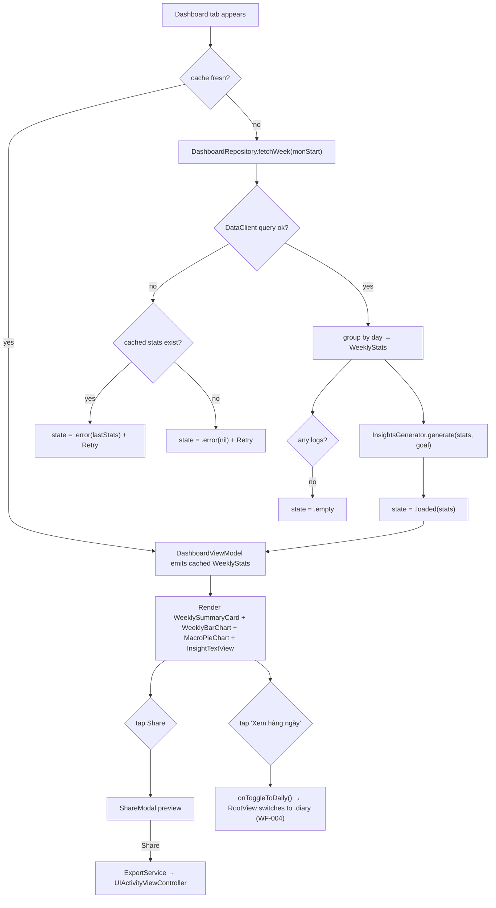
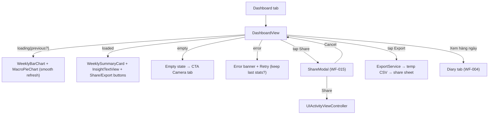

# dashboard-view - Technical Design

> **Implementation intent:** *Hybrid* — Dashboard is a consumption feature with a clear read-only data path over a single offline-aware read query. Order: `WeeklyStats`/`MacroBreakdown`/`GoalStatus`/`Weekday`/`WeeklyInsight` models → `DashboardRepository` (week read over shared `DataClient`) → `InsightsGenerator` (pure rule engine) → `ExportService` (CSV + `UIActivityViewController`) → `DashboardViewModel` → `DashboardView` + subviews. Swift Charts is an Apple framework (iOS 16+) — **no SPM dependency**; project min iOS stays at 16.

## 1. Overview

### Goals
- Dashboard screen (WF-005) with: weekly summary card (total + average), 7-bar calorie chart Mon-Sun (color-coded by `GoalStatus`), macro pie chart (P/C/F), 1-2 sentence insight text, Export and Share buttons, and a "Xem hàng ngày" toggle.
- Share Modal (WF-015) with text preview and `UIActivityViewController` invocation.
- Daily/weekly goal semantics reused from FR-014 (already in `diary-logging`); this spec reuses `MealLog`/`Macros` (shared-foundations) for the read query, `ProgressBar` color thresholds (BR-014.2 / BR-012.2) for the bar chart, and `DataClient` for the week-window read.
- Correct cache-and-stale handling (≤5 min fresh, >5 min re-fetch with smooth refresh) and recoverable error surfacing via shared `ErrorHandler`.

### In-scope / out-of-scope
**In-scope:** `WeeklyStats` / `DayBucket` / `MacroBreakdown` / `GoalStatus` / `Weekday` / `WeeklyInsight` models, `DashboardRepository` (week query over `DataClient`), `InsightsGenerator` (rule engine: tone + coaching tip), `ExportService` (CSV writer + `UIActivityViewController` presenter), `DashboardViewModel` (state machine, cache, lifecycle, toggle callback), `DashboardView` + subviews (`WeeklySummaryCard`, `WeeklyBarChart`, `MacroPieChart`, `InsightTextView`, `ShareModal`).
**Out-of-scope:** AI recognition (`ai-recognition`), meal confirmation save (`confirmation-edit`), daily list UI (`diary-logging`), paywall (`paywall-display`), goal change modal (WF-017 → `account-management`), PDF export (post-MVP), push notification for weekly summary, social backend.

### AC Coverage Summary
Addresses **all 24 acceptance criteria**:
- **REQ-001 → §7.1:** AC-001.1, AC-001.2, AC-001.3, AC-001.4, AC-001.5
- **REQ-002 → §7.2:** AC-002.1, AC-002.2, AC-002.3, AC-002.4, AC-002.5
- **REQ-003 → §7.3:** AC-003.1, AC-003.2, AC-003.3, AC-003.4, AC-003.5
- **REQ-004 → §7.4:** AC-004.1, AC-004.2, AC-004.3, AC-004.4, AC-004.5
- **REQ-005 → §7.5:** AC-005.1, AC-005.2, AC-005.3, AC-005.4

## 2. Architecture

### Runtime boundaries
```
RootView (Dashboard tab) ─▶ DashboardView ─▶ DashboardViewModel
                                                ├─ DashboardRepository (week read over DataClient)
                                                ├─ InsightsGenerator (pure rules)
                                                ├─ ExportService (CSV + UIActivityViewController)
                                                ├─ AppEnvironment.data (DataClient)
                                                └─ AppEnvironment.errors (ErrorHandler)
DashboardViewModel ── onToggleToDaily ──▶ RootView.AppTab.diary (NavigationStack)
DashboardView ── onShare ──▶ ShareModal ── ExportService.presentShareSheet
```

### Module responsibilities
| Module | Responsibility |
|--------|----------------|
| `WeeklyStats` / `DayBucket` / `MacroBreakdown` / `GoalStatus` / `Weekday` / `WeeklyInsight` | Pure value models — Mon-Sun aggregation result, no I/O. |
| `DashboardRepository` | Query `DataClient` for the week's `MealLog`s (Mon 00:00 → Sun 23:59:59 local), group by day, compute totals + macros + goal status. Returns `WeeklyStats`. |
| `InsightsGenerator` | Pure function `generate(stats:goal:locale:) -> WeeklyInsight` — tone by `avgPct`, coaching tip by "≥4/7 days" rule. |
| `ExportService` | Write CSV to NSTemporaryDirectory, return `URL`; present `UIActivityViewController`; cleanup on completion/failure. |
| `DashboardViewModel` | `@MainActor` state machine: `.loading(stats?) / .loaded(stats) / .empty / .error(stats?)`; in-memory cache (5 min TTL); lifecycle; toggle callback. |
| `DashboardView` + subviews | Compose `WeeklySummaryCard`, `WeeklyBarChart`, `MacroPieChart`, `InsightTextView`, action buttons, `ShareModal`. |

### Data flow


## 3. Components and Interfaces

| Component | Type | Contract | File |
|-----------|------|----------|------|
| `WeeklyStats` | struct (Codable, Equatable) | `{ weekStart: Date (Mon 00:00 local), days: [DayBucket; 7], totalCalories: Double, averageCalories: Double, macroBreakdown: MacroBreakdown, goal: Int, isEmpty: Bool }` | `Features/Dashboard/Models/WeeklyStats.swift` |
| `DayBucket` | struct (Identifiable) | `{ date: Date, weekday: Weekday, totalCalories: Double, macro: Macros, goalStatus: GoalStatus }` | same |
| `MacroBreakdown` | struct | `{ proteinG: Double, carbsG: Double, fatG: Double, isEmpty: Bool }` — derived `proteinPct/carbsPct/fatPct` (sum 100% ±1%, VR-003.3) | same |
| `GoalStatus` | enum | `case onTrack / nearLimit / over / under` (thresholds 100% / 110% / 80% per BR-014.2 + REQ-003 coaching) | same |
| `Weekday` | enum | `.mon .tue .wed .thu .fri .sat .sun` with `shortLabel` (localized 2-letter e.g. "T2"–"CN") | same |
| `WeeklyInsight` | struct | `{ headline: String, coachingTip: String? }` | same |
| `DashboardRepository` (protocol) | protocol | `fetchWeek(containing date: Date) async throws -> WeeklyStats` | `Features/Dashboard/Services/DashboardRepository.swift` |
| `DashboardRepositoryImpl` | class | Concrete — calls `DataClient.query` over `meal_logs` for current user's Mon-Sun window, groups by `date`, computes per-day totals + macros + goal status; default goal = 2000 | same |
| `InsightsGenerator` | struct (pure) | `static func generate(stats: WeeklyStats, goal: Int, locale: Locale = .current) -> WeeklyInsight` | `Features/Dashboard/Services/InsightsGenerator.swift` |
| `ExportService` (protocol) | protocol | `writeCSV(stats: WeeklyStats) throws -> URL`; `presentShareSheet(items: [Any], from: UIViewController) async throws -> Bool`; `cleanupTempFile(at: URL)` | `Features/Dashboard/Services/ExportService.swift` |
| `ExportServiceImpl` | class | Concrete — `String` → CSV → temp file → `UIActivityViewController` via UIKit bridge | same |
| `DashboardViewModel` | `@MainActor` ObservableObject | `@Published state: DashboardState`; `onAppear()` / `onDisappear()`; `refresh()`; `retry()`; `exportCSV() async -> URL?`; `openShareModal() / dismissShareModal()`; callback `onToggleToDaily: () -> Void` | `Features/Dashboard/ViewModels/DashboardViewModel.swift` |
| `DashboardState` | enum | `.loading(stats?) / .loaded(WeeklyStats) / .empty / .error(AppError, lastStats?)` | same |
| `DashboardView` | SwiftUI `View` | Hosts summary card + bar chart + pie chart + insight + buttons + ShareModal; manages in-flight tasks | `Features/Dashboard/Views/DashboardView.swift` |
| `WeeklySummaryCard` | SwiftUI `View` | "Tổng tuần: N cal / Trung bình: M cal/ngày" + empty/loading/error banner | `Features/Dashboard/Views/WeeklySummaryCard.swift` |
| `WeeklyBarChart` | SwiftUI `View` | `Chart` with 7 `BarMark`s + `foregroundStyle` by `GoalStatus`; `accessibilityLabel`; `if #available(iOS 16, *)` guard with text-only fallback | `Features/Dashboard/Views/WeeklyBarChart.swift` |
| `MacroPieChart` | SwiftUI `View` | `Chart` with 3 `SectorMark`s; placeholder when `isEmpty`; `accessibilityLabel` | `Features/Dashboard/Views/MacroPieChart.swift` |
| `InsightTextView` | SwiftUI `View` | Renders `WeeklyInsight.headline` + optional `coachingTip`; placeholder when nil | `Features/Dashboard/Views/InsightTextView.swift` |
| `ShareModal` | SwiftUI `View` | WF-015 modal: title, preview text, Share/Cancel buttons; uses `UIViewControllerRepresentable` to host `UIActivityViewController` | `Features/Dashboard/Views/ShareModal.swift` |

### Reuse Plan (ios-components Reuse-First Gate)
- **Reuse:** `MealLog` + `Macros` (shared-foundations) for query/grouping; `DataClient` (shared-foundations) for the read; `ProgressBar` color thresholds (BR-014.2 / BR-012.2) — `GoalStatus` uses the same numeric thresholds as `ProgressBar` to keep bar colors consistent with the daily progress bar; `ErrorHandler` (shared-foundations) for recoverable errors; `AppEnvironment` for DI; `PlaceholderView` for empty state copy; `RootView` `AppTab.dashboard` seam from `project-structure` (replace `PlaceholderView("Dashboard")`).
- **New (justified):** `WeeklyStats` / `DayBucket` / `MacroBreakdown` / `GoalStatus` / `Weekday` / `WeeklyInsight` (dashboard-specific aggregation; no existing model); `DashboardRepository` (week-window read; not present in `shared-foundations`); `InsightsGenerator` (rule engine for tone + tip; not present elsewhere); `ExportService` + `ShareModal` (CSV + share, dashboard-specific); Swift Charts `WeeklyBarChart` + `MacroPieChart` (no SwiftUI equivalent; Apple framework, no SPM dep). No generic component duplicated.

## 4. Data Models and Contracts
- `WeeklyStats` invariants: `days.count == 7`; `days[0].weekday == .mon`, `days[6].weekday == .sun`; `totalCalories == days.map(\.totalCalories).reduce(0, +)`; `averageCalories == totalCalories / 7` (BR-013.2); `isEmpty == (totalCalories == 0 && macroBreakdown.isEmpty)`.
- `DayBucket`: `totalCalories >= 0` (VR-012.1); `goalStatus` derived from `totalCalories / goal` using BR-014.2 / 80%-under rule (100 / 110 / 80 thresholds).
- `MacroBreakdown`: `proteinPct + carbsPct + fatPct == 100 ±1`; `(4*p + 4*c + 9*f) / totalCalories` within 0.9..1.1 (VR-003.3). `isEmpty` is true when all three grams are 0.
- `GoalStatus`: `onTrack if pct ≤ 1.0`; `nearLimit if 1.0 < pct ≤ 1.10`; `over if pct > 1.10`; `under if pct < 0.80` (used by REQ-003 coaching rule).
- `Weekday`: enum order `[.mon, .tue, .wed, .thu, .fri, .sat, .sun]`; `shortLabel` returns localized 2-letter label (e.g. "T2", "T3" for vi-VN).
- `DashboardState`: `loading(stats?)` (cache-then-refresh, keep prior visible); `loaded(WeeklyStats)`; `empty` (first week); `error(AppError, lastStats?)` (recoverable; Retry surfaced).
- Validation: `goal > 0` enforced in repository (default 2000 per ERR-014.1); `weekStart` rounded down to local Monday 00:00.

## 5. Error Handling

| Failure mode | Detection | User-visible behavior | Recovery |
|--------------|-----------|-----------------------|----------|
| DataClient query fails (network/5xx) | `DataClient` throws | `ErrorHandler` banner; retain last stats if any; Retry button (AC-005.4) | Retry; falls back to stale cache when present |
| Goal unset (goal == 0 / nil) | `User.calorieTarget` check | Default 2000 kcal; banner prompting user to set profile (AC-001.5) | Profile edit (out-of-scope; deep link to Settings tab via `AppTab.settings`) |
| Empty week (no logs) | `totalCalories == 0 && macros.isEmpty` | Empty state "Ghi log bữa ăn để xem xu hướng hàng tuần" + CTA to Camera (AC-001.3, ERR-013.1) | First meal log triggers re-render |
| Swift Charts unavailable (iOS <16) | `if #available(iOS 16, *)` false | Text-only summary of 7 days + macro percentages (AC-002.5) | iOS 16+ deployment; not a runtime fix |
| Pie chart all-zero macros | `macroBreakdown.isEmpty` | Placeholder "Chưa có dữ liệu macro" (AC-002.4) | First non-zero macro day triggers pie |
| CSV write fails (disk full / permission) | `writeCSV` throws | `ErrorHandler` banner; no temp file left (AC-004.4) | Retry; user can free space |
| `UIActivityViewController` dismissed without target | `completionWithItemsHandler` returns `false`/`nil` | Return to WF-005 with state intact (AC-004.5) | Re-tap Share |
| Share Modal Cancel | user tap Cancel | Modal closes, state intact (AC-004.3) | Re-tap Share |
| Toggle to daily | `onToggleToDaily` callback | Switch to Diary tab (AC-005.1) | Switch back via tab bar |

## 6. Testing Strategy
Unit tests under `calo-ai-testTests/` (test target from `shared-foundations` task 4.1.1):
- `WeeklyStatsComputationTests.swift` — Mon-Sun grouping, average = sum / 7, default goal = 2000, empty-week detection, `DayBucket.goalStatus` thresholds (AC-001.1, AC-001.2, AC-001.3, AC-001.4, AC-001.5; P1, P2, P3, P4).
- `MacroBreakdownTests.swift` — P/C/F sum 100% ±1%, calorie-equivalent ±10% (VR-003.3), `isEmpty` when all-zero (AC-002.3, AC-002.4; P7).
- `InsightsGeneratorTests.swift` — tone buckets (≤100, 100-110, >110), coaching tips for ≥4/7 days over/under, placeholder when empty (AC-003.1, AC-003.2, AC-003.3, AC-003.4, AC-003.5; P8, P9, P10, P11).
- `DashboardViewModelTests.swift` — cache-fresh path (no re-query), cache-stale path (re-query with `loading(stats?)`), empty state, error + Retry, lifecycle (onAppear/onDisappear), toggle callback fires once (AC-005.1, AC-005.2, AC-005.3, AC-005.4; P16, P17).
- `ExportServiceTests.swift` — CSV row count, header correctness, partial-file cleanup on throw, `UIActivityViewController` invocation (AC-004.1, AC-004.4; P12, P13).
- `ChartFallbackTests.swift` — text-only summary path on iOS <16 simulation (AC-002.5; P18).

Build checkpoint: XcodeBuildMCP `build_sim` after each phase. Dashboard charts verified on simulator (Swift Charts works on sim); UIActivityViewController verified on device.

## 7. Feature Breakdown (iOS-first)

### 7.1 Weekly Aggregation & Summary Card
- **ACs Implemented:** AC-001.1, AC-001.2, AC-001.3, AC-001.4, AC-001.5
- **Source:** FR-013, UC-012, WF-005; FR-014 (goal semantics)
- **What:** `WeeklyStats` / `DayBucket` / `MacroBreakdown` / `GoalStatus` / `Weekday` / `WeeklyInsight` models; `DashboardRepository.fetchWeek(containing:)` groups `MealLog`s by `date` in Mon-Sun local window; substitutes `goal = 2000` if `User.calorieTarget <= 0` or nil; sets `isEmpty` when total = 0 and macros empty.
- **States:** loading (with optional cached) / loaded / empty / error (with optional last).
- **UX expectations:** summary card uses SF Pro 22pt for total, 14pt for avg; CTA to Camera on empty; banner to Settings on goal-unset; Dynamic Type; Dark Mode.
- **Files:** `Features/Dashboard/Models/WeeklyStats.swift`, `Features/Dashboard/Services/DashboardRepository.swift`, `Features/Dashboard/Views/WeeklySummaryCard.swift`.

### 7.2 7-Bar Calorie Chart & Macro Pie Chart
- **ACs Implemented:** AC-002.1, AC-002.2, AC-002.3, AC-002.4, AC-002.5
- **Source:** FR-014, UC-013, WF-005
- **What:** Swift Charts `Chart { BarMark }` for 7 days (height = daily total, `foregroundStyle` by `GoalStatus`); Swift Charts `Chart { SectorMark }` for 3 macro slices; iOS 16+ `if #available` guard with text-only fallback; placeholder for empty macros.
- **States:** loaded (chart visible) / empty-macros (placeholder) / unsupported-iOS (text-only fallback).
- **UX expectations:** bars labeled with weekday short label + calorie value; pie slices labeled "P X% / C Y% / F Z%"; `accessibilityLabel` summarizes all 7 days per WF-005 a11y ("Biểu đồ hàng tuần, Thứ Hai 1800 calo, Thứ Ba 1950…"); tap target on each bar ≥44pt (PRD §9 a11y baseline).
- **Files:** `Features/Dashboard/Views/WeeklyBarChart.swift`, `Features/Dashboard/Views/MacroPieChart.swift`.

### 7.3 Insights Text Generation
- **ACs Implemented:** AC-003.1, AC-003.2, AC-003.3, AC-003.4, AC-003.5
- **Source:** FR-014, UC-013, WF-005
- **What:** `InsightsGenerator.generate(stats:goal:locale:)` — pure rule engine. `avgPct = totalCalories / (goal * 7)`; tone bucket by `avgPct` (≤1.0 on-track, 1.0-1.10 near-limit, >1.10 over); coaching tip when `daysOver / 7 ≥ 4/7` or `daysUnder / 7 ≥ 4/7`; placeholder "Hãy ghi log để xem insight tuần" when `stats.isEmpty`.
- **States:** loaded (insight visible) / empty (placeholder text).
- **UX expectations:** SF Pro 16pt regular; localized tone strings (vi-VN first; en-US fallback); VoiceOver reads both `headline` and `coachingTip`.
- **Files:** `Features/Dashboard/Services/InsightsGenerator.swift`, `Features/Dashboard/Views/InsightTextView.swift`.

### 7.4 Export & Share Progress
- **ACs Implemented:** AC-004.1, AC-004.2, AC-004.3, AC-004.4, AC-004.5
- **Source:** FR-014, UC-013, WF-005, WF-015
- **What:** `ExportService.writeCSV(stats:)` writes `weekday,date,total_cal,daily_goal\n...` + summary row to NSTemporaryDirectory, returns `URL`; `ShareModal` shows preview text + Share/Cancel; `UIActivityViewController` presented via `UIViewControllerRepresentable`.
- **States:** idle / sharing / error (write or sheet).
- **UX expectations:** CSV generated within <500ms (NFR-DV-002); preview text shows the user's actual weekly average ("Tôi đã ăn 1850 calo hôm nay! 📊"); Cancel does not invoke share sheet; Dark Mode + Dynamic Type honored.
- **Files:** `Features/Dashboard/Services/ExportService.swift`, `Features/Dashboard/Views/ShareModal.swift`.

### 7.5 Dashboard Lifecycle, Tab Integration & Daily Toggle
- **ACs Implemented:** AC-005.1, AC-005.2, AC-005.3, AC-005.4
- **Source:** FR-014, UC-013, WF-005, WF-004 (toggle)
- **What:** `DashboardViewModel` state machine + 5-min in-memory cache; lifecycle hooks (`onAppear` triggers load/refresh, `onDisappear` cancels in-flight tasks); `onToggleToDaily()` callback wired to `RootView.AppTab.diary`; `loading(stats?)` keeps previous chart visible during refresh (no flicker).
- **States:** idle / loading(previousStats?) / loaded / empty / error(previousStats?).
- **UX expectations:** first paint <1s on iPhone 12+ (NFR-DV-001); smooth refresh — no flicker; Retry visible on error; tap targets ≥44pt.
- **Files:** `Features/Dashboard/ViewModels/DashboardViewModel.swift`, `Features/Dashboard/Views/DashboardView.swift`, `App/RootView.swift` (replace `PlaceholderView("Dashboard")`).

## 8. Navigation and Integration

### Flow diagram


### Navigation table
| From | To | Trigger | Data |
|------|----|---------|------|
| RootView Dashboard tab | DashboardView | tab select | AppEnvironment, last cached stats (optional) |
| DashboardView | Camera tab | empty-state CTA | AppTab.camera |
| DashboardView | Settings tab | goal-unset banner CTA | AppTab.settings (post-MVP goal-change modal lives in `account-management`) |
| DashboardView | ShareModal | tap Share | preview text |
| ShareModal | UIActivityViewController | tap Share (in modal) | preview text, CSV URL (when Export then Share) |
| DashboardView | UIActivityViewController | tap Export | temp CSV URL |
| DashboardView | Diary tab | tap "Xem hàng ngày" | AppTab.diary |

### Integration rules
- `DashboardView` replaces `PlaceholderView("Dashboard")` in `RootView` (the one-line seam from `project-structure`).
- `DataClient` is the shared query path (`shared-foundations` REQ-003); the repository adds no auth or RLS code — it relies on the injected `DataClient` which already attaches JWT (NFR-014, NFR-003).
- `InsightsGenerator` is a pure function (no `MainActor`, no I/O) so it can be unit-tested without fakes.
- `ExportService` owns temp-file lifecycle — every code path that creates a file must either return the URL or call `cleanupTempFile`.
- `ShareModal` is dashboard-specific; it does not replace any shared component (WF-015 is dashboard-only per Roadmap Phase 5 file breakdown).
- `onToggleToDaily` is an injected callback; wiring to `RootView.AppTab` happens at composition time in `App/RootView.swift`.
- Cache TTL: 5 min, in-memory only (no disk) — matches `diary-logging` cache strategy (per FR-012 offline read).

## 9. Correctness Properties

| Property | Type | Validates AC | Statement |
|---|---|---|---|
| P1 | Invariant | AC-001.1, AC-001.2 | `DashboardRepository.fetchWeek(containing:)` returns a `WeeklyStats` with exactly 7 `DayBucket`s starting at the local Monday 00:00 of the week containing `date`. |
| P2 | Invariant | AC-001.3 | When the week has no logs (`totalCalories == 0` and `macros.isEmpty`), `DashboardViewModel.state == .empty` and `WeeklySummaryCard` shows the empty-state copy + CTA. |
| P3 | Invariant | AC-001.4 | For any input with 0..7 logged days, `averageCalories == totalCalories / 7` (Double division) and missing days are 0. |
| P4 | Invariant | AC-001.5 | If `User.calorieTarget <= 0` or nil, the repository substitutes `goal = 2000` and `DashboardViewModel` exposes a `goalUnset: Bool` flag. |
| P5 | Invariant | AC-002.1, AC-002.2 | For each day, the bar's height equals `DayBucket.totalCalories` and the `foregroundStyle` is `green` if `pct ≤ 1.0`, `yellow` if `1.0 < pct ≤ 1.10`, `red` if `pct > 1.10` (BR-014.2). |
| P6 | Invariant | AC-002.1 | The 7 bars are ordered Mon → Sun; weekday labels are localized. |
| P7 | Invariant | AC-002.3, AC-002.4 | When `macroBreakdown.isEmpty` is true, the pie chart is replaced by a placeholder and `MacroBreakdown.percentages` are not accessed (no divide-by-zero). Otherwise, the 3 slice percentages sum to 100% ±1% and the calorie-equivalent ratio is within [0.9, 1.1] (VR-003.3). |
| P8 | Invariant | AC-003.1, AC-003.2 | `InsightsGenerator.generate(stats, goal)` returns a `WeeklyInsight` whose `headline` matches the tone bucket for `avgPct`: on-track (≤1.0), near-limit (1.0-1.10), over (>1.10). |
| P9 | Invariant | AC-003.3 | If at least 4 of 7 days are `over` (>110%), the returned `WeeklyInsight.coachingTip` is non-nil and starts with an "above average" coaching prefix. |
| P10 | Invariant | AC-003.4 | If at least 4 of 7 days are `under` (<80%), the returned `WeeklyInsight.coachingTip` is non-nil and starts with a "below average" encouragement prefix. |
| P11 | Invariant | AC-003.5 | When `stats.isEmpty`, `InsightsGenerator` returns a `WeeklyInsight(headline: "Hãy ghi log để xem insight tuần", coachingTip: nil)`. |
| P12 | Invariant | AC-004.1 | `ExportService.writeCSV(stats:)` writes a CSV whose first row is the header (`weekday,date,total_cal,daily_goal`), followed by exactly 7 daily rows + 1 summary row, and returns a file `URL` in NSTemporaryDirectory. |
| P13 | Invariant | AC-004.4 | If `writeCSV` throws, no file remains in NSTemporaryDirectory (cleanupTempFile called in the catch path). |
| P14 | Invariant | AC-004.2, AC-004.3 | Tapping Share in `ShareModal` invokes `UIActivityViewController`; tapping Cancel does not. After Cancel, `DashboardViewModel.shareModalPresented == false`. |
| P15 | Invariant | AC-004.5 | If `UIActivityViewController.completionWithItemsHandler` reports no selection, `DashboardViewModel.state` remains `.loaded(prevStats)`. |
| P16 | Invariant | AC-005.1, AC-005.2, AC-005.3 | `DashboardViewModel` keeps the last `WeeklyStats` in memory; if `cacheAge ≤ 5 min` on tab re-appear, it emits `.loaded(cached)` without a new query. If `cacheAge > 5 min`, it emits `.loading(cached)` and re-queries; on success, emits `.loaded(new)`. |
| P17 | Invariant | AC-005.4 | On `DataClient` query failure, `DashboardViewModel.state == .error(lastError, lastStats?)` and `Retry()` re-invokes the query. No crash, no blank screen. |
| P18 | Invariant | AC-002.5 | On iOS <16, the Dashboard renders a text-only 7-day summary and macro percentages, with no Swift Charts call. |
