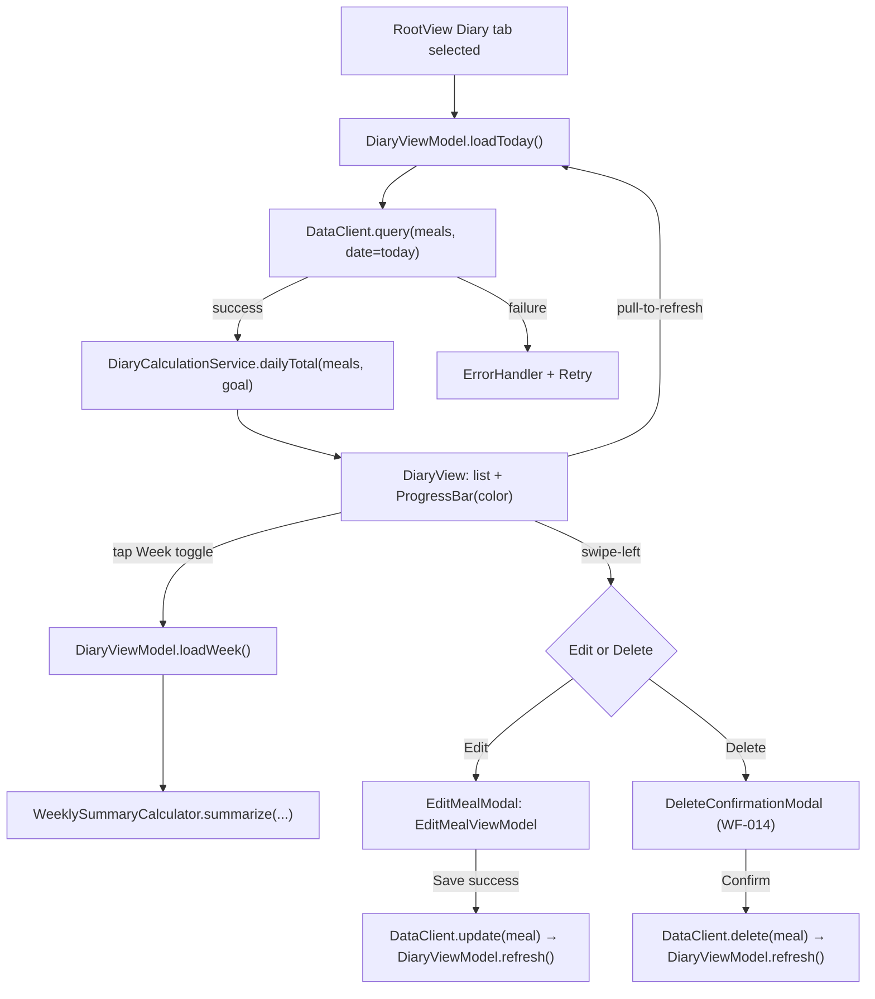
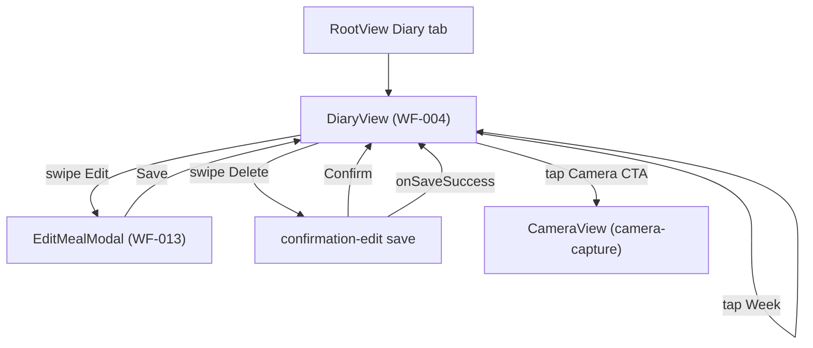

# diary-logging - Technical Design

> **Implementation intent:** *Logic-first* for the calculation services (daily/weekly totals, color threshold), then ViewModel, then views. Reuses `CaloButton` + `ProgressBar` + `ErrorHandler` + `AppEnvironment` from `shared-foundations`; reuses `MacroCalculationService` from `confirmation-edit`; depends on `DataClient` from `shared-foundations` for CRUD; `OfflineSyncService` from `shared-foundations` for queued writes. No new SPM deps.

## 1. Overview

### Goals
- Render the Diary (WF-004) with today's meal list, weekly toggle, and a color-coded `ProgressBar` (green ≤100%, amber 100–110%, red >110%) comparing consumed vs goal.
- Support swipe-left on a meal row to open Edit modal (WF-013, FR-015/016) or Delete confirm (WF-014, FR-017).
- Refresh the view on save/edit/delete (own and from `confirmation-edit`) and on pull-to-refresh; work offline with a "Last updated" indicator.

### In-scope / out-of-scope
**In-scope:** `DiaryEntry` value type, `DiaryCalculationService` (daily totals, weekly aggregates, color threshold), `DiaryViewModel` (state machine, fetch, edit, delete, refresh), `WeeklySummaryCalculator`, `EditMealViewModel` (reuses `confirmation-edit` mutation), `DiaryView` (WF-004), `EditMealModal` (WF-013), `DeleteConfirmationModal` (WF-014), `MealListItem` (with swipe actions), `ProgressBar` consumer, pull-to-refresh, empty/error/loading states, offline staleness indicator.

**Out-of-scope:** Photo capture (`camera-capture`), AI recognition (`ai-recognition`), Confirmation save flow (`confirmation-edit`), Dashboard weekly chart (`dashboard-view`), paywall, subscription, onboarding.

### AC Coverage Summary
This design addresses **all 30 acceptance criteria** from `requirements.md`:
- **REQ-001 → §7.1:** AC-001.1, AC-001.2, AC-001.3, AC-001.4
- **REQ-002 → §7.2:** AC-002.1, AC-002.2, AC-002.3, AC-002.4
- **REQ-003 → §7.3:** AC-003.1, AC-003.2, AC-003.3, AC-003.4, AC-003.5
- **REQ-004 → §7.4:** AC-004.1, AC-004.2, AC-004.3, AC-004.4
- **REQ-005 → §7.5:** AC-005.1, AC-005.2, AC-005.3, AC-005.4, AC-005.5
- **REQ-006 → §7.6:** AC-006.1, AC-006.2, AC-006.3, AC-006.4
- **REQ-007 → §7.7:** AC-007.1, AC-007.2, AC-007.3, AC-007.4

## 2. Architecture

### Runtime boundaries
```
RootView (Diary tab) ─▶ DiaryView ─▶ DiaryViewModel (@MainActor)
                                          │  ├─ DataClient (shared-foundations) [query, update, delete]
                                          │  ├─ OfflineSyncService (shared-foundations) [queue + flush]
                                          │  ├─ DiaryCalculationService (pure)
                                          │  ├─ WeeklySummaryCalculator (pure)
                                          │  └─ AppEnvironment.errors (ErrorHandler)
                                          ├─ onTapEdit(meal) ─▶ EditMealModal (WF-013) ─▶ EditMealViewModel
                                          └─ onTapDelete(meal) ─▶ DeleteConfirmationModal (WF-014)

Confirmation save (confirmation-edit.onSaveSuccess) ─▶ DiaryViewModel.refresh()
```

### Module responsibilities
| Module | Responsibility |
|--------|----------------|
| `DiaryEntry` | Value type: `{ date: Date, meals: [MealLog], totalCalories, totalMacros, goalCalories, progressRatio, colorTier }` |
| `WeeklySummary` | Value type: `{ weekStart: Date, days: [DailyTotal], weeklyAverage, weeklyTotal }` |
| `DiaryCalculationService` | Pure: `dailyTotal(meals, goal) -> (consumed, remaining, ratio, tier)`; `colorTier(for ratio) -> ColorTier` |
| `WeeklySummaryCalculator` | Pure: `summarize(logs, weekStart, goal) -> WeeklySummary` (Mon–Sun, empty days = 0) |
| `DiaryViewModel` | `@MainActor`; `loadToday()`, `loadWeek()`, `refresh()`, `edit(meal)`, `delete(meal)`, `openEditModal`, `openDeleteModal`; published `state` + `viewMode`; `onAppear` triggers fetch |
| `EditMealViewModel` | Wraps meal; reuses `MacroCalculationService`; `save()` via `DataClient.update`; cancel discards |
| `DiaryView` | WF-004: `ProgressBar` + list + Week toggle + pull-to-refresh + empty/error/offline states |
| `MealListItem` | Row with name, calo, time + `.swipeActions` (Edit, Delete) |
| `EditMealModal` | WF-013: form (reuses pattern from `confirmation-edit`); Save / Cancel / Delete (within modal) |
| `DeleteConfirmationModal` | WF-014: warning + Cancel + Delete (destructive) |
| `DiaryEmptyState` | "No meals logged yet" + Camera CTA |
| `OfflineBadge` | "Last updated X min ago" banner |

### Data flow


## 3. Components and Interfaces

| Component | Type | Contract | File |
|-----------|------|----------|------|
| `DiaryEntry` | struct | `{ date: Date, meals: [MealLog], consumed: Int, goal: Int, remaining: Int, ratio: Double, tier: ColorTier }` | `Features/Diary/Models/DiaryEntry.swift` |
| `WeeklySummary` | struct | `{ weekStart: Date, days: [DailyTotal], weeklyAverage: Int, weeklyTotal: Int }` | `Features/Diary/Models/WeeklySummary.swift` |
| `ColorTier` | enum | `.green / .amber / .red / .unknown` | `Features/Diary/Models/ColorTier.swift` |
| `DiaryCalculationService` | struct (pure) | `dailyTotal(_ meals: [MealLog], goal: Int) -> (consumed, remaining, ratio, tier)`; `tier(forRatio: Double) -> ColorTier` | `Features/Diary/Services/DiaryCalculationService.swift` |
| `WeeklySummaryCalculator` | struct (pure) | `summarize(_ logs: [MealLog], weekStart: Date, goal: Int) -> WeeklySummary` (Mon–Sun; empty days = 0) | `Features/Diary/Services/WeeklySummaryCalculator.swift` |
| `DiaryViewModel` | `@MainActor ObservableObject` | `viewMode: .daily / .week`; `state: DiaryState`; `loadToday()`, `loadWeek()`, `refresh()`, `applyExternalSave(meal)` (called by `confirmation-edit.onSaveSuccess`); `openEdit(meal)`, `openDelete(meal)`; `commitEdit(updatedMeal)`, `commitDelete(mealId)` | `Features/Diary/ViewModels/DiaryViewModel.swift` |
| `DiaryState` | enum | `.loading / .loaded(DiaryEntry) / .week(WeeklySummary) / .empty / .error(AppError) / .offline(DiaryEntry, lastUpdated: Date)` | same |
| `EditMealViewModel` | `@MainActor ObservableObject` | `load(meal)`; mutates via `MacroCalculationService`; `save() -> Bool`; `cancel()`; callbacks `onSaved(MealLog)` | `Features/Diary/ViewModels/EditMealViewModel.swift` |
| `DiaryView` | SwiftUI `View` | Hosts `ProgressBar`, `MealListItem` list, Week toggle, pull-to-refresh, empty/error/offline | `Features/Diary/Views/DiaryView.swift` |
| `MealListItem` | SwiftUI `View` | Row with meal name, calories, time, `.swipeActions` (Edit, Delete) | `Features/Diary/Views/MealListItem.swift` |
| `EditMealModal` | SwiftUI `View` | WF-013 form (ingredient list, portion, macro editor) + Save/Cancel/Delete | `Features/Diary/Views/EditMealModal.swift` |
| `DeleteConfirmationModal` | SwiftUI `View` | WF-014: warning + Cancel + Delete (destructive) | `Features/Diary/Views/DeleteConfirmationModal.swift` |
| `DiaryEmptyState` | SwiftUI `View` | "No meals logged yet" + Camera CTA | `Features/Diary/Views/DiaryEmptyState.swift` |
| `OfflineBadge` | SwiftUI `View` | "Last updated X min ago" | `Features/Diary/Views/OfflineBadge.swift` |

### Reuse Plan (ios-components Reuse-First Gate)
- **Reuse:** `CaloButton` (Primary/Secondary/Destructive from `shared-foundations`) for Save / Cancel / Delete / Camera CTA; `ProgressBar` (color-themed) from `shared-foundations` for the daily/weekly progress; `ErrorHandler` + `AppError` for fetch/edit/delete failures; `AppEnvironment` for DI (`DataClient`, `OfflineSyncing`, `ErrorPresenting`, `AuthService.getUser`); `MacroCalculationService` from `confirmation-edit` for edit-modal recalc; `MealLog` from `shared-foundations`; `OfflineSyncService` from `shared-foundations` for queued writes.
- **New (justified):** `DiaryCalculationService` and `WeeklySummaryCalculator` (pure aggregation + color threshold — not in shared-foundations), `DiaryViewModel` and `EditMealViewModel` (feature orchestration), `DiaryView` + subviews (`MealListItem`, `EditMealModal`, `DeleteConfirmationModal`, `DiaryEmptyState`, `OfflineBadge`) — WF-004/013/014. No generic component duplicated.

## 4. Data Models and Contracts

- `MealLog` (shared-foundations): `id, userId, date, mealName, totalCalories, macros(P,C,F), ingredients[]`.
- `DiaryEntry`: derived; `consumed = sum(meals.totalCalories)`, `remaining = goal - consumed` (negative allowed per BR-014.3 → "X cal over"), `ratio = goal > 0 ? consumed / Double(goal) : 0`, `tier = DiaryCalculationService.tier(forRatio:)`.
- `ColorTier` thresholds: `ratio ≤ 1.0 → .green`, `1.0 < ratio ≤ 1.1 → .amber`, `ratio > 1.1 → .red` (BR-012.2, BR-014.2). Goal = 0 → `.unknown` (handled via default 2000 per AC-003.5).
- `WeeklySummary`: 7 entries Mon..Sun; empty days = `DailyTotal(0, 0, 0)`. `weeklyAverage = total / 7` (integer). `weekStart` = Monday of current week (BR-013.1, NFR-DL-008).
- Read path: `DataClient.query(meals, predicate: { date in today } )` for daily; `{ date in [Mon..Sun] }` for week.
- Write paths: edit → `DataClient.update(MealLog)`; delete → `DataClient.delete(mealId)`; refresh on `confirmation-edit.onSaveSuccess` via injected `applyExternalSave(meal)` (AC-007.1).
- Edit validation: same as `confirmation-edit` — ≥1 selected ingredient, total > 0, no all-zero macro override (VR-015.1).
- Delete confirmation: required by `WF-014`; no in-place optimistic removal without a successful response OR explicit optimistic-with-rollback strategy (AC-006.4).
- Offline: `OfflineSyncService` queues writes when offline and surfaces a non-blocking banner; `Last updated X min ago` is shown whenever the cache age > 30s (NFR-008, AC-007.3).

## 5. Error Handling

| Failure mode | Detection | User-visible behavior | Recovery |
|--------------|-----------|-----------------------|----------|
| Daily fetch fails | `DataClient.query` throws | `DiaryState.error(AppError)` with Retry; never silent | Retry button (AC-001.4) |
| Weekly fetch fails | `DataClient.query` throws | Error banner; "Switch to Daily" secondary | Retry (AC-002.1) |
| Goal not set | `User.calorieTarget == nil` | Use 2000 default + onboarding prompt | "Complete profile" link (AC-003.5) |
| Meal deleted by another user | `DataClient.update/delete` returns not-found | Close modal + "Meal deleted by another user" | Dismiss (AC-004.4) |
| Edit validation fails (0 selected / total=0) | `EditMealViewModel` | Block save, show specific message | Adjust in modal (AC-005.4) |
| Edit save fails | `DataClient.update` throws | Recoverable error + Retry; modal stays open; edits preserved | Retry (AC-005.5) |
| Delete fails | `DataClient.delete` throws | Keep row, recoverable error + Retry | Retry (AC-006.4) |
| Stale cache | `cacheAge > 30s` AND offline | "Last updated X min ago" badge | Pull to refresh (AC-007.3) |
| Queued write fails after N retries | `OfflineSyncService` reports failure | Non-blocking error banner per meal | User Retry / discard (AC-007.4) |

## 6. Testing Strategy

Unit + property tests under `calo-ai-testTests/`:
- `DiaryCalculationServiceTests.swift` — daily total; remaining; color tier grid at ratio ∈ {0, 0.5, 0.99, 1.0, 1.01, 1.1, 1.11, 2.0}; goal=0 fallback (P1, P2, P3, P4; AC-003.1/.2/.3/.4/.5; NFR-DL-004).
- `WeeklySummaryCalculatorTests.swift` — Mon–Sun generation; empty days = 0; weekly average; partial-week logs; week start = Monday for any given date (P5, P6; AC-002.1/.2; NFR-DL-008).
- `DiaryViewModelTests.swift` (fakes for `DataClient`, `OfflineSyncing`, `AuthService`) — daily load success/failure/empty; week toggle; refresh; `applyExternalSave` triggers refresh; edit → update; delete → delete; swipe action reveal; offline badge after cache age (P7, P8, P9, P10, P11, P12; AC-001.*, AC-002.*, AC-004.*, AC-005.*, AC-006.*, AC-007.*).
- `EditMealViewModelTests.swift` — load pre-populates; mutate recalcs; validation gates; save success/failure; cancel discards (P13, P14; AC-005.*).
- `ProgressBarColorTests.swift` — pbt over ratio grid (P4; NFR-DL-004).

Build checkpoint: XcodeBuildMCP `discover_projs -> list_schemes -> build_sim` after each phase. Manual smoke for swipe gestures and pull-to-refresh on simulator.

## 7. Feature Breakdown (iOS-first)

### 7.1 Daily Meal Log List
- **ACs Implemented:** AC-001.1, AC-001.2, AC-001.3, AC-001.4
- **Source:** FR-012, UC-011, WF-004
- **What:** `DiaryViewModel.loadToday()` queries today's meals; `DiaryView` renders the list via `MealListItem`; `DiaryEmptyState` for none; skeleton/spinner ≤500ms.
- **States:** loading / loaded / empty / error / offline.
- **UX expectations:** Skeleton shimmer; pull-to-refresh; "Last updated" badge when offline; a11y "Today's meals".
- **Files:** `Features/Diary/Views/DiaryView.swift`, `Features/Diary/ViewModels/DiaryViewModel.swift`, `Features/Diary/Views/DiaryEmptyState.swift`.

### 7.2 Weekly Summary View (Toggle)
- **ACs Implemented:** AC-002.1, AC-002.2, AC-002.3, AC-002.4
- **Source:** FR-013, UC-012, WF-004
- **What:** `viewMode == .week` → `DiaryViewModel.loadWeek()` → `WeeklySummaryCalculator.summarize(...)` → 7 rows + footer (avg + total); tap a row expands to reveal meals (read-only).
- **States:** loading / loaded / empty.
- **UX expectations:** a11y "Weekly summary, Monday 1800 cal…"; sticky toggle; smooth transition.
- **Files:** `Features/Diary/Views/DiaryView.swift` (week layout), `Features/Diary/Services/WeeklySummaryCalculator.swift`.

### 7.3 Progress Bar vs Goal (Color Threshold)
- **ACs Implemented:** AC-003.1, AC-003.2, AC-003.3, AC-003.4, AC-003.5
- **Source:** FR-014, UC-013, BR-012.2, BR-014.2
- **What:** `ProgressBar` (from `shared-foundations`) reads `DiaryEntry.ratio`; `DiaryCalculationService.tier(forRatio:)` decides color. Hero zone of `DiaryView`.
- **States:** green / amber / red / unknown.
- **UX expectations:** Color contrast WCAG 2.1 AA (NFR-009); a11y "Progress, 1800 of 2000, 90 percent, on track".
- **Files:** `Features/Diary/Services/DiaryCalculationService.swift`, `Features/Diary/Views/DiaryView.swift`.

### 7.4 Swipe-to-Edit Action
- **ACs Implemented:** AC-004.1, AC-004.2, AC-004.3, AC-004.4
- **Source:** FR-015, UC-014, WF-013, WF-004
- **What:** `MealListItem` uses SwiftUI `.swipeActions(edge: .trailing)`; Edit button opens `EditMealModal`; missing meal → `ErrorHandler`.
- **States:** `editing / not-editing / meal-missing`.
- **UX expectations:** Reveal within 200ms; a11y "Edit meal, Pasta Carbonara".
- **Files:** `Features/Diary/Views/MealListItem.swift`, `Features/Diary/Views/EditMealModal.swift`, `Features/Diary/ViewModels/EditMealViewModel.swift`.

### 7.5 Edit Modal State & Save
- **ACs Implemented:** AC-005.1, AC-005.2, AC-005.3, AC-005.4, AC-005.5
- **Source:** FR-015, FR-016, UC-014, WF-013
- **What:** `EditMealViewModel.load(meal)`; user mutates via same `MacroCalculationService`; `save()` validates → `DataClient.update` → on success `onSaved(MealLog)` → `DiaryViewModel.refresh()`.
- **States:** `editing / saving / saved / failed`.
- **UX expectations:** Save spinner; failure preserves edits; a11y "Save changes to meal".
- **Files:** `Features/Diary/ViewModels/EditMealViewModel.swift`, `Features/Diary/Views/EditMealModal.swift`.

### 7.6 Swipe-to-Delete with Confirmation
- **ACs Implemented:** AC-006.1, AC-006.2, AC-006.3, AC-006.4
- **Source:** FR-017, UC-015, WF-014
- **What:** `MealListItem` swipe Delete → `DeleteConfirmationModal`; Confirm → `DiaryViewModel.commitDelete(id)` → `DataClient.delete` → `refresh()`.
- **States:** `confirming / deleting / deleted / failed`.
- **UX expectations:** Destructive button red; cancel preserves; failure keeps row + Retry.
- **Files:** `Features/Diary/Views/DeleteConfirmationModal.swift`, `Features/Diary/ViewModels/DiaryViewModel.swift`.

### 7.7 Refresh, Offline & Cross-Feature Sync
- **ACs Implemented:** AC-007.1, AC-007.2, AC-007.3, AC-007.4
- **Source:** NFR-007, NFR-008, confirmation-edit save handoff
- **What:** `DiaryViewModel.applyExternalSave(meal)` (injected callback from `RootView`) appends + recomputes; pull-to-refresh re-fetches; `OfflineSyncing` queues failed writes; `OfflineBadge` shows "Last updated X min ago" when cache age > 30s and offline.
- **States:** refreshing / offline / sync-pending.
- **UX expectations:** Pull gesture haptic; sync banner; a11y "Diary, last updated 5 minutes ago".
- **Files:** `Features/Diary/ViewModels/DiaryViewModel.swift`, `Features/Diary/Views/OfflineBadge.swift`.

## 8. Navigation and Integration

### Flow diagram


### Navigation table
| From | To | Trigger | Data |
|------|----|---------|------|
| RootView Diary tab | DiaryView | tab select | AppEnvironment |
| DiaryView | EditMealModal | swipe-left Edit tap | `MealLog` |
| DiaryView | DeleteConfirmationModal | swipe-left Delete tap | `MealLog.id` |
| DiaryView | DiaryView (week) | tap Week toggle | viewMode=.week |
| EditMealModal | DiaryView | Save success | updated `MealLog` |
| DeleteConfirmationModal | DiaryView | Confirm Delete | deleted `id` |
| DiaryView | CameraView | tap empty-state CTA | none |

### Integration rules
- `DiaryView` replaces `PlaceholderView("Diary")` in `RootView` (one-line seam from `project-structure`).
- `confirmation-edit.onSaveSuccess(MealLog)` is wired to `DiaryViewModel.applyExternalSave(_:)` by `RootView` so the diary updates without a manual reload.
- `EditMealViewModel` reuses `MacroCalculationService` from `confirmation-edit`; both VMs share the same validation rules (BR-004.1, BR-004.2, VR-007.2).
- `AuthService.getUser().calorieTarget` supplies the goal; fallback 2000 if nil (AC-003.5).
- All writes go through `DataClient`; offline writes are queued by `OfflineSyncService` (NFR-007).
- Color thresholds are the SINGLE source of truth in `DiaryCalculationService.tier(forRatio:)`; `ProgressBar` reads `ColorTier` only.

## 9. Correctness Properties

| Property | Type | Validates AC | Statement |
|---|---|---|---|
| P1 | Invariant | AC-003.1, AC-003.5 | `dailyTotal(meals, goal)` returns `consumed = sum(meals.totalCalories)`, `remaining = goal - consumed` (may be negative), `ratio = goal > 0 ? consumed / goal : 0`; if `goal == 0` the caller is responsible for substituting the 2000 default. |
| P2 | Invariant | AC-003.2, AC-003.3, AC-003.4, NFR-DL-004 | `tier(forRatio:)` returns `.green` for `ratio ≤ 1.0`, `.amber` for `1.0 < ratio ≤ 1.1`, `.red` for `ratio > 1.1`; boundary `ratio == 1.0` is green and `ratio == 1.1` is amber (closed/open). |
| P3 | Invariant | AC-001.1, AC-002.2 | Daily total equals the sum of `meals.totalCalories`; weekly total equals the sum of the 7 daily totals; weekly average = `weeklyTotal / 7` (integer division). |
| P4 | Invariant | AC-002.1, AC-002.3, NFR-DL-008 | `summarize(...)` always produces exactly 7 days Mon..Sun for any input date; days with no logs have `total == 0`. |
| P5 | Invariant | AC-001.3 | `loadToday()` with zero meals transitions to `DiaryState.empty` and renders the empty-state CTA. |
| P6 | Invariant | AC-001.4 | `loadToday()` on `DataClient.query` failure transitions to `DiaryState.error` and never silently renders stale data as fresh. |
| P7 | Invariant | AC-002.4 | Tapping a day row in week view expands it to reveal its meals; collapsing the row hides the meals; no other state is affected. |
| P8 | Invariant | AC-004.1, AC-004.2 | Swipe-left on `MealListItem` reveals Edit and Delete actions; tapping Edit opens `EditMealModal` pre-populated with the meal. |
| P9 | Invariant | AC-004.4 | If `DataClient.update(mealId)` returns not-found, `EditMealViewModel` closes the modal and `DiaryViewModel.refresh()` runs. |
| P10 | Round-trip | AC-005.1, AC-005.2, AC-005.3, AC-005.4, AC-005.5 | After editing a meal and saving successfully, `DataClient.update(meal)` was called once with the new values, the modal closed, the row reflects the new totals, and the progress bar ratio is recomputed from the new total. |
| P11 | Invariant | AC-005.4 | Edit-modal save is blocked iff `selectedCount == 0` OR `totalCalories < 1` OR `manualMacros == (0,0,0)`; specific message is shown. |
| P12 | Invariant | AC-006.1, AC-006.2, AC-006.3, AC-006.4 | Delete requires confirmation; on confirm `DataClient.delete(id)` is called; on success the row is removed and totals recomputed; on failure the row is preserved and a Retry is offered. |
| P13 | Round-trip | AC-007.1 | After `applyExternalSave(meal)`, the new meal appears in today's list and the daily total + progress bar reflect it without a manual refresh. |
| P14 | Invariant | AC-007.3, NFR-DL-005 | When offline, `DiaryState.offline(DiaryEntry, lastUpdated)` is rendered with a "Last updated X min ago" badge; queued writes flush when connectivity returns. |
| P15 | Invariant | AC-007.2 | Pull-to-refresh triggers `loadToday()` and the list is replaced; completion within 2s for ≤50 meals. |
