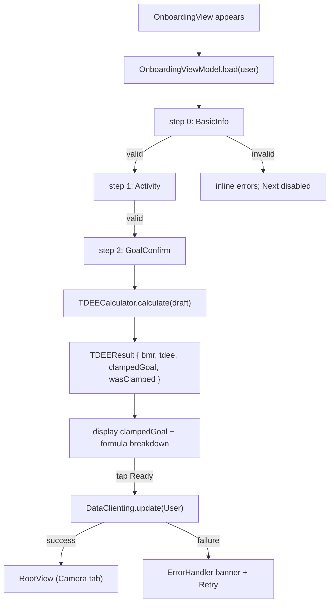
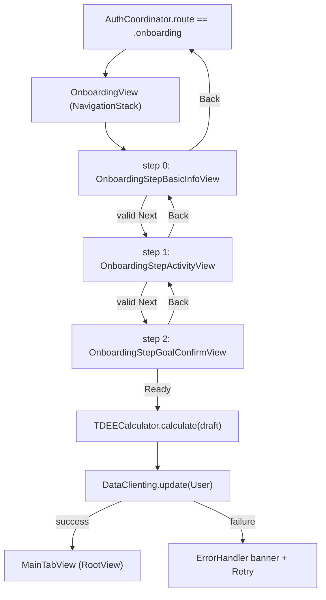

# onboarding-form - Technical Design

> **Implementation intent:** *Hybrid*. Multi-step form orchestrator + pure utility. Order: `UserProfileDraft` (in-progress model) → `TDEECalculator` (pure Mifflin-St Jeor utility) → `OnboardingViewModel` (state machine + validation + save) → step views → assembly + routing. No third-party SDK; persistence uses `DataClient` from `shared-foundations`.

## 1. Overview

### Goals
- Onboarding screen (WF-008) drives a 3-step form: Basic Info (height / weight / sex / age + goal + rate) → Activity Level → Computed Calorie Goal.
- Pure `TDEECalculator` utility implements **Mifflin-St Jeor** BMR formula, applies the activity multiplier (BR-019.1), applies the Lose / Maintain / Gain adjustment (BR-020.2), and clamps to [1000, 3500] kcal safety bounds (BR-020.3).
- `OnboardingViewModel` validates each step (VR-018.* / VR-019.1 / VR-020.1), persists the in-progress `UserProfileDraft`, and saves the completed `User` (with `onboardingComplete=true` + `calorieTarget`) via `DataClient.update(_:)`.
- On success, route to RootView (Camera tab). On failure, surface a recoverable `ErrorHandler` banner with retry.

### In-scope / out-of-scope
**In-scope:** `UserProfileDraft` model; `TDEECalculator` utility (Mifflin-St Jeor); `OnboardingViewModel` (step state machine + validation + save); step views (`OnboardingStepBasicInfoView`, `OnboardingStepActivityView`, `OnboardingStepGoalConfirmView`); `OnboardingProgressIndicator`; `OnboardingView` (multi-step container via `NavigationStack`); integration of `User` / `DataClienting` / `ErrorPresenting` from `shared-foundations`; integration with `authentication` (consumes signed-in `User`).
**Out-of-scope:** Splash / Sign in (authentication); Camera / Diary / Paywall; editing profile after onboarding (account-management); subscription / paywall.

### AC Coverage Summary
Addresses **all 17 acceptance criteria**:
- **REQ-001 → §7.1:** AC-001.1, AC-001.2, AC-001.3, AC-001.4
- **REQ-002 → §7.2:** AC-002.1, AC-002.2, AC-002.3, AC-002.4
- **REQ-003 → §7.3:** AC-003.1, AC-003.2, AC-003.3, AC-003.4
- **REQ-004 → §7.4:** AC-004.1, AC-004.2, AC-004.3, AC-004.4, AC-004.5

## 2. Architecture

### Runtime boundaries
```
AuthCoordinator.route == .onboarding
        │
        ▼
   OnboardingView (NavigationStack)
        │
        ▼
   OnboardingViewModel ─┬─► validates step
        │                ├─► updates UserProfileDraft (in-memory)
        │                ├─► On step 3 "Ready":
        │                │     ├─► TDEECalculator.calculate(draft) → Int
        │                │     ├─► User { ..., calorieTarget, onboardingComplete=true }
        │                │     └─► DataClienting.update(User) → RootView
        │                └─► ErrorHandler banner on failure
        ▼
   Step views: BasicInfo | Activity | GoalConfirm
```

### Module responsibilities
| Module | Responsibility |
|--------|----------------|
| `UserProfileDraft` | In-progress struct: `height`, `weight`, `sex`, `age`, `goal`, `goalRateLbPerWeek`, `activityLevel`; mutators per step; `validate(step:)` returns `AppError?`. |
| `TDEECalculator` | Pure enum/struct utility: `calculate(draft: UserProfileDraft) -> TDEEResult`; Mifflin-St Jeor + multiplier + adjustment + clamp. No side effects. |
| `TDEEResult` | `{ bmr: Double, tdee: Double, rawGoal: Int, clampedGoal: Int, wasClamped: Bool, formulaBreakdown: String }`. |
| `OnboardingViewModel` | `@MainActor ObservableObject`; `@Published currentStep`; `@Published draft`; `next()` / `back()` / `selectActivity()` / `setGoal()` / `save()`; deps: `DataClienting`, `ErrorPresenting`, optional `User` prefill. |
| `OnboardingView` | SwiftUI `NavigationStack` hosting 3 step views + `OnboardingProgressIndicator`; "Next"/"Back" `CaloButton`s. |
| `OnboardingStepBasicInfoView` | Step 1 form (height/weight/age/sex inputs + goal + rate stepper). |
| `OnboardingStepActivityView` | Step 2 radio list. |
| `OnboardingStepGoalConfirmView` | Step 3 goal display + formula breakdown + "Ready to start logging" `CaloButton`. |
| `OnboardingProgressIndicator` | 1/3, 2/3, 3/3 progress chip. |

### Data flow


## 3. Components and Interfaces

| Component | Type | Contract | File |
|-----------|------|----------|------|
| `UserProfileDraft` | struct | `var height, weight, age, sex, goal, goalRateLbPerWeek, activityLevel`; `enum Step { case basicInfo, activity, goalConfirm }`; `validate(step:) -> AppError?` | `Features/Onboarding/Models/UserProfileDraft.swift` |
| `Sex` | enum | `case male, female, other`; `bmrConstant: Double` returns +5 / -161 / +1 (per Mifflin-St Jeor for male / female / "other" / non-binary — see §4) | `Features/Onboarding/Models/Sex.swift` |
| `WeightGoal` | enum | `case lose, maintain, gain`; `dailyAdjustmentKcal(rateLbPerWeek:) -> Int` returns −rate/0.5 × 500, etc. (BR-020.2) | `Features/Onboarding/Models/WeightGoal.swift` |
| `ActivityLevel` | enum | `case sedentary, light, moderate, veryActive`; `multiplier: Double` returns 1.375 / 1.55 / 1.725 / 1.9 (BR-019.1) | `Features/Onboarding/Models/ActivityLevel.swift` |
| `TDEECalculator` | enum (namespace) | `static func calculate(draft: UserProfileDraft) -> TDEEResult` | `Features/Onboarding/Utils/TDEECalculator.swift` |
| `TDEEResult` | struct | `bmr, tdee, rawGoal, clampedGoal, wasClamped, formulaBreakdown` | same |
| `OnboardingViewModel` | `@MainActor ObservableObject` | `@Published currentStep: Step`; `@Published draft`; `next()`, `back()`, `setBasicInfo(...)`, `setGoal(...)`, `setActivity(...)`, `save()`; deps: `DataClienting`, `ErrorPresenting` | `Features/Onboarding/ViewModels/OnboardingViewModel.swift` |
| `OnboardingView` | SwiftUI `View` | `NavigationStack` host for step views + progress indicator + Next/Back | `Features/Onboarding/Views/OnboardingView.swift` |
| `OnboardingStepBasicInfoView` | SwiftUI `View` | numeric inputs + goal selector + rate stepper; inline validation messages | `Features/Onboarding/Views/OnboardingStepBasicInfoView.swift` |
| `OnboardingStepActivityView` | SwiftUI `View` | 4 radio rows with description | `Features/Onboarding/Views/OnboardingStepActivityView.swift` |
| `OnboardingStepGoalConfirmView` | SwiftUI `View` | big calorie number + formula breakdown + safety-bounds warning + "Ready to start logging" `CaloButton` | `Features/Onboarding/Views/OnboardingStepGoalConfirmView.swift` |
| `OnboardingProgressIndicator` | SwiftUI `View` | "Step X of 3" + segmented bar | `Features/Onboarding/Views/OnboardingProgressIndicator.swift` |

### Reuse Plan (ios-components Reuse-First Gate)
- **Reuse:** `User` model (shared-foundations) — final persisted shape; `DataClienting` (shared-foundations) — `update(User)`; `ErrorHandler` / `ErrorPresenting` (shared-foundations) — recoverable banner + retry; `CaloButton` (shared-foundations) — Next/Back/Ready; `AppEnvironment` (project-structure + shared-foundations) — DI source; Auth-gated entry: receives `User` from `authentication`'s `AuthCoordinator.route == .onboarding`.
- **New (justified):** `UserProfileDraft`, `Sex`, `WeightGoal`, `ActivityLevel`, `TDEECalculator` (onboarding-domain models + pure utility — no shared equivalent); the 3 step views + `OnboardingProgressIndicator` (onboarding-specific UI). No generic component duplicated.

## 4. Data Models and Contracts

### `UserProfileDraft`
| Field | Type | Notes / Validation |
|-------|------|--------------------|
| `height` | `Double?` (cm) | 100–250 (VR-018.1; expanded range vs shared-foundations BR-018.1 120–220 — onboarding accepts 100–250 for younger users / non-binary edge cases; persisted model still enforces shared-foundations `validate()`) |
| `weight` | `Double?` (kg) | 30–300 (VR-018.2) |
| `age` | `Int?` | 13–100 (per PRD §9 — no minors) |
| `sex` | `Sex?` | required (VR-018.3) |
| `goal` | `WeightGoal?` | required |
| `goalRateLbPerWeek` | `Double` | −1.0 ... +1.0 in 0.25 steps; hidden when `goal == .maintain` |
| `activityLevel` | `ActivityLevel?` | required for TDEE |

`validate(step:)` returns the first `AppError.validation("...")` that fails; nil means step valid.

### Enums
```swift
enum Sex { case male, female, other
    var bmrConstant: Double {
        switch self {
        case .male:   return  +5
        case .female: return -161
        case .other:  return  +1   // midpoint between male +5 and female −161 (PRD §9 "non-binary midpoint")
        }
    }
}

enum WeightGoal { case lose, maintain, gain
    func dailyAdjustmentKcal(rateLbPerWeek: Double) -> Int {
        switch self {
        case .maintain: return 0
        case .lose, .gain:
            // 1 lb of fat ≈ 3500 kcal; 0.5 lb/week → ±500 kcal/day (BR-020.2)
            let kcal = Int((rateLbPerWeek * 3500.0 / 7.0).rounded())
            return self == .lose ? -abs(kcal) : abs(kcal)
        }
    }
    var allowsRate: Bool { self != .maintain }
}

enum ActivityLevel { case sedentary, light, moderate, veryActive
    var multiplier: Double {
        switch self {
        case .sedentary:  return 1.375
        case .light:      return 1.55
        case .moderate:   return 1.725
        case .veryActive: return 1.9
        }
    }
}
```

### `TDEECalculator`
```text
TDEECalculator.calculate(draft: UserProfileDraft) -> TDEEResult

  guard let w = draft.weight, let h = draft.height,
        let a = draft.age,    let s = draft.sex,
        let g = draft.goal,   let al = draft.activityLevel
  else { return .invalid("Missing required fields") }

  let bmr     = 10*w + 6.25*h - 5*Double(a) + s.bmrConstant           // BR-020.1
  let tdee    = bmr * al.multiplier                                    // BR-019.1
  let adjust  = g.dailyAdjustmentKcal(rateLbPerWeek: draft.goalRateLbPerWeek) // BR-020.2
  let raw     = Int((tdee + Double(adjust)).rounded())
  let clamped = max(1000, min(3500, raw))                              // BR-020.3
  return TDEEResult(
    bmr: bmr, tdee: tdee,
    rawGoal: raw, clampedGoal: clamped,
    wasClamped: clamped != raw,
    formulaBreakdown: "BMR = 10·\(w) + 6.25·\(h) − 5·\(a) + \(s.bmrConstant) = \(Int(bmr.rounded())); "
                    + "TDEE = BMR × \(al.multiplier) = \(Int(tdee.rounded())); "
                    + "Goal = TDEE \(adjust >= 0 ? "+" : "")\(adjust) = \(raw)"
                    + (clamped != raw ? "; clamped to \(clamped)" : "")
  )
```

### Persistence
On `save()`:
1. Compute `TDEEResult`.
2. Build final `User` from auth-provided `User` (preserves id/email/name) + draft (height/weight/age/sex/goal/activityLevel) + `calorieTarget: clampedGoal` + `onboardingComplete: true`.
3. Call `DataClienting.update(User)`; on success route to RootView; on failure surface `ErrorHandler` banner + retry (AC-004.5).

## 5. Error Handling

| Failure mode | Detection | User-visible behavior | Recovery |
|--------------|-----------|-----------------------|----------|
| Out-of-range field | `UserProfileDraft.validate(step:)` returns `AppError.validation` | Inline error under the offending field | Edit field (AC-001.3) |
| Missing required field | `validate()` | "Please complete all fields" | Fill field (AC-001.4) |
| Activity not selected | `validate()` on step 2 | "Please select activity level" | Tap a radio (AC-002.4) |
| TDEE clamp triggered | `wasClamped == true` | Warning chip "Goal adjusted to safety bounds" | Continue (AC-004.3) |
| Save network error | `DataClienting.update` throws `AppError.network` | `ErrorHandler` banner "Couldn't save profile. Retry." | "Retry" `CaloButton` (AC-004.5) |
| Save server error | `AppError.server` | Same banner | Retry; banner persists until success |
| Save validation rejected | `AppError.validation` | Field-level message | Fix field + Retry |
| Empty draft on save | VM guard | Defensive — should not happen; fall back to step 0 | Force user to re-enter |

## 6. Testing Strategy

Unit tests under `calo-ai-testTests/`:
- `UserProfileDraftTests.swift` — field-level validation: height/weight/age/sex/goal ranges accept/reject; rate bounds; `validate(step:)` per step (AC-001.2, AC-001.3, AC-001.4, AC-002.4; P1, P2).
- `SexEnumTests.swift` — `bmrConstant` returns +5 / -161 / +1 (AC-004.1; P3).
- `WeightGoalEnumTests.swift` — `dailyAdjustmentKcal` for Lose/Maintain/Gain and rate mapping (AC-003.1, AC-003.2, AC-003.3; P4, P5).
- `ActivityLevelEnumTests.swift` — multipliers match BR-019.1 (AC-002.2; P6).
- `TDEECalculatorTests.swift` — Mifflin-St Jeor formula on representative inputs (e.g., male 30y 80kg 180cm Moderate → BMR ≈ 1780, TDEE ≈ 3069, Maintain goal = 3069); clamp behavior below 1000 and above 3500; `wasClamped` flag (AC-004.1, AC-004.2, AC-004.3; P3, P7, P8).
- `OnboardingViewModelTests.swift` — fake `DataClienting`: step transitions; validation gating; `save()` success → calls `update(User)` with `onboardingComplete=true` and `calorieTarget` matching clamped value; failure → banner + retry leaves draft intact (AC-002.3, AC-003.4, AC-004.4, AC-004.5; P9, P10, P11).
- `PersistenceAtomicityTests.swift` — `update(User)` invoked exactly once per save; `User.id` preserved from auth-supplied user (no duplicate creation).

Build checkpoint: XcodeBuildMCP `build_sim` after each phase. TDEE math verified deterministically (pure function).

## 7. Feature Breakdown (iOS-first)

### 7.1 Basic Info Collection (Step 1)
- **ACs Implemented:** AC-001.1, AC-001.2, AC-001.3, AC-001.4
- **Source:** FR-018, UC-016, WF-008 (step 1)
- **What:** `OnboardingStepBasicInfoView` — numeric inputs (height cm, weight kg, age y), `Sex` segmented control, `WeightGoal` radio, `goalRateLbPerWeek` stepper (hidden for Maintain); inline validation messages; "Next" `CaloButton` enabled iff `validate(step: .basicInfo)` returns nil.
- **States:** empty / partial / valid / submitted.
- **UX expectations:** numeric keyboards; unit conversion hint ("Stored in metric"); Dynamic Type; VoiceOver labels per field.
- **Files:** `Features/Onboarding/Models/UserProfileDraft.swift`, `Features/Onboarding/Models/Sex.swift`, `Features/Onboarding/Models/WeightGoal.swift`, `Features/Onboarding/Views/OnboardingStepBasicInfoView.swift`.

### 7.2 Activity Level Selection (Step 2)
- **ACs Implemented:** AC-002.1, AC-002.2, AC-002.3, AC-002.4
- **Source:** FR-019, UC-017, WF-008 (step 2)
- **What:** `OnboardingStepActivityView` — 4 radio rows (Sedentary/Light/Moderate/Very Active) with description; tapping one sets `draft.activityLevel`; "Next" disabled until set.
- **States:** unselected / selected.
- **UX expectations:** one selectable at a time; back-restores prior; VoiceOver "Sedentary, little or no exercise".
- **Files:** `Features/Onboarding/Models/ActivityLevel.swift`, `Features/Onboarding/Views/OnboardingStepActivityView.swift`.

### 7.3 Weight Goal Direction & Rate Mapping (Step 1 sub-feature)
- **ACs Implemented:** AC-003.1, AC-003.2, AC-003.3, AC-003.4
- **Source:** FR-018, FR-020, UC-016, WF-008 (step 1)
- **What:** `WeightGoal.dailyAdjustmentKcal(rateLbPerWeek:)`; Lose / Maintain / Gain switch hides/shows the rate stepper and updates `UserProfileDraft.goal` immediately; rate bounds enforced ±1 lb/week in 0.25 steps.
- **States:** collapsed (Maintain) / expanded (Lose / Gain).
- **UX expectations:** rate stepper responsive; visible tooltip "0.5 lb/week ≈ 500 kcal/day".
- **Files:** `Features/Onboarding/Models/WeightGoal.swift`, `Features/Onboarding/ViewModels/OnboardingViewModel.swift`.

### 7.4 TDEE Computation & Goal Display (Step 3)
- **ACs Implemented:** AC-004.1, AC-004.2, AC-004.3, AC-004.4, AC-004.5
- **Source:** FR-020, UC-018, WF-008 (step 3)
- **What:** `TDEECalculator.calculate(draft:)` returns `TDEEResult`; `OnboardingStepGoalConfirmView` displays big calorie number + formula breakdown + clamp warning if `wasClamped`; "Ready to start logging" `CaloButton` triggers `OnboardingViewModel.save()` which calls `DataClienting.update(User)`.
- **States:** computing / displayed / saving / saved / error.
- **UX expectations:** clamp warning visible but not blocking; large calorie number Dynamic-Type-friendly; "Retry" surfaced on failure.
- **Files:** `Features/Onboarding/Utils/TDEECalculator.swift`, `Features/Onboarding/Views/OnboardingStepGoalConfirmView.swift`, `Features/Onboarding/ViewModels/OnboardingViewModel.swift`.

## 8. Navigation and Integration

### Flow diagram


### Navigation table
| From | To | Trigger | Data |
|------|----|---------|------|
| `AuthCoordinator.route == .onboarding` | `OnboardingView` | first sign-in success | `User` (prefilled id/email/name) |
| `OnboardingView` step 0 | step 1 | tap "Next" + step 0 valid | `UserProfileDraft` |
| `OnboardingView` step 1 | step 2 | tap "Next" + step 1 valid | `UserProfileDraft` |
| `OnboardingView` step 2 | `MainTabView` | tap "Ready" + `DataClient.update(User)` success | persisted `User` |
| `OnboardingView` any step | previous step | tap "Back" | `UserProfileDraft` unchanged |
| `OnboardingView` step 2 (save failure) | `OnboardingView` step 2 | tap "Retry" | re-attempt with same draft |

### Integration rules
- `OnboardingViewModel` is constructed with the `User` returned by `AuthCoordinator.route == .onboarding` (preserves id/email/name) and the injected `DataClienting` + `ErrorPresenting` from `AppEnvironment`.
- `DataClienting.update(User)` is the ONLY write that flips `onboardingComplete=true`; the app-level routing (`RootView`) treats `onboardingComplete==true` as the signal to land in the Camera tab.
- `OnboardingView` is the destination for `authentication`'s `.onboarding` route and the FIRST step of any `account-management`-initiated profile-edit flow (out of scope here).
- Persistence uses `DataClienting` (shared-foundations); no concrete instantiation in this spec.

## 9. Correctness Properties

| Property | Type | Validates AC | Statement |
|---|---|---|---|
| P1 | Invariant | AC-001.2, AC-001.3, AC-001.4 | `UserProfileDraft.validate(step: .basicInfo)` returns nil iff height∈[100,250] AND weight∈[30,300] AND age∈[13,100] AND sex set AND goal set AND rate∈[−1,1]. |
| P2 | Invariant | AC-002.2, AC-002.4 | `validate(step: .activity)` returns nil iff `activityLevel != nil`; selecting a level makes "Next" enable in one tick. |
| P3 | Formula | AC-004.1 | `TDEECalculator.calculate(draft)` BMR equals `10·weight + 6.25·height − 5·age + s.bmrConstant` exactly (Mifflin-St Jeor). |
| P4 | Formula | AC-002.2, AC-003.1, AC-003.3 | `ActivityLevel.multiplier` returns 1.375 / 1.55 / 1.725 / 1.9 exactly; `WeightGoal.dailyAdjustmentKcal(rate:)` returns `±rate·500` (sign per direction) clamped to safe adjustment. |
| P5 | Invariant | AC-003.2 | When `goal == .maintain`, `dailyAdjustmentKcal(rate: any)` returns 0 regardless of rate value. |
| P6 | Invariant | AC-003.4 | Switching `goal` between Lose/Maintain/Gain updates `draft.goal` and shows/hides the rate stepper in the same tick. |
| P7 | Invariant | AC-004.2, AC-004.3 | `TDEEResult.clampedGoal` always lies in [1000, 3500]; `wasClamped == (rawGoal != clampedGoal)`. |
| P8 | Invariant | AC-004.3 | If `wasClamped`, the goal-confirm view displays the warning chip "Goal adjusted to safety bounds" alongside the (clamped) goal. |
| P9 | Invariant | AC-002.3 | Tapping "Back" preserves the draft unchanged; re-advancing restores the prior step's selection. |
| P10 | Invariant | AC-004.4 | On successful save, the VM emits exactly one `update(User)` call with `onboardingComplete=true` AND `calorieTarget == clampedGoal` AND `User.id` matching the auth-supplied id. |
| P11 | Recovery | AC-004.5 | On save failure, the VM stays on step 2 with the same draft; tapping "Retry" re-invokes `update(User)` with the same arguments; no duplicate save with mutated draft. |
| P12 | Persistence | NFR-OB-005, NFR-OB-006 | Persisted `User.height` is in cm, `weight` in kg, `age` in years — never in inches / lbs; UI unit toggle is display-only. |