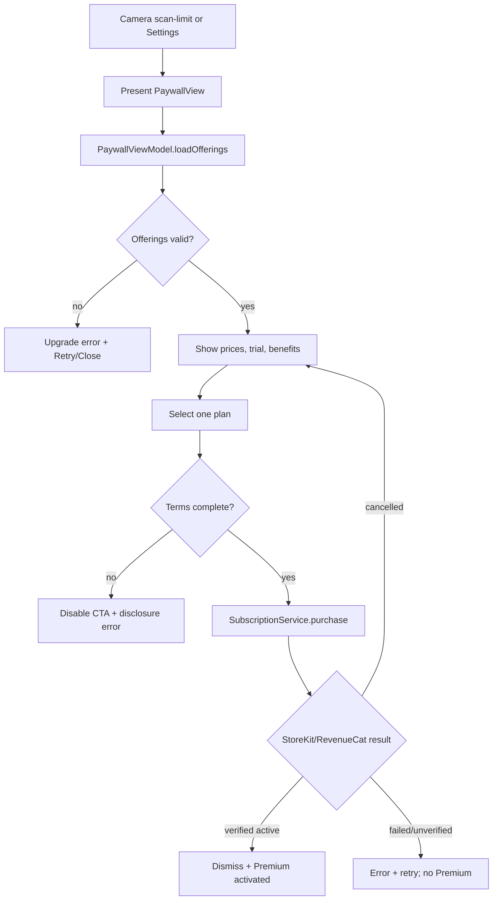
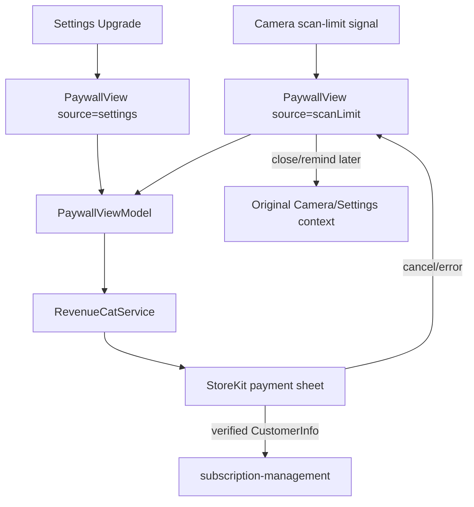

# paywall-display - Technical Design

> **Implementation intent:** *Hybrid* — load and validate RevenueCat offerings first, then compose the SwiftUI paywall around an injected `SubscriptionService` protocol. The camera scan-limit signal only presents this feature; quota enforcement and trigger decisions remain in `camera-capture`.

## 1. Overview

### Goals
- Implement WF-006 as a transparent paywall with weekly, monthly, and annual pricing cards, a 7-day trial badge, benefits, selected-plan state, and a full-width Start trial CTA.
- Present localized RevenueCat/StoreKit pricing before purchase, including billing cycle, renewal terms, and an in-app cancellation path.
- Start the selected trial through the injected `SubscriptionService` abstraction and dismiss only after verified Premium entitlement is available.
- Provide non-purchase dismissal, recoverable loading/error states, accessibility, and App Store Guideline 3.1.2c / 5.6 compliance.

### In-scope / out-of-scope
**In-scope:** `PaywallView`, `PaywallViewModel`, plan/offer display models, RevenueCat offerings adapter, selected-plan state, trial CTA handoff, paywall analytics events, transparent terms, retry/close states, and wiring from camera-capture/Settings presentation points.

**Out-of-scope:** scan quota counting or the FR-010 trigger decision (`camera-capture`), subscription entitlement persistence/listening/cancellation/restore implementation (`subscription-management`), Settings screen ownership (`account-management`/`subscription-settings`), backend receipt validation, and AI features.

### AC Coverage Summary
Addresses **all 16 acceptance criteria**:
- **REQ-001 → §7.1:** AC-001.1, AC-001.2, AC-001.3, AC-001.4
- **REQ-002 → §7.2:** AC-002.1, AC-002.2, AC-002.3, AC-002.4
- **REQ-003 → §7.3:** AC-003.1, AC-003.2, AC-003.3, AC-003.4
- **REQ-004 → §7.3 and §8:** AC-004.1, AC-004.2, AC-004.3, AC-004.4

## 2. Architecture

### Runtime boundaries
```
CameraView / SettingsView
          │ presentation(source: .scanLimit | .settings)
          ▼
     PaywallView ─▶ PaywallViewModel
                         │  ├─ SubscriptionService protocol
                         │  │     └─ RevenueCatService (purchases-ios)
                         │  ├─ AuthService eligibility/session
                         │  ├─ AppEnvironment configuration + analytics
                         │  └─ ErrorHandler
                         ▼
                 subscription-management entitlement flow
```

The paywall receives a presentation source and does not inspect scan counts. The RevenueCat SDK is configured once by `AppBootstrap` from project-structure 2.3.1; this feature consumes the injected SDK/service and does not call `Purchases.configure` again.

### Module responsibilities
| Module | Responsibility |
|--------|----------------|
| `PaywallView` | Render WF-006 hierarchy, pricing cards, badge, benefits, terms, CTA, dismiss/retry states, and accessibility labels. |
| `PaywallViewModel` | Load offerings, select one valid plan, expose state, enforce purchase preconditions, call service, map outcomes, and emit paywall/trial analytics. |
| `SubscriptionService` protocol | Stable purchase/offering contract shared with subscription-management; hides RevenueCat and StoreKit details from views. |
| `RevenueCatService` | Map `purchases-ios` `Offerings`/`Package` values to app plans and hand purchases to RevenueCat. |
| `AuthService` | Confirm a signed-in session and current user identity before purchase; no receipt or token is logged. |
| `AppEnvironment` / `ErrorHandler` | Inject dependencies/configuration and surface recoverable user-facing failures. |

### Data flow


## 3. Components and Interfaces

| Component | Type | Contract | File |
|-----------|------|----------|------|
| `SubscriptionService` | protocol | `loadOfferings()`, `purchase(plan:)`, and verified purchase result; no SDK types leak into the view layer | `Features/Paywall/Services/SubscriptionService.swift` |
| `RevenueCatService` | class | `purchases-ios` adapter for `Offerings`, `Package`, purchase, and `CustomerInfo` mapping | `Features/Paywall/Services/RevenueCatService.swift` |
| `PaywallViewModel` | `@MainActor ObservableObject` | `load()`, `select(plan:)`, `startTrial()`, `retry()`, `dismiss()`; published loading/content/error/purchase states | `Features/Paywall/ViewModels/PaywallViewModel.swift` |
| `PaywallView` | SwiftUI `View` | WF-006 presentation with source-aware dismissal and explicit transparent terms | `Features/Paywall/Views/PaywallView.swift` |
| `PricingCard` | SwiftUI `View` | Displays plan name, localized price, cycle, selection, savings, and VoiceOver value | `Features/Paywall/Views/PricingCard.swift` |
| `TrialBadge` | SwiftUI `View` | Displays the 7-day trial length consistently in hero and selected-plan terms | `Features/Paywall/Views/TrialBadge.swift` |
| `BenefitsList` | SwiftUI `View` | Displays unlimited scans and configured benefits; labels coming-soon benefits accurately | `Features/Paywall/Views/BenefitsList.swift` |
| `PaywallPresentation` | model | Presentation source and dismissal callback; no quota state | `Features/Paywall/Models/PaywallPresentation.swift` |

### Reuse Plan (ios-components Reuse-First Gate)
- **Reuse:** `CaloButton` from `shared-foundations` for Start trial, Retry, and Remind me later; `ErrorHandler` for service failures; `AppEnvironment` for dependency injection/configuration; `AuthService` for session/eligibility; `SubscriptionService` protocol abstraction for purchase; system `NavigationStack`/sheet dismissal.
- **New (justified):** `PricingCard`, `TrialBadge`, and `BenefitsList` are WF-006-specific compositions with pricing accessibility semantics. They must not duplicate generic button, error, or card primitives.
- **Execution references:** follow `ios-architecture` MVVM/file placement and `ios-components` reuse-first patterns; no Figma token source is available in the repository, so use WF-006 and shared component tokens.

## 4. Data Models and Contracts

- `SubscriptionPlan`: `{ id, cycle: .weekly/.monthly/.annual, displayPrice, billingPeriod, trialDays, renewalDisclosure, annualSavingsLabel?, isAvailable }`. `displayPrice` and `billingPeriod` are copied from RevenueCat/StoreKit; the UI does not compute a replacement price.
- `PaywallState`: `loading`, `content(plans, selectedPlanID)`, `purchasing(planID)`, `activated`, `cancelled`, `unavailable(message)`, `failed(message)`.
- `PurchaseResult`: `cancelled`, `verifiedEntitlement(customerInfo)`, `pending`, `failed(recoverableMessage)`. A verified entitlement is required for activation.
- `PaywallPresentation`: `{ source: .scanLimit | .settings, onDismiss }`; `.scanLimit` is informational and cannot grant or consume a scan.
- Plan validation rejects an offer with missing product identifier, empty localized price, missing billing period, invalid trial length, or unavailable StoreKit product. A malformed plan is never selectable.
- The plan catalog supports weekly $2.99, monthly $9.99, and annual $39.99–$49.99 as configured products; storefront localization is authoritative at runtime.
- `purchases-ios` is the SPM dependency from project-structure 2.3.1. `RevenueCatService` consumes `Offerings.current`, `Package`, `purchase(package:)`, and verified `CustomerInfo`; SDK handles are passed from `AppEnvironment`/`AppBootstrap`.

## 5. Error Handling

| Failure mode | Detection | User-visible behavior | Recovery |
|--------------|-----------|-----------------------|----------|
| Offerings unavailable | `loadOfferings()` throws or returns no valid plan | "Upgrade to Premium" plus Retry and Close; no invented price | Retry with bounded backoff; close preserves free tier |
| Malformed/unavailable plan | validation fails for product/price/cycle | Card disabled with specific availability text; CTA disabled if no valid selection | Reload offerings |
| Missing compliance disclosure | selected plan lacks trial/renewal/cancel terms | Trial CTA disabled; explicit unavailable state | Reload remote offering/config |
| User not eligible/signed in | `AuthService` has no valid session or entitlement is already active | Explain that the flow is unavailable or show Manage subscription route | Reauthenticate or navigate to subscription management |
| StoreKit sheet cancelled | RevenueCat returns cancellation/pending without verified entitlement | Return to content state; no charge/no Premium; CTA remains retryable | User may retry or dismiss |
| Receipt/network verification failure | purchase result not verified or service error | "Could not activate trial" via `ErrorHandler`; no Premium | Retry; preserve transaction for RevenueCat reconciliation |
| Unexpected service error | unknown thrown error | Recoverable error state; no crash and no entitlement mutation | Retry or close |

## 6. Testing Strategy

Unit tests under `calo-ai-testTests/`:
- `PaywallOfferTests.swift` — plan validation, localized price/cycle preservation, annual savings, missing disclosure rejection (AC-001.2/.3/.4, AC-002.2/.4, AC-004.1/.4; P2, P4, P8).
- `PaywallViewModelTests.swift` — source presentation, selection exclusivity, CTA preconditions, successful activation, cancellation, verification failure, retry/dismiss (AC-001.1/.4, AC-002.1/.3/.4, AC-003.1–.4, AC-004.3/.4; P1, P3, P5, P6, P7, P9).
- `RevenueCatServiceTests.swift` — fake `SubscriptionService`/RevenueCat adapter mapping and no duplicate purchase call (AC-003.1/.2/.4, NFR-PW-002/.004; P5, P6, P10).
- `PaywallAccessibilityTests.swift` — VoiceOver labels, Dynamic Type layout, 44pt controls, contrast and visible dismissal/terms (AC-001.2/.3, AC-004.1/.2/.3; P2, P7, P8).

Integration boundaries:
- StoreKit Configuration sandbox verifies weekly/monthly/annual product IDs, trial metadata, cancellation, and purchase cancellation.
- Camera-capture presents the paywall with `.scanLimit`; Settings presents it with `.settings`; neither path is allowed to alter quota in this feature.
- A verified trial result is handed to subscription-management through `CustomerInfo`; an unverified result remains in the paywall.

Build checkpoint: XcodeBuildMCP `discover_projs -> list_schemes -> build_sim` after each phase; `test_sim` at Phase Gate 4. No simulator boot is required for the phase gates.

## 7. Feature Breakdown (iOS-first)

### 7.1 Feature: Offer Loading and WF-006 Display
- **ACs Implemented:** AC-001.1, AC-001.2, AC-001.3, AC-001.4
- **Source:** FR-010, FR-021, UC-019, WF-006
- **Wireframe structure:** Hero headline "Unlock Unlimited Scans" and `TrialBadge`; pricing engagement zone with weekly/monthly/annual cards; benefits exploration zone; utility zone with Start trial and Remind me later.
- **States:** Loading (offer fetch), Success (valid content), Error (retry/close), Empty/unavailable (no valid products).
- **Actions:** load on presentation, retry, dismiss, report `paywall_viewed`; presentation source is passed through without quota logic.
- **UX expectations:** price/cycle visible from first content render; monthly may be default only as an explicit selection, never hidden; VoiceOver announces each plan and selected state; Dynamic Type, Dark Mode, and 44pt actions.
- **Files:**
  - `Features/Paywall/Views/PaywallView.swift`
  - `Features/Paywall/Views/TrialBadge.swift`
  - `Features/Paywall/Views/BenefitsList.swift`
  - `Features/Paywall/ViewModels/PaywallViewModel.swift`
  - `Features/Paywall/Services/RevenueCatService.swift`

### 7.2 Feature: Pricing Plan Selection
- **ACs Implemented:** AC-002.1, AC-002.2, AC-002.3, AC-002.4
- **Source:** FR-021, FR-022, UC-019, UC-020, WF-006
- **Wireframe structure:** One selectable `PricingCard` per cycle with selected border/fill, localized price, cycle, trial terms, and optional annual savings badge.
- **States:** No selection, selected valid plan, switching selection, unavailable plan, and no valid plan.
- **Actions:** select plan; update CTA terms synchronously; block unavailable cards; never issue a purchase from card selection.
- **UX expectations:** only one plan is selected; selected state is conveyed by shape/text and not color alone; card labels include price and cycle in VoiceOver.
- **Files:**
  - `Features/Paywall/Models/SubscriptionPlan.swift`
  - `Features/Paywall/Views/PricingCard.swift`
  - `Features/Paywall/ViewModels/PaywallViewModel.swift`

### 7.3 Feature: Trial CTA and Transparent Terms
- **ACs Implemented:** AC-003.1, AC-003.2, AC-003.3, AC-003.4, AC-004.1, AC-004.2, AC-004.3, AC-004.4
- **Source:** FR-022, FR-021, UC-020, UC-019, WF-006, PRD §1, PRD §11
- **Wireframe structure:** Full-width `CaloButton` Start 7-day trial below selected-plan terms; explicit renewal/cancellation disclosure; secondary Remind me later/close action remains reachable.
- **States:** Ready, purchasing, activated, cancelled, verification error, and disclosure-unavailable.
- **Actions:** CTA calls `SubscriptionService.purchase`; verified activation dismisses and informs subscription-management; cancellation returns to ready; retry repeats only after the previous request resolves.
- **UX expectations:** no countdown, forced continuation, hidden cost, or blocked dismissal; CTA is disabled until all required terms are visible; VoiceOver reads the whole price/trial/renewal value.
- **Files:**
  - `Features/Paywall/Views/PaywallView.swift`
  - `Features/Paywall/ViewModels/PaywallViewModel.swift`
  - `Features/Paywall/Services/SubscriptionService.swift`
  - `Features/Paywall/Views/PaywallTermsView.swift`

## 8. Navigation and Integration

### Flow diagram


### Navigation table
| From | To | Trigger | Data |
|------|----|---------|------|
| CameraView | PaywallView | `onScanLimitReached` | `PaywallPresentation(source: .scanLimit)` |
| Settings upgrade action | PaywallView | Tap Upgrade | `PaywallPresentation(source: .settings)` |
| PaywallView | StoreKit sheet | Start 7-day trial | Selected RevenueCat package/product |
| StoreKit/RevenueCat | subscription-management | Verified entitlement | `CustomerInfo` / `PurchaseResult` |
| PaywallView | Originating screen | Close/back/Remind me later | Dismiss callback; no entitlement/quota mutation |

### Integration rules
- `camera-capture` owns the quota check and only emits the presentation signal; `paywall-display` must not call `ScanQuotaService.increment()` or decide whether a scan is blocked.
- `AppEnvironment` supplies `AuthService`, `ErrorHandler`, analytics, and the configured RevenueCat handle; `RevenueCatService` never reconfigures the SDK.
- `CaloButton` is used for all primary, retry, and secondary actions; `ErrorHandler` maps failures without exposing raw receipts or SDK errors.
- Purchase success is considered complete only when `CustomerInfo` contains the configured Premium entitlement. Subscription-management owns ongoing listener/state synchronization.
- The paywall must remain compliant with PRD §1 and §11 even when a remote offering changes; missing terms disable purchase rather than hiding disclosure.

## 9. Correctness Properties

| Property | Type | Validates AC | Statement |
|---|---|---|---|
| P1 | Invariant | AC-001.1 | Presenting from either supported source creates WF-006 without quota reads/writes or subscription mutation. |
| P2 | Invariant | AC-001.2, AC-001.3, AC-002.2, AC-004.1 | Every enabled content state exposes each valid plan's localized price/cycle plus trial, benefit, renewal, and cancellation terms before CTA enablement. |
| P3 | Invariant | AC-001.4 | An offerings failure always reaches a retry/close error state and never renders an invented price, blank content, or crash. |
| P4 | Invariant | AC-002.1, AC-002.3 | At most one valid plan ID is selected, and changing selection updates the purchase target before any purchase call. |
| P5 | Invariant | AC-002.4, AC-004.4 | A plan or disclosure missing required product, price, cycle, or terms cannot be selected or purchased. |
| P6 | Invariant | AC-003.1, AC-003.2 | Exactly one purchase request for an explicit CTA tap can produce activation, and activation requires verified Premium `CustomerInfo`. |
| P7 | Invariant | AC-003.3, AC-004.3 | Cancellation/dismissal outcomes leave entitlement and free-tier access unchanged and keep the paywall retryable or dismissible. |
| P8 | Invariant | AC-004.2 | The rendered paywall always exposes price, cycle, trial terms, and a dismissal action without deceptive countdowns or hidden charges. |
| P9 | Invariant | AC-003.4 | Unverified or failed purchases never activate Premium and expose a retry/recovery path without issuing a duplicate purchase. |
| P10 | Invariant | AC-004.1, AC-004.4 | CTA enablement is false until selected price/cycle, trial length, renewal, and cancellation disclosures are all non-empty and visible. |
