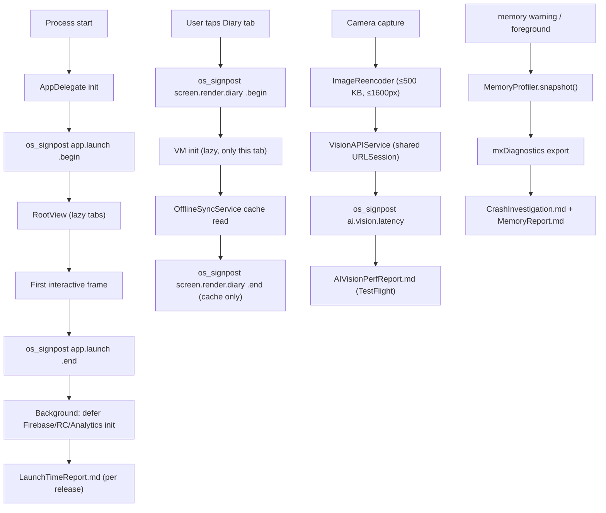
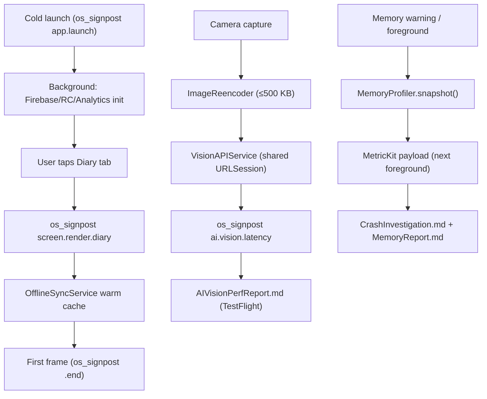

# performance-optimization - Technical Design

> **Implementation intent:** *Hybrid profile + optimize* — `os_signpost` + `MetricKit` for measurement (Apple-native, no SPM), `NSCache` with cost limits for images, single shared `URLSession` for batching, `Instruments` `allocations`/`leaks`/Time Profiler for memory investigation. No architectural rewrites; no new SPM dependencies; small additions to `shared-foundations` (`MemoryProfiler`, `RequestCounter`) and per-feature view models that need them.

## 1. Overview

### Goals
- **Cold launch <2s** (NFR-001) — measure with `os_signpost`; defer Firebase/RevenueCat/Analytics init; move large JSON parsing + CoreData stack to lazy.
- **Screen-to-content render <1s** (PRD §9), **Diary <500ms** (NFR-003) — measure per screen; SwiftUI view-model lazy; warm cache path.
- **AI Vision p95 <3s** (PRD §9) — measure from `VisionAPIService`; reduce request size (re-encode JPEG ≤500 KB, ≤1600px); reuse `URLSession`.
- **Crash investigation + memory profiling** — `MetricKit` subscription, `MemoryProfiler.snapshot()`, scripted 10-min session, `CrashInvestigation.md`.
- **Image cache + network batching** — `NSCache` with cost limits; shared `URLSession`; batch Diary reads into one PostgREST query.

### In-scope / out-of-scope
**In-scope:** `os_signpost` intervals across launch, screens, AI Vision; `MetricKit` integration; `MemoryProfiler`; `RequestCounter`; `ImageCache` (NSCache, cost-limit 64 MB); shared `URLSession`; Perf regression report; AI image re-encode; TestFlight perf reports.
**Out-of-scope:** Architectural rewrites; new SPM packages; on-device ML fallback; Android (post-MVP); new feature work; UI redesign.

### AC Coverage Summary
Addresses **all 21 acceptance criteria**:
- **REQ-001 → §7.1:** AC-001.1, AC-001.2, AC-001.3, AC-001.4
- **REQ-002 → §7.2:** AC-002.1, AC-002.2, AC-002.3, AC-002.4
- **REQ-003 → §7.3:** AC-003.1, AC-003.2, AC-003.3, AC-003.4
- **REQ-004 → §7.4:** AC-004.1, AC-004.2, AC-004.3, AC-004.4, AC-004.5
- **REQ-005 → §7.5:** AC-005.1, AC-005.2, AC-005.3, AC-005.4

## 2. Architecture

### Runtime boundaries
```
┌───────────────────────────────────────────────────────────────┐
│ Instrumentation (Apple-native, no SPM)                       │
│  ├─ os_signpost(.app, "app.launch", .begin/.end)             │
│  ├─ os_signpost(.app, "screen.render.<Name>", .begin/.end)   │
│  ├─ os_signpost(.app, "ai.vision.latency", .begin/.end)      │
│  ├─ os_signpost(.app, "image.cache.hit|.miss", .event)       │
│  ├─ os_signpost(.app, "network.requests.per.<op>", .event)   │
│  └─ MetricKit (MXMetricManager.shared().add(self))           │
├───────────────────────────────────────────────────────────────┤
│ Shared/Perf (small additions to shared-foundations)          │
│  ├─ PerfSignpost.swift  ── typed wrappers around os_signpost │
│  ├─ MemoryProfiler      ── snapshot() of heap / resident     │
│  ├─ RequestCounter      ── counts URLSessionTask per op      │
│  └─ ImageCache          ── NSCache, totalCostLimit 64 MB     │
├───────────────────────────────────────────────────────────────┤
│ URLSession (single shared, default config)                    │
│  └─ Used by DataClient (shared-foundations) + VisionAPIService│
│     (ai-recognition) + RevenueCat REST; no per-call .session │
├───────────────────────────────────────────────────────────────┤
│ Per-screen ViewModels (lazy)                                 │
│  └─ Camera/Diary/Dashboard/Paywall/Settings VM created on    │
│     first appearance, never in the launch path               │
├───────────────────────────────────────────────────────────────┤
│ Reports (artifacts under Tools/Perf/ and StoreMetadata/)      │
│  ├─ LaunchTimeReport.md  ── cold launch p50/p95 from simctl  │
│  ├─ AIVisionPerfReport.md ── p50/p95/p99 from signposts      │
│  ├─ MemoryReport.md       ── from mxDiagnostics + Instruments│
│  ├─ CrashInvestigation.md ── from Crashlytics + MetricKit    │
│  ├─ ImageCacheReport.md   ── hit rate                        │
│  ├─ NetworkReport.md      ── requests per diary load         │
│  └─ PerfSignOff.md        ── per-release iOS Lead sign-off   │
└───────────────────────────────────────────────────────────────┘
```

### Module responsibilities
| Module | Responsibility |
|--------|----------------|
| `PerfSignpost` (Swift) | Typed wrappers: `appLaunchInterval`, `screenRender(_ name:)`, `aiVisionLatency()`, `imageCacheHit/Miss`, `networkRequestPer(_ op:)` |
| `MemoryProfiler` (Swift) | `snapshot()` returns `MemorySnapshot { heapUsed, heapPeak, resident }`; hooked from memory warning + foreground transitions |
| `MetricKitSubscriber` (Swift) | conforms to `MXMetricManagerDelegate`; forwards `didReceive` payloads to `CrashInvestigation.md` pipeline |
| `RequestCounter` (Swift) | increments per `URLSessionTask` (URL + host); exposes `count(for: "diary.load")` |
| `ImageCache` (Swift) | `NSCache<NSString, UIImage>` with `totalCostLimit = 64 * 1024 * 1024`; per-entry cost = `w * h * 4`; lazy `UIImage` construction on read |
| `URLSessionFactory.shared` (Swift) | one shared `URLSession` (default config, `httpMaximumConnectionsPerHost = 4`, `requestTimeoutInterval = 10`, `waitsForConnectivity = false`); reused via `AppEnvironment` |
| `ImageReencoder` (Swift) | re-encodes JPEG ≤1600px long edge, quality 0.7 → ≤500 KB target; called from `VisionAPIService` before upload |
| `LaunchTimeProbe` (Swift) | emits `os_signpost(.event, "app.launch")` on first foreground; logs `LaunchTimeReport` line |
| `InstrumentsScript` (Apple) | `xcrun xctrace record --template "Allocations" --output … --attach <pid>`; `LeakInstrument.template` |

### Data flow


## 3. Components and Interfaces

| Component | Type | Contract | File |
|-----------|------|----------|------|
| `PerfSignpost` | enum/struct | `appLaunchInterval()` → SignpostInterval; `screenRender(_ name: String)`; `aiVisionLatency()`; `imageCacheHit/Miss`; `networkRequestPer(_ op:)` | `Shared/Perf/PerfSignpost.swift` |
| `MemoryProfiler` | class | `static let shared`; `snapshot() -> MemorySnapshot`; `MemorySnapshot { heapUsedBytes, heapPeakBytes, residentBytes }` | `Shared/Perf/MemoryProfiler.swift` |
| `MetricKitSubscriber` | class : NSObject, MXMetricManagerDelegate | `didReceive(_ payload: [MXMetricPayload])`; forwards to `CrashInvestigation.md` | `Shared/Perf/MetricKitSubscriber.swift` |
| `RequestCounter` | class | `increment(op: String)`; `count(for op: String) -> Int`; `reset(op: String)`; thread-safe | `Shared/Perf/RequestCounter.swift` |
| `ImageCache` | class | `static let shared`; `image(for url: URL) -> UIImage?` (sync, NSCache lookup); `set(_ image: UIImage, for url: URL)`; `cost = w * h * 4` | `Shared/Perf/ImageCache.swift` |
| `URLSessionFactory` | enum | `.shared -> URLSession` (default config tuned); injected via `AppEnvironment` | `Shared/Perf/URLSessionFactory.swift` |
| `ImageReencoder` | struct | `static func reencode(_ image: UIImage, maxLongEdge: CGFloat = 1600, quality: CGFloat = 0.7) -> Data?` | `Shared/Perf/ImageReencoder.swift` |
| `LaunchTimeProbe` | class | emits signpost `app.launch` and logs a line in `LaunchTimeReport.md` on first foreground event | `App/LaunchTimeProbe.swift` |
| `MemoryGate` | bash script | reads `MemoryReport.md`; exits 0 iff peak ≤250 MB steady, ≤250 MB transient | `scripts/memory_gate.sh` |
| `PerfSignoffCheck` | bash script | reads `AIVisionPerfReport.md` (p95 ≤3000), `LaunchTimeReport.md` (median ≤2000), `MemoryReport.md` (peak ≤250); exits 0 if all pass | `scripts/perf_signoff_check.sh` |
| `PerformanceTests` (XCTest) | unit | `ImageCacheCostLimitTests` (synthetic fill ≤64 MB), `ImageReencoderTests` (size + quality) | `calo-ai-testTests/Performance/ImageCacheTests.swift`, `ImageReencoderTests.swift` |
| `LaunchTimeMeasurer` (bash) | bash | `xcrun simctl app_launch_measurement` x10; aggregates median + p95 → `LaunchTimeReport.md` | `scripts/launch_time_measurer.sh` |
| `AIVisionPerfReportParser` | Swift | consumes signpost CSV → p50/p95/p99 stats | `Tools/Perf/AIVisionPerfReportParser.swift` |

### Reuse Plan (ios-components Reuse-First Gate)
- **Reuse:** `shared-foundations` `RetryPolicy` (exp backoff ≤3, ≤10s) — already enforces NFR-016 inside `VisionAPIService`; `shared-foundations` `OfflineSyncService` cache for Diary render (warm path); `shared-foundations` `ErrorHandler` for surfacing perf failures; `shared-foundations` `AppEnvironment` is the injection point for the shared `URLSession` and `ImageCache`; `ai-recognition` `VisionAPIService` is the signpost emitter for AI latency; `camera-capture` `CameraService` provides `CapturedImage` (re-encoded before handoff).
- **New (justified):** `ImageCache` (no Apple-provided image cache for arbitrary URLs in the app target; SwiftUI `AsyncImage` is per-view and unbounded); `MemoryProfiler` (wraps Mach task_info in a typed API the existing code base does not have); `MetricKitSubscriber` (forwarding MXMetricPayload to a markdown report is app-specific); `URLSessionFactory` (one shared tuned session is the entire optimization point).
- **No SPM dependency.**

## 4. Data Models and Contracts

- `MemorySnapshot { heapUsedBytes: UInt64, heapPeakBytes: UInt64, residentBytes: UInt64, timestamp: Date }`. From `<mach/mach.h>` `task_info(TASK_VM_INFO)` + `task_basic_info`.
- `MemoryReport.md` schema: `{ windowStart, windowEnd, avgHeapMB, peakHeapMB, peakResidentMB, leaksFound[], scriptDuration }`.
- `AIVisionPerfReport.md` schema: `{ totalCalls, p50Ms, p95Ms, p99Ms, maxMs, callsByEndpoint, topSlowestSignposts[] }`.
- `LaunchTimeReport.md` schema: `{ deviceModel, osVersion, runs: [{ runIndex, coldLaunchMs }], medianMs, p95Ms, headroomTo2sMs }`.
- `ImageCacheReport.md` schema: `{ totalReads, hits, misses, hitRate, peakBytes, evictions, byURLPrefix }`.
- `NetworkReport.md` schema: `{ operation: "diary.load", beforeOptRequests, afterOptRequests, reductionPct }`.
- `PerfSignOff.md` schema: `{ version, date, launchP50, launchP95, aiVisionP50, aiVisionP95, aiVisionP99, memoryPeakMB, leaksFound, signedOffBy }`.

## 5. Error Handling

| Failure mode | Detection | Behavior | Recovery |
|--------------|-----------|----------|----------|
| Cold launch >2s median | `LaunchTimeMeasurer` | `perf_signoff_check.sh` fails | Defer more off launch path (e.g., warm `URLSession` lazily, skip Superwall remote-config fetch); re-measure |
| Screen render >1s median | `PerfSignpost` | `PerfRegressionReport.md` flags | Lazy VM, smaller initial fetch, prefetch |
| AI Vision p95 >3s | `AIVisionPerfReport` | `perf_signoff_check.sh` fails; `AI Vision Sign-Off` required in `PerfSignOff.md` | Reduce image size more, switch to faster endpoint, add `URLSession` keep-alive |
| Memory peak >250 MB | `MemoryReport` | `memory_gate.sh` fails | Reduce `ImageCache.totalCostLimit`, evict view models on background, fix retain cycles |
| Leak >5 MB over 10 min | `Instruments` `leaks` | `CrashInvestigation.md` enumerates | Fix retain cycle, weak self in long closures |
| P0 crash | `Crashlytics` | `CrashInvestigation.md` P0 section | Fix in owning spec; rebuild beta |
| `mxDiagnostics` lost (small sample) | MetricKit only ships when ≥2-day window | `MemoryReport.md` marked "no payload yet" | Wait for next beta cycle |
| `os_signpost` not visible in Instruments | Profile build only | Signposts ignored in Release | Documented in `LaunchTimeProbe` (profiling builds only) |

## 6. Testing Strategy

- **Unit (`calo-ai-testTests/Performance/`)** — `ImageCacheCostLimitTests` synthesizes 200 images of varying sizes, asserts peak bytes ≤ 64 MB; `ImageReencoderTests` asserts output size ≤500 KB and quality ≥0.6 SSIM against source; `MemoryProfilerTests` mocks `task_info`; `RequestCounterTests` asserts concurrency-safety. (AC-005.*, AC-001.*; P1–P3, P12–P14.)
- **Integration (`Calo-AIUITests/Performance/`)** — `DiaryLoadPerformanceTests` instruments tab tap → first frame with `os_signpost`; asserts ≤1000 ms (cached) and ≤500 ms (Diary warm) on iPhone 12+ sim. `ColdLaunchUITests` uses `xcrun simctl app_launch_measurement` to take 10 measurements. (AC-001.*, AC-002.*; P1, P4.)
- **Manual / `Instruments`** — 10-minute scripted session recorded with `Allocations` + `Leaks` + `Time Profiler`; results parsed into `MemoryReport.md` + `CrashInvestigation.md`. (AC-004.*)
- **TestFlight beta** — `AIVisionPerfReportParser` consumes the signpost CSV the `VisionAPIService` emits; aggregated over ≥100 calls; `MemoryReport.md` from `mxDiagnostics` over ≥2-day window. (AC-003.*, AC-004.*)
- **Build/test checkpoint per phase via XcodeBuildMCP** — `discover_projs → list_schemes → build_sim → test_sim`. Perf gates (`launch_time_measurer.sh`, `memory_gate.sh`, `perf_signoff_check.sh`) hook into the same CI step.

## 7. Feature Breakdown (iOS-first)

### 7.1 Cold Launch Optimization
- **ACs Implemented:** AC-001.1, AC-001.2, AC-001.3, AC-001.4
- **Source:** NFR-001, PRD §9, Overview §5/§6.1
- **What:** Wrap launch in `os_signpost app.launch`; `LaunchTimeProbe` emits the value. Defer Firebase/RevenueCat/Analytics init to a background `DispatchQueue.global(qos: .utility)` after first frame. Replace any eager `ViewModel()` in `RootView` with lazy `@StateObject` (SwiftUI defers until first appearance). Move large JSON parsing + CoreData stack build to after first frame. Move URLSession warm-up behind a lazy `URLSessionFactory.shared` first access. `launch_time_measurer.sh` runs `xcrun simctl app_launch_measurement` x10 and writes `LaunchTimeReport.md`; the gate `perf_signoff_check.sh` fails if median >2000 ms or p95 >2500 ms.
- **States:** launching / launched / background-deferred.
- **UX expectations:** Splash visible during deferred init; no flash of empty UI.
- **Files:** `App/AppDelegate.swift` (deferred init), `App/RootView.swift` (lazy tabs), `App/LaunchTimeProbe.swift`, `Shared/Perf/PerfSignpost.swift`, `Shared/Perf/URLSessionFactory.swift`, `scripts/launch_time_measurer.sh`, `scripts/perf_signoff_check.sh`, `StoreMetadata/LaunchTimeReport.md`.

### 7.2 Screen-to-Content Render (<1s)
- **ACs Implemented:** AC-002.1, AC-002.2, AC-002.3, AC-002.4
- **Source:** PRD §9, NFR-003, Overview §6.1
- **What:** `PerfSignpost.screenRender("diary")` wraps tab tap → first interactive frame in `DiaryView.onAppear` (or `RootView` `.task(id:)`); same for Dashboard, Settings, Paywall, Camera preview. `DiaryViewModel` instantiated on first appearance, fetches from `OfflineSyncService` warm cache first. `LazyVStack` with stable IDs and `@StateObject` per row view-model. `PerfRegressionReport.md` enumerates any screen with median >1s over 10 taps (release-blocker).
- **States:** tap → loading-cached → ready; tap → loading-network → ready.
- **UX expectations:** no perceptible blank frame; cache-first response.
- **Files:** `Shared/Perf/PerfSignpost.swift`, `Features/Diary/Views/DiaryView.swift`, `Features/Dashboard/Views/DashboardView.swift`, `Features/Account/Views/AccountView.swift`, `Features/Paywall/Views/PaywallView.swift`, `Features/Camera/Views/CameraView.swift` (instrumentation only), `scripts/perf_signoff_check.sh`, `Tools/Perf/PerfRegressionReport.md`.

### 7.3 AI Recognition p95 <3s
- **ACs Implemented:** AC-003.1, AC-003.2, AC-003.3, AC-003.4
- **Source:** PRD §9, NFR-002, Overview §3.3/§6.1
- **What:** `VisionAPIService.analyze(image:)` wraps the URLSession call in `os_signpost ai.vision.latency`; the duration is emitted to `AIVisionPerfReport.csv` via `RequestCounter` (or a local CSV logger that survives the session). Before upload, `ImageReencoder` reduces the captured JPEG to ≤1600px long edge and quality 0.7 — keeps visual fidelity for the AI model while reducing payload to ≤500 KB. `VisionAPIService` uses the shared `URLSessionFactory.shared` so connection pool is reused. `AIVisionPerfReportParser` aggregates TestFlight data into p50/p95/p99; `perf_signoff_check.sh` fails if p95 >3000 ms.
- **States:** request-issued / latency-measured / response-parsed; budget-exhausted → retry affordance.
- **UX expectations:** spinner remains; budget exhausted → "Retry" affordance (already from `ai-recognition`).
- **Files:** `Shared/Perf/PerfSignpost.swift`, `Shared/Perf/URLSessionFactory.swift`, `Shared/Perf/ImageReencoder.swift`, `Features/AI/Services/VisionAPIService.swift` (instrumentation + re-encode), `Tools/Perf/AIVisionPerfReportParser.swift`, `StoreMetadata/AIVisionPerfReport.md`, `scripts/perf_signoff_check.sh`, `StoreMetadata/PerfSignOff.md`.

### 7.4 Crash Investigation & Memory Profiling
- **ACs Implemented:** AC-004.1, AC-004.2, AC-004.3, AC-004.4, AC-004.5
- **Source:** NFR-015, PRD §9, Overview §6.1
- **What:** `MetricKitSubscriber` conforms to `MXMetricManagerDelegate`, receives `MXMetricPayload` + `MXDiagnosticPayload`; on background→foreground the app also calls `MemoryProfiler.snapshot()` and persists a row to local `memories.log`. After the TestFlight beta cycle, `MemoryReport.md` is generated from `mxDiagnostics` JSON + `MemoryProfiler` rows. `CrashInvestigation.md` is generated from Crashlytics (top signatures + stack) and MetricKit (hangs >250ms + memory). `memory_gate.sh` fails if peak >250 MB OR leak >5 MB. P0 crash signatures must be fixed before promotion; P1 triaged in `ReleaseSignOff.md` (testing-integration) or `PerfSignOff.md`.
- **States:** monitoring → MX-payload-received → report-generated.
- **UX expectations:** none — diagnostic only.
- **Files:** `Shared/Perf/MetricKitSubscriber.swift`, `Shared/Perf/MemoryProfiler.swift`, `App/AppDelegate.swift` (memory-warning hook), `Tools/CrashMonitor/CrashlyticsVerifier.swift` (from testing-integration — reused), `Tools/Perf/CrashInvestigation.md`, `StoreMetadata/MemoryReport.md`, `scripts/memory_gate.sh`.

### 7.5 Image Cache & Network Request Batching
- **ACs Implemented:** AC-005.1, AC-005.2, AC-005.3, AC-005.4
- **Source:** NFR-007/008, PRD §9, Overview §6.1
- **What:** `ImageCache.shared` (NSCache, `totalCostLimit = 64 MB`, per-entry cost = `w * h * 4`); `UIImage` constructed lazily on read from underlying `Data`. `URLSessionFactory.shared` returns the single shared `URLSession` (`httpMaximumConnectionsPerHost = 4`, `requestTimeoutInterval = 10`, `waitsForConnectivity = false`); injected via `AppEnvironment`. `RequestCounter` increments per `URLSessionTask` (URLSession delegate or wrapper); exposes `count(for: "diary.load")`. Diary view model (`DiaryViewModel`) fetches today's meals with one PostgREST query that includes joined ingredients: `GET /meal_logs?select=*,ingredients(*)&date=eq.<today>&order=created_at.desc` (instead of N parallel reads). `ImageCacheReport.md` records hit/miss counters; `NetworkReport.md` records requests-per-operation before/after.
- **States:** cache-empty → fill → warm-cache-hit; single-request vs N-requests.
- **UX expectations:** scrolling Diary/Dashboard smooth; no jank.
- **Files:** `Shared/Perf/ImageCache.swift`, `Shared/Perf/URLSessionFactory.swift`, `Shared/Perf/RequestCounter.swift`, `Features/Diary/ViewModels/DiaryViewModel.swift` (batch read), `Features/Dashboard/ViewModels/DashboardViewModel.swift` (reuses `ImageCache` for thumbnail URLs), `calo-ai-testTests/Performance/ImageCacheTests.swift`, `StoreMetadata/ImageCacheReport.md`, `StoreMetadata/NetworkReport.md`.

## 8. Navigation and Integration

### Flow diagram


### Integration table
| From | To | Trigger | Data |
|------|----|---------|------|
| `AppDelegate` | `PerfSignpost.appLaunchInterval()` | launch | os_signpost interval |
| `LaunchTimeProbe` | `LaunchTimeReport.md` | first foreground | launch ms |
| Feature views | `PerfSignpost.screenRender(name)` | `onAppear`/`.task(id:)` | signpost interval |
| `VisionAPIService` | `PerfSignpost.aiVisionLatency()` | every API call | signpost interval |
| `VisionAPIService` | `ImageReencoder` | before upload | re-encoded `Data` |
| `DataClient` / `VisionAPIService` / RC SDK | `URLSessionFactory.shared` | each request | shared session |
| `ImageCache.shared` | UI consumers | image read by URL | `UIImage` from cache or network |
| `MemoryProfiler.snapshot()` | `memories.log` | memory warning + foreground | `MemorySnapshot` |
| `MetricKitSubscriber` | `MemoryReport.md` / `CrashInvestigation.md` | payload received | `MXMetricPayload`, `MXDiagnosticPayload` |
| `DiaryViewModel` | batch PostgREST | first appearance | one query w/ `select=*,ingredients(*)` |
| `RequestCounter` | `NetworkReport.md` | test_sim + TestFlight | counts per operation |
| CI | `perf_signoff_check.sh` + `memory_gate.sh` | every release candidate | exit 0 iff all gates pass |

### Integration rules
- All new code lives under `Shared/Perf/` (shared-foundations extensions) and `Tools/Perf/` (one-off scripts + parsers). No SPM packages added.
- `URLSessionFactory.shared` is the only `URLSession` the app should construct; `DataClient` (shared-foundations), `VisionAPIService` (ai-recognition), and any new client MUST accept it via `AppEnvironment`.
- `os_signpost` intervals are emitted only in **Profile scheme** builds (`#if DEBUG` is too coarse — Profile is the canonical perf build). `LaunchTimeProbe` documents this and `perf_signoff_check.sh` runs against Profile scheme.
- `MetricKit` payload shipping is automatic on real devices in TestFlight; on the sim it's a no-op. `MemoryReport.md` is therefore only meaningful after a TestFlight cycle.
- Each feature spec owns its own perf instrumentation in its views (signpost emit) — this spec defines the `PerfSignpost` API and reports; the feature specs call it.

## 9. Correctness Properties

| Property | Type | Validates AC | Statement |
|---|---|---|---|
| P1 | Invariant | AC-001.2, AC-001.3 | Over 10 cold-launch runs on iPhone 12+ sim, median ≤2000 ms; p95 ≤2500 ms. No eager VM init, no eager Firebase/RC init in the launch path. |
| P2 | Invariant | AC-001.4 | If a launch-path dependency takes >100 ms (`os_signpost` "lazy.deferred >100ms" emitted), it SHALL be moved off the launch path before next build; the launch budget SHALL NOT regress vs the prior baseline (delta captured in `LaunchTimeReport.md`). |
| P3 | Invariant | AC-002.1, AC-002.2 | For any tab tap with a warm `OfflineSyncService` cache (lastSyncedAt <60s), `screen.render.<name>` is ≤1000 ms (≤500 ms for Diary) over 10 taps on iPhone 12+ sim. |
| P4 | Invariant | AC-002.3 | A feature view's view model is created lazily (first appearance) and never in `RootView.init`. Reflected in `RootView` source inspection + signpost event count = 1 per tap. |
| P5 | Invariant | AC-002.4 | No screen ships to release with median `screen.render` >1000 ms; `PerfRegressionReport.md` lists the screen and the remediation owner until fixed. |
| P6 | Invariant | AC-003.1, AC-003.2 | Every `VisionAPIService` call emits exactly one `ai.vision.latency` interval; aggregated p95 ≤3000 ms and p99 ≤5000 ms over ≥100 calls in a TestFlight cycle; upload payload ≤500 KB and ≤1600px long edge. |
| P7 | Round-trip | AC-003.3 | On a transient failure the existing `RetryPolicy` (≤3, ≤10s) caps the spinner; after budget exhausted the user sees a retry affordance; the same image is re-submitted exactly once on Retry. |
| P8 | Invariant | AC-003.4 | `perf_signoff_check.sh` exits 0 iff `AIVisionPerfReport.md` p95 ≤3000 ms (or explicit iOS Lead sign-off recorded in `PerfSignOff.md`). |
| P9 | Invariant | AC-004.1, AC-004.2 | `MXMetricManager.shared().add(self)` is called at launch; `MemoryProfiler.snapshot()` is called on every memory warning + foreground; the resulting `MemorySnapshot` rows are emitted into `memories.log` and aggregated into `MemoryReport.md`. |
| P10 | Invariant | AC-004.3, AC-004.4 | `CrashInvestigation.md` lists every Crashlytics signature with owning spec; every P0 signature is fixed before promotion; P1 signatures are triaged in `ReleaseSignOff.md` (testing-integration) or `PerfSignOff.md`. |
| P11 | Invariant | AC-004.5 | `memory_gate.sh` exits 0 iff steady-state ≤150 MB, peak ≤250 MB, leak ≤5 MB over the 10-minute scripted session; otherwise blocks promotion. |
| P12 | Invariant | AC-005.1, AC-005.2 | `ImageCache.totalCostLimit` = 64 MB; `ImageCacheCostLimitTests` (synthetic 200 images, mixed sizes) asserts peak bytes ≤ 64 MB and per-entry eviction is cost-based. Hit rate ≥80% for thumbnail reads in `ImageCacheReport.md`. |
| P13 | Invariant | AC-005.3 | Only ONE `URLSession` exists in the process (`URLSessionFactory.shared`); `DataClientTests` + a runtime assertion in DEBUG assert no per-call `.session` constructions; reused via `AppEnvironment`. |
| P14 | Invariant | AC-005.4 | A Diary load with ≥10 meals issues exactly 1 PostgREST request (`network.requests.per.diary.load = 1`); `NetworkReport.md` records before/after reduction ≥40%. |