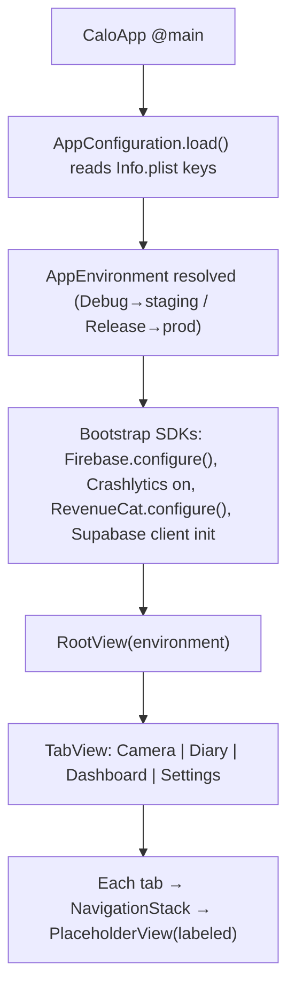

# project-structure - Technical Design

> **Implementation intent:** *Infrastructure-first*. This spec contains no domain logic and no real
> UI, so the conventional logic-first / UI-first choice does not apply. Work proceeds bottom-up:
> Xcode target & config → source-tree scaffold → SPM dependencies → signing/entitlements →
> app config & secrets → build configs/schemes → root app shell. Each layer must build before the
> next is added.

## 1. Overview

### Goals
- Establish a single, buildable Xcode project for Calo AI targeting **iOS 16+, iPhone-only, portrait**, that launches on the simulator into a navigable app shell.
- Replace the default Xcode CoreData template (`calo-ai-test` → `ContentView`, `Persistence`, `Item` entity) with the canonical **MVVM + Repository** source tree so every downstream feature spec has a known home.
- Wire the foundational third-party SDKs (**Supabase, RevenueCat, Firebase Analytics + Crashlytics**) via **Swift Package Manager** with pinned versions.
- Set up **signing, bundle identity, entitlements (Sign in with Apple)**, **Info.plist usage strings**, **xcconfig-based environment/secrets separation**, and **Debug/Release build configs + a shared scheme**.
- Provide a **TabView + NavigationStack** root shell with labeled placeholders for Camera / Diary / Dashboard / Settings.

### In-scope / out-of-scope
**In-scope**
- Xcode project settings, deployment target, device/orientation family.
- Directory scaffold + entry point (`App/CaloApp.swift`) + removal of CoreData boilerplate.
- SPM manifest & `Package.resolved`; SDK registration (no feature usage yet).
- Signing config, bundle ID, `Calo-AI.entitlements`, capabilities.
- `Info.plist` usage descriptions; `.xcconfig` files (Debug/Release/Shared); secret-injection contract; ATS.
- Build configurations, shared scheme, `AppEnvironment` selection.
- Root `TabView`/`NavigationStack` shell with placeholder destinations; SDK bootstrap at launch.

**Out-of-scope** (owned by later specs)
- Any real feature UI/logic — Camera, AI, Confirmation, Diary, Dashboard, Paywall, Onboarding, Account (Phases 3–8).
- Auth *implementation* (`shared-foundations`/`authentication`) — this spec only enables the entitlement + shell slot.
- Supabase schema/RLS, RevenueCat product setup, analytics event taxonomy — only SDK *presence* and init here.
- CI/CD pipeline definition (referenced as a consumer of `Package.resolved`, not built here).

### AC Coverage Summary
This design addresses **all 28 acceptance criteria** from `requirements.md`:
- **REQ-001 → §7.1:** AC-001.1, AC-001.2, AC-001.3, AC-001.4
- **REQ-002 → §7.2:** AC-002.1, AC-002.2, AC-002.3, AC-002.4
- **REQ-003 → §7.3:** AC-003.1, AC-003.2, AC-003.3, AC-003.4
- **REQ-004 → §7.4:** AC-004.1, AC-004.2, AC-004.3, AC-004.4
- **REQ-005 → §7.5:** AC-005.1, AC-005.2, AC-005.3, AC-005.4
- **REQ-006 → §7.6:** AC-006.1, AC-006.2, AC-006.3, AC-006.4
- **REQ-007 → §7.7:** AC-007.1, AC-007.2, AC-007.3, AC-007.4

## 2. Architecture

### Runtime boundaries
This spec produces a **shell app** — one process, no networking at runtime yet. The boundaries it *establishes* (for downstream specs to fill) are:

```
┌───────────────────────────── iOS App Process ─────────────────────────────┐
│  App/ (composition root)                                                   │
│   └─ CaloApp (@main) → bootstraps SDKs → builds AppEnvironment → RootView  │
│  Presentation: RootView (TabView) → NavigationStack per tab → Placeholder  │
│  Shared/: Models · Services · ViewModels · Components · Utils (empty stubs)│
│  Config: AppEnvironment (reads xcconfig via Info.plist) → picks endpoints  │
│  SDK adapters (init-only): Firebase, RevenueCat, Supabase client handle    │
└────────────────────────────────────────────────────────────────────────┘
          │ (build-time)                    │ (launch-time, once)
   SPM (Package.resolved)          Firebase.configure() / RC.configure()
```

### Module responsibilities
| Module | Responsibility (this spec) | Owner going forward |
|--------|----------------------------|---------------------|
| `App/` | `@main` entry, DI composition root, SDK bootstrap sequence, inject `AppEnvironment` into environment | this spec |
| `App/AppConfiguration` | Read build-config values (bundle id, env name, endpoints, keys) from `Info.plist` (populated by xcconfig) | this spec |
| `Shared/Components/` | Home for reusable UI (e.g. `Button`, `ProgressBar`) — **created empty**, populated by `shared-foundations` | `shared-foundations` |
| `Shared/Services/` | Home for `AuthService`, `SupabaseService`, etc. — **not implemented here** | `shared-foundations` |
| `Features/*` | Feature modules — **only `RootView` shell + placeholder views exist now** | Phases 3–8 |
| `Resources/` | `Assets.xcassets`, colors, `Localizable.strings` | this spec (scaffold) |
| `Supporting Files/` | `Info.plist`, `Calo-AI.entitlements`, `*.xcconfig` | this spec |

### Data flow (bootstrap)


Cross-cutting: the SDK bootstrap runs exactly once at launch, **before** the first view renders; a failed non-fatal SDK init must degrade gracefully (see §5), never block the shell from appearing (AC-007.3).

## 3. Components and Interfaces

### Swift components (source)
| Component | Type | Public contract (this spec) | File |
|-----------|------|-----------------------------|------|
| `CaloApp` | `App` (`@main`) | SwiftUI entry; owns bootstrap; injects `AppEnvironment` into `RootView` | `App/CaloApp.swift` |
| `AppBootstrap` | enum/struct (static) | `configure(_ env:)` → runs Firebase/RevenueCat/Supabase init idempotently; returns bootstrap result | `App/AppBootstrap.swift` |
| `AppConfiguration` | struct | Reads typed values (`environmentName`, `apiBaseURL`, `supabaseURL`, `supabaseAnonKey`, `revenueCatKey`) from `Info.plist`; throws `ConfigError` on missing key | `App/AppConfiguration.swift` |
| `AppEnvironment` | enum `{ staging, production }` | Derived from build config; exposes resolved endpoints/keys; `ObservableObject`/`EnvironmentValue` for injection | `App/AppEnvironment.swift` |
| `RootView` | `View` | Root `TabView`; declares 4 tab slots; hosts `NavigationStack` per tab | `App/RootView.swift` |
| `AppTab` | enum | `{ camera, diary, dashboard, settings }` — id, title, SF Symbol | `App/RootView.swift` |
| `PlaceholderView` | `View` | Labeled placeholder (`title:`) for unbuilt feature modules | `Shared/Components/Placeholder/PlaceholderView.swift` |

### Project artifacts (non-source)
| Artifact | Contract |
|----------|----------|
| `Calo-AI.xcodeproj` | Target `Calo-AI`, deployment iOS 16.0, `TARGETED_DEVICE_FAMILY=1` (iPhone), portrait-only `UISupportedInterfaceOrientations` |
| `Config/Shared.xcconfig` | Common build settings + placeholders for keys |
| `Config/Debug.xcconfig` | `#include Shared`; `APP_ENV = staging`; staging endpoints |
| `Config/Release.xcconfig` | `#include Shared`; `APP_ENV = production`; prod endpoints |
| `Config/Secrets.xcconfig` (git-ignored) | Real key values injected locally/CI; `Secrets.example.xcconfig` committed as template |
| `Supporting Files/Info.plist` | Usage strings + `$(…)` references to xcconfig keys |
| `Supporting Files/Calo-AI.entitlements` | `com.apple.developer.applesignin = [Default]` |
| `Package.resolved` | Committed; pins Supabase/RevenueCat/Firebase versions |

### Reuse Plan (feeds ios-components Reuse-First Gate)
- **New (justified):** `PlaceholderView` — no shared component library exists yet; this is the seed of `Shared/Components/`. Kept minimal (title + SF Symbol + "coming soon" copy) so it is trivially deletable as real features land.
- **Reuse later:** downstream feature views must reuse `Shared/Components/` (`Button`, `ProgressBar` created by `shared-foundations`), not re-declare. This spec only reserves the folders.
- **No new components beyond `PlaceholderView`** are introduced here.

### File plan (canonical ios-architecture tree)
```
Calo-AI/
├── App/
│   ├── CaloApp.swift
│   ├── AppBootstrap.swift
│   ├── AppConfiguration.swift
│   ├── AppEnvironment.swift
│   └── RootView.swift
├── Features/                      (empty; created per-feature later)
├── Shared/
│   ├── Models/                    (empty)
│   ├── Services/                  (empty)
│   ├── ViewModels/                (empty)
│   ├── Components/
│   │   └── Placeholder/PlaceholderView.swift
│   └── Utils/                     (empty)
├── Resources/
│   ├── Assets.xcassets
│   └── Colors.xcassets
├── Config/
│   ├── Shared.xcconfig
│   ├── Debug.xcconfig
│   ├── Release.xcconfig
│   └── Secrets.example.xcconfig
└── Supporting Files/
    ├── Info.plist
    └── Calo-AI.entitlements
```

## 4. Data Models and Contracts

No domain entities are defined here (owned by `shared-foundations`). The contracts are **configuration models**:

### `AppEnvironment` (enum)
| Case | Selected when | Endpoints |
|------|---------------|-----------|
| `.staging` | `APP_ENV == "staging"` (Debug) | staging Supabase URL / API base |
| `.production` | `APP_ENV == "production"` (Release) | prod Supabase URL / API base |

### `AppConfiguration` keys (read from `Info.plist`, sourced from xcconfig)
| Key (Info.plist) | xcconfig var | Type | Required | Validation |
|------------------|-------------|------|----------|-----------|
| `APP_ENV` | `APP_ENV` | String (`staging`\|`production`) | Yes | must be one of enum raw values |
| `API_BASE_URL` | `API_BASE_URL` | URL string | Yes | valid `https://` URL |
| `SUPABASE_URL` | `SUPABASE_URL` | URL string | Yes | valid `https://` URL |
| `SUPABASE_ANON_KEY` | `SUPABASE_ANON_KEY` | String | Yes | non-empty |
| `REVENUECAT_API_KEY` | `REVENUECAT_API_KEY` | String | Yes | non-empty |

### Entitlement contract
- `com.apple.developer.applesignin` present with `Default` value (AC-004.2/AC-004.4).

### Validation constraints
- `AppConfiguration.load()` throws `ConfigError.missingKey(String)` / `.invalidValue(String)` if any required key is absent or malformed → surfaced per §5 (AC-006.4, AC-005.2).
- ATS: `NSAppTransportSecurity` MUST NOT contain `NSAllowsArbitraryLoads = true` (AC-005.4).

## 5. Error Handling

| Failure mode | Detection | User-visible behavior | Recovery / rule |
|--------------|-----------|-----------------------|-----------------|
| Build error (missing iOS-16 availability, syntax) | Compile time | N/A (developer) | Build fails with diagnostic; blocks merge (AC-001.1, AC-001.4) |
| SPM resolution failure (version conflict/offline) | Build time | N/A (developer) | Fail with resolution error; never silently fall back to unpinned (AC-003.3, AC-003.4) |
| Missing/invalid config key | Launch (`AppConfiguration.load()` throws) | **Debug:** `assertionFailure` with key name + a diagnostic screen instead of tabs. **Release:** log to Crashlytics, fall back to safe defaults where possible, otherwise show a non-crashing error state | No silent empty endpoints (AC-006.4, AC-005.2) |
| Missing entitlement | Sign/validate time | N/A (developer) | Signing/validation fails (AC-004.4) |
| Non-fatal SDK init failure (Firebase/RC/Supabase) | Launch (bootstrap) | Shell still appears; feature that needs the SDK degrades later | Log non-fatal to Crashlytics; **must not block RootView** (AC-007.3) |
| Feature module not yet built | Compile/design time | Labeled `PlaceholderView` ("Camera — coming soon") | No crash, no CoreData list (AC-007.4, AC-002.4) |
| ATS misconfig (arbitrary loads) | Static check / review | N/A | Config check fails review (AC-005.4) |

## 6. Testing Strategy

No business logic ships here, so testing is **build/smoke/config**-oriented. Concrete targets/files:

### Unit tests — `Calo-AITests/`
- `AppConfigurationTests.swift` — `load()` parses valid keys; throws `.missingKey`/`.invalidValue` on bad input (validates §4 constraints; AC-005.2, AC-006.4).
- `AppEnvironmentTests.swift` — `APP_ENV` raw string maps to correct case; unknown value rejected (AC-006.3).

### UI / smoke tests — `Calo-AIUITests/`
- `AppLaunchSmokeTests.swift` — app launches, `RootView` tab bar exists with 4 tabs, each tab shows a placeholder, no crash (AC-001.3, AC-007.1, AC-007.3, AC-007.4).

### Static / build checkpoints (CI or manual gate)
- **Build checkpoint:** `xcodebuild -scheme Calo-AI -destination 'iOS Simulator, OS=16.x' build` → 0 errors (AC-001.1, AC-002.4, AC-003.3).
- **Warning gate:** build emits 0 warnings; app target has `SWIFT_TREAT_WARNINGS_AS_ERRORS=YES` recommended (NFR-PS-005).
- **Config lint:** deployment target == 16.0, `TARGETED_DEVICE_FAMILY==1`, entitlement present, no `NSAllowsArbitraryLoads`, no committed `Secrets.xcconfig` values, `Package.resolved` committed (AC-001.2, AC-004.2, AC-005.3, AC-005.4, AC-003.1, NFR-PS-006).
- **Launch-time check:** cold launch of empty shell < 2.0s on iPhone 12+ sim (NFR-PS-002).

Per-phase checkpoint: this spec's exit gate = "clean build + launch smoke test green" (Roadmap Phase 1 exit).

## 7. Feature Breakdown (iOS-first)

### 7.1 Xcode Project & Deployment Target
- **ACs Implemented:** AC-001.1, AC-001.2, AC-001.3, AC-001.4
- **Source:** NFR-011, NFR-012, Roadmap Phase 1
- **What:** Rename/retarget the existing `calo-ai-test` project to `Calo-AI`; set deployment target iOS 16.0, `TARGETED_DEVICE_FAMILY=1` (iPhone), portrait-only orientation. Ensure a booted iOS 16 simulator build launches into the shell.
- **States:** N/A (build-level). Success = compiles + launches; Error = compile/availability failure.
- **Actions:** build, run.
- **UX expectations:** none (no user-facing surface beyond shell in §7.7).
- **Files:** `Calo-AI.xcodeproj/project.pbxproj` (target/build settings), `Supporting Files/Info.plist` (orientation).

### 7.2 MVVM + Repository Source-Tree Scaffold
- **ACs Implemented:** AC-002.1, AC-002.2, AC-002.3, AC-002.4
- **Source:** Project_Overview §3.1, Roadmap "Project Structure"; ref `ios-architecture` skill
- **What:** Create the canonical tree (`App/`, `Features/`, `Shared/{Models,Services,ViewModels,Components,Utils}/`, `Resources/`, `Config/`, `Supporting Files/`). Add `App/CaloApp.swift` as the entry point. **Delete** the template files `ContentView.swift`, `Persistence.swift`, the `.xcdatamodeld` bundle, and the `Item` entity so no CoreData boilerplate ships.
- **States:** N/A.
- **Actions:** N/A.
- **UX expectations:** none.
- **Files:** the full tree in §3 File plan; removals: `ContentView.swift`, `Persistence.swift`, `calo_ai_test.xcdatamodeld/`.

### 7.3 Dependency Management (SPM)
- **ACs Implemented:** AC-003.1, AC-003.2, AC-003.3, AC-003.4
- **Source:** PRD §9 (third-party integrations), NFR-015, NFR-019
- **What:** Add SPM packages with pinned versions (exact or up-to-next-major, never `branch`): `supabase-swift`, `purchases-ios` (RevenueCat), `firebase-ios-sdk` (FirebaseAnalytics + FirebaseCrashlytics products). Commit `Package.resolved`. Verify clean-checkout resolution + compile. Superwall/AI-Vision SDKs are deferred to their owning specs (Phase 3/6) and intentionally NOT added now.
- **States:** resolution success / conflict-failure.
- **Actions:** resolve packages, build.
- **UX expectations:** none.
- **Files:** `Calo-AI.xcodeproj/project.xcworkspace/xcshareddata/swiftpm/Package.resolved`, project package references.

### 7.4 Code Signing, Bundle Identity & Entitlements
- **ACs Implemented:** AC-004.1, AC-004.2, AC-004.3, AC-004.4
- **Source:** NFR-004, FR-001, PRD §9 (Sign in with Apple); enables `authentication`
- **What:** Set a unique reverse-DNS bundle id (e.g. `vn.amobear.caloai`) consistent across Debug/Release; add `Calo-AI.entitlements` with `com.apple.developer.applesignin`; enable automatic signing for a dev team. Entitlement absence must fail sign/validate.
- **States:** signed / sign-failure.
- **Actions:** sign, validate.
- **UX expectations:** none.
- **Files:** `Supporting Files/Calo-AI.entitlements`, `project.pbxproj` (`CODE_SIGN_*`, `PRODUCT_BUNDLE_IDENTIFIER` via xcconfig).

### 7.5 App Configuration, Usage Descriptions & Secrets Handling
- **ACs Implemented:** AC-005.1, AC-005.2, AC-005.3, AC-005.4
- **Source:** FR-001, PRD §9 (Privacy & Security), NFR-005
- **What:** Add `NSCameraUsageDescription` + `NSPhotoLibraryUsageDescription` to `Info.plist` with compliant purpose strings. Route env/keys through xcconfig → `Info.plist` `$(VAR)` → `AppConfiguration`. Commit `Secrets.example.xcconfig`, git-ignore real `Secrets.xcconfig`. Configure ATS to require HTTPS (no `NSAllowsArbitraryLoads`).
- **States:** config-valid / config-error (see §5).
- **Actions:** load config at launch.
- **UX expectations:** permission prompts (owned by feature specs) will read these strings; a11y N/A here.
- **Files:** `Supporting Files/Info.plist`, `Config/Shared.xcconfig`, `Config/Secrets.example.xcconfig`, `.gitignore`, `App/AppConfiguration.swift`.

### 7.6 Build Configurations & Schemes per Environment
- **ACs Implemented:** AC-006.1, AC-006.2, AC-006.3, AC-006.4
- **Source:** Roadmap Phase 1, NFR-013, Overview §5 Phase 1
- **What:** Define `Debug` and `Release` build configs mapped to `Debug.xcconfig`/`Release.xcconfig`; provide a shared, source-controlled scheme (`Calo-AI.xcscheme`) that builds/runs/tests. `APP_ENV` selects staging vs production endpoints. Missing required env values fail the build with a clear diagnostic (via `AppConfiguration` precondition + xcconfig validation).
- **States:** N/A (build-level).
- **Actions:** build (Debug/Release), test.
- **UX expectations:** none.
- **Files:** `Config/Debug.xcconfig`, `Config/Release.xcconfig`, `Calo-AI.xcodeproj/xcshareddata/xcschemes/Calo-AI.xcscheme`, `App/AppEnvironment.swift`.

### 7.7 Root App Shell & Navigation Container
- **ACs Implemented:** AC-007.1, AC-007.2, AC-007.3, AC-007.4
- **Source:** PRD §9 (Navigation), Overview §3.1, Roadmap WF navigation; ref `ios-ui-ux` skill
- **What:** `RootView` = `TabView` with 4 tabs (Camera, Diary, Dashboard, Settings), each wrapped in a `NavigationStack` (no third-party nav). Each tab renders `PlaceholderView(title:)` until its feature ships. `CaloApp` runs `AppBootstrap.configure` then presents `RootView`.
- **States:** Loading (bootstrap, effectively instant) / Empty (placeholders) / Error (config-error diagnostic, §5) / Success (shell shown).
- **Actions:** launch, switch tab.
- **UX expectations:** tab icons = SF Symbols with accessible labels; **Dynamic Type** and **Dark Mode** must render (system-provided); tap targets ≥44pt (system tab bar); VoiceOver reads each tab name (per PRD §9 accessibility baseline).
- **Reuse:** uses the single new `PlaceholderView`; no other components.
- **Files:** `App/RootView.swift`, `App/CaloApp.swift`, `App/AppBootstrap.swift`, `Shared/Components/Placeholder/PlaceholderView.swift`.

## 8. Navigation and Integration

### Flow diagram
```mermaid
graph TD
    L["Launch"] --> B["AppBootstrap.configure(env)"]
    B --> R["RootView (TabView)"]
    R --> T1["Camera tab → NavigationStack → PlaceholderView(\"Camera\")"]
    R --> T2["Diary tab → NavigationStack → PlaceholderView(\"Diary\")"]
    R --> T3["Dashboard tab → NavigationStack → PlaceholderView(\"Dashboard\")"]
    R --> T4["Settings tab → NavigationStack → PlaceholderView(\"Settings\")"]
```

### Navigation table
| From | To | Trigger | Data |
|------|----|---------|------|
| Launch | RootView | app start after bootstrap | resolved `AppEnvironment` |
| RootView | selected tab | tab bar tap | `AppTab` selection |
| Tab root | Placeholder | default (feature not built) | tab title string |
| Tab root | *(feature root)* | *replaced by owning spec later* | — (future) |

### Cross-feature synchronization / integration rules
- **Extension points reserved, not filled:** each tab's content view is the seam a future spec swaps its real root into (e.g. `camera-capture` replaces `PlaceholderView("Camera")` with `CameraView`). This spec must make that swap a one-line change in `RootView`.
- **`AppEnvironment` is injected once** at the root via SwiftUI environment; all future ViewModels/Services read it from there (no re-reading Info.plist downstream).
- **SDK handles** created in `AppBootstrap` are the single source consumed by `shared-foundations` (Supabase client) and `paywall`/`subscription` (RevenueCat) — those specs must not re-`configure()`.
- No inter-tab data flow exists yet (nothing to sync); the contract is simply "shell renders, tabs independent".

## 9. Correctness Properties

**IMPORTANT:** Each property references an AC from requirements.

| Property | Type | Validates AC | Statement |
|---|---|---|---|
| P1 | Invariant | AC-001.1, AC-002.4 | A clean build of the `Calo-AI` scheme for an iOS 16 simulator produces 0 errors and links no CoreData `Item`/`Persistence` symbols. |
| P2 | Invariant | AC-001.2 | Deployment target is exactly `16.0` and `TARGETED_DEVICE_FAMILY == 1` (iPhone) in every build configuration. |
| P3 | Invariant | AC-001.3, AC-007.1 | On launch, the accessibility tree contains a tab bar with exactly the 4 tabs {Camera, Diary, Dashboard, Settings}. |
| P4 | Invariant | AC-001.4 | No symbol resolves an API marked unavailable before iOS 16 (build fails otherwise). |
| P5 | Invariant | AC-002.1, AC-002.2 | The source tree contains `App/`, `Features/`, `Shared/{Models,Services,ViewModels,Components,Utils}/`, `Resources/`, `Supporting Files/`, and a single `@main` entry `CaloApp`. |
| P6 | Invariant | AC-002.3 | Adding `Features/<X>/Views/…` compiles without modifying any existing folder or file outside `<X>`. |
| P7 | Invariant | AC-003.1, NFR-PS-006 | Every SPM dependency in `Package.resolved` has a pinned version (no `branch`/`revision`-only entries); `Package.resolved` is committed. |
| P8 | Invariant | AC-003.2 | The resolved package graph includes Supabase, RevenueCat, and Firebase (Analytics + Crashlytics) products. |
| P9 | Round-trip | AC-003.3, AC-003.4 | Delete DerivedData + resolve from a clean checkout → all packages resolve to the pinned versions and the app compiles (no fallback/upgrade). |
| P10 | Invariant | AC-004.1 | The bundle identifier is identical across Debug and Release configurations. |
| P11 | Invariant | AC-004.2, AC-004.4 | The signed product's entitlements contain `com.apple.developer.applesignin`; removing it fails signing/validation. |
| P12 | Invariant | AC-004.3 | With a development team set, the app installs on a simulator (and device) under the configured signing. |
| P13 | Invariant | AC-005.1 | `Info.plist` contains non-empty `NSCameraUsageDescription` and `NSPhotoLibraryUsageDescription`. |
| P14 | Round-trip | AC-005.2, AC-006.3 | Changing `APP_ENV`/endpoint in xcconfig changes the value returned by `AppConfiguration.load()` with no source edits. |
| P15 | Invariant | AC-005.3 | The repository contains no committed production secret values (only `Secrets.example.xcconfig`; `Secrets.xcconfig` is git-ignored). |
| P16 | Invariant | AC-005.4 | `NSAppTransportSecurity` does not set `NSAllowsArbitraryLoads = true`. |
| P17 | Invariant | AC-006.1, AC-006.2 | `Debug` and `Release` configurations exist and a shared scheme `Calo-AI` builds/runs/tests. |
| P18 | Invariant | AC-006.4 | If a required env key is missing for the active configuration, the build/launch fails with a diagnostic naming the key (never empty endpoint). |
| P19 | Invariant | AC-007.2 | Every navigable tab is wrapped in `NavigationStack`; no third-party navigation dependency is linked. |
| P20 | Invariant | AC-007.3, AC-007.4 | For any tab whose feature module is absent, the shell renders a labeled `PlaceholderView` and never the CoreData list or a crash, even if a non-fatal SDK init failed. |
