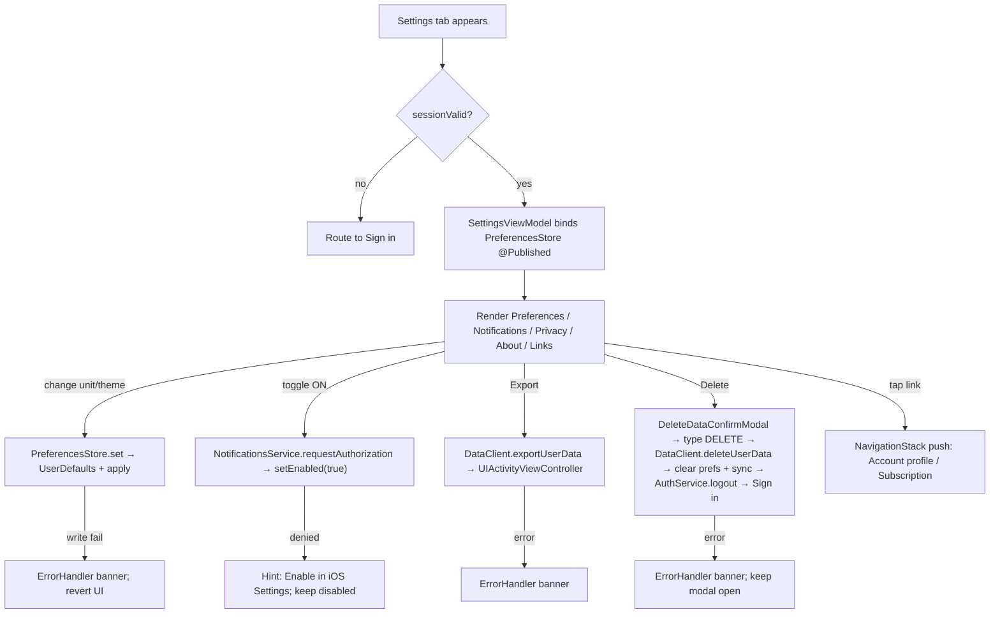
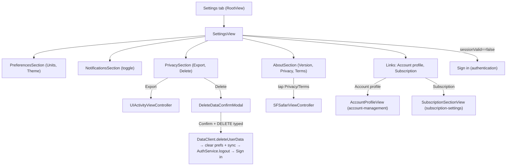

# settings-management - Technical Design

> **Implementation intent:** *Hybrid* — local-prefs are pure (UserDefaults wrapper + Combine publishers); export/delete are service-backed. Order: `PreferencesStore` (UserDefaults wrapper) → `NotificationsService` (UNUserNotificationCenter) → `SettingsViewModel` → `SettingsView` + sub-views. Reuses `DataClient`, `AuthService`, `OfflineSyncService`, `ErrorHandler`, `CaloButton`. No new SPM dependency.

## 1. Overview

### Goals
- Settings screen (WF-014 settings portion) groups preferences (units, theme), Notifications (opt-in), Privacy (Export + Delete), About (version, privacy policy, terms), and links to Account profile and Subscription.
- Local preferences persist via `PreferencesStore` (UserDefaults wrapper) and are reactive (Combine `@Published`).
- Privacy actions call `DataClient.exportUserData()` / `deleteUserData()` (Supabase RPC); delete additionally clears local cache + signs out.
- Notifications opt-in uses `UNUserNotificationCenter` once per ON-tap.
- No parallel error path; everything flows through shared `ErrorHandler`.

### In-scope / out-of-scope
**In-scope:** Settings screen, PreferencesStore, NotificationsService, Export/Delete flow + typed-keyword guardrail, About section (version, privacy policy URL, terms URL in SFSafariViewController), navigation links to Account/Subscription sections.
**Out-of-scope:** Subscription management (owned by `subscription-settings`); profile editing (owned by `account-management`); the share-progress card (WF-015, post-MVP teaser); sign-in screen (owned by `authentication`).

### AC Coverage Summary
Addresses **all 17 acceptance criteria** across 4 requirements:
- **REQ-001 → §7.1:** AC-001.1, AC-001.2, AC-001.3, AC-001.4
- **REQ-002 → §7.2:** AC-002.1, AC-002.2, AC-002.3, AC-002.4
- **REQ-003 → §7.3:** AC-003.1, AC-003.2, AC-003.3, AC-003.4, AC-003.5
- **REQ-004 → §7.4:** AC-004.1, AC-004.2, AC-004.3, AC-004.4

## 2. Architecture

### Runtime boundaries
```
RootView (Settings tab) ─▶ SettingsView ─▶ SettingsViewModel
                                            │  ├─ PreferencesStore (UserDefaults wrapper, @Published)
                                            │  ├─ NotificationsService (UNUserNotificationCenter wrapper)
                                            │  ├─ DataClient.exportUserData() / deleteUserData()
                                            │  ├─ AuthService.logout() (delete flow only)
                                            │  ├─ OfflineSyncService.clearUserCache() (delete flow only)
                                            │  └─ AppEnvironment.errors (ErrorHandler)
SettingsView ── presents ──▶ DeleteDataConfirmModal (sheet; typed-keyword)
SettingsView ── presents ──▶ SFSafariViewController (Privacy policy / Terms)
SettingsView ── pushes ──▶ AccountProfileSection (account-management)
SettingsView ── pushes ──▶ SubscriptionSection (subscription-settings)
```

### Module responsibilities
| Module | Responsibility |
|--------|----------------|
| `PreferencesStore` | UserDefaults-backed key/value store; `units: UnitSystem`; `theme: AppTheme`; `notificationsEnabled: Bool`; `@Published` so views update reactively |
| `NotificationsService` | Wraps `UNUserNotificationCenter`; `currentStatus()`; `requestAuthorization()`; `setEnabled(_:)` schedules/cancels the daily meal-log reminder |
| `SettingsViewModel` | Owns `prefs`, `notificationsStatus`; orchestrates export/delete flows; validates delete guardrail (typed "DELETE") |
| `SettingsView` | Renders sections; presents delete confirmation; presents SFSafariViewController; pushes navigation links |
| `DeleteDataConfirmModal` | Sheet with copy + text field; destructive button enabled only when input == "DELETE" |
| `AboutRow` / `LinkRow` / `ToggleRow` | Reusable Settings row components |

### Data flow


## 3. Components and Interfaces

| Component | Type | Contract | File |
|-----------|------|----------|------|
| `UnitSystem` | enum | `case metric, imperial` | `Features/Settings/Models/UnitSystem.swift` |
| `AppTheme` | enum | `case system, light, dark` | `Features/Settings/Models/AppTheme.swift` |
| `PreferencesStore` | class (ObservableObject) | `@Published var units: UnitSystem`; `@Published var theme: AppTheme`; `@Published var notificationsEnabled: Bool`; `set<T>(_:forKey:)`; injected via `AppEnvironment` | `Features/Settings/Services/PreferencesStore.swift` |
| `NotificationsServicing` | protocol | `currentStatus() async -> UNAuthorizationStatus`; `requestAuthorization() async -> Bool`; `setEnabled(_ enabled: Bool) async` (schedules/cancels daily reminder) | `Features/Settings/Services/NotificationsService.swift` |
| `NotificationsService` | class (UNUserNotificationCenter wrapper) | concrete impl | same |
| `SettingsViewModel` | `@MainActor ObservableObject` | `@Published prefs: PreferencesSnapshot`; `setUnits(_:)`, `setTheme(_:)`, `toggleNotifications(_:)`, `exportData()`, `requestDelete()`, `confirmDelete()`, callbacks `onSignedOut`, `onNavigateToAccount`, `onNavigateToSubscription` | `Features/Settings/ViewModels/SettingsViewModel.swift` |
| `PreferencesSnapshot` | struct | `units`, `theme`, `notificationsEnabled` — used as a single render-bound value | `Features/Settings/Models/PreferencesSnapshot.swift` |
| `SettingsView` | SwiftUI `View` | sections: Preferences, Notifications, Privacy, About, Links | `Features/Settings/Views/SettingsView.swift` |
| `PreferencesSection` | SwiftUI `View` | units + theme rows | `Features/Settings/Views/PreferencesSection.swift` |
| `NotificationsSection` | SwiftUI `View` | toggle + hint | `Features/Settings/Views/NotificationsSection.swift` |
| `PrivacySection` | SwiftUI `View` | Export + Delete buttons | `Features/Settings/Views/PrivacySection.swift` |
| `AboutSection` | SwiftUI `View` | version, privacy policy, terms | `Features/Settings/Views/AboutSection.swift` |
| `DeleteDataConfirmModal` | SwiftUI `View` | text field + destructive `CaloButton` (enabled only on "DELETE") | `Features/Settings/Views/DeleteDataConfirmModal.swift` |

### Reuse Plan (ios-components Reuse-First Gate)
- **Reuse:** `CaloButton` (shared-foundations) for Save/Cancel/destructive; `ErrorHandler` for all errors; `DataClient` (Supabase) for export/delete RPCs; `AuthService.logout()` for sign-out; `OfflineSyncService.clearUserCache()` for local cache wipe on delete; `User` (read-only here).
- **New (justified):** `PreferencesStore` (UserDefaults wrapper — no shared equivalent in shared-foundations), `NotificationsService` (UNUserNotificationCenter wrapper — no shared equivalent), `SettingsViewModel`, `SettingsView` and section views, `DeleteDataConfirmModal`. No SPM dependency.

## 4. Data Models and Contracts

- `UnitSystem`: enum `{metric, imperial}`. When `imperial`, height/weight are displayed in in/lb via conversion (1 cm = 0.393701 in; 1 kg = 2.20462 lb); underlying storage stays metric (per BR-018.3).
- `AppTheme`: enum `{system, light, dark}`. Applied via `.preferredColorScheme(_:)` on the root.
- `PreferencesSnapshot`: `{ units, theme, notificationsEnabled }` — read from `PreferencesStore`.
- `NotificationsService`:
  - `currentStatus() async -> UNAuthorizationStatus` (notDetermined / denied / authorized / provisional / ephemeral)
  - `requestAuthorization() async -> Bool` (true if granted)
  - `setEnabled(_ enabled: Bool) async` — schedules a daily 8pm local reminder if `enabled && authorized`; cancels all pending if not
- `DeleteDataConfirmModal` typed-keyword validation: input must equal `"DELETE"` (case-sensitive) before destructive button enables.
- Persistence keys: `units`, `theme`, `notificationsEnabled` (all under a Calo-namespaced suite in UserDefaults).

## 5. Error Handling

| Failure mode | Detection | User-visible behavior | Recovery |
|--------------|-----------|-----------------------|----------|
| Preferences write fail (disk full / sandbox error) | `UserDefaults.set` throws | `ErrorHandler` banner; UI reverts to last persisted | Retry from row (AC-001.4) |
| Notifications auth denied | `requestAuthorization` returns false | Hint "Enable in iOS Settings > Calo AI > Notifications" with deep-link | Manual enable (AC-002.4) |
| Export fail | `DataClient.exportUserData()` throws | `ErrorHandler` recoverable banner; no share sheet | Retry (AC-003.4) |
| Delete fail (network/5xx) | `DataClient.deleteUserData()` throws | `ErrorHandler` banner; modal stays open | Retry from modal (AC-003.4) |
| URL load fail (privacy policy / terms) | `SFSafariViewController` fails to load | `ErrorHandler` banner + Retry | Retry (AC-004.3) |
| Not signed in on tab open | `AuthService.sessionValid() == false` | Route to Sign in | Sign in (NFR-SM-004) |
| User types wrong keyword on Delete | `input != "DELETE"` | Destructive button disabled; inline hint "Type DELETE to confirm" | Type correctly (AC-003.2, NFR-SM-003) |

## 6. Testing Strategy

Unit tests under `calo-ai-testTests/` (test target from `shared-foundations` task 4.1.1):

- `PreferencesStoreTests.swift` — read/write round-trip per key; `@Published` fires on set; persists across instances (AC-001.1/.2/.3; P1, P2).
- `NotificationsServiceTests.swift` — with fake `UNUserNotificationCenter`: `setEnabled(true)` schedules daily reminder; `setEnabled(false)` cancels; denied status does not retry request (AC-002.2/.3/.4; P3, P4).
- `SettingsViewModelTests.swift` — with fakes for `PreferencesStore`, `NotificationsService`, `DataClient`, `AuthService`, `OfflineSyncService`:
  - units/theme writes flip `@Published` (AC-001.2; P2)
  - delete confirm requires typed "DELETE" before enabling destructive (AC-003.2; P5)
  - delete confirm calls `DataClient.deleteUserData()` + `AuthService.logout()` + `OfflineSyncService.clearUserCache()` and fires `onSignedOut` (AC-003.3/.5; P6, P7)
  - export success returns URL (AC-003.1; P8)
  - export/delete failure surfaces `ErrorHandler` and does not mark complete (AC-003.4; P9)
- `DeleteDataConfirmModalTests.swift` — destructive button enabled iff input == "DELETE" (AC-003.2, NFR-SM-003; P5).

Build checkpoint: XcodeBuildMCP `build_sim` after each phase.

## 7. Feature Breakdown (iOS-first)

### 7.1 Preferences (Units & Theme)
- **ACs Implemented:** AC-001.1, AC-001.2, AC-001.3, AC-001.4
- **Source:** FR-018 (BR-018.3), PRD §9, UC-022, WF-014
- **What:** `PreferencesStore` (UserDefaults wrapper, `@Published` for reactivity). `PreferencesSection` renders two rows: Units segmented (metric/imperial) and Theme segmented (system/light/dark). Changes write through `PreferencesStore.set`; theme is applied at root via `AppTheme.colorScheme`.
- **States:** idle / saving / saved / error.
- **UX expectations:** segmented controls ≥44pt; VoiceOver; Dynamic Type; Dark Mode.
- **Files:** `Features/Settings/Services/PreferencesStore.swift`, `Features/Settings/Models/UnitSystem.swift`, `Features/Settings/Models/AppTheme.swift`, `Features/Settings/Views/PreferencesSection.swift`.

### 7.2 Notifications Opt-In
- **ACs Implemented:** AC-002.1, AC-002.2, AC-002.3, AC-002.4
- **Source:** PRD §9 (opt-in, max 1/day); UC-022; WF-014
- **What:** `NotificationsService` wraps `UNUserNotificationCenter`. Toggle defaults OFF. On ON: `requestAuthorization()` → if granted, schedule daily 8pm reminder + persist `notificationsEnabled = true`; if denied, keep disabled and show hint. On OFF: cancel pending + persist `notificationsEnabled = false`.
- **States:** idle / requesting / authorized / denied / error.
- **UX expectations:** toggle visible state via `accessibilityValue`; hint copy and Settings deep-link.
- **Files:** `Features/Settings/Services/NotificationsService.swift`, `Features/Settings/Views/NotificationsSection.swift`, `Features/Settings/ViewModels/SettingsViewModel.swift`.

### 7.3 Privacy — Export & Delete
- **ACs Implemented:** AC-003.1, AC-003.2, AC-003.3, AC-003.4, AC-003.5
- **Source:** PRD §9 (required export + delete); UC-022; WF-014
- **What:** `PrivacySection` with two buttons. Export → `DataClient.exportUserData()` → `UIActivityViewController`. Delete → `DeleteDataConfirmModal` requiring typed "DELETE" → on confirm, `DataClient.deleteUserData()` + `PreferencesStore.clear()` + `OfflineSyncService.clearUserCache()` + `AuthService.logout()` + `onSignedOut`. Both failures surface via `ErrorHandler`.
- **States:** idle / exporting / exported / deleting / deleted / error.
- **UX expectations:** destructive `CaloButton` red; inline hint "Type DELETE to confirm"; toast on export success.
- **Files:** `Features/Settings/Views/PrivacySection.swift`, `Features/Settings/Views/DeleteDataConfirmModal.swift`, `Features/Settings/ViewModels/SettingsViewModel.swift`.

### 7.4 App Info & Links
- **ACs Implemented:** AC-004.1, AC-004.2, AC-004.3, AC-004.4
- **Source:** PRD §9; UC-022; WF-014
- **What:** `AboutSection` shows `CFBundleShortVersionString` + `CFBundleVersion`; tap "Privacy policy" → `SFSafariViewController(url: "https://caloai.app/privacy")`; tap "Terms of service" → `SFSafariViewController(url: "https://caloai.app/terms")`. Tap "Account profile" → push `AccountProfileView` (from `account-management`). Tap "Subscription" → push `SubscriptionSectionView` (from `subscription-settings`).
- **States:** idle / loading-url / error.
- **UX expectations:** read-only version text in caption style; URLs open in-app, not external browser.
- **Files:** `Features/Settings/Views/AboutSection.swift`, `Features/Settings/Views/SettingsView.swift`.

## 8. Navigation and Integration

### Flow diagram


### Navigation table
| From | To | Trigger | Data |
|------|----|---------|------|
| RootView Settings tab | SettingsView | tab select | AppEnvironment (prefs, data, auth, errors) |
| SettingsView | AccountProfileView | tap "Account profile" | `NavigationStack` push |
| SettingsView | SubscriptionSectionView | tap "Subscription" | `NavigationStack` push |
| SettingsView | UIActivityViewController | tap "Export" | exported JSON file URL |
| SettingsView | DeleteDataConfirmModal | tap "Delete my data" | sheet |
| SettingsView | SFSafariViewController | tap "Privacy policy" / "Terms" | URL |
| DeleteDataConfirmModal | Sign in screen | confirm delete | clear local + backend delete + logout |

### Integration rules
- `SettingsView` replaces `PlaceholderView("Settings")` (or the placeholder portion of the Settings tab) in `RootView`. Composition with `account-management` and `subscription-settings` happens via `NavigationStack` push from this view.
- `PreferencesStore` is a singleton owned by `AppEnvironment` so `account-management` can also read `units` to render height/weight in the chosen unit.
- `NotificationsService` is a singleton owned by `AppEnvironment`; the actual daily-reminder scheduling logic stays here (no other spec owns notifications).
- Export uses `DataClient.exportUserData()` (RPC) — the underlying transport is the same `DataClient` from shared-foundations, so URLSession/PostgREST + RLS apply.
- Delete is destructive: typed keyword + final `CaloButton`. UI MUST NOT allow single-tap delete (NFR-SM-003).

## 9. Correctness Properties

| Property | Type | Validates AC | Statement |
|---|---|---|---|
| P1 | Round-trip | AC-001.1, AC-001.3 | A value written via `PreferencesStore.set(_:forKey:)` is read back as the same value across instances and app launches. |
| P2 | Invariant | AC-001.2 | Changing Units or Theme in the UI flips the corresponding `@Published` property synchronously and triggers persistence within 100ms. |
| P3 | Invariant | AC-002.2, AC-002.3 | A toggle ON only persists `notificationsEnabled = true` when `requestAuthorization()` returns granted; a toggle OFF always persists false and cancels pending reminders. |
| P4 | Invariant | AC-002.4 | A denied `requestAuthorization()` keeps `notificationsEnabled = false`, displays the iOS Settings hint, and never auto-retries. |
| P5 | Invariant | AC-003.2, NFR-SM-003 | The destructive Delete button in `DeleteDataConfirmModal` is enabled iff the typed input exactly equals "DELETE" (case-sensitive). |
| P6 | Invariant | AC-003.3, AC-003.5 | A confirmed Delete calls `DataClient.deleteUserData()`, `PreferencesStore.clear()`, `OfflineSyncService.clearUserCache()`, and `AuthService.logout()` in that order; `onSignedOut` fires on success. |
| P7 | Invariant | AC-003.4 | A failure on any Delete step surfaces `ErrorHandler`, leaves `PreferencesStore` and `OfflineSyncService` cache in their prior state, and does not invoke `onSignedOut`. |
| P8 | Round-trip | AC-003.1 | A successful `exportUserData()` returns a downloadable file URL that is presented in `UIActivityViewController`. |
| P9 | Invariant | AC-004.1, AC-004.2 | Tapping "Privacy policy" opens `https://caloai.app/privacy` in `SFSafariViewController`; tapping "Terms of service" opens `https://caloai.app/terms`; app does not switch to Safari.app. |
| P10 | Invariant | AC-004.4 | Tapping "Account profile" pushes the `account-management` view; tapping "Subscription" pushes the `subscription-settings` view — no modal presentation for these. |
