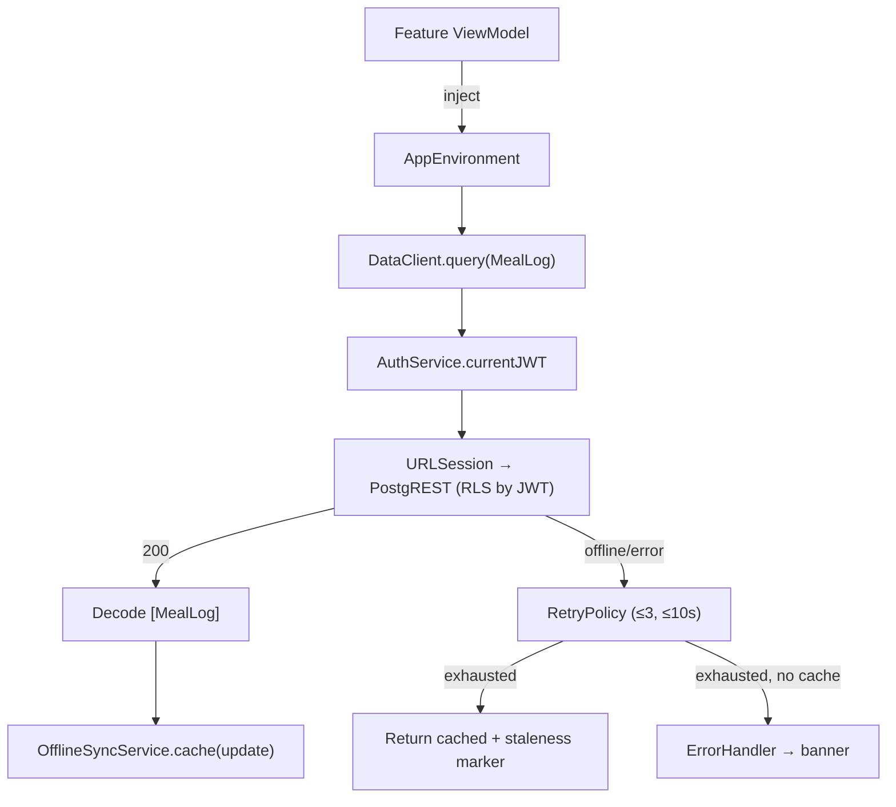
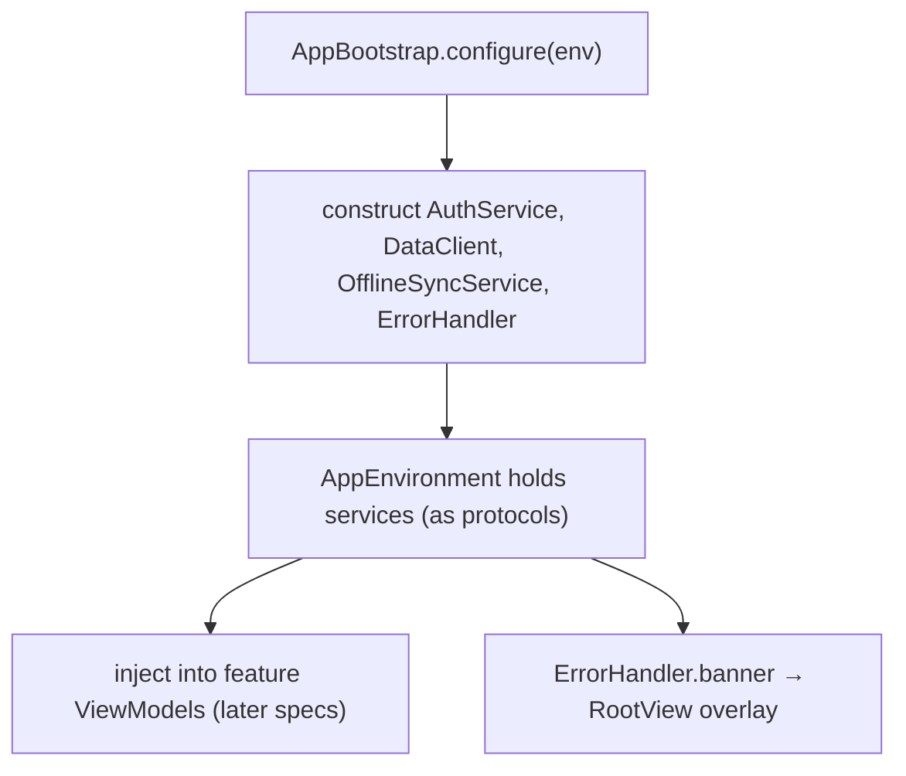

# shared-foundations - Technical Design

> **Implementation intent:** *Logic-first*. This spec is almost entirely domain models + services;
> UI is limited to two reusable components. Order: models → error taxonomy → service protocols →
> concrete implementations → DI wiring → shared components.
>
> **Key buildability decision:** the SPM packages (Supabase/RevenueCat/Firebase) are **deferred** by
> `project-structure`. To keep the target compiling now, the data client is implemented over
> **`URLSession` against Supabase's REST (PostgREST) + Auth (GoTrue) HTTPS endpoints** — no third-party
> SDK dependency. Sign in with Apple uses Apple's own `AuthenticationServices` framework (no SPM).
> A swap to the official SDK later is an internal detail behind the service protocols.

## 1. Overview

### Goals
- Deliver the `Shared/` foundation: `User`/`MealLog`/`Ingredient` models, `AuthService` (Sign in with Apple + Keychain session), a Supabase-backed `DataClient` (RLS-scoped CRUD over HTTPS), `OfflineSyncService` (cache + queue), `ErrorHandler` (typed `AppError` + retry/backoff), and shared `Button`/`ProgressBar` components.
- Provide these through a dependency-injection point (`AppEnvironment` service container) so feature ViewModels get constructor-injected, testable dependencies.
- Keep the app target building with **zero** deferred SPM packages.

### In-scope / out-of-scope
**In-scope**
- Domain models + validation, `AppError` taxonomy.
- `AuthServicing`/`DataClienting`/`OfflineSyncing`/`ErrorPresenting` protocols + concrete implementations.
- Keychain token storage; URLSession PostgREST/GoTrue client with JWT injection + RLS scoping.
- Local cache (file/CoreData-free lightweight store) + write queue with last-write-wins + staleness marker.
- Retry/backoff policy; shared error banner presenter.
- `Button` (Primary/Secondary/Destructive) + color-coded `ProgressBar`.
- DI wiring: extend `project-structure`'s `AppEnvironment` to vend services; provide fakes for tests/previews.

**Out-of-scope** (owned by later specs)
- Any feature screen or ViewModel (Camera, Confirmation, Diary, Dashboard, Paywall, Onboarding, Account).
- Subscription cancel/manage/restore business logic + UI (FR-024/025/026) — owned by `subscription-management`/`subscription-settings`; this spec only supplies session (`getUser`/`sessionValid`).
- RevenueCat + Firebase SDK wiring (deferred SPM; Firebase init TODO lives in `project-structure` `AppBootstrap`).
- Backend schema/RLS policy authoring (backend task); this spec consumes it.

### AC Coverage Summary
This design addresses **all 32 acceptance criteria** from `requirements.md`:
- **REQ-001 → §7.1:** AC-001.1, AC-001.2, AC-001.3, AC-001.4
- **REQ-002 → §7.2:** AC-002.1, AC-002.2, AC-002.3, AC-002.4, AC-002.5
- **REQ-003 → §7.3:** AC-003.1, AC-003.2, AC-003.3, AC-003.4, AC-003.5
- **REQ-004 → §7.4:** AC-004.1, AC-004.2, AC-004.3, AC-004.4, AC-004.5
- **REQ-005 → §7.5:** AC-005.1, AC-005.2, AC-005.3, AC-005.4
- **REQ-006 → §7.6:** AC-006.1, AC-006.2, AC-006.3, AC-006.4
- **REQ-007 → §7.7:** AC-007.1, AC-007.2, AC-007.3, AC-007.4

## 2. Architecture

### Runtime boundaries
```
┌──────────────────────── iOS App Process ────────────────────────┐
│  App/ (project-structure)                                        │
│   └─ CaloApp → AppBootstrap.configure(env) → builds services     │
│               → injects AppEnvironment (service container)        │
│  Features/* (later specs)  ── inject ──▶  service PROTOCOLS       │
│                                                                   │
│  Shared/                                                          │
│   ├─ Models/     User · MealLog · Ingredient · Macros            │
│   ├─ Services/   AuthService · DataClient · OfflineSyncService   │
│   │              ErrorHandler                                     │
│   ├─ Components/  Button · ProgressBar · (Placeholder)           │
│   └─ Utils/      Keychain · RetryPolicy · AppError · Reachability│
└─────────────┬───────────────────────────────┬──────────────────┘
   AuthenticationServices (Apple)      URLSession (HTTPS)
   Keychain (Security.framework)   GoTrue /auth  +  PostgREST /rest
```

### Module responsibilities
| Module | Responsibility | Notes |
|--------|----------------|-------|
| `Shared/Models` | Pure data + validation; no I/O | Codable/Identifiable; `validate()` returns `AppError?` |
| `Shared/Services/AuthService` | Sign in with Apple, session lifecycle, Keychain token | Conforms to `AuthServicing` |
| `Shared/Services/DataClient` | RLS-scoped CRUD over PostgREST; JWT injection | Conforms to `DataClienting`; URLSession-based |
| `Shared/Services/OfflineSyncService` | Local cache + write queue + reconcile | Conforms to `OfflineSyncing`; uses Reachability |
| `Shared/Services/ErrorHandler` | Map errors → `AppError`; drive user banner | Conforms to `ErrorPresenting` |
| `Shared/Utils` | Keychain wrapper, `RetryPolicy`, `AppError`, `Reachability` | No SwiftUI |
| `Shared/Components` | `Button`, `ProgressBar` | SwiftUI, a11y-ready |
| `AppEnvironment` (extended) | Vend service instances via protocols; provide test fakes | Constructor-injection source |

### Data flow (authenticated read, with offline)


The service **protocols** are the contract features depend on; concrete implementations and the SDK/URLSession choice stay hidden behind them (AC-007.3).

## 3. Components and Interfaces

### Service protocols (public contracts)
| Protocol | Key members (contract, no bodies) | Concrete type | File |
|----------|-----------------------------------|---------------|------|
| `AuthServicing` | `signInWithApple() async throws -> User`; `logout()`; `sessionValid() -> Bool`; `getUser() -> User?`; `currentAccessToken() -> String?` | `AppleAuthService` | `Shared/Services/AuthService.swift` |
| `DataClienting` | `query<T:Decodable>(_:filters:) async throws -> [T]`; `insert<T:Codable>(_:) async throws -> T`; `update<T:Codable>(_:) async throws -> T`; `delete(table:id:) async throws` | `SupabaseRESTClient` | `Shared/Services/DataClient.swift` |
| `OfflineSyncing` | `cache<T:Codable>(_:)`; `cached<T:Codable>(_:) -> [T]`; `enqueue(_ op:)`; `flush() async`; `lastSyncedAt -> Date?` | `OfflineSyncService` | `Shared/Services/OfflineSyncService.swift` |
| `ErrorPresenting` | `map(_ error:Error) -> AppError`; `present(_:)`; `@Published var banner: ErrorBanner?` | `ErrorHandler` | `Shared/Services/ErrorHandler.swift` |

### Support types
| Type | Role | File |
|------|------|------|
| `KeychainStore` | Read/write/delete tokens in Keychain (Security.framework) | `Shared/Utils/KeychainStore.swift` |
| `RetryPolicy` | Exponential backoff, ≤3 attempts, ≤10s cap | `Shared/Utils/RetryPolicy.swift` |
| `AppError` | Typed error enum + user message | `Shared/Utils/AppError.swift` |
| `Reachability` | Network up/down signal (NWPathMonitor) | `Shared/Utils/Reachability.swift` |

### SwiftUI components
| Component | API | File |
|-----------|-----|------|
| `CaloButton` (+ `ButtonRole`-like variants) | `CaloButton(_ title:, variant: .primary/.secondary/.destructive, action:)` | `Shared/Components/Button/CaloButton.swift` |
| `ProgressBar` | `ProgressBar(current: Double, goal: Double)` → color-coded | `Shared/Components/ProgressBar/ProgressBar.swift` |

### DI composition (extends project-structure)
`AppEnvironment` gains service properties typed as the **protocols**:
`auth: AuthServicing`, `data: DataClienting`, `sync: OfflineSyncing`, `errors: ErrorPresenting`.
`AppBootstrap.configure(env)` constructs the concrete implementations from resolved config and assigns them. A `AppEnvironment.preview`/`.fake` factory vends in-memory fakes (AC-007.4).

### Reuse Plan (ios-components Reuse-First Gate)
- **Reuse:** `PlaceholderView` (from `project-structure`) stays as-is.
- **New (justified):** `CaloButton`, `ProgressBar` — these ARE the shared library REQ-006 mandates; every feature reuses them (no per-feature button/bar). Prefixed `Calo` to avoid clashing with SwiftUI `Button`.
- No other components introduced.

### File plan (canonical ios-architecture tree)
```
calo-ai-test/
├── Shared/
│   ├── Models/
│   │   ├── User.swift
│   │   ├── MealLog.swift
│   │   └── Ingredient.swift        (+ Macros)
│   ├── Services/
│   │   ├── AuthService.swift
│   │   ├── DataClient.swift
│   │   ├── OfflineSyncService.swift
│   │   └── ErrorHandler.swift
│   ├── Utils/
│   │   ├── KeychainStore.swift
│   │   ├── RetryPolicy.swift
│   │   ├── AppError.swift
│   │   └── Reachability.swift
│   └── Components/
│       ├── Button/CaloButton.swift
│       └── ProgressBar/ProgressBar.swift
└── App/
    └── AppEnvironment.swift          (extended: service container + fakes)
```

## 4. Data Models and Contracts

### `User`
| Field | Type | Notes / Validation |
|-------|------|--------------------|
| `id` | `UUID`/`String` | primary key (Identifiable) |
| `email` | `String` | from Apple; may be private-relay |
| `name` | `String` | optional display name |
| `height` | `Double` (cm) | 120–220 (BR-018.1) |
| `weight` | `Double` (kg) | 30–300 (BR-018.2) |
| `goal` | enum `{lose, maintain, gain}` | required (VR-018.3) |
| `activityLevel` | enum | required for TDEE (onboarding-form) |
| `calorieTarget` | `Int` | computed downstream |
| `onboardingComplete` | `Bool` | gates first-run routing |

### `MealLog` / `Ingredient` / `Macros`
- `MealLog`: `id`, `userId`, `date`, `ingredients: [Ingredient]`, `totalCalories: Int`, `macros: Macros`, `confidence: Double`.
- `Ingredient`: `id`, `name`, `portion` (enum `{small, medium, large}` or grams), `calories: Int`, `macros: Macros`, `isSelected: Bool`.
- `Macros`: `protein`, `carbs`, `fat` (grams, `Double`).

### Contracts & rules
- All models `Codable` + `Identifiable`; explicit `CodingKeys` mapping snake_case ⇄ camelCase for PostgREST (AC-001.3 round-trip).
- `validate() -> AppError?` on `User` (ranges) and non-negative totals on `MealLog` (VR-012.1) (AC-001.4).
- DTO boundary: models decode directly from PostgREST JSON; dates as ISO-8601.

### `AppError` (taxonomy)
`enum AppError: Error { case network, unauthenticated, validation(String), timeout, server(Int), unknown }` with `userMessage: String` and `isRetryable: Bool` (network/timeout/server→true; validation/unauthenticated→false) (AC-005.1, AC-005.4).

## 5. Error Handling

| Failure mode | Detection | User-visible behavior | Recovery |
|--------------|-----------|-----------------------|----------|
| Transient network / timeout / 5xx | URLSession error / status | Silent during retries; then banner with Retry | `RetryPolicy`: exp backoff, ≤3 attempts, ≤10s (AC-005.2) |
| Retries exhausted | RetryPolicy result | `ErrorHandler` banner + Retry affordance | Manual retry (AC-005.3) |
| Unauthenticated (no/expired JWT) | `sessionValid()==false` / 401 | Route to sign-in; no data leak | Fail fast, no retry (AC-003.5, AC-005.4) |
| Validation (bad model field) | `validate()` before persist | Inline field message | No retry; block save (AC-001.4, AC-005.4) |
| Offline write | Reachability down | "Syncing…" pending state | Enqueue + flush on reconnect (AC-004.2/.3) |
| Queued write permanently fails | flush result after retries | Recoverable error; item retained | No silent loss (AC-004.5) |
| Decode failure | JSON decode throws | Generic error banner | Treated as `server`/`unknown`; no partial data (AC-003.3) |

## 6. Testing Strategy

Target ≥60% coverage on Services + Models (NFR-SF-006). Concrete files under `calo-ai-testTests/` (requires a unit-test target — see tasks; deferred from `project-structure`):

- `UserModelTests.swift` — validation ranges accept/reject; Codable round-trip (AC-001.1, AC-001.3, AC-001.4; P1–P3).
- `MealLogModelTests.swift` — Codable round-trip; non-negative totals (AC-001.2/.3/.4; P2, P4).
- `AuthServiceTests.swift` — session valid/invalid/logout using a fake Keychain; failed sign-in leaves state (AC-002.3/.4/.5; P5–P7). Uses `KeychainStore` fake.
- `DataClientTests.swift` — JWT attached to request; HTTPS-only; unauth fails fast; decode-or-throw (AC-003.2/.3/.4/.5; P8–P11). Uses `URLProtocol` stub.
- `RetryPolicyTests.swift` — retryable retries ≤3 & ≤10s; non-retryable does not retry (AC-005.2/.4; P13, P15).
- `OfflineSyncServiceTests.swift` — cache read offline; enqueue + ordered flush + last-write-wins; failed item retained (AC-004.1/.2/.3/.5; P12, P16).
- `ProgressBarTests.swift` — color thresholds (green/yellow/red) + clamp on goal 0/negative (AC-006.2/.4; P14, P17).

Build/test checkpoint per phase via XcodeBuildMCP `build_sim` (compile) + `test_sim` (once test target exists).

## 7. Feature Breakdown (iOS-first)

### 7.1 Domain Data Models
- **ACs Implemented:** AC-001.1, AC-001.2, AC-001.3, AC-001.4
- **Source:** FR-018, FR-012, UC-016, UC-011
- **What:** `User`, `MealLog`, `Ingredient`, `Macros` value types (Codable/Identifiable), explicit `CodingKeys`, `validate()` helpers.
- **States:** N/A (pure data).
- **Files:** `Shared/Models/User.swift`, `Shared/Models/MealLog.swift`, `Shared/Models/Ingredient.swift`.

### 7.2 Authentication & Session
- **ACs Implemented:** AC-002.1, AC-002.2, AC-002.3, AC-002.4, AC-002.5
- **Source:** NFR-004, NFR-006, PRD §9; enables `authentication`
- **What:** `AuthServicing` protocol + `AppleAuthService` (AuthenticationServices) + `KeychainStore` for token persistence. Session validity from stored token; logout clears it; failed/cancelled sign-in preserves prior state.
- **States:** signedOut / signingIn / signedIn / error.
- **UX expectations:** none here (Sign in with Apple button UI is `authentication` spec); a11y N/A.
- **Files:** `Shared/Services/AuthService.swift`, `Shared/Utils/KeychainStore.swift`.

### 7.3 Backend Data Client (Supabase REST + RLS)
- **ACs Implemented:** AC-003.1, AC-003.2, AC-003.3, AC-003.4, AC-003.5
- **Source:** NFR-005, NFR-014, FR-012, UC-011
- **What:** `DataClienting` protocol + `SupabaseRESTClient` over URLSession hitting PostgREST; injects `Authorization: Bearer <JWT>` from `AuthService`; HTTPS-only; decode-or-throw; fail-fast when unauthenticated.
- **States:** idle / loading / success / error.
- **Files:** `Shared/Services/DataClient.swift` (+ uses `RetryPolicy`, `AppError`).

### 7.4 Offline Cache & Sync Queue
- **ACs Implemented:** AC-004.1, AC-004.2, AC-004.3, AC-004.4, AC-004.5
- **Source:** NFR-007, NFR-008, PRD §9 (offline read cache, last-write-wins)
- **What:** `OfflineSyncing` protocol + `OfflineSyncService`: lightweight encrypted local cache (Codable snapshots), write-op queue persisted across launches, `Reachability` triggers ordered `flush()`, last-write-wins reconcile, `lastSyncedAt` for staleness marker; failed items retained.
- **States:** online-synced / offline-cached(stale) / syncing / sync-error.
- **UX expectations:** exposes `lastSyncedAt` so Diary can show "Last updated X min ago".
- **Files:** `Shared/Services/OfflineSyncService.swift`, `Shared/Utils/Reachability.swift`.

### 7.5 Error Handling & Retry
- **ACs Implemented:** AC-005.1, AC-005.2, AC-005.3, AC-005.4
- **Source:** NFR-016, FR-001, FR-003
- **What:** `AppError` taxonomy + `RetryPolicy` (exp backoff, ≤3, ≤10s) + `ErrorPresenting`/`ErrorHandler` publishing an `ErrorBanner` for the shell to render. Retryable vs non-retryable classification.
- **States:** none / retrying / banner-shown.
- **UX expectations:** banner is accessible (VoiceOver announces), dismissible, has Retry.
- **Files:** `Shared/Utils/AppError.swift`, `Shared/Utils/RetryPolicy.swift`, `Shared/Services/ErrorHandler.swift`.

### 7.6 Shared UI Components
- **ACs Implemented:** AC-006.1, AC-006.2, AC-006.3, AC-006.4
- **Source:** FR-014, FR-012 (BR-012.2), WF-004; ref `ios-ui-ux`
- **What:** `CaloButton` (primary/secondary/destructive) and `ProgressBar` (green ≤100%, yellow 100–110%, red >110%; clamps goal≤0 / negative current).
- **States:** Button: normal/pressed/disabled. ProgressBar: under/near/over.
- **UX expectations:** Dynamic Type, Dark Mode, ≥44pt tap target, accessibility labels + values (ProgressBar announces "1800 of 2000 calories").
- **Reuse:** new shared components (the library seed); reused by all feature screens.
- **Files:** `Shared/Components/Button/CaloButton.swift`, `Shared/Components/ProgressBar/ProgressBar.swift`.

### 7.7 Service Composition & Dependency Injection
- **ACs Implemented:** AC-007.1, AC-007.2, AC-007.3, AC-007.4
- **Source:** PRD §9 (constructor injection), Overview §3.1; extends `project-structure` `AppEnvironment`
- **What:** Extend `AppEnvironment` to hold `auth/data/sync/errors` typed as protocols, constructed in `AppBootstrap`. Provide `AppEnvironment.fake()` with in-memory implementations for previews/tests. Feature ViewModels take dependencies via initializer.
- **States:** N/A.
- **Files:** `App/AppEnvironment.swift` (extended), `App/AppBootstrap.swift` (wire real services).

## 8. Navigation and Integration

### Flow diagram


### Integration table (from → to → trigger → data)
| From | To | Trigger | Data |
|------|----|---------|------|
| `AppBootstrap` | service instances | launch | resolved `AppConfiguration` (supabaseURL, anon key) |
| `AppEnvironment` | feature ViewModels | ViewModel init (later specs) | service protocols |
| `AuthService` | `DataClient` | each request | current JWT for RLS |
| `DataClient` | `OfflineSyncService` | successful fetch | cache update |
| `ErrorHandler` | `RootView` | error presented | `ErrorBanner` (message + retry) |

### Cross-feature synchronization / integration rules
- This spec **has no screens**; "navigation" = the DI wiring above. `RootView` (from `project-structure`) gains an error-banner overlay reading `AppEnvironment.errors.banner`.
- Services are **singletons within `AppEnvironment`**, shared by all features; features never instantiate them directly (AC-007.2).
- Session is the single source of truth for auth; `DataClient` reads JWT from `AuthService` (no duplicate token stores).
- Consumed by: `authentication` (AuthService), `camera-capture`/`ai-recognition` (ErrorHandler), `confirmation-edit`/`diary-logging` (models + DataClient + OfflineSync + ProgressBar/Button), `onboarding-form` (User + validation), `account/subscription` (getUser/sessionValid).

## 9. Correctness Properties

**IMPORTANT:** Each property references an AC from requirements.

| Property | Type | Validates AC | Statement |
|---|---|---|---|
| P1 | Invariant | AC-001.1 | `User` conforms to `Codable` & `Identifiable` and exposes the required fields. |
| P2 | Round-trip | AC-001.3 | For any valid `User`/`MealLog`, `decode(encode(x)) == x` (stable CodingKeys, no loss). |
| P3 | Invariant | AC-001.1, AC-001.4 | `User.validate()` returns an error iff height∉[120,220] or weight∉[30,300] or goal unset. |
| P4 | Invariant | AC-001.2, AC-001.4 | A `MealLog` with a negative total is rejected by validation; `Ingredient`/`Macros` fields present. |
| P5 | Invariant | AC-002.2 | After a successful sign-in, the token exists in Keychain and nowhere in `UserDefaults`/plaintext. |
| P6 | Round-trip | AC-002.3, AC-002.4 | `signIn` then relaunch ⇒ `sessionValid()==true`; `logout()` ⇒ `sessionValid()==false` and Keychain cleared. |
| P7 | Invariant | AC-002.5 | A failed/cancelled sign-in leaves `getUser()` and `sessionValid()` exactly as before the attempt. |
| P8 | Invariant | AC-003.2 | Every `DataClient` request carries the current `Authorization: Bearer <JWT>` header. |
| P9 | Invariant | AC-003.4 | No `DataClient` request uses a non-`https` scheme. |
| P10 | Invariant | AC-003.5 | When `sessionValid()==false`, `DataClient` throws `.unauthenticated` without performing a network request. |
| P11 | Invariant | AC-003.3 | `DataClient` either returns a fully-decoded `[T]` or throws; it never returns partially-decoded data. |
| P12 | Round-trip | AC-004.1, AC-004.3 | An item written offline then flushed appears in the backend and in cache after reconnect (order preserved). |
| P13 | Invariant | AC-005.2 | A retryable failure triggers ≤3 retries and the total elapsed retry window is ≤10s. |
| P14 | Invariant | AC-006.2 | `ProgressBar` color is green for ratio ≤1.0, yellow for 1.0<ratio≤1.1, red for ratio>1.1. |
| P15 | Invariant | AC-005.4 | A non-retryable `AppError` (`.validation`/`.unauthenticated`) causes zero retries. |
| P16 | Invariant | AC-004.5 | A queued write that fails all retries remains in the queue (count does not decrease) and yields a recoverable error. |
| P17 | Invariant | AC-006.4 | For goal ≤ 0 or negative current, `ProgressBar` renders a clamped bar with no NaN/infinite width. |
| P18 | Invariant | AC-007.2, AC-007.3 | Each service is reachable only via its protocol through `AppEnvironment`; a fake conforming to the protocol can be injected in tests. |
| P19 | Invariant | AC-007.4 | `AppEnvironment.fake()` builds with in-memory services and requires no live backend (previews/tests compile & run). |
| P20 | Invariant | AC-004.4 | While offline with cached data, `OfflineSyncService.lastSyncedAt` is non-nil and drives a staleness marker. |
| P21 | Invariant | AC-005.1, AC-005.3 | Every surfaced failure maps to an `AppError` case and produces exactly one user-facing banner with a retry affordance when retryable. |
| P22 | Invariant | AC-003.1, AC-007.1 | `AppEnvironment` vends `auth`/`data`/`sync`/`errors`, and `DataClient` exposes query/insert/update/delete. |
| P23 | Invariant | AC-006.1, AC-006.3 | `CaloButton` exposes primary/secondary/destructive variants, each with an accessibility label and ≥44pt tap target. |
