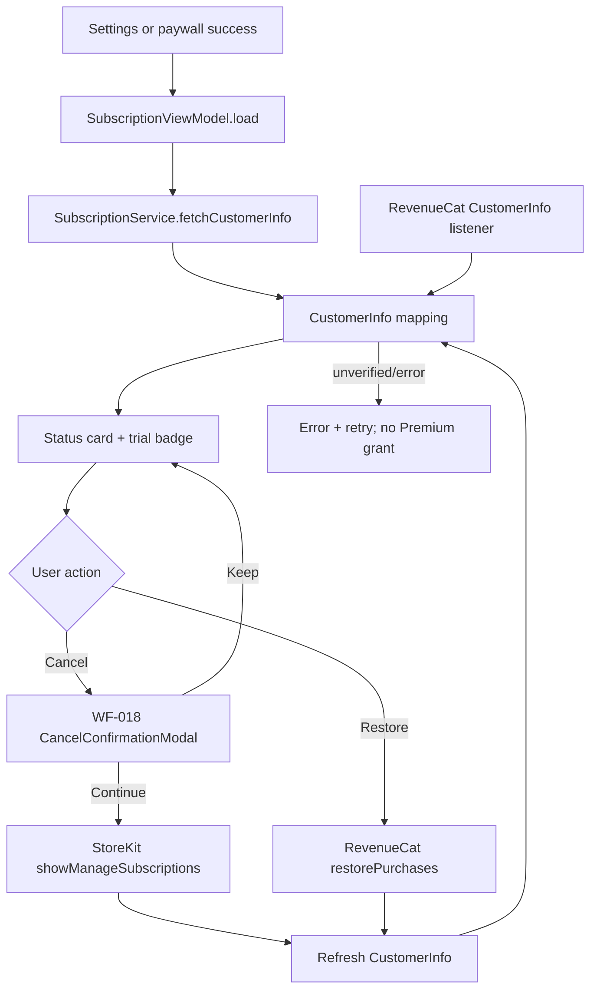
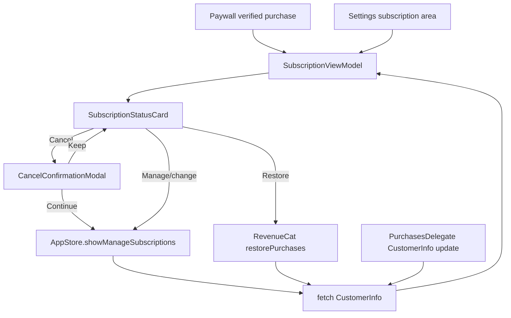

# subscription-management - Technical Design

> **Implementation intent:** *Hybrid* — establish the RevenueCat `CustomerInfo`/StoreKit service boundary first, then bind a listener-driven subscription ViewModel to the status card, trial badge, cancel modal, restore action, and manage-subscriptions flow.

## 1. Overview

### Goals
- Maintain a verified subscription state from RevenueCat `CustomerInfo` for Free, Trial, Premium, Cancellation pending, and Expired states.
- Show the 7-day trial badge and trial/renewal date after paywall activation, with scan entitlement changing only after verified `CustomerInfo`.
- Provide WF-018 cancellation confirmation followed by StoreKit `showManageSubscriptions` in-app, retaining Premium through the App Store expiration date.
- Restore purchases idempotently on a new device/reinstall, expose state-appropriate manage actions, and handle stale/network/Apple ID errors without granting unverified access.

### In-scope / out-of-scope
**In-scope:** `SubscriptionService` protocol abstraction, RevenueCat `purchases-ios` adapter, `CustomerInfo` listener, subscription state mapping, status card, trial badge, WF-018 cancel modal, StoreKit manage-subscriptions presentation, restore purchases, Settings integration seams, error/retry states, and subscription analytics.

**Out-of-scope:** paywall pricing-card layout and initial purchase CTA (`paywall-display`), camera quota enforcement (`camera-capture`), account/profile screen ownership (`account-management`), backend receipt implementation, support-contact workflows, and refund processing.

### AC Coverage Summary
Addresses **all 21 acceptance criteria**:
- **REQ-001 → §7.1:** AC-001.1, AC-001.2, AC-001.3, AC-001.4
- **REQ-002 → §7.2:** AC-002.1, AC-002.2, AC-002.3, AC-002.4
- **REQ-003 → §7.3:** AC-003.1, AC-003.2, AC-003.3, AC-003.4, AC-003.5
- **REQ-004 → §7.4:** AC-004.1, AC-004.2, AC-004.3, AC-004.4
- **REQ-005 → §7.5:** AC-005.1, AC-005.2, AC-005.3, AC-005.4

## 2. Architecture

### Runtime boundaries
```
PaywallView / Settings subscription area
              │
              ▼
 SubscriptionStatusCard ─▶ SubscriptionViewModel (@MainActor)
                                  │  ├─ SubscriptionService protocol
                                  │  │     ├─ RevenueCatSubscriptionService
                                  │  │     └─ StoreKitSubscriptionCoordinator
                                  │  ├─ CustomerInfoListener
                                  │  ├─ AuthService / AppEnvironment
                                  │  └─ ErrorHandler
                                  ▼
                  scan entitlement + Settings UI state
```

RevenueCat is configured once by `AppBootstrap` using the `purchases-ios` SPM dependency from project-structure 2.3.1. `SubscriptionService` consumes that configured handle and never reconfigures the SDK. StoreKit owns the App Store cancellation UI; the app does not claim to cancel a subscription through a private backend API.

### CustomerInfo listener pattern
- `RevenueCatSubscriptionService` owns a retained `PurchasesDelegate` listener registered once during service initialization.
- The listener receives RevenueCat `CustomerInfo` updates through `purchases(_:receivedUpdated:)`, maps the SDK object to an app-owned `CustomerInfoSnapshot`, and publishes it through an `AsyncStream`/Combine bridge.
- `SubscriptionViewModel` consumes the stream on `@MainActor`, applies only verified entitlement snapshots, updates status/scan access, and refreshes the view without relaunch.
- Foreground, Settings entry, purchase completion, restore completion, and return from `showManageSubscriptions` request a fresh `CustomerInfo`; stale cached state remains explicitly labeled.

### Module responsibilities
| Module | Responsibility |
|--------|----------------|
| `SubscriptionService` | Protocol for customer-info fetch/listen, purchase result reconciliation, restore, and StoreKit manage-subscriptions presentation. |
| `RevenueCatSubscriptionService` | `purchases-ios` adapter for `CustomerInfo`, entitlements, restore, purchase reconciliation, and listener registration. |
| `StoreKitSubscriptionCoordinator` | Present `AppStore.showManageSubscriptions` using the active `UIWindowScene`; return presentation/error outcome without fabricating cancellation. |
| `SubscriptionViewModel` | Map snapshots to UI state, expose state-appropriate actions, coordinate cancel/restore/manage, and surface errors. |
| `SubscriptionStatusCard` | Display state, plan, price/cycle, renewal/trial end, scan access, and actions. |
| `CancelConfirmationModal` | WF-018 warning, expiry date, Keep subscription, and Continue cancellation actions. |
| `TrialBadge` | Shared visual/accessibility treatment for active 7-day trial state; paywall may consume the same contract. |
| `AppEnvironment` / `AuthService` / `ErrorHandler` | Inject configured dependencies, current user/session, and recoverable error presentation. |

### Data flow


## 3. Components and Interfaces

| Component | Type | Contract | File |
|-----------|------|----------|------|
| `SubscriptionService` | protocol | Fetch/listen for app-owned `CustomerInfoSnapshot`, restore purchases, reconcile purchase, and request StoreKit manage-subscriptions UI | `Features/Subscription/Services/SubscriptionService.swift` |
| `RevenueCatSubscriptionService` | class | `purchases-ios` adapter; maps `CustomerInfo`, registers listener, restores, and exposes verified entitlement updates | `Features/Subscription/Services/RevenueCatSubscriptionService.swift` |
| `CustomerInfoListener` | class/delegate | Retained `PurchasesDelegate` bridge from RevenueCat `CustomerInfo` updates to `AsyncStream`/Combine | `Features/Subscription/Services/CustomerInfoListener.swift` |
| `StoreKitSubscriptionCoordinator` | class | Presents `AppStore.showManageSubscriptions(in:)` and returns success/failure without direct cancellation mutation | `Features/Subscription/Services/StoreKitSubscriptionCoordinator.swift` |
| `SubscriptionViewModel` | `@MainActor ObservableObject` | `loadStatus()`, `refresh()`, `handleCancel()`, `confirmCancellation()`, `keepSubscription()`, `handleRestore()`, `manageSubscription()` | `Features/Subscription/ViewModels/SubscriptionViewModel.swift` |
| `SubscriptionStatusCard` | SwiftUI `View` | Free/trial/Premium/pending/expired status, dates, scan access, and actions | `Features/Subscription/Views/SubscriptionStatusCard.swift` |
| `TrialBadge` | SwiftUI `View` | "7 days free" plus trial end/renewal accessibility value | `Features/Subscription/Views/TrialBadge.swift` |
| `CancelConfirmationModal` | SwiftUI `View` | WF-018 warning and Keep/Continue actions | `Features/Subscription/Views/CancelConfirmationModal.swift` |
| `SubscriptionStatus` | enum/model | Stable app state independent of RevenueCat SDK types | `Features/Subscription/Models/SubscriptionStatus.swift` |
| `CustomerInfoSnapshot` | model | Verified entitlement, product, period, trial, expiration, cancellation-pending, and freshness data | `Features/Subscription/Models/CustomerInfoSnapshot.swift` |

### Reuse Plan (ios-components Reuse-First Gate)
- **Reuse:** `CaloButton` from `shared-foundations` for Manage, Restore, Cancel, Keep, Retry, and Upgrade actions; `ErrorHandler` for StoreKit/RevenueCat errors; `AppEnvironment` for injected services and analytics; `AuthService` for session/user identity; `SubscriptionService` protocol abstraction from the paywall purchase boundary.
- **New (justified):** `SubscriptionStatusCard`, `CancelConfirmationModal`, `CustomerInfoListener`, and `StoreKitSubscriptionCoordinator` are subscription-specific UI/platform boundaries. They do not recreate generic buttons, alerts, or error banners.
- **Execution references:** follow `ios-architecture` MVVM/file placement and `ios-components` reuse-first patterns; use WF-018 warning hierarchy and shared design tokens for Dynamic Type/Dark Mode.

## 4. Data Models and Contracts

- `SubscriptionStatus`: `loading`, `free`, `trial`, `premium`, `cancellationPending`, `expired`, `stale(cachedStatus)`, and `error(message)`.
- `CustomerInfoSnapshot`: `{ entitlement: .none/.trial/.active, productID, planCycle, localizedPrice, billingPeriod, trialEndDate?, renewalDate?, expirationDate?, willRenew, isVerified, receivedAt }`.
- `SubscriptionAccess`: `{ isPremium, scans: .limited/.unlimited }`; `isPremium` and unlimited scans are true only for a verified active/trial entitlement.
- `SubscriptionActionState`: active/trial exposes Manage/change, Restore, and Cancel; free/expired exposes Upgrade and Restore; cancellation is disabled when there is no active entitlement.
- `CustomerInfo` mapping uses RevenueCat entitlement identifiers and expiration/period metadata. A missing entitlement, invalid expiration, or failed verification maps to non-Premium/stale/error rather than active.
- `restorePurchases()` is idempotent. It may update the existing App Store/RevenueCat identity but must never create a new purchase request or charge.
- Cancellation state is not an immediate local mutation. `showManageSubscriptions` presents Apple's UI; after return, fresh `CustomerInfo` determines `willRenew` and expiration. Pending cancellation retains Premium access until expiration.
- `purchases-ios` is the SPM dependency from project-structure 2.3.1. SDK types are confined to the service adapter; views and ViewModels use app-owned models.
- The service retains the listener for the app session and cancels its stream/task on deinitialization. All UI updates cross to `@MainActor`.

## 5. Error Handling

| Failure mode | Detection | User-visible behavior | Recovery |
|--------------|-----------|-----------------------|----------|
| CustomerInfo unavailable/stale | fetch timeout/network failure | Cached status with Stale label and Refresh; never claim new Premium | Retry on user action/foreground |
| Listener update invalid | missing entitlement, invalid dates, verification mismatch | Keep non-Premium or last verified state; show verification error | Refresh or restore |
| Trial expired | entitlement expiration passed and no renewal | Free/Expired state, badge removed, unlimited scans removed, Upgrade shown | Open paywall |
| Cancel requested without active sub | ViewModel action guard | Cancel disabled/hidden with explanation; no WF-018 | Refresh status |
| StoreKit manage UI unavailable | `showManageSubscriptions` throws or no window scene | Error plus Settings/App Store path; do not mark cancelled | Retry when scene active |
| User keeps subscription | modal Keep action | Close modal; no StoreKit call or state mutation | Continue using Premium |
| Cancellation pending | refreshed `willRenew == false` with future expiration | Pending badge and "Premium expires on the verified expiration date"; retain access | User may manage again |
| Restore finds no purchase | empty entitlement after restore | "No previous purchases"; status unchanged | Retry or upgrade |
| Restore network/Apple ID error | service error classification | Specific recoverable message and Retry; no Premium grant | Retry with bounded backoff |
| Unexpected SDK error | uncategorized failure | `ErrorHandler` banner/alert; no crash or fabricated state | Retry/close |

## 6. Testing Strategy

Unit tests under `calo-ai-testTests/`:
- `SubscriptionStatusMappingTests.swift` — map verified trial/active/expired/pending/no-entitlement/stale `CustomerInfoSnapshot` values (AC-001.1/.2/.4, AC-002.1–.4, AC-003.4, AC-005.1/.4; P1–P5, P12).
- `CustomerInfoListenerTests.swift` — delegate update delivery, main-actor reconciliation, listener lifetime, and invalid snapshot rejection (AC-001.3, AC-002.1/.4; P2, P3, P6).
- `SubscriptionViewModelTests.swift` — state display, trial badge, refresh, state-specific actions, keep/cancel, manage return, and restore (AC-001.*, AC-002.*, AC-003.*, AC-004.*, AC-005.*; P1–P15).
- `SubscriptionServiceTests.swift` — RevenueCat restore idempotency, verified entitlement gating, no duplicate purchase, and error mapping (AC-002.1/.4, AC-004.1–.4, AC-005.3; P3, P4, P10, P11, P14).
- `SubscriptionAccessibilityTests.swift` — VoiceOver values for status/dates/badge, Dynamic Type, contrast, and 44pt actions (AC-001.1/.2, AC-002.2, AC-003.1/.4, AC-005.1/.4; P1, P5, P15).

Integration boundaries:
- StoreKit Configuration sandbox covers trial activation, expiration, renewal, `showManageSubscriptions`, and Apple ID restore.
- RevenueCat sandbox `CustomerInfo` updates are the source of truth for Premium and unlimited scan access.
- Settings hosts the status card; paywall-display consumes the same service boundary for activation and trial badge handoff.

Build checkpoint: XcodeBuildMCP `discover_projs -> list_schemes -> build_sim` after each phase; `test_sim` at Phase Gate 4. No simulator boot is required for phase gates.

## 7. Feature Breakdown (iOS-first)

### 7.1 Feature: Status Card and CustomerInfo Synchronization
- **ACs Implemented:** AC-001.1, AC-001.2, AC-001.3, AC-001.4
- **Source:** FR-025, UC-022, WF-006, WF-018
- **Wireframe structure:** Settings subscription card with status title, plan/price/cycle, renewal or trial-end date, scan access, and state-appropriate action row.
- **States:** Loading, Free, Trial, Premium, Cancellation pending, Expired, Stale cached, and Error.
- **Actions:** load on Settings entry/foreground, listen for `CustomerInfo`, refresh, open Upgrade/Manage/Restore/Cancel.
- **UX expectations:** status and date are readable in Dynamic Type; VoiceOver announces "Premium subscription, renews on the displayed date" or equivalent state; stale data is explicit and never silently presented as current.
- **Files:**
  - `Features/Subscription/Views/SubscriptionStatusCard.swift`
  - `Features/Subscription/ViewModels/SubscriptionViewModel.swift`
  - `Features/Subscription/Models/SubscriptionStatus.swift`
  - `Features/Subscription/Models/CustomerInfoSnapshot.swift`
  - `Features/Subscription/Services/CustomerInfoListener.swift`

### 7.2 Feature: Trial Activation and Badge
- **ACs Implemented:** AC-002.1, AC-002.2, AC-002.3, AC-002.4
- **Source:** FR-023, FR-025, UC-020, UC-022, WF-006
- **Wireframe structure:** Trial badge adjacent to active status and trial end date; Premium/unlimited access visible as a status value, not inferred from a local flag.
- **States:** Trial active, Premium renewed, Expired/free, Verifying, and Verification error.
- **Actions:** reconcile verified paywall purchase, subscribe to `CustomerInfo` listener, refresh, and route to Upgrade after expiry.
- **UX expectations:** "7 days free" remains visible during trial; the badge includes an accessible end-date value; no badge or unlimited access is shown for unverified state.
- **Files:**
  - `Features/Subscription/Views/TrialBadge.swift`
  - `Features/Subscription/ViewModels/SubscriptionViewModel.swift`
  - `Features/Subscription/Services/RevenueCatSubscriptionService.swift`

### 7.3 Feature: WF-018 Cancellation and In-App StoreKit Management
- **ACs Implemented:** AC-003.1, AC-003.2, AC-003.3, AC-003.4, AC-003.5
- **Source:** FR-024, FR-025, UC-021, UC-022, WF-018
- **Wireframe structure:** Warning icon, "Cancel subscription?" title, loss-of-unlimited-scans copy, known expiration date, destructive Continue cancellation, and primary Keep subscription.
- **States:** Confirmation, Keeping, Presenting StoreKit, Pending cancellation, Error/unavailable.
- **Actions:** Keep closes modal; Continue invokes `AppStore.showManageSubscriptions(in:)`; on return request fresh `CustomerInfo`; show pending expiration and retain Premium.
- **UX expectations:** cancellation is self-serve with no support contact requirement; destructive action is explicit but not obstructed; modal and dates are VoiceOver-readable and controls are at least 44pt.
- **Files:**
  - `Features/Subscription/Views/CancelConfirmationModal.swift`
  - `Features/Subscription/Services/StoreKitSubscriptionCoordinator.swift`
  - `Features/Subscription/ViewModels/SubscriptionViewModel.swift`

### 7.4 Feature: Restore Purchases
- **ACs Implemented:** AC-004.1, AC-004.2, AC-004.3, AC-004.4
- **Source:** FR-026, FR-025, UC-023, UC-022, WF-006, WF-018
- **Wireframe structure:** Restore purchases action in the subscription card with progress, success, no-purchase, and recoverable error feedback.
- **States:** Idle, Restoring, Restored Premium/Trial, No purchases, Apple ID mismatch, Network error.
- **Actions:** call `restorePurchases`, reconcile `CustomerInfo`, show success/no-purchase/error, and allow idempotent retry.
- **UX expectations:** progress prevents duplicate taps; success names the restored state; failure does not grant access or charge the user.
- **Files:**
  - `Features/Subscription/Services/SubscriptionService.swift`
  - `Features/Subscription/Services/RevenueCatSubscriptionService.swift`
  - `Features/Subscription/ViewModels/SubscriptionViewModel.swift`

### 7.5 Feature: State-Aware Manage Actions
- **ACs Implemented:** AC-005.1, AC-005.2, AC-005.3, AC-005.4
- **Source:** FR-025, FR-024, FR-026, UC-022, UC-021, UC-023, WF-006, WF-018
- **Wireframe structure:** Active/trial action row exposes Manage/change, Restore, Cancel; Free/Expired exposes Upgrade and Restore; no misleading cancellation action for no entitlement.
- **States:** Active actions, Free actions, Expired actions, action loading, and action error.
- **Actions:** Manage/change opens StoreKit `showManageSubscriptions`; Restore uses §7.4; Cancel opens §7.3; return refreshes status.
- **UX expectations:** action labels explain destination and effect; unavailable actions are hidden/disabled with reason; no support contact is required for cancellation.
- **Files:**
  - `Features/Subscription/Views/SubscriptionStatusCard.swift`
  - `Features/Subscription/ViewModels/SubscriptionViewModel.swift`
  - `Features/Subscription/Services/StoreKitSubscriptionCoordinator.swift`

## 8. Navigation and Integration

### Flow diagram


### Navigation table
| From | To | Trigger | Data |
|------|----|---------|------|
| Settings subscription area | SubscriptionStatusCard | Settings entry/foreground | `AppEnvironment`, authenticated user |
| Paywall-display | SubscriptionViewModel | Verified purchase result | `CustomerInfoSnapshot` |
| SubscriptionStatusCard | CancelConfirmationModal | Tap Cancel | Current verified status and expiration date |
| CancelConfirmationModal | StoreKit manage UI | Confirm cancellation | Active `UIWindowScene`; no private cancellation API |
| SubscriptionStatusCard | StoreKit manage UI | Tap Manage/change | Active `UIWindowScene` |
| SubscriptionStatusCard | RevenueCat restore | Tap Restore purchases | Current App Store/RevenueCat identity |
| StoreKit/RevenueCat | SubscriptionStatusCard | Return/update listener | Fresh `CustomerInfoSnapshot` |

### Integration rules
- `SubscriptionService` is the protocol seam reused by paywall-display and subscription-management; SDK types do not cross into SwiftUI views.
- `CustomerInfo` listener updates are the authoritative path for status and unlimited scan access. Local purchase completion alone cannot activate Premium.
- `AppEnvironment` provides the configured RevenueCat handle, `AuthService`, `ErrorHandler`, analytics, and StoreKit scene resolution; no SDK is configured a second time.
- `showManageSubscriptions` is Apple's in-app management UI. The app presents it from the cancellation flow, refreshes afterward, and never fabricates a cancellation result.
- Cancellation is scheduled by the App Store; the app preserves Premium until the verified expiration date and displays the pending state.
- Restore is idempotent and uses the same Apple ID/App Store identity; no support contact or backend manual grant is part of the flow.

## 9. Correctness Properties

| Property | Type | Validates AC | Statement |
|---|---|---|---|
| P1 | Invariant | AC-001.1, AC-001.2, AC-005.1 | Every status card state renders a matching label, and active/trial states render plan, price/cycle, date, and access. |
| P2 | Eventual consistency | AC-001.3, AC-002.1 | Every valid `CustomerInfo` listener update reaches the main-actor ViewModel and reconciles status/access without relaunch. |
| P3 | Safety invariant | AC-001.4, AC-002.4 | Stale, missing, or invalid `CustomerInfo` never creates a new Premium/unlimited state; cached data is marked stale or an error is shown. |
| P4 | State transition | AC-002.1, AC-002.3 | Verified active trial maps to Trial/Premium with unlimited scans; verified expiry without renewal maps to Free/Expired and removes unlimited scans. |
| P5 | Invariant | AC-002.2 | While the trial entitlement is active, the status view exposes the 7-day badge and a non-empty trial end/renewal date. |
| P6 | Invariant | AC-003.1 | Cancel is available only for active/trial entitlement and always presents WF-018 with warning, date when known, and both actions. |
| P7 | No-op invariant | AC-003.2 | Keep subscription closes WF-018 without calling StoreKit or changing entitlement/status. |
| P8 | Integration invariant | AC-003.3, AC-005.2 | Confirm cancellation or Manage/change calls StoreKit `showManageSubscriptions` in the active scene and does not require support contact. |
| P9 | State transition | AC-003.4 | A refreshed `willRenew == false` with future expiration yields Cancellation pending, shows the expiration date, and retains Premium until expiration. |
| P10 | Error invariant | AC-003.5 | Failure to present or refresh StoreKit produces a recoverable error/path and never falsely marks cancellation complete. |
| P11 | Idempotency | AC-004.1, AC-004.2, AC-005.3 | Repeated restore calls query existing App Store/RevenueCat purchases without a new charge; a verified match updates the same status model. |
| P12 | Negative path | AC-004.3 | An empty restore result shows no previous purchases and leaves the prior entitlement unchanged. |
| P13 | Error invariant | AC-004.4 | Network, StoreKit, or Apple ID restore errors expose retryable specific feedback and never grant unverified Premium. |
| P14 | State-guard invariant | AC-005.4 | No active entitlement means cancellation is not presented and no cancellation confirmation can be opened. |
| P15 | Accessibility invariant | AC-001.1, AC-001.2, AC-002.2, AC-003.1, AC-003.4, AC-005.1 | All status, badge, date, and action controls have stable VoiceOver values, Dynamic Type-safe layout, 44pt hit areas, and sufficient contrast. |
