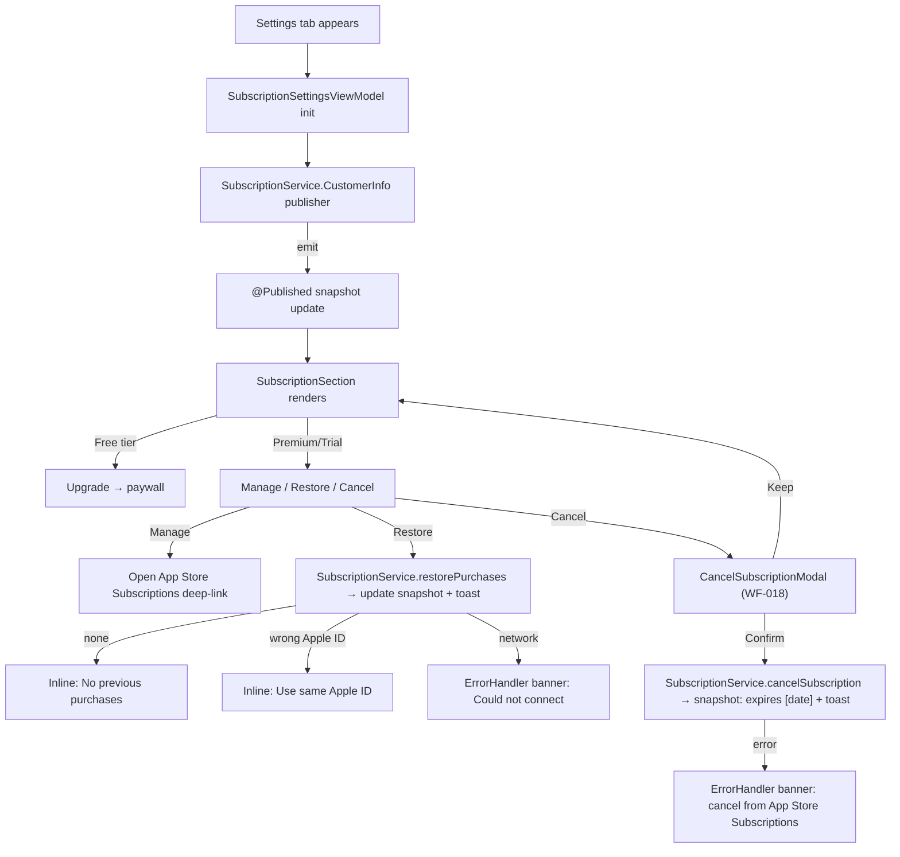
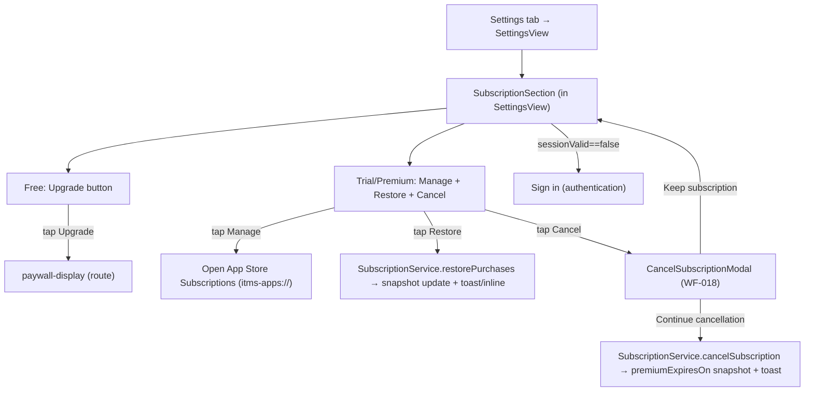

# subscription-settings - Technical Design

> **Implementation intent:** *Reactive* — heavy reliance on `SubscriptionService.CustomerInfo` Combine publisher. Order: reuse `SubscriptionService` (from `subscription-management`) → `SubscriptionSettingsViewModel` (subscribes to `CustomerInfo`) → `SubscriptionSection` view + `CancelSubscriptionModal`. No new SPM dependency.

## 1. Overview

### Goals
- Subscription section in Settings (WF-014 subscription portion) shows live status from `SubscriptionService.CustomerInfo` publisher: Free / Trial X days left / Premium — renews [date].
- Cancel flow (WF-018 modal) calls `SubscriptionService.cancelSubscription()`; UI transitions to "expires [date]" state on success.
- Restore purchases via `SubscriptionService.restorePurchases()` with the documented error branches (none / network / wrong Apple ID).
- Deep-link to App Store Subscriptions management (`itms-apps://apps.apple.com/account/subscriptions`).
- All UI is reactive — no manual refresh; `CustomerInfo` publisher drives the view state.

### In-scope / out-of-scope
**In-scope:** Subscription section view + cancel modal + restore button + App Store deep-link + status rendering + reactive subscription to `CustomerInfo`.
**Out-of-scope:** Trial start / purchase (owned by `paywall-display` / `subscription-management`); `SubscriptionService` itself (owned by `subscription-management`); any non-subscription Settings content (owned by `settings-management` and `account-management`).

### AC Coverage Summary
Addresses **all 15 acceptance criteria** across 3 requirements:
- **REQ-001 → §7.1:** AC-001.1, AC-001.2, AC-001.3, AC-001.4
- **REQ-002 → §7.2:** AC-002.1, AC-002.2, AC-002.3, AC-002.4, AC-002.5, AC-002.6
- **REQ-003 → §7.3:** AC-003.1, AC-003.2, AC-003.3, AC-003.4, AC-003.5

## 2. Architecture

### Runtime boundaries
```
SettingsView (Subscription section) ─▶ SubscriptionSectionView ─▶ SubscriptionSettingsViewModel
                                                                   │  ├─ SubscriptionService (CustomerInfo publisher)
                                                                   │  └─ AppEnvironment.errors (ErrorHandler)
SubscriptionSectionView ── presents ──▶ CancelSubscriptionModal (sheet)
SubscriptionSectionView ── opens ─────▶ App Store (itms-apps:// deep-link)
SubscriptionSectionView ── taps Restore ─▶ SubscriptionSettingsViewModel.restorePurchases()
SubscriptionSectionView ── taps Upgrade ─▶ AppRouter.routeToPaywall()
```

### Module responsibilities
| Module | Responsibility |
|--------|----------------|
| `SubscriptionService` | (Reused from `subscription-management`) Owns StoreKit/RevenueCat; exposes `CustomerInfo` publisher; methods: `getStatus()`, `cancelSubscription()`, `restorePurchases()` |
| `CustomerInfo` | (Reused) Published value: `{ tier: .free/.trial/.premium, renewalDate: Date?, trialEndDate: Date? }` |
| `SubscriptionSettingsViewModel` | Subscribes to `CustomerInfo`; exposes `@Published snapshot: SubscriptionSnapshot`; orchestrates cancel/restore; handles errors |
| `SubscriptionSnapshot` | Render-bound struct: `tier`, `displayText`, `renewalDateText`, `trialDaysRemaining`, `actions: [.upgrade, .manage, .restore, .cancel]` based on tier |
| `SubscriptionSection` | SwiftUI `View` that renders the snapshot; shows buttons appropriate to tier; presents cancel modal |
| `CancelSubscriptionModal` | WF-018 destructive confirm; "Keep subscription" + "Continue cancellation" |

### Data flow


## 3. Components and Interfaces

| Component | Type | Contract | File |
|-----------|------|----------|------|
| `SubscriptionServicing` (reused) | protocol | `var customerInfo: AnyPublisher<CustomerInfo, Never>` (or `Published<CustomerInfo>`); `func getStatus() async throws -> CustomerInfo`; `func cancelSubscription() async throws -> CustomerInfo`; `func restorePurchases() async throws -> CustomerInfo`; `func openManagementDeepLink()` | `Features/Subscription/Services/SubscriptionService.swift` (owned by `subscription-management`) |
| `CustomerInfo` (reused) | struct | `tier: SubscriptionTier`; `renewalDate: Date?`; `trialEndDate: Date?`; `originalAppleIDHash: String?` | `Features/Subscription/Models/CustomerInfo.swift` |
| `SubscriptionTier` (reused) | enum | `case free, trial(daysRemaining: Int), premium, premiumExpiresOn(Date)` | `Features/Subscription/Models/CustomerInfo.swift` |
| `SubscriptionSettingsViewModel` | `@MainActor ObservableObject` | `@Published snapshot: SubscriptionSnapshot?`; `@Published restoreState: RestoreState`; `@Published cancelState: CancelState`; `init(subscription:)`; `cancel()`, `confirmCancel()`, `keepSubscription()`, `restore()`, `openManagement()`; callback `onUpgrade` | `Features/Subscription/ViewModels/SubscriptionSettingsViewModel.swift` |
| `SubscriptionSnapshot` | struct | `tier: SubscriptionTier`; `title: String`; `subtitle: String`; `availableActions: Set<SubscriptionAction>` | `Features/Subscription/Models/SubscriptionSnapshot.swift` |
| `SubscriptionAction` | enum | `case upgrade, manage, restore, cancel` | `Features/Subscription/Models/SubscriptionSnapshot.swift` |
| `RestoreState` | enum | `idle / loading / noPurchases / wrongAppleID / restored / error(AppError)` | `Features/Subscription/ViewModels/SubscriptionSettingsViewModel.swift` |
| `CancelState` | enum | `idle / confirming / cancelling / cancelled / error(AppError)` | `Features/Subscription/ViewModels/SubscriptionSettingsViewModel.swift` |
| `SubscriptionSection` | SwiftUI `View` | renders `snapshot`; tier-appropriate buttons; presents cancel modal; opens deep-links | `Features/Subscription/Views/SubscriptionSection.swift` |
| `CancelSubscriptionModal` | SwiftUI `View` | WF-018 destructive confirm; "Keep subscription" + "Continue cancellation" | `Features/Subscription/Views/CancelSubscriptionModal.swift` |

### Reuse Plan (ios-components Reuse-First Gate)
- **Reuse:** `SubscriptionService` + `CustomerInfo` + `SubscriptionTier` from `subscription-management`; `CaloButton` (shared-foundations); `ErrorHandler` (shared-foundations); `AuthService` (for sessionValid check).
- **New (justified):** `SubscriptionSettingsViewModel` (consumes the publisher + handles cancel/restore flows for the Settings UI — distinct from the `subscription-management` `SubscriptionViewModel` which lives in the Paywall flow); `SubscriptionSection` view; `CancelSubscriptionModal` (WF-018 destructive variant for Settings; the paywall-side cancel modal is owned by `subscription-management` and not reused here because the Settings variant needs different copy).
- No SPM dependency.

## 4. Data Models and Contracts

- `SubscriptionTier`:
  - `free` — no subscription.
  - `trial(daysRemaining: Int)` — `daysRemaining >= 1`; derived from `trialEndDate - now` rounded down to calendar days (local TZ) (NFR-SS-004).
  - `premium` — active paid subscription.
  - `premiumExpiresOn(Date)` — paid subscription scheduled to cancel at expiry (FR-024.1).
- `CustomerInfo`: `{ tier: SubscriptionTier, renewalDate: Date?, trialEndDate: Date?, originalAppleIDHash: String? }` — published by `SubscriptionService`.
- `SubscriptionSnapshot`: derived renderable value computed from `SubscriptionTier`:
  - `free` → title "Free", subtitle "Upgrade to Premium", availableActions = `{ .upgrade, .restore }` (AC-002.1: NO manage/cancel buttons on Free).
  - `trial(daysRemaining)` → title "Trial — \(daysRemaining) days left", subtitle includes trialEndDate, availableActions = `{ .manage, .restore, .cancel }`.
  - `premium` → title "Premium", subtitle "Renews [renewalDate]", availableActions = `{ .manage, .restore, .cancel }`.
  - `premiumExpiresOn(date)` → title "Premium — expires [date]", availableActions = `{ .manage, .restore }` (cancel button hidden — already expiring).
- `SubscriptionService.openManagementDeepLink()` opens `itms-apps://apps.apple.com/account/subscriptions` (Apple's subscriptions management URL).
- `SubscriptionService.restorePurchases()` returns:
  - `CustomerInfo` (with `tier` reflecting restored state) on success → caller shows toast "Premium restored".
  - `RestoreError.noPurchases` → caller shows inline "No previous purchases for this Apple ID".
  - `RestoreError.wrongAppleID` → caller shows inline "Use the same Apple ID as your original purchase".
  - network failure → throws `AppError.network` → caller surfaces `ErrorHandler` banner with "Could not connect to App Store. Try again later.".
- `SubscriptionService.cancelSubscription()` returns:
  - `CustomerInfo` with `tier = .premiumExpiresOn(renewalDate)` on success.
  - throws `AppError.network` or similar if App Store unreachable → caller surfaces `ErrorHandler` banner with "Please cancel from Settings > [App Name] > Manage Subscriptions" (FR-024.2 fallback).

## 5. Error Handling

| Failure mode | Detection | User-visible behavior | Recovery |
|--------------|-----------|-----------------------|----------|
| Initial status fetch fail | `SubscriptionService.getStatus()` throws | `ErrorHandler` banner + Retry; keep last snapshot if present | Retry (AC-001.4) |
| Cancel fails (network / App Store unreachable) | `SubscriptionService.cancelSubscription()` throws | `ErrorHandler` banner: "Please cancel from Settings > [App Name] > Manage Subscriptions" (ERR-024.2) | Manual App Store cancel (AC-002.5) |
| Restore → no purchases | `restorePurchases()` returns `.noPurchases` | Inline "No previous purchases for this Apple ID" (no banner) | None (AC-003.3) |
| Restore → wrong Apple ID | `restorePurchases()` returns `.wrongAppleID` | Inline "Use the same Apple ID as your original purchase" | None (AC-003.5) |
| Restore → network | `restorePurchases()` throws `AppError.network` | `ErrorHandler` banner: "Could not connect to App Store. Try again later." (ERR-026.2); Restore button stays enabled | Retry (AC-003.4) |
| User taps "Keep subscription" | Cancel modal cancel action | Dismiss modal; no `cancelSubscription()` call | None (AC-002.6) |
| Subscription data stale (e.g., renewal_date not refreshed) | `CustomerInfo` publisher hasn't emitted in >60s (heuristic) | `ErrorHandler` banner: "Subscription info may be stale — Refresh"; explicit Refresh button | Manual refresh (FR-025.ERR-025.1) |

## 6. Testing Strategy

Unit tests under `calo-ai-testTests/` (test target from `shared-foundations` task 4.1.1):

- `SubscriptionSettingsViewModelTests.swift` — with fake `SubscriptionService` (custom `CurrentValueSubject<CustomerInfo, Never>`):
  - initial snapshot reflects emitted `CustomerInfo` (AC-001.1; P1)
  - publisher emission flips `@Published snapshot` within 1s (AC-001.2; P2)
  - `cancel()` → `confirmCancel()` → `SubscriptionService.cancelSubscription()` called once; on success returns `.premiumExpiresOn(...)` snapshot; on failure surfaces `ErrorHandler` and keeps tier (AC-002.4, AC-002.5; P4, P5)
  - `cancel()` → `keepSubscription()` → no `cancelSubscription()` call (AC-002.6; P6)
  - `restore()` → on success emits Premium snapshot + sets `restoreState = .restored` (AC-003.2; P7)
  - `restore()` → no purchases → `restoreState = .noPurchases`, no `ErrorHandler` banner (AC-003.3; P8)
  - `restore()` → wrong Apple ID → `restoreState = .wrongAppleID`, no banner (AC-003.5; P9)
  - `restore()` → network throw → `ErrorHandler` banner + button stays enabled (AC-003.4; P10)
  - Free tier snapshot has `availableActions = { .upgrade, .restore }` only (no .manage, no .cancel) (AC-002.1; P3)
- `SubscriptionSnapshotTests.swift` — derivation from `SubscriptionTier`:
  - `free` → title "Free", actions `{ .upgrade, .restore }` (P3)
  - `trial(daysRemaining: 3)` → title "Trial — 3 days left", actions `{ .manage, .restore, .cancel }` (P1)
  - `premium` with renewalDate → title "Premium", subtitle contains formatted date, actions `{ .manage, .restore, .cancel }` (P1)
  - `premiumExpiresOn(date)` → actions `{ .manage, .restore }` only (no cancel button) (P1)
- `CancelSubscriptionModalTests.swift` — destructive button copy "Continue cancellation"; primary "Keep subscription"; cancel button disabled state during `cancelling` (NFR-SS-002; P5).

Build checkpoint: XcodeBuildMCP `build_sim` after each phase. Subscription flow verified in StoreKit sandbox environment; cancel/restore flows tested against sandbox Apple ID.

## 7. Feature Breakdown (iOS-first)

### 7.1 Subscription Status Display
- **ACs Implemented:** AC-001.1, AC-001.2, AC-001.3, AC-001.4
- **Source:** FR-024, FR-025, UC-022, WF-014
- **What:** `SubscriptionSettingsViewModel` subscribes to `SubscriptionService.CustomerInfo` publisher; `@Published snapshot` updates view; `SubscriptionSection` renders one of Free / Trial X days left / Premium — renews [date] / Premium — expires [date].
- **States:** loading / loaded / error.
- **UX expectations:** status row legible; VoiceOver "Premium subscription, renews January 25"; Dynamic Type; trial countdown visibly updates at day rollover.
- **Files:** `Features/Subscription/ViewModels/SubscriptionSettingsViewModel.swift`, `Features/Subscription/Models/SubscriptionSnapshot.swift`, `Features/Subscription/Views/SubscriptionSection.swift`.

### 7.2 Manage / Cancel Subscription
- **ACs Implemented:** AC-002.1, AC-002.2, AC-002.3, AC-002.4, AC-002.5, AC-002.6
- **Source:** FR-024 (BR-024.1/2/3, ERR-024.1/2), FR-025 (BR-025.1/2), UC-021, WF-018
- **What:** `SubscriptionSection` shows tier-appropriate buttons (Free → Upgrade only; Premium/Trial → Manage + Restore + Cancel). Cancel opens `CancelSubscriptionModal` (WF-018 destructive confirm). Manage opens `itms-apps://apps.apple.com/account/subscriptions` via `SubscriptionService.openManagementDeepLink()`. Confirm cancel → `SubscriptionService.cancelSubscription()`; on success snapshot updates to `premiumExpiresOn` and toast appears; on failure `ErrorHandler` banner.
- **States:** idle / cancel-confirming / cancelling / cancelled / error.
- **UX expectations:** destructive `CaloButton` red; copy transparent ("You'll lose unlimited scans. Access continues until [date]").
- **Files:** `Features/Subscription/Views/CancelSubscriptionModal.swift`, `Features/Subscription/ViewModels/SubscriptionSettingsViewModel.swift`, `Features/Subscription/Views/SubscriptionSection.swift`.

### 7.3 Restore Purchases
- **ACs Implemented:** AC-003.1, AC-003.2, AC-003.3, AC-003.4, AC-003.5
- **Source:** FR-026 (BR-026.1/2, VR-026.1, ERR-026.1/2/3), UC-023, WF-014
- **What:** "Restore purchases" button always visible regardless of tier (NFR-SS-003). On tap → `SubscriptionService.restorePurchases()` → loading indicator → on success Premium state activated + toast "Premium restored"; on `.noPurchases` → inline "No previous purchases for this Apple ID"; on `.wrongAppleID` → inline "Use the same Apple ID as your original purchase"; on network error → `ErrorHandler` banner "Could not connect to App Store. Try again later." + button stays enabled.
- **States:** idle / loading / no-purchases / wrong-apple-id / restored / error.
- **UX expectations:** loading spinner on button while in flight; inline messages do not stack with banner.
- **Files:** `Features/Subscription/Views/SubscriptionSection.swift`, `Features/Subscription/ViewModels/SubscriptionSettingsViewModel.swift`.

## 8. Navigation and Integration

### Flow diagram


### Navigation table
| From | To | Trigger | Data |
|------|----|---------|------|
| SettingsView | SubscriptionSection | (composed in `settings-management`) | `SubscriptionService` via AppEnvironment |
| SubscriptionSection (Free) | Paywall | tap "Upgrade" | `AppRouter.routeToPaywall()` callback |
| SubscriptionSection (Premium) | App Store | tap "Manage" | URL `itms-apps://apps.apple.com/account/subscriptions` |
| SubscriptionSection | CancelSubscriptionModal | tap "Cancel" | current snapshot |
| CancelSubscriptionModal | SubscriptionSection | "Keep subscription" | no-op |
| CancelSubscriptionModal | SubscriptionSection | "Continue cancellation" | updated snapshot from `cancelSubscription()` |

### Integration rules
- `SubscriptionSection` is composed into `SettingsView` by `settings-management` (the integration spec that owns the Settings screen assembly). This spec delivers a single SwiftUI `View` + ViewModel pair that drops into `SettingsView`.
- `SubscriptionService` is owned by `subscription-management` (Phase 6). This spec MUST NOT modify `SubscriptionService`; it only consumes its protocol.
- The Upgrade route from Free tier must invoke the paywall route owned by `paywall-display` — this is wired by the integrator (`settings-management` or the root router) via the `onUpgrade` callback.
- The "Manage" deep-link opens Apple App Store subscription management directly (FR-025.1: "managed via App Store, not in-app management"); this is the standard Apple pattern and matches Calo AI's policy of "no support contact for cancel".
- Cancel flow never sends the user to a support contact form (PRD §11) — fallback is always App Store Subscriptions page (Apple-mandated) per ERR-024.2.

## 9. Correctness Properties

| Property | Type | Validates AC | Statement |
|---|---|---|---|
| P1 | Invariant | AC-001.1, AC-002.1, AC-002.2 | `SubscriptionSnapshot` derived from any `SubscriptionTier` value contains the correct `availableActions`: free → `{upgrade, restore}`; trial/premium → `{manage, restore, cancel}`; premiumExpiresOn → `{manage, restore}`. |
| P2 | Invariant | AC-001.2 | An emission on `SubscriptionService.CustomerInfo` flips `viewModel.snapshot` synchronously and the view reflects the new value within the next runloop. |
| P3 | Invariant | AC-002.1 | A `SubscriptionTier.free` snapshot renders ONLY the "Upgrade to Premium" button (no Manage/Cancel/Restore buttons hidden, no destructive actions exposed). |
| P4 | Invariant | AC-002.4, AC-002.6 | `confirmCancel()` invokes `SubscriptionService.cancelSubscription()` exactly once; `keepSubscription()` does NOT invoke it. |
| P5 | Invariant | AC-002.5 | A failure on `cancelSubscription()` keeps the user subscribed (tier unchanged) and surfaces the `ErrorHandler` banner with the App Store fallback copy. |
| P6 | Round-trip | AC-002.4 | On successful cancel, the new `CustomerInfo` has `tier == .premiumExpiresOn(renewalDate)` and the view shows "Premium — expires [date]" + toast. |
| P7 | Invariant | AC-003.1, AC-003.2 | A successful `restorePurchases()` returns a `CustomerInfo` with a Premium tier, viewModel sets `restoreState = .restored`, snapshot updates to Premium, and toast "Premium restored" is shown. |
| P8 | Invariant | AC-003.3 | `restorePurchases()` returning `.noPurchases` sets `restoreState = .noPurchases`, shows inline message, and does NOT invoke `ErrorHandler`. |
| P9 | Invariant | AC-003.5 | `restorePurchases()` returning `.wrongAppleID` sets `restoreState = .wrongAppleID`, shows inline message, and does NOT invoke `ErrorHandler`. |
| P10 | Invariant | AC-003.4 | A thrown `AppError.network` from `restorePurchases()` sets `restoreState = .error(...)`, surfaces the `ErrorHandler` banner with "Could not connect to App Store. Try again later.", and the Restore button remains enabled. |
