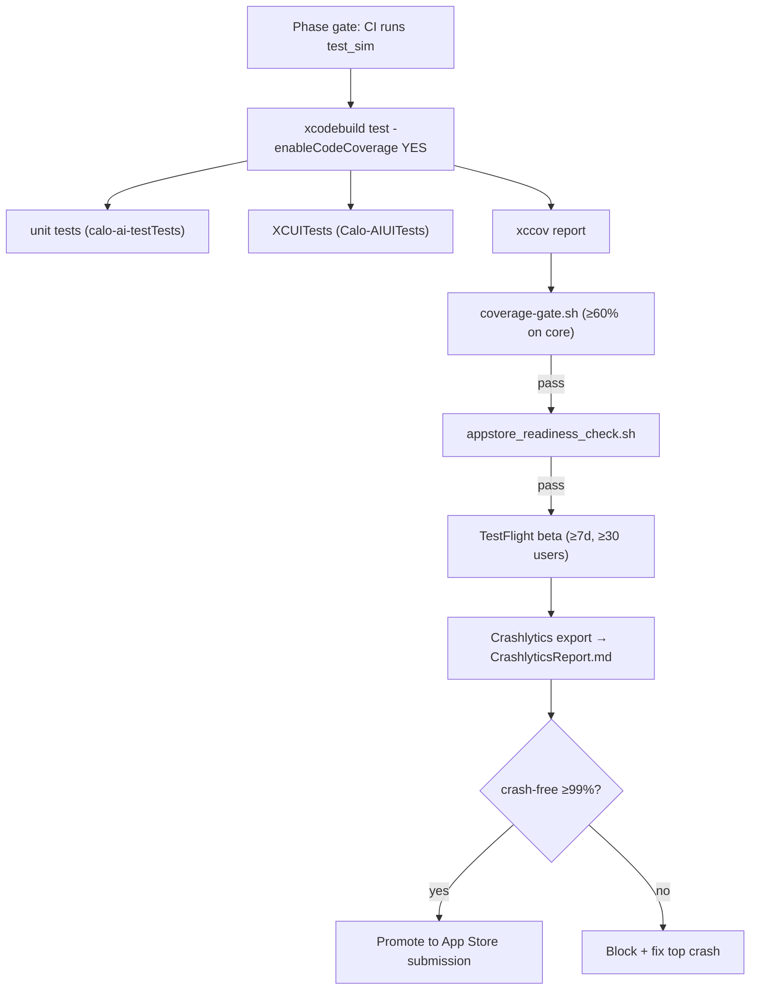
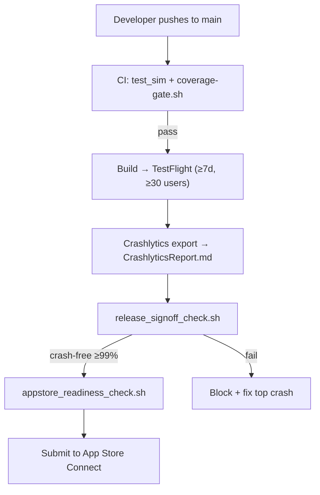

# testing-integration - Technical Design

> **Implementation intent:** *Hybrid test harness* — extends the unit-test infra already shipped from `shared-foundations` and per-feature spec tests. New: XCUITest E2E target `Calo-AIUITests` (already present from `project-structure`), StoreKit 2 sandbox config + `Configuration.storekit`, a coverage gate script, an App Store metadata + screenshot pipeline, and a Crashlytics verifier. No new production code beyond `CrashMonitor.recordNonFatal(_:)` hook in `ErrorHandler`.

## 1. Overview

### Goals
- **E2E core loop** (`CoreLoopE2ETests`): deterministic XCUITest that drives Camera permission → capture → AI mock → Confirmation edit → Save → Diary assertion.
- **E2E subscription** (`SubscriptionFlowTests`, `RestorePurchaseTests`, `CancelFlowTests`): StoreKit 2 sandbox-driven tests of paywall → trial → active → cancel → restore.
- **Unit-test coverage gate ≥60%** on core Services + ViewModels (NFR-SF-006 / Overview §5).
- **App Store submission package**: metadata yaml + screenshots per device class + Privacy Nutrition Label + Privacy Policy + readiness script.
- **Crash-free ≥99%** verification via Crashlytics beta report + `CrashMonitor.recordNonFatal(_:)` hook.

### In-scope / out-of-scope
**In-scope:** Test harness (XCUITest target, fixtures, `URLProtocol` stubs for AI Vision + Supabase + RevenueCat, StoreKit sandbox config), coverage-gate script + per-spec coverage maps, App Store metadata + screenshot generation script, `PrivacyNutritionLabel.md` + `PrivacyPolicy.md`, `CrashMonitor` non-fatal recorder, beta Crashlytics report parser, readiness script.
**Out-of-scope:** New feature work; performance optimization beyond what `performance-optimization` owns; Android (out of MVP per PRD §6); production code outside the small `CrashMonitor.recordNonFatal(_:)` hook in `ErrorHandler`.

### AC Coverage Summary
Addresses **all 23 acceptance criteria**:
- **REQ-001 → §7.1:** AC-001.1, AC-001.2, AC-001.3, AC-001.4, AC-001.5
- **REQ-002 → §7.2:** AC-002.1, AC-002.2, AC-002.3, AC-002.4, AC-002.5
- **REQ-003 → §7.3:** AC-003.1, AC-003.2, AC-003.3, AC-003.4
- **REQ-004 → §7.4:** AC-004.1, AC-004.2, AC-004.3, AC-004.4, AC-004.5
- **REQ-005 → §7.5:** AC-005.1, AC-005.2, AC-005.3, AC-005.4

## 2. Architecture

### Runtime boundaries
```
┌────────────────────────────────────────────────────────────────┐
│   Calo-AIUITests (XCUITest target — already from project-struct) │
│   ├─ CoreLoopE2ETests       → drives app via accessibility IDs │
│   ├─ SubscriptionFlowTests  → uses Configuration.storekit (sandbox) │
│   ├─ RestorePurchaseTests   → 2nd Apple ID + restorePurchases() │
│   ├─ CancelFlowTests        → WF-018 + App Store deep-link verify │
│   └─ AppInitSmokeTests      → Firebase + Crashlytics online check │
│   ↳ uses URLProtocol stubs: AIVisionStub, SupabaseStub, RCStub  │
├────────────────────────────────────────────────────────────────┤
│   calo-ai-testTests (unit tests — from shared-foundations 4.1.1) │
│   └─ + per-spec coverage maps regenerated each test_sim run     │
├────────────────────────────────────────────────────────────────┤
│   Tools/CrashMonitor/  ── CrashlyticsVerifier, recordNonFatal    │
│   scripts/             ── coverage-gate.sh, appstore_readiness.sh│
│   StoreMetadata/       ── metadata yaml, screenshots, PNL, Policy │
└────────────────────────────────────────────────────────────────┘
```

### Module responsibilities
| Module | Responsibility |
|--------|----------------|
| `CoreLoopE2ETests` (XCUITest) | Drive camera permission grant → capture (fixture JPEG) → AI mock → Confirmation edit → Save → Diary assertion; assert <10s and `ScanQuotaService.used` increments only on Save |
| `SubscriptionFlowTests`/`RestorePurchaseTests`/`CancelFlowTests` (XCUITest) | Drive paywall → StoreKit sandbox → trial/active/cancel/restore; assert transparent pricing labels, deep-link to App Store, restore idempotency |
| `URLProtocol` stubs (`AIVisionStub`, `SupabaseStub`, `RCStub`) | Provide deterministic responses to `URLSession` from tests (avoid real network in E2E) |
| `Configuration.storekit` | StoreKit 2 sandbox schema with weekly/monthly/annual products + `test_sign` account hint |
| `coverage-gate.sh` | Parse `xccov` output; enforce ≥60% on core business logic; fail the build if violated (NFR-SF-006) |
| `appstore_readiness_check.sh` | Verify presence of metadata yaml, ≥3 screenshots per device class, Privacy Nutrition Label, Privacy Policy (PRD §9 release-blocker) |
| `Tools/CrashMonitor/CrashlyticsVerifier` | Assert `FirebaseApp.configure()` ran and Crashlytics collection enabled; emit `app_crash` events with `fatal` flag |
| `CrashMonitor.recordNonFatal(_:)` | Hook in `ErrorHandler` to forward caught errors to Crashlytics as non-fatal |
| `Tests/Coverage/<Spec>.md` | Per-spec coverage map: ViewModel/Service, coverage %, untested functions + justification |

### Data flow


## 3. Components and Interfaces

| Component | Type | Contract | File |
|-----------|------|----------|------|
| `CoreLoopE2ETests` | XCUITest | `test_<scenario>()` async; uses accessibility identifiers from feature views | `Calo-AIUITests/CoreLoop/CoreLoopE2ETests.swift` |
| `SubscriptionFlowTests` | XCUITest | exercises paywall → trial → active via `Configuration.storekit` | `Calo-AIUITests/Subscription/SubscriptionFlowTests.swift` |
| `RestorePurchaseTests` | XCUITest | restore from prior Apple ID sandbox receipt | `Calo-AIUITests/Subscription/RestorePurchaseTests.swift` |
| `CancelFlowTests` | XCUITest | WF-018 cancel + App Store deep-link | `Calo-AIUITests/Subscription/CancelFlowTests.swift` |
| `AIVisionStub` | `URLProtocol` subclass | returns canned `{dish, cals, macros, ingredients, confidence}` JSON for AI endpoint | `Calo-AIUITests/Stubs/AIVisionStub.swift` |
| `SupabaseStub` | `URLProtocol` subclass | canned PostgREST responses for meal_logs / users tables | `Calo-AIUITests/Stubs/SupabaseStub.swift` |
| `RCStub` | `URLProtocol` subclass | stubs RevenueCat REST endpoints used by SDK | `Calo-AIUITests/Stubs/RCStub.swift` |
| `PhotosPickerStub` | UI test helper | injects a fixture JPEG into the photo-picker callback | `Calo-AIUITests/Stubs/PhotosPickerStub.swift` |
| `Configuration.storekit` | StoreKit 2 config | products: `com.caloai.premium.weekly`, `.monthly`, `.annual`; subscription group | `Calo-AIUITests/Configuration.storekit` |
| `coverage-gate.sh` | bash script | reads `xccov`; exits 0/1; thresholds in `config/coverage.thresholds.json` | `scripts/coverage-gate.sh` |
| `appstore_readiness_check.sh` | bash script | verifies StoreMetadata artifacts present; exits 0/1 | `scripts/appstore_readiness_check.sh` |
| `CrashlyticsVerifier` | Swift helper | `verifyInit()`; `recordNonFatal(_:)` | `Tools/CrashMonitor/CrashlyticsVerifier.swift` |
| `ErrorHandler.recordNonFatal` | extension on existing `ErrorHandler` | calls `CrashlyticsVerifier.recordNonFatal(error)` | `Shared/Services/ErrorHandler.swift` (extension) |
| `CoverageMapGenerator` | Swift script / bash | converts `xccov` JSON → `Tests/Coverage/<Spec>.md` | `scripts/generate_coverage_maps.sh` |
| `AppStoreMetadataParser` | Swift | validates `StoreMetadata/app-store-metadata.yaml` schema (yaml + required keys) | `Tools/Metadata/AppStoreMetadataParser.swift` |
| `PrivacyNutritionLabel.md` | doc | declares Apple's data categories; checked by `appstore_readiness_check.sh` | `StoreMetadata/PrivacyNutritionLabel.md` |
| `PrivacyPolicy.md` | doc | data collected, purpose, retention, user rights, contact | `StoreMetadata/PrivacyPolicy.md` |
| `CrashlyticsReport.md` | doc (generated) | ≥7d beta summary; sessions, crash-free, top signatures | `StoreMetadata/CrashlyticsReport.md` (generated) |
| `ReleaseSignOff.md` | doc | per-release sign-off: PO + iOS Lead + QA | `StoreMetadata/ReleaseSignOff.md` |

### Reuse Plan (ios-components Reuse-First Gate)
- **Reuse:** `AppEnvironment.fake()` (shared-foundations), `KeychainStore` fake, `URLProtocol` stub pattern from `shared-foundations 4.1.3` `DataClientTests`, `XCTAssertEqual`-style XCUITest idioms from prior per-spec unit tests, `ErrorHandler` (shared-foundations) extended with one method.
- **New (justified):** StoreKit sandbox configuration (no Apple-provided template fits our products), coverage-gate script (no first-party equivalent), `CrashMonitor` non-fatal hook (Crashlytics has the SDK; we just expose a typed wrapper that other errors can flow through).
- **No SPM dependency** — every new artifact is Apple framework + bash + existing Swift toolchain.

## 4. Data Models and Contracts

- `AIVisionStub.fixture: AIVisionPayload` — `{dish: "Pho", calories: 450, protein_g: 25, carbs_g: 60, fat_g: 12, ingredients: ["broth","noodles","beef"], confidence: 88}`. Used by `CoreLoopE2ETests` (AC-001.1).
- `SupabaseStub.fixtureMealLogs: [MealLogDTO]` — pre-seeded diary entries (some with prior day, one empty for "today") so the test can assert the new entry appears at the top.
- `SubscriptionState` (from `subscription-management` spec, reused) — `free / trialing / active / expired / pendingCancellation`.
- `CoverageThresholds`: `{ coreBusinessMinPct: 60, failOnUntestedNewFile: true, excludePaths: ["**/Resources/**", "**/*Preview.swift"] }`. Lives in `config/coverage.thresholds.json`.
- `AppStoreMetadata` (decoded from yaml): `{ name, subtitle, primaryCategory, secondaryCategory, keywords, supportURL, marketingURL, privacyPolicyURL, descriptionEN, descriptionVI, whatsNew, version }`. Validated by `AppStoreMetadataParser`.
- `PrivacyNutritionLabel.Entry` — `{ category: "Photos" | "Health & Fitness" | "Identifiers" | "Usage Data" | "Diagnostics" | "Data Not Collected", dataType, linkedToUser, usedForTracking, purpose }`. One row per actual transmission we do.
- `CrashlyticsReport` (generated) — `{ windowStart, windowEnd, totalSessions, crashCount, crashFreeRate, topSignatures: [{title, count, stackTrace}] }`. Source: Firebase Crashlytics export JSON.

## 5. Error Handling

| Failure mode | Detection | User-visible behavior (or test behavior) | Recovery |
|--------------|-----------|------------------------------------------|----------|
| E2E flake | `xcodebuild test` reports retryable failure | Re-run; `coverage-gate.sh` records flake rate | Quarantine flaky test under `Calo-AIUITests/Quarantine/` after 3 consecutive fails; gate still passes |
| StoreKit sandbox unavailable | `Configuration.storekit` not loaded in scheme | Test fails fast with descriptive message | Fix scheme; re-run |
| Coverage <60% | `xccov` parse + threshold check | CI build fails; report shows files below threshold | Add unit tests for those functions OR mark justified in `Tests/Coverage/<Spec>.md` (NFR-SF-006) |
| New ViewModel/Service with 0 tests | diff coverage report vs prior baseline | Build fails with file list | Add at least 1 unit test |
| App Store metadata missing key | `AppStoreMetadataParser` schema check | Readiness script exits non-zero | Restore missing key |
| Crash-free <99% | parsed Crashlytics report | `release_signoff_check.sh` blocks promotion | Fix top signature, run another beta cycle |
| Privacy Nutrition Label drift | Compare label entries vs actual SDK transmissions (manual review checklist) | PO/QA sign-off fails | Update label to match actual data flows (or stop collecting) |
| Crashlytics not initialized | `CrashlyticsVerifier.verifyInit()` returns false in `AppInitSmokeTests` | Build fails (Firebase is a hard dependency) | Re-check `FirebaseApp.configure()` in `AppDelegate` |

## 6. Testing Strategy

This spec **is** the testing strategy — and it also produces tests that are themselves tested by running them. The test pyramid:

- **Unit (`calo-ai-testTests/`)** — already exists from `shared-foundations` + every per-feature spec; this spec adds coverage maps + the gate. `coverage-gate.sh` enforces ≥60% (NFR-SF-006).
- **Integration (new under `Tests/Integration/`)** — XCUITest flows that span multiple feature ViewModels/services; E2E core loop, subscription flow, restore, cancel. Use `URLProtocol` stubs (`AIVisionStub`, `SupabaseStub`, `RCStub`) and `PhotosPickerStub` to remove external dependencies.
- **UI smoke (`Calo-AIUITests/AppInitSmokeTests.swift`)** — from `project-structure 4.2.1`; extended here to assert Firebase + Crashlytics init.
- **Property-based / invariants** — mapped to correctness properties §9 (P1–P8).
- **Build checkpoint per phase via XcodeBuildMCP**: `discover_projs → list_schemes → build_sim → test_sim` (`test_sim` runs both unit + UI targets). Readiness scripts (`coverage-gate.sh`, `appstore_readiness_check.sh`) hook into the same CI step.

Concrete new files:
- `Calo-AIUITests/CoreLoop/CoreLoopE2ETests.swift` (AC-001.*; P1–P4)
- `Calo-AIUITests/Subscription/SubscriptionFlowTests.swift` (AC-002.1/.2; P5)
- `Calo-AIUITests/Subscription/RestorePurchaseTests.swift` (AC-002.3; P6)
- `Calo-AIUITests/Subscription/CancelFlowTests.swift` (AC-002.4; P7)
- `Calo-AIUITests/Stubs/AIVisionStub.swift`, `SupabaseStub.swift`, `RCStub.swift`, `PhotosPickerStub.swift`
- `Calo-AIUITests/Configuration.storekit`
- `scripts/coverage-gate.sh`, `scripts/appstore_readiness_check.sh`, `scripts/generate_coverage_maps.sh`, `scripts/release_signoff_check.sh`
- `Tools/CrashMonitor/CrashlyticsVerifier.swift` + `Tools/CrashMonitor/CrashlyticsReportParser.swift`
- `config/coverage.thresholds.json`
- `StoreMetadata/app-store-metadata.yaml`, `StoreMetadata/screenshots/` (generated), `StoreMetadata/PrivacyNutritionLabel.md`, `StoreMetadata/PrivacyPolicy.md`, `StoreMetadata/CrashlyticsReport.md` (generated), `StoreMetadata/ReleaseSignOff.md`

## 7. Feature Breakdown (iOS-first)

### 7.1 End-to-End Core Loop Test
- **ACs Implemented:** AC-001.1, AC-001.2, AC-001.3, AC-001.4, AC-001.5
- **Source:** FR-001, FR-002, FR-003, FR-004–FR-008, FR-012, UC-001/002/003/005–008/011, PRD §9 core loop <10s
- **What:** XCUITest `CoreLoopE2ETests` driving: tap Camera tab → system permission dialog → assert `camera.access.granted` → shutter (or fixture via `PhotosPickerStub` → `Use This`) → `AIVisionStub` returns meal JSON → loading screen → Confirmation → toggle 1 ingredient off, change portion → tap Save → assert diary entry shows with correct calories/macros, and `ScanQuotaService.used` incremented by 1 (BR-009.4). Negative branch: denied permission → assert no Save, no AI call.
- **States:** permission-prompt → preview → captured → loading → confirming → saved.
- **UX expectations:** UI identifiers match production views (`a11yIdentifier("useThisButton")` etc. — added by feature specs).
- **Files:** `Calo-AIUITests/CoreLoop/CoreLoopE2ETests.swift`, `Calo-AIUITests/Stubs/AIVisionStub.swift`, `Calo-AIUITests/Stubs/PhotosPickerStub.swift`.

### 7.2 Subscription Purchase Flow Test
- **ACs Implemented:** AC-002.1, AC-002.2, AC-002.3, AC-002.4, AC-002.5
- **Source:** FR-021–FR-026, UC-019–UC-023, PRD §9 StoreKit sandbox billing test
- **What:** Three XCUITests using `Configuration.storekit` and `test_sign` Apple ID. `SubscriptionFlowTests` asserts both plans visible with price+cycle, trial starts, scan badge flips to "Unlimited". `RestorePurchaseTests` simulates a second Apple ID with a prior receipt and asserts Premium is restored. `CancelFlowTests` opens WF-018, taps Continue Cancel, verifies deep-link to `apps.apple.com`, then verifies local `pendingCancellation` status. Negative: cancelled StoreKit sheet → no mutation, no analytics gap.
- **States:** paywall → StoreKit sheet → active / cancelled → settings / restored.
- **UX expectations:** pricing labels explicit (BR-022.4 — no dark patterns); restore button present on WF-007.
- **Files:** `Calo-AIUITests/Subscription/{SubscriptionFlow,RestorePurchase,CancelFlow}Tests.swift`, `Calo-AIUITests/Configuration.storekit`, `Calo-AIUITests/Stubs/RCStub.swift`.

### 7.3 Unit Test Coverage Audit (Core Business Logic)
- **ACs Implemented:** AC-003.1, AC-003.2, AC-003.3, AC-003.4
- **Source:** NFR-SF-006 (≥60% Services/Models), Overview §5/§6.1, all FR-001..FR-026
- **What:** `coverage-gate.sh` parses `xcodebuild test -enableCodeCoverage YES` output (xccov JSON); computes per-directory line coverage for `Shared/Services/**`, `Shared/Models/**`, `Features/<F>/{ViewModels,Services}/**`; fails if aggregate <60% OR any new file in those dirs has 0 tests. `generate_coverage_maps.sh` produces per-spec `Tests/Coverage/<Spec>.md` maps each run. Diff against prior baseline catches new-untested-file drift (AC-003.4).
- **States:** pass / fail / waived (waived entries documented in coverage map).
- **UX expectations:** N/A — CI-visible only.
- **Files:** `scripts/coverage-gate.sh`, `scripts/generate_coverage_maps.sh`, `config/coverage.thresholds.json`, `Tests/Coverage/<Spec>.md` (one per spec).

### 7.4 App Store Submission Prep (Metadata + Privacy Nutrition Label)
- **ACs Implemented:** AC-004.1, AC-004.2, AC-004.3, AC-004.4, AC-004.5
- **Source:** PRD §9, §11, §13, Overview §3.1, §5 Phase 3
- **What:** `StoreMetadata/app-store-metadata.yaml` (name, subtitle, keywords, descriptions EN+VI, URLs); `StoreMetadata/screenshots/<DeviceClass>-<ScreenName>-<Locale>.png` for 6.7", 6.1", 5.5", iPad 12.9"; `StoreMetadata/PrivacyNutritionLabel.md` per Apple categories (Photos/Food Images, Health & Fitness, Identifiers, Usage Data, Diagnostics — all `Linked to User`, `Not Used for Tracking`); `StoreMetadata/PrivacyPolicy.md` (data collected, retention 7-day image auto-delete, user export+delete rights, 30-day GDPR/CCPA SLA per Overview §8); `appstore_readiness_check.sh` asserts all present + parses yaml schema. Generation script `scripts/build_screenshot_set.sh` (optional: pulls from Figma via API or copies from a `Design/` source).
- **States:** ready / not-ready (artifact missing).
- **UX expectations:** N/A — ASO/release-visible only.
- **Files:** `StoreMetadata/app-store-metadata.yaml`, `StoreMetadata/screenshots/`, `StoreMetadata/PrivacyNutritionLabel.md`, `StoreMetadata/PrivacyPolicy.md`, `scripts/appstore_readiness_check.sh`, `Tools/Metadata/AppStoreMetadataParser.swift`.

### 7.5 Crash-Free Verification (≥99%)
- **ACs Implemented:** AC-005.1, AC-005.2, AC-005.3, AC-005.4
- **Source:** PRD §9, NFR-015, Overview §6.1, §3.1 Firebase Crashlytics
- **What:** `Tools/CrashMonitor/CrashlyticsVerifier.verifyInit()` called from `AppInitSmokeTests` (asserts FirebaseApp configured + Crashlytics collection enabled). `CrashMonitor.recordNonFatal(_:)` called from `ErrorHandler` extension on every caught `AppError` so transient errors still surface. After ≥7d TestFlight beta with ≥30 external testers, `CrashlyticsReportParser` consumes the Firebase Crashlytics export JSON and produces `CrashlyticsReport.md` (sessions, crash count, crash-free rate, top-3 signatures + stack traces). `release_signoff_check.sh` blocks promotion if crash-free <99% (or 99–99.5% without sign-off in `ReleaseSignOff.md`).
- **States:** initializing / collecting / reporting / blocking.
- **UX expectations:** none — diagnostic + release-gate only.
- **Files:** `Tools/CrashMonitor/CrashlyticsVerifier.swift`, `Tools/CrashMonitor/CrashlyticsReportParser.swift`, `Shared/Services/ErrorHandler.swift` (extension), `Calo-AIUITests/AppInitSmokeTests.swift` (extension), `scripts/release_signoff_check.sh`, `StoreMetadata/CrashlyticsReport.md`, `StoreMetadata/ReleaseSignOff.md`.

## 8. Navigation and Integration

### Flow diagram


### Integration table
| From | To | Trigger | Data |
|------|----|---------|------|
| Feature views (Camera, Confirmation, Paywall, Settings, Cancel Modal) | XCUITests | accessibility identifiers added by feature specs | tap/query by id |
| `ErrorHandler` (shared-foundations) | `CrashMonitor.recordNonFatal(_:)` | every `catch AppError` | error description + stack |
| `xcodebuild test` | `coverage-gate.sh` | CI step | `xccov` JSON |
| Firebase Crashlytics export | `CrashlyticsReport.md` | post-beta manual export | sessions, crashes, signatures |
| `StoreMetadata/*` | `appstore_readiness_check.sh` | CI pre-submit step | file presence + yaml schema parse |

### Integration rules
- No new SPM packages. All new code uses Foundation + XCTest + StoreKit + Firebase (already integrated in `project-structure`).
- XCUITest target `Calo-AIUITests` is the one created in `project-structure 4.2.1` — this spec **adds suites** to it.
- `CrashMonitor.recordNonFatal(_:)` is the only production-code change; it calls the existing Firebase Crashlytics SDK.
- Feature views must expose stable `accessibilityIdentifier`s for XCUITests (a requirement handed back to each feature spec via this spec's integration table — no code changes here).

## 9. Correctness Properties

| Property | Type | Validates AC | Statement |
|---|---|---|---|
| P1 | Invariant | AC-001.1 | `CoreLoopE2ETests` produces exactly one diary entry per "Save" tap, with calories/macros equal to the `AIVisionStub.fixture`. |
| P2 | Invariant | AC-001.2, AC-001.4 | End-to-end time (capture confirmation shown → diary entry visible) is <10s on iPhone 12+ sim; `ScanQuotaService.used` increments by exactly 1 only after Save. |
| P3 | Round-trip | AC-001.3, AC-001.5 | With `AIVisionStub` returning canned JSON, no real network call occurs; with permission denied, no Save and no AI call occur. |
| P4 | Invariant | AC-002.1, AC-002.2 | `SubscriptionFlowTests` results in `SubscriptionState.trialing` with `trial_end_date = trial_start_date + 7d` and scan badge text "Unlimited". |
| P5 | Round-trip | AC-002.3 | `RestorePurchaseTests` with a second Apple ID holding a prior receipt ends with `SubscriptionState` matching the receipt (not free) and no duplicate trial grant. |
| P6 | Invariant | AC-002.4, AC-002.5 | Cancel flow deep-links to `apps.apple.com` and leaves `SubscriptionState.pendingCancellation`; cancelling the StoreKit sheet mid-purchase leaves `SubscriptionState` unchanged and no `subscription_started` analytics event was emitted. |
| P7 | Invariant | AC-003.1, AC-003.2 | For any CI run, the aggregate line coverage on `Shared/Services/**` ∪ `Shared/Models/**` ∪ `Features/<F>/{ViewModels,Services}/**` is ≥60% OR the build fails. |
| P8 | Invariant | AC-003.4 | A new file under those directories without ≥1 unit test increases the "untested new file" set and fails the gate (detected by diff against prior baseline). |
| P9 | Invariant | AC-004.1, AC-004.2, AC-004.5 | For any release candidate, `appstore_readiness_check.sh` exits 0 iff metadata yaml, ≥3 screenshots per device class, Privacy Nutrition Label, and Privacy Policy all exist and yaml schema is valid. |
| P10 | Invariant | AC-005.1 | `AppInitSmokeTests` asserts `CrashlyticsVerifier.verifyInit()` returns true; if false, the test fails and no beta build is promoted. |
| P11 | Invariant | AC-005.2, AC-005.4 | `release_signoff_check.sh` exits 0 iff `CrashlyticsReport.md` for the most recent beta cycle shows crash-free ≥99% (or 99–99.5% with explicit sign-off in `ReleaseSignOff.md`). |