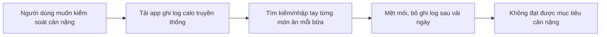
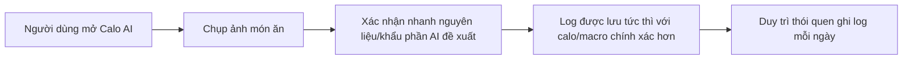
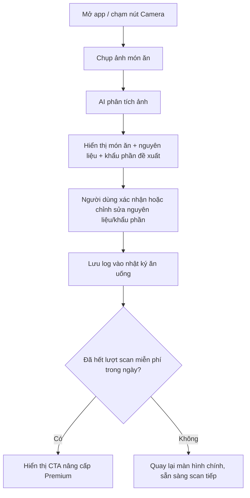
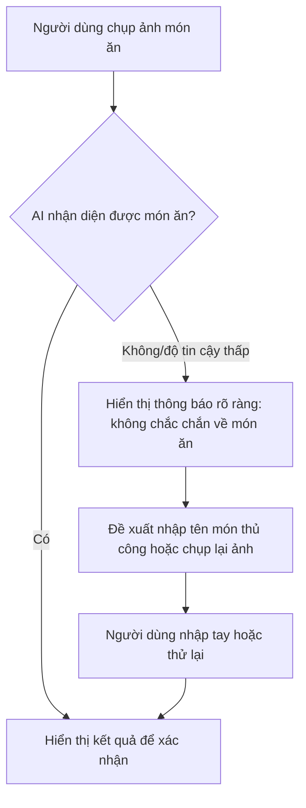
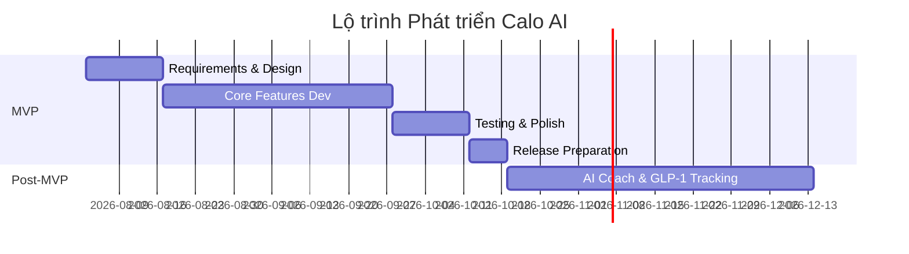

# Calo AI - Tài liệu Yêu cầu Sản phẩm

**Version**: 1.0
**Date**: 2026-07-21
**Author**: AI Research Agent
**Mode**: Full PRD
**Status**: Bản nháp để PO rà soát

## Các bên liên quan

| Vai trò | Tên | Trách nhiệm | Liên kết |
| --- | --- | --- | --- |
| Project Manager | Chưa chỉ định | Quản lý toàn bộ dự án, quyết định cuối cùng | Chưa có |
| Product Owner | Chưa chỉ định | Nghiên cứu phân tích dự án, chốt các tính năng và các phase phát triển dự án | Chưa có |
| Developer | Chưa chỉ định | Triển khai code xây dựng dự án | Chưa có |
| UI/UX | Chưa chỉ định | Thiết kế dự án | Chưa có |
| Data Analytic | Chưa chỉ định | Viết tài liệu tracking và tracking số liệu hằng tuần | Chưa có |
| BE | Chưa chỉ định | Viết API để ứng dụng lấy dữ liệu | Chưa có |
| AI | Chưa chỉ định | Tạo các model AI xử lý tính năng trong app | Chưa có |
| Graphic | Chưa chỉ định | Thiết kế icon và screenshot cho app | Chưa có |
| ASO | Chưa chỉ định | Tạo tên app, description, keyword, localization và các thông tin giới thiệu về app trên Store | Chưa có |
| Tester | Chưa chỉ định | Kiểm tra app, đảm bảo chất lượng app trước khi lên store | Chưa có |
| Marketing (UA) | Chưa chỉ định | Kinh doanh sản phẩm | Chưa có |

## Lịch sử phiên bản

| Ngày | Phiên bản | Nội dung | Tác giả |
|---|---|---|---|
| 2026-07-21 | 1.0 | Tạo bản nháp PRD đầu tiên cho Calo AI, dựa trên nghiên cứu thị trường AI calorie-tracking 2025-2026 | AI Research Agent |

## Liên kết quan trọng

| Nội dung | Liên kết |
| --- | --- |
| UI/UX | <www.figma.com> |
| Diagram | Chưa có — sẽ bổ sung ở giai đoạn Design |
| Api | Chưa có — sẽ bổ sung khi backend được triển khai |
| Monet | Chưa có — sẽ bổ sung khi tích hợp RevenueCat/App Store Connect |

---

## 1. Tóm tắt Điều hành

### Phát biểu Vấn đề

Người muốn giảm cân hoặc kiểm soát cân nặng cần theo dõi lượng calo nạp vào mỗi ngày, nhưng cách ghi log truyền thống (tìm kiếm món ăn thủ công, quét mã vạch, nhập tay từng thành phần) tốn thời gian và dễ khiến người dùng bỏ cuộc chỉ sau vài ngày. Các ứng dụng lâu đời như MyFitnessPal còn giới hạn khắt khe ở gói miễn phí (5 lượt nhập/ngày) và đặt tính năng quét mã vạch — vốn được dùng nhiều nhất — sau paywall, khiến trải nghiệm miễn phí kém hấp dẫn ngay từ đầu.

### Giải pháp

Calo AI cho phép người dùng chụp ảnh món ăn và nhận kết quả nhận diện món ăn kèm ước tính calo/macro trong vài giây, loại bỏ hoàn toàn thao tác tìm kiếm hay nhập tay. Khác với các app AI-photo hiện có, Calo AI thêm một bước xác nhận nguyên liệu và khẩu phần trước khi lưu log — giải quyết trực tiếp lỗi ước tính sai nghiêm trọng mà người dùng phàn nàn ở các đối thủ AI (ví dụ dầu ăn, nước sốt "vô hình" với ảnh chụp) — đồng thời cam kết billing minh bạch tuyệt đối để khai thác đúng khoảng trống niềm tin mà thị trường đang để lại.

### Tại sao là lúc này

- AI photo logging đã được thị trường kiểm chứng ở quy mô lớn: MyFitnessPal (220 triệu tài khoản đăng ký) mua lại Cal AI — app AI-photo dẫn đầu — vào ngày 2026-03-02, thay vì tự xây dựng công nghệ này (Nguồn: Fitt Insider, insider.fitt.co/myfitnesspal-acquires-rival-food-tracker-cal-ai, 2026-03-02).
- Doanh thu IAP toàn ngành Health & Fitness đạt 4.5 tỷ USD trong năm 2025 (+13% so với cùng kỳ), mức cao kỷ lục, một phần nhờ tích hợp AI (Nguồn: Sensor Tower, sensortower.com/blog/health-and-fitness-apps-ai, 2026-02) — cho thấy khả năng chi trả (willingness-to-pay) trong ngành đang tăng chứ không bão hoà.
- Làn sóng thuốc giảm cân GLP-1 đang mở ra một phân khúc người dùng mới: 12% người trưởng thành tại Mỹ (~41 triệu người) đã từng dùng thuốc GLP-1 tính đến tháng 11/2025, tăng gấp đôi so với 6% vào tháng 5/2024 (Nguồn: khảo sát KFF qua Forbes Health, forbes.com/health/weight-loss/glp-1-statistics, 2025-11). Nhóm người dùng này có nhu cầu theo dõi dinh dưỡng đặc thù (khẩu phần nhỏ, triệu chứng) mà các app calo hiện tại chưa phục vụ tốt trong cùng một app.
- Khoảng trống niềm tin vừa mới mở ra: Cal AI bị Apple gỡ khỏi App Store từ 2026-04-16 đến 2026-04-21 vì thiết kế paywall lừa dối và né phí IAP (Nguồn: TechCrunch, techcrunch.com/2026/04/21/apples-cal-ai-crackdown-signals-its-still-policing-the-app-store, 2026-04-21), đồng thời từng bị rò rỉ hơn 3.2 triệu bản ghi dữ liệu người dùng qua backend Firebase không xác thực vào 2026-03-09 (Nguồn: Kiteworks/Hackread/SC Media/Cybernews, kiteworks.com/cybersecurity-risk-management/cal-ai-data-breach-3-million-users-health-data-exposed, 2026-03-09). Đây là cơ hội rõ ràng cho một app mới định vị bằng sự minh bạch và an toàn dữ liệu.

### Thị trường Mục tiêu

- **Primary Users**: Người trưởng thành 18-45 tuổi tại các thị trường nói tiếng Anh (ưu tiên US trước, nơi tập trung doanh thu IAP ngành cao nhất) muốn giảm cân hoặc kiểm soát cân nặng, ưu tiên trải nghiệm ghi log nhanh-gọn hơn là độ chính xác tuyệt đối ngay từ ngày đầu — đây là phân khúc rộng nhất (mass-market) để tối đa hoá lượng người dùng.
- **Positioning**: "Ghi log calo nhanh như chụp ảnh, minh bạch như một app nên có" — tốc độ ngang Cal AI nhưng không có paywall lừa dối, cộng thêm gói AI Coach/GLP-1 riêng biệt để tăng ARPU từ phân khúc đang tăng trưởng nhanh nhất mà không giới hạn TAM của gói lõi.
- **Market Size Framing**: Thị trường Diet & Nutrition Apps được ước tính 5.95 tỷ USD (2025) tăng lên 6.94 tỷ USD (2026), trong đó Calorie Tracking là phân khúc lớn nhất chiếm 42.3% thị phần (~2.03 tỷ USD) (Nguồn: Grand View Research, grandviewresearch.com/industry-analysis/diet-nutrition-apps-market-report, 2025). Riêng phân khúc AI-driven meal planning tăng trưởng nhanh nhất với CAGR 24.6%, từ 0.83 tỷ USD (2025) lên 1.03 tỷ USD (2026) (Nguồn: The Business Research Company, thebusinessresearchcompany.com, 2026).
- **Market Trend**: Đang tăng trưởng nhanh và hợp nhất (M&A lớn nhất ngành: MyFitnessPal mua Cal AI tháng 3/2026), đồng thời AI hoá nhanh chóng — tỷ lệ app Health & Fitness dùng từ khoá liên quan AI tăng từ 19% (Q4/2024) lên 28% (Q1/2026) (Nguồn: Sensor Tower, 2026-02).

### Tiêu chí Thành công

- Đạt mục tiêu tải app và MRR đề ra trong 3 và 6 tháng đầu (chi tiết tại mục 5) mà không cần phụ thuộc vào một kênh UA duy nhất.
- Đạt tỷ lệ chuyển đổi free-to-paid cạnh tranh so với chuẩn ngành freemium di động (thường 2-5%), chứng minh mô hình billing minh bạch không làm giảm khả năng chuyển đổi so với các app dùng dark pattern.
- D7 retention đạt ngưỡng tối thiểu đủ để chứng minh product-market fit của core loop "chụp ảnh → xác nhận → log" trước khi mở rộng ngân sách UA hoặc đầu tư vào AI Coach/GLP-1.
- Không phát sinh vi phạm App Store Guideline liên quan billing (3.1.2c, 5.6) hay sự cố bảo mật dữ liệu — đây là điều kiện tiên quyết để giữ vững định vị "đáng tin cậy" đã chọn.

---

## 2. Mục tiêu và Bối cảnh

### Mục tiêu Sản phẩm

Calo AI được xây dựng để trở thành lựa chọn ghi log calo bằng AI được tin tưởng nhất cho người dùng phổ thông toàn cầu, thắng bằng ba trụ cột: tốc độ ghi log (ngang hoặc nhanh hơn Cal AI), minh bạch billing (khác biệt rõ với các đối thủ AI-photo hiện tại), và một gói AI Coach/GLP-1 chuyên biệt để khai thác phân khúc đang tăng trưởng nhanh nhất của ngành mà không thu hẹp đối tượng của gói lõi.

### Liên kết với Mục tiêu Kinh doanh

- Doanh thu subscription IAP là nguồn thu chính, đóng góp trực tiếp vào tăng trưởng doanh thu — phù hợp với việc ngành Health & Fitness đang chứng kiến IAP tăng 13% YoY, đạt 4.5 tỷ USD năm 2025.
- Giả định kinh doanh chính cần kiểm chứng qua MVP: (1) billing minh bạch đủ sức là một lợi thế cạnh tranh thực sự chứ không chỉ là "điều nên có"; (2) người dùng sẵn sàng trả thêm cho một gói AI Coach/GLP-1 tách biệt với gói core.
- Mốc kinh doanh cần hỗ trợ: đạt được tỷ lệ chuyển đổi và MRR đủ để tiến tới hoà vốn vận hành (chi phí AI Vision API + hạ tầng) trong vòng 6 tháng kể từ beta có monetization.

### Nguyên tắc Sản phẩm

1. Ghi log phải nhanh hơn hoặc bằng bất kỳ đối thủ AI-photo nào — mục tiêu dưới 10 giây từ khi mở camera đến khi log xong.
2. Không bao giờ dùng dark pattern billing: giá và chu kỳ thanh toán hiển thị rõ ràng trước khi bắt đầu trial, huỷ được ngay trong app, không lặp lại các vi phạm mà Cal AI từng gặp (Guideline 3.1.2c, 5.6).
3. Gói miễn phí phải đủ giá trị để hình thành thói quen dùng hàng ngày, tránh giới hạn khắt khe kiểu MyFitnessPal (5 lượt nhập/ngày) vốn gây bất mãn rộng rãi.
4. Độ chính xác AI phải luôn đi kèm cơ chế xác nhận/điều chỉnh của người dùng, không để hệ thống âm thầm chấp nhận sai số như các đối thủ hiện tại.
5. Monetization mở rộng theo lớp (gói core subscription + add-on AI Coach/GLP-1) thay vì một mức giá duy nhất, để tối đa hoá ARPU từ phân khúc sẵn sàng chi trả cao mà không làm giảm khả năng tiếp cận mass-market của gói lõi.

---

## 3. Vấn đề Người dùng và Đối tượng Mục tiêu

### Persona Chính

- **Profile**: Người mới bắt đầu kiểm soát cân nặng, 25-40 tuổi, cả nam và nữ, thu nhập trung bình, dùng smartphone hàng ngày, không có kiến thức dinh dưỡng chuyên sâu.
- **Context**: Muốn giảm hoặc duy trì cân nặng nhưng từng bỏ cuộc với ít nhất một app ghi log thủ công vì tốn thời gian và khó duy trì thói quen.
- **Pain Points**:
  - Tìm kiếm món ăn thủ công trong danh sách hoặc quét mã vạch mất nhiều thao tác mỗi bữa ăn.
  - Quên ghi log sau vài ngày vì quy trình quá rườm rà, dẫn đến bỏ dùng app hoàn toàn.
  - Không biết cách ước lượng khẩu phần ăn (gram, phần trăm đĩa) nên số liệu ghi log không chính xác dù có nhập tay.
- **Need**: Một cách ghi log gần như không cần suy nghĩ, đủ nhanh để duy trì được thành thói quen dài hạn.

### Persona Thứ cấp

- **Profile**: Người dùng thuốc giảm cân GLP-1 (Ozempic, Wegovy, Zepbound...), 30-55 tuổi, thu nhập khá hơn nhóm chính, sẵn sàng trả phí cao hơn cho công cụ hỗ trợ sức khoẻ chuyên biệt.
- **Context**: Khẩu phần ăn thay đổi đột ngột do thuốc (ăn ít hơn nhiều, buồn nôn, no nhanh), cần theo dõi sát dinh dưỡng để tránh thiếu chất trong khi giảm cân nhanh.
- **Pain Points**:
  - Các app calo chính thống (MyFitnessPal, Noom...) chưa có tính năng theo dõi đặc thù cho người dùng GLP-1.
  - Phải cài thêm một app riêng (ví dụ Shotsy) chỉ để nhắc lịch thuốc và theo dõi triệu chứng, tách biệt hoàn toàn khỏi app ghi log calo chính.
- **Need**: Theo dõi calo, triệu chứng, và nhắc lịch thuốc trong cùng một app duy nhất.

### Persona Thứ ba (nếu có)

- **Profile**: Người từng dùng Cal AI hoặc app AI calo tương tự, bị ảnh hưởng bởi sự cố billing hoặc lo ngại về quyền riêng tư dữ liệu, đang tìm ứng dụng thay thế đáng tin cậy hơn.
- **Context**: Chuyển đổi sau các sự cố công khai của Cal AI (paywall lừa dối bị Apple xử lý tháng 4/2026; rò rỉ dữ liệu tháng 3/2026).
- **Pain Points**:
  - Mất niềm tin vào các app AI calo nói chung sau khi đọc tin tức hoặc trải nghiệm trực tiếp việc bị tính phí không rõ ràng.
  - Lo ngại về việc dữ liệu sức khoẻ cá nhân (cân nặng, ảnh món ăn, thói quen ăn uống) bị lưu trữ không an toàn.
- **Need**: Cam kết minh bạch tuyệt đối về giá và chính sách bảo mật dữ liệu rõ ràng, dễ kiểm chứng.

### Hành trình Người dùng Hiện tại

### Hành trình Người dùng Mong muốn

---

## 4. Phân tích Cạnh tranh

### Tổng quan Thị trường

Thị trường app ghi log calo đang trong giai đoạn hợp nhất và AI hoá nhanh. Sự kiện quan trọng nhất định hình bối cảnh cạnh tranh là việc MyFitnessPal — ứng dụng lâu đời với 220 triệu tài khoản đăng ký — mua lại Cal AI, ứng dụng AI-photo dẫn đầu, vào ngày 2026-03-02 thay vì tự phát triển công nghệ nhận diện ảnh (Nguồn: Fitt Insider, 2026-03-02). Điều này cho thấy ghi log bằng ảnh AI đã trở thành tiêu chuẩn kỳ vọng của thị trường chứ không còn là lợi thế khác biệt một mình nó có thể tạo ra. Đồng thời, Cal AI — vốn tăng trưởng cực nhanh (5 triệu lượt tải trong 8 tháng, theo TechCrunch 2025-03-16) — vừa trải qua khủng hoảng niềm tin nghiêm trọng: bị Apple gỡ khỏi App Store tháng 4/2026 vì paywall lừa dối, và bị rò rỉ 3.2 triệu bản ghi dữ liệu người dùng tháng 3/2026. Khoảng trống này, cộng với làn sóng người dùng thuốc giảm cân GLP-1 chưa được phục vụ tốt, là hai cơ hội định vị chính cho Calo AI.

### Ghi chú Phương pháp luận

Dữ liệu App Store (rating, số lượt đánh giá, giá niêm yết) trong bảng dưới đây được lấy trực tiếp từ trang App Store của từng app (fetched 2026-07). Dữ liệu về lượt tải, doanh thu, DAU, retention là ước tính của bên thứ ba (chủ yếu qua Sensor Tower, được trích dẫn lại qua báo chí ngành như Fitt Insider) hoặc không có nguồn công khai — các ô không xác thực được đánh dấu rõ "Không có dữ liệu công khai" thay vì suy đoán. Mục đích của phân tích là so sánh tương đối để ra quyết định định vị sản phẩm, không phải dự báo tài chính chính xác.

### Ma trận Đối thủ

| App | Tín hiệu quy mô | Đánh giá | Mô hình giá | Điểm mạnh | Điểm yếu / Phàn nàn | Hàm ý cho chúng ta |
| ----- | ---------------- | ---------- | ------------- | ----------- | --------------------- | -------------------- |
| Cal AI - Calorie Tracker | ~15 triệu lượt tải tích luỹ, ~40 triệu USD doanh thu tính đến thời điểm bị mua lại (2026-03, ước tính Sensor Tower qua Fitt Insider) | 4.8/5, 343K lượt đánh giá | Freemium + subscription $2.99-$49.99 (A/B test), trial 3 ngày | Ghi log AI cực nhanh, UI đẹp, marketing ASO mạnh bằng từ khoá AI | Sai số ước tính nghiêm trọng (dầu, nước sốt "vô hình"); paywall bị Apple xử lý vì lừa dối; rò rỉ dữ liệu | AI-photo là bắt buộc để cạnh tranh, nhưng độ chính xác và minh bạch billing là khoảng trống lớn để khai thác |
| MyFitnessPal | ~220 triệu tài khoản đăng ký (tự công bố); ~900K lượt tải/tháng, ~13 triệu USD doanh thu/tháng (ước tính Sensor Tower qua Fitt Insider, 2026) | 4.7/5, 2.3 triệu lượt đánh giá | Freemium (giới hạn 5 lượt nhập/ngày) + Premium $79.99/năm, Premium+ $99.99/năm | Database 20 triệu món ăn, thương hiệu lâu năm, vừa sở hữu công nghệ Cal AI | Giới hạn free tier khắt khe, quét mã vạch (tính năng dùng nhiều nhất) đã bị đưa vào paywall, giao diện redesign 2025-2026 gây phản ứng tiêu cực | Đối thủ lớn nhất nhưng có gánh nặng "nợ trải nghiệm" ở gói free — cơ hội chiếm người dùng bất mãn |
| Lose It! | Không có dữ liệu công khai về lượt tải/doanh thu | 4.8/5, 767K lượt đánh giá | Freemium (rộng rãi) + Premium $79.99/năm (tăng từ $39.99 từ 2025-12-22), Lifetime $299.99 | Free tier hào phóng nhất nhóm legacy (log không giới hạn, database 27 triệu món, quét mã vạch miễn phí) | Tính năng chụp ảnh "Snap It" bị khoá sau Premium dù độ chính xác bị chê; tăng giá đột ngột gây phản ứng tiêu cực | Free tier hào phóng tạo thói quen tốt, nhưng khoá tính năng AI-photo sau trả phí là điểm có thể khai thác nếu ta mở AI-photo ở free tier hợp lý |
| YAZIO | Không có dữ liệu công khai về lượt tải/doanh thu | 4.7/5, 49K lượt đánh giá | Freemium + PRO $23.90-$47.90/năm (khuyến mãi), trial 7 ngày | Giá rẻ nhất trong nhóm subscription, tích hợp wearable, nội dung fasting | Tính năng quét mã vạch từng miễn phí nay đã paywall; database món ăn ngoài phương Tây yếu hơn | Chuẩn neo giá cho phân khúc nhạy cảm giá — Calo AI có thể định giá gần mức này nhưng có thêm tính năng khác biệt |
| Noom | Không có dữ liệu công khai về lượt tải/doanh thu | 4.7/5, 869K lượt đánh giá | Subscription-first ~209 USD/năm hoặc 70 USD/tháng, trial 14 ngày "pay-what-you-can" ($0-$18.37) | Nội dung coaching tâm lý học (CBT) hiệu quả trong 2-3 tháng đầu; vừa mở rộng sang Noom Med (GLP-1 telehealth) | Không có chụp ảnh món ăn (log hoàn toàn thủ công) dù giá cao nhất ngành; nội dung lặp lại sau vài tháng | Chứng minh người dùng sẵn sàng trả giá rất cao cho coaching cá nhân hoá — hỗ trợ luận điểm gói AI Coach/GLP-1 add-on của Calo AI |

*Ghi chú: Ngoài 5 đối thủ trong ma trận chính, nghiên cứu cũng ghi nhận Cronometer (4.8/5, 95K đánh giá — định vị "độ chính xác lâm sàng", không có AI-photo), MyNetDiary (4.8/5, ~158K đánh giá — có "AI Coach" hội thoại, differentiator gần nhất với hướng Calo AI chọn), SnapCalorie (dùng LiDAR để ước lượng khẩu phần theo thể tích — hướng kỹ thuật đáng cân nhắc cho roadmap dài hạn) và Foodvisor (4.6/5, ~16K đánh giá — mạnh về ẩm thực châu Âu, yếu về món ăn Mỹ/châu Á) như các tín hiệu bổ sung, không đưa vào bảng chính vì quy mô nhỏ hơn.*

### Bảng 1. Chỉ số Thị trường & Thương mại

| Chỉ số | Cal AI | MyFitnessPal | Lose It! | YAZIO | Noom |
| --- | --- | --- | --- | --- | --- |
| Tên app | Cal AI - Calorie Tracker | MyFitnessPal | Lose It! | YAZIO | Noom |
| Link cài app | apps.apple.com/us/app/cal-ai-calorie-tracker/id6480417616 | apps.apple.com/us/app/myfitnesspal-calorie-counter/id341232718 | apps.apple.com/us/app/lose-it-calorie-counter/id297368629 | apps.apple.com/us/app/ai-calorie-tracker-by-yazio/id946099227 | apps.apple.com/us/app/noom-weight-health-plans/id634598719 |
| Quy mô tải/người dùng | ~15 triệu lượt tải tích luỹ tại thời điểm bị mua lại (ước tính, 2026-03) | ~220 triệu tài khoản đăng ký (tự công bố) | Không có dữ liệu công khai | Không có dữ liệu công khai | Không có dữ liệu công khai |
| Rating | 4.8/5 (343K) | 4.7/5 (2.3M) | 4.8/5 (767K) | 4.7/5 (49K) | 4.7/5 (869K) |
| DAU | Không có dữ liệu công khai | Không có dữ liệu công khai | Không có dữ liệu công khai | Không có dữ liệu công khai | Không có dữ liệu công khai |
| IAP revenue | ~40 triệu USD tích luỹ đến M&A; ~2 triệu USD/tháng (ước tính Sensor Tower, 2026-03) | ~13 triệu USD/tháng (ước tính Sensor Tower, 2026) | Không có dữ liệu công khai | Không có dữ liệu công khai | Không có dữ liệu công khai |
| RPD | Không có dữ liệu công khai | Không có dữ liệu công khai | Không có dữ liệu công khai | Không có dữ liệu công khai | Không có dữ liệu công khai |
| Engagement time | Không có dữ liệu công khai | Không có dữ liệu công khai | Không có dữ liệu công khai | Không có dữ liệu công khai | Không có dữ liệu công khai |
| Sessions/ngày | Không có dữ liệu công khai | Không có dữ liệu công khai | Không có dữ liệu công khai | Không có dữ liệu công khai | Không có dữ liệu công khai |
| Retention D1/D7/D14/D30/D60 | Không có dữ liệu công khai | Không có dữ liệu công khai | Không có dữ liệu công khai | Không có dữ liệu công khai | Không có dữ liệu công khai |
| Mô hình giá | Freemium + subscription $2.99-$49.99, trial 3 ngày | Freemium (5 lượt/ngày) + Premium $79.99/năm, Premium+ $99.99/năm | Freemium + Premium $79.99/năm, Lifetime $299.99 | Freemium + PRO $23.90-$47.90/năm, trial 7 ngày | Subscription $209/năm hoặc $70/tháng, trial 14 ngày pay-what-you-can |
| Top country/top countries | Chủ yếu US (giá niêm yết USD, chưa xác thực số liệu theo quốc gia) | Chủ yếu US, có mặt toàn cầu | Chủ yếu US | Chủ yếu US/EU (công ty Đức) | Chủ yếu US |

### Bảng 2. Chỉ số Sản phẩm & Kỹ thuật

| Chỉ số | Cal AI | MyFitnessPal | Lose It! | YAZIO | Noom |
| --- | --- | --- | --- | --- | --- |
| Main features | Chụp ảnh nhận diện AI, theo dõi macro, streaks/milestones | Database 20 triệu món ăn, quét mã vạch (trả phí), cộng đồng | Quét mã vạch miễn phí, "Snap It" chụp ảnh (Premium), theo dõi exercise | Chương trình fasting, tích hợp wearable (Fitbit/Garmin) | Coaching CBT, Noom Med (GLP-1 telehealth), không có chụp ảnh |
| App size | Không có dữ liệu công khai | Không có dữ liệu công khai | Không có dữ liệu công khai | Không có dữ liệu công khai | Không có dữ liệu công khai |
| Minimum iOS | Chưa xác thực trong phạm vi nghiên cứu này | Chưa xác thực trong phạm vi nghiên cứu này | Chưa xác thực trong phạm vi nghiên cứu này | Chưa xác thực trong phạm vi nghiên cứu này | Chưa xác thực trong phạm vi nghiên cứu này |
| Version hiện tại | Chưa xác thực trong phạm vi nghiên cứu này | Chưa xác thực trong phạm vi nghiên cứu này | Chưa xác thực trong phạm vi nghiên cứu này | Chưa xác thực trong phạm vi nghiên cứu này | Chưa xác thực trong phạm vi nghiên cứu này |
| Lần cập nhật gần nhất | Cập nhật paywall ~2026-04-21 sau sự cố Apple | Redesign UI lớn trong giai đoạn 2025-2026 | Thay đổi giá hiệu lực 2025-12-22 | Chưa xác thực trong phạm vi nghiên cứu này | Cập nhật giá Noom Med hiệu lực 2026-03-31 |
| Dấu hiệu tuổi đời app | ~2 năm tuổi tại thời điểm bị mua lại (thành lập ~2024, theo TechCrunch 2025-03) | App lâu năm, nhiều năm hiện diện trên thị trường (dựa trên 2.3 triệu lượt đánh giá tích luỹ) | App lâu năm trong ngành (dựa trên 767K lượt đánh giá tích luỹ) | Chưa xác thực trong phạm vi nghiên cứu này | App lâu năm, mở rộng sang dịch vụ y tế (Noom Med) gần đây |

### Phụ lục gọn: IAP, release và ghi chú storefront

| Trường | Cal AI | MyFitnessPal | Lose It! | YAZIO | Noom |
| --- | --- | --- | --- | --- | --- |
| IAP product names & prices | Weekly $2.99, Monthly $5.99, Annual $19.99-$49.99 (A/B test); micro-IAP "Streak Restore" $0.99 | Premium $9.99/tháng hoặc $79.99/năm; Premium+ $19.99/tháng hoặc $99.99/năm | Premium $79.99/năm (từ $39.99), Lifetime $299.99 | PRO $6.99/tháng, $23.90-$47.90/năm | Subscription $60-70/tháng hoặc ~$209/năm; Noom Med Microdose $79 + $199/tháng, full program $149 + $349/tháng |
| Ngày phát hành đầu tiên | ~2024 (ước tính, dựa trên tuổi app ~2 năm tại thời điểm M&A 2026-03) | Chưa xác thực trong phạm vi nghiên cứu này | Chưa xác thực trong phạm vi nghiên cứu này | Chưa xác thực trong phạm vi nghiên cứu này | Chưa xác thực trong phạm vi nghiên cứu này |
| Ghi chú dữ liệu | Số liệu doanh thu/lượt tải là ước tính Sensor Tower qua Fitt Insider, không phải số liệu chính thức của công ty | Số tài khoản 220 triệu là tự công bố; doanh thu là ước tính bên thứ ba | Giá lấy trực tiếp từ trang hỗ trợ chính thức Lose It! | Giá lấy trực tiếp từ App Store, có chênh lệch giữa giá khuyến mãi và giá chuẩn | Giá Noom Med lấy từ trang chính thức, hiệu lực từ 2026-03-31 |

### Diễn giải nhanh cho chiến lược sản phẩm

- MyFitnessPal thắng nhờ quy mô database và thương hiệu, nhưng vừa phải **mua lại** công nghệ AI-photo thay vì tự xây — nghĩa là ghi log bằng ảnh AI giờ là "vé vào cửa" bắt buộc, không phải lợi thế khác biệt bền vững nếu Calo AI chỉ dừng ở đó. Calo AI không nên cố gắng cạnh tranh trực diện với database 20 triệu món ăn của MyFitnessPal trong giai đoạn MVP.
- Cal AI chứng minh nhu cầu AI-photo là có thật và rất lớn (5 triệu lượt tải/8 tháng), nhưng đồng thời chứng minh rằng tăng trưởng nóng mà bỏ qua độ chính xác và minh bạch billing sẽ dẫn đến khủng hoảng niềm tin nghiêm trọng (gỡ app, rò rỉ dữ liệu). Đây là bài học trực tiếp cho nguyên tắc sản phẩm của Calo AI.
- Tín hiệu định giá cho thấy willingness-to-pay trải rộng: YAZIO ở đáy giá (~$24-48/năm) vẫn duy trì rating tốt, trong khi Noom ở đỉnh giá (~$209/năm) vẫn giữ được 869K lượt đánh giá tích cực nhờ nội dung coaching thực chất — hàm ý một mô hình giá phân lớp (core rẻ + add-on coaching đắt) có cơ sở thị trường vững hơn một mức giá cố định duy nhất.
- Việc Lose It! và MyFitnessPal đều bị phản ứng tiêu cực khi khoá thêm tính năng vào paywall (quét mã vạch, chụp ảnh) cho thấy cơ hội rõ nhất để khác biệt hoá là: mở tính năng AI-photo core ở free tier với giới hạn hợp lý theo lượt/ngày (thay vì khoá hoàn toàn), rồi thu phí cho unlimited + độ chính xác cao hơn + coaching.
- Kết luận chiến lược cho PO: giai đoạn đầu nên tập trung vào tốc độ + độ chính xác của core loop chụp ảnh và billing minh bạch để giành người dùng bất mãn từ MyFitnessPal/Lose It!/Cal AI, chưa nên sa đà vào xây database món ăn khổng lồ hay nội dung coaching tâm lý học sâu như Noom trong MVP.

### Insight Chính từ Review và Định vị của Đối thủ

- **Điều người dùng yêu thích**: Tốc độ ghi log gần như tức thì của AI-photo (Cal AI); database phong phú và độ tin cậy thương hiệu (MyFitnessPal); free tier hào phóng (Lose It!, Cronometer); giá cả phải chăng (YAZIO); nội dung coaching tâm lý học thực chất (Noom).
- **Phàn nàn phổ biến**: Sai số AI nghiêm trọng với món có dầu/nước sốt/nguyên liệu ẩn (ghi nhận ở mọi app AI-photo được thử nghiệm, kể cả Cal AI, Foodvisor, SnapCalorie — theo thảo luận Hacker News 2025-06 và các nghiên cứu học thuật JMIR 2025); tính năng vốn miễn phí (quét mã vạch, chụp ảnh) bị chuyển vào paywall; billing không minh bạch/tăng giá đột ngột (Cal AI, Lose It!); log hoàn toàn thủ công dù giá cao (Noom).
- **Khoảng trống cơ hội**: Chưa có đối thủ nào giải quyết tốt việc xác nhận nguyên liệu/khẩu phần sau khi AI nhận diện; chưa có app calo chính thống nào tích hợp theo dõi nhận biết GLP-1 ngay trong app chính (người dùng phải cài thêm app riêng như Shotsy); "niềm tin vào billing minh bạch" đang là một khoảng trống bị bỏ ngỏ ngay sau khủng hoảng Cal AI.

### Khác biệt hóa của Chúng ta

1. Ghi log ảnh AI nhanh như Cal AI, nhưng bắt buộc có bước xác nhận nguyên liệu và khẩu phần trước khi lưu — giảm thiểu các lỗi ước tính phi lý (dầu, nước sốt, nguyên liệu ẩn) mà mọi đối thủ AI-photo hiện tại đều mắc phải.
2. Billing minh bạch tuyệt đối làm trụ cột marketing: hiển thị rõ giá/chu kỳ trước khi bắt đầu trial, trial tối thiểu 7 ngày, huỷ dễ dàng trong app — biến chính khủng hoảng niềm tin của Cal AI (tháng 3-4/2026) thành lợi thế định vị "app AI calo mà bạn không cần lo bị lừa".
3. Gói AI Coach + theo dõi nhận biết GLP-1 tích hợp sẵn trong app chính (không cần cài thêm app riêng như Shotsy) làm lớp monetization bổ sung, khai thác đúng phân khúc đang tăng trưởng nhanh nhất (41 triệu người dùng GLP-1 tại Mỹ) mà không thu hẹp đối tượng của gói lõi mass-market.

---

## 5. Tầm nhìn và Mục tiêu Sản phẩm

### Tuyên bố Tầm nhìn

Calo AI là cách nhanh nhất và đáng tin cậy nhất để bất kỳ ai cũng có thể theo dõi dinh dưỡng hàng ngày — không cần gõ tay, không cần lo bị tính phí bất ngờ.

### Mục tiêu & KPI trong 6 tháng

*Ghi chú: Các con số dưới đây là mục tiêu nội bộ (target) do đội ngũ sản phẩm đề xuất dựa trên chuẩn ngành freemium di động (free-to-paid conversion 2-5%), không phải số liệu đã được đo lường thực tế — cần PO xác nhận hoặc điều chỉnh trước khi dùng làm cam kết chính thức.*

| Mục tiêu | KPI | Mục tiêu 3 tháng | Mục tiêu 6 tháng | Cách đo lường |
| ---------- | ----- | ------------------ | ------------------ | ---------------- |
| Thu hút người dùng | Lượt tải (installs) | 20.000 | 150.000 | App Store Connect Analytics |
| Tương tác | Sessions/ngày trung bình mỗi user active | 1.5 | 2.0 | In-app analytics (Firebase/Amplitude) |
| Giữ chân | D7 retention | 20% | 30% | Cohort analytics |
| Kiếm tiền | Free-to-paid conversion | 3% | 5% | Billing + analytics (chuẩn ngành freemium mobile subscription 2-5%) |
| Doanh thu | MRR | 15.000 USD | 120.000 USD | RevenueCat/App Store Connect |
| Hài lòng | App Store rating trung bình | ≥4.5 | ≥4.6 | App Store |
| Chất lượng | Crash-free sessions | ≥99% | ≥99.5% | Firebase Crashlytics |

---

## 6. Phạm vi và Những gì nằm ngoài Phạm vi

### Phạm vi MVP (In Scope)

- Chụp ảnh nhận diện món ăn bằng AI và ước tính calo/macro trong vài giây.
- Bước xác nhận/điều chỉnh nguyên liệu và khẩu phần trước khi lưu log (differentiator chính so với mọi đối thủ AI-photo).
- Nhật ký ăn uống (food diary) xem lại theo ngày/tuần với tổng calo/macro so với mục tiêu.
- Onboarding cá nhân hoá: thu thập cân nặng, chiều cao, mục tiêu, mức hoạt động để tính mục tiêu calo hàng ngày.
- Gói miễn phí giới hạn 3 lượt scan AI/ngày (ASSUMPTION — xem mục 14) đủ để tạo thói quen dùng hàng ngày.
- Subscription core minh bạch: hiển thị rõ giá/chu kỳ, trial 7 ngày (ASSUMPTION — xem mục 14), huỷ dễ dàng trong app.
- Xác thực cơ bản (Sign in with Apple) để đồng bộ dữ liệu giữa các phiên.
- Push notification cơ bản (nhắc log bữa ăn, opt-in, không mặc định bật).
- Analytics và crash reporting tích hợp từ ngày đầu để đo các KPI ở mục 5.

### Sau MVP (Giai đoạn tiếp theo)

- AI Coach hội thoại, chủ động đưa gợi ý dựa trên nhật ký ăn uống và mục tiêu (tương tự MyNetDiary AI Coach).
- Theo dõi nhận biết GLP-1: ghi nhận triệu chứng, khẩu phần nhỏ, nhắc lịch thuốc — làm gói add-on riêng.
- Gamification: streaks, milestones, leaderboard bạn bè (Cal AI đã chứng minh cơ chế này thu hút engagement).
- Đồng bộ Apple Health hai chiều đầy đủ.
- Tích hợp thiết bị đeo (Apple Watch, Fitbit, Garmin).
- Mở rộng đa nền tảng sang Android.

### Những gì Rõ ràng nằm ngoài Phạm vi MVP

- Nền tảng Android (tập trung iOS để kiểm chứng nhanh trước khi nhân đôi chi phí phát triển).
- Dịch vụ telehealth/kê đơn thuốc GLP-1 (Calo AI chỉ theo dõi, không phải nền tảng y tế như Noom Med).
- Tính năng cộng đồng/social feed công khai.
- Meal planning và tạo danh sách mua sắm tự động.

### Lý do

Giữ phạm vi MVP hẹp quanh core loop "chụp ảnh → xác nhận → log" và mô hình billing minh bạch để kiểm chứng hai giả định quan trọng nhất (billing minh bạch có thực sự là lợi thế cạnh tranh; free tier hào phóng có tạo thói quen dùng hàng ngày) trước khi đầu tư nguồn lực vào AI Coach và GLP-1 tracking — những tính năng cần dữ liệu người dùng thật để cá nhân hoá hiệu quả.

---

## 7. Yêu cầu và Tính năng

### Bảng Tính năng MVP

| # | Tính năng | User Story | Acceptance Criteria | Ưu tiên |
| --- | ----------- | ------------ | --------------------- | --------- |
| 1 | Chụp ảnh nhận diện món ăn AI | Với vai trò người dùng, tôi muốn chụp ảnh món ăn để app tự nhận diện và ước tính calo, để tôi không phải tìm kiếm thủ công | - [ ] Kết quả nhận diện trả về trong dưới 5 giây - [ ] Hiển thị tên món, calo, macro ước tính - [ ] Cho phép chỉnh sửa thủ công nếu AI nhận diện sai | P0 |
| 2 | Xác nhận nguyên liệu/khẩu phần | Với vai trò người dùng, tôi muốn xác nhận lại nguyên liệu và khẩu phần AI đề xuất, để có số liệu calo chính xác hơn | - [ ] Hiển thị danh sách nguyên liệu phát hiện được kèm tuỳ chọn thêm/bớt - [ ] Cho phép điều chỉnh khẩu phần (nhỏ/vừa/lớn hoặc theo gram) - [ ] Calo/macro cập nhật lại ngay khi điều chỉnh | P0 |
| 3 | Giới hạn scan AI ở gói miễn phí | Với vai trò người dùng miễn phí, tôi muốn dùng thử scan AI mỗi ngày để trải nghiệm giá trị trước khi quyết định trả phí | - [ ] 3 lượt scan AI miễn phí/ngày (ASSUMPTION — mục 14) - [ ] Reset vào nửa đêm theo giờ địa phương - [ ] Hiển thị rõ số lượt còn lại - [ ] CTA nâng cấp hiển thị khi hết lượt | P0 |
| 4 | Nhật ký ăn uống hàng ngày | Với vai trò người dùng, tôi muốn xem lại lịch sử log để theo dõi tiến trình của mình | - [ ] Xem theo ngày và theo tuần - [ ] Hiển thị tổng calo/macro so với mục tiêu - [ ] Cho phép sửa/xoá log cũ | P0 |
| 5 | Onboarding cá nhân hoá mục tiêu | Với vai trò người dùng mới, tôi muốn app tính mục tiêu calo hàng ngày phù hợp với tôi | - [ ] Thu thập cân nặng, chiều cao, mục tiêu, mức hoạt động - [ ] Tính TDEE/mục tiêu calo theo công thức Mifflin-St Jeor - [ ] Hiển thị kết quả tính toán trước khi vào màn hình chính | P0 |
| 6 | Subscription minh bạch | Với vai trò người dùng, tôi muốn thấy rõ giá và chu kỳ thanh toán trước khi dùng thử, để tôi tin tưởng và không lo bị tính phí bất ngờ | - [ ] Hiển thị rõ giá + chu kỳ trước khi bắt đầu trial - [ ] Trial 7 ngày (ASSUMPTION — mục 14) - [ ] Gửi nhắc nhở trước khi trial kết thúc - [ ] Huỷ được ngay trong app (Settings), không cần liên hệ support | P0 |
| 7 | AI Coach hội thoại (Sau MVP) | Với vai trò người dùng trả phí, tôi muốn nhận gợi ý chủ động dựa trên nhật ký ăn uống của mình | - [ ] Acceptance criteria chi tiết sẽ chốt ở giai đoạn Design sau khi có dữ liệu MVP | P1 |
| 8 | Theo dõi nhận biết GLP-1 (Sau MVP) | Với vai trò người dùng dùng thuốc GLP-1, tôi muốn theo dõi triệu chứng và được nhắc lịch thuốc trong cùng app ghi log calo | - [ ] Acceptance criteria chi tiết sẽ chốt ở giai đoạn Design sau khi có dữ liệu MVP | P1 |

### Gợi ý khi viết Acceptance Criteria

- Mô tả hành vi quan sát được (observable) của người dùng, không mô tả chi tiết cách implement nội bộ (ví dụ model AI cụ thể nào được gọi).
- Ưu tiên viết rõ điều kiện hoàn thành, trạng thái lỗi (AI không nhận diện được món ăn) và ràng buộc hiệu năng (thời gian phản hồi AI) vì đây là yếu tố cạnh tranh cốt lõi của Calo AI.
- Mọi tính năng có entitlement free/premium (ví dụ số lượt scan/ngày, AI Coach) phải nêu rõ ranh giới free/premium ngay trong acceptance criteria.

### Sau MVP (Backlog định hướng)

- AI Coach hội thoại cá nhân hoá dựa trên lịch sử nhật ký.
- Theo dõi nhận biết GLP-1 (triệu chứng, nhắc lịch thuốc, khẩu phần nhỏ) như gói add-on riêng.
- Gamification: streaks, milestones, chia sẻ tiến trình với bạn bè.

---

## 8. Luồng Người dùng

### Luồng Chính: Chụp ảnh và ghi log món ăn

### Luồng Phục hồi / Lỗi

### Luồng Phụ

- Onboarding cá nhân hoá: thu thập thông tin cơ bản và tính mục tiêu calo hàng ngày trước khi vào màn hình chính lần đầu.
- Nâng cấp Subscription: từ CTA hết lượt scan hoặc từ Settings, dẫn tới màn hình Paywall minh bạch, xác nhận thanh toán qua StoreKit.

---

## 9. Ràng buộc Sản phẩm và Kỹ thuật

### Ma trận Nền tảng

- **Platform**: iOS (MVP chỉ tập trung iOS, xem mục 6 — Android là Sau MVP).
- **Minimum Version**: iOS 16.0 (ASSUMPTION — mốc phổ biến hiện tại cho app mới, cần Engineering xác nhận theo API AI/camera cần dùng).
- **Devices**: iPhone (iPad không phải mục tiêu MVP).
- **Orientation**: Portrait (trải nghiệm camera và log chủ yếu dùng một tay).

### Kiến trúc

- **UI Framework**: SwiftUI.
- **Architecture Pattern**: MVVM.
- **Dependency Injection**: Constructor injection / factory nhẹ, tránh framework DI nặng cho MVP.
- **Navigation**: NavigationStack với luồng tab chính (Camera, Nhật ký, Tiến trình, Cài đặt).

### Backend và Dịch vụ

- **Backend**: Backend riêng có xác thực đầy đủ (không dùng Firebase không bật auth/rules như sự cố rò rỉ dữ liệu của Cal AI tháng 3/2026) — khuyến nghị Supabase với Row-Level Security bật mặc định, hoặc custom API tương đương (ASSUMPTION, cần Engineering xác nhận).
- **Authentication**: Sign in with Apple (bắt buộc tối thiểu cho MVP; nếu bổ sung social login khác phải cung cấp Sign in with Apple theo yêu cầu App Store).
- **Database**: PostgreSQL (qua Supabase hoặc tương đương).
- **Storage**: Ảnh món ăn không lưu vĩnh viễn mặc định — tự động xoá sau một khoảng thời gian ngắn trừ khi người dùng chọn giữ lại (ASSUMPTION, xem mục 14), nhằm giảm rủi ro dữ liệu nhạy cảm bị lộ.
- **Analytics**: Firebase Analytics hoặc Amplitude.
- **Crash Reporting**: Firebase Crashlytics.

### Tích hợp Bên thứ ba

| Dịch vụ | Mục đích | Chi phí |
| --------- | ---------- | --------- |
| AI Vision API (OpenAI/Anthropic multimodal) | Nhận diện món ăn từ ảnh chụp | Paid (theo usage/lượt scan) |
| RevenueCat | Quản lý subscription/billing, giảm rủi ro tự implement StoreKit sai (ASSUMPTION — mục 14) | Free tier có phí theo doanh thu vượt ngưỡng |
| Firebase / Amplitude | Analytics và crash reporting | Free/Paid tuỳ tier sử dụng |
| Superwall (hoặc tương đương) | Quản lý màn hình paywall, A/B test minh bạch | Paid, tuỳ tier |

### Mục tiêu Hiệu năng và Độ tin cậy

- **Cold launch**: < 2.0s trên iPhone đời máy mục tiêu.
- **Screen-to-content render**: < 1.0s với dữ liệu đã cache (ví dụ mở lại Nhật ký).
- **AI nhận diện ảnh (core loop)**: trả kết quả trong < 5s — đây là ngưỡng UX quan trọng nhất vì "tốc độ ghi log" là lợi thế cạnh tranh chính đã chọn.
- **API p95 (lệnh gọi AI Vision)**: < 3s (cao hơn ngưỡng API thông thường vì đây là external AI API call, không thể đạt < 800ms).
- **Crash-free sessions**: >= 99.5%.

### Offline và Đồng bộ

- **Offline**: Không hỗ trợ scan AI khi offline (cần kết nối để gọi AI Vision API); cho phép xem lại nhật ký đã log trước đó ở chế độ offline nhờ cache cục bộ.
- **Sync**: Gần real-time khi có kết nối mạng.
- **Conflict Handling**: Last-write-wins đơn giản cho MVP (một người dùng thường chỉ dùng một thiết bị).

### Thông báo

- Có dùng push notification.
- Opt-in, không mặc định bật — phù hợp với nguyên tắc minh bạch/tôn trọng người dùng đã chọn làm định vị.
- Tần suất mặc định tối đa 1 nhắc nhở log bữa ăn/ngày trừ khi người dùng chủ động bật thêm.
- Dùng cho retention: nhắc log buổi tối nếu chưa ghi đủ bữa ăn trong ngày.

### Khả năng Trợ năng

- Hỗ trợ Dynamic Type và VoiceOver cho toàn bộ luồng chính (Camera, Xác nhận log, Nhật ký, Paywall).
- Vùng chạm tối thiểu 44x44pt theo Apple Human Interface Guidelines.
- Đây là yêu cầu accessibility bắt buộc cho MVP, không phải tính năng tuỳ chọn.

### Quyền riêng tư và Bảo mật

- Dữ liệu cá nhân thu thập: ảnh món ăn, dữ liệu sức khoẻ (cân nặng, chiều cao, mục tiêu), lịch sử ăn uống.
- Mục đích thu thập: cá nhân hoá mục tiêu calo và cải thiện độ chính xác nhận diện AI.
- Yêu cầu: Privacy Policy rõ ràng, cho phép người dùng export và xoá toàn bộ dữ liệu, consent rõ ràng khi thu thập dữ liệu sức khoẻ.
- Ràng buộc bắt buộc: audit bảo mật backend trước khi ra mắt beta công khai — không lặp lại lỗi cấu hình Firebase không xác thực đã khiến Cal AI rò rỉ 3.2 triệu bản ghi (2026-03).

### Mức độ Sẵn sàng Phát hành

- Metadata store và Privacy Nutrition Label phải khai báo chính xác loại dữ liệu thu thập (tránh bị Apple từ chối vì khai báo sai, một rủi ro compliance ngày càng bị siết chặt).
- Luồng billing (trial, thanh toán, huỷ subscription) phải được test đầy đủ trong StoreKit sandbox trước khi submit, để tránh lặp lại vi phạm Guideline 3.1.2c/5.6 mà Cal AI từng gặp (2026-04).
- Điều kiện release-blocker: mọi lỗi ở luồng Camera → Xác nhận → Log và luồng Subscription phải được giải quyết trước khi nộp App Store.

---

## 10. Danh sách Màn hình

| # | Tên màn hình | Mô tả | Ưu tiên | Phụ thuộc |
| --- | -------------- | ------- | --------- | ----------- |
| 1 | Onboarding & thu thập mục tiêu | Thu thập cân nặng, chiều cao, mục tiêu, mức hoạt động; tính mục tiêu calo hàng ngày | P0 | None |
| 2 | Camera / Chụp ảnh món ăn | Màn hình chính, chụp ảnh và gửi cho AI nhận diện | P0 | None |
| 3 | Xác nhận nguyên liệu & khẩu phần | Hiển thị kết quả AI, cho phép chỉnh sửa nguyên liệu/khẩu phần trước khi lưu | P0 | Phụ thuộc kết quả AI từ màn Camera |
| 4 | Nhật ký ăn uống (Diary) | Xem lại log theo ngày/tuần, tổng calo/macro so với mục tiêu | P0 | Phụ thuộc dữ liệu log đã lưu |
| 5 | Dashboard tiến trình (tuần/tháng) | Biểu đồ tiến trình cân nặng/calo theo thời gian | P1 | Phụ thuộc dữ liệu Diary |
| 6 | Paywall / Subscription | Hiển thị giá, chu kỳ, trial minh bạch trước khi thanh toán | P0 | None |
| 7 | Cài đặt tài khoản & quản lý subscription | Quản lý thông tin cá nhân, huỷ subscription trong app | P0 | None |
| 8 | AI Coach chat (Sau MVP) | Hội thoại gợi ý cá nhân hoá dựa trên nhật ký | P1 | Phụ thuộc dữ liệu Diary tích luỹ |
| 9 | Theo dõi GLP-1 (Sau MVP) | Ghi nhận triệu chứng, nhắc lịch thuốc | P1 | Phụ thuộc Onboarding mở rộng |

---

## 11. Kiếm tiền

### Mô hình Doanh thu

**Freemium + Subscription (tuần/tháng/năm)** làm nguồn thu core, cộng thêm lớp add-on subscription riêng cho AI Coach/GLP-1 tracking ở giai đoạn Sau MVP — mô hình kiếm tiền phân lớp (layered monetization) để tối đa ARPU từ phân khúc sẵn sàng chi trả cao mà không thu hẹp TAM của gói lõi mass-market.

### Gói Miễn phí

- 3 lượt scan AI/ngày (ASSUMPTION — xem mục 14), reset lúc nửa đêm giờ địa phương.
- Xem nhật ký ăn uống đầy đủ, không giới hạn lịch sử.
- Tính toán mục tiêu calo cá nhân hoá cơ bản (onboarding).
- Mức giá trị này được thiết kế đủ để hình thành thói quen dùng hàng ngày, cố ý hào phóng hơn giới hạn 5 lượt nhập/ngày của MyFitnessPal — vốn là nguồn phàn nàn phổ biến nhất trong cộng đồng người dùng.

### Gói Premium

- Scan AI không giới hạn.
- Xác nhận khẩu phần nâng cao (độ chính xác cao hơn, ưu tiên xử lý AI nhanh hơn).
- Theo dõi vi chất dinh dưỡng (micronutrient) chi tiết.
- Xuất báo cáo tiến trình.
- Trial 7 ngày (ASSUMPTION — xem mục 14), huỷ trong app dễ dàng, không yêu cầu liên hệ support — cơ chế restore purchases chuẩn StoreKit.

### Khuyến nghị Định giá

- Gói tháng: 9.99 USD (neo giữa YAZIO PRO $6.99/tháng và MyFitnessPal Premium $9.99/tháng).
- Gói năm: 39.99-49.99 USD/năm (thấp hơn đáng kể so với MyFitnessPal $79.99/năm và Lose It! $79.99/năm sau đợt tăng giá gây phản ứng tiêu cực tháng 12/2025; cao hơn một chút so với mức khuyến mãi thấp nhất của YAZIO $23.90/năm vì có thêm tính năng xác nhận khẩu phần khác biệt).
- Free trial: 7 ngày (dài hơn trial 3 ngày của Cal AI — vốn bị xem là một phần nguyên nhân dẫn đến phàn nàn về billing — để củng cố định vị minh bạch).

### Cơ sở Định giá

Định giá neo theo YAZIO — mức giá rẻ nhất trong nhóm subscription của ngành — để tối đa hoá khả năng tiếp cận mass-market theo đúng mục tiêu ưu tiên, nhưng cao hơn một chút vì Calo AI có tính năng xác nhận nguyên liệu/khẩu phần mà YAZIO không có. Đồng thời định giá thấp hơn đáng kể so với MyFitnessPal và Lose It! (cả hai đều vừa tăng giá hoặc duy trì mức giá cao và bị phản ứng tiêu cực) để chủ động thu hút nhóm người dùng đang tìm lựa chọn thay thế rẻ hơn nhưng vẫn tin cậy được.

### Cấu trúc Chi phí (nếu cần)

*Ghi chú: Các chi phí dưới đây là ước tính sơ bộ, cần chốt lại chính xác sau khi chọn nhà cung cấp AI Vision cụ thể (mục 14) và có dữ liệu volume thực tế.*

| Hạng mục | Chi phí hàng tháng | Ghi chú |
| ---------- | -------------------- | -------- |
| AI Vision API (theo lượt scan) | Ước tính, biến đổi theo volume | Phụ thuộc nhà cung cấp (OpenAI/Anthropic) và số lượt scan thực tế |
| RevenueCat / billing infra | Ước tính, theo % doanh thu vượt ngưỡng free tier của RevenueCat | Chi phí tăng theo doanh thu, không phải chi phí cố định |
| Backend hosting (Supabase/custom) | Ước tính, theo scale người dùng | Cần chốt sau khi chọn nhà cung cấp backend |
| **Tổng** | **Chưa xác định — cần chốt sau Phase Design** | Không suy đoán số liệu cụ thể khi chưa có báo giá/volume thực tế |

### Phân tích Hòa vốn (nếu cần)

- **Người dùng trả phí cần thiết**: Chưa xác định — phụ thuộc vào cấu trúc chi phí AI Vision API thực tế, cần tính lại sau khi chốt nhà cung cấp.
- **Mốc thời gian hòa vốn**: Mục tiêu sơ bộ 6 tháng kể từ beta có monetization (gắn với KPI doanh thu ở mục 5), cần xác nhận lại khi có dữ liệu chi phí thực tế.

---

## 12. Chỉ số Thành công và Analytics

### Định nghĩa KPI

- **Scan completion rate**: % lượt mở Camera dẫn đến một log được lưu thành công — đo trực tiếp hiệu quả của core loop cạnh tranh chính (tốc độ ghi log).
- **AI manual-override rate**: % lượt scan mà người dùng phải chỉnh sửa đáng kể nguyên liệu/khẩu phần AI đề xuất — dùng làm proxy đo độ chính xác AI trong thực tế, không chỉ dựa vào con số nhà cung cấp AI tự công bố.
- **Free-to-paid conversion**: % người dùng ở gói miễn phí chuyển sang trả phí trong vòng 30 ngày kể từ khi cài đặt.
- **GLP-1/Coach add-on attach rate** (Sau MVP): % subscriber gói core nâng cấp thêm gói add-on AI Coach/GLP-1.

### Sự kiện Cốt lõi

| Event | Trigger | Mục đích |
| ------- | --------- | ---------- |
| app_opened | Ứng dụng được mở hoặc đưa lên foreground | Theo dõi DAU/session |
| onboarding_completed | Người dùng hoàn thành thu thập mục tiêu calo | Funnel conversion |
| photo_scan_started | Người dùng chụp ảnh và gửi cho AI phân tích | Activation, đo độ trễ AI |
| photo_scan_completed | AI trả kết quả nhận diện (kèm thời gian xử lý) | Đo hiệu năng core loop, Activation |
| scan_confirmed_saved | Người dùng xác nhận và lưu log | Engagement / retention |
| scan_manual_override | Người dùng chỉnh sửa đáng kể nguyên liệu/khẩu phần AI đề xuất | Đo độ chính xác AI thực tế (quality) |
| paywall_viewed | Người dùng thấy màn hình Paywall | Monetization funnel |
| trial_started | Người dùng bắt đầu dùng thử Premium | Monetization funnel |
| subscription_started | Người dùng bắt đầu trả phí | Revenue |
| subscription_cancelled | Người dùng huỷ subscription trong app | Revenue, churn |
| error_occurred | Lỗi nghiệp vụ hoặc lỗi hệ thống (ví dụ AI timeout) | Quality monitoring |
| crash_occurred | Ứng dụng crash | Stability |

### Dashboard cần theo dõi

1. **Acquisition**: Lượt tải, nguồn người dùng, chi phí UA, tỷ lệ hoàn thành onboarding.
2. **Engagement**: Scan completion rate, sessions/ngày, tần suất mở Camera.
3. **Retention**: D1/D7/D30, theo kênh UA và theo phân khúc (mass-market vs. GLP-1).
4. **Revenue**: MRR, ARPU, free-to-paid conversion, hiệu quả trial 7 ngày.
5. **Quality**: Crash-free sessions, AI manual-override rate (proxy độ chính xác), thời gian phản hồi AI Vision API.

---

## 13. Giả định, Phụ thuộc, Rủi ro

### Giả định Chính

1. Người dùng mass-market ưu tiên tốc độ ghi log hơn độ chính xác tuyệt đối ở giai đoạn đầu — dựa theo việc Cal AI dẫn đầu tăng trưởng doanh thu dù bị phàn nàn nhiều về độ chính xác.
2. Billing minh bạch là lợi thế cạnh tranh đủ mạnh để thu hút người dùng chuyển từ Cal AI hoặc đối thủ khác sau khủng hoảng niềm tin 2026 — chưa được kiểm chứng trực tiếp, cần đo qua conversion rate ở MVP.
3. Phân khúc người dùng GLP-1 sẵn sàng trả thêm cho tính năng chuyên biệt tích hợp trong app chính — cần kiểm chứng qua attach rate ở giai đoạn Sau MVP.
4. Chi phí AI Vision API theo lượt scan duy trì đủ thấp để mô hình freemium (3 lượt/ngày miễn phí) khả thi về tài chính — rủi ro nếu chi phí/lượt scan cao hơn dự kiến (xem Rủi ro Chính).
5. Phạm vi iOS-only trong MVP đủ để kiểm chứng product-market fit trước khi đầu tư nguồn lực nhân đôi sang Android.

### Các Phụ thuộc

- Quyết định nhà cung cấp AI Vision (OpenAI/Anthropic hoặc tự huấn luyện model) — ảnh hưởng trực tiếp chi phí vận hành và độ chính xác nhận diện.
- Nền tảng quản lý subscription (RevenueCat hoặc StoreKit trực tiếp).
- Backend có xác thực đầy đủ ngay từ đầu — không lặp lại lỗi bảo mật đã khiến Cal AI rò rỉ dữ liệu.
- Pháp lý: Privacy Policy, tuân thủ App Store Health & Fitness data guidelines.
- Nguồn lực nội bộ: design, kỹ sư AI/ML, backend, QA chuyên biệt cho luồng billing.

### Rủi ro Chính và Hướng Giảm thiểu

| Rủi ro | Xác suất | Tác động | Giảm thiểu |
| -------- | ---------- | ---------- | ------------ |
| Chi phí AI Vision API vượt dự toán khi scale | Medium | High | Đàm phán giá theo volume với nhà cung cấp; cache kết quả cho các món ăn phổ biến; siết lại giới hạn free tier nếu cần |
| Độ chính xác AI thấp gây mất niềm tin, lặp lại vấn đề của Cal AI | High | High | Bắt buộc bước xác nhận nguyên liệu/khẩu phần; thu thập scan_manual_override để cải thiện model liên tục |
| Bị Apple từ chối/gỡ app vì vi phạm billing (Guideline 3.1.2c/5.6) | Medium | High | Thiết kế paywall minh bạch ngay từ đầu; review kỹ trước khi submit; dùng RevenueCat/Superwall đã qua kiểm chứng thị trường |
| Cạnh tranh trực diện từ MyFitnessPal (đã sở hữu công nghệ Cal AI) | High | Medium | Tập trung vào ngách billing minh bạch + GLP-1 mà MyFitnessPal chưa làm tốt; tốc độ ra tính năng nhanh hơn một incumbent lớn |
| Rò rỉ dữ liệu sức khoẻ nhạy cảm (ảnh món ăn, cân nặng) | Low | High | Audit bảo mật backend bắt buộc trước beta công khai; không lưu ảnh vĩnh viễn nếu không cần thiết (mục 14) |

---

## 14. Câu hỏi Mở

| Câu hỏi | Chủ quyết định | Cần trước |
| ---------- | ---------------- | ----------- |
| Số lượt scan AI miễn phí/ngày — **Default: 3 lượt/ngày (ASSUMPTION)** | Product | Trước khi viết Functional Requirements |
| Độ dài free trial Premium — **Default: 7 ngày (ASSUMPTION)** | Product/Growth | Trước khi viết Functional Requirements |
| Nhà cung cấp AI Vision (OpenAI/Anthropic API hay tự huấn luyện model) — **Default: multimodal LLM API (OpenAI/Anthropic) cho MVP để tối ưu time-to-market (ASSUMPTION)** | Engineering/AI | Trước khi viết Design |
| Có lưu ảnh món ăn vĩnh viễn hay không — **Default: không lưu vĩnh viễn, tự động xoá sau thời gian ngắn trừ khi người dùng chọn giữ (ASSUMPTION)** | Product/Legal | Trước khi viết FR/NFR về privacy |
| Nền tảng quản lý billing (StoreKit trực tiếp hay RevenueCat) — **Default: RevenueCat để giảm rủi ro tự implement StoreKit sai (ASSUMPTION)** | Engineering | Trước khi viết Design |

---

## 15. Điều phối Triển khai

| Hạng mục | Chi tiết |
| ---------- | ---------- |
| Chủ sở hữu | Product Owner (chưa chỉ định) |
| Participants / Stakeholders | Product, Design, Engineering (iOS + Backend + AI), QA, Growth, Legal |
| Status | Draft |
| Target Release Window | Beta có monetization trong 3 tháng kể từ khi PRD được duyệt; public launch trong 4-5 tháng (đề xuất, cần PO xác nhận) |

### Các mốc đề xuất

1. Phê duyệt PRD
2. Khóa phạm vi MVP
3. Phê duyệt thiết kế / prototype
4. Alpha build (core loop chụp ảnh + xác nhận + log)
5. Beta có billing minh bạch và analytics đầy đủ
6. Gửi store / phát hành công khai

### Timeline trực quan (tùy chọn)

---

## 16. Phụ lục

### Nguồn Nghiên cứu

- Sensor Tower Blog — sensortower.com/blog/health-and-fitness-apps-ai (2026-02)
- Fitt Insider — insider.fitt.co/myfitnesspal-acquires-rival-food-tracker-cal-ai (2026-03-02)
- TechCrunch — techcrunch.com/2025/03/16 (Cal AI origin story) và techcrunch.com/2026/04/21 (Apple crackdown)
- Grand View Research — grandviewresearch.com/industry-analysis/diet-nutrition-apps-market-report (2025)
- KFF/Forbes Health — forbes.com/health/weight-loss/glp-1-statistics (2025-11)
- JMIR mHealth / JMIR Formative Research — mhealth.jmir.org/2025/1/e60070, formative.jmir.org/2025/1/e70124 (2025)
- Xem Bảng Bằng chứng bên dưới cho danh sách đầy đủ nguồn đã rà soát.

### Thuật ngữ

- **DAU**: Daily Active Users
- **MAU**: Monthly Active Users
- **MRR**: Monthly Recurring Revenue
- **ARPU**: Average Revenue Per User
- **LTV**: Lifetime Value
- **TDEE**: Total Daily Energy Expenditure — tổng năng lượng tiêu hao hàng ngày, dùng để tính mục tiêu calo cá nhân hoá
- **GLP-1**: Nhóm thuốc hỗ trợ giảm cân/điều trị tiểu đường (Ozempic, Wegovy, Zepbound...) đang tạo ra làn sóng người dùng mới cho ngành nutrition app
- **Retention**: Tỷ lệ người dùng quay lại theo mốc thời gian

### Nhật ký Thay đổi

| Version | Date | Changes | Author |
|---------|------|---------|--------|
| 1.0 | 2026-07-21 | PRD ban đầu cho Calo AI, dựa trên nghiên cứu thị trường AI calorie-tracking 2025-2026 và định hướng "kết hợp cả 3" do PO chọn (mass-market core + AI Coach/GLP-1 upsell + minh bạch billing) | AI Research Agent |

## Bảng Bằng chứng

| Nhận định | Source URL | Date | Độ tin cậy (High/Med/Low) |
| ---------- | ------------ | ------ | ---------------------------- |
| MyFitnessPal mua lại Cal AI | insider.fitt.co/myfitnesspal-acquires-rival-food-tracker-cal-ai | 2026-03-02 | High |
| Cal AI: 15 triệu lượt tải, 40+ triệu USD doanh thu tại thời điểm bị mua; MyFitnessPal ~900K lượt tải/tháng, ~13 triệu USD doanh thu/tháng | insider.fitt.co/myfitnesspal-acquires-rival-food-tracker-cal-ai (trích Sensor Tower) | 2026-03 | Medium-High (ước tính) |
| Health & Fitness: 3.96 tỷ lượt tải (2025), 4.5 tỷ USD doanh thu IAP (+13% YoY) | sensortower.com/blog/health-and-fitness-apps-ai | ~2026-02 | High |
| Cal AI, MacroFactor, YAZIO là các app AI nutrition tăng trưởng doanh thu IAP hàng đầu | sensortower.com/blog/health-and-fitness-apps-ai | 2026-02 | High |
| Cal AI thành lập bởi hai học sinh 18 tuổi; 5 triệu lượt tải/8 tháng; 2 triệu USD doanh thu trong một tháng; tuyên bố độ chính xác ~90% | techcrunch.com/2025/03/16/photo-calorie-app-cal-ai-downloaded-over-a-million-times-was-built-by-two-teenagers | 2025-03-16 | High |
| Apple gỡ Cal AI khỏi App Store vì né phí IAP, paywall lừa dối, thao túng người dùng | techcrunch.com/2026/04/21/apples-cal-ai-crackdown-signals-its-still-policing-the-app-store (corroborated by MacRumors, 9to5Mac) | 2026-04-21 | High |
| Cal AI rò rỉ 3.2+ triệu bản ghi qua Firebase backend không xác thực | kiteworks.com/cybersecurity-risk-management/cal-ai-data-breach-3-million-users-health-data-exposed (corroborated by Hackread, SC Media, Cybernews) | ~2026-03-09 | Medium-High |
| 12% người trưởng thành Mỹ (~41 triệu) đã dùng thuốc GLP-1, tăng gấp đôi từ 6% (5/2024) | KFF survey via forbes.com/health/weight-loss/glp-1-statistics | Khảo sát 2025-11 | High |
| Thị trường Diet & Nutrition Apps: 5.95 tỷ USD (2025) → 6.94 tỷ USD (2026); Calorie Tracking chiếm 42.3% thị phần | grandviewresearch.com/industry-analysis/diet-nutrition-apps-market-report | 2025 | Medium |
| Cal AI App Store: 4.8/5, 343K lượt đánh giá, #7 Health & Fitness | apps.apple.com/us/app/cal-ai-calorie-tracker/id6480417616 | Fetched 2026-07 | High |
| MyFitnessPal App Store: 4.7/5, 2.3M lượt đánh giá; Premium $79.99/năm, Premium+ $99.99/năm | apps.apple.com/us/app/myfitnesspal-calorie-counter/id341232718 | Fetched 2026-07 | High |
| Lose It! tăng giá Premium lên $79.99/năm hiệu lực 2025-12-22 (từ $39.99) | loseit.zendesk.com/hc/en-us/articles/47574735018004 | Cuối 2025 | High |
| Cronometer App Store: 4.8/5, 95K lượt đánh giá; Gold $59.99/năm | apps.apple.com/us/app/cronometer-calorie-counter/id1145935738 | Fetched 2026-07 | High |
| YAZIO App Store: 4.7/5, 49K lượt đánh giá; PRO $23.90-$47.90/năm | apps.apple.com/us/app/ai-calorie-tracker-by-yazio/id946099227 | Fetched 2026-07 | High |
| MyNetDiary App Store: 4.8/5, ~158K lượt đánh giá | apps.apple.com/us/app/calorie-counter-mynetdiary/id287529757 | Fetched 2026-07 | High |
| Noom App Store: 4.7/5, 869K lượt đánh giá; ~$209/năm hoặc $70/tháng; Noom Med tiers GLP-1 | apps.apple.com/us/app/noom-weight-health-plans/id634598719 | Fetched 2026-07 | High |
| SnapCalorie thành lập bởi cựu đồng sáng lập Google Lens/Cloud Vision; dùng LiDAR ước lượng khẩu phần theo thể tích | techcrunch.com/2023/06/26/snapcalorie-computer-vision-health-app-raises-3m | 2023 (bối cảnh), reviews 2025-2026 | Medium-High |
| Độ chính xác nhận diện món ăn AI: 87-97% tuỳ món ăn/ẩm thực (nghiên cứu học thuật) | mhealth.jmir.org/2025/1/e60070; formative.jmir.org/2025/1/e70124 | 2025 | High (peer-reviewed) |
| Cộng đồng Reddit ưu tiên khuyên dùng Cronometer/MacroFactor hơn Cal AI dù Cal AI dẫn đầu App Store | nutrola.app/en/blog/most-recommended-calorie-trackers-on-reddit-2026 | 2026 | Low-Medium (nguồn đơn lẻ, có khả năng có lợi ích cạnh tranh) |
| Doanh thu MyFitnessPal 2025 ước tính ~310 triệu USD (số liệu không nhất quán giữa các năm) | businessofapps.com/data/myfitnesspal-statistics | 2025-2026 | Low-Medium |
| Thị trường AI-Driven Meal Planning Apps: 0.83 tỷ USD (2025) → 1.03 tỷ USD (2026), CAGR 24.6% | thebusinessresearchcompany.com | 2026 | Medium |
| Thị trường Fitness App rộng hơn: 12.9 tỷ USD (2025) → 14.6 tỷ USD (2026) → 40.3 tỷ USD (2034) | Polaris Market Research | 2025-2026 | Medium |
| Tỷ lệ app Health & Fitness dùng từ khoá AI tăng từ 19% (Q4/2024) lên 28% (Q1/2026) | sensortower.com/blog/health-and-fitness-apps-ai | 2026-02 | High |
| Cal AI: các tier IAP $2.99-$29.99, trial 3 ngày (ngắn nhất trong ngành) | Tổng hợp từ App Store + TechCrunch/MacRumors | 2025-2026 | Medium-High |
| Lose It!: free tier hào phóng (log không giới hạn, database 27 triệu món, quét mã vạch miễn phí); tính năng "Snap It" chụp ảnh bị khoá sau Premium | Mô tả App Store + reviews | 2025-2026 | Medium |
| MyNetDiary có tính năng "AI Coach" hội thoại, khác biệt so với việc chỉ ghi log | Mô tả sản phẩm/truyền thông MyNetDiary | 2025-2026 | Medium |
| Foodvisor App Store: 4.6/5, ~16K lượt đánh giá; Premium $23.99-$83.99; độ chính xác học thuật ~87% | apps.apple.com/us/app/foodvisor-ai-calorie-counter/id1064020872 + nghiên cứu JMIR-adjacent | 2025-2026 | Medium-High |
| Thảo luận Hacker News về giới hạn độ chính xác AI calo (dầu/nước sốt không hiện trong ảnh) | news.ycombinator.com/item?id=44220135 | 2025-06 | High (về sự tồn tại thảo luận), Medium (về nội dung ý kiến) |
| Benchmark độc lập 2026: SnapCalorie chỉ đạt 59.9% nhận diện đúng món, sai số khẩu phần ±19.8-24.6% | Trang so sánh/review độc lập | 2026 | Low-Medium |
| Noom: trial 14 ngày "pay-what-you-can" ($0-$18.37); Noom Med tiers (Microdose $79+$199/tháng, full $149+$349/tháng hiệu lực 2026-03-31) | App Store + trang chính thức Noom | 2026 | Medium-High |

## Cổng Chất lượng PRD

- Core-8 Completeness: Pass
- Evidence Quality: Pass (30 nguồn trong Bảng Bằng chứng, mọi claim không xác thực được đánh dấu rõ "Không có dữ liệu công khai" hoặc "Chưa xác thực")
- Mobile-Specific Coverage: Pass
- Scope Clarity: Pass
- Metrics Readiness: Pass

## Vướng mắc

- Không có vướng mắc chặn tài liệu ở baseline hiện tại. Một số chỉ số định lượng của đối thủ (DAU, RPD, retention cohort, app size, minimum iOS version) không có nguồn công khai và đã được đánh dấu rõ "Không có dữ liệu công khai" trong Bảng 1 và Bảng 2 thay vì suy đoán.

## Điều chỉnh Bắt buộc

1. PO cần xác nhận hoặc điều chỉnh 5 giá trị Default/ASSUMPTION tại mục 14 (số lượt scan miễn phí, độ dài trial, nhà cung cấp AI Vision, chính sách lưu ảnh, nền tảng billing) trước khi chuyển sang bước Requirements/Design, vì các tài liệu downstream (Functional Requirements, Design) sẽ tham chiếu trực tiếp các giá trị này.
2. Cấu trúc chi phí và phân tích hoà vốn ở mục 11 hiện chưa có số liệu cụ thể — cần chốt lại sau khi chọn nhà cung cấp AI Vision và có báo giá/volume thực tế.

## Tóm tắt Bàn giao

- Đã cập nhật file: `.claude/specs/Calo-AI/PRD.md`
- Chế độ: Full
- Số đối thủ đã phân tích: 5 trong ma trận chính (Cal AI, MyFitnessPal, Lose It!, YAZIO, Noom) + 4 đối thủ tham khảo bổ sung (Cronometer, MyNetDiary, SnapCalorie, Foodvisor)
- Số nguồn đã rà soát: 30 (xem Bảng Bằng chứng)
- Số giả định đang mở: 5 (đã chốt Default + cờ ASSUMPTION tại mục 14, chờ PO xác nhận)
- Hành động tiếp theo được khuyến nghị: Project_Overview.md (Bước 2 trong pipeline `/ios-project-docs`)
