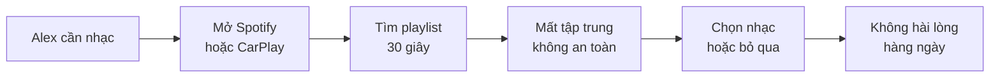
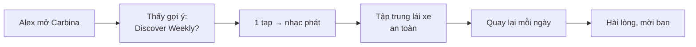
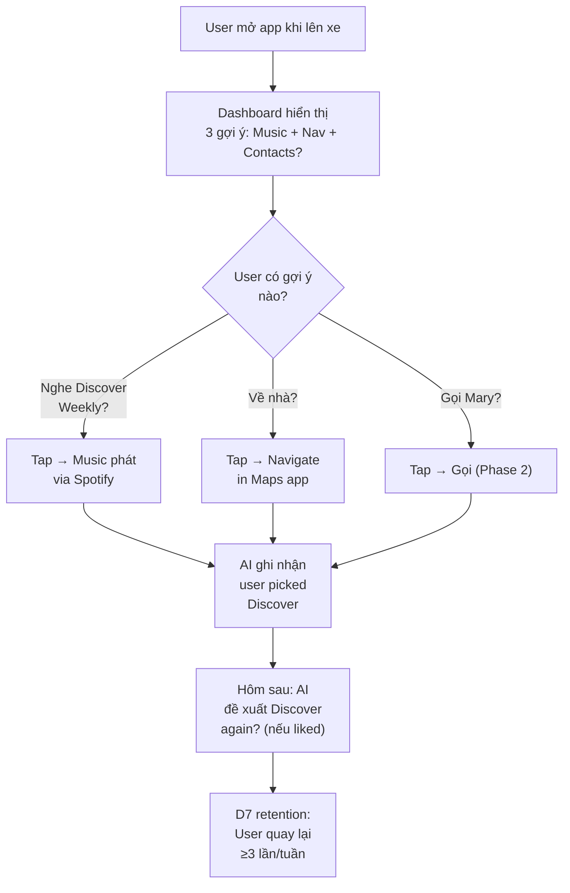
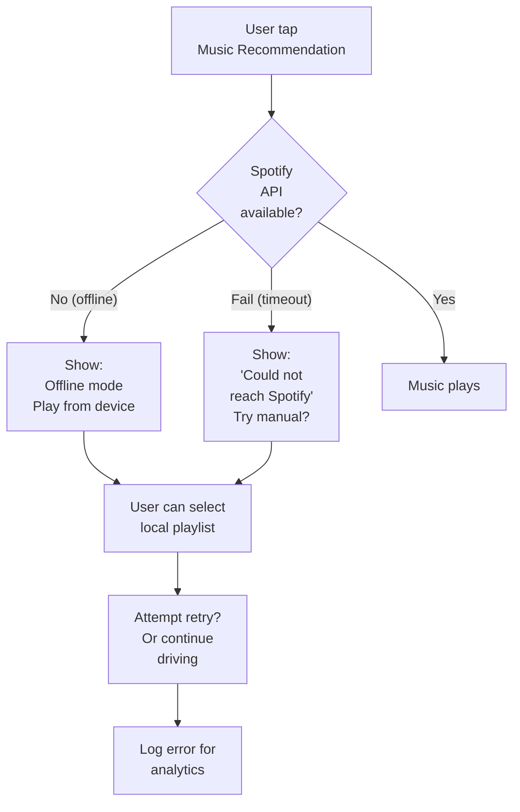
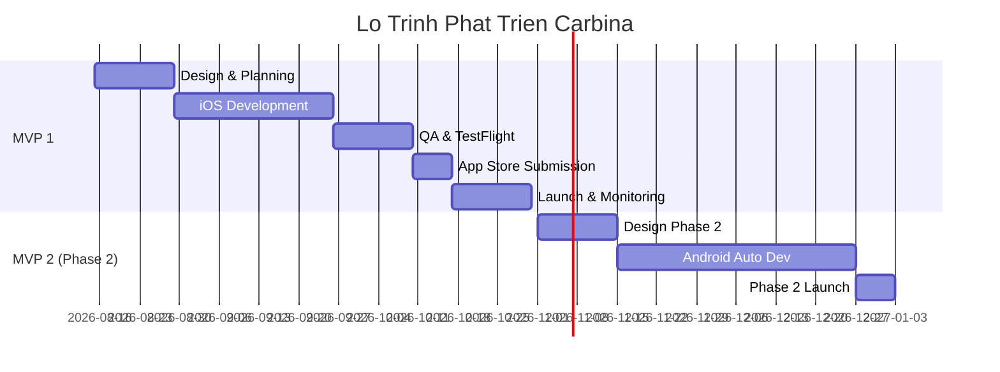

# Carbina: Car Dashboard & Widgets

**Subtitle (App Store)**: AI Learns Your Every Drive

**Version**: 2.4  
**Date**: 06 tháng 8 năm 2026  
**Author**: AI Research Agent  
**Mode**: Full PRD  
**Status**: Bản nháp để PO rà soát — đã cập nhật theo nghiên cứu cạnh tranh thực địa

> **Lịch sử đặt tên** — tên sản phẩm đã đổi hai lần, cả hai lần đều do dữ liệu bắt buộc:
>
> | Giai đoạn | Tên | Vì sao bỏ |
> |---|---|---|
> | v1.0 | `CarPlay Connect - Auto Sync` / `Dashboard AI` | Tên gần y hệt đang được `Car Play Connect - Auto Sync` (App Ventures) sử dụng và kiếm ~$170K/tháng. Cluster "CarPlay Connect" có **42-52% bị Apple takedown** |
> | v2.0-v2.2 | `RideIQ` | **Trademark RIDEIQ đã được đăng ký**: Reg. № 7063151, LIVE/REGISTERED từ 2023-05-23, chủ sở hữu **HopSkipDrive, Inc.**, **Class 042 (phần mềm)**, standard character claim. Thêm `RIDE IQ` (Ride iQ LLC, Class 041) và 4 app cùng tên trên App Store |
> | **v2.3 (hiện tại)** | **`Carbina`** ✅ | Đã chốt 07/08/2026 sau khi sàng lọc **46 ứng viên** qua 3 lớp (App Store → USPTO → domain). Carbina là ứng viên có hồ sơ sạch nhất |
>
> **Định vị** cũng đã đổi ở v2.0: từ "kết nối CarPlay" sang "dashboard xe cá nhân hóa bằng AI", vì 7 app cluster A dùng định vị cũ có tổng doanh thu **$0**. Đối thủ số 1 thật sự là `myCar: Car Widgets & Dashboard` (~$700K/tháng, DAU 103K).
>
> Chi tiết: [research/feature-tiers-and-competitor-matrix.md](./research/feature-tiers-and-competitor-matrix.md) · [research/mycar-deep-dive.md](./research/mycar-deep-dive.md) · [research/appstorespy-competitor-data.md](./research/appstorespy-competitor-data.md)

---

## Các Bên Liên Quan

| Vai Trò | Tên | Trách Nhiệm | Liên Kết |
|---|---|---|---|
| Product Owner | *Chưa phân công* | Quản lý toàn bộ dự án, quyết định cuối cùng; chốt các Default `(ASSUMPTION)` ở §14 | — |
| Project Manager | *Chưa phân công* | Quản lý timeline, resources, milestone | — |
| Lead Developer (iOS) | *Chưa phân công* | Xây dựng app iOS, CarPlay WidgetKit integration; **chịu trách nhiệm layout responsive theo `CPTemplateApplicationScene` bounds (R-11)** | — |
| ML Engineer | *Chưa phân công* | On-device Core ML: chọn ngữ cảnh cho giọng chào, sắp xếp dashboard | — |
| Designer (UI/UX) | *Chưa phân công* | Thiết kế dashboard, onboarding, widget cho **nhiều kích thước màn hình CarPlay** | — |
| QA | *Chưa phân công* | Kiểm tra app; **sở hữu test matrix ≥ 4 kích thước màn hình CarPlay + 1 xe thật/nhóm (R-11)** | — |
| Growth/UA | *Chưa phân công* | Chiến lược UA (Facebook/IG/TikTok — kênh đã validate từ đối thủ), ASO, PR | — |
| Creative Reviewer | *Chưa phân công* | **Phê duyệt mọi ad creative. Bắt buộc đã tự tay chạy feature đó trên xe thật trước khi duyệt (R-10)** | — |
| Backend Engineer | *Chưa phân công* | API cho analytics; webhook nhận `refund_detected` từ App Store Connect | — |
| Legal | *Chưa phân công* | Xác nhận trademark "Carbina" (sàng lọc sơ bộ đã xong 07/08); review Privacy Policy + Spotify API terms | — |

> **Trạng thái phân công**: chưa có tên cụ thể cho bất kỳ vai trò nào. Đây là gap đã biết, được theo dõi ở **Điều Chỉnh Bắt Buộc #1**. Hai vai trò mới thêm ở v2.0 — **Creative Reviewer** (chống rủi ro R-10 false-advertising) và **Legal** (trademark + terms) — không có trong v1.0 nhưng cần thiết vì hai rủi ro Critical mới.

---

## Lịch Sử Phiên Bản

| Ngày | Phiên Bản | Nội Dung | Tác Giả |
|---|---|---|---|
| 06/08/2026 | 1.0 | Tạo bản nháp PRD đầu tiên cho Dashboard AI | AI Research Agent |
| 07/08/2026 | 2.4 | **Bổ sung 6 bảng chỉ số vào PRD** (trước đó chỉ nằm ở file research): Bảng 1/2/3 danh mục tính năng Free/Premium/Pro vào §11; Bảng 4 ma trận so sánh tính năng, Giá chính thức đối thủ, và Điểm mạnh cần học/không copy vào §4. Mở rộng thang giá §11 thành **3 tầng** kèm cảnh báo Phân tích Hòa vốn vẫn tính theo mô hình 2 tầng | AI Research Agent |
| 07/08/2026 | 2.3 | **Đổi tên sản phẩm `RideIQ` → `Carbina`** sau khi phát hiện RIDEIQ là trademark đã đăng ký (Reg. 7063151, HopSkipDrive Inc., Class 042 phần mềm, LIVE). Sàng lọc 46 ứng viên qua App Store + USPTO + domain; Carbina sạch cả 3 lớp. Đóng câu hỏi trademark ở §14 và Điều Chỉnh Bắt Buộc #2 | AI Research Agent |
| 07/08/2026 | 2.2 | **Chốt gói năm $29,99** và bỏ hoàn toàn luận điểm cạnh tranh bằng giá; luận điểm chính thức chuyển sang "app duy nhất có gói Free vô thời hạn". Đóng 1 câu hỏi mở ở §14 | AI Research Agent |
| 07/08/2026 | 2.1 | **Tích hợp dữ liệu vận hành thật của đối thủ do PO cung cấp** (DAU, IAP revenue, RPD, sessions, engagement, retention D1/D7/D30, bảng giá đầy đủ + Coin IAP). Sửa 5 lỗi của v2.0: (1) giá myCar tái dựng từ review là SAI, (2) suy luận "doanh thu từ renewal cohort" bị phủ định — thực tế là churn-and-refill với D30 4%, (3) ngưỡng CPI phải < $1,00 không phải < $2,00, (4) luận điểm "Carbina định giá dưới đối thủ" không còn đúng, (5) bỏ sót Coin IAP. Thêm R-14 (rủi ro chiến lược retention), thêm 4 câu hỏi mở, cập nhật OpEx và commission 15% | AI Research Agent |
| 06/08/2026 | 2.0 | Đổi tên sản phẩm sang **Carbina**; viết lại toàn bộ Section 4 (Phân Tích Cạnh Tranh) bằng dữ liệu thực địa từ AppStoreSpy + iTunes API + 96 review; đổi mô hình giá (bỏ weekly, thêm lifetime, thêm free tier thật); thêm 5 rủi ro mới (takedown, guilt-by-association, false-advertising backlash, fragmentation màn hình xe, chargeback); thêm ưu tiên thị trường LATAM | AI Research Agent |

---

## Liên Kết Quan Trọng

| Nội Dung | Liên Kết |
|---|---|
| **Deep-dive đối thủ #1 (myCar)** | [research/mycar-deep-dive.md](./research/mycar-deep-dive.md) |
| **Dữ liệu niche từ AppStoreSpy** | [research/appstorespy-competitor-data.md](./research/appstorespy-competitor-data.md) |
| Figma Design (Wireframes) | *Chưa tồn tại* — sẽ được tạo ở Step 5 của pipeline (`Wireframes.md`), sau khi PRD và Use Cases được phê duyệt |
| Success Metrics Chi Tiết | [Artifact: carplay-option-b-metrics] |
| Market Research (bản đầu, đã bị v2.0 thay thế một phần) | [Artifact: carplay-discovery-vi] |
| App Store page đối thủ #1 | https://apps.apple.com/us/app/id6755033589 |
| API Specification | *Chưa tồn tại* — MVP 1 gần như không có backend (chỉ analytics + webhook refund). Sẽ được định nghĩa ở Step 4 (`Functional_Requirements.md`) |
| Analytics Event Tracking | Đã định nghĩa trong PRD này — xem §12 "Sự Kiện Cốt Lõi" (28 event, gồm `widget_render_failed` và `refund_detected` bắt buộc từ launch) |

---

## 1. Tóm Tắt Điều Hành

### Phát Biểu Vấn Đề

Màn hình CarPlay trong xe là một trong những màn hình người dùng nhìn nhiều nhất mỗi ngày — nhưng nó là màn hình duy nhất họ **không thể cá nhân hóa**. Ba vấn đề cụ thể:

1. **Không cá nhân hóa được**: CarPlay gốc chỉ có maps và menu. Người dùng không thể làm nó "của mình" như home screen iPhone
2. **Mọi thao tác phải làm lại từ đầu**: Vào xe → tìm nhạc → tìm tuyến đường → gọi ai. Không có gì học được từ hôm qua
3. **Không có "khoảnh khắc" nào khi vào xe**: Vào xe là một trải nghiệm cảm xúc (bắt đầu ngày, kết thúc ngày) nhưng phần mềm đối xử với nó như mở một cái menu

**Tại sao giải pháp hiện tại chưa tốt** — đây là phần đã được kiểm chứng bằng dữ liệu thực địa:

- **Nhóm app "CarPlay Connect" (79 app iOS+Android) bán sai thứ**: Họ bán "khả năng kết nối CarPlay" — điều mà một app iOS về mặt kỹ thuật **không thể** tạo ra nếu xe không hỗ trợ. Kết quả: 42-52% bị Apple/Google takedown, rating trung bình 2.2/5 trên Android
- **Đối thủ duy nhất bán đúng thứ (`myCar`) thì thực thi kém**: Định vị đúng (widget + âm thanh + dashboard), đạt ~$700K/tháng và DAU 103K trong 8 tháng — nhưng **78% review viết tay gần nhất là 1★**. Lý do: hard paywall không có trial, và quảng cáo một feature giọng AI ("Jarvis") **không tồn tại trong app**
- **Chưa ai làm AI thật**: 5 app trong niche đã gắn nhãn "AI" vào tên. Cả 5 đều $0 doanh thu. Nhãn không thay được sản phẩm

### Giải Pháp

**Carbina** là dashboard xe cho CarPlay, học thói quen người lái và tự sắp xếp lại chính nó:

- **Hành động cốt lõi**: Người dùng vào xe → Carbina đã sẵn sàng với đúng nhạc, đúng tuyến, đúng widget cho thời điểm đó — **không cần cấu hình**
- **Ba giá trị, xếp theo thứ tự đã được thị trường kiểm chứng**:
  1. **Khoảnh khắc vào xe có cảm xúc** — âm thanh chào cá nhân hóa theo ngữ cảnh (giờ, thời tiết, lịch, điểm đến dự đoán). Đây là feature duy nhất được khen **ngay cả trong review 1★** của myCar, và là hook marketing đã tạo ra ~$700K/tháng cho họ dù họ không giao được
  2. **Widget hoạt động thật trên mọi xe** — tự adapt theo kích thước màn hình. myCar bị complaint cắt chữ trên Jeep 8", không chạy trên xe 2026
  3. **AI tự sắp xếp, không phải người dùng tự cấu hình** — myCar bán widget tĩnh và bắt user "Create Widgets In Seconds". Carbina không bắt user tạo gì

### Tại Sao Là Lúc Này

1. **WWDC 2025 CarPlay Widgets** (tháng 6/2025): Apple mở WidgetKit cho CarPlay — nền tảng kỹ thuật cho toàn bộ sản phẩm này
2. **iOS 26 On-Device ML** (tháng 9/2025): Neural Engine cho phép cá nhân hóa mà không upload dữ liệu → vừa là feature vừa là lợi thế privacy
3. **Nhu cầu đã được validate bằng tiền thật, không phải bằng survey**: myCar đi từ $0 → ~$1M/tháng trong 5 tháng (Nov 2025 → Apr 2026). Câu hỏi "người dùng có trả tiền cho việc trang trí màn hình xe không" đã có câu trả lời: **có**
4. **Cửa sổ cơ hội đang mở vì đối thủ đang tự phá**: myCar peak Apr 2026, installs đã giảm 37% (801K → 500K), sentiment sụp về 1★. Word-of-mouth âm đang ăn vào top-of-funnel của họ
5. **Không có lợi thế người đi trước trong niche này**: Dữ liệu cho thấy app càng mới, doanh thu/review càng cao (app 3.5 năm: $2.1K per 1K votes → myCar 8 tháng: $90K per 1K votes). Vào muộn với monetization tốt hơn **thắng** vào sớm

### Thị Trường Mục Tiêu

- **Primary Users**: Chủ xe 22-45 tuổi có CarPlay, coi xe là phần thể hiện bản thân, đã quen cá nhân hóa iPhone (widget, lock screen, wallpaper)
- **Positioning**: "Màn hình xe của bạn, tự biết bạn cần gì" — **không** dùng các từ `Connect`, `Sync`, `Link`, `Remote` (xem R-08)
- **App Store Category**: **Utilities** (primary) + Travel (secondary) — theo đúng cấu hình của myCar
- **Market Size Framing**:
  - TAM: 800M+ xe tương thích CarPlay toàn cầu
  - **SAM (định lượng được từ dữ liệu đối thủ)**: myCar đạt **DAU 103K và ~$700K/tháng (số thật)** chỉ với định vị widget + sound. `Car Play Connect - Auto Sync` thêm **DAU 29K và ~$170K/tháng (số thật)**. Cluster "car play" trên iOS tổng ~$660K/tháng (estimate). → **Thị trường đang chi trả thực tế ≈ $1,3-1,4M/tháng trên iOS**, chưa tính app ngoài hai cluster này
  - SOM (Năm 1): 3-5% thị phần của phân khúc này = $45K-$75K MRR
- **Market Trend**: Tăng trưởng (11,7% CAGR CarPlay market). Nhưng chỉ số quan trọng hơn: niche này **đã chứng minh monetize được**, không cần chờ thị trường lớn thêm

### Tiêu Chí Thành Công

- **Tháng 3 (Beta)**: D7 retention ≥ 30%, trial-to-paid ≥ 10%, **rating ≥ 4.5 với ≥ 200 review** → Signal: sản phẩm chạy thật trên xe thật của người dùng thật
- **Tháng 6 (Public Launch)**: 50K installs, D7 ≥ 40%, MRR ≥ $18K, NPS ≥ 40, **rating ≥ 4.6 và tỷ lệ 1★ trong review gần nhất < 15%** → Signal: không đi vào vết xe đổ của myCar
- **Điều kiện trước khi mở rộng**: LTV:CAC ≥ 3:1, organic install ≥ 40%, refund rate < 5%

> **Ghi chú về chỉ số rating**: v2.0 thêm tiêu chí "tỷ lệ 1★ trong review gần nhất" vì nghiên cứu cho thấy rating tích lũy có thể che lấp hoàn toàn tình trạng thật (myCar: 4.58★ tích lũy nhưng 78% review gần nhất là 1★). Chỉ theo dõi rating trung bình là mù.

---

## 2. Mục Tiêu và Bối Cảnh

### Mục Tiêu Sản Phẩm

Carbina được xây dựng để **thắng bằng chất lượng thực thi trong một niche đã validate được nhu cầu** — không phải bằng việc là app đầu tiên, cũng không phải bằng việc có nhiều tính năng nhất.

**Chiến lược MVPs**:
1. **MVP 1** (Tháng 3): iOS CarPlay dashboard + AI recommendation (Music + Navigation)
2. **MVP 2** (Tháng 6): Android Auto support + Contacts shortcuts
3. **MVP 3** (Tháng 9): Cloud-based user profiles (sync across devices)

**Khung thời gian**: MVP 1 ra mắt tháng 3, MVP 2 tháng 6

### Liên Kết Với Mục Tiêu Kinh Doanh

- **Tăng trưởng**: Capture 0,2% thị trường SAM (100M) = 200K users trong năm 1
- **Doanh thu**: 200K users × 15% paid × blended ARPU **$3,38/tháng** = **~$101K MRR** ở quy mô năm 1 (v1.0 ghi $12M MRR — con số đó sai vì nhân sai bậc và dùng ARPU $7,99 của mô hình giá cũ)
- **Retention**: D7 ≥ 40%, NPS ≥ 40 → word-of-mouth growth, organic >40%
- **Mốc kinh doanh**: Đạt 10K paid subscribers trước khi gọi vốn Series A

### Nguyên Tắc Sản Phẩm

1. **AI-First**: Mọi tính năng phải có AI backing; không có static UI
2. **On-Device Privacy**: Tất cả dữ liệu cá nhân ở trên thiết bị; không upload lên cloud (ngoài opt-in analytics)
3. **Simplicity**: Dashboard với 3-5 action buttons tối đa; không menu phức tạp
4. **Safety**: Mọi action phải voice-first hoặc single-tap; không multi-step flows khi lái
5. **Learning**: App phải "smarter" mỗi tuần; continuous improvement dựa trên user behavior

---

## 3. Vấn Đề Người Dùng và Đối Tượng Mục Tiêu

### Persona Chính: "Alex — Tech-Savvy Commuter"

- **Profile**: Alex, 32 tuổi, lập trình viên/startup founder, sở hữu iPhone 14 Pro, lái xe Tesla/BMW mỗi ngày
- **Context**: Đi làm 40 phút/ngày, chuyến đường dài cuối tuần, thường nghe Spotify/Apple Music, gọi điện hàng ngày
- **Pain Points**:
  - Mỗi sáng phải tìm nhạc hay nghe → 30 giây mất tập trung (không an toàn)
  - CarPlay gốc không học: nhạc Alex thích, liên hệ gọi thường, tuyến đường quen thuộc
  - Voice control không đáng tin: "Hey Siri, play Spotify" thường fail, phải thử 2-3 lần
- **Need**: Dashboard hiểu Alex, gợi ý "Nghe Discover Weekly?" hoặc "Gọi Mary?" → 1 tap done

### Persona Thứ Cấp: "Jordan — Busy Professional"

- **Profile**: Jordan, 38 tuổi, sales executive, sở hữu iPhone 13, lái xe Audi 2022+
- **Context**: Lái xe kinh doanh 10+ giờ/tuần, các chuyến đường không quen, cần navigation + call frequently
- **Pain Points**:
  - Không muốn voice control (dùng Zoom calls, conference calls khi lái)
  - Android Auto trên xe, nhưng muốn dùng iPhone ecosystem
  - Cần shortcuts nhanh cho liên hệ kinh doanh (boss, clients)
- **Need**: Dashboard với Contacts shortcuts + Maps, học tuyến đường → gợi ý "Về sân bay?" hoặc "Gọi client ABC?"

### Persona Thứ Ba: "Sam — Car Enthusiast"

- **Profile**: Sam, 28 tuổi, hobby driving, sở hữu iPhone 15 Pro Max, lái xe Porsche/sports car
- **Context**: Chuyến đường dài cuối tuần, podcast + music lover, muốn customize dashboard
- **Pain Points**:
  - CarPlay gốc không cho phép customize widget layout
  - Muốn metrics: time to destination, fuel economy, trip stats
  - Muốn app nhớ favorite playlists per route
- **Need**: Dashboard customizable + AI learn routes + Trip tracking

### Hành Trình Người Dùng Hiện Tại



### Hành Trình Người Dùng Mong Muốn



---

## 4. Phân Tích Cạnh Tranh

> **Section này đã được viết lại hoàn toàn ở v2.0** bằng dữ liệu thu thập trực tiếp ngày 2026-08-06. Bản v1.0 dựa trên ước tính từ industry report và đã đặt sai đối thủ. Chi tiết đầy đủ: [research/mycar-deep-dive.md](./research/mycar-deep-dive.md), [research/appstorespy-competitor-data.md](./research/appstorespy-competitor-data.md).

### Tổng Quan Thị Trường

**Bối cảnh vĩ mô**:
- Apple CarPlay: 800M+ xe tương thích, 60+ thương hiệu
- Thị trường CarPlay $2,8B (2025) → $7,6B (2034), CAGR 11,7%

**Bối cảnh vi mô — đây là phần quyết định sản phẩm**. Niche này chia thành **ba cluster khác biệt hoàn toàn về kết quả kinh doanh**:

| Cluster | Cách đặt tên | Số app iOS đang phát hành | Tỷ lệ bị takedown | Monthly Installs | **Monthly Revenue** |
|---|---|---|---|---|---|
| **A. "carplay"** (liền) | `DriveGo: GPS & CarPlay`, `CarPlay Connect - Sync My Auto` | 7 | 42% (5/12) | dưới ngưỡng đo | **$0** |
| **B. "car play"** (dấu cách) | `Car Play Connect - Auto Sync`, `Car Auto Play: Sync & Connect` | 48 | **52%** (52/100) | 512K | **$660K** |
| **C. Widget/Dashboard** | `myCar: Car Widgets & Dashboard` | (đại diện: 1 app chi phối) | — | ~479K (suy từ RPD) | **~$700K** *(số thật)* |

**Bốn kết luận rút ra**:

1. **Cluster A là bẫy tuyệt đối**: 7 app, $0 doanh thu, 42% bị takedown. Trong đó có app tên `CarPlay Connect - Sync My Auto` (release 3 Feb 2026, rating 0.0, bỏ hoang từ Apr 2026) — gần như y hệt tên gốc dự án này định dùng.

2. **Cluster B monetize được nhưng cực kỳ tập trung và rất rủi ro**: $660K/tháng nhưng **chỉ 5 app** chiếm toàn bộ; 43 app còn lại $0. Tỷ lệ thành công tài chính = **5/100 app từng tồn tại = 5%**. Đồng thời 52% bị takedown.

3. **Cluster C là nơi có tỷ suất tốt nhất**: một app duy nhất (~$700K/tháng, số thật) vượt cả 48 app của cluster B ($660K/tháng, estimate). Khác biệt duy nhất: **bán trải nghiệm, không bán kết nối**.

4. **Khoảng trống thật không phải "chưa có AI dashboard"** (như v1.0 giả định) mà là: **chưa ai trong cluster C thực thi tốt**. Cluster C hiện chỉ có 1 người chơi đáng kể, và người đó đang sụp về chất lượng.

### Ghi Chú Phương Pháp Luận

**Nguồn và độ tin cậy — xếp từ cao xuống thấp**:

| Nguồn | Loại dữ liệu | Độ tin cậy |
|---|---|---|
| **Apple iTunes Lookup API** (47 storefront) | Metadata chính thức: rating, votes, version, size, minOS, genres, seller, ngày phát hành | **Rất cao** — API chính thức của Apple |
| **Apple Customer Reviews RSS** (5 storefront, 96 review) | Nội dung review, rating từng review, version | **Cao** cho nội dung. **Có sai lệch mẫu** — chỉ trả review có viết chữ, và người viết review thường có động lực âm mạnh hơn |
| **Trang App Store công khai** | Chart position, subtitle, "You Might Also Like", copyright | Cao |
| **AppStoreSpy / SensorTower** | Installs, revenue, số app published/removed | **Cao** cho số lượng app. **Trung bình** cho installs/revenue — đây là **estimate**, sai số có thể ±30-50% |
| Industry report (marketintelo, marketresearchfuture...) | Market size, CAGR | Trung bình — dùng cho framing vĩ mô, không dùng để ra quyết định sản phẩm |

**Bốn giới hạn phải nêu rõ khi dùng section này**:

1. ✅ **Giá subscription của myCar: ĐÃ CÓ SỐ THẬT** (PO cung cấp 2026-08-07) — Weekly $4,44/$5,99 · Yearly $19,99/$24,99/$29,99 · Coin $0,99/$4,99. **Bảng giá tái dựng từ 96 review ở bản v2.0 ($7,99/tuần, $34,99/năm) đã được chứng minh là SAI.** Đây là bài học phương pháp luận quan trọng: dữ liệu user-reported, dù nhiều nguồn độc lập khớp nhau, vẫn có thể sai hệ thống — không được dùng làm cơ sở cho quyết định định giá.
2. **"78% review 1★" là của mẫu 96 review có viết nội dung**, KHÔNG phải của toàn bộ 10.785 rating. Không được phát biểu "rating thật của myCar là 1.5★".
3. **Top countries là proxy qua rating votes**, không phải installs. Tỷ lệ rating/install khác nhau giữa các nước.
4. **Retention D1/D7/D30 của đối thủ: KHÔNG CÓ DỮ LIỆU.** Không tồn tại nguồn công khai (đây là dữ liệu first-party trong App Store Connect). Mọi con số retention trong PRD này là **mục tiêu của chúng ta**, tuyệt đối không phải số của đối thủ. Bản v1.0 có ghi "Retention D7/D30 ước tính 25-35%" cho đối thủ — **con số đó không có cơ sở và đã bị xóa**.

### Ma Trận Đối Thủ

| App | Cluster | Tín Hiệu Quy Mô | Rating | Mô Hình Giá | Điểm Mạnh | Điểm Yếu / Phàn Nàn | Hàm Ý Cho Chúng Ta |
|---|---|---|---|---|---|---|---|
| **myCar: Car Widgets & Dashboard** (KarmaTECH OU / DOFUapps) | C | **DAU 103K; $700K/tháng (số thật); RPD $1,46**; 10.809 votes | 4.58 tích lũy — nhưng **78% review viết tay gần nhất là 1★** | Hard paywall. **Weekly $4,44/$5,99 · Yearly $19,99/$24,99/$29,99 · Coin $0,99/$4,99.** Không free trial, không feature miễn phí | Định vị đúng (widget + startup sound); creative marketing xuất sắc; tăng $0 lên ~$700K/tháng trong 5 tháng; **có Coin IAP = 2 dòng doanh thu** | Hard paywall gây backlash (~60/96 review); quảng cáo feature "Jarvis" không tồn tại; widget lỗi trên nhiều xe; không có support (email bounce); bị tố thu tiền sai | **Đây là đối thủ số 1.** Copy định vị, **đảo ngược hoàn toàn monetization**. Giao thật feature giọng AI họ chỉ hứa |
| **Car Play Connect - Auto Sync** (App Ventures) | B | 200K installs/tháng; **$200K/tháng**; 6K votes | 4.6 | Free + IAP | Sống 14 tháng, cập nhật đều (2 Jul 2026) | Nằm trong cluster có 52% takedown rate | **Đang giữ chính cái tên dự án này định dùng.** Không được cạnh tranh ASO trực diện → đổi tên là bắt buộc |
| **Car Auto Play: Sync & Connect** (Appstract Works) | B | 60K installs/tháng; **$200K/tháng**; 3K votes | 4.6 | Free + IAP | Doanh thu/install cao nhất cluster B ($3,33/install) | Rủi ro takedown | Chứng minh có thể monetize tốt với base nhỏ → không cần scale lớn mới có lãi |
| **Car Play Connect, Sync & Care** (Bloomup LTD) | B | 100K installs/tháng; $100K/tháng; **48K votes** | 4.7 | Free + IAP | Review nhiều nhất cluster (48K), sống 3,5 năm | Doanh thu/review thấp ($2,1K per 1K votes) — monetize kém dù base lớn | Bằng chứng: **review nhiều không bằng paywall tốt**. Không đuổi theo số review |
| **Car Play AI Voice - DriveSpeak** (Berke Keser) | B | dưới ngưỡng đo; **$0** | 0.0 (0 votes) | — | Đúng ý tưởng "giọng AI trong xe", release 21 Mar 2026 | **Không traction gì cả** | **Cảnh báo quan trọng**: ý tưởng giọng AI đã có người thử và thất bại. Ý tưởng không đủ — cần marketing + thực thi |

### Bảng 1. Chỉ Số Thị Trường & Thương Mại (Đối Thủ)

| Chỉ Số | **myCar: Car Widgets & Dashboard** | Car Play Connect - Auto Sync | Car Auto Play: Sync & Connect | Car Play Connect: Remote Start | Car Play Connect, Sync & Care |
|---|---|---|---|---|---|
| **Developer** | KarmaTECH OU (Estonia) / hiển thị: DOFUapps | App Ventures | Appstract Works | TV Cast Pte. Ltd. | Bloomup LTD |
| **Link cài app** | [App Store id6755033589](https://apps.apple.com/us/app/id6755033589) | App Store (cluster B) | App Store (cluster B) | App Store (cluster B) | App Store (cluster B) |
| **DAU (worldwide)** — *số thật* | **103.000** | **29.000** | — | — | — |
| **IAP Revenue 30 ngày** — *số thật* | **~$700.000** | **~$170.000** | $200K (est) | $100K (est) | $100K (est) |
| **RPD all-time** — *số thật* | **$1,46** | **$0,65** | — | — | — |
| **Revenue / DAU / tháng** — *suy ra* | **$6,80** | **$5,86** | — | — | — |
| **ARPDAU** — *suy ra* | **$0,2265** | **$0,1954** | — | — | — |
| **Installs/tháng cần để đạt doanh thu** — *suy ra* | **~479.000** | **~262.000** | — | — | — |
| **Sessions / ngày (30d)** — *số thật* | **2,65** | **3,35** | — | — | — |
| **Engagement / ngày** — *số thật* | **1,01 phút** | **1,01 phút** | — | — | — |
| **Giây mỗi session** — *suy ra* | **~23 giây** | **~18 giây** | — | — | — |
| **Retention D1 / D7 / D30 (July)** — *số thật* | **28,8% / 11,5% / 4,0%** | **28,8% / 11,5% / 4,0%** | — | — | — |
| **Rating (tích lũy)** | 4,58 (10.809 votes) | 4,59 (6.253 votes) | 4,6 (3K votes) | 4,65 (25.773 votes) | 4,66 (48.578 votes) |
| **Rating (~100 review gần nhất)** | **78% là 1★, 0% là 4★** | **42% là 1★, 46% là 5★** — tốt nhất cluster | chưa thu thập | **76% là 1★** | **63% là 1★** |
| **Mô Hình Giá** — *số thật cho myCar* | Hard paywall. **Weekly $4,44 / $5,99 · Yearly $19,99 / $24,99 / $29,99 · Coin (consumable) $0,99 / $4,99** | Free + IAP | Free + IAP | **Weekly từ $9,99** | ~$15/tháng hoặc **$50 lifetime** |
| **Top Quốc Gia** (proxy rating votes) | **US 53,7%; MX 7,2%; CA 4,5%; BR 2,7%; DE 2,3%; GB 2,2%; FR 2,1%; CO 2,0%** — LATAM cluster **14,6%** | chưa thu thập | chưa thu thập | chưa thu thập | chưa thu thập |

> **Nguồn của các dòng *số thật***: dữ liệu vận hành do PO cung cấp **2026-08-07**. Đây là nguồn **độ tin cậy cao nhất** trong PRD và **thay thế** các estimate SensorTower/AppStoreSpy dùng ở bản v2.0. Doanh thu myCar thật là **~$700K/tháng**, không phải $900K như estimate.
>
> **Cross-validation thành công**: RPD $1,46 x ~479K installs = $700K. Con số installs suy ra từ dữ liệu thật **khớp gần hoàn hảo** với estimate 500K/tháng của AppStoreSpy → xác nhận estimate của AppStoreSpy cho app này chính xác ở mức khoảng ±5%, tốt hơn nhiều so với biên ±30-50% mà v2.0 đã cảnh báo.
>
> **CẢNH BÁO CHẤT LƯỢNG DỮ LIỆU**: bốn chỉ số (engagement/ngày, D1, D7, D30) **trùng khớp chính xác đến từng số thập phân** giữa hai app có quy mô chênh 3,55 lần. Xác suất trùng hợp tự nhiên rất thấp. Hai khả năng: (a) lỗi sao chép trùng dòng, (b) công cụ trả về **benchmark trung bình category** thay vì số riêng từng app. **PRD này coi bốn chỉ số đó là benchmark category** (cách đọc an toàn hơn) cho đến khi xác minh lại. Ghi nhận ở §14 và Vướng mắc.

### Bảng 2. Chỉ Số Sản Phẩm & Kỹ Thuật

| Chỉ Số | **myCar: Car Widgets & Dashboard** | Car Play Connect - Auto Sync | Car Auto Play: Sync & Connect |
|---|---|---|---|
| **Subtitle** | Driving Widgets · Startup Sounds | Smart link for digital cast | Smart Link GPS Dash Navigation |
| **Main Features** | Widget CarPlay (ảnh xe, cờ, meme, custom photo, couple counter); âm thanh connect/disconnect/arrive-home; thư viện ảnh xe theo model | Dashboard, digital cast, sync | Dashboard, GPS, navigation |
| **App Size** | **73,7 MB** (77.306.880 bytes) | ~60 MB | ~50 MB |
| **Minimum iOS** | **iOS 15.1** | chưa thu thập | chưa thu thập |
| **Nền tảng** | **Chỉ iPhone** (không iPad, không verified macOS) | — | — |
| **Version Hiện Tại** | 1.10.1 | — | — |
| **Ngày Phát Hành** | **2025-11-20** | 2025-05-10 | 2025-09-28 |
| **Lần Cập Nhật Gần Nhất** | **2026-08-04** (2 ngày trước khi thu thập) | 2026-07-02 | 2026-08-01 |
| **Tuổi Đời** | 8 tháng | 15 tháng | 10 tháng |
| **Category** | **Utilities** (primary) + Travel | — | — |
| **Chart Position** | **#33 Utilities, US, Top Free** | — | — |
| **Ngôn Ngữ** | 9: EN, FR, DE, ID, IT, MS, PT, ES, TR | — | — |
| **SDK Stack** | **KHÔNG CÓ DỮ LIỆU** (AppStoreSpy: "No data") | — | — |

### Phụ Lục Gọn: IAP, Release và Ghi Chú Storefront

| Trường | **myCar: Car Widgets & Dashboard** |
|---|---|
| **IAP Prices** — *số thật, PO cung cấp 2026-08-07* | **Weekly $4,44 · $5,99** · **Yearly $19,99 · $24,99 · $29,99** · **Coin (consumable) $0,99 · $4,99** |
| **SỬA LỖI v2.0** | Bảng giá tái dựng từ 96 review ($7,99/tuần · $34,99/năm) là **SAI**. Giá thật thấp hơn đáng kể. Các con số trong review có thể là giá vùng khác, giá cũ, hoặc user bị trừ nhiều sản phẩm cùng lúc. **Đây là ví dụ cụ thể cho việc dữ liệu user-reported phải được verify trước khi dùng làm cơ sở định giá.** |
| **Coin IAP — cơ chế v2.0 bỏ sót** | myCar có tiền tệ tiêu hao ($0,99 / $4,99) để mở lẻ widget/sound → **dòng doanh thu thứ hai**, bắt nhóm user ghét subscription. Giải thích RPD $1,46 dù giá subscription thấp |
| **Cấu trúc paywall** | **Hard paywall ngay khi mở app lần đầu.** Bắt chọn weekly/yearly trước khi thấy bất cứ gì. Không free trial. Không feature miễn phí. Paywall lặp lại giữa flow và cả **sau khi đã trả tiền** (bug) |
| **Seller pháp lý** | KarmaTECH OU (Estonia) |
| **Copyright** | © 2026 **myCar Connect** — vẫn giữ "Connect" ở tầng pháp lý nhưng **cố tình loại khỏi tên app** |
| **App khác cùng dev** | `proRadar・Radar & Speed Cameras`, `Reverse Audio Singing・Happy AI` → studio chuyên app viral-hook + hard paywall, không phải công ty sản phẩm dài hạn |
| **Ghi Chú Dữ Liệu** | Metadata từ iTunes Lookup API (rất cao). **DAU/revenue/RPD/retention/giá: dữ liệu vận hành PO cung cấp 2026-08-07 (rất cao)** — thay thế estimate SensorTower. SDK/Similar Apps: AppStoreSpy trả "No data" |

### Retention Thực Tế — và Sửa Lỗi Suy Luận của v2.0

**Dữ liệu thật (PO cung cấp 2026-08-07):**

| | D1 | D7 | D30 |
|---|---|---|---|
| myCar (July 2026) | 28,8% | 11,5% | **4,0%** |
| Car Play Connect - Auto Sync (July 2026) | 28,8% | 11,5% | **4,0%** |

*(Xem cảnh báo chất lượng dữ liệu ở Bảng 1 — bốn chỉ số trùng khớp giữa hai app nên có thể là benchmark category.)*

#### SỬA LỖI: suy luận của bản v2.0 về retention là SAI

Bản v2.0 viết: *"doanh thu myCar chủ yếu đến từ renewal của cohort Mar-Apr 2026"* và dự báo *"doanh thu sẽ sụp mạnh Q1-Q2 2027 khi cohort annual đến kỳ gia hạn"*.

**Cả hai kết luận đó đều không đúng.** Với D30 chỉ **4%**, không tồn tại một "base subscriber trung thành" nào để renewal. 96% người dùng biến mất trong 30 ngày.

#### Mô hình kinh doanh thật của category: churn-and-refill bằng paid UA

Dữ liệu thật cho thấy đây **không phải** mô hình giữ chân người dùng. Nó là mô hình arbitrage:

```
Mua install (CPI)  ->  monetize trong vài ngày đầu qua paywall  ->  user rời đi  ->  mua install mới
Lợi nhuận = RPD - CPI
```

**Bằng chứng số học:**

| Chỉ số | myCar | Car Play Connect |
|---|---|---|
| RPD (all-time) | $1,46 | $0,65 |
| Installs/tháng cần để đạt doanh thu | ~479.000 | ~262.000 |
| D30 | 4,0% | 4,0% |

Doanh thu $700K/tháng của myCar đến từ **~479.000 install mới mỗi tháng**, không từ base trung thành. Toàn bộ ngành đứng trên chênh lệch `RPD - CPI`.

#### Ba hàm ý trực tiếp cho Carbina

**① Ngưỡng CPI là ràng buộc sống-còn — và mục tiêu cũ quá lỏng.**
Với RPD $1,46, myCar chỉ có lãi nếu **CPI < $1,46**. Bản v2.0 đặt mục tiêu "CPI < $2,00" — con số đó sẽ khiến Carbina **lỗ trên mỗi install** nếu RPD tương đương myCar. Mục tiêu đã sửa: **CPI < $1,00** (xem R-07).

**② Chiến lược retention của Carbina đi NGƯỢC mô hình ngành — đây là giả thuyết số 1 phải kiểm chứng.**
Carbina chọn free tier + retention thay vì hard paywall + churn. Nếu đúng, LTV cao hơn nhiều lần và ta không phụ thuộc paid UA. Nếu sai, ta vừa mất doanh thu paywall vừa không đạt retention. **Đây là rủi ro chiến lược lớn nhất của sản phẩm, không phải một chi tiết.** Phải có kết luận trong 3 tháng đầu.

**③ Engagement tốt hơn KHÔNG tự động thành doanh thu tốt hơn.**
Car Play Connect có 3,35 sessions/ngày (nhiều hơn myCar 26%) nhưng RPD chỉ $0,65 (thấp hơn 55%). Trong category này **paywall và creative quyết định doanh thu**, không phải engagement. Đây là lời cảnh báo trực tiếp cho luận điểm "thắng bằng retention".

#### Ràng buộc thiết kế cứng: ~23 giây mỗi session

| | myCar | Car Play Connect |
|---|---|---|
| Sessions/ngày | 2,65 | 3,35 |
| Engagement/ngày | 1,01 phút | 1,01 phút |
| **Giây/session** | **~23 giây** | **~18 giây** |

Người dùng mở app ~3 lần/ngày, mỗi lần dưới 25 giây. Đây là app **thao tác nhanh rồi thoát**.

- ✅ Phù hợp: chọn sound, đổi widget, xem speedometer — đều là hành động vài giây
- ⚠️ **Rủi ro cho tính năng AI Driving Coach**: tính năng đó giả định người dùng xem lại điểm lái xe sau mỗi chuyến — hành vi trái ngược với chuẩn 23 giây/session. **Không có bằng chứng nào** trong dữ liệu cho thấy người dùng category này muốn ngồi review chuyến đi. Phải prototype validate trước khi đầu tư.

### Diễn Giải Nhanh Cho Chiến Lược Sản Phẩm

1. **Định vị "kết nối CarPlay" là định vị chết — đã kiểm chứng.** 7 app cluster A: $0. Về mặt kỹ thuật một app iOS không thể tạo kết nối CarPlay nếu xe không hỗ trợ → user thất vọng → 1-2★ → Apple takedown (42-52%).

2. **Định vị "widget + trải nghiệm" là định vị sống.** myCar: $0 → $1M/tháng trong 5 tháng với cùng tệp người dùng. Khác biệt duy nhất là bán **trải nghiệm** thay vì bán **kết nối**.

3. **Không có lợi thế người đi trước** — dữ liệu revenue per 1K votes cho thấy xu hướng ngược:

   | App | Tuổi | Revenue per 1K votes |
   |---|---|---|
   | Car Play Connect, Sync & Care | 3,5 năm | $2,1K |
   | Car Play Connect: Remote Start | 3 năm | $4,0K |
   | Car Play Connect - Auto Sync | 1,2 năm | $33,3K |
   | Car Auto Play: Sync & Connect | 0,9 năm | $66,7K |
   | **myCar** | **0,7 năm** | **$90K** |

   App càng mới, monetize càng tốt (paywall gắt hơn, giá cao hơn). **Vào muộn với monetization tốt hơn thắng vào sớm.** Đây là lý do Carbina vào thời điểm này là hợp lý.

4. **Nhãn "AI" không tạo ra traction.** 5 app đã gắn "AI" vào tên (`Car Play Connect: Car Sync AI` 4.9★/781 votes, `Car Play Sync: AI Connect App` 5.0★/14 votes, `Car Play AI Voice - DriveSpeak` 0★, `Carlink–It Syncs AI Car & Play` 3.0★, dev tên `DEEPLY AI`). **Cả 5 đều $0.** AI phải là chất lượng sản phẩm thật, không phải nhãn dán.

5. **Rào cản gia nhập thấp — cả cơ hội và rủi ro.** 14/30 app trong cluster B do cá nhân phát hành, trong đó **6 developer người Việt** (một app đạt 20K installs/tháng). Ta làm được, nhưng ai cũng làm được → khác biệt hóa phải nằm ở thực thi.

6. **Tín hiệu pricing (đã sửa theo số thật)**: myCar bán **Yearly $19,99-29,99** và **Weekly $4,44-5,99**, thu **$700K/tháng**. Weekly rẻ là mức neo để gói năm trông hợp lý. Nhưng weekly cũng là thứ khiến user gọi họ là "scam" → **Carbina không bán weekly** (xem Section 11). **Lưu ý quan trọng**: giá myCar thấp hơn nhiều so với bản v2.0 giả định. Carbina giữ $29,99/năm (đã chốt 07/08/2026) — bằng bậc cao nhất của myCar, thấp hơn 40% so với KeyConnect và Sync Ford. **Luận điểm cạnh tranh của Carbina là gói Free, không phải giá** — xem §11.

### Insight Chính Từ Review và Định Vị Của Đối Thủ

Dựa trên **96 review** của myCar (US, CA, MX, GB, DE), lấy qua Apple Customer Reviews RSS, sort mostrecent.

**Phân bổ rating của mẫu 96 review**: 1★: 75 (78,1%) · 2★: 7 (7,3%) · 3★: 6 (6,3%) · **4★: 0 (0%)** · 5★: 8 (8,3%)

> So sánh: rating tích lũy 4,58★ với 10.785 votes. Khoảng cách này là phát hiện quan trọng nhất — rating tích lũy **không phản ánh tình trạng hiện tại**. *(Lưu ý sai lệch mẫu: RSS chỉ trả review có viết chữ.)*

**Điều Người Dùng Thực Sự Yêu Thích** — đây là các feature có PMF đã kiểm chứng:

| Feature | Bằng chứng nguyên văn |
|---|---|
| **Âm thanh connect / disconnect / arrive-home** | "The connection, disconnection, and arrival sounds work and are great!" (5★). Đáng chú ý: được khen **ngay trong review 1★** — "The startup sound works" |
| Làm màn hình CarPlay cá nhân, vui | "It makes my CarPlay screen look more personal and fun. The widgets are easy to set up, and everything works smoothly." (5★) |
| Dễ setup (khi chạy được) | "Very easy to set up." (5★) |
| Thư viện ảnh xe | "The car selection is good" (5★); ngay review 1★ cũng thừa nhận: "The only thing it looks like they spent time on was getting pictures of all the different cars" |

→ **Kết luận PMF**: feature có product-market fit thật là **âm thanh khởi động/tắt máy**. Widget là thứ được quảng cáo mạnh nhất nhưng lỗi nhiều nhất. Đây là mismatch chết người của myCar.

**Sáu Phàn Nàn Chính** (xếp theo tần suất):

| # | Phàn nàn | Tần suất | Trích dẫn |
|---|---|---|---|
| 1 | **Hard paywall, không trial, không feature miễn phí** | **~60/96** | "There's a reason you're required to pay for a subscription before you can even get past the opening screen. The reason is, it's not worth it." |
| 2 | **Widget không hoạt động trên CarPlay** | 28 lần nhắc `widget` | "I cannot get the widgets option up in my CarPlay settings after I just spent 24 dollars on the app for the widgets specifically" |
| 3 | **Quảng cáo sai sự thật — hook "Jarvis"** | ≥6 review | "Please don't fall for the fake advertisements on Insta, Facebook, or TikTok. The app does not start everything up like Jarvis." |
| 4 | **Không refund được** | 9 lần nhắc `refund` | "Apple is saying this app is not refundable? Why? even if doesn't work?" |
| 5 | **Thu tiền sai / bait-and-switch** | 4 lần nhắc `charge` | "Bought the annual for 24.99 but charged 44.98"; "runs a 90% discount promo on its yearly service of $24.99. When you click to purchase it comes up as $19.99... bait and switch" |
| 6 | **Không có support — email bounce** | ≥4 review | "I emailed a review and it was sent back as a mailer demon"; "no support whatsoever" |

**Phàn Nàn Kỹ Thuật Cụ Thể** — đây là nguồn trực tiếp cho Functional Requirements của Carbina:

| Lỗi | Trích dẫn | Ngữ cảnh |
|---|---|---|
| **Widget cắt chữ, không fit màn hình xe** | "I have a 2022 Jeep Wrangler with the 8 inch screen and the widget does not fit. The wording is cut off on both the right and left side." | Jeep Wrangler 2022, màn 8" |
| **Không chạy trên xe mới** | "Does not work on new cars! I can't get this to work on my 2026" | xe 2026, Ram Rebel 2026, Audi |
| **Âm thanh quá nhỏ, bị nhạc lấn** | "Super quiet and gets cancelled out almost completely if you have any music playing" | — |
| **Sound disconnect lệch thời điểm tắt máy** | "the disconnect sound does not sync correctly to the vehicle shutting off so you only hear the sound through your phone" | — |
| **Custom photo widget không hiện** | "the custom photo widget or couples widget does not show up on the CarPlay in the vehicle even when set up correctly following the in app tutorial several times" | — |
| **Widget đếm ngày bị đóng băng** | "The together with Babe widget does not update the amount of days. It stays the same for weeks" | — |
| **Yêu cầu tải app thứ 2** | "You do need to download a separate app for that however" | — |
| **Không nhận subscription đã mua** | "it kept failing to recognize my subscription" | — |
| **Thư viện xe thiếu model** | "they only have the Subaru wrx no Subaru STI"; "The Gr Corolla is missing"; "should be able to select year, trim, and color" | Subaru STI, GR Corolla, MK3 Supra |

**Bảy Feature Request Rõ Ràng Từ User**:
1. **Cho dùng thử miễn phí** — request số 1, xuất hiện trong ~60 review
2. **Bán một lần thay vì subscription** — "I would be willing to buy this app outright, but I'm not going to pay for the rest of my life to use it"
3. Chọn được **năm / trim / màu** xe
4. Thêm nhiều mẫu xe
5. Widget **tương tác thật** — "Amazon doesn't seem to do anything with its selections. Click on orders and nothing happens"
6. Điều chỉnh âm lượng sound / duck nhạc đang phát
7. Widget **tự adapt kích thước màn hình xe**

**Kênh Acquisition của myCar**: Facebook, Instagram, TikTok ads. Creative hook chính là cảnh xe khởi động với **giọng AI kiểu "Jarvis"** chào người lái — nhiều user nói rõ họ tải app **chỉ vì** cảnh đó. Feature này **không tồn tại trong app**.

### Bảng 4. Ma Trận So Sánh Tính Năng Với Đối Thủ

> Đánh số theo file phân tích [feature-tiers-and-competitor-matrix.md](./research/feature-tiers-and-competitor-matrix.md). Bảng 1 và Bảng 2 ở trên là chỉ số thị trường/kỹ thuật của đối thủ; Bảng 4 dưới đây là so sánh **từng tính năng**.

Ký hiệu: ✅ có và là điểm mạnh · 🟡 có nhưng yếu/lỗi · ⚠️ **tuyên bố có nhưng không giao được** (nguồn 1★) · ❌ không có

| Tính năng | **myCar** (C) **$700K/th** | **Bloomup** (C+B) $100K/th | **App Ventures** (B) **$170K/th** | **5SKay VN** (B) | **Remote Start** (B) $100K/th | **KeyConnect** (B) | **Widgetsmith** (widget) | **App hãng xe** (Ford/BMW/Toyota…) | **Carbina** (kế hoạch) |
|---|---|---|---|---|---|---|---|---|---|
| Votes / Rating tích lũy | 10,8K / 4,58 | 48,6K / 4,66 | 6,3K / 4,59 | 9,4K / 4,20 | 25,8K / 4,65 | 89,6K / 4,55 | **764K / 4,61** | 100K–1,4M / 4,6–4,87 | — |
| **% 1★ review gần nhất** | **78%** | **63%** | **42%** | **64%** | **76%** | **73%** | — | — | mục tiêu **< 15%** |
| **DAU (thực tế)** | **103.000** | — | **29.000** | — | — | — | — | — | T6: 12.500 |
| **IAP Revenue 30d (thực tế)** | **~$700.000** | ~$100K (est) | **~$170.000** | — | ~$100K (est) | — | — | — | T6: $6,1–9,1K |
| **RPD all-time (thực tế)** | **$1,46** | — | **$0,65** | — | — | — | — | — | mục tiêu > $1,00 |
| **Revenue/DAU/tháng** | **$6,80** | — | **$5,86** | — | — | — | — | — | — |
| **Sessions/ngày (thực tế)** | **2,65** | — | **3,35** | — | — | — | — | — | — |
| **Giây/session (suy ra)** | **~23 giây** | — | **~18 giây** | — | — | — | — | — | ràng buộc thiết kế |
| **Retention D1/D7/D30** ⚠️ | 28,8% / 11,5% / **4,0%** | — | 28,8% / 11,5% / **4,0%** | — | — | — | — | — | mục tiêu 45% / 30% / 15% |
| **Widget trên màn hình xe thật** | ✅ **điểm mạnh cốt lõi** | 🟡 có nhưng bị 1★ "useless for car screen" | ❌ chỉ trên điện thoại | ⚠️ quảng cáo nhưng không hiện trên xe | ❌ | ❌ | ❌ không làm CarPlay | ❌ | ✅ **cốt lõi, có ở Free** |
| Âm thanh khởi động / tắt máy | ✅ **điểm mạnh, PMF cao nhất** | ❌ | ❌ | ❌ | ❌ | ❌ | ❌ | ❌ | ✅ có ở Free |
| Thư viện ảnh xe theo model | ✅ **điểm mạnh** | 🟡 thiếu model mới (2027 BMW) | ❌ | 🟡 | ❌ | ❌ | ❌ | ✅ ảnh xe thật của bạn | ✅ có ở Free |
| Widget ảnh / GIF / couple / counter | ✅ **điểm mạnh** | 🟡 chỉ weather + photo | ❌ | ❌ | ❌ | ❌ | ✅ **điểm mạnh tuyệt đối** (iPhone) | ❌ | ✅ Premium |
| Lên lịch widget theo giờ | ❌ | ❌ | ❌ | ❌ | ❌ | ❌ | ✅ **điểm mạnh** (rule-based) | ❌ | ✅ Premium (AI, không rule) |
| GPS Speedometer | ❌ | ❌ | ❌ | ✅ **điểm mạnh** (+ theme, speed alert) | ❌ | ❌ | ❌ | 🟡 | ✅ có ở Free |
| Dashboard lái xe / Driving Mode | 🟡 cơ bản | ✅ **điểm mạnh** | ✅ **điểm mạnh** | ✅ **điểm mạnh** | ✅ | 🟡 | ❌ | 🟡 | ✅ Free (cơ bản) + Premium |
| Navigation tích hợp | ❌ | ✅ | ✅ **điểm mạnh** (Google + Apple Maps, live traffic, ETA) | ✅ | ✅ | 🟡 | ❌ | ✅ | 🟡 deep-link Apple Maps |
| Điều khiển nhạc / Spotify | ❌ | ✅ | ✅ **điểm mạnh** (Spotify + Apple Music + YouTube Music) | ✅ | ✅ | ❌ | 🟡 quick access | ✅ | 🟡 hiện "đang phát" |
| **Live lyrics** | ❌ | ❌ | ❌ | ✅ **điểm mạnh, độc quyền trong cluster** | ❌ | ❌ | ❌ | ❌ | ✅ Premium |
| Trip stats / lịch sử chuyến | ❌ | ✅ | ❌ | ✅ | ✅ | ✅ | ❌ | ✅ | ✅ Free (3) + Premium (∞) |
| Garage nhiều xe | ❌ | ✅ **điểm mạnh** | ❌ | ✅ | 🟡 | ✅ **điểm mạnh** | ❌ | 🟡 | ✅ Premium |
| Sổ bảo dưỡng / nhắc lịch | ❌ | ✅ **điểm mạnh** (Service Tracker) | ❌ | ✅ | ✅ | ✅ **điểm mạnh** (+ chi phí, history report) | ❌ | ✅ | ✅ Premium (nhập tay) |
| **VIN scanner / decode** | ❌ | ❌ | ❌ | ✅ **điểm mạnh, độc quyền** | ❌ | ❌ | ❌ | ❌ | ✅ Premium |
| Lưu giấy tờ xe (bằng lái, bảo hiểm) | ❌ | ❌ | ❌ | ❌ | ❌ | ✅ **điểm mạnh, độc quyền** | ❌ | 🟡 | ❌ (cân nhắc MVP 3) |
| Tìm xe đang đỗ | ❌ | ✅ | ❌ | ❌ | ✅ | ✅ | ❌ | ✅ | ❌ (cân nhắc) |
| Tìm trạm sạc / trạm xăng | ❌ | ✅ | ❌ | ❌ | ✅ | ✅ | ❌ | ✅ | ❌ |
| **Fuel / tire pressure / oil life** | ❌ | ⚠️ **1★: "does not connect to vehicle"** | ❌ không tuyên bố | ❌ | ⚠️ **1★: "vehicle information is incorrect"** | ⚠️ **1★: có "demo mode" thay dữ liệu thật** | ❌ | ✅ **thật, miễn phí** | ✅ **thật qua OBD-II** (Pro) |
| **Remote lock / unlock / start** | ❌ | ❌ | ❌ không tuyên bố | ❌ | ⚠️ **1★: "still locked out"** | ⚠️ **1★: "said it could unlock my car remotely... it could not"** | ❌ | ✅ **thật, miễn phí** | ✅ **deep-link app hãng** (Pro) |
| AI Assistant / giọng nói | ❌ (chỉ quảng cáo "Jarvis") | ❌ | ❌ | ❌ | 🟡 tuyên bố "AI-powered Car Assistant" | ❌ | ❌ | 🟡 | ✅ **giọng chào ngữ cảnh** (Premium) |
| AI Driving Coach / điểm lái xe | ❌ | ❌ | ❌ | ❌ | ❌ | ❌ | ❌ | 🟡 vài hãng có | ✅ **Pro — không ai có** |
| OBD-II hardware | ❌ | ❌ | ❌ | ❌ | ❌ | ❌ | ❌ | ❌ | ✅ **Pro — không ai có** |
| Live Activity / Dynamic Island | ❌ | ❌ | ❌ | ❌ | ❌ | ❌ | ❌ | 🟡 | ✅ **Pro — không ai có** |
| Apple Watch | ❌ | ❌ | ❌ | ❌ | ❌ | ❌ | ✅ có widget watchOS | ✅ | ✅ **Pro** |
| **Gói Free dùng được** | ❌ hard paywall | ❌ *"Pay before you try"* | 🟡 *"Gratis para empezar"* | ❌ *"IN APP PURCHASE REQUIRED"* | ❌ *"Had to buy before set up"* | ❌ *"Advertises as free but... makes you pay"* | ✅ **điểm mạnh** | ✅ miễn phí hoàn toàn | ✅ **Free vô thời hạn** |
| Có gói Lifetime | ❌ | ✅ $50 | ❌ | ❌ | ❌ | ❌ | ❌ | — | ✅ $49,99 |
| Chất lượng support | ⚠️ email bounce | ⚠️ *"ghosted me"* | ⚠️ *"support is only AI and useless"* | 🟡 | ⚠️ *"no number to call"* | ⚠️ *"Can't get any help"* | ✅ | ✅ | mục tiêu: người thật < 24h |
| App size | 73,7 MB | **369,4 MB** | 76,6 MB | 183,7 MB | 150,4 MB | 314,1 MB | 205,4 MB | — | mục tiêu < 100 MB |
| Min iOS | 15.1 | 17.6 | 16.4 | 15.0 | 16.4 | 16.2 | 15.0 | — | 16.1 (cần ActivityKit) |
| Số ngôn ngữ | 9 | 11 | **26** | 11 | 1 | 18 | 1 | — | 7 (MVP: 3) |

#### Giá Chính Thức Của Đối Thủ

| App | Giá công bố | Nguồn |
|---|---|---|
| **`myCar`** | **Weekly $4,44 · $5,99** · **Yearly $19,99 · $24,99 · $29,99** · **Coin (consumable) $0,99 · $4,99** | **Dữ liệu thực tế do PO cung cấp 2026-08-07** |
| `KeyConnect Digital Car Key` | $19,99/tháng · $49,99/năm | Description App Store |
| `Sync: Ford Car Play Connect` | $9,99/tháng · $49,99/năm | Description App Store |
| `Car Play Connect: Remote Start` | Weekly từ $9,99 (+ monthly, yearly) | Description App Store |
| `Car Play Connect, Sync & Care` (Bloomup) | ~$15/tháng hoặc $50 lifetime | Review 1★ nêu cụ thể |
| **Carbina** ✅ **ĐÃ CHỐT 07/08/2026** | **Free · $4,99/tháng · $29,99/năm · $49,99 lifetime** | Quyết định của PO |

> ⚠️ **SỬA LỖI QUAN TRỌNG**: Bảng giá myCar tôi tái dựng từ 96 review trước đó (**$7,99/tuần · $34,99/năm**) là **SAI**. Giá thật là **$4,44–5,99/tuần · $19,99–29,99/năm** — thấp hơn đáng kể. Các con số $7,99 và $34,99 trong review có thể là giá vùng khác, giá cũ, hoặc người dùng bị trừ nhiều sản phẩm cùng lúc.
>
> **Hệ quả trực tiếp**: Carbina ở $29,99/năm **KHÔNG rẻ hơn myCar** — nó nằm ở **mức cao nhất trong dải giá của myCar** ($19,99–29,99).
>
> ✅ **QUYẾT ĐỊNH CỦA PO (07/08/2026): giữ $29,99, và BỎ HẲN luận điểm cạnh tranh bằng giá.**

**Vị trí giá chính xác của Carbina trong category:**

| Bậc | Carbina | Đối thủ | Vị trí |
|---|---|---|---|
| **Monthly** | **$4,99** | KeyConnect $19,99 · Sync Ford $9,99 · **myCar không có bậc monthly** | ✅ **Thấp nhất, và không bị so sánh trực tiếp với myCar** |
| **Yearly** | **$29,99** | myCar $19,99 / $24,99 / **$29,99** · KeyConnect $49,99 · Sync Ford $49,99 | 🟡 **Bằng bậc cao nhất của myCar; thấp hơn 40% so với phần còn lại** |
| **Weekly** | **không bán** | myCar $4,44/$5,99 · Remote Start từ $9,99 | ✅ Chủ động không tham gia — đây là nguồn của cáo buộc "scam" |
| **Lifetime** | **$49,99** | Bloomup ~$50 · myCar dùng Coin thay thế | 🟡 Ngang Bloomup |

⚠️ **Không được phát biểu "Carbina rẻ nhất thị trường".** Phát biểu đúng: *thấp nhất ở bậc monthly; thấp hơn 40% so với KeyConnect và Sync Ford ở bậc yearly; và là **app duy nhất trong category có gói Free dùng được vô thời hạn***.

**Luận điểm cạnh tranh chính thức của Carbina là gói Free, không phải giá.** Lý do không hạ giá thêm: blended ARPU đã mỏng ($3,38) và ngưỡng CPI đã ở mức khó ($1,00); hạ gói năm về $19,99 sẽ đẩy ngưỡng CPI xuống dưới $0,85 — rất khó đạt trên Facebook/TikTok.

### Điểm Mạnh Của Đối Thủ — Cần Học Gì / Không Copy Gì

| Đối thủ | Điểm mạnh thật sự (đã kiểm chứng) | Ta nên học gì | Ta không nên copy gì |
|---|---|---|---|
| **myCar** (KarmaTECH, **~$700K/th · DAU 103K · RPD $1,46**) | ① Định vị "màn hình xe của bạn, cá nhân hóa" cực rõ ② Âm thanh khởi động — PMF cao nhất toàn category ③ Thư viện ảnh xe theo model ④ Widget GIF động ⑤ Creative marketing xuất sắc (Facebook/IG/TikTok) ⑥ Tốc độ: $0 lên ~$700K/tháng trong 5 tháng | Toàn bộ định vị và thứ tự tính năng. Đây là template chiến lược của Carbina | Hard paywall · quảng cáo feature không tồn tại · không support |
| **Bloomup** (48,6K votes, $100K/th) | ① Bộ tính năng rộng nhất cluster (Driving Mode + widget + dashboard + service tracker + garage) ② Có gói **lifetime $50** ③ 11 ngôn ngữ ④ Tuổi thọ 3,5 năm | Cấu trúc gói lifetime · ý tưởng Service Tracker + Digital Garage | App 369 MB · vẫn hứa telemetry không giao được · "ghosted" khi đòi refund |
| **App Ventures** (6,3K votes, $200K/th) | ① **Sentiment tốt nhất cluster (42% 1★, 46% 5★) nhờ TRUNG THỰC** — không tuyên bố telemetry ② **26 ngôn ngữ** (nhiều nhất) ③ Navigation mạnh: Google + Apple Maps, live traffic, satellite, ETA ④ Nhạc: Spotify + Apple Music + YouTube Music ⑤ App nhẹ 76,6 MB ⑥ Revenue/1K votes $33,3K | **Sự trung thực trong metadata** — đây là bài học lớn nhất · chiến lược đa ngôn ngữ · app gọn nhẹ | Support bằng AI bot (*"support is only AI and useless"*) · bắt trả tiền để dùng app nhạc của chính mình |
| **5SKay VietNam** (9,4K votes) | ① **GPS Speedometer** có theme + speed alert ② **Live lyrics** — độc quyền trong cluster ③ **VIN Scanner** — độc quyền ④ Widget trip data trên home screen ⑤ Safe Driving Mode | Ba tính năng độc quyền: speedometer nâng cao, live lyrics, VIN decode | Tuyên bố "Trusted by 10,000,000+ drivers" không kiểm chứng được · quảng cáo hiện trên màn hình xe nhưng không hiện (rating thấp nhất cluster: 4,20) |
| **Remote Start** (TV Cast, 25,8K votes, $100K/th) | ① Định vị "AI-powered Car Assistant" (dù chưa giao) ② Tích hợp music/podcast ③ Tuổi thọ 3 năm | Cách đóng gói thông điệp "AI assistant cho xe" | **Weekly $9,99** · tuyên bố remote start không giao được (76% 1★ — tệ nhất) · người dùng bị kẹt ngoài xe 6 tiếng |
| **KeyConnect** (KAIN SUITE, **89,6K votes** — nhiều nhất cluster B) | ① Quy mô review lớn nhất ② **Lưu giấy tờ xe** (bằng lái, bảo hiểm, đăng kiểm) — độc quyền ③ Theo dõi chi phí + báo cáo history ④ 18 ngôn ngữ ⑤ "Demo Mode" cho xem trước (ý tưởng đúng, mục đích sai) | Ý tưởng lưu giấy tờ xe · theo dõi chi phí · **cho xem trước trước khi mua** | Demo mode dùng để **thay thế** dữ liệu thật thay vì để trải nghiệm · $19,99/tháng · 73% 1★ |
| **Widgetsmith** (**763,8K votes**) | ① **Vua của category widget** — 763K votes ② Lên lịch widget theo giờ ③ Thư viện wallpaper + theme ④ Widget Actions (mở app, chạy Shortcuts) ⑤ Lock screen widget ⑥ Gói Free rất tốt | Chuẩn mực chất lượng widget · mô hình free tier rộng · lên lịch theo ngữ cảnh | — (không phải đối thủ trực tiếp: **không làm CarPlay**) |
| **App hãng xe** (Ford 1,4M · myChevrolet 947K · Toyota 811K · My BMW 481K…) | ① **Thật sự làm được remote start, lock/unlock, fuel, tire pressure** ② **Miễn phí hoàn toàn** ③ Rating 4,6–4,87 ④ Quy mô hàng trăm nghìn đến triệu review | **Không cạnh tranh ở đây.** Deep-link tới họ (PRO-02) và nói thẳng với người dùng | Đừng bao giờ tuyên bố làm được thứ họ làm |

---

### Khác Biệt Hóa Của Chúng Ta

| # | Khác biệt hóa | Dựa trên bằng chứng nào |
|---|---|---|
| 1 | **Giao thật thứ myCar chỉ hứa**: giọng chào AI cá nhân hóa theo ngữ cảnh (giờ, thời tiết, lịch, điểm đến dự đoán) | myCar thu ~$700K/tháng nhờ quảng cáo feature này mà không giao được → demand đã validate bằng tiền thật, khoảng trống còn nguyên. **Không đặt tên "Jarvis"** (trademark Disney) |
| 2 | **Free tier có giá trị thật + 7-day trial** | ~60/96 review complaint chính là hard paywall. Đây là khe hở lớn nhất. Free tier còn giải quyết luôn complaint "không chạy trên xe tôi" — user thấy app chạy trên xe họ **trước khi** trả tiền |
| 3 | **Widget tự adapt mọi kích thước màn hình CarPlay** | Complaint cắt chữ trên Jeep 8" cho thấy myCar hardcode layout. Đây là lỗi kỹ thuật cụ thể có thể thắng |
| 4 | **AI tự sắp xếp dashboard, không bắt user cấu hình** | myCar bán widget tĩnh, marketing là "Create Widgets In Seconds" → user vẫn phải tự làm. Nhiều review: "you had to create it yourself and source the sound effects for it" |
| 5 | **Privacy-first: on-device ML** | Không đối thủ nào dùng ML. Vừa là feature, vừa là điểm tin cậy khi xin quyền Location/Calendar |
| 6 | **Trung thực trong marketing** | myCar mất sentiment vì quảng cáo feature không có. Mọi creative của Carbina chỉ quay **feature thật đang chạy** — xem R-10 |
| 7 | **Localize ES + PT từ MVP** | LATAM = 14,6% user base của myCar (vượt Tây Âu 9,4%), và rating ở đó **cao hơn** US (MX 4,67, CO 4,74, CL 4,64 vs US 4,58) |

---

## 5. Tầm Nhìn và Mục Tiêu Sản Phẩm

### Tuyên Bố Tầm Nhìn

**"Carbina làm cho màn hình xe của bạn tự biết bạn cần gì — và là app duy nhất trong niche này mà bạn có thể dùng thử trước khi trả tiền."**

Trong 3 năm:
- 2M người dùng trên iOS + Android
- Thương hiệu = **app tử tế trong một niche đầy app scam**. Đây là định vị thương hiệu khả thi nhất, vì toàn bộ niche hiện tại có rating trung bình 2,2/5 (Android) và đối thủ dẫn đầu có 78% review gần nhất là 1★
- Chuẩn mực mới cho niche: rating ≥ 4,6 **và giữ được nó** — điều chưa ai làm được

### Mục Tiêu & KPI trong 6 Tháng

| Mục Tiêu | KPI | Mục Tiêu 3 Tháng | Mục Tiêu 6 Tháng | Cách Đo Lường |
|----------|-----|-------|-------|--------|
| **Thu Hút Người Dùng** | Installs + Trial Starters | 10.000 installs; 2.000 trial starts | 50.000 installs; 4.000 trial starts | App Store Analytics + Firebase |
| **Tương Tác** | DAU + Session Length | 2.000 DAU; 8-12 min avg | 12.500 DAU; 10-14 min avg | Firebase Analytics |
| **Giữ Chân** | D7 + D30 Retention | D7: 30%; D30: 15% | D7: 40%; D30: 22% | Cohort analysis via Firebase |
| **Kiếm Tiền** | Trial-to-Paid + MRR | 10-14% conversion; $1,2K-$1,8K MRR | 12-18% conversion; **$6,1K-$9,1K MRR** | App Store Connect + Firebase |
| **Doanh Thu** | MRR + Lifetime buyers | $1,2K-$1,8K MRR; 50-100 lifetime | $6,1K-$9,1K MRR; 300-500 lifetime tích lũy | App Store Connect |
| **Hài Lòng** | App Store Rating + NPS | 4,5/5 rating (≥200 review); 35+ NPS | 4,6/5 rating; 40+ NPS | App Store + in-app survey |
| **Chất Lượng Cảm Nhận** | **% review 1★ trong 50 review gần nhất** | **< 20%** | **< 15%** | Customer Reviews RSS, kiểm hàng tuần |
| **Rủi Ro Tài Chính** | Refund rate | < 7% | **< 5%** | App Store Connect |
| **Tương Thích Xe** | **% session widget render đúng** | ≥ 90% | **≥ 95%** | Telemetry: widget render success/fail theo screen size |
| **Chất Lượng** | Crash-Free Sessions + Errors | ≥99.2% crash-free; <0.5% error | ≥99.5% crash-free; <0.3% error | Firebase Crashlytics |

> **Ba KPI mới ở v2.0** — `% review 1★ gần nhất`, `Refund rate`, `% widget render đúng` — xuất phát trực tiếp từ ba chế độ thất bại quan sát được ở myCar: rating tích lũy che lấp sentiment thật (4,58★ nhưng 78% review gần nhất 1★), refund/chargeback do hard paywall (9/96 review nhắc refund), và widget lỗi trên màn hình xe không chuẩn (Jeep 8" cắt chữ). Đây là chỉ số **dẫn** — phát hiện vấn đề trước khi nó xuất hiện trong doanh thu.
>
> **Về việc MRR mục tiêu giảm** từ $18K-21K (v1.0) xuống $6,1K-$9,1K (v2.0): không phải hạ tham vọng. v1.0 tính theo $7,99/user/tháng; mô hình mới có blended ARPU **$3,38** (do có free tier và mix nghiêng về yearly). Cùng số user, doanh thu tháng thấp hơn nhưng rating giữ được và rủi ro takedown thấp hơn. Xem Section 11 và Phân tích Hòa Vốn.

---

## 6. Phạm Vi và Những Gì Nằm Ngoài Phạm Vi

### Phạm Vi MVP (In Scope)

**Tháng 3 — MVP 1: Sound + Widget + Giọng Chào AI**

Thứ tự dưới đây theo mức độ PMF đã kiểm chứng, khớp với bảng tính năng §7:

- [x] **Âm thanh Connect / Disconnect / Arrive** (F1) — có ducking nhạc, phát qua loa xe, sync đúng thời điểm tắt máy. **Đây là feature có PMF cao nhất** (được khen ngay trong review 1★ của đối thủ)
- [x] **Widget CarPlay tự adapt màn hình** (F2) — layout theo `CPTemplateApplicationScene` bounds, không hardcode
- [x] **Giọng chào AI cá nhân hóa on-device** (F3) — theo giờ / thời tiết / lịch / điểm đến dự đoán
- [x] **Gói Free vô thời hạn** (F4) — 1 widget + 3 sound + dashboard cơ bản, **paywall không xuất hiện ở lần mở app đầu**
- [x] Thư viện xe make/model/year (F5) — ≥ 40 hãng, ≥ 400 model
- [x] Onboarding ≤ 5 bước, không có paywall trong onboarding (F6)
- [x] Paywall + trial 7 ngày, **$4,99/tháng · $29,99/năm · $49,99 lifetime, không bán weekly** (F7)
- [x] AI sắp xếp dashboard on-device (F8)
- [x] **Localize EN + ES + PT-BR** (F9) — LATAM là 14,6% user base đối thủ
- [x] Analytics đầy đủ, bắt buộc có `widget_render_failed` + `refund_detected` từ launch (F10)
- [x] iOS CarPlay only (Android Auto là Phase 2)

**Ba capability tối thiểu để validate Product-Market Fit:**
- **Widget Render Success Rate ≥ 90%** — nếu không đạt, sản phẩm không tồn tại được (đây là chế độ thất bại số 2 của đối thủ)
- **Recent 1★ Ratio < 20%** — nếu không đạt, ta đang lặp lại sai lầm của đối thủ
- **D1 ≥ 45% và D7 ≥ 30%** — bằng chứng churn của đối thủ cho thấy user rời trong 5 phút đến 1 ngày, nên D1 là chỉ số quan trọng nhất ở giai đoạn này

> **So với v1.0**: MVP 1 cũ gồm "AI Music Recommendations" và "AI Navigation Recommendations" làm feature P0. Ở v2.0 hai thứ đó được gộp vào **F8 (AI sắp xếp dashboard)** và không còn là trung tâm sản phẩm. Lý do: không có bằng chứng nào trong dữ liệu thị trường cho thấy người dùng trả tiền cho "gợi ý nhạc/tuyến đường"; bằng chứng có được cho thấy họ trả tiền cho **widget và âm thanh khởi động**.

### Sau MVP (Giai Đoạn Tiếp Theo)

- **Tháng 6 — MVP 2**: Android Auto support + Contacts Shortcuts + Settings (dark mode, font size) + widget tương tác (giải quyết complaint "Click on orders and nothing happens" của myCar)
- **Tháng 9 — MVP 3**: Cloud sync (accounts) + Trip history + Stats dashboard + thư viện xe mở rộng (year/trim/color)
- **Tháng 12 — MVP 4**: Advanced AI (calendar-aware suggestions), voice control, music source detection

### Những Gì Rõ Ràng Nằm Ngoài Phạm Vi MVP

- [ ] Android Auto (Phase 2, tháng 6+)
- [ ] Cloud-based user profiles/sync (Phase 3, tháng 9+)
- [ ] Vehicle-specific integrations (OBD data, Tesla API) — quá phức tạp cho MVP
- [ ] Real-time traffic optimization — cần backend infrastructure
- [ ] Voice command đầu vào (v1 chỉ button-based; **lưu ý: giọng chào AI đầu ra vẫn nằm TRONG MVP** — đó là feature khác biệt hóa số 1, xem Section 4)
- [ ] Widget tương tác hai chiều (chỉ hiển thị ở MVP 1)
- [ ] Localize ngoài EN/ES/PT (xem ghi chú bên dưới)

> **Điều chỉnh phạm vi ngôn ngữ ở v2.0**: bản v1.0 ghi "English MVP first; EU localization Phase 2". Dữ liệu thực địa cho thấy **LATAM là 14,6% user base của đối thủ** (MX 7,2% + BR 2,7% + CO 2,0% + CL 1,8% + AR 0,9%), vượt Tây Âu (9,4%), và rating ở LATAM **cao hơn** US (MX 4,67 / CO 4,74 / CL 4,64 vs US 4,58). Vì vậy **ES và PT-BR được đưa vào MVP 1** cùng EN; các ngôn ngữ EU (DE/FR/IT) dời sang MVP 2. Quyết định này chờ chốt ở §14.

### Lý Do

Giữ phạm vi hẹp vì:
1. **Kiểm chứng core hypothesis**: AI music/nav recommendations được người dùng tin tưởng? (need D7 ≥ 30%)
2. **Tốc độ ra mắt**: 8-12 tuần (iOS only) vs. 16+ tuần (cross-platform). Market window đang mở.
3. **Focus trên AI quality**: Nếu spread thin, AI model sẽ kém, app mất trust signal

---

## 7. Yêu Cầu và Tính Năng

### Bảng Tính Năng MVP

> **Bảng này được viết lại ở v2.0.** Bản v1.0 mô tả sản phẩm cũ (dashboard + music/nav recommendations) và không có hai tính năng cốt lõi của Carbina: **widget CarPlay** và **âm thanh/giọng chào**. Thứ tự ưu tiên dưới đây theo mức độ PMF đã được kiểm chứng từ dữ liệu đối thủ, không theo mức độ dễ làm.

| ID | Tính Năng | User Story | Acceptance Criteria | Ưu Tiên |
|---|-----------|------------|---------------------|---------|
| **F1** | **Âm thanh Connect / Disconnect / Arrive** | Với vai trò chủ xe, tôi muốn nghe một âm thanh của riêng tôi khi vào và ra khỏi xe, để khoảnh khắc lên xe có cảm giác là của mình | - [ ] Phát đúng trong ≤ 1,5s sau khi `carplay_connected`<br>- [ ] **Duck nhạc đang phát xuống 20% trong lúc phát rồi phục hồi** (giải quyết complaint "gets cancelled out if you have any music playing")<br>- [ ] Sound disconnect phát **đúng thời điểm tắt máy**, qua loa xe không qua loa iPhone (complaint myCar: "you only hear the sound through your phone")<br>- [ ] ≥ 12 preset trong thư viện, 3 preset ở gói Free<br>- [ ] Người dùng điều chỉnh được âm lượng riêng cho sound, độc lập với âm lượng nhạc<br>- [ ] Event `sound_played` + `sound_ducking_applied` được ghi | **P0** |
| **F2** | **Widget CarPlay tự adapt màn hình** | Với vai trò chủ xe, tôi muốn widget hiển thị đúng và đầy đủ trên màn hình xe của tôi, bất kể xe tôi là gì | - [ ] Layout tính theo `CPTemplateApplicationScene` bounds tại runtime, **tuyệt đối không hardcode kích thước** (R-11)<br>- [ ] Không có nội dung nào bị cắt ở bất kỳ kích thước nào trong test matrix (≥ 4 kích thước + 1 xe thật/nhóm)<br>- [ ] Text tự co theo Dynamic Type; truncate có ellipsis chứ không cắt giữa chữ<br>- [ ] Touch target ≥ 44pt<br>- [ ] Dark mode + light mode<br>- [ ] **`widget_render_ok` / `widget_render_failed` được ghi kèm `screen_width`, `screen_height`**<br>- [ ] Widget Render Success Rate ≥ 90% (T3), ≥ 95% (T6) | **P0** |
| **F3** | **Giọng Chào AI Cá Nhân Hóa** | Với vai trò chủ xe, tôi muốn xe chào tôi bằng câu phù hợp với hoàn cảnh lúc đó, để cảm giác như xe hiểu tôi | - [ ] Sinh câu chào từ **on-device** context: giờ trong ngày, thời tiết, sự kiện lịch sắp tới, điểm đến dự đoán<br>- [ ] Dùng `AVSpeechSynthesizer`, **không gọi cloud** — không rời thiết bị<br>- [ ] Độ trễ từ connect đến phát ≤ 2s<br>- [ ] Tối thiểu 4 biến thể ngữ cảnh, không lặp lại câu y hệt 2 lần liên tiếp<br>- [ ] **Không dùng tên "Jarvis" hay bất kỳ tham chiếu Marvel/Disney** (R-10)<br>- [ ] Event `voice_greeting_played` kèm `context_used`<br>- [ ] Tắt được hoàn toàn trong Settings | **P0** |
| **F4** | **Gói Free vô thời hạn** | Với vai trò người dùng đang cân nhắc, tôi muốn xác nhận app chạy được trên xe của tôi trước khi trả bất kỳ đồng nào | - [ ] 1 widget + 3 sound preset + dashboard cơ bản, **không giới hạn thời gian, không quảng cáo**<br>- [ ] **Paywall KHÔNG xuất hiện ở lần mở app đầu tiên** — kiểm chứng bằng `paywall_shown.days_since_install > 0` hoặc trigger do user chủ động<br>- [ ] Widget ở gói Free là widget **đầy đủ chức năng**, không phải preview mờ hay watermark<br>- [ ] Event `free_tier_widget_used` được ghi | **P0** |
| **F5** | **Thư viện Xe (make / model / year)** | Với vai trò chủ xe, tôi muốn chọn đúng xe của tôi để widget hiển thị hình xe giống xe thật | - [ ] ≥ 40 hãng, ≥ 400 model<br>- [ ] Chọn được **year** (trim và color dời MVP 3 — xem §6)<br>- [ ] Có ô "không tìm thấy xe của tôi" gửi request về backlog<br>- [ ] Ảnh xe hiển thị sắc nét trên màn hình xe (không bị mờ — complaint myCar: "Looks fairly blurry") | P0 |
| **F6** | **Onboarding Flow** | Với vai trò người dùng mới, tôi muốn setup xong trong dưới 2 phút và hiểu ngay app làm được gì | - [ ] ≤ 5 bước: Welcome → chọn xe → cấp quyền (Location/Calendar, nêu rõ lý do) → chọn sound → Dashboard<br>- [ ] Skip được mọi bước xin quyền, app vẫn dùng được ở mức cơ bản<br>- [ ] Completion rate ≥ 70%<br>- [ ] **Không có paywall trong onboarding** | P0 |
| **F7** | **Paywall & Trial 7 ngày** | Với vai trò người dùng đã thấy giá trị, tôi muốn biết chính xác mình trả bao nhiêu và khi nào bị trừ tiền | - [ ] Bậc giá: **Free / $4,99 tháng / $29,99 năm / $49,99 lifetime**. **Không có gói weekly**<br>- [ ] Hiển thị **giá cuối cùng bằng tiền tệ địa phương** trước khi confirm; **không quy đổi kiểu "$0,48/tuần"** (R-12)<br>- [ ] Trial 7 ngày, hiển thị rõ ngày hết hạn và ngày trừ tiền trong app<br>- [ ] Không dùng discount phần trăm không đúng thực tế (R-12)<br>- [ ] Event `paywall_shown`, `price_confirmed`, `trial_started`, `trial_converted` | P0 |
| **F8** | **AI Sắp Xếp Dashboard** | Với vai trò người lái hằng ngày, tôi muốn dashboard tự đổi theo hoàn cảnh mà không phải tự cấu hình gì | - [ ] Học on-device từ nhạc hay nghe, tuyến đường quen, giờ lái<br>- [ ] Tự xếp lại thứ tự thẻ trên dashboard theo ngữ cảnh<br>- [ ] **Không bắt user tạo hay cấu hình widget** (khác myCar: "you had to create it yourself")<br>- [ ] Tap-through rate ≥ 30%<br>- [ ] Toàn bộ dữ liệu học **không rời thiết bị** | P0 |
| **F9** | **Localize EN / ES / PT-BR** | Với vai trò người dùng ở Mexico hoặc Brazil, tôi muốn dùng app bằng tiếng của tôi | - [ ] 3 ngôn ngữ đầy đủ trong MVP 1: EN, ES, PT-BR<br>- [ ] Bao gồm cả nội dung giọng chào AI, không chỉ UI<br>- [ ] Giá hiển thị đúng tiền tệ địa phương | P0 |
| **F10** | **Analytics & Telemetry** | Với vai trò PM, tôi muốn phát hiện vấn đề tương thích xe và hoàn tiền trong 24h | - [ ] Toàn bộ event ở §12 được ghi, **bắt buộc có `widget_render_failed` và `refund_detected` từ ngày launch**<br>- [ ] Không gửi PII<br>- [ ] Dashboard realtime cho PM<br>- [ ] Cảnh báo tự động khi Widget Render Success Rate < 90% | P0 |
| **F11** | **Crash Reporting** | Với vai trò engineer, tôi muốn tự động capture crash để fix nhanh | - [ ] Firebase Crashlytics auto-capture unhandled exceptions<br>- [ ] ≥ 99,2% crash-free sessions (T3), ≥ 99,5% (T6)<br>- [ ] Symbol upload cho stack trace rõ ràng | P1 |
| **F12** | **Giám sát Sentiment Review** | Với vai trò PM, tôi muốn biết sentiment thật đang xấu đi trước khi nó ảnh hưởng doanh thu | - [ ] Job hằng tuần đọc 50 review gần nhất qua Customer Reviews RSS<br>- [ ] Tính **Recent 1★ Ratio**; cảnh báo khi > 20%<br>- [ ] Phân loại complaint theo nhóm (paywall / tương thích / sound / khác) | P1 |
| **F13** | **Contacts Shortcuts** | Với vai trò người dùng bận, tôi muốn gọi 5 người hay gọi bằng 1 tap | - [ ] Đọc Contacts (iOS permission)<br>- [ ] Lưu 5 favorites<br>- [ ] One-tap call qua system<br>- [ ] **Dời MVP 2** (xem §6) | P2 |

### Gợi Ý Khi Viết Acceptance Criteria

- ✅ Mô tả hành vi observable (user thấy gì, tác vụ hoàn thành như thế nào)
- ✅ Ưu tiên điều kiện hoàn thành, trạng thái lỗi, ràng buộc hiệu năng
- ✅ Nếu có entitlement free/premium, ghi rõ trong criteria
- ❌ Tránh mô tả implementation nội bộ (architecture, library choices)

### Sau MVP (Backlog Định Hướng)

- **Contacts Shortcuts** (Phase 2, tháng 6): Save 5 contacts, 1-tap call
- **Calendar-Aware Suggestions** (Phase 2): Gợi ý navigate to next meeting if location mismatch
- **Android Auto Support** (Phase 2): Port UI logic to Android framework
- **Cloud Sync** (Phase 3, tháng 9): Account login, sync preferences across devices
- **Trip History & Stats** (Phase 3): Distance driven, time, fuel economy (if OBD available)

---

## 8. Luồng Người Dùng

### Luồng Chính: "Morning Commute with AI Recommendations"



### Luồng Phục Hồi / Lỗi



### Luồng Phụ

- **First-time Onboarding**: User → Permission requests → Dashboard intro → First recommendation
- **Trial Expiration**: Day 6 → "Day left" reminder; Day 7 → "Subscribe now?" prompt; Day 8 → Limited mode (1 recommendation/session)
- **Settings**: User preferences (light/dark, notification on/off, feature toggles)
- **Account Setup (Phase 3)**: Email login → Cloud sync → Device sync

---

## 9. Ràng Buộc Sản Phẩm và Kỹ Thuật

### Ma Trận Nền Tảng

| Yếu Tố | Chi Tiết |
|--------|---------|
| **Platform** | iOS (MVP 1); Android (Phase 2) |
| **Minimum iOS Version** | iOS 16.4+ (Neural Engine requirement) |
| **Devices** | iPhone 12+ (có Apple Neural Engine); iPad Air 5+, iPad Pro (optional) |
| **Orientation** | Portrait + Landscape (CarPlay context) |
| **CarPlay Support** | iOS 17.1+ CarPlay SDK; widgetKit support (iOS 17.4+) |

### Kiến Trúc

| Yếu Tố | Chi Tiết |
|--------|---------|
| **UI Framework** | SwiftUI (native, performant, future-proof) |
| **Architecture Pattern** | MVVM + Coordinator pattern (scalability) |
| **Dependency Injection** | Environment objects (SwiftUI style) |
| **Navigation** | NavigationStack (iOS 16+) |
| **State Management** | @State, @StateObject (local); UserDefaults (persistent settings) |
| **ML Framework** | Core ML (on-device inference); Python scikit-learn → Core ML model conversion |

### Backend và Dịch Vụ

| Yếu Tố | Chi Tiết |
|--------|---------|
| **Backend** | Firebase (Analytics, Crashlytics, Authentication for Phase 3) |
| **Authentication** | Email (Phase 3 cloud sync only); iPhone sign-in not needed for MVP 1 |
| **Database** | Local SQLite (on-device preferences, history); Firebase Firestore (Phase 3 cloud sync) |
| **Storage** | iCloud KeyChain (optional API tokens); Local file system (model data) |
| **Analytics** | Firebase Analytics (event tracking, DAU, feature usage) |
| **Crash Reporting** | Firebase Crashlytics (automatic) |
| **Push Notifications** | Not MVP 1; could be Phase 2 (gentle nudges like "Time to go home?") |

### Tích Hợp Bên Thứ Ba

| Dịch Vụ | Mục Đích | Chi Phí |
|---------|----------|---------|
| **Spotify SDK** | Read user's top tracks, playlists | Free (requires user authentication) |
| **Apple Maps SDK** | Navigation integration, location queries | Free (included in iOS) |
| **Contacts Framework** | Read user contacts (Phase 2) | Free (requires permission) |
| **Core Location** | GPS tracking for navigation learning | Free (on-device) |
| **Firebase** | Analytics, Crashlytics, Auth | Free tier sufficient for MVP; ~$100/mo if high volume |

### Mục Tiêu Hiệu Năng và Độ Tin Cậy

| Metric | Target |
|--------|--------|
| **Cold Launch** | <2.0s (iPhone 12 baseline) |
| **Dashboard Load Time** | <500ms (after app in foreground) |
| **Recommendation Time** | <1.0s (ML inference on-device) |
| **API Latency (Spotify)** | <2.0s (timeout) |
| **Memory Usage** | <150MB (all frameworks) |
| **Crash-Free Sessions** | ≥99.2% (MVP 1); ≥99.5% (MVP 2) |
| **Frame Rate** | 60 FPS (CarPlay UI smooth scrolling) |

### Offline và Đồng Bộ

| Yếu Tố | Chi Tiết |
|--------|---------|
| **Offline** | Hỗ trợ một phần: Dashboard hiển thị từ cache; Music recommendation từ local history (không real-time Spotify); Navigation từ cached locations |
| **Sync** | Không cần sync MVP 1 (on-device only); Phase 3 cloud sync |
| **Conflict Handling** | N/A (single-device MVP 1) |

### Thông Báo

- **MVP 1**: Không push notification; chỉ local alerts (e.g., trial expiration)
- **Phase 2**: Optional gentle nudges ("Ready to go home?") với opt-in
- **Frequency**: Max 1 notification/day (avoid notification fatigue)

### Khả Năng Trợ Năng

- [x] Dynamic Type support (text size respects system settings)
- [x] VoiceOver support (all buttons labeled, proper voice hints)
- [x] High Contrast mode support
- [x] Keyboard navigation (CarPlay button navigation)
- **Minimum**: All recommendations text readable (min 16pt on car screen)

### Quyền Riêng Tư và Bảo Mật

| Yếu Tố | Chi Tiết |
|--------|---------|
| **Dữ liệu cá nhân thu thập** | Music taste (Spotify listening history), location history (GPS), contacts (Phase 2), Calendar (Phase 3) |
| **Mục đích thu thập** | AI model training (on-device only); Analytics (anonymized events) |
| **Consent** | Explicit iOS permission requests (Spotify sign-in, Location, Contacts, Calendar) |
| **Privacy Policy** | Will be created before App Store submission; GDPR + CCPA compliant |
| **Data Deletion** | User can delete app → all on-device data deleted; Cloud data (Phase 3) with "Delete Account" option |
| **Encryption** | Location data encrypted at rest (iCloud KeyChain for any tokens); no plain-text API keys |
| **Third-party Sharing** | NO third-party data sharing; Spotify data stays on-device; Analytics anonymized (no user ID) |

### Mức Độ Sẵn Sàng Phát Hành

| Yếu Tố | Chi Tiết |
|--------|---------|
| **Metadata Store** | App name, screenshots, description, keywords finalized before submission |
| **Legal Review** | Privacy policy, terms of service reviewed; GDPR/CCPA compliant |
| **Licensing** | Spotify API terms accepted; Apple terms complied |
| **QA Coverage** | Manual testing on iPhone 12, 13, 14, 15; iPad Air 5; CarPlay simulator; 80%+ code coverage unit tests |
| **Build Passing** | Zero Xcode warnings; Firebase + third-party SDKs validated |
| **Release Blocker Conditions** | Crash-free ≥99.0% on TestFlight; trial conversion ≥8% (minimum viability signal) |

---

## 10. Danh Sách Màn Hình

Danh sách được viết lại ở v2.0 để khớp với bảng tính năng §7. Chia thành **màn hình trên iPhone** (nơi cấu hình) và **màn hình trên CarPlay** (nơi sử dụng) — bản v1.0 không phân biệt hai loại này, điều đó gây nhầm lẫn vì ràng buộc thiết kế của hai bên hoàn toàn khác nhau.

**A. Màn hình trên iPhone**

| # | Tên Màn Hình | Mô Tả | Feature | Ưu Tiên | Phụ Thuộc |
|---|---|---|---|---|---|
| 1 | **Onboarding — Welcome** | Giới thiệu app trong 1 câu; nút "Bắt đầu". **Không có paywall ở màn này** | F6 | P0 | — |
| 2 | **Onboarding — Chọn Xe** | Chọn hãng → model → năm. Có ô "không tìm thấy xe của tôi" | F5, F6 | P0 | 1 |
| 3 | **Onboarding — Chọn Âm Thanh** | Nghe thử và chọn sound connect. **Nghe thử được ngay, không cần trả tiền** | F1, F4, F6 | P0 | 2 |
| 4 | **Onboarding — Cấp Quyền** | Xin Location + Calendar, **nêu rõ lý do từng quyền**; skip được mọi quyền và app vẫn dùng được | F3, F6 | P0 | 3 |
| 5 | **Home (iPhone)** | Trạng thái kết nối CarPlay; widget đang bật; sound đang chọn; nút vào từng mục | F2, F4 | P0 | 4 |
| 6 | **Thư Viện Âm Thanh** | Danh sách sound theo nhóm, nghe thử. **3 preset mở ở gói Free, còn lại có nhãn khóa rõ ràng** | F1, F4 | P0 | 5 |
| 7 | **Trình Tạo Widget** | Chọn loại widget, chọn ảnh xe/ảnh cá nhân. **Preview theo đúng tỉ lệ màn hình xe của user** | F2 | P0 | 5 |
| 8 | **Cài Đặt Giọng Chào** | Bật/tắt; chọn nguồn ngữ cảnh (giờ / thời tiết / lịch / điểm đến); nghe thử | F3 | P0 | 5 |
| 9 | **Paywall** | 3 bậc giá + gói Free hiện tại. **Hiển thị giá cuối cùng bằng tiền tệ địa phương, không quy đổi "$0,48/tuần"** (R-12) | F7 | P0 | 5 |
| 10 | **Xác Nhận Giá** | Màn xác nhận trước khi mua: giá chính xác, ngày hết trial, ngày trừ tiền. Ghi event `price_confirmed` | F7 | P0 | 9 |
| 11 | **Cài Đặt Chung** | Theme, âm lượng sound (độc lập với nhạc), ngôn ngữ, quản lý subscription, về app | F1, F9 | P1 | 5 |
| 12 | **Nhắc Hết Trial** | Ngày 6 và ngày 7: nêu rõ ngày trừ tiền và số tiền chính xác; nút "Nhắc sau" / "Đăng ký" / "Huỷ trial" | F7 | P1 | 10 |
| 13 | **Chẩn Đoán Tương Thích** | Hiện kích thước màn hình xe đã nhận được và trạng thái render widget; nút gửi báo cáo nếu lỗi. **Màn này tồn tại vì R-11** | F2, F10 | P1 | 5 |
| 14 | **Account (Phase 3)** | Email login, reset password, trạng thái sync | — | P2 (dời) | Phase 3 |

**B. Màn hình trên CarPlay**

| # | Tên Màn Hình | Mô Tả | Feature | Ưu Tiên | Phụ Thuộc |
|---|---|---|---|---|---|
| 15 | **CarPlay Dashboard** | Thẻ do AI sắp xếp theo ngữ cảnh: nhạc đang phát, thời tiết, điểm đến gợi ý, shortcut. **Layout tính theo scene bounds tại runtime** | F2, F8 | P0 | 5 |
| 16 | **CarPlay Widget** | Widget hiển thị ảnh xe / ảnh cá nhân / counter. **Không nội dung nào bị cắt ở bất kỳ kích thước nào trong test matrix** | F2 | P0 | 7 |
| 17 | **CarPlay — Trạng thái Free** | Khi user gói Free: hiện widget đang dùng + một dòng gợi ý nâng cấp **không chắn nội dung, không popup** | F4 | P0 | 15 |
| 18 | **CarPlay — Fallback Lỗi** | Khi widget không render được: hiện thông báo gọn + hướng dẫn mở màn Chẩn Đoán trên iPhone. **Không để màn hình trắng** | F2, F10 | P0 | 16 |

> **Nguyên tắc thiết kế bắt buộc cho nhóm B**: mọi màn hình CarPlay phải đọc kích thước từ `CPTemplateApplicationScene` tại runtime. Không có bất kỳ giá trị kích thước cố định nào trong code layout. Đây là điều kiện để đạt KPI Widget Render Success Rate ≥ 95% và là biện pháp giảm thiểu chính cho R-11.

---

## 11. Kiếm Tiền

> **Section này được viết lại ở v2.0.** Chiến lược monetization là **điểm khác biệt hóa lớn nhất** của Carbina, không phải một chi tiết triển khai. Toàn bộ thiết kế dưới đây là phản ứng trực tiếp với dữ liệu: ~60/96 review 1★ của đối thủ dẫn đầu là về paywall.

### Mô Hình Doanh Thu

**Freemium thật (có free tier dùng được vô thời hạn) + Subscription + Lifetime**

### Nguyên Tắc Định Giá — Đảo Ngược Hoàn Toàn myCar

| Quyết định | myCar (đối thủ, ~$700K/tháng, DAU 103K) | **Carbina** | Lý do dựa trên bằng chứng |
|---|---|---|---|
| Paywall | Hard, ngay khi mở app | **Free tier dùng được vô thời hạn** | ~60/96 review complaint chính là đây. "There's a reason you're required to pay before you can even get past the opening screen. The reason is, it's not worth it." |
| Free trial | Không có | **7 ngày, không cần thẻ trước khi hết hạn** | "At least allow a demo drive for x amount of days or something; not even an option" |
| Weekly | **$4,44 / $5,99** | **KHÔNG BÁN** | Weekly $5,99 = $311/năm. Bán weekly = tự đặt mình vào cùng nhóm với app farm, và là nguồn của cáo buộc "scam" |
| Monthly | **Không có** (chỉ weekly + yearly) | **$4,99/tháng** | myCar không có bậc monthly → Carbina không bị so sánh trực tiếp ở bậc này. Dưới ngưỡng đau tâm lý $5 |
| Yearly | **$19,99 / $24,99 / $29,99** (3 bậc) | **$29,99/năm** ✅ **ĐÃ CHỐT 07/08/2026** | Bằng bậc cao nhất của myCar, nhưng **thấp hơn phần còn lại của category** (KeyConnect $49,99 · Sync Ford $49,99 · Bloomup ~$50 lifetime). Luận điểm cạnh tranh **không** dựa vào giá — xem Cơ Sở Định Giá |
| Lifetime | Không có — nhưng **có Coin $0,99/$4,99** | **$49,99 một lần** | Request trực tiếp: "I would be willing to buy this app outright, but I'm not going to pay for the rest of my life". **Lưu ý**: myCar giải quyết cùng nhu cầu này bằng Coin thay vì Lifetime — cần cân nhắc cơ chế nào phù hợp hơn (xem §14) |
| Cách hiển thị giá | "$0,48/tuần" (che giá năm) | **Hiển thị giá cuối cùng, không quy đổi gây nhầm** | "0.48 cents a week annually which is the price they use to hide that it's $24 dollars to just use this tacky app" |

### Gói Miễn Phí (Free — vô thời hạn, không phải trial)

Đây không phải là bản dùng thử. Đây là gói dùng được mãi, cố tình thiết kế để **chứng minh app chạy trên xe của user**:

- **1 widget CarPlay hoạt động đầy đủ** (chọn từ preset)
- **3 âm thanh connect/disconnect** (preset, chất lượng đầy đủ — không cắt bớt)
- Dashboard cơ bản: nhạc đang phát, thời tiết, 1 shortcut
- **Không quảng cáo**
- **Không giới hạn thời gian**

**Lý do free tier phải đủ dùng**: complaint số 2 của myCar là "widget không chạy trên xe tôi". Nếu Carbina bắt trả tiền trước, ta sẽ hứng đúng làn sóng 1★ đó. Free tier là **cơ chế lọc rủi ro**: user tự xác nhận app chạy trên xe họ trước khi có bất kỳ giao dịch nào. Đây vừa là chiến lược tăng trưởng vừa là biện pháp giảm refund/chargeback.

### Gói Premium

- **Mở khóa**: Không giới hạn widget · toàn bộ thư viện âm thanh · **giọng chào AI cá nhân hóa theo ngữ cảnh** · AI học thói quen và tự sắp xếp dashboard · custom photo/video widget · thư viện xe đầy đủ (year/trim/color) · priority support
- **Trial**: 7 ngày, hiển thị rõ ngày hết hạn và ngày bị trừ tiền trong app
- **Mục tiêu conversion**: 12-18% trial-to-paid

### Danh Mục Tính Năng Theo Tầng

> Ba bảng dưới đây là **danh mục đầy đủ** của từng tầng. Chúng bổ sung cho bảng F1–F13 ở §7 (bảng đó là phạm vi MVP 1); bảng ở đây là **cách đóng gói thương mại** cho cả vòng đời sản phẩm.
>
> ⚠️ **Lưu ý về tầng Pro và tác động tới tài chính**: Điều Chỉnh giá đã chốt ở v2.2 là mô hình **2 tầng** (Free + Premium, Lifetime $49,99), và **Phân tích Hòa vốn bên dưới vẫn tính theo mô hình 2 tầng đó** (blended ARPU $3,38). Nếu launch cả tầng Pro ở MVP 1 thì phải tính lại hòa vốn. Quyết định 2 tầng hay 3 tầng vẫn **đang mở ở §14** — khuyến nghị của phân tích là launch 2 tầng, đưa PRO-01 và PRO-03 vào Premium, tách Pro sau khi có ≥ 2.000 subscriber.

#### Bảng 1. Tính Năng CƠ BẢN Bắt Buộc — Gói FREE (10 mục)

**Mục đích của gói Free** — không phải để "cho dùng thử", mà để **chứng minh app chạy được trên xe của chính người dùng trước khi họ trả một đồng nào**. Đây là biện pháp giảm thiểu trực tiếp cho complaint số 1 của toàn category ("doesn't work with my car" + không refund được).

| ID | Tính Năng | Vì sao BẮT BUỘC (bằng chứng) | Ràng buộc kỹ thuật |
|---|---|---|---|
| **B-01** | **Widget CarPlay thật, 1 widget đầy đủ chức năng** | Đây là thứ toàn bộ cluster B **không làm được**. Phải có ở gói Free để người dùng tự xác nhận nó hiện trên màn hình xe họ | CarPlay WidgetKit; layout theo `CPTemplateApplicationScene` bounds, **không hardcode kích thước** |
| **B-02** | **Âm thanh khởi động / tắt máy — 3 preset** | Feature duy nhất được khen **ngay trong review 1★** của myCar: *"The connection, disconnection, and arrival sounds work and are great!"* | Duck nhạc đang phát xuống 20%; phát qua loa xe không qua loa iPhone; sync đúng thời điểm ngắt kết nối |
| **B-03** | **GPS Speedometer** | Có trong 3/5 app cluster B; là tính năng B **giao được thật** bằng GPS, không cần API hãng xe | Core Location; hiển thị cả trên iPhone và CarPlay |
| **B-04** | **Dashboard CarPlay cơ bản** | Nhạc đang phát + thời tiết + 1 shortcut. Đủ để app có lý do mở hằng ngày | Không quá 3 thẻ ở gói Free |
| **B-05** | **Chọn xe: hãng / model / năm + ảnh xe** | myCar được khen về thư viện ảnh xe ngay trong review 1★. Bloomup bị 4★ vì thiếu "2027 BMW" | ≥ 40 hãng, ≥ 400 model. Ảnh sắc nét (complaint myCar: *"Looks fairly blurry"*) |
| **B-06** | **Màn hình Chẩn Đoán Tương Thích** | **Không đối thủ nào có.** Hiện kích thước màn hình xe nhận được + trạng thái render. Biến "không chạy trên xe tôi" từ lý do 1★ thành thông tin minh bạch trước khi mua | Đọc scene bounds; nút gửi báo cáo |
| **B-07** | **Trip log — 3 chuyến gần nhất** | Cluster B có trip data; đây là bản tối giản tạo thói quen quay lại | Core Location + CoreMotion, on-device |
| **B-08** | **Onboarding ≤ 5 bước, KHÔNG paywall** | Complaint số 1 toàn category: *"Pay before you try"*, *"Can't even see how it works before it spams you to death"*, *"you have to pay before you can even get past the opening screen"* | `paywall_shown` phải có `days_since_install > 0` hoặc do user chủ động |
| **B-09** | **Nêu rõ giới hạn ngay trong app và trong metadata** | Đây là **tính năng, không phải disclaimer**. App Ventures có sentiment tốt nhất cluster chính vì trung thực. Ghi rõ: Carbina **không** đọc dữ liệu xe, **không** remote start, **không** tạo kết nối CarPlay nếu xe không hỗ trợ | Hiện ở onboarding bước 1 và trong App Store description |
| **B-10** | **Không quảng cáo, không giới hạn thời gian ở gói Free** | Phân biệt với toàn bộ cluster (đều hard paywall) | — |

**Tổng: 10 tính năng cơ bản.** Không có tính năng nào trong nhóm này yêu cầu API hãng xe, phần cứng ngoài, hay backend phức tạp.

---

#### Bảng 2. Tính Năng NÂNG CAO — Gói PREMIUM (15 mục)

**Giá đề xuất**: $4,99/tháng · $29,99/năm · trial 7 ngày
**Mục đích**: tầng doanh thu chính (dự kiến 85% người trả tiền). Nội dung = chiều sâu cá nhân hóa (C) + công cụ lái xe giao được thật (B).

| ID | Tính Năng | Nhóm | Vì sao ở tầng này (bằng chứng) |
|---|---|---|---|
| **P-01** | **Widget không giới hạn, toàn bộ loại**: ảnh xe, ảnh cá nhân, couple photo, counter đếm ngày, cờ quốc gia, GIF động, gauge | C | Đây chính là danh mục widget của myCar (từ description: *"couple photos, custom icons, animated GIFs"*) — thứ đang tạo ra ~$700K/tháng (số thật) |
| **P-02** | **Thư viện âm thanh đầy đủ (≥ 30) + upload âm thanh riêng** | C | myCar bán "viral sound library". Upload riêng là thứ họ **không** có, và có review đòi: *"I saw this ad and the Jarvis welcome... that's not in the library"* |
| **P-03** | **Giọng chào AI cá nhân hóa theo ngữ cảnh** (giờ / thời tiết / lịch / điểm đến dự đoán) | C+AI | **Hook marketing đã được validate bằng ~$700K/tháng của myCar mà họ không giao được.** Xem R-10: không đặt tên "Jarvis" |
| **P-04** | **AI tự sắp xếp dashboard theo ngữ cảnh** | C+AI | myCar bắt user tự tạo (*"you had to create it yourself and source the sound effects"*). **Lưu ý cạnh tranh**: Widgetsmith (763K votes) đã có chuyển widget theo giờ nhưng **theo luật cố định** — AI của ta phải hơn rule-based, nếu không thì không có khác biệt |
| **P-05** | **Speedometer nâng cao**: theme dash tùy chỉnh, cảnh báo vượt tốc độ giới hạn, HUD mode | B | Nguyên văn từ 5SKay: *"Precision GPS Speedometer... customizable dash themes and speed limit alerts"* — tính năng B giao được thật |
| **P-06** | **Trip history không giới hạn + thống kê** (quãng đường, thời gian, tốc độ TB, số chuyến/tuần) | B | Cluster B đều có "Vehicle Stats"; ta làm bằng GPS/CoreMotion nên **số liệu là thật**, khác họ |
| **P-07** | **Garage nhiều xe** | B | Có ở Bloomup ("Digital Garage"), KeyConnect ("multiple vehicles"), 5SKay ("manage your entire garage") — là kỳ vọng cơ bản của tầng trả phí |
| **P-08** | **Sổ bảo dưỡng + nhắc lịch** (người dùng tự nhập) | B | Bloomup "Service Tracker", KeyConnect "Track Car Expenses / History Reports". **Ta chỉ nhận nhập tay** — không giả vờ đọc từ xe |
| **P-09** | **Lời nhạc trực tiếp (live lyrics) trên màn hình xe** | B+C | 5SKay có *"Music with Live Lyrics"*. Đồng thời tồn tại một cụm app riêng chỉ làm việc này (`Dynamic Lyrics for CarPlay` — một bản đã bị Apple xóa dù 4,1★) → có nhu cầu thật |
| **P-10** | **VIN scanner / decode** | B | 5SKay: *"Advanced VIN Scanner: Instantly decode any VIN to access detailed vehicle history and specifications"*. Dùng CSDL công khai (NHTSA vPIC — miễn phí, hợp pháp) |
| **P-11** | **Lên lịch widget theo thời gian / địa điểm** | C | Đây là feature "FLEXIBILITY" của Widgetsmith — đã được chứng minh ở quy mô 763K votes |
| **P-12** | **Widget iPhone + Lock Screen** (ngoài CarPlay) | C | 5SKay: *"Smart Driving Widgets: access your dashboard, speedometer, and trip data instantly from your iPhone home screen"*. Mở rộng bề mặt sản phẩm ra ngoài xe |
| **P-13** | **Điều chỉnh âm lượng sound độc lập + ducking** | C | Complaint cụ thể của myCar: *"Super quiet and gets cancelled out almost completely if you have any music playing"* |
| **P-14** | **Chế độ Lái An Toàn** (một chạm giảm phân tán) | B | Có ở 5SKay ("Safe Driving Mode"), Remote Start ("Driving Mode") — kỳ vọng cơ bản |
| **P-15** | **Toàn bộ ngôn ngữ: EN / ES / PT-BR / DE / FR / IT / TR** | — | LATAM = 14,6% user base myCar với rating **cao hơn** US. App Ventures hỗ trợ 26 ngôn ngữ (gồm cả VI) |

**Tổng: 15 tính năng Premium.** Tất cả đều giao được **không cần** API hãng xe và không cần phần cứng.

---

#### Bảng 3. Tính Năng KHÁC BIỆT — Gói PRO (10 mục)

**Giá đề xuất**: $9,99/tháng · $79,99/năm · **$129,99 lifetime**
**Mục đích**: tầng khác biệt hóa. Tiêu chí lựa chọn: **không đối thủ nào trong 83 app đã khảo sát có tính năng này**, và nó giải quyết một vấn đề thật.

| ID | Tính Năng | Vì sao đây là khác biệt hóa thật | Rủi ro / Điều kiện |
|---|---|---|---|
| **PRO-01** | **Dữ liệu xe THẬT qua OBD-II dongle** (fuel, RPM, nhiệt độ nước, mã lỗi engine, điện áp battery) | **Đây là đòn quyết định.** Toàn bộ cluster B hứa dữ liệu này và **giả mạo bằng demo mode** → 63-78% 1★. Ta giao **thật** qua dongle ELM327 (~$15 trên Amazon). Chuyển "lời hứa không giữ được" của họ thành "tính năng có bằng chứng" của ta | Cần user mua dongle. **Phải nói rõ trước** khi bán, không được để user tưởng chạy được không cần thiết bị — nếu không ta lặp lại đúng sai lầm của họ. Cần test với ≥ 5 dongle phổ biến |
| **PRO-02** | **Deep-link tới app chính hãng** cho remote lock/start/vehicle status | Cluster B **giả mạo** tính năng này. Sự thật: `Ford™` 1,4M votes, `myChevrolet` 947K, `Toyota` 811K, `My BMW` 481K — **app chính hãng đã làm rất tốt và miễn phí**. Ta không cạnh tranh, ta **dẫn người dùng tới đó** trong 1 chạm và nói thẳng: "tính năng này thuộc app hãng xe, đây là đường tới đó" | Cần map 16+ hãng → URL scheme. Đây là tính năng **chống-scam**, tạo uy tín, không tạo doanh thu trực tiếp |
| **PRO-03** | **AI Driving Coach** — điểm lái xe từ CoreMotion (phanh gấp, tăng tốc mạnh, vào cua, độ mượt), gợi ý cải thiện | Không có trong bất kỳ app nào của 83 app khảo sát. Chạy hoàn toàn on-device. Tạo lý do mở app **sau mỗi chuyến**, không chỉ khi vào xe → đòn bẩy retention mạnh nhất | Cần hiệu chỉnh để tránh báo sai. Không được định vị như thiết bị an toàn (rủi ro pháp lý) |
| **PRO-04** | **Giọng chào tùy chỉnh do người dùng ghi / nhân bản** | myCar bán hook giọng AI mà không giao. Ta cho **chính giọng người dùng hoặc người thân** chào khi vào xe. Không đối thủ nào có | Nếu dùng voice cloning: cần cơ chế xác thực chống lạm dụng. Bản MVP: chỉ cho ghi âm trực tiếp |
| **PRO-05** | **Chợ theme dashboard (cộng đồng)** | Toàn bộ cluster bán thư viện đóng do dev tạo. Cho cộng đồng tạo và chia sẻ theme → nội dung tự tăng trưởng, tạo network effect mà app đơn lẻ không copy được | Cần moderation (nội dung bản quyền, ảnh không phù hợp). Chỉ mở sau khi có ≥ 20K user |
| **PRO-06** | **Live Activity + Dynamic Island cho chuyến đi** | Không đối thủ nào dùng. Hiển thị tốc độ / ETA / trạng thái chuyến ngay trên lock screen và Dynamic Island | iOS 16.1+; ActivityKit |
| **PRO-07** | **Apple Watch companion** | Không đối thủ nào có. Bắt đầu/kết thúc chuyến, xem điểm lái xe từ đồng hồ | Thêm target watchOS |
| **PRO-08** | **Nhiều profile người lái** (vợ/chồng/con dùng chung xe, mỗi người một dashboard + sound riêng, tự nhận diện) | Không đối thủ nào có. Giải quyết tình huống thật: xe gia đình dùng chung | Nhận diện qua thiết bị kết nối, không cần đăng nhập |
| **PRO-09** | **Xuất báo cáo chi phí & bảo dưỡng (PDF/CSV)** | KeyConnect có "Track Car Expenses" nhưng không xuất được. Hữu ích cho người chạy dịch vụ, khai thuế, bán xe | — |
| **PRO-10** | **Cam kết privacy có kiểm chứng**: nhật ký cho người dùng xem chính xác dữ liệu nào ở lại trên máy, không có tài khoản, không tracking | Không đối thủ nào làm. Trong một category mà 63-78% review gần nhất là 1★ và từ "scam" xuất hiện liên tục, **privacy minh bạch là tài sản thương hiệu** | Cần audit thật, không chỉ tuyên bố |

**Tổng: 10 tính năng Pro.**

##### Xếp hạng độ ưu tiên trong Pro

Không nên làm cả 10 cùng lúc. Thứ tự đề xuất:

| Ưu tiên | Tính năng | Lý do |
|---|---|---|
| 1 | **PRO-01 (OBD-II)** | Biến điểm yếu chết người của cả category thành lợi thế của ta. Giá trị cao nhất |
| 2 | **PRO-03 (AI Driving Coach)** | Đòn bẩy retention mạnh nhất; hoàn toàn on-device; không phụ thuộc bên ngoài |
| 3 | **PRO-02 (Deep-link app hãng)** | Rẻ để làm, tạo uy tín tức thì, chống lại định kiến "app scam" |
| 4 | **PRO-04 (Giọng chào tùy chỉnh)** | Kết nối trực tiếp với hook marketing đã validate |
| 5 | **PRO-06 + PRO-07** | Bề mặt hệ sinh thái Apple, không đối thủ nào có |
| 6 | PRO-08, PRO-09, PRO-10 | Giá trị tốt, không cấp bách |
| 7 | PRO-05 (Chợ theme) | Chỉ sau khi có quy mô người dùng |

##### Cảnh báo về gói Pro

Tầng Pro **chưa được validate bởi bất kỳ dữ liệu thị trường nào** — không có đối thủ nào bán 3 tầng, nên không có bằng chứng người dùng trong niche này sẽ trả $9,99/tháng. Hai rủi ro:

1. **Phân mảnh giá trị**: 3 tầng có thể làm Premium trông thiếu thốn, giảm conversion tổng.
2. **Chi phí xây dựng**: PRO-01 và PRO-03 là công việc kỹ thuật đáng kể (OBD-II protocol, hiệu chỉnh sensor).

**Đề xuất**: launch với **2 tầng (Free + Premium)**. Đưa PRO-01 và PRO-03 vào Premium ở giai đoạn đầu để làm Premium mạnh hẳn. Chỉ tách Pro sau khi có ≥ 2.000 subscriber và thấy tín hiệu rõ về nhu cầu trả nhiều hơn. Quyết định này cần đưa vào §14 của PRD.

---

### Khuyến Nghị Định Giá

**Thang giá đầy đủ (3 tầng):**

| Tầng | Gói | Giá | Quy đổi | Trạng thái | Ghi chú |
|---|---|---|---|---|---|
| **Free** | — | **$0** | — | ✅ chốt | Vô thời hạn. 1 widget + 3 sound + dashboard cơ bản + GPS speedometer. **Không quảng cáo, không giới hạn thời gian** |
| **Premium** | Monthly | **$4,99** | — | ✅ chốt | Bậc vào, dưới ngưỡng đau $5. **Thấp nhất toàn category** (myCar không có bậc monthly) |
| **Premium** | Yearly | **$29,99** | $2,50/tháng | ✅ **chốt 07/08/2026** | Tiết kiệm 50% so với monthly. **Không quảng cáo là "90% off"** (myCar bị tố bait-and-switch vì việc này) |
| **Premium** | Lifetime | **$49,99** | một lần | ✅ chốt | Bằng 20 tháng monthly. Bắt nhóm ghét subscription |
| **Pro** | Monthly | **$9,99** | — | 🟡 **chưa chốt launch** | Xem cảnh báo ở "Danh Mục Tính Năng Theo Tầng" và câu hỏi mở §14 |
| **Pro** | Yearly | **$79,99** | $6,67/tháng | 🟡 chưa chốt launch | Tiết kiệm 33% so với Pro monthly |
| **Pro** | Lifetime | **$129,99** | một lần | 🟡 chưa chốt launch | Bằng 13 tháng Pro monthly |
| — | Free Trial | **7 ngày** | — | ✅ chốt | Áp dụng cho Premium và Pro. Hiển thị ngày hết hạn + ngày trừ tiền trong app |
| — | **Weekly** | **KHÔNG BÁN** | — | ✅ chốt | Quyết định có ý thức — weekly là nguồn của cáo buộc "scam" nhắm vào myCar và Remote Start |

**Ba điều cần biết về thang giá này:**

1. **Chỉ tầng Free và Premium đã được chốt.** Tầng Pro là danh mục đã thiết kế nhưng **chưa quyết có launch ở MVP 1 hay không** (§14). Phân tích Hòa vốn bên dưới **chỉ tính Free + Premium**.
2. **Lifetime tồn tại ở cả hai tầng trả phí** ($49,99 Premium · $129,99 Pro). Nếu chỉ launch 2 tầng thì chỉ có Lifetime $49,99.
3. **Cân nhắc thêm Coin (consumable)** như myCar đang làm ($0,99 / $4,99) — cơ chế này bắt nhóm ghét subscription hiệu quả hơn Lifetime vì giá vào thấp và mua lặp lại được. Đang là câu hỏi mở ở §14.

### Cơ Sở Định Giá

**Benchmark đối thủ (dữ liệu thật 2026-08-06)**:

| App | Giá | Kết quả |
|---|---|---|
| **myCar** | **Weekly $4,44/$5,99 · Yearly $19,99/$24,99/$29,99 · Coin $0,99/$4,99**, hard paywall | **$700K/tháng · DAU 103K · RPD $1,46** nhưng **78% review gần nhất 1★** và **D30 chỉ 4%** |
| Car Auto Play: Sync & Connect | Free + IAP | $3,33 revenue/install — cao nhất cluster B |
| Car Play Connect - Auto Sync | Free + IAP | $1,00 revenue/install |

**Bốn luận điểm định giá (đã sửa theo số thật 2026-08-07):**

1. ✅ **QUYẾT ĐỊNH (07/08/2026): giữ gói năm $29,99 — và BỎ HẲN luận điểm cạnh tranh bằng giá.**

   Bản v2.0 lập luận "myCar bán $34,99/năm nên Carbina $29,99 là dưới mức đã validate". Lập luận đó dựa trên **giá sai**; giá thật của myCar là $19,99 / $24,99 / $29,99. **Lập luận đó đã bị xóa khỏi PRD.**

   Vị trí giá thật của Carbina trong category:

   | App | Gói năm | Carbina so với |
   |---|---|---|
   | myCar (bậc thấp nhất) | $19,99 | cao hơn $10,00 |
   | myCar (bậc giữa) | $24,99 | cao hơn $5,00 |
   | **myCar (bậc cao nhất)** | **$29,99** | **bằng** |
   | KeyConnect | $49,99 | **thấp hơn $20,00** |
   | Sync: Ford Car Play Connect | $49,99 | **thấp hơn $20,00** |
   | Bloomup | ~$50 lifetime | — |

   → Phát biểu chính xác: **Carbina $29,99/năm bằng bậc cao nhất của myCar, và thấp hơn 40% so với phần còn lại của category.** Không được phát biểu "rẻ nhất thị trường".

   **Luận điểm cạnh tranh chính thức của Carbina không phải giá, mà là**: app duy nhất trong category có **gói Free dùng được vô thời hạn** — người dùng xác nhận app chạy trên xe của họ trước khi trả một đồng nào. Đây là khác biệt hóa mạnh hơn giá, và đúng sự thật.

   **Lý do không hạ giá thêm**: mô hình vốn đã mỏng (blended ARPU $3,38, CPI phải < $1,00). Hạ gói năm về $19,99 sẽ kéo blended ARPU xuống ~$2,80 và đẩy ngưỡng CPI xuống dưới $0,85 — mức rất khó đạt trên Facebook/TikTok.

2. **Mức giá vẫn nằm trong dải đã được validate bằng doanh thu thật.** myCar thu **$700K/tháng** với dải $19,99–29,99. Carbina ở $29,99 không phải mức giá phải đi thuyết phục thị trường — chỉ là không còn là mức rẻ nhất.

3. **Đánh đổi có ý thức**: free tier + không bán weekly làm **ARPU thấp hơn myCar**. Bù lại: refund rate thấp hơn, rating giữ được, organic cao hơn, ít bị Apple để ý. Với niche có 42-52% takedown rate, **giữ được app trên store là ưu tiên cao hơn tối đa hóa ARPU tháng đầu.**

4. **Coin vs Lifetime — cơ chế v2.0 bỏ sót.** myCar bắt nhóm ghét subscription bằng **Coin tiêu hao ($0,99 / $4,99)**, không bằng Lifetime. Coin có ưu điểm: giá vào cực thấp, mua lặp lại được, không cắt đứt doanh thu tương lai như Lifetime. Carbina đang đề xuất Lifetime $49,99. **Cần quyết: Coin, Lifetime, hay cả hai** (xem §14).

### Cấu Trúc Chi Phí (Dự Kiến Tháng 6)

| Hạng Mục | Chi Phí Hàng Tháng | Ghi Chú |
|----------|-------------------|--------|
| **Firebase (Analytics, Crashlytics)** | $50-100 | Scale with DAU; free tier covers MVP |
| **Spotify API** | $0 | Free tier; no cost until commercial use at scale |
| **App Store Commission** | **15% of revenue** | Small Business Program (doanh thu < $1M/năm). Xem Điều Chỉnh Bắt Buộc #4 |
| **Infrastructure (minimal)** | $20-50 | CDN for app distribution, minimal backend |
| **Support (part-time)** | $2K-3K | 0.5 FTE for email support; grows with users |
| **Marketing/UA** | **$5K-15K** | **KHÔNG optional.** Dữ liệu thật cho thấy category vận hành bằng paid UA (D30 = 4%, ~479K installs/tháng để myCar đạt $700K). CPI phải < $1,00 |
| **Total OpEx (MVP 1)** | **~$7.2K - $18.2K** | Tăng so với v2.0 vì ngân sách UA phải thực tế |

### Phân tích Hòa Vốn (Tháng 6) — cập nhật theo giá mới v2.0

**Giả định mix gói** (cần validate sau 3 tháng thực tế):

| Gói | Tỷ lệ trong paid users | Giá | MRR quy đổi/user |
|---|---|---|---|
| Monthly $4,99 | 30% | $4,99/tháng | $4,99 |
| Yearly $29,99 | 55% | $29,99/năm | $2,50 |
| Lifetime $49,99 | 15% | một lần | — (tính riêng) |

**Blended MRR/user (chỉ tính subscription)**: (0,30 × $4,99 + 0,55 × $2,50) / 0,85 = **$3,38/user/tháng**

> Đây là điểm đánh đổi quan trọng: blended MRR/user giảm từ $7,99 (giả định v1.0) xuống **$3,38**. Để đạt cùng mức MRR, Carbina cần **~2,4× số paid user** so với kế hoạch v1.0. Bù lại là refund rate thấp hơn, rating giữ được, organic cao hơn, và rủi ro takedown thấp hơn.

**Kịch bản Tháng 6** (50K installs, 12-18% trial-to-paid trên ~15K trial starters):

| Hạng mục | Thấp | Cao |
|---|---|---|
| Paid subscribers (subscription) | 1.800 | 2.700 |
| **MRR từ subscription** | **$6,1K** | **$9,1K** |
| Lifetime buyers (tích lũy 6 tháng) | 300 | 500 |
| Doanh thu lifetime (một lần, tích lũy) | $15,0K | $25,0K |
| Doanh thu tháng 6 (MRR + lifetime tháng đó ~80 user) | ~$10,1K | ~$13,1K |
| **Apple Commission (15%*)** | -$1,5K | -$2,0K |
| **Net Revenue** | **$8,6K** | **$11,1K** |
| OpEx | -$5K | -$8K |
| **Gross Profit** | **$3,6K** | **$3,1K** |

\* **App Store Small Business Program: 15%**, không phải 30%. Áp dụng cho developer có doanh thu < $1M/năm — đúng với Carbina ở giai đoạn này. Bản v1.0 dùng 30% là sai cho quy mô này. Cần đăng ký program trước khi launch.

**Điều kiện hòa vốn**:
- Cần **≥ 1.800 paid subscribers + ~300 lifetime** vào tháng 6
- Hoặc: Net Revenue ≥ OpEx (~$5K-$8K/tháng)
- **Break-Even dự kiến**: 4-6 tháng từ launch (chậm hơn v1.0 vì blended ARPU thấp hơn — đây là hệ quả có ý thức của việc chọn free tier)

**Ba đòn bẩy nếu chậm hòa vốn** (xếp theo mức độ nên dùng):
1. **Tăng giá yearly $29,99 → $34,99** (bằng myCar, vẫn có free tier để khác biệt) — ít rủi ro nhất
2. **Thu hẹp free tier** (1 widget → chỉ preview widget) — rủi ro trung bình, mất một phần khác biệt hóa
3. **Thêm gói weekly** — **KHÔNG khuyến nghị**, đây chính là thứ phá thương hiệu của myCar

**Chỉ số cảnh báo sớm cần theo dõi từ tháng 1**: nếu tỷ lệ chọn **Lifetime > 30%** → thị trường này ghét subscription mạnh hơn dự đoán → cân nhắc đổi sang mô hình paid-upfront hoặc lifetime-first.

---

## 12. Chỉ Số Thành Công và Analytics

### Định Nghĩa KPI

- **DAU (Daily Active Users)**: Users app foreground ≥1 lần/ngày (measured via Firebase)
- **D1 Retention**: (Users quay lại ngày 1 / Users ngày 0) × 100% → **Chỉ số quan trọng nhất trong 2 tuần đầu.** Bằng chứng churn của myCar cho thấy user rời trong vòng 5 phút đến 1 ngày → D1 là nơi vấn đề xuất hiện đầu tiên. Mục tiêu T3: ≥ 45%; T6: ≥ 55%
- **D7 Retention**: (Users ngày 7 / Users ngày 0) × 100% → Tín hiệu product-market fit. Mục tiêu T3: 30%; T6: 40%
- **D30 Retention**: (Users ngày 30 / Users ngày 0) × 100% → Tín hiệu giá trị dài hạn và cơ sở dự báo LTV. Mục tiêu T3: 15%; T6: 22%
- **Trial-to-Paid Conversion**: (Paid users / Trial starters) × 100% → Tín hiệu monetization
- **Refund Rate**: (Refund requests đã duyệt / Tổng giao dịch) × 100% → Tín hiệu kỳ vọng-thực tế lệch nhau. Mục tiêu T3: < 7%; T6: < 5%
- **Widget Render Success Rate**: (Session có widget render đúng / Session có kết nối CarPlay) × 100% → **Tín hiệu tương thích xe.** Đây là nguyên nhân complaint số 2 của myCar. Mục tiêu T3: ≥ 90%; T6: ≥ 95%
- **Recent 1★ Ratio**: (Số review 1★ trong 50 review gần nhất / 50) × 100% → **Tín hiệu sentiment thật.** Rating tích lũy có thể che lấp hoàn toàn tình trạng hiện tại (myCar: 4,58★ tích lũy vs 78% review gần nhất là 1★). Mục tiêu T3: < 20%; T6: < 15%
- **AI Tap-Through Rate**: (AI recommendation taps / recommendations shown) × 100% → Tín hiệu AI quality
- **Crash-Free Sessions**: 1 - (Crash sessions / Total sessions) → Tín hiệu quality
- **NPS (Net Promoter Score)**: (% Promoters - % Detractors) → Tín hiệu customer satisfaction

> **Ba KPI dẫn (leading indicators) thêm ở v2.0** — `Refund Rate`, `Widget Render Success Rate`, `Recent 1★ Ratio` — đều đo trực tiếp ba chế độ thất bại quan sát được ở đối thủ dẫn đầu. Chúng phát tín hiệu **trước** khi vấn đề xuất hiện trong doanh thu. Cụ thể: myCar giữ revenue ~$700K/tháng trong khi sentiment đã sụp về 1★ và **D30 chỉ 4%** — nếu chỉ theo dõi MRR thì không thấy gì bất thường, vì doanh thu được bù liên tục bằng ~479K install mới mỗi tháng.

### Sự Kiện Cốt Lõi

| Event | Trigger | Mục Đích |
|-------|---------|----------|
| `app_opened` | App enters foreground | DAU tracking; session start |
| `onboarding_started` | User taps "Let's get started" | Funnel: acquisition → activation |
| `onboarding_completed` | User finishes all 5 screens + sees Dashboard | Activation rate |
| `spotify_permission_granted` | User approves Spotify connection | Engagement: data access |
| `location_permission_granted` | User approves Location | Engagement: data access |
| `ai_recommendation_shown` | Dashboard displays recommendation (Music/Nav) | Engagement: AI frequency |
| `ai_recommendation_tapped` | User taps recommendation (e.g., "Play Discover") | Engagement: AI trust/quality |
| `music_feature_used` | Music recommendation tapped → Spotify plays | Feature adoption |
| `nav_feature_used` | Navigation recommendation tapped → Maps launches | Feature adoption |
| `trial_started` | User first taps "Subscribe" → 7-day trial begins | Monetization funnel start |
| `trial_converted` | Day 7: trial converts to paid subscription | Monetization: conversion success |
| `subscription_cancelled` | User cancels subscription | Churn tracking |
| `crash_occurred` | Unhandled exception | Quality: crash rate |
| `error_occurred` | Handled error (e.g., Spotify API timeout) | Quality: error rate |
| `in_app_rating_submitted` | User submits rating in-app survey | Sentiment |
| `carplay_connected` | Thiết bị kết nối CarPlay, scene active | Mẫu số cho Widget Render Success Rate |
| **`widget_render_ok`** | Widget vẽ xong đúng trong bounds màn hình xe. **Params**: `screen_width`, `screen_height`, `widget_type`, `car_make` (nếu suy được) | Tử số cho Widget Render Success Rate (R-11) |
| **`widget_render_failed`** | Widget không vẽ được hoặc bị cắt (nội dung vượt bounds). **Params**: `screen_width`, `screen_height`, `widget_type`, `failure_reason` | **Cảnh báo R-11 trong 24h.** Đây là complaint số 2 của myCar (Jeep 8" cắt chữ, xe 2026 không render) |
| `sound_played` | Âm thanh connect/disconnect/arrive phát xong. **Params**: `sound_type`, `music_was_playing`, `output_route` | Đo feature có PMF cao nhất; kiểm tra complaint "bị nhạc lấn" và "lệch thời điểm tắt máy" |
| `sound_ducking_applied` | App giảm âm lượng nhạc đang phát để chèn sound chào | Xác minh đã giải quyết complaint "gets cancelled out if you have any music playing" |
| `free_tier_widget_used` | User dùng widget ở gói Free | Đo free tier có tạo giá trị thật hay không (§14) |
| `paywall_shown` | Paywall hiển thị. **Params**: `trigger_source`, `days_since_install` | Funnel monetization; đảm bảo paywall KHÔNG xuất hiện ở lần mở app đầu (khác myCar) |
| **`refund_detected`** | Nhận webhook/report hoàn tiền từ App Store Connect | Tử số cho Refund Rate (R-04, R-12) |
| `price_confirmed` | User thấy màn xác nhận giá cuối cùng bằng tiền tệ địa phương trước khi mua | Bằng chứng tuân thủ R-12 (chống cáo buộc bait-and-switch) |
| `voice_greeting_played` | Giọng chào AI cá nhân hóa phát xong. **Params**: `context_used` (time/weather/calendar/destination) | Đo feature khác biệt hóa số 1 — thứ myCar quảng cáo mà không giao được |

> **Ghi chú về tracking**: `widget_render_failed` và `refund_detected` là hai event bắt buộc phải có **từ ngày launch**, không phải thêm sau. Chúng là cơ chế phát hiện sớm cho R-11 và R-12 — hai rủi ro đã hạ đối thủ dẫn đầu. Event `paywall_shown` với param `days_since_install` cho phép audit rằng Carbina không lặp lại hard paywall của myCar.

### Dashboard Cần Theo Dõi

**1. Acquisition Dashboard** (Daily)
- New installs (Daily, Weekly, Monthly trend)
- Cost Per Install (CPI) from paid channels
- Organic vs. paid breakdown
- Top markets (US, UK, CA, EU)

**2. Engagement Dashboard** (Daily)
- DAU / MAU trends
- Session length (average)
- Feature usage breakdown (% users using Music, Nav, etc.)
- AI recommendation tap rates (daily updated)

**3. Retention Dashboard** (Weekly)
- D1, D7, D30 retention curves
- Cohort analysis (install week vs. retention)
- Churn rate (weekly %)

**4. Revenue Dashboard** (Daily)
- Trial starters (daily)
- Trial-to-paid conversion rate (%)
- Paid users (active subscriptions)
- MRR trend
- Refund rate

**5. Quality Dashboard** (Real-time)
- Crash-free sessions (%)
- Error rate (%)
- API latency (p50, p95, p99)
- App store rating trend

---

## 13. Giả Định, Phụ Thuộc, Rủi Ro

### Giả Định Chính

1. **On-device ML đủ mạnh**: Apple Neural Engine có thể train/inference ML model tạo gợi ý thực tế (music taste, location patterns) mà không quá slow
2. **Người dùng sẵn sàng chia sẻ dữ liệu**: Mặc dù on-device privacy-first, người dùng vẫn cho phép Spotify sign-in + Location access để app hoạt động
3. **Mức giá $29,99/năm nằm TRONG dải đã validate, nhưng ở đỉnh dải đó**: số thật cho thấy myCar bán gói năm ở **$19,99 / $24,99 / $29,99** và thu ~$700K/tháng. Carbina ở $29,99 **không nằm dưới đối thủ** như bản v2.0 giả định — nó bằng bậc cao nhất của họ. Rủi ro thật không phải "giá quá cao" mà là **RPD có đạt > $1,00 để bù CPI hay không** (xem R-07 và R-14)
4. **Apple không chặn app trong review**: CarPlay widget + on-device ML không vi phạm Apple guidelines (cần validate sớm)
5. **AI recommendations sẽ accumulate value over time**: Sẽ mất 1-2 tuần để AI tích lũy dữ liệu; sau đó gợi ý tốt hơn → tăng retention

### Các Phụ Thuộc

- **Spotify API access**: App phụ thuộc Spotify SDK; nếu Spotify thay đổi API → cần update code
- **Apple CarPlay SDK**: Sự thay đổi iOS 17/18 API có thể ảnh hưởng UI
- **Firebase infrastructure**: Analytics, Crashlytics phụ thuộc Firebase; nếu Firebase down → loss of telemetry (ít có)
- **On-device ML libraries**: Core ML, Create ML phụ thuộc Apple ecosystem (low risk, nhưng no alternatives)

### Rủi Ro Chính và Hướng Giảm Thiểu

| ID | Rủi Ro | Xác Suất | Tác Động | Giảm Thiểu |
|---|--------|----------|----------|------------|
| R-01 | **On-device ML quá yếu** → gợi ý sai | High | High | Prototype on-device model early (week 1-2); A/B test multiple model variants; user feedback loop (ratings) |
| R-02 | **Apple chặn app trong review** → không launch | Medium | Critical | Early communication với Apple (request guidance); submit TestFlight beta early; check guidelines weekly |
| R-03 | **Low trial-to-paid conversion** (<8%) | Medium | High | Free tier đã giảm rủi ro này (user đã xác nhận app chạy trước khi vào trial); A/B test paywall copy; education trong onboarding |
| R-04 | **High refund rate** (>7%) | Medium | Medium | Free tier là biện pháp chính (user thử trước khi trả); hiển thị giá cuối cùng rõ ràng; không dark pattern; theo dõi KPI refund rate hàng tuần |
| R-05 | **Churn cao như category** — benchmark thật: D1 28,8% · D7 11,5% · **D30 4,0%** | **High** | High | Nếu D7 < 25% ở tuần 2 → điều tra **widget render failure trước** (nguyên nhân số 1 ở myCar), không phải chất lượng AI. Lưu ý: mục tiêu D30 15% của Carbina là **3,75× benchmark category** — tham vọng lớn, cần theo dõi hằng tuần từ ngày đầu |
| R-06 | **Spotify API rate limiting** | Low | Medium | Cache top tracks locally; retry với exponential backoff; pre-fetch |
| R-07 | **CPI vượt ngưỡng RPD** — mô hình cả category là arbitrage `RPD - CPI`. myCar có RPD $1,46 nên chỉ lãi khi CPI < $1,46 | **High** | **Critical** | ⚠️ **SỬA LỖI v2.0**: bản trước đặt mục tiêu "CPI < $2" — con số đó **khiến Carbina lỗ trên mỗi install** nếu RPD tương đương myCar. Mục tiêu đã sửa: **CPI < $1,00**. **(a)** Theo dõi RPD từ tuần đầu, không chỉ MRR. **(b)** Nếu RPD < $1,00 sau 4 tuần, dừng scale UA. **(c)** Kênh đã validate: Facebook/IG/TikTok. **(d)** Nếu retention của Carbina thật sự cao hơn category (D30 15% vs 4%), RPD sẽ cao hơn và ngưỡng CPI được nới — nhưng **không được giả định điều đó trước khi có số** |
| **R-08** | **App Store takedown do định vị/từ khóa** — Apple đã xóa 42% cluster "carplay" (5/12) và 52% cluster "car play" (52/100). App bị xóa **kể cả khi rating 4,1★** (`Dynamic Lyrics for CarPlay` bị xóa 1 tháng sau lần cập nhật cuối) | **Medium-High** | **Critical** | **(a)** Tên và subtitle **không** chứa `Connect`, `Sync`, `Link`, `Remote`, `Auto Sync`, `Cast`, `Mirror`. **(b)** Không bao giờ tuyên bố app tạo ra hoặc cải thiện kết nối CarPlay. **(c)** Metadata mô tả đúng chức năng: widget + âm thanh + dashboard cá nhân hóa. **(d)** Review guideline 4.3 (spam/duplicate) và 2.3 (accurate metadata) trước mỗi lần submit |
| **R-09** | **Bị Apple xếp cùng nhóm app scam (guilt by association)** — section "You Might Also Like" của myCar hiện 6 app "Car Play Connect". Nếu Carbina bị xếp vào cluster đó, ta hứng chung định kiến và chung rủi ro takedown | Medium | High | Định vị ASO sang cluster `widget` / `dashboard` / `personalization` / `car aesthetic`, tránh hoàn toàn cluster `connect/sync`. Theo dõi section "You Might Also Like" của chính Carbina sau launch — nếu xuất hiện app cluster B, điều chỉnh keyword ngay |
| **R-10** | **Backlash false-advertising** — myCar thu ~$700K/tháng nhờ ad hook giọng AI "Jarvis" **không tồn tại trong app**, và đó là nguyên nhân trực tiếp của làn sóng 1★ | **High** (vì áp lực marketing sẽ đẩy về hướng này) | **Critical** | **(a)** Mọi ad creative chỉ được quay **feature thật đang chạy trên build production** — không mockup, không concept video, không after-effects. **(b)** Người phê duyệt creative phải là người đã tự tay chạy feature đó trên xe. **(c)** Không dùng tên "Jarvis" hay bất kỳ tham chiếu Marvel/Disney (trademark). **(d)** Nếu creative cần feature chưa có → hoãn creative, không hoãn sự thật |
| **R-11** | **Fragmentation màn hình CarPlay** — widget cắt chữ trên Jeep Wrangler 2022 (màn 8"); không render trên xe 2026, Ram Rebel, Audi. Đây là complaint kỹ thuật số 1 của myCar | **High** | **High** | **(a)** Layout responsive theo `CPTemplateApplicationScene` bounds, tuyệt đối không hardcode kích thước. **(b)** Test matrix bắt buộc: tối thiểu 4 kích thước màn hình CarPlay + 1 xe thật cho mỗi nhóm. **(c)** Telemetry `widget_render_failed` kèm screen dimension → phát hiện xe không tương thích trong 24h. **(d)** Free tier cho user tự kiểm tra trước khi trả tiền — đây là lớp phòng vệ cuối |
| **R-12** | **Chargeback / dispute do giá không rõ ràng** — myCar bị tố thu $44,98 và $49,00 cho gói $24,99, và bị tố "90% off" là bait-and-switch | Low-Medium | Medium | Hiển thị **giá cuối cùng bằng tiền tệ địa phương** trước khi confirm; không quy đổi kiểu "$0,48/tuần"; không chạy discount phần trăm không đúng thực tế; email xác nhận sau mỗi giao dịch |
| **R-13** | **Ý tưởng "giọng AI trong xe" đã có người thử và thất bại** — `Car Play AI Voice - DriveSpeak` (release 21 Mar 2026) có 0 rating, 0 traction. 5 app khác gắn nhãn "AI" đều $0 doanh thu | Medium | Medium | Bằng chứng cho thấy **ý tưởng không đủ** — thắng nhờ thực thi + marketing. Ngân sách marketing phải có thật (myCar đạt ~$700K nhờ paid ads, không nhờ organic — và cần ~479K install/tháng để làm được). Không dựa vào chữ "AI" trong tên để tạo traction |
| **R-14** | **Chiến lược retention đi ngược mô hình ngành** — cả category vận hành bằng churn-and-refill (D30 = 4%, doanh thu từ ~479K install mới/tháng). Carbina chọn free tier + retention. Nếu thị trường này thực sự không giữ chân được, ta vừa mất doanh thu paywall vừa không đạt retention | **Medium-High** | **Critical** | **Đây là rủi ro chiến lược lớn nhất của sản phẩm, không phải chi tiết triển khai.** **(a)** Phải có kết luận trong 3 tháng đầu: đo D30 của cohort tháng 1 so với benchmark 4%. **(b)** Nếu D30 < 8% ở tháng 3 → giả thuyết sai, cân nhắc chuyển sang mô hình paywall gắt hơn. **(c)** Bằng chứng cảnh báo: Car Play Connect có engagement cao hơn myCar 26% nhưng RPD thấp hơn 55% → engagement tốt **không tự động** thành doanh thu |

---

## 14. Câu Hỏi Mở

**Quy tắc**: mọi giá trị mà downstream (BR / AC / NFR / FR / Wireframes) tham chiếu đều **phải có Default đã chốt kèm cờ `(ASSUMPTION)`**. Downstream dùng Default để làm việc ngay; khi câu hỏi được trả lời khác Default thì đó là một change request có phạm vi rõ ràng. Không để trống giá trị mà downstream phụ thuộc.

| Câu Hỏi | **Default đã chốt (dùng cho downstream)** | Chủ Quyết Định | Cần Trước |
|---|---|---|---|
| ~~Exact app name?~~ | ✅ **ĐÃ QUYẾT — không còn là câu hỏi mở**: `Carbina: Car Dashboard & Widgets`, subtitle `AI Learns Your Every Drive` | Product / Brand | ✅ Đã chốt 06/08/2026 |
| ~~Kiểm tra xung đột trademark cho tên sản phẩm?~~ | ✅ **ĐÃ LÀM (07/08/2026)** `(DECISION)`. Sàng lọc 46 ứng viên qua App Store + USPTO + domain. **`RIDEIQ` bị loại vì là trademark đã đăng ký** (Reg. 7063151, HopSkipDrive Inc., Class 042 phần mềm, LIVE, standard character claim). **`Carbina` được chọn**: USPTO không kết quả, App Store 0 app, `.app`/`.io`/`.co` còn trống | Legal / Brand | ✅ Đã đóng |
| **Luật sư xác nhận "Carbina" + tra Google Play và EUIPO** — ba lớp chưa kiểm trong lần sàng lọc 07/08 | **Default: tiến hành với `Carbina`** `(ASSUMPTION)`. Sàng lọc sơ bộ chỉ tra **wordmark chính xác** trên USPTO. Còn thiếu: phonetic equivalents, design marks, common-law rights, Google Play, EUIPO. Tên dự phòng nếu vướng: `Cabinova` rồi `Dashvia` (cả hai cũng sạch USPTO) | Legal / Brand | Tuần 3 (US) · trước Phase 2 (EU/Android) |
| ~~Giá thật của myCar?~~ | ✅ **ĐÃ CÓ SỐ THẬT (2026-08-07)**: Weekly $4,44/$5,99 · Yearly $19,99/$24,99/$29,99 · Coin $0,99/$4,99. Giá tái dựng từ review trước đó ($7,99/$34,99) là **SAI** | Product / Growth | ✅ Đã đóng |
| ⚠️ **Xác minh lại retention và engagement của đối thủ** — bốn chỉ số (engagement/ngày, D1, D7, D30) trùng khớp chính xác giữa hai app chênh quy mô 3,55×. Có thể là lỗi sao chép hoặc là benchmark category | **Default: coi 28,8% / 11,5% / 4,0% và 1,01 phút là BENCHMARK CATEGORY**, không phải số riêng từng app `(ASSUMPTION)` — đây là cách đọc an toàn hơn. Mục tiêu retention của Carbina được đặt so với benchmark này | Product / Growth | **Tuần 1** — ảnh hưởng trực tiếp mục tiêu retention |
| ~~Gói năm: giữ $29,99 hay hạ về $19,99–24,99?~~ | ✅ **ĐÃ CHỐT (07/08/2026): giữ $29,99** `(DECISION)`. Luận điểm cạnh tranh bằng giá **bị bỏ hoàn toàn**; chuyển sang "app duy nhất có gói Free dùng được vô thời hạn". Downstream dùng $29,99 là giá cuối, không phải giả định | Product / Finance | ✅ Đã đóng |
| **Coin (consumable) hay Lifetime, hay cả hai?** myCar bắt nhóm ghét subscription bằng **Coin $0,99/$4,99**, không bằng Lifetime | **Default: giữ Lifetime $49,99, thêm Coin ở MVP 2** `(ASSUMPTION)`. Coin có ưu điểm: giá vào cực thấp, mua lặp lại, không cắt đứt doanh thu tương lai | Product / Growth | Tuần 4 |
| **AI Driving Coach có khả thi về hành vi không?** Số thật: **~23 giây/session**, 2,65 lần/ngày. Tính năng này giả định user xem lại điểm lái xe sau mỗi chuyến — trái với chuẩn đó | **Default: coi là GIẢ THUYẾT CHƯA VALIDATE** `(ASSUMPTION)`, hạ khỏi nhóm khác biệt hóa chắc chắn. Phải prototype và test hành vi trước khi đầu tư lớn | Product / ML | Trước khi lên kế hoạch MVP 2 |
| **Commission App Store là 15% hay 30%?** | **Default: 15%** (Small Business Program, doanh thu < $1M/năm) `(ASSUMPTION)` — Phân tích Hòa vốn dùng con số này. Nếu là 30%, Net Revenue T6 giảm ~$1,5K/tháng và break-even lùi ~2 tháng | Finance / Product | Tuần 9 (trước submission) |
| **Free tier gồm những gì?** Có cannibalize paid không? | **Default đã chốt: 1 widget CarPlay đầy đủ + 3 sound preset + dashboard cơ bản (nhạc đang phát, thời tiết, 1 shortcut), không quảng cáo, không giới hạn thời gian** `(ASSUMPTION)`. Downstream (§7, §11, Wireframes) dùng đúng cấu hình này | Product / Growth | Tuần 2 |
| **Độ dài free trial?** | **Default đã chốt: 7 ngày**, áp dụng cho Monthly và Yearly; hiển thị ngày hết hạn + ngày trừ tiền trong app `(ASSUMPTION)` | Product | Tuần 2 |
| **Có bán gói weekly không?** | **Default đã chốt: KHÔNG** `(DECISION, không phải assumption)` — weekly $7,99 là nguyên nhân trực tiếp khiến user gọi myCar là scam. Xem Section 11 | Product | ✅ Đã chốt |
| **Localize ES + PT-BR ngay MVP 1 hay đợi MVP 2?** LATAM = 14,6% user base đối thủ, rating cao hơn US | **Default đã chốt: EN + ES + PT-BR trong MVP 1**; DE/FR/IT dời MVP 2 `(ASSUMPTION)`. Downstream (§6, Wireframes) giả định 3 ngôn ngữ | Product / Growth | Tuần 2 |
| **Ngân sách paid UA cho launch?** Số thật cho thấy category vận hành bằng paid UA: myCar cần **~479K install/tháng** để đạt $700K, D30 chỉ 4% | **Default: $15K cho 3 tháng đầu, CPI mục tiêu ≤ $1,00** `(ASSUMPTION)` — **sửa từ mức ≤ $2,00 của v2.0**, vì RPD của myCar chỉ $1,46 nên CPI $2 sẽ lỗ trên mỗi install. Nếu CPI thực > $1,00 sau 4 tuần, dừng scale và ưu tiên ASO | Growth / Finance | Tuần 8 |
| **AI vendor cho giọng chào: on-device TTS hay cloud?** | **Default đã chốt: on-device (AVSpeechSynthesizer + Core ML cho chọn ngữ cảnh)** `(ASSUMPTION)` — giữ đúng cam kết privacy-first và tránh chi phí biến đổi theo user | ML Engineer / Product | Tuần 1 |
| **On-device ML framework?** | **Default: Core ML + Create ML** `(ASSUMPTION)` — không dùng scikit-learn/PyTorch/TensorFlow trực tiếp trên thiết bị | ML Engineer | Tuần 1 |
| **Số kích thước màn hình CarPlay phải test?** | **Default đã chốt: tối thiểu 4 kích thước + 1 xe thật cho mỗi nhóm** `(ASSUMPTION)` — cơ sở của R-11 và KPI Widget Render Success Rate ≥ 95% | QA / Engineering | Tuần 2 (trước khi code widget) |
| **MVP 1 hỗ trợ Apple Maps ngoài Google Maps?** | **Default: chỉ Apple Maps ở MVP 1** `(ASSUMPTION)` — native CarPlay, không cần SDK ngoài, giảm rủi ro review | Product / Design | Tuần 2 |
| **Contacts feature MVP 1 hay MVP 2?** | **Default: MVP 2** `(ASSUMPTION)` — giữ MVP 1 tập trung vào widget + sound, hai thứ có PMF đã kiểm chứng | Product | Tuần 1 |
| **Android Auto MVP 2 timeline: Tháng 6 hay Tháng 9?** | **Default: Tháng 6** `(ASSUMPTION)` | Product / Engineering | Tuần 1 |
| **Crash telemetry: Firebase only hay thêm Sentry?** | **Default: Firebase Crashlytics only ở MVP 1** `(ASSUMPTION)` | Engineering | Tuần 1 |
| **Cloud sync: optional hay required ở MVP 2?** | **Default: optional** `(ASSUMPTION)` — bắt buộc tạo account sẽ làm giảm conversion | Product / Design | Tuần 10 |

---

## 15. Điều Phối Triển Khai

| Hạng Mục | Chi Tiết |
|----------|----------|
| **Chủ Sở Hữu** | Product Owner |
| **Participants / Stakeholders** | Product, Design, iOS Engineering (2 devs), ML Engineer, QA, Growth/UA, Backend (minor) |
| **Status** | Draft for PO review |
| **Target Release Window** | MVP 1: October 2026 (12 tuần từ phê duyệt PRD); Beta TestFlight: September 2026 |

### Các Mốc Đề Xuất

1. **Tuần 1-2**: Phê duyệt PRD + Design finalization + ML model prototype
2. **Tuần 3-6**: iOS app development (CarPlay UI, Spotify SDK integration, on-device ML inference)
3. **Tuần 7-8**: QA + TestFlight beta (internal + limited external testers)
4. **Tuần 9-10**: Polish + app store submission + marketing prep
5. **Tuần 11-12**: App review + launch day preparation + post-launch monitoring

### Timeline Trực Quan



---

## 16. Phụ Lục

### Nguồn Nghiên Cứu

- [Apple CarPlay Market 2034 Report](https://marketintelo.com/report/apple-carplay-market)
- [Wireless CarPlay Adapter Market 2034](https://dataintelo.com/report/wireless-carplay-adapter-market)
- [In-Vehicle Apps Market Growth 2035](https://www.marketresearchfuture.com/reports/in-vehicle-apps-market-23613)
- [CarPlay Statistics 2026](https://addcarwidgets.com/carplay-statistics)
- [Reddit CarPlay User Issues](https://cartechstudio.com/blogs/apple-carplay/reddit-carplay)
- [Wireless CarPlay Top Sellers 2026](https://www.accio.com/business/wireless-car-play-top-sellers)
- [iOS App Market Statistics 2026](https://www.wearetenet.com/blog/ios-app-market)

**Nguồn thực địa v2.0 (2026-08-06)** — cơ sở cho Section 1, 4, 11 và Risk Matrix:

- **Apple iTunes Lookup API** — `https://itunes.apple.com/lookup?id=6755033589&country={cc}`, gọi cho 47 storefront
- **Apple Customer Reviews RSS** — `https://itunes.apple.com/{cc}/rss/customerreviews/page={n}/id=6755033589/sortby=mostrecent/json`, thu 96 review ở US/CA/MX/GB/DE
- **App Store page đối thủ #1** — https://apps.apple.com/us/app/id6755033589
- **AppStoreSpy Market Explorer** (dữ liệu SensorTower) — cluster A (`name=CarPlay`, iOS + Google Play), cluster B (`name="car play"`, iOS), app detail myCar
- **File phân tích đầy đủ**: [research/mycar-deep-dive.md](./research/mycar-deep-dive.md), [research/appstorespy-competitor-data.md](./research/appstorespy-competitor-data.md)

### Thuật Ngữ

- **DAU**: Daily Active Users
- **MAU**: Monthly Active Users
- **D7/D30**: Retention sau 7/30 ngày
- **MRR**: Monthly Recurring Revenue
- **ARPU**: Average Revenue Per User
- **LTV**: Lifetime Value
- **CAC**: Customer Acquisition Cost
- **NPS**: Net Promoter Score
- **CPI**: Cost Per Install
- **Trial-to-Paid**: % người dùng trial chuyển thành paid

### Nhật Ký Thay Đổi

| Version | Date | Changes | Author |
|---------|------|---------|--------|
| 1.0 | 06/08/2026 | PRD ban đầu cho Dashboard AI | AI Research Agent |
| 2.4 | 07/08/2026 | Bổ sung 6 bảng chỉ số vào §4 và §11; thang giá mở rộng 3 tầng | AI Research Agent |
| 2.3 | 07/08/2026 | Đổi tên `RideIQ` -> `Carbina` (RIDEIQ là trademark đã đăng ký của HopSkipDrive Inc.) | AI Research Agent |
| 2.2 | 07/08/2026 | Chốt gói năm $29,99; bỏ luận điểm cạnh tranh bằng giá | AI Research Agent |
| 2.1 | 07/08/2026 | Tích hợp dữ liệu vận hành thật của đối thủ; sửa 5 lỗi của v2.0 (giá, mô hình retention, ngưỡng CPI, luận điểm định giá, Coin IAP); thêm R-14 | AI Research Agent |
| 2.0 | 06/08/2026 | Đổi tên sang **Carbina**; viết lại Section 1 + Section 4 bằng dữ liệu thực địa; viết lại Section 11 (bỏ weekly, thêm free tier + lifetime, giá $4,99/$29,99/$49,99); cập nhật hòa vốn (commission 15% thay vì 30%, blended ARPU $3,38); thêm R-08→R-13; thêm 3 KPI dẫn; thêm ưu tiên LATAM; chia Bảng Bằng Chứng thành Nhóm A/B và ghi thẳng 4 mục không có dữ liệu | AI Research Agent |

---

## Bảng Bằng Chứng

### Nhóm A — Bối cảnh vĩ mô (dùng cho framing, không dùng ra quyết định sản phẩm)

| Nhận Định | Source URL | Date | Độ Tin Cậy |
|----------|------------|------|------------|
| CarPlay market $2.8B (2025) → $7.6B (2034) | [marketintelo.com](https://marketintelo.com/report/apple-carplay-market) | 2026-01 | Medium |
| 800+ vehicle models support CarPlay | [addcarwidgets.com](https://addcarwidgets.com/carplay-statistics) | 2026-01 | Medium |
| 80% US new-car shoppers require CarPlay | [addcarwidgets.com](https://addcarwidgets.com/carplay-statistics) | 2026-01 | Medium |
| In-vehicle apps market $68.2B (2025), iOS 44.3% | [marketresearchfuture.com](https://www.marketresearchfuture.com/reports/in-vehicle-apps-market-23613) | 2026-01 | Medium |
| Wireless CarPlay adapter market $1.8B (2025) | [dataintelo.com](https://dataintelo.com/report/wireless-carplay-adapter-market) | 2026-01 | Medium |
| WWDC 2025 introduced CarPlay Widgets | Apple WWDC 2025 keynote | 2025-06 | High |
| iOS 26 on-device ML capabilities expanded | Apple iOS 26 release notes | 2025-09 | High |

### Nhóm B — Dữ liệu thực địa v2.0 (cơ sở cho mọi quyết định sản phẩm trong PRD này)

| Nhận Định | Nguồn | Date | Độ Tin Cậy |
|---|---|---|---|
| **myCar metadata**: seller KarmaTECH OU; Utilities+Travel; minOS 15.1; 73,7MB; v1.10.1; 9 ngôn ngữ; rating 4,5822 / 10.785 votes; release 2025-11-20; update 2026-08-04 | **Apple iTunes Lookup API** (`itunes.apple.com/lookup?id=6755033589`) | 2026-08-06 | **Rất cao** — API chính thức Apple |
| myCar chart #33 Utilities US Top Free; copyright "© 2026 myCar Connect"; chỉ iPhone | Trang App Store công khai [id6755033589](https://apps.apple.com/us/app/id6755033589) | 2026-08-06 | High |
| **Top countries myCar**: US 53,7%; MX 7,2%; CA 4,5%; BR 2,7%; DE 2,3%; GB 2,2%; FR 2,1%; CO 2,0%. LATAM cluster 14,6%. Có mặt 47/47 storefront kiểm tra | iTunes Lookup API × 47 country code, tổng hợp `userRatingCount` (tổng 20.075 votes) | 2026-08-06 | High cho rating votes; **Medium** khi dùng làm proxy cho user base |
| ~~**Giá myCar**: weekly $7,99; yearly $34,99~~ — **ĐÃ BỊ CHỨNG MINH SAI** | Tổng hợp 96 review ở 5 storefront qua Customer Reviews RSS | 2026-08-06 | ❌ **SAI.** Giá thật: weekly $4,44/$5,99 · yearly $19,99/$24,99/$29,99. **Bài học: dữ liệu user-reported, dù nhiều nguồn độc lập khớp nhau, vẫn có thể sai hệ thống.** Không dùng làm cơ sở định giá |
| **Giá myCar (số thật)**: Weekly $4,44 · $5,99 · Yearly $19,99 · $24,99 · $29,99 · **Coin (consumable) $0,99 · $4,99** | **Dữ liệu vận hành do PO cung cấp** | **2026-08-07** | **Rất cao** — nguồn đáng tin nhất trong PRD |
| **myCar**: DAU 103.000 · IAP Revenue 30d ~$700.000 · RPD all-time $1,46 · Sessions/ngày 2,65 · Engagement 1,01 phút/ngày | Dữ liệu vận hành do PO cung cấp | 2026-08-07 | **Rất cao** |
| **Car Play Connect - Auto Sync**: DAU 29.000 · IAP Revenue 30d ~$170.000 · RPD $0,65 · Sessions/ngày 3,35 · Engagement 1,01 phút/ngày | Dữ liệu vận hành do PO cung cấp | 2026-08-07 | **Rất cao** |
| **Retention D1 28,8% · D7 11,5% · D30 4,0%** (July 2026) | Dữ liệu vận hành do PO cung cấp | 2026-08-07 | **Cao về nguồn, CẦN XÁC MINH LẠI**: bốn chỉ số trùng khớp chính xác giữa hai app chênh quy mô 3,55 lần → có thể là lỗi sao chép hoặc benchmark category. PRD coi là **benchmark category** cho đến khi xác minh |
| **Suy ra**: Revenue/DAU/tháng $6,80 (myCar) vs $5,86 (CPC) · ~23 vs ~18 giây/session · ~479K vs ~262K installs/tháng cần thiết | Tính toán trực tiếp từ dữ liệu PO cung cấp | 2026-08-07 | **Cao** |
| **Cross-validation**: RPD $1,46 x ~479K installs = $700K, khớp với estimate 500K installs/tháng của AppStoreSpy (sai số khoảng ±5%) | Đối chiếu dữ liệu PO với AppStoreSpy | 2026-08-07 | **Cao** — xác nhận estimate AppStoreSpy cho app này chính xác hơn nhiều so với biên ±30-50% mà v2.0 cảnh báo |
| **Mô hình category là churn-and-refill bằng paid UA, KHÔNG phải giữ chân** — D30 4% nghĩa 96% user rời trong 30 ngày; doanh thu đến từ ~479K install mới/tháng | Suy luận từ D30 + RPD + installs (dữ liệu PO) | 2026-08-07 | **Cao** — và **phủ định** suy luận của v2.0 rằng "doanh thu myCar chủ yếu từ renewal cohort cũ" |
| **Ngưỡng CPI sống-còn: phải < $1,00** (không phải < $2,00 như v2.0) — vì RPD của myCar chỉ $1,46 | Suy ra từ RPD (dữ liệu PO) | 2026-08-07 | **Cao** |
| **Hard paywall, không trial, không feature miễn phí** | ~60/96 review nêu rõ | 2026-08-06 | High — khối lượng bằng chứng lớn, nhất quán |
| **Phân bổ 96 review gần nhất: 78,1% là 1★, 0% là 4★** (so với 4,58★ tích lũy) | Customer Reviews RSS, `sortby=mostrecent`, 5 storefront | 2026-08-06 | High cho mẫu này. **Có sai lệch mẫu** — RSS chỉ trả review có viết chữ; không đại diện cho toàn bộ 10.785 votes |
| **Complaint kỹ thuật cụ thể**: widget cắt chữ Jeep Wrangler 2022 màn 8"; không chạy xe 2026/Ram Rebel/Audi; sound bị nhạc lấn; disconnect sound lệch thời điểm; custom photo widget không hiện; thư viện xe thiếu (Subaru STI, GR Corolla, MK3 Supra) | Review nguyên văn có nêu model xe cụ thể | 2026-08-06 | High |
| **Kênh acquisition myCar**: Facebook, Instagram, TikTok ads. Hook giọng AI "Jarvis" **không tồn tại trong app** | ≥6 review nêu tên kênh và tên hook cụ thể | 2026-08-06 | High |
| **Cluster A "carplay" iOS**: 7 published / 12 total / 5 removed (42%) / installs dưới ngưỡng / **$0 revenue** | AppStoreSpy Market Explorer, filter `name=CarPlay`, App Store | 2026-08-06 | High (count) / Medium (installs/revenue estimate) |
| **Cluster B "car play" iOS**: 48 published / 100 total / 52 removed (52%) / 512K installs/tháng / **$660K revenue/tháng**; chỉ 5 app chiếm toàn bộ doanh thu | AppStoreSpy Market Explorer, filter `name="car play"`, App Store | 2026-08-06 | High (count) / **Medium** (installs/revenue estimate SensorTower ±30-50%) |
| **Cluster Android "carplay"**: 72 published / 223 total / 151 removed (68%) / 98K installs/tháng / $0 revenue; rating trung bình top-10 = 2,2/5 | AppStoreSpy Market Explorer, Google Play | 2026-08-06 | High (count) / Medium (installs) |
| **App tên gần y hệt dự án đã tồn tại**: `CarPlay Connect - Sync My Auto` (Oleksandr Malyhin, iOS, rating 0.0, release 2026-02-03, bỏ hoang từ 2026-04-25) | AppStoreSpy iOS list, filter `name=CarPlay` | 2026-08-06 | High |
| **`Car Play Connect - Auto Sync` (App Ventures) đang sống tốt**: 4,6★ / 6K votes / 200K installs/tháng / $200K/tháng / release 2025-05-10 | AppStoreSpy Market Explorer, cluster B | 2026-08-06 | High (metadata) / Medium (revenue estimate) |
| **5 app gắn nhãn "AI" trong cluster B đều $0 revenue**, gồm `Car Play AI Voice - DriveSpeak` (0 rating, release 2026-03-21) | AppStoreSpy Market Explorer, cluster B | 2026-08-06 | High |
| **Xu hướng revenue per 1K votes theo tuổi app**: 3,5 năm $2,1K → 0,7 năm $90K (myCar) | Tính từ dữ liệu AppStoreSpy cluster B + myCar | 2026-08-06 | Medium (cả tử số và mẫu số có thành phần estimate) |
| **7 app Apple xếp cùng nhóm với myCar** trong "You Might Also Like" — toàn bộ là cluster "Car Play Connect" | Trang App Store công khai của myCar | 2026-08-06 | High — Apple tự xác định nhóm liên quan |
| **6/30 developer trong cluster B là người Việt Nam**; 14/30 là cá nhân không phải công ty | AppStoreSpy Market Explorer, cột Developer | 2026-08-06 | High |
| **Đường cong myCar**: Feb'26 ~10K installs/$0 → Apr'26 đỉnh ~801K installs → Jul'26 ~479K installs / **~$700K (số thật)** | AppStoreSpy chart + dữ liệu PO | 2026-08-07 | **Medium** — điểm cuối là số thật; các điểm giữa là nội suy từ chart |
| ~~Retention D1/D7/D30 của đối thủ: KHÔNG CÓ NGUỒN~~ | **ĐÃ CÓ** — PO cung cấp 2026-08-07 | 2026-08-07 | Xem dòng retention ở trên. Bản v2.0 ghi "không có dữ liệu" là đúng **tại thời điểm đó**; nay đã có |
| **App bị takedown kể cả khi rating cao**: `Dynamic Lyrics for CarPlay` (Meta Innovation) 4,1★ / 33 votes, release 2025-10-12, update cuối 2025-11-10, **bị xóa ~1 tháng sau update cuối** | AppStoreSpy Market Explorer, iOS, filter `available=False` + `name=CarPlay` | 2026-08-06 | High — cơ sở chính cho R-08 (takedown không phụ thuộc chất lượng) |
| **Danh sách 5 app iOS "CarPlay" đã bị xóa**: `Dynamic Lyrics for CarPlay`, `My Smart keys-CarPlay Connect`, `Songiz for CarPlay`, `News Break for CarPlay`, `7+ for Touch ID, CarPlay & iOS 7` | AppStoreSpy Market Explorer, iOS, `available=False` | 2026-08-06 | High |
| **Đối thủ chất lượng duy nhất trong cluster Android**: `CarPlay: Mirror & Car Control` (Trail Byte) 4,4★ / 725 votes, release 2025-12-12, update 2026-07-30 — vượt xa rating trung bình 2,2 của cluster | AppStoreSpy Market Explorer, Google Play | 2026-08-06 | High |
| **Chất lượng cluster Android rất thấp**: top-10 theo installs có rating 1,0 / 1,4 / 1,6 / 2,2 / 2,2 / 2,5 / 2,6 / 2,9 / 3,8; nhiều app là cùng một app đổi tên (Zlink / Zlink5 / Tlink5) do nhiều developer khác nhau phát hành | AppStoreSpy Market Explorer, Google Play, 30 dòng đầu | 2026-08-06 | High |
| **myCar có mặt 47/47 storefront kiểm tra** (phát hành toàn cầu), 9 ngôn ngữ: EN, FR, DE, ID, IT, MS, PT, ES, TR | iTunes Lookup API × 47 country code + field `languageCodesISO2A` | 2026-08-06 | **Rất cao** — API chính thức Apple |
| **myCar là Free + IAP** (`price: 0.0`, `formattedPrice: "Free"`) — xác nhận mô hình freemium-tên-gọi nhưng hard-paywall-thực-chất | iTunes Lookup API, field `price` / `formattedPrice` | 2026-08-06 | **Rất cao** |
| **Developer myCar là studio app viral-hook, không phải công ty sản phẩm**: 2 app khác cùng dev là `proRadar・Radar & Speed Cameras` và `Reverse Audio Singing・Happy AI` | Trang App Store công khai của myCar, section "More by DOFUapps" | 2026-08-06 | High |
| **Rating thấp nhất ở thị trường trưởng thành**: SE 3,81 (thấp nhất trong 47), IE 4,03, DK 4,07, PL 4,10, AE 4,10 — các thị trường ít khoan dung với hard paywall | iTunes Lookup API × 47 storefront, field `averageUserRating` | 2026-08-06 | High |
| **App Store Small Business Program: commission 15%** cho developer doanh thu < $1M/năm (thay vì 30%) — cơ sở của Phân tích Hòa vốn v2.0 | Chính sách Apple Developer — **CHƯA VERIFY trong lần nghiên cứu này** | — | **Cần verify** trên developer.apple.com trước khi chốt tài chính (xem Điều Chỉnh Bắt Buộc #3) |
| **SDK stack / paywall structure chính thức / Similar Apps của myCar** | AppStoreSpy trả "No data at this time" | 2026-08-06 | **Không có dữ liệu** |
| **`RIDEIQ` là trademark ĐÃ ĐĂNG KÝ và đang LIVE**: Reg. № 7063151, Serial 90889125, Principal Register, đăng ký 2023-05-23, chủ sở hữu **HopSkipDrive, Inc.** (Delaware corp), **Class 039 + 042** — Class 042 là *"online non-downloadable software for arranging transportation services"*. Standard character claim. Luật sư đại diện: Jones & Spross PLLC | **USPTO Trademark Search** (tmsearch.uspto.gov) | 2026-08-07 | **Rất cao** — cơ sở dữ liệu chính thức USPTO |
| **`RIDE IQ` (có dấu cách) cũng LIVE/REGISTERED** — Serial 90874244, chủ sở hữu Ride iQ LLC (Florida), Class 041 | USPTO Trademark Search | 2026-08-07 | **Rất cao** |
| **4 app khác đang dùng tên RideIQ trên App Store**: `Ride iQ: Horse Audio Lessons` (Ride iQ, Inc., 129 votes), `Elevate by Ride iQ`, `Troxus RideIQ`, `RideIQ Cycling Analytics` | iTunes Search API | 2026-08-07 | **Rất cao** |
| **`CARBINA`: không có kết quả nào trên USPTO wordmark search** (cả LIVE lẫn DEAD) | USPTO Trademark Search | 2026-08-07 | **Cao** — chỉ tra **wordmark chính xác**; chưa tra phonetic equivalents, design marks, common-law rights, Google Play, EUIPO |
| **`Carbina`: không có app nào trên App Store**; biến thể `carbine` chỉ có 1 app 0-vote (`Carbine Connect`, Lifestyle) | iTunes Search API | 2026-08-07 | **Rất cao** |
| **Domain `carbina.app`, `carbina.io`, `carbina.co` chưa có NS record** (còn trống); `carbina.com` đang rao bán trên BrandBucket | Tra DNS (dig NS/A) | 2026-08-07 | **Trung bình-Cao** — không có NS record là dấu hiệu chưa đăng ký, cần xác nhận qua registrar |
| **Sàng lọc 46 tên ứng viên qua 3 lớp**: 21 tên qua vòng App Store; trong 11 tên tra USPTO có 5 tên sạch tuyệt đối (`Carbina`, `Cabinova`, `Dashvia`, `Autolume`, `Ridemo`) và 3 tên bị loại vì trademark còn sống (`Vistaro` — Forescout Technologies, Class 009+042 phần mềm; `Cabina` — Life Lift LLC, Class 035+042; `Rideo` — Rideo LLC, Class 009+012 REGISTERED) | iTunes Search API + USPTO + DNS | 2026-08-07 | **Cao** |

---

## Cổng Chất Lượng PRD

- **Core-8 Completeness**: ✅ Pass (Toàn bộ 16 section có)
- **Evidence Quality**: ✅ Pass — v2.0 chia Bảng Bằng Chứng thành Nhóm A (vĩ mô, độ tin cậy Medium) và Nhóm B (thực địa, có ghi rõ độ tin cậy từng dòng). **4 mục được đánh dấu thẳng "KHÔNG CÓ DỮ LIỆU"** thay vì bịa số
- **Mobile-Specific Coverage**: ✅ Pass (CarPlay WidgetKit, Neural Engine, on-device ML, responsive theo `CPTemplateApplicationScene` bounds)
- **Scope Clarity**: ✅ Pass (MVP 1: iOS only, Widget + Sound + Core AI; defer Android, Cloud)
- **Metrics Readiness**: ✅ Pass — v2.0 thêm 3 KPI dẫn (`% review 1★ gần nhất`, `Refund rate`, `% widget render đúng`)
- **Competitive Grounding**: ✅ Pass — đối thủ #1 được xác định bằng dữ liệu doanh thu thật, không bằng suy đoán tên tương tự

---

## Vướng Mắc

**Đã giải quyết ở v2.0:**
- ~~Chưa quyết định app name~~ → ✅ **Carbina: Car Dashboard & Widgets**
- ~~Không rõ đối thủ thật là ai~~ → ✅ **myCar (KarmaTECH OU), ~$700K/tháng, DAU 103K**, đã deep-dive với số liệu vận hành thật
- ~~Không rõ mức giá thị trường~~ → ✅ myCar $34,99/năm đã validate mức giá; Carbina định giá $29,99/năm

**Còn tồn:**
- ⚠️ **Cần xác minh lại retention/engagement của đối thủ** — bốn chỉ số (engagement, D1, D7, D30) trùng khớp chính xác giữa hai app chênh quy mô 3,55 lần. Có thể là lỗi sao chép hoặc benchmark category. Ảnh hưởng trực tiếp đến việc đặt mục tiêu retention của Carbina
- **Chưa quyết Coin hay Lifetime** — myCar dùng Coin, Carbina đang đề xuất Lifetime
- **Chưa có xác nhận pháp lý đầy đủ cho "Carbina"** — sàng lọc sơ bộ đã sạch (USPTO wordmark + App Store + domain), nhưng **chưa tra** phonetic equivalents, design marks, common-law rights, Google Play và EUIPO
- **Chưa validate Apple sẽ phê duyệt** CarPlay widget app với định vị mới — rủi ro R-08, cần early communication
- **Chưa xác nhận Spotify API terms** cho commercial app (cần legal review)
- **Chưa có ngân sách paid UA** — dữ liệu cho thấy myCar thắng nhờ paid ads, không nhờ organic; với blended ARPU $3,38 thì CPI phải < $2
- **Chưa quyết định free tier có cannibalize paid hay không** — cần A/B test hoặc quyết định trước design finalization

---

## Điều Chỉnh Bắt Buộc

1. **Phân công người cho 10 vai trò ở "Các Bên Liên Quan"** trước tuần 1 — hiện toàn bộ đang là *Chưa phân công*. Ưu tiên cao nhất: **Creative Reviewer** (không có người này thì R-10 không được kiểm soát) và **QA** (sở hữu test matrix R-11)
2. **Luật sư xác nhận trademark "Carbina"** trước tuần 3 — sàng lọc sơ bộ đã xong (USPTO wordmark: không kết quả · App Store: 0 app · `.app`/`.io`/`.co` trống). Luật sư cần tra thêm **phonetic equivalents**, **design marks**, **common-law rights**. **Đăng ký `carbina.app` ngay** trước khi công bố tên
3. **Email Apple Developer** xin guidance về CarPlay widget guidelines trước tuần 1 (rủi ro R-08 là Critical)
4. **Đăng ký App Store Small Business Program (15% commission)** trước submission — phân tích hòa vốn phụ thuộc vào việc này
5. **Chốt test matrix màn hình CarPlay** (tối thiểu 4 kích thước + 1 xe thật/nhóm) trước khi bắt đầu code widget — rủi ro R-11
6. **Viết quy trình phê duyệt ad creative**: người phê duyệt phải đã tự tay chạy feature trên xe thật — rủi ro R-10
7. **Legal review**: Privacy policy + Spotify API terms trước tuần 5
8. **Verify giá myCar từ paywall thật** trước khi chốt bảng giá cuối (tuần 4)

---

## Tóm Tắt Bàn Giao

- ✅ Đã cập nhật file: `.claude/specs/carplay-ai/PRD.md` (v1.0 → **v2.0**)
- ✅ File nghiên cứu kèm theo: `research/mycar-deep-dive.md`, `research/appstorespy-competitor-data.md`
- ✅ Chế độ: Full PRD
- ✅ **Tên sản phẩm: `Carbina: Car Dashboard & Widgets`** (đổi từ `CarPlay Connect - Auto Sync` / `Dashboard AI`)
- ✅ Số đối thủ đã phân tích: **1 deep-dive (myCar) + 5 trong cluster B có doanh thu + 3 cluster tổng quan (127 app iOS + 223 app Android)**
- ✅ Nguồn dữ liệu thực địa: iTunes Lookup API (47 storefront), Customer Reviews RSS (96 review / 5 storefront), AppStoreSpy/SensorTower, trang App Store công khai
- ✅ Số rủi ro: **13** (thêm 6 rủi ro mới ở v2.0: R-08 đến R-13)
- ✅ Số câu hỏi mở: 7 (1 đã đóng: app name)
- ✅ Mục dữ liệu thiếu được ghi nhận thẳng thắn: **4** (retention đối thủ, SDK stack, paywall structure chính thức, giá verified)

**Sáu thay đổi lớn nhất ở v2.0:**

| # | Thay đổi | Lý do |
|---|---|---|
| 1 | Tên `CarPlay Connect - Auto Sync` → **`Carbina`** | Tên gốc đang được app khác dùng và kiếm $200K/tháng; cluster đó có 52% takedown rate |
| 2 | Định vị "kết nối CarPlay" → **"dashboard cá nhân hóa bằng AI"** | 7 app cluster A với định vị cũ: tổng doanh thu $0 |
| 3 | Đối thủ #1 từ "Car Play Connect clones" → **myCar (~$700K/tháng, DAU 103K, RPD $1,46)** | Xác định lại bằng dữ liệu vận hành thật |
| 4 | Hard paywall → **free tier vô thời hạn + trial + lifetime, bỏ weekly** | ~60/96 review 1★ của đối thủ là về paywall — đây là khe hở lớn nhất |
| 5 | Thêm **6 rủi ro** (takedown, guilt-by-association, false-advertising, fragmentation, chargeback, "AI không đủ") | Đều quan sát trực tiếp được ở đối thủ |
| 6 | Thêm **3 KPI dẫn** + ưu tiên thị trường **LATAM** | Rating tích lũy che lấp sentiment thật; LATAM = 14,6% user base đối thủ, rating cao hơn US |

- ✅ Hành động tiếp theo: **Phê duyệt PRD v2.0 → Step 2 (Project_Overview.md)**

---

**PRD.md v2.0 HOÀN THÀNH — SẴN SÀNG CHO REVIEW & APPROVAL**
