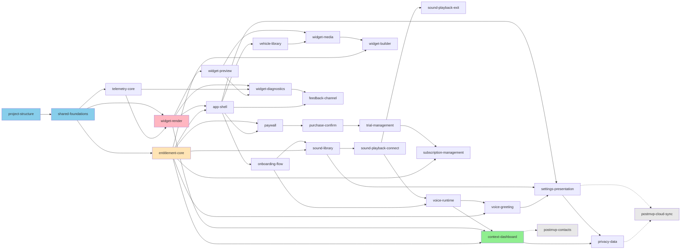

# Carbina: Car Dashboard & Widgets — Project Implementation Roadmap

**Version**: 2.4
**Snapshot Date**: 2026-08-07 (đồng bộ toàn bộ 6 tài liệu upstream)
**Ngày tạo file**: 2026-08-17
**Author**: AI Research Agent
**Status**: Draft — chờ PO review

---

## Overview

| Property | Value |
|---|---|
| Project | `carplay-ai` (sản phẩm: **Carbina**) |
| Total Specs | **27** (25 MVP 1 + 2 Deferred) |
| Total Phases | **11** (10 phase MVP 1 + 1 phase Deferred) |
| Target Duration | **28 ngày làm việc** cho MVP 1 (≈ 5,5 tuần code) — khớp cửa sổ 12 tuần của PRD §15 sau khi trừ QA/TestFlight/submission |
| Screens covered | **30/30** WF-001 → WF-030, mỗi màn thuộc **đúng một** spec |
| FRs covered | **66/66** FR-001 → FR-066 |
| UCs covered | **36/36** UC-001 → UC-036 |
| Generated | 2026-08-17 |
| Upstream | `PRD.md` v2.4 · `Project_Overview.md` v2.4 · `Use_Cases.md` v2.4 · `Functional_Requirements.md` v2.4 (+7 sub-spec) · `Wireframes.md` v2.4 · `UX_Flows.md` v2.4 |

**Ba loại spec trong roadmap này** — phân biệt vì chúng có quy tắc sở hữu màn hình khác nhau:

| Loại | Sở hữu màn hình? | Spec |
|---|---|---|
| `infra` | Không | `project-structure`, `shared-foundations` |
| `core-service` | Không — là **hành vi nền** hoặc service dùng chung; màn hình nơi hành vi diễn ra do spec khác sở hữu, có con trỏ tường minh | `telemetry-core`, `sound-playback-connect`, `sound-playback-exit`, `voice-runtime`, `entitlement-core`, `feedback-channel` |
| `feature` | **Có** — mỗi màn hình thuộc đúng một spec loại này | 17 spec MVP 1 + 2 Deferred |

---

## Scope Decision Record

Nguồn chân lý **duy nhất** về phạm vi. Mọi nhãn priority ở `PRD.md`, `Project_Overview.md` §4, `Use_Cases.md` §7 và `Functional_Requirements.md` §1.3 đều theo đúng legend này.

| Tier | Nhãn UC / Overview | Nhãn FR | Code | Trong MVP 1? |
|---|---|---|---|---|
| **Tier 1** | Must-Have | High | P0 | **Có** |
| **Tier 2** | Should-Have | Medium | P1 | Không (Post-MVP) |
| **Tier 3** | Could-Have / Nice-to-Have | Low | P2 | Không (Future) |

### MVP definition

**MVP 1 = 34 UC + 63 FR:**
- **UC**: UC-001 → UC-033 và UC-036 *(34 UC)*
- **FR**: FR-001 → FR-062 và FR-066 *(63 FR)*
- **WF**: WF-001 → WF-014, WF-016 → WF-030 *(29 màn hình)*

**Ngoài MVP 1:**
| ID | Giai đoạn | Lý do |
|---|---|---|
| UC-034, FR-063 | MVP 2 (12/2026) | Contacts Shortcuts — có nhu cầu thật (persona Jordan) nhưng ngoài ba trụ PMF đã kiểm chứng |
| UC-035, FR-064, FR-065, **WF-015** | MVP 3 (03/2027) | Cloud sync — cần backend thật; bắt tạo tài khoản làm giảm conversion (PRD §14) |

### Scope rules (được `gate-roadmap` cưỡng chế)

1. Một spec/phase thuộc MVP **iff** mọi UC/FR nó phủ là Tier 1 — **hoặc** được ghi tường minh ở **Scope Promotions** bên dưới.
2. **Dependency rule**: nếu một flow Tier 1 phụ thuộc một UC như **đường phục hồi / critical path**, UC đó **phải** là Tier 1. Một UC nằm trên đường phục hồi **không được** là Post-MVP khi flow của nó là MVP.
3. Mọi sai lệch so với nhãn ở UC/FR phải ghi ở Scope Promotions.

### Scope Promotions (sai lệch so với nhãn UC/FR, kèm lý do)

**Nhóm A — Bắt buộc theo Dependency rule (đường phục hồi của flow MVP)**

| UC/FR | Tier gốc | Promote lên | Lý do |
|---|---|---|---|
| **UC-003**, FR-006 | Tier 2 (Medium) | **Tier 1** | Đường phục hồi của UC-002 trong **J1** (flow MVP): thư viện xe thiếu model là tình huống chắc chắn xảy ra; không có nó thì onboarding bị chặn cứng |
| **UC-017**, FR-032 | Tier 2 (Medium) | **Tier 1** | Đường phục hồi của **J4** — hành trình xử lý R-11, rủi ro `High/High` của dự án. Không có chẩn đoán thì lỗi render không đo được trong 24h |
| **UC-028**, FR-052 | Tier 2 (Medium) | **Tier 1** | Đường phục hồi của **J6**: người dùng phải được nhắc **trước khi bị trừ tiền**. Không có nó là nguyên nhân trực tiếp của chargeback (R-12) |
| **UC-029**, FR-053 | Tier 2 (Medium) | **Tier 1** | Đường huỷ của **J6**. Đường huỷ khó tìm là nguyên nhân người dùng gọi app khác là scam (R-12) |
| **UC-033**, FR-059, FR-060 | Tier 2 (Medium) | **Tier 1** | Cơ chế phân luồng phản hồi — bảo vệ trực tiếp KPI **Recent 1★ Ratio < 15%** (PRD §12). Đây là KPI dẫn, không phải tính năng phụ |

**Nhóm B — Bắt buộc vì là lớp phòng vệ rủi ro, không phải tính năng bán được**

| UC/FR | Tier gốc | Promote lên | Lý do |
|---|---|---|---|
| FR-008 *(UC-005 đã Tier 1)* | High — **không cần promote**, ghi lại để nhấn mạnh | Tier 1 | Dùng được khi từ chối mọi quyền. Cắt đi là bỏ tín hiệu tin cậy trong niche rating 2,2/5 |
| FR-031 *(UC-016 đã Tier 1)* | High — không cần promote | Tier 1 | Fallback khi render lỗi. **0 màn trắng** là điều kiện chặn phát hành (NFR-020) |
| FR-044 *(UC-024 đã Tier 1)* | High — không cần promote | Tier 1 | Gói Free — cơ chế lọc rủi ro R-11/R-04, và là điểm khác biệt hóa số 1 |
| FR-066 | Tier 2 (Medium) | **Tier 1** | `widget_render_failed` và `refund_detected` **bắt buộc hoạt động từ build TestFlight đầu tiên** (BR-066.1). Telemetry là cơ chế phát hiện sớm R-11/R-12, không phải việc làm sau |

**Nhóm C — Trong MVP 1 nhưng là nhóm cắt trước nhất nếu buộc phải cắt**

| UC/FR | Tier | Ghi chú |
|---|---|---|
| UC-008, FR-014 | Tier 2 | Sound Disconnect/Arrive — onboarding chỉ hỏi sound Connect; hai sự kiện kia là mở rộng |
| UC-014, FR-027, FR-028 | Tier 2 | Ảnh cá nhân cho widget — ảnh xe theo model đã đủ dùng |
| UC-019, FR-034, FR-035 | Tier 2 | Chọn nguồn ngữ cảnh — có thể mặc định bật hết ở bản đầu |
| UC-030, FR-054 | Tier 2 | Gói Lifetime — Monthly/Yearly đã đủ để validate monetization |
| UC-031, FR-055, FR-056, FR-039 | Tier 2 | Localize ES/PT-BR — **cảnh báo**: cắt cái này là bỏ 14,6% user base LATAM (PRD §6) |
| UC-032, FR-057, FR-058 | Tier 2 | Xoá dữ liệu on-device — **cảnh báo**: liên quan cam kết GDPR/CCPA ở PRD §9 |
| UC-036, FR-061 | Tier 2 | Đổi theme |
| FR-003 | Tier 2 | Phục hồi giao dịch — **cảnh báo**: cắt sẽ tạo review 1★ từ người đã mua rồi cài lại |
| FR-015 | Tier 1 (High) | Âm lượng độc lập — không cắt, là AC của F1 |
| FR-062 | Tier 2 | Lối vào quyền từ Settings |

> **Quy tắc cắt phạm vi**: mọi lần cắt phải cập nhật bảng Nhóm C **kèm tier và lý do**, không được cắt im lặng. Bốn mục có chữ **cảnh báo** ở trên có hệ quả vượt ra ngoài phạm vi tính năng (thị trường LATAM, tuân thủ pháp lý, review sau khi mua) — cắt chúng cần quyết định của PO, không phải của engineering.

### Kiểm nhất quán phạm vi

| Phép kiểm | Kết quả |
|---|---|
| Nhãn priority khớp giữa `Use_Cases` §7, `Functional_Requirements` §1.3, `Project_Overview` §4 | **Pass** — cùng legend Tier 1/2/3 |
| Spec trong phase MVP chỉ phủ UC/FR Tier 1 hoặc đã promote | **Pass** — 11 mục Tier 2 được promote ở Nhóm A và B; 15 mục Tier 2 còn lại nằm trong MVP 1 và được ghi ở Nhóm C |
| Dependency rule: UC recovery/critical path của flow MVP là Tier 1 | **Pass** — 5 UC được promote ở Nhóm A |
| MVP definition có danh sách ID rõ ràng | **Pass** — 34 UC · 63 FR · 29 WF liệt kê ở trên |

---

## Project Structure

> **Chỉ thư mục và tên file. Không có dòng code nào.** Cấu trúc theo `Project_Overview.md` §3.3 Quyết định 7 và `ios-architecture` skill.

### Directories

```
Carbina/
├── App/
├── Core/
│   ├── CarPlay/
│   ├── ML/
│   ├── Audio/
│   ├── Entitlement/
│   ├── Analytics/
│   ├── Persistence/
│   ├── Extensions/
│   └── Utilities/
├── Features/
│   ├── Onboarding/
│   │   ├── Views/
│   │   ├── ViewModels/
│   │   ├── Models/
│   │   └── Services/
│   ├── Home/
│   │   ├── Views/
│   │   ├── ViewModels/
│   │   └── Models/
│   ├── SoundLibrary/
│   │   ├── Views/
│   │   ├── ViewModels/
│   │   ├── Models/
│   │   └── Services/
│   ├── WidgetBuilder/
│   │   ├── Views/
│   │   ├── ViewModels/
│   │   ├── Models/
│   │   └── Services/
│   ├── VoiceGreeting/
│   │   ├── Views/
│   │   ├── ViewModels/
│   │   └── Models/
│   ├── Paywall/
│   │   ├── Views/
│   │   ├── ViewModels/
│   │   └── Models/
│   ├── Settings/
│   │   ├── Views/
│   │   ├── ViewModels/
│   │   └── Models/
│   ├── Diagnostics/
│   │   ├── Views/
│   │   ├── ViewModels/
│   │   └── Models/
│   └── CarPlayDashboard/
│       ├── Views/
│       ├── ViewModels/
│       └── Models/
├── CarbinaWidget/
├── shared/
│   ├── Components/
│   │   ├── Buttons/
│   │   ├── Cards/
│   │   ├── Rows/
│   │   ├── Inputs/
│   │   ├── Feedback/
│   │   └── CarPlay/
│   ├── Styles/
│   └── Modifiers/
├── Resources/
│   ├── Assets.xcassets/
│   ├── Sounds/
│   ├── VehicleImages/
│   ├── GreetingVariants/
│   ├── en.lproj/
│   ├── es.lproj/
│   └── pt-BR.lproj/
└── Tests/
    ├── CoreTests/
    ├── CarPlayLayoutTests/
    └── FeatureTests/
```

### Files

| Path | Type |
|---|---|
| `App/CarbinaApp.swift` | entry |
| `App/AppDelegate.swift` | app lifecycle |
| `App/CarPlaySceneDelegate.swift` | scene delegate |
| `App/AppRouter.swift` | routing |
| `App/Info.plist` | config |
| `App/Carbina.entitlements` | config (App Group) |
| `CarbinaWidget/CarbinaWidgetBundle.swift` | widget entry |
| `CarbinaWidget/Info.plist` | config |
| `CarbinaWidget/CarbinaWidget.entitlements` | config (App Group) |
| `shared/Styles/AppColors.swift` | style |
| `shared/Styles/AppFonts.swift` | style |
| `shared/Styles/AppSpacing.swift` | style |
| `shared/Styles/AppShadows.swift` | style |
| `shared/Styles/AppMotion.swift` | style |
| `Core/CarPlay/CarPlayLayoutTokens.swift` | tokens |
| `Core/Persistence/AppGroupBridge.swift` | infra |
| `Core/Persistence/SQLiteStore.swift` | infra |
| `Core/Analytics/AnalyticsService.swift` | service |
| `Core/Analytics/EventSchema.swift` | model |
| `Resources/Assets.xcassets` | assets |
| `Resources/en.lproj/Localizable.strings` | resource |
| `Resources/es.lproj/Localizable.strings` | resource |
| `Resources/pt-BR.lproj/Localizable.strings` | resource |
| `Tests/CarPlayLayoutTests/LayoutPropertyTests.swift` | test |
| `Carbina.xcodeproj` | project |

---

## Phase Timeline

| Phase | Specs | Duration | Entry Criteria | Deliverables | Exit Criteria |
|---|---|---|---|---|---|
| **P1: Project Structure** | `project-structure` | 1 ngày | Roadmap được PO phê duyệt · 10 vai trò ở PRD đã phân công người *(rủi ro C ở Overview §8)* | Cây thư mục đầy đủ · 2 target (app + widget) · App Group cấu hình xong · Xcode project build rỗng | `xcodebuild` thành công 0 warning · App Group đọc/ghi được từ cả 2 target |
| **P2: Shared Foundations** | `shared-foundations`, `telemetry-core` | 2 ngày | P1 xong | 5 file style từ token Bento · `shared/Components/` khung · `AppGroupBridge` · `SQLiteStore` · `AnalyticsService` + 28 event schema | 0 warning · `widget_render_failed` và `refund_detected` **gửi được từ build này** (BR-066.1) · token không hardcode |
| **P3: CarPlay Render Engine + Entitlement** | `widget-render`, `entitlement-core` | 4 ngày | P2 xong · **test matrix ≥4 kích thước + 1 xe thật/nhóm đã chốt** (R-11) | Layout engine đọc `CPTemplateApplicationScene` bounds runtime · giảm cấp 3 vòng · WF-017 + WF-019 · `EntitlementService` + cấu hình Free | **Property-based test pass với mọi cặp (w,h) hợp lệ** (AC-NFR-024.3) · grep 0 hằng số kích thước · widget ≤ 25MB · 0 vùng trắng ở ma trận lỗi |
| **P4: App Shell + Onboarding** | `app-shell`, `onboarding-flow`, `vehicle-library` | 4 ngày | P3 xong | WF-001, WF-002, WF-003, WF-005, WF-006, WF-021, WF-022, WF-030 · tab bar 4 tab · router | Onboarding ≤ 120s · thoát giữa luồng vào lại đúng bước · **0 paywall trong onboarding** · tìm kiếm xe ≤ 200ms offline |
| **P5: Sound** | `sound-library`, `sound-playback-connect`, `sound-playback-exit` | 3 ngày | P4 xong | WF-004, WF-007, WF-020 · ducking 20% · định tuyến loa xe · chống phát trùng | Sound Connect ≤ 1,5s · Disconnect lệch ≤ 1s · `output_route` ghi giá trị thật · **không phát bù qua loa iPhone** |
| **P6: Widget Builder** | `widget-preview`, `widget-media`, `widget-builder` | 3 ngày | P5 xong (dùng lại engine của P3) | WF-008, WF-023, WF-024 · preview theo tỉ lệ thật · crop + nén ≤ 2MB | ≥3 preset gợi ý theo xe · **0 canvas rỗng** · ảnh sau nén ≤ 2MB · cảnh báo vượt vùng nêu **tên phần tử** |
| **P7: AI Context** | `voice-runtime`, `voice-greeting`, `context-dashboard` | 4 ngày | P6 xong · **prototype Core ML đã có từ tuần 1** (R-01) | WF-009, WF-016, WF-018 · ContextEngine on-device · TTS · sắp xếp thẻ | Giọng chào ≤ 2s · **0 lệnh gọi mạng** trong đường ngữ cảnh (test chế độ máy bay) · ≥4 biến thể/ngôn ngữ · crossfade 0,4s throttle 30s |
| **P8: Monetization** | `paywall`, `purchase-confirm`, `trial-management` | 3 ngày | P7 xong · **Small Business Program 15% đã đăng ký** | WF-010, WF-011, WF-013 · StoreKit 2 · trial 7 ngày | **0 bậc weekly** · giá chỉ từ `Product.displayPrice` · **1 điểm gọi purchase duy nhất, sau WF-011** · nút huỷ ngang hàng nút mua |
| **P9: Settings & Subscription** | `settings-presentation`, `subscription-management`, `privacy-data` | 3 ngày | P8 xong | WF-012, WF-025, WF-026, WF-027, WF-029 · 3 ngôn ngữ · theme · xoá dữ liệu | Đường huỷ ≤ 3 chạm từ WF-012 · 0 khoá dịch chưa dịch ở cả 3 ngôn ngữ · xoá dữ liệu học **không** ảnh hưởng entitlement |
| **P10: Diagnostics & Feedback** | `widget-diagnostics`, `feedback-channel` | 2 ngày | P9 xong | WF-014, WF-028 · phân luồng phản hồi | Kích thước scene hiện **giá trị thật** · payload **0 PII** (rà bằng proxy) · **chặn** mời đánh giá khi có lỗi render trong 7 ngày |
| **P11: Post-MVP** *(Deferred)* | `postmvp-contacts`, `postmvp-cloud-sync` | *(MVP 2: 3 ngày · MVP 3: 5 ngày)* | MVP 1 đã launch · **điểm quyết định R-14 tháng 3 đã có kết luận** | WF-015 + màn chọn favorite (MVP 2) | Không thuộc phạm vi MVP 1 |

**Tổng MVP 1: P1 → P10 = 29 ngày làm việc** *(1+2+4+4+3+3+4+3+3+2)*.

### Estimation Assumptions

Roadmap này là **nguồn duy nhất về effort**. `Use_Cases.md` chỉ mang priority + complexity, **không** mang số ngày.

| Giả định | Giá trị | Nguồn |
|---|---|---|
| Parallel developers | **2 iOS dev** | PRD §15 "Participants" |
| AI-assisted coding | **Có** | Đội dùng Claude Code cho pipeline này |
| 1 ngày = | **6 giờ engineering lý tưởng** (không tính họp, review, ngắt) | — |
| Buffer / contingency | **25%** đã cộng vào từng phase | Rủi ro R-01, R-11 đều `High` |
| Không tính vào 29 ngày | QA theo test matrix · TestFlight beta · chuẩn bị metadata · App Review | PRD §15 Phase 3 (tuần 7–12) |
| Đối chiếu với PRD §15 | 29 ngày code ≈ **5,8 tuần** ⇔ PRD dành **tuần 3–6 cho iOS development** + phần tuần 1–2 cho prototype. **Khớp**, với điều kiện prototype layout engine (P3) và Core ML (P7) được bắt đầu ở tuần 1–2 song song | — |
| Phase dài nhất | P3 và P4 và P7 (4 ngày) | P3 vì là rủi ro cao nhất; P7 vì on-device ML |
| Không có phase nào | > 3 spec | Quy tắc skill |

---

## Feature→Screen Mapping

Mỗi **WF-XXX thuộc đúng một** spec loại `feature`. Spec `infra` và `core-service` **không sở hữu màn hình** — cột "Screens" của chúng là `N/A` kèm con trỏ tới màn hình nơi hành vi diễn ra.

| Feature Spec | Type | Screens (WF) | Archetype | Source FR section |
|---|---|---|---|---|
| `project-structure` | infra | N/A | — | — |
| `shared-foundations` | infra | N/A | — | — |
| `telemetry-core` | core-service | N/A → hành vi nền, hiển thị ở WF-014/WF-028 *(do `widget-diagnostics` sở hữu)* | — | `FR_settings_privacy` |
| `app-shell` | feature | **WF-001** (Splash · Consumption) · **WF-006** (Home · Management/Dense) · **WF-030** (Toast · Consumption) | Consumption + Management | `FR_onboarding` (FR-009) |
| `onboarding-flow` | feature | **WF-002** (Welcome · Discovery) · **WF-005** (Cấp quyền · Action) · **WF-022** (Sheet lý do quyền · Consumption) | Discovery + Action | `FR_onboarding` |
| `vehicle-library` | feature | **WF-003** (Chọn xe · Action/Medium) · **WF-021** (Sheet thiếu xe · Action/Light) | Action | `FR_onboarding` |
| `sound-library` | feature | **WF-004** (Chọn âm thanh · Discovery) · **WF-007** (Thư viện âm thanh · Discovery/Dense) · **WF-020** (Sheet nghe thử · Consumption) | Discovery | `FR_sound` |
| `sound-playback-connect` | core-service | N/A → hành vi nền trên **WF-016** *(do `context-dashboard` sở hữu)* | — | `FR_sound` |
| `sound-playback-exit` | core-service | N/A → hành vi nền trên **WF-016** | — | `FR_sound` |
| `widget-render` | feature | **WF-017** (CarPlay Widget · Consumption/Light) · **WF-019** (Fallback lỗi · Consumption/Light) | Consumption | `FR_widget` |
| `widget-preview` | feature | **WF-023** (Modal preview · Consumption/Medium) | Consumption | `FR_widget` |
| `widget-media` | feature | **WF-024** (Sheet chọn ảnh · Action/Medium) | Action | `FR_widget` |
| `widget-builder` | feature | **WF-008** (Trình tạo widget · Management/Dense) | Management | `FR_widget` |
| `widget-diagnostics` | feature | **WF-014** (Chẩn đoán · Management/Medium) · **WF-028** (Sheet gửi báo cáo · Action/Medium) | Management + Action | `FR_widget` |
| `voice-runtime` | core-service | N/A → hành vi nền trên **WF-016** | — | `FR_voice_dashboard` |
| `voice-greeting` | feature | **WF-009** (Cài đặt giọng chào · Action/Medium) | Action | `FR_voice_dashboard` |
| `context-dashboard` | feature | **WF-016** (CarPlay Dashboard · Discovery/Medium) · **WF-018** (Trạng thái Free · Consumption/Light) | Discovery + Consumption | `FR_voice_dashboard` |
| `entitlement-core` | core-service | N/A → gate hiển thị ở WF-006/007/008/009/010/016/018 | — | `FR_monetization` |
| `paywall` | feature | **WF-010** (Paywall · Action/Medium) | Action | `FR_monetization` |
| `purchase-confirm` | feature | **WF-011** (Xác nhận giá · Action/Light) | Action | `FR_monetization` |
| `trial-management` | feature | **WF-013** (Nhắc hết trial · Action/Light) | Action | `FR_monetization` |
| `subscription-management` | feature | **WF-025** (Sheet đăng ký · Management/Medium) · **WF-027** (Alert huỷ · Action/Light) | Management + Action | `FR_monetization` |
| `settings-presentation` | feature | **WF-012** (Cài đặt chung · Management/Dense) · **WF-026** (Sheet ngôn ngữ · Action/Light) | Management + Action | `FR_settings_privacy` |
| `privacy-data` | feature | **WF-029** (Alert xoá dữ liệu · Action/Light) | Action | `FR_settings_privacy` |
| `feedback-channel` | core-service | N/A → hiển thị ở **WF-030** *(`app-shell`)* và **WF-028** *(`widget-diagnostics`)*, có con trỏ ở §Affordance Ownership | — | `FR_settings_privacy` |
| `postmvp-contacts` *(Deferred)* | feature | Màn chọn favorite **chưa có WF-ID** (sẽ cấp ở MVP 2) → defer thẻ liên hệ trên **WF-016** | Action | `FR_postmvp` |
| `postmvp-cloud-sync` *(Deferred)* | feature | **WF-015** (Account · Management/Light) | Management | `FR_postmvp` |

**Kiểm tra sở hữu màn hình**: 30/30 WF được sở hữu bởi **đúng một** spec `feature`. Không màn hình mồ côi, không màn hình bị hai spec cùng nhận.

### Affordance Ownership — affordance nằm trên màn hình của spec khác

Theo quy tắc `gate-roadmap`: mọi Component/Interaction phải nằm trong spec sở hữu screen đó, **hoặc** defer có con trỏ tới spec khác + FR. Bảng dưới là **danh sách đầy đủ** các trường hợp defer.

| Affordance | Nằm trên screen (spec sở hữu) | Spec thực thi | FR |
|---|---|---|---|
| Thẻ widget đang dùng + chạm để đổi | WF-006 (`app-shell`) | `widget-builder` | FR-021 |
| `WarningRow` cảnh báo tương thích | WF-006 (`app-shell`) | `widget-render` | FR-031 |
| `StatusBadge` gói hiện tại | WF-006 (`app-shell`) | `entitlement-core` | FR-044 |
| `StatusBadge` "Trial còn N ngày" | WF-006 (`app-shell`) | `trial-management` | FR-051 |
| Thẻ sound (tóm tắt 3 sự kiện) | WF-006 (`app-shell`) | `sound-library` | FR-014 |
| Thẻ giọng chào (`StatusRow` chỉ đọc) | WF-006 (`app-shell`) | `voice-greeting` | FR-033 |
| Thẻ xe + "đổi" | WF-006 (`app-shell`) | `vehicle-library` | FR-004 |
| Thẻ "Hoàn tất thiết lập" | WF-006 (`app-shell`) | `onboarding-flow` | FR-002 |
| `ToastUndo` "Hoàn tác" 5s | WF-030 (`app-shell`) | `privacy-data` | FR-058 |
| `RatingPromptOverlay` (bộ chọn mức hài lòng) | WF-030 (`app-shell`) | `feedback-channel` | FR-059 |
| `ToastError` + [Thử lại] | WF-030 (`app-shell`) | spec gây ra lỗi tương ứng | FR-022, FR-032, FR-049 |
| Biến thể "không hài lòng" (ô ghi chú nhấn mạnh) | WF-028 (`widget-diagnostics`) | `feedback-channel` | FR-060 |
| Nút "Cấp quyền Vị trí" (Variant A) | WF-007 (`sound-library`) | `onboarding-flow` | FR-007 |
| Nút "Cấp quyền" ở dòng nguồn thiếu quyền | WF-009 (`voice-greeting`) | `onboarding-flow` | FR-007, FR-035 |
| Preview widget nhúng ở Zone A | WF-008 (`widget-builder`) | `widget-preview` | FR-025 |
| "Xem widget ở kích thước này" | WF-014 (`widget-diagnostics`) | `widget-preview` | FR-025 |
| `LockLabel` trên preset/loại widget | WF-004, WF-007, WF-008, WF-024 | `entitlement-core` | FR-043, FR-023 |
| `CarPlayStaticUpsellLine` | WF-018 (`context-dashboard`) | `entitlement-core` | FR-044 |
| Hành vi nền sound Connect/Disconnect | WF-016 (`context-dashboard`) | `sound-playback-connect`, `sound-playback-exit` | FR-016 → FR-020 |
| Hành vi nền giọng chào | WF-016 (`context-dashboard`) | `voice-runtime` | FR-037, FR-038, FR-039 |
| Thẻ liên hệ 1 chạm *(MVP 2)* | WF-016 (`context-dashboard`) | `postmvp-contacts` | FR-063 |
| Dòng "Tài khoản" *(MVP 3)* | WF-012 (`settings-presentation`) | `postmvp-cloud-sync` | FR-064 |
| Tab bar 4 tab · nút back · nút đóng · drag indicator · lối tắt ⚙ | mọi màn | `app-shell` (định nghĩa ở `UX_Flows.md` §4) | FR-009 |
| Ghi 28 event analytics | mọi màn | `telemetry-core` | FR-066 |

**Kết quả**: 24 affordance nằm trên màn hình của spec khác, **tất cả đều có con trỏ tới spec thực thi + FR**. **0 affordance không có chủ.**

### Cơ chế dùng chung — định nghĩa một nơi duy nhất

Theo `gate-roadmap`: cơ chế dùng chung phải định nghĩa **duy nhất một nơi**, spec khác tham chiếu — cấm mâu thuẫn chéo.

| Cơ chế | Định nghĩa **duy nhất** ở | Spec tham chiếu | Giá trị chốt |
|---|---|---|---|
| **Số bậc giá** | `paywall` (FR-046) | `purchase-confirm`, `trial-management`, `subscription-management`, `entitlement-core` | **Đúng 4 bậc**: Free · Monthly $4,99 · Yearly $29,99 · Lifetime $49,99. **Không có weekly** |
| **Huỷ đăng ký** | `subscription-management` (FR-053) | `trial-management` (WF-013 nút "Huỷ trial" trỏ về đây) | Huỷ thực hiện qua **trang subscription của iOS**, không phải in-app, không phải deep-link riêng. Đường huỷ **≤ 3 chạm** từ WF-012 |
| **Phục hồi giao dịch** | `entitlement-core` (FR-003) | `onboarding-flow` (WF-002), `paywall` (WF-010), `subscription-management` (WF-025) | Một hàm duy nhất `restorePurchases()`; 3 điểm khởi phát cùng gọi nó |
| **Cấu hình gói Free** | `entitlement-core` (FR-044) | `sound-library`, `widget-builder`, `context-dashboard`, `paywall` | **1 widget đầy đủ chức năng + 3 sound preset + dashboard 3 thẻ** (nhạc · thời tiết · 1 shortcut) |
| **Layout engine CarPlay** | `widget-render` (FR-029) | `widget-preview` (WF-023 dùng **cùng engine**), `context-dashboard` (WF-016 layout) | Đọc `CPTemplateApplicationScene` bounds tại runtime; **0 hằng số kích thước** |
| **Chính sách nhường phiên audio** | `sound-playback-connect` (FR-017) | `sound-playback-exit`, `voice-runtime` | Cuộc gọi → bỏ hẳn lượt, **không phát bù**; chỉ dẫn dẫn đường → chờ ≤ 3s |
| **28 event schema** | `telemetry-core` (FR-066) | mọi spec | Whitelist tham số; **0 PII** |
| **Design token** | `shared-foundations` | mọi spec | `bento-grid` · 5 file style ở `shared/Styles/` |
| **App Group container** | `shared-foundations` | `widget-render`, `widget-builder`, `sound-library`, `settings-presentation` | `AppGroupBridge` là **lối duy nhất** đọc/ghi giữa app và widget extension |

---

## Spec Registry

### Phase 1: Project Structure

| Spec ID | Status | Priority | Depends On | Summary | Screens (WF) | Files Created | Key Functions / Components | Covers (FR, UC, WF) |
|---|---|---|---|---|---|---|---|---|
| `project-structure` | pending | 1 | None | Dựng cây thư mục, 2 target (app + widget extension), App Group, Xcode project | N/A | `Carbina.xcodeproj`, `App/CarbinaApp.swift`, `App/AppDelegate.swift`, `App/Info.plist`, `App/Carbina.entitlements`, `CarbinaWidget/CarbinaWidgetBundle.swift`, `CarbinaWidget/Info.plist`, `CarbinaWidget/CarbinaWidget.entitlements` | `CarbinaApp`, `AppDelegate` | N/A (infra) |

### Phase 2: Shared Foundations

| Spec ID | Status | Priority | Depends On | Summary | Screens (WF) | Files Created | Key Functions / Components | Covers (FR, UC, WF) |
|---|---|---|---|---|---|---|---|---|
| `shared-foundations` | pending | 2 | `project-structure` | 5 file style từ token Bento · khung `shared/Components/` · `AppGroupBridge` · `SQLiteStore` | N/A | `shared/Styles/AppColors.swift`, `AppFonts.swift`, `AppSpacing.swift`, `AppShadows.swift`, `AppMotion.swift`, `Core/Persistence/AppGroupBridge.swift`, `Core/Persistence/SQLiteStore.swift`, `shared/Components/**` | `AppColors`, `AppFonts`, `AppSpacing`, `AppShadows`, `AppMotion`, `AppGroupBridge.read(_:)`, `AppGroupBridge.write(_:)`, `SQLiteStore.migrate()` | N/A (infra) |
| `telemetry-core` | pending | 3 | `shared-foundations` | 28 event schema · whitelist tham số · lọc PII · cảnh báo Render Success < 90% · nhận App Store Server Notification | N/A → hiển thị ở WF-014/WF-028 | `Core/Analytics/AnalyticsService.swift`, `Core/Analytics/EventSchema.swift`, `Core/Analytics/RefundWebhookHandler.swift`, `Core/Analytics/RenderSuccessMonitor.swift` | `AnalyticsService.log(_:params:)`, `EventSchema.validate(_:)`, `stripPII(_:)`, `RenderSuccessMonitor.evaluateDaily()`, `RefundWebhookHandler.handle(_:)` | **FR-066** · UC-017, UC-026, UC-029, UC-032 |

### Phase 3: CarPlay Render Engine + Entitlement

| Spec ID | Status | Priority | Depends On | Summary | Screens (WF) | Files Created | Key Functions / Components | Covers (FR, UC, WF) |
|---|---|---|---|---|---|---|---|---|
| `widget-render` | pending | 4 | `shared-foundations`, `telemetry-core` | **Rủi ro cao nhất dự án.** Layout engine đọc scene bounds runtime · giảm cấp 3 vòng · fallback không vùng trắng | **WF-017**, **WF-019** | `Core/CarPlay/CarPlayLayoutTokens.swift`, `Core/CarPlay/WidgetRenderService.swift`, `Core/CarPlay/LayoutDegradationEngine.swift`, `Core/CarPlay/SafeAreaCalculator.swift`, `CarbinaWidget/CarPlayWidgetSurface.swift`, `Features/CarPlayDashboard/Views/CarPlayFallbackNoticeView.swift`, `Tests/CarPlayLayoutTests/LayoutPropertyTests.swift` | `WidgetRenderService.render(bounds:config:)`, `LayoutDegradationEngine.degrade(spec:in:)`, `SafeAreaCalculator.insets(for:)`, `CarPlayWidgetSurface`, `WidgetScrim`, `WidgetInfoLayer`, `CarPlayFallbackNotice` | **FR-029, FR-030, FR-031** · UC-015, UC-016 · WF-017, WF-019 |
| `entitlement-core` | pending | 5 | `shared-foundations` | Nguồn chân lý duy nhất về quyền · cấu hình gói Free · phục hồi giao dịch · chính sách paywall | N/A → gate ở 7 màn | `Core/Entitlement/EntitlementService.swift`, `Core/Entitlement/FreeTierConfig.swift`, `Core/Entitlement/StoreKitAdapter.swift`, `Core/Entitlement/RestorePurchases.swift` | `EntitlementService.current()`, `.allowance(for:)`, `.observeChanges()`, `FreeTierConfig.widgetLimit`, `StoreKitAdapter.currentEntitlements()`, `restorePurchases()` | **FR-003, FR-043, FR-044** · UC-001, UC-024, UC-029, UC-030 |

### Phase 4: App Shell + Onboarding

| Spec ID | Status | Priority | Depends On | Summary | Screens (WF) | Files Created | Key Functions / Components | Covers (FR, UC, WF) |
|---|---|---|---|---|---|---|---|---|
| `app-shell` | pending | 6 | `entitlement-core`, `widget-render` | Splash + định tuyến · Home hub · tab bar 4 tab · hệ thống Toast 4 biến thể | **WF-001**, **WF-006**, **WF-030** | `App/AppRouter.swift`, `Features/Home/Views/SplashView.swift`, `Features/Home/Views/HomeView.swift`, `Features/Home/ViewModels/HomeViewModel.swift`, `Features/Home/Models/HomeStatus.swift`, `shared/Components/Feedback/ToastOverlay.swift`, `shared/Components/Feedback/ToastVariants.swift`, `App/TabBarCustom.swift` | `AppRouter.route()`, `SplashView`, `HomeView`, `HomeViewModel.refreshStatus()`, `.clearWarningIfResolved()`, `HomeStatus`, `ToastConfirm`, `ToastUndo`, `ToastError`, `RatingPromptOverlay`, `TabBarCustom` | **FR-009** · UC-001 · WF-001, WF-006, WF-030 |
| `onboarding-flow` | pending | 7 | `app-shell` | 4 bước onboarding · lưu/phục hồi tiến trình · trình bày lý do quyền · suy giảm theo quyền | **WF-002**, **WF-005**, **WF-022** | `Features/Onboarding/Views/WelcomeView.swift`, `Features/Onboarding/Views/PermissionStepView.swift`, `Features/Onboarding/Views/PermissionRationaleSheet.swift`, `Features/Onboarding/ViewModels/OnboardingViewModel.swift`, `Features/Onboarding/Models/OnboardingProgress.swift`, `Features/Onboarding/Services/PermissionService.swift`, `Features/Onboarding/Services/CapabilityDowngradeService.swift` | `WelcomeView`, `PermissionStepView`, `PermissionRationaleSheet`, `OnboardingViewModel.advance()`, `.restoreProgress()`, `OnboardingProgress`, `PermissionService.request(_:)`, `.status(for:)`, `CapabilityDowngradeService.availableContextSources()` | **FR-001, FR-002, FR-007, FR-008** · UC-001, UC-004, UC-005, UC-019 · WF-002, WF-005, WF-022 |
| `vehicle-library` | pending | 8 | `app-shell` | Thư viện ≥40 hãng / ≥400 model on-device · picker 3 tầng · ảnh xe + fallback silhouette · gửi yêu cầu thêm xe | **WF-003**, **WF-021** | `Features/Onboarding/Views/VehiclePickerView.swift`, `Features/Onboarding/Views/VehicleRequestSheet.swift`, `Features/Onboarding/ViewModels/VehiclePickerViewModel.swift`, `Features/Onboarding/Models/Vehicle.swift`, `Features/Onboarding/Services/VehicleCatalogService.swift`, `Features/Onboarding/Services/VehicleImageResolver.swift`, `Features/Onboarding/Services/VehicleRequestQueue.swift` | `VehiclePickerView`, `PickerCascade`, `VehicleRequestSheet`, `VehiclePickerViewModel.search(_:)`, `.selectTier(_:)`, `Vehicle`, `VehicleCatalogService.makes()`, `.models(for:)`, `VehicleImageResolver.image(for:)`, `.silhouette(for:)`, `VehicleRequestQueue.enqueue(_:)` | **FR-004, FR-005, FR-006** · UC-002, UC-003 · WF-003, WF-021 |

### Phase 5: Sound

| Spec ID | Status | Priority | Depends On | Summary | Screens (WF) | Files Created | Key Functions / Components | Covers (FR, UC, WF) |
|---|---|---|---|---|---|---|---|---|
| `sound-library` | pending | 9 | `onboarding-flow`, `entitlement-core` | ≥12 preset, 3 ở Free · nghe thử inline + sheet · gán cho 3 sự kiện | **WF-004**, **WF-007**, **WF-020** | `Features/SoundLibrary/Views/SoundOnboardingView.swift`, `Features/SoundLibrary/Views/SoundLibraryView.swift`, `Features/SoundLibrary/Views/SoundPreviewSheet.swift`, `Features/SoundLibrary/ViewModels/SoundLibraryViewModel.swift`, `Features/SoundLibrary/Models/SoundPreset.swift`, `Features/SoundLibrary/Services/SoundCatalogService.swift`, `Features/SoundLibrary/Services/SoundPreviewPlayer.swift`, `shared/Components/Feedback/WaveformLive.swift` | `SoundOnboardingView`, `SoundLibraryView`, `SoundPreviewSheet`, `SoundLibraryViewModel.play(_:)`, `.assign(_:to:)`, `SoundPreset`, `SoundCatalogService.presets()`, `SoundPreviewPlayer.preview(_:ducking:)`, `WaveformLive` | **FR-010, FR-011, FR-012, FR-013, FR-014** · UC-006, UC-007, UC-008 · WF-004, WF-007, WF-020 |
| `sound-playback-connect` | pending | 10 | `sound-library` | Phát sound Connect + ducking 20% · chính sách nhường phiên audio · chống phát trùng 3s | N/A → nền trên WF-016 | `Core/Audio/AudioSessionService.swift`, `Core/Audio/ConnectSoundPlayer.swift`, `Core/Audio/AudioSessionPolicy.swift`, `Core/Audio/DuplicatePlaybackGuard.swift` | `AudioSessionService.configure(ducking:)`, `.routeToCarSpeaker()`, `ConnectSoundPlayer.playOnConnect()`, `AudioSessionPolicy.decide(for:)`, `DuplicatePlaybackGuard.shouldPlay(_:)` | **FR-016, FR-017, FR-018** · UC-010 |
| `sound-playback-exit` | pending | 11 | `sound-playback-connect` | Phát sound Disconnect/Arrive đúng thời điểm tắt máy · định tuyến loa xe · cấm phát bù | N/A → nền trên WF-016 | `Core/Audio/DisconnectSoundPlayer.swift`, `Core/Audio/OutputRouteResolver.swift` | `DisconnectSoundPlayer.playOnDisconnect()`, `.playOnArrive()`, `OutputRouteResolver.currentRoute()`, `.isCarSpeaker` | **FR-019, FR-020** · UC-011 |

### Phase 6: Widget Builder

| Spec ID | Status | Priority | Depends On | Summary | Screens (WF) | Files Created | Key Functions / Components | Covers (FR, UC, WF) |
|---|---|---|---|---|---|---|---|---|
| `widget-preview` | pending | 12 | `widget-render` | Preview theo tỉ lệ màn hình xe (thật hoặc ước lượng) · phát hiện + báo phần tử vượt vùng an toàn | **WF-023** | `Features/WidgetBuilder/Views/WidgetPreviewModal.swift`, `Features/WidgetBuilder/ViewModels/WidgetPreviewViewModel.swift`, `Features/WidgetBuilder/Models/ScreenRatio.swift`, `Features/WidgetBuilder/Services/OverflowDetector.swift` | `WidgetPreviewModal`, `WidgetPreviewFrame`, `RatioSourceLabel`, `RatioPager`, `OverflowWarningBanner`, `WidgetPreviewViewModel.ratios()`, `.selectRatio(_:)`, `ScreenRatio`, `OverflowDetector.detect(spec:in:)` | **FR-025, FR-026** · UC-013 · WF-023 |
| `widget-media` | pending | 13 | `widget-preview`, `vehicle-library` | Chọn ảnh xe theo model / ảnh cá nhân · crop theo tỉ lệ xe · kiểm độ phân giải · nén ≤ 2MB | **WF-024** | `Features/WidgetBuilder/Views/ImagePickerSheet.swift`, `Features/WidgetBuilder/ViewModels/ImagePickerViewModel.swift`, `Features/WidgetBuilder/Services/ImageCropService.swift`, `Features/WidgetBuilder/Services/ImageCompressionService.swift` | `ImagePickerSheet`, `ImageCropCanvas`, `ThumbCarousel`, `ResolutionWarningBanner`, `PermissionInfoBanner`, `ImagePickerViewModel.pick(_:)`, `ImageCropService.crop(_:to:)`, `ImageCompressionService.compress(_:maxBytes:)` | **FR-027, FR-028** · UC-014 · WF-024 |
| `widget-builder` | pending | 14 | `widget-media`, `entitlement-core` | Preset gợi ý theo xe (0 canvas rỗng) · lưu App Group ngay · giới hạn theo entitlement · ngưỡng iOS 17.4 | **WF-008** | `Features/WidgetBuilder/Views/WidgetBuilderView.swift`, `Features/WidgetBuilder/ViewModels/WidgetBuilderViewModel.swift`, `Features/WidgetBuilder/Models/WidgetConfig.swift`, `Features/WidgetBuilder/Models/WidgetPreset.swift`, `Features/WidgetBuilder/Services/WidgetConfigStore.swift`, `Features/WidgetBuilder/Services/WidgetAvailabilityChecker.swift` | `WidgetBuilderView`, `PresetCarousel`, `CardPresetWidget`, `LimitNotice`, `VersionNotice`, `WidgetBuilderViewModel.selectPreset(_:)`, `.save()`, `WidgetConfig`, `WidgetPreset`, `WidgetConfigStore.write(_:)`, `.readback()`, `WidgetAvailabilityChecker.isCarPlayWidgetSupported` | **FR-021, FR-022, FR-023, FR-024** · UC-012 · WF-008 |

### Phase 7: AI Context

| Spec ID | Status | Priority | Depends On | Summary | Screens (WF) | Files Created | Key Functions / Components | Covers (FR, UC, WF) |
|---|---|---|---|---|---|---|---|---|
| `voice-runtime` | pending | 15 | `sound-playback-connect`, `onboarding-flow` | ContextEngine on-device · sinh + phát giọng chào ≤2s · chống lặp · ràng buộc nội dung R-10 · theo ngôn ngữ | N/A → nền trên WF-016 | `Core/ML/ContextEngine.swift`, `Core/ML/GreetingVariantStore.swift`, `Core/ML/ContextModelLoader.swift`, `Core/Audio/GreetingSpeaker.swift`, `Core/ML/ContentPolicyFilter.swift` | `ContextEngine.selectGreeting(sources:)`, `.rankCards(history:)`, `GreetingVariantStore.variants(for:locale:)`, `ContextModelLoader.warmUp()`, `GreetingSpeaker.speak(_:locale:)`, `ContentPolicyFilter.validateAtBuildTime()` | **FR-037, FR-038, FR-039** · UC-021, UC-031 |
| `voice-greeting` | pending | 16 | `voice-runtime`, `entitlement-core` | Công tắc chính · 4 nguồn ngữ cảnh + ví dụ · chặn nguồn thiếu quyền · nghe thử sinh thật kèm chữ | **WF-009** | `Features/VoiceGreeting/Views/VoiceGreetingView.swift`, `Features/VoiceGreeting/ViewModels/VoiceGreetingViewModel.swift`, `Features/VoiceGreeting/Models/ContextSource.swift`, `Features/VoiceGreeting/Models/GreetingSettings.swift` | `VoiceGreetingView`, `RowToggleMain`, `CardGreetingProof`, `RowToggleContext`, `VoiceGreetingViewModel.previewGreeting()`, `.toggleSource(_:)`, `ContextSource`, `GreetingSettings` | **FR-033, FR-034, FR-035, FR-036** · UC-018, UC-019, UC-020 · WF-009 |
| `context-dashboard` | pending | 17 | `voice-runtime`, `widget-render`, `entitlement-core` | Sắp xếp thẻ theo ngữ cảnh on-device · crossfade 0,4s throttle 30s · cấu hình theo entitlement + offline · chạm thẻ | **WF-016**, **WF-018** | `Features/CarPlayDashboard/Views/CarPlayDashboardView.swift`, `Features/CarPlayDashboard/Views/CarPlayFreeStateView.swift`, `Features/CarPlayDashboard/ViewModels/DashboardViewModel.swift`, `Features/CarPlayDashboard/Models/DashboardCard.swift`, `Features/CarPlayDashboard/Services/CardActionRouter.swift`, `Features/CarPlayDashboard/Services/CardReorderThrottle.swift`, `shared/Components/CarPlay/CarPlayCards.swift` | `CarPlayDashboardView`, `CarPlayFreeStateView`, `DashboardViewModel.orderedCards()`, `.demote(_:)`, `DashboardCard`, `CardActionRouter.perform(_:)`, `CardReorderThrottle.shouldReorder()`, `CarPlayPriorityCard`, `CarPlayActionCard`, `CarPlayCardError`, `CarPlayCardLocked`, `CarPlayEdgeStatus`, `CarPlayStaticUpsellLine` | **FR-040, FR-041, FR-042** · UC-005, UC-022, UC-023 · WF-016, WF-018 |

### Phase 8: Monetization

| Spec ID | Status | Priority | Depends On | Summary | Screens (WF) | Files Created | Key Functions / Components | Covers (FR, UC, WF) |
|---|---|---|---|---|---|---|---|---|
| `paywall` | pending | 18 | `entitlement-core`, `app-shell` | 4 bậc giá từ StoreKit (không weekly) · chính sách hiển thị paywall · cấm giá cache | **WF-010** | `Features/Paywall/Views/PaywallView.swift`, `Features/Paywall/ViewModels/PaywallViewModel.swift`, `Features/Paywall/Models/PriceTier.swift`, `Features/Paywall/Services/PaywallPolicyService.swift`, `Features/Paywall/Services/PriceProvider.swift` | `PaywallView`, `PriceTierCard`, `CardContextUpsell`, `ComparisonTableExpandable`, `CardErrorInline`, `PaywallViewModel.tiers()`, `.select(_:)`, `PriceTier`, `PaywallPolicyService.mayPresent(trigger:daysSinceInstall:surface:)`, `PriceProvider.fetch()` | **FR-045, FR-046, FR-047** · UC-024, UC-025 · WF-010 |
| `purchase-confirm` | pending | 19 | `paywall` | Điểm chặn duy nhất trước giao dịch · 4 mốc · ghi `price_confirmed` trước dialog · xử lý StoreKit · Lifetime | **WF-011** | `Features/Paywall/Views/PriceConfirmView.swift`, `Features/Paywall/ViewModels/PriceConfirmViewModel.swift`, `Features/Paywall/Services/PurchaseService.swift`, `Features/Paywall/Services/TransactionReceiptSender.swift` | `PriceConfirmView`, `CardPriceConfirm`, `PriceConfirmViewModel.confirm()`, `PurchaseService.purchase(_:)`, `.verify(_:)`, `TransactionReceiptSender.send(_:)` | **FR-048, FR-049, FR-050, FR-054** · UC-026, UC-030 · WF-011 |
| `trial-management` | pending | 20 | `purchase-confirm` | Trial 7 ngày · badge đếm ngày kèm ngày trừ tiền · nhắc ngày 6/7 với 3 nút ngang hàng | **WF-013** | `Features/Paywall/Views/TrialReminderView.swift`, `Features/Paywall/ViewModels/TrialViewModel.swift`, `Features/Paywall/Models/TrialState.swift`, `Features/Paywall/Services/TrialReminderScheduler.swift` | `TrialReminderView`, `CardTrialSummary`, `TrialViewModel.daysRemaining()`, `.chargeDate()`, `TrialState`, `TrialReminderScheduler.scheduleDay6And7()` | **FR-051, FR-052** · UC-027, UC-028 · WF-013 |

### Phase 9: Settings & Subscription

| Spec ID | Status | Priority | Depends On | Summary | Screens (WF) | Files Created | Key Functions / Components | Covers (FR, UC, WF) |
|---|---|---|---|---|---|---|---|---|
| `settings-presentation` | pending | 21 | `app-shell`, `sound-library`, `voice-greeting` | Âm lượng sound độc lập · ngôn ngữ EN/ES/PT-BR + fallback · theme · lối vào trạng thái quyền | **WF-012**, **WF-026** | `Features/Settings/Views/SettingsView.swift`, `Features/Settings/Views/LanguagePickerSheet.swift`, `Features/Settings/ViewModels/SettingsViewModel.swift`, `Features/Settings/Models/AppPreferences.swift`, `Features/Settings/Services/LocalizationService.swift`, `Features/Settings/Services/ThemeService.swift`, `Core/Audio/SoundVolumeStore.swift` | `SettingsView`, `CardPlanStatus`, `RowSliderVolume`, `RowSegmentedTheme`, `MiniWidgetPreview`, `LanguagePickerSheet`, `RowSelectableLanguage`, `SettingsViewModel.setVolume(_:)`, `.setTheme(_:)`, `AppPreferences`, `LocalizationService.setLanguage(_:)`, `.fallbackString(for:)`, `ThemeService.apply(_:)`, `SoundVolumeStore.value` | **FR-015, FR-055, FR-056, FR-061, FR-062** · UC-009, UC-031, UC-036, UC-004 · WF-012, WF-026 |
| `subscription-management` | pending | 22 | `trial-management`, `entitlement-core` | Trạng thái đăng ký · huỷ ≤3 chạm · alert nêu ngày hết quyền + cấu hình được giữ · Lifetime không có nút huỷ | **WF-025**, **WF-027** | `Features/Paywall/Views/SubscriptionSheet.swift`, `Features/Paywall/Views/CancelConfirmAlert.swift`, `Features/Paywall/ViewModels/SubscriptionViewModel.swift`, `Features/Paywall/Services/SubscriptionStatusService.swift` | `SubscriptionSheet`, `CardSubscriptionStatus`, `FeatureListExpandable`, `DoubleChargeWarning`, `CancelConfirmAlert`, `SubscriptionViewModel.status()`, `.cancel()`, `SubscriptionStatusService.renewalDate()`, `.openSystemSubscriptionPage()` | **FR-053** · UC-029 · WF-025, WF-027 |
| `privacy-data` | pending | 23 | `settings-presentation`, `context-dashboard` | Liệt kê dữ liệu on-device · xoá dữ liệu học · tách xoá học khỏi xoá cấu hình · Hoàn tác 5s | **WF-029** | `Features/Settings/Views/DataDeletionAlert.swift`, `Features/Settings/ViewModels/PrivacyViewModel.swift`, `Features/Settings/Services/DataDeletionService.swift` | `DataDeletionAlert`, `DataLossList`, `DataKeptList`, `RowSecondaryDestructive`, `PrivacyViewModel.dataSummary()`, `DataDeletionService.deleteLearningData()`, `.deleteLearningAndConfig()`, `.undoWithin(seconds:)` | **FR-057, FR-058** · UC-032 · WF-029 |

### Phase 10: Diagnostics & Feedback

| Spec ID | Status | Priority | Depends On | Summary | Screens (WF) | Files Created | Key Functions / Components | Covers (FR, UC, WF) |
|---|---|---|---|---|---|---|---|---|
| `widget-diagnostics` | pending | 24 | `widget-render`, `telemetry-core`, `widget-preview` | Hiện kích thước scene **thật** · lịch sử kết nối + `failure_reason` · gửi báo cáo có tick chọn từng mục | **WF-014**, **WF-028** | `Features/Diagnostics/Views/DiagnosticsView.swift`, `Features/Diagnostics/Views/ReportSheet.swift`, `Features/Diagnostics/ViewModels/DiagnosticsViewModel.swift`, `Features/Diagnostics/Models/ConnectionRecord.swift`, `Features/Diagnostics/Services/DiagnosticsStore.swift`, `Features/Diagnostics/Services/ReportSubmitQueue.swift` | `DiagnosticsView`, `CardSceneMetrics`, `RowDiagnosticExpandable`, `CardEmptyGuide`, `ReportSheet`, `RowDataDisclosureExpandable`, `LabelNoPII`, `DiagnosticsViewModel.history()`, `.copyPayload()`, `ConnectionRecord`, `DiagnosticsStore.record(_:)`, `.clear()`, `ReportSubmitQueue.submit(_:)` | **FR-032** · UC-017, UC-013, UC-016 · WF-014, WF-028 |
| `feedback-channel` | pending | 25 | `widget-diagnostics`, `app-shell` | Mời đánh giá có điều kiện (chặn 7 ngày sau lỗi render) · phân luồng 👍 App Store / 👎 WF-028 | N/A → hiển thị ở WF-030, WF-028 | `Features/Settings/Services/RatingPromptPolicy.swift`, `Features/Settings/Services/FeedbackRouter.swift`, `Features/Settings/ViewModels/FeedbackViewModel.swift` | `RatingPromptPolicy.mayPrompt()`, `.recordDismissal()`, `FeedbackRouter.route(satisfaction:)`, `FeedbackViewModel.submitNote(_:)`, `SatisfactionPicker` | **FR-059, FR-060** · UC-033 |

### Phase 11: Post-MVP *(Deferred)*

| Spec ID | Status | Priority | Depends On | Summary | Screens (WF) | Files Created | Key Functions / Components | Covers (FR, UC, WF) |
|---|---|---|---|---|---|---|---|---|
| `postmvp-contacts` | deferred | 26 | `context-dashboard` | *(MVP 2)* 5 favorite + gọi một chạm từ dashboard | Màn chọn favorite (WF-ID cấp ở MVP 2) → defer thẻ trên WF-016 | `Features/CarPlayDashboard/Services/ContactsShortcutService.swift`, `Features/Settings/Views/FavoriteContactsView.swift` | `ContactsShortcutService.favorites()`, `.call(_:)`, `FavoriteContactsView` | **FR-063** · UC-034 |
| `postmvp-cloud-sync` | deferred | 27 | `settings-presentation`, `privacy-data` | *(MVP 3)* Đăng nhập email tuỳ chọn · đồng bộ **chỉ cấu hình** · xoá tài khoản | **WF-015** | `Features/Settings/Views/AccountView.swift`, `Features/Settings/ViewModels/AccountViewModel.swift`, `Features/Settings/Services/CloudSyncService.swift`, `Features/Settings/Services/AccountDeletionService.swift` | `AccountView`, `CardAccountStatus`, `SyncScopeTable`, `AccountViewModel.signIn(_:)`, `.toggleSync(_:)`, `CloudSyncService.push()`, `.resolveConflict(_:)`, `AccountDeletionService.deleteAccount()` | **FR-064, FR-065** · UC-035 · WF-015 |

**Kiểm tra Spec Registry**: 27/27 spec có mặt · 0 spec mồ côi · mọi spec `feature` liệt kê ≥1 WF · mọi spec `core-service`/`infra` ghi `N/A` kèm con trỏ · **không phase nào > 3 spec** · mọi spec (trừ 2 infra) trace tới ≥1 FR.

---

## File Breakdown

Đường dẫn dùng **cây thư mục thật** ở §Project Structure. Tên hàm/component là **tên thật sẽ tồn tại**, không phải placeholder.

### Phase 1: Project Structure

| File Path | Type | Key Functions / Components | Covers |
|---|---|---|---|
| `Carbina.xcodeproj` | project | 2 target: `Carbina`, `CarbinaWidget` | N/A |
| `App/CarbinaApp.swift` | entry | `CarbinaApp` (`@main`), `body` | N/A |
| `App/AppDelegate.swift` | app lifecycle | `AppDelegate.application(_:didFinishLaunchingWithOptions:)`, `.configurationForConnecting(_:)` | N/A |
| `App/CarPlaySceneDelegate.swift` | scene delegate | `CarPlaySceneDelegate.templateApplicationScene(_:didConnect:)`, `.didDisconnect(_:)` | N/A |
| `App/Info.plist` | config | `CPTemplateApplicationSceneSessionRoleApplication`, `UIBackgroundModes` | N/A |
| `App/Carbina.entitlements` | config | App Group `group.app.carbina.shared` | N/A |
| `CarbinaWidget/CarbinaWidgetBundle.swift` | widget entry | `CarbinaWidgetBundle` (`@main`) | N/A |
| `CarbinaWidget/Info.plist` | config | `NSExtension` | N/A |
| `CarbinaWidget/CarbinaWidget.entitlements` | config | App Group (cùng ID) | N/A |

### Phase 2: Shared Foundations

| File Path | Type | Key Functions / Components | Covers |
|---|---|---|---|
| `shared/Styles/AppColors.swift` | style | `AppColors.background`, `.surface`, `.accent`, `.onAccent`, `.border`, `.borderStrong`, `.semantic(_:)`, `.overlayScrim` | N/A |
| `shared/Styles/AppFonts.swift` | style | `AppFonts.h1…footnote`, `.stat`, `.monoData`, `.carplayTitle`, `.carplayMin` | N/A |
| `shared/Styles/AppSpacing.swift` | style | `AppSpacing.xs…xxxl`, `AppRadius.sm…full` | N/A |
| `shared/Styles/AppShadows.swift` | style | `AppShadows.elevation(_:)` | N/A |
| `shared/Styles/AppMotion.swift` | style | `AppMotion.smooth`, `.stiff`, `.normal`, `.carplayCrossfade`, `.haptic(_:)` | N/A |
| `Core/Persistence/AppGroupBridge.swift` | infra | `AppGroupBridge.read(_:)`, `.write(_:)`, `.containerURL`, `.readback(_:)` | N/A |
| `Core/Persistence/SQLiteStore.swift` | infra | `SQLiteStore.migrate()`, `.insert(_:)`, `.query(_:)` — lược đồ chừa sẵn bảng `trips` cho MVP 3 | N/A |
| `shared/Components/Buttons/BtnPrimary.swift` | component | `BtnPrimary`, `BtnSecondary`, `BtnTertiary`, `BtnDestructiveOutline` | N/A |
| `shared/Components/Cards/CardBase.swift` | component | `CardBase`, `CardCompactStatus` | N/A |
| `shared/Components/Rows/RowBase.swift` | component | `RowNavigable`, `RowSelectable`, `RowToggle` | N/A |
| `shared/Components/Inputs/TFField.swift` | component | `TFField`, `TFSearch`, `TFTextArea`, `SliderControl`, `SegmentedControl2`, `SegmentedControl3`, `ChipSegment` | N/A |
| `shared/Components/Feedback/NavBar.swift` | component | `NavBarStandard`, `NavBarModal`, `SheetContainer`, `AlertContainer`, `ProgressBarOnboard`, `StatusBadge`, `LockLabel` | N/A |
| `shared/Components/CarPlay/CarPlayBase.swift` | component | `CarPlayCardBase` — **shadow.elevation.0 cưỡng chế ở đây** | N/A |
| `Core/Analytics/AnalyticsService.swift` | service | `AnalyticsService.log(_:params:)`, `.flushQueue()`, `.enqueueOffline(_:)` | **FR-066** |
| `Core/Analytics/EventSchema.swift` | model | `EventSchema.all` (28 event), `.validate(_:)`, `.whitelist(for:)`, `stripPII(_:)` | **FR-066** |
| `Core/Analytics/RefundWebhookHandler.swift` | service | `RefundWebhookHandler.handle(_:)` → `refund_detected` | **FR-066** · UC-026, UC-029 |
| `Core/Analytics/RenderSuccessMonitor.swift` | service | `RenderSuccessMonitor.evaluateDaily()`, `.alertIfBelowThreshold()`, `.flagRepeatedFailure(size:)` | **FR-066** · UC-017 |

### Phase 3: CarPlay Render Engine + Entitlement

| File Path | Type | Key Functions / Components | Covers |
|---|---|---|---|
| `Core/CarPlay/CarPlayLayoutTokens.swift` | tokens | `CarPlayLayoutTokens.safeAreaInsetRatio`, `.minFontSize`, `.zoneRatios` — **nơi duy nhất biết về tỉ lệ bounds** | FR-029 |
| `Core/CarPlay/SafeAreaCalculator.swift` | service | `SafeAreaCalculator.insets(for:)`, `.usableRect(in:)` | FR-029 |
| `Core/CarPlay/WidgetRenderService.swift` | service | `WidgetRenderService.render(bounds:config:)`, `.persistObservedSize(_:)`, `.emitRenderEvent(_:)` | **FR-029** · UC-015 · WF-017 |
| `Core/CarPlay/LayoutDegradationEngine.swift` | service | `LayoutDegradationEngine.degrade(spec:in:)`, `.dropLowestPriority(_:)`, `.shrinkText(_:)`, `.truncateWithEllipsis(_:)` | **FR-030** · UC-015 |
| `CarbinaWidget/CarPlayWidgetSurface.swift` | view | `CarPlayWidgetSurface`, `WidgetImageLayer`, `WidgetScrim`, `WidgetInfoLayer` | **FR-029, FR-030** · UC-015, UC-036 · **WF-017** |
| `Features/CarPlayDashboard/Views/CarPlayFallbackNoticeView.swift` | view | `CarPlayFallbackNoticeView`, `CarPlayFallbackNotice` | **FR-031** · UC-016 · **WF-019** |
| `Tests/CarPlayLayoutTests/LayoutPropertyTests.swift` | test | `testNoOverflowForAnyBounds()`, `testTextNeverBelow16pt()`, `testNoHardcodedSizeConstants()` | FR-029, FR-030 |
| `Core/Entitlement/EntitlementService.swift` | service | `EntitlementService.current()`, `.allowance(for:)`, `.observeChanges()`, `.mayPresentPaywall(...)` | **FR-043** · UC-024 |
| `Core/Entitlement/FreeTierConfig.swift` | model | `FreeTierConfig.widgetLimit`(1), `.freeSoundCount`(3), `.dashboardCards` | **FR-044** · UC-024 |
| `Core/Entitlement/StoreKitAdapter.swift` | service | `StoreKitAdapter.currentEntitlements()`, `.verify(_:)`, `.cachedVerified()` | FR-043 |
| `Core/Entitlement/RestorePurchases.swift` | service | `restorePurchases()`, `.hasAnyTransaction()` | **FR-003** · UC-029, UC-030 |

### Phase 4: App Shell + Onboarding

| File Path | Type | Key Functions / Components | Covers |
|---|---|---|---|
| `App/AppRouter.swift` | routing | `AppRouter.route()`, `.destinationOnLaunch()`, `.push(_:)`, `.presentSheet(_:)` | **FR-009** · UC-001 |
| `App/TabBarCustom.swift` | view | `TabBarCustom` — 4 tab, badge cảnh báo | FR-009 |
| `Features/Home/Views/SplashView.swift` | view | `SplashView`, `SplashBrandMark`, `DelayedSpinner` | **FR-009** · UC-001 · **WF-001** |
| `Features/Home/Views/HomeView.swift` | view | `HomeView`, `CardConnectionStatus`, `CardWidgetPreview`, `CardSuggestion`, `WarningRow` | **FR-009** · UC-001, UC-024 · **WF-006** |
| `Features/Home/ViewModels/HomeViewModel.swift` | viewmodel | `HomeViewModel.refreshStatus()`, `.clearWarningIfResolved()`, `.statusCards()` | **FR-009** · UC-016 |
| `Features/Home/Models/HomeStatus.swift` | model | `HomeStatus`, `ConnectionState`, `WarningState` | FR-009 |
| `shared/Components/Feedback/ToastOverlay.swift` | component | `ToastOverlay`, `BtnInlineUndo`, `BtnInlineRetry` | FR-009 · **WF-030** |
| `shared/Components/Feedback/ToastVariants.swift` | component | `ToastConfirm`, `ToastUndo`, `ToastError`, `RatingPromptOverlay` | FR-009 · UC-003, UC-007, UC-012, UC-017, UC-026, UC-032, UC-033 · **WF-030** |
| `Features/Onboarding/Views/WelcomeView.swift` | view | `WelcomeView`, `OnboardHeroIllustration` | **FR-001, FR-003** · UC-001 · **WF-002** |
| `Features/Onboarding/Views/PermissionStepView.swift` | view | `PermissionStepView`, `PermissionCard`, `ExampleChip` | **FR-007, FR-008** · UC-004, UC-005 · **WF-005** |
| `Features/Onboarding/Views/PermissionRationaleSheet.swift` | view | `PermissionRationaleSheet`, `CardExampleContrast` | **FR-007** · UC-004, UC-019 · **WF-022** |
| `Features/Onboarding/ViewModels/OnboardingViewModel.swift` | viewmodel | `OnboardingViewModel.advance()`, `.back()`, `.skipStep()`, `.restoreProgress()`, `.complete()` | **FR-001, FR-002** · UC-001 |
| `Features/Onboarding/Models/OnboardingProgress.swift` | model | `OnboardingProgress`, `OnboardingStep` | **FR-002** · UC-001 |
| `Features/Onboarding/Services/PermissionService.swift` | service | `PermissionService.request(_:)`, `.status(for:)`, `.openSystemSettings()` | **FR-007** · UC-004 |
| `Features/Onboarding/Services/CapabilityDowngradeService.swift` | service | `CapabilityDowngradeService.availableContextSources()`, `.affectedFeatures(for:)` | **FR-008** · UC-005 |
| `Features/Onboarding/Views/VehiclePickerView.swift` | view | `VehiclePickerView`, `PickerCascade`, `PinnedTierRow`, `CardVehiclePhoto` | **FR-004, FR-005** · UC-002 · **WF-003** |
| `Features/Onboarding/Views/VehicleRequestSheet.swift` | view | `VehicleRequestSheet`, `ChipSegment` | **FR-006** · UC-003 · **WF-021** |
| `Features/Onboarding/ViewModels/VehiclePickerViewModel.swift` | viewmodel | `VehiclePickerViewModel.search(_:)`, `.selectTier(_:)`, `.confirm()` | **FR-004** · UC-002 |
| `Features/Onboarding/Models/Vehicle.swift` | model | `Vehicle`, `VehicleSegment`, `YearRange` | FR-004 |
| `Features/Onboarding/Services/VehicleCatalogService.swift` | service | `VehicleCatalogService.makes(for:)`, `.models(for:)`, `.years(for:)`, `.search(_:)` | **FR-004** · UC-002 |
| `Features/Onboarding/Services/VehicleImageResolver.swift` | service | `VehicleImageResolver.image(for:size:)`, `.silhouette(for:)`, `.reportMissingAsset(_:)` | **FR-005** · UC-002 |
| `Features/Onboarding/Services/VehicleRequestQueue.swift` | service | `VehicleRequestQueue.enqueue(_:)`, `.dedupe(_:)`, `.flush()` | **FR-006** · UC-003 |

### Phase 5: Sound

| File Path | Type | Key Functions / Components | Covers |
|---|---|---|---|
| `Features/SoundLibrary/Models/SoundPreset.swift` | model | `SoundPreset`, `SoundEvent`(connect/disconnect/arrive), `SoundTier` | FR-010 |
| `Features/SoundLibrary/Services/SoundCatalogService.swift` | service | `SoundCatalogService.presets()`, `.grouped()`, `.tier(for:)` | **FR-010** · UC-006 |
| `Features/SoundLibrary/Services/SoundPreviewPlayer.swift` | service | `SoundPreviewPlayer.preview(_:ducking:)`, `.stop()`, `.isPlaying` | **FR-011, FR-012** · UC-006 |
| `Features/SoundLibrary/ViewModels/SoundLibraryViewModel.swift` | viewmodel | `SoundLibraryViewModel.play(_:)`, `.assign(_:to:)`, `.switchEvent(_:)`, `.clearAssignment(_:)` | **FR-011, FR-013, FR-014** · UC-006, UC-007, UC-008 |
| `Features/SoundLibrary/Views/SoundOnboardingView.swift` | view | `SoundOnboardingView`, `AutoPlayOnAppear`, `CardNowPlaying` | **FR-010, FR-011, FR-013** · UC-006, UC-001 · **WF-004** |
| `Features/SoundLibrary/Views/SoundLibraryView.swift` | view | `SoundLibraryView`, `RowSoundPreset`, `SectionHeaderPlain`, `IconButtonVolume`, `CardPermissionInline` | **FR-010, FR-011, FR-013, FR-014** · UC-006, UC-007, UC-008 · **WF-007** |
| `Features/SoundLibrary/Views/SoundPreviewSheet.swift` | view | `SoundPreviewSheet`, `CardNowPlayingLarge` | **FR-012, FR-013** · UC-006, UC-007 · **WF-020** |
| `shared/Components/Feedback/WaveformLive.swift` | component | `WaveformLive` — chạy theo tiến độ audio thật | FR-011 |
| `Core/Audio/AudioSessionService.swift` | service | `AudioSessionService.configure(ducking:)`, `.routeToCarSpeaker()`, `.restorePreviousLevel()` | **FR-016** · UC-010 |
| `Core/Audio/ConnectSoundPlayer.swift` | service | `ConnectSoundPlayer.playOnConnect()`, `.emitSoundEvent(_:)` | **FR-016** · UC-010 |
| `Core/Audio/AudioSessionPolicy.swift` | service | `AudioSessionPolicy.decide(for:)`, `.skipForVoiceCall()`, `.yieldToNavigationPrompt(timeout:)` | **FR-017** · UC-010, UC-021 |
| `Core/Audio/DuplicatePlaybackGuard.swift` | service | `DuplicatePlaybackGuard.shouldPlay(_:at:)`, `.window` | **FR-018** · UC-010 |
| `Core/Audio/DisconnectSoundPlayer.swift` | service | `DisconnectSoundPlayer.playOnDisconnect()`, `.playOnArrive()`, `.suppressIfArriveRecent()` | **FR-019** · UC-011 |
| `Core/Audio/OutputRouteResolver.swift` | service | `OutputRouteResolver.currentRoute()`, `.isCarSpeaker`, `.neverFallbackToPhone()` | **FR-020** · UC-011 |

### Phase 6: Widget Builder

| File Path | Type | Key Functions / Components | Covers |
|---|---|---|---|
| `Features/WidgetBuilder/Models/ScreenRatio.swift` | model | `ScreenRatio`, `RatioSource`(observed/reference) | FR-025 |
| `Features/WidgetBuilder/Services/OverflowDetector.swift` | service | `OverflowDetector.detect(spec:in:)`, `.offendingElements()` | **FR-026** · UC-013 |
| `Features/WidgetBuilder/ViewModels/WidgetPreviewViewModel.swift` | viewmodel | `WidgetPreviewViewModel.ratios()`, `.selectRatio(_:)`, `.toggleLayer(_:)`, `.reduceElement(_:)` | **FR-025, FR-026** · UC-013 |
| `Features/WidgetBuilder/Views/WidgetPreviewModal.swift` | view | `WidgetPreviewModal`, `WidgetPreviewFrame`, `RatioSourceLabel`, `RatioPager`, `OverflowWarningBanner`, `ChipToggleLayer` | **FR-025, FR-026** · UC-013 · **WF-023** |
| `Features/WidgetBuilder/Services/ImageCropService.swift` | service | `ImageCropService.crop(_:to:)`, `.suggestedFrame(for:)`, `.reset()` | **FR-027** · UC-014 |
| `Features/WidgetBuilder/Services/ImageCompressionService.swift` | service | `ImageCompressionService.compress(_:maxBytes:)`, `.meetsResolutionFloor(_:)` | **FR-028** · UC-014 |
| `Features/WidgetBuilder/ViewModels/ImagePickerViewModel.swift` | viewmodel | `ImagePickerViewModel.pick(_:)`, `.rotate()`, `.resetFrame()`, `.finish()` | **FR-027, FR-028** · UC-014 |
| `Features/WidgetBuilder/Views/ImagePickerSheet.swift` | view | `ImagePickerSheet`, `ImageCropCanvas`, `ThumbCarousel`, `ThumbVehicle`, `ResolutionWarningBanner`, `PermissionInfoBanner`, `ChipSourcePicker` | **FR-027, FR-028** · UC-014 · **WF-024** |
| `Features/WidgetBuilder/Models/WidgetConfig.swift` | model | `WidgetConfig`, `WidgetType`, `InfoLayer`, `layoutSpec` (thứ tự ưu tiên) | FR-021, FR-026 |
| `Features/WidgetBuilder/Models/WidgetPreset.swift` | model | `WidgetPreset`, `.suggested(for:)` | FR-021 |
| `Features/WidgetBuilder/Services/WidgetConfigStore.swift` | service | `WidgetConfigStore.write(_:)`, `.readback()`, `.reloadTimelines()` | **FR-022** · UC-012 |
| `Features/WidgetBuilder/Services/WidgetAvailabilityChecker.swift` | service | `WidgetAvailabilityChecker.isCarPlayWidgetSupported`, `.requiredOSVersion` | **FR-024** · UC-012 |
| `Features/WidgetBuilder/ViewModels/WidgetBuilderViewModel.swift` | viewmodel | `WidgetBuilderViewModel.selectPreset(_:)`, `.save()`, `.draft`, `.limitNotice` | **FR-021, FR-022, FR-023** · UC-012 |
| `Features/WidgetBuilder/Views/WidgetBuilderView.swift` | view | `WidgetBuilderView`, `PresetCarousel`, `CardPresetWidget`, `CardWidgetPreviewLive`, `RowImageSlot`, `LimitNotice`, `VersionNotice` | **FR-021, FR-022, FR-023, FR-024** · UC-012 · **WF-008** |

### Phase 7: AI Context

| File Path | Type | Key Functions / Components | Covers |
|---|---|---|---|
| `Core/ML/ContextModelLoader.swift` | service | `ContextModelLoader.warmUp()`, `.isWarm` — nạp sẵn để đạt ngưỡng ≤2s | **FR-037** · UC-021 |
| `Core/ML/ContextEngine.swift` | service | `ContextEngine.selectGreeting(sources:)`, `.rankCards(history:)`, `.confidence` | **FR-037, FR-040** · UC-021, UC-022 |
| `Core/ML/GreetingVariantStore.swift` | model | `GreetingVariantStore.variants(for:locale:)`, `.lastSpoken`, `.pickNonRepeating(_:)` | **FR-038, FR-039** · UC-021, UC-031 |
| `Core/ML/ContentPolicyFilter.swift` | service | `ContentPolicyFilter.validateAtBuildTime()`, `.bannedTerms` — chặn tham chiếu Marvel/Disney (R-10) | **FR-038** · UC-021 |
| `Core/Audio/GreetingSpeaker.swift` | service | `GreetingSpeaker.speak(_:locale:)`, `.progressPublisher` | **FR-037, FR-039** · UC-021 |
| `Features/VoiceGreeting/Models/ContextSource.swift` | model | `ContextSource`(time/weather/calendar/destination), `.requiresPermission` | FR-034 |
| `Features/VoiceGreeting/Models/GreetingSettings.swift` | model | `GreetingSettings.enabled`, `.enabledSources` | FR-033, FR-034 |
| `Features/VoiceGreeting/ViewModels/VoiceGreetingViewModel.swift` | viewmodel | `VoiceGreetingViewModel.previewGreeting()`, `.toggleMain(_:)`, `.toggleSource(_:)`, `.blockedSourceAction(_:)` | **FR-033, FR-034, FR-035, FR-036** · UC-018, UC-019, UC-020 |
| `Features/VoiceGreeting/Views/VoiceGreetingView.swift` | view | `VoiceGreetingView`, `RowToggleMain`, `CardGreetingProof`, `RowToggleContext`, `CardUpsellInline` | **FR-033, FR-034, FR-035, FR-036** · UC-018, UC-019, UC-020 · **WF-009** |
| `Features/CarPlayDashboard/Models/DashboardCard.swift` | model | `DashboardCard`, `CardKind`, `CardPriority` | FR-040, FR-041 |
| `Features/CarPlayDashboard/Services/CardReorderThrottle.swift` | service | `CardReorderThrottle.shouldReorder(now:)`, `.deferWhileTouching()` | **FR-040** · UC-022 |
| `Features/CarPlayDashboard/Services/CardActionRouter.swift` | service | `CardActionRouter.perform(_:)`, `.cancelInFlight()`, `.fallbackAction(for:)` | **FR-042** · UC-023 |
| `Features/CarPlayDashboard/ViewModels/DashboardViewModel.swift` | viewmodel | `DashboardViewModel.orderedCards()`, `.demote(_:)`, `.cardsFor(entitlement:)` | **FR-040, FR-041, FR-042** · UC-022, UC-023 |
| `shared/Components/CarPlay/CarPlayCards.swift` | component | `CarPlayPriorityCard`, `CarPlayActionCard`, `CarPlayCardError`, `CarPlayCardLocked`, `CarPlayEdgeStatus`, `CarPlayStaticUpsellLine` | FR-041, FR-042 |
| `Features/CarPlayDashboard/Views/CarPlayDashboardView.swift` | view | `CarPlayDashboardView` | **FR-040, FR-041, FR-042** · UC-005, UC-022, UC-023 · **WF-016** |
| `Features/CarPlayDashboard/Views/CarPlayFreeStateView.swift` | view | `CarPlayFreeStateView` | **FR-041, FR-044** · UC-024, UC-022 · **WF-018** |

### Phase 8: Monetization

| File Path | Type | Key Functions / Components | Covers |
|---|---|---|---|
| `Features/Paywall/Models/PriceTier.swift` | model | `PriceTier`(free/monthly/yearly/lifetime) — **4 bậc, không weekly** | FR-046 |
| `Features/Paywall/Services/PriceProvider.swift` | service | `PriceProvider.fetch()`, `.displayPrice(for:)`, `.invalidateOnStorefrontChange()` | **FR-046, FR-047** · UC-025 |
| `Features/Paywall/Services/PaywallPolicyService.swift` | service | `PaywallPolicyService.mayPresent(trigger:daysSinceInstall:surface:)`, `.recordRejection(_:)` | **FR-045** · UC-024 |
| `Features/Paywall/ViewModels/PaywallViewModel.swift` | viewmodel | `PaywallViewModel.tiers()`, `.select(_:)`, `.expandComparison()`, `.contextCopy(for:)` | **FR-045, FR-046, FR-047** · UC-025 |
| `Features/Paywall/Views/PaywallView.swift` | view | `PaywallView`, `PriceTierCard`, `CardContextUpsell`, `ComparisonTableExpandable`, `CardErrorInline` | **FR-045, FR-046, FR-047** · UC-024, UC-025, UC-030 · **WF-010** |
| `Features/Paywall/Services/PurchaseService.swift` | service | `PurchaseService.purchase(_:)`, `.verify(_:)`, `.finish(_:)` | **FR-049, FR-054** · UC-026, UC-030 |
| `Features/Paywall/Services/TransactionReceiptSender.swift` | service | `TransactionReceiptSender.send(_:)`, `.enqueueRetry(_:)` | **FR-050** · UC-026 |
| `Features/Paywall/ViewModels/PriceConfirmViewModel.swift` | viewmodel | `PriceConfirmViewModel.confirm()`, `.milestones()`, `.isLifetime` | **FR-048, FR-049, FR-054** · UC-026, UC-030 |
| `Features/Paywall/Views/PriceConfirmView.swift` | view | `PriceConfirmView`, `CardPriceConfirm`, `LinkFootnote` | **FR-048, FR-049, FR-050, FR-054** · UC-026, UC-027, UC-030 · **WF-011** |
| `Features/Paywall/Models/TrialState.swift` | model | `TrialState`, `.daysRemaining`, `.chargeDate`, `.hasUsedTrial` | FR-051 |
| `Features/Paywall/Services/TrialReminderScheduler.swift` | service | `TrialReminderScheduler.scheduleDay6And7()`, `.remindLaterCount` | **FR-052** · UC-028 |
| `Features/Paywall/ViewModels/TrialViewModel.swift` | viewmodel | `TrialViewModel.daysRemaining()`, `.chargeDate()`, `.subscribe()`, `.remindLater()`, `.cancelTrial()` | **FR-051, FR-052** · UC-027, UC-028 |
| `Features/Paywall/Views/TrialReminderView.swift` | view | `TrialReminderView`, `CardTrialSummary` | **FR-051, FR-052** · UC-027, UC-028 · **WF-013** |

### Phase 9: Settings & Subscription

| File Path | Type | Key Functions / Components | Covers |
|---|---|---|---|
| `Core/Audio/SoundVolumeStore.swift` | service | `SoundVolumeStore.value`, `.set(_:)`, `.isMuted` | **FR-015** · UC-009 |
| `Features/Settings/Models/AppPreferences.swift` | model | `AppPreferences.language`, `.theme`, `.soundVolume` | FR-055, FR-061 |
| `Features/Settings/Services/LocalizationService.swift` | service | `LocalizationService.setLanguage(_:)`, `.effectiveLanguage`, `.fallbackString(for:)` | **FR-055, FR-056** · UC-031 |
| `Features/Settings/Services/ThemeService.swift` | service | `ThemeService.apply(_:)`, `.effectiveTheme`, `.writeToAppGroup()` | **FR-061** · UC-036 |
| `Features/Settings/ViewModels/SettingsViewModel.swift` | viewmodel | `SettingsViewModel.setVolume(_:)`, `.setTheme(_:)`, `.permissionSummary()`, `.planStatus()` | **FR-015, FR-061, FR-062** · UC-009, UC-004, UC-036 |
| `Features/Settings/Views/SettingsView.swift` | view | `SettingsView`, `CardPlanStatus`, `RowSliderVolume`, `RowSegmentedTheme`, `MiniWidgetPreview`, `SectionHeaderGroup` | **FR-015, FR-055, FR-061, FR-062** · UC-009, UC-031, UC-036, UC-004 · **WF-012** |
| `Features/Settings/Views/LanguagePickerSheet.swift` | view | `LanguagePickerSheet`, `RowSelectableLanguage`, `NoteFootnote` | **FR-055, FR-056** · UC-031 · **WF-026** |
| `Features/Paywall/Services/SubscriptionStatusService.swift` | service | `SubscriptionStatusService.status()`, `.renewalDate()`, `.openSystemSubscriptionPage()` | **FR-053** · UC-029 |
| `Features/Paywall/ViewModels/SubscriptionViewModel.swift` | viewmodel | `SubscriptionViewModel.status()`, `.cancel()`, `.expandFeatures()`, `.restore()` | **FR-053, FR-003** · UC-029 |
| `Features/Paywall/Views/SubscriptionSheet.swift` | view | `SubscriptionSheet`, `CardSubscriptionStatus`, `FeatureListExpandable`, `DoubleChargeWarning`, `BtnDestructiveOutline` | **FR-053, FR-003, FR-054** · UC-029, UC-030 · **WF-025** |
| `Features/Paywall/Views/CancelConfirmAlert.swift` | view | `CancelConfirmAlert` | **FR-053** · UC-029, UC-028 · **WF-027** |
| `Features/Settings/Services/DataDeletionService.swift` | service | `DataDeletionService.deleteLearningData()`, `.deleteLearningAndConfig()`, `.undoWithin(seconds:)`, `.summary()` | **FR-057, FR-058** · UC-032 |
| `Features/Settings/ViewModels/PrivacyViewModel.swift` | viewmodel | `PrivacyViewModel.dataSummary()`, `.daysOfData`, `.confirmDelete(_:)` | **FR-057** · UC-032 |
| `Features/Settings/Views/DataDeletionAlert.swift` | view | `DataDeletionAlert`, `DataLossList`, `DataKeptList`, `RowSecondaryDestructive` | **FR-057, FR-058** · UC-032 · **WF-029** |

### Phase 10: Diagnostics & Feedback

| File Path | Type | Key Functions / Components | Covers |
|---|---|---|---|
| `Features/Diagnostics/Models/ConnectionRecord.swift` | model | `ConnectionRecord`, `FailureReason`(overflow/memory), `.observedSize` | FR-032 |
| `Features/Diagnostics/Services/DiagnosticsStore.swift` | service | `DiagnosticsStore.record(_:)`, `.history(limit:)`, `.clear()`, `.lastObservedSize` | **FR-032** · UC-017 |
| `Features/Diagnostics/Services/ReportSubmitQueue.swift` | service | `ReportSubmitQueue.submit(_:)`, `.enqueueOffline(_:)`, `.payload(for:)` | **FR-032** · UC-017 |
| `Features/Diagnostics/ViewModels/DiagnosticsViewModel.swift` | viewmodel | `DiagnosticsViewModel.history()`, `.expand(_:)`, `.copyPayload()`, `.clearHistory()` | **FR-032** · UC-017, UC-016 |
| `Features/Diagnostics/Views/DiagnosticsView.swift` | view | `DiagnosticsView`, `CardSceneMetrics`, `RowDiagnosticExpandable`, `CardEmptyGuide`, `IconButtonCopy` | **FR-032** · UC-017, UC-013, UC-016 · **WF-014** |
| `Features/Diagnostics/Views/ReportSheet.swift` | view | `ReportSheet`, `RowDataDisclosureExpandable`, `LabelNoPII`, `TFTextArea` | **FR-032, FR-060** · UC-017, UC-033 · **WF-028** |
| `Features/Settings/Services/RatingPromptPolicy.swift` | service | `RatingPromptPolicy.mayPrompt()`, `.recordDismissal()`, `.blockedByRecentRenderFailure` | **FR-059** · UC-033 |
| `Features/Settings/Services/FeedbackRouter.swift` | service | `FeedbackRouter.route(satisfaction:)`, `.openAppStoreReview()`, `.openReportSheet()` | **FR-059, FR-060** · UC-033 |
| `Features/Settings/ViewModels/FeedbackViewModel.swift` | viewmodel | `FeedbackViewModel.select(_:)`, `.submitNote(_:)` | **FR-059, FR-060** · UC-033 |

### Phase 11: Post-MVP *(Deferred)*

| File Path | Type | Key Functions / Components | Covers |
|---|---|---|---|
| `Features/CarPlayDashboard/Services/ContactsShortcutService.swift` | service | `ContactsShortcutService.favorites()`, `.call(_:)`, `.defaultNumber(for:)` | **FR-063** · UC-034 |
| `Features/Settings/Views/FavoriteContactsView.swift` | view | `FavoriteContactsView` | **FR-063** · UC-034 |
| `Features/Settings/Services/CloudSyncService.swift` | service | `CloudSyncService.push()`, `.pull()`, `.resolveConflict(_:)`, `.syncScope` | **FR-064** · UC-035 |
| `Features/Settings/Services/AccountDeletionService.swift` | service | `AccountDeletionService.deleteAccount()`, `.verifyNoRemainingRecords()` | **FR-065** · UC-035 |
| `Features/Settings/ViewModels/AccountViewModel.swift` | viewmodel | `AccountViewModel.signIn(_:)`, `.signOut()`, `.toggleSync(_:)`, `.deleteAccount()` | **FR-064, FR-065** · UC-035 |
| `Features/Settings/Views/AccountView.swift` | view | `AccountView`, `CardAccountStatus`, `SyncScopeTable`, `BtnTertiaryDestructive` | **FR-064, FR-065** · UC-035 · **WF-015** |

**Tổng: 108 file** trên 11 phase.

---

## Screen→File Breakdown

Mỗi WF-XXX phải có **≥1 file View**. Bảng dưới liệt kê đủ 30 màn hình.

### Phase 3: `widget-render` (WF-017, WF-019)

| Screen (WF) | File Path | Key Functions / Components | Covers |
|---|---|---|---|
| WF-017 | `CarbinaWidget/CarPlayWidgetSurface.swift` | `CarPlayWidgetSurface`, `WidgetImageLayer`, `WidgetScrim`, `WidgetInfoLayer` | FR-029, FR-030 |
| WF-017 | `Core/CarPlay/WidgetRenderService.swift` | `render(bounds:config:)` | FR-029 |
| WF-019 | `Features/CarPlayDashboard/Views/CarPlayFallbackNoticeView.swift` | `CarPlayFallbackNoticeView`, `CarPlayFallbackNotice` | FR-031 |

### Phase 4: `app-shell` (WF-001, WF-006, WF-030) · `onboarding-flow` (WF-002, WF-005, WF-022) · `vehicle-library` (WF-003, WF-021)

| Screen (WF) | File Path | Key Functions / Components | Covers |
|---|---|---|---|
| WF-001 | `Features/Home/Views/SplashView.swift` | `SplashView`, `SplashBrandMark`, `DelayedSpinner` | FR-009 |
| WF-006 | `Features/Home/Views/HomeView.swift` | `HomeView`, `CardConnectionStatus`, `CardWidgetPreview`, `WarningRow` | FR-009 |
| WF-006 | `Features/Home/ViewModels/HomeViewModel.swift` | `refreshStatus()`, `clearWarningIfResolved()` | FR-009 |
| WF-030 | `shared/Components/Feedback/ToastVariants.swift` | `ToastConfirm`, `ToastUndo`, `ToastError`, `RatingPromptOverlay` | FR-009, FR-058, FR-059 |
| WF-002 | `Features/Onboarding/Views/WelcomeView.swift` | `WelcomeView`, `OnboardHeroIllustration` | FR-001, FR-003 |
| WF-005 | `Features/Onboarding/Views/PermissionStepView.swift` | `PermissionStepView`, `PermissionCard`, `ExampleChip` | FR-007, FR-008 |
| WF-022 | `Features/Onboarding/Views/PermissionRationaleSheet.swift` | `PermissionRationaleSheet`, `CardExampleContrast` | FR-007 |
| WF-003 | `Features/Onboarding/Views/VehiclePickerView.swift` | `VehiclePickerView`, `PickerCascade`, `PinnedTierRow`, `CardVehiclePhoto` | FR-004, FR-005 |
| WF-021 | `Features/Onboarding/Views/VehicleRequestSheet.swift` | `VehicleRequestSheet` | FR-006 |

### Phase 5: `sound-library` (WF-004, WF-007, WF-020)

| Screen (WF) | File Path | Key Functions / Components | Covers |
|---|---|---|---|
| WF-004 | `Features/SoundLibrary/Views/SoundOnboardingView.swift` | `SoundOnboardingView`, `AutoPlayOnAppear`, `CardNowPlaying` | FR-010, FR-011, FR-013 |
| WF-007 | `Features/SoundLibrary/Views/SoundLibraryView.swift` | `SoundLibraryView`, `RowSoundPreset`, `SegmentedControl3`, `CardPermissionInline` | FR-010, FR-011, FR-013, FR-014 |
| WF-020 | `Features/SoundLibrary/Views/SoundPreviewSheet.swift` | `SoundPreviewSheet`, `CardNowPlayingLarge`, `RowSliderVolume` | FR-012, FR-013 |

### Phase 6: `widget-preview` (WF-023) · `widget-media` (WF-024) · `widget-builder` (WF-008)

| Screen (WF) | File Path | Key Functions / Components | Covers |
|---|---|---|---|
| WF-023 | `Features/WidgetBuilder/Views/WidgetPreviewModal.swift` | `WidgetPreviewModal`, `WidgetPreviewFrame`, `RatioSourceLabel`, `RatioPager`, `OverflowWarningBanner` | FR-025, FR-026 |
| WF-024 | `Features/WidgetBuilder/Views/ImagePickerSheet.swift` | `ImagePickerSheet`, `ImageCropCanvas`, `ThumbCarousel`, `ResolutionWarningBanner` | FR-027, FR-028 |
| WF-008 | `Features/WidgetBuilder/Views/WidgetBuilderView.swift` | `WidgetBuilderView`, `PresetCarousel`, `CardWidgetPreviewLive`, `LimitNotice`, `VersionNotice` | FR-021, FR-022, FR-023, FR-024 |

### Phase 7: `voice-greeting` (WF-009) · `context-dashboard` (WF-016, WF-018)

| Screen (WF) | File Path | Key Functions / Components | Covers |
|---|---|---|---|
| WF-009 | `Features/VoiceGreeting/Views/VoiceGreetingView.swift` | `VoiceGreetingView`, `RowToggleMain`, `CardGreetingProof`, `RowToggleContext` | FR-033, FR-034, FR-035, FR-036 |
| WF-016 | `Features/CarPlayDashboard/Views/CarPlayDashboardView.swift` | `CarPlayDashboardView`, `CarPlayPriorityCard`, `CarPlayActionCard`, `CarPlayCardError` | FR-040, FR-041, FR-042 |
| WF-018 | `Features/CarPlayDashboard/Views/CarPlayFreeStateView.swift` | `CarPlayFreeStateView`, `CarPlayStaticUpsellLine` | FR-041, FR-044 |

### Phase 8: `paywall` (WF-010) · `purchase-confirm` (WF-011) · `trial-management` (WF-013)

| Screen (WF) | File Path | Key Functions / Components | Covers |
|---|---|---|---|
| WF-010 | `Features/Paywall/Views/PaywallView.swift` | `PaywallView`, `PriceTierCard`, `CardContextUpsell`, `ComparisonTableExpandable` | FR-045, FR-046, FR-047 |
| WF-011 | `Features/Paywall/Views/PriceConfirmView.swift` | `PriceConfirmView`, `CardPriceConfirm` | FR-048, FR-049, FR-050, FR-054 |
| WF-013 | `Features/Paywall/Views/TrialReminderView.swift` | `TrialReminderView`, `CardTrialSummary` | FR-051, FR-052 |

### Phase 9: `settings-presentation` (WF-012, WF-026) · `subscription-management` (WF-025, WF-027) · `privacy-data` (WF-029)

| Screen (WF) | File Path | Key Functions / Components | Covers |
|---|---|---|---|
| WF-012 | `Features/Settings/Views/SettingsView.swift` | `SettingsView`, `CardPlanStatus`, `RowSliderVolume`, `RowSegmentedTheme` | FR-015, FR-055, FR-061, FR-062 |
| WF-026 | `Features/Settings/Views/LanguagePickerSheet.swift` | `LanguagePickerSheet`, `RowSelectableLanguage` | FR-055, FR-056 |
| WF-025 | `Features/Paywall/Views/SubscriptionSheet.swift` | `SubscriptionSheet`, `CardSubscriptionStatus`, `FeatureListExpandable` | FR-053, FR-003 |
| WF-027 | `Features/Paywall/Views/CancelConfirmAlert.swift` | `CancelConfirmAlert` | FR-053 |
| WF-029 | `Features/Settings/Views/DataDeletionAlert.swift` | `DataDeletionAlert`, `DataLossList`, `DataKeptList` | FR-057, FR-058 |

### Phase 10: `widget-diagnostics` (WF-014, WF-028)

| Screen (WF) | File Path | Key Functions / Components | Covers |
|---|---|---|---|
| WF-014 | `Features/Diagnostics/Views/DiagnosticsView.swift` | `DiagnosticsView`, `CardSceneMetrics`, `RowDiagnosticExpandable`, `CardEmptyGuide` | FR-032 |
| WF-028 | `Features/Diagnostics/Views/ReportSheet.swift` | `ReportSheet`, `RowDataDisclosureExpandable`, `LabelNoPII` | FR-032, FR-060 |

### Phase 11: `postmvp-cloud-sync` (WF-015) *(Deferred)*

| Screen (WF) | File Path | Key Functions / Components | Covers |
|---|---|---|---|
| WF-015 | `Features/Settings/Views/AccountView.swift` | `AccountView`, `CardAccountStatus`, `SyncScopeTable` | FR-064, FR-065 |

**Kiểm tra Screen→File**: **30/30 WF có ≥1 file View**. 0 GAP.

---

## Machine-Readable Dependencies

```json
{
  "project": "carplay-ai",
  "product": "Carbina",
  "generated": "2026-08-17",
  "snapshot": "2.4",
  "totals": { "specs": 27, "phases": 11, "files": 108, "fr": 66, "uc": 36, "wf": 30 },
  "phases": [
    { "phase": 1,  "name": "project-structure",   "duration_days": 1, "specs": ["project-structure"] },
    { "phase": 2,  "name": "shared-foundations",  "duration_days": 2, "specs": ["shared-foundations", "telemetry-core"] },
    { "phase": 3,  "name": "carplay-render-core", "duration_days": 4, "specs": ["widget-render", "entitlement-core"] },
    { "phase": 4,  "name": "shell-and-onboarding","duration_days": 4, "specs": ["app-shell", "onboarding-flow", "vehicle-library"] },
    { "phase": 5,  "name": "sound",               "duration_days": 3, "specs": ["sound-library", "sound-playback-connect", "sound-playback-exit"] },
    { "phase": 6,  "name": "widget-builder",      "duration_days": 3, "specs": ["widget-preview", "widget-media", "widget-builder"] },
    { "phase": 7,  "name": "ai-context",          "duration_days": 4, "specs": ["voice-runtime", "voice-greeting", "context-dashboard"] },
    { "phase": 8,  "name": "monetization",        "duration_days": 3, "specs": ["paywall", "purchase-confirm", "trial-management"] },
    { "phase": 9,  "name": "settings-subscription","duration_days": 3, "specs": ["settings-presentation", "subscription-management", "privacy-data"] },
    { "phase": 10, "name": "diagnostics-feedback","duration_days": 2, "specs": ["widget-diagnostics", "feedback-channel"] },
    { "phase": 11, "name": "post-mvp",            "duration_days": 8, "specs": ["postmvp-contacts", "postmvp-cloud-sync"] }
  ],
  "specs": {
    "project-structure": {
      "status": "pending", "priority": 1, "phase": 1, "type": "infra",
      "depends_on": [], "blocks": ["shared-foundations"],
      "covers": { "fr": [], "uc": [], "wf": [] }, "screens": [],
      "files": [
        { "path": "Carbina.xcodeproj", "functions": ["Carbina", "CarbinaWidget"], "covers": { "fr": [], "uc": [] } },
        { "path": "App/CarbinaApp.swift", "functions": ["CarbinaApp"], "covers": { "fr": [], "uc": [] } },
        { "path": "App/CarPlaySceneDelegate.swift", "functions": ["CarPlaySceneDelegate"], "covers": { "fr": [], "uc": [] } },
        { "path": "App/Carbina.entitlements", "functions": ["AppGroup"], "covers": { "fr": [], "uc": [] } }
      ],
      "summary": "Cây thư mục, 2 target, App Group, Xcode project"
    },
    "shared-foundations": {
      "status": "pending", "priority": 2, "phase": 2, "type": "infra",
      "depends_on": ["project-structure"],
      "blocks": ["telemetry-core", "widget-render", "entitlement-core"],
      "covers": { "fr": [], "uc": [], "wf": [] }, "screens": [],
      "files": [
        { "path": "shared/Styles/AppColors.swift", "functions": ["AppColors"], "covers": { "fr": [], "uc": [] } },
        { "path": "shared/Styles/AppFonts.swift", "functions": ["AppFonts"], "covers": { "fr": [], "uc": [] } },
        { "path": "shared/Styles/AppSpacing.swift", "functions": ["AppSpacing", "AppRadius"], "covers": { "fr": [], "uc": [] } },
        { "path": "shared/Styles/AppShadows.swift", "functions": ["AppShadows"], "covers": { "fr": [], "uc": [] } },
        { "path": "shared/Styles/AppMotion.swift", "functions": ["AppMotion"], "covers": { "fr": [], "uc": [] } },
        { "path": "Core/Persistence/AppGroupBridge.swift", "functions": ["AppGroupBridge.read", "AppGroupBridge.write", "readback"], "covers": { "fr": [], "uc": [] } },
        { "path": "Core/Persistence/SQLiteStore.swift", "functions": ["migrate", "insert", "query"], "covers": { "fr": [], "uc": [] } }
      ],
      "summary": "Token → style files, shared components, App Group bridge, SQLite"
    },
    "telemetry-core": {
      "status": "pending", "priority": 3, "phase": 2, "type": "core-service",
      "depends_on": ["shared-foundations"],
      "blocks": ["widget-render", "widget-diagnostics"],
      "covers": { "fr": ["FR-066"], "uc": ["UC-017", "UC-026", "UC-029", "UC-032"], "wf": [] }, "screens": [],
      "files": [
        { "path": "Core/Analytics/AnalyticsService.swift", "functions": ["log", "flushQueue", "enqueueOffline"], "covers": { "fr": ["FR-066"], "uc": [] } },
        { "path": "Core/Analytics/EventSchema.swift", "functions": ["all", "validate", "stripPII"], "covers": { "fr": ["FR-066"], "uc": [] } },
        { "path": "Core/Analytics/RefundWebhookHandler.swift", "functions": ["handle"], "covers": { "fr": ["FR-066"], "uc": ["UC-026", "UC-029"] } },
        { "path": "Core/Analytics/RenderSuccessMonitor.swift", "functions": ["evaluateDaily", "alertIfBelowThreshold", "flagRepeatedFailure"], "covers": { "fr": ["FR-066"], "uc": ["UC-017"] } }
      ],
      "summary": "28 event, whitelist tham số, 0 PII, cảnh báo Render Success < 90%, refund webhook"
    },
    "widget-render": {
      "status": "pending", "priority": 4, "phase": 3, "type": "feature",
      "depends_on": ["shared-foundations", "telemetry-core"],
      "blocks": ["app-shell", "widget-preview", "context-dashboard", "widget-diagnostics"],
      "covers": { "fr": ["FR-029", "FR-030", "FR-031"], "uc": ["UC-015", "UC-016"], "wf": ["WF-017", "WF-019"] },
      "screens": ["WF-017", "WF-019"],
      "files": [
        { "path": "Core/CarPlay/CarPlayLayoutTokens.swift", "functions": ["safeAreaInsetRatio", "minFontSize", "zoneRatios"], "covers": { "fr": ["FR-029"], "uc": [] } },
        { "path": "Core/CarPlay/SafeAreaCalculator.swift", "functions": ["insets", "usableRect"], "covers": { "fr": ["FR-029"], "uc": [] } },
        { "path": "Core/CarPlay/WidgetRenderService.swift", "functions": ["render", "persistObservedSize", "emitRenderEvent"], "covers": { "fr": ["FR-029"], "uc": ["UC-015"] } },
        { "path": "Core/CarPlay/LayoutDegradationEngine.swift", "functions": ["degrade", "dropLowestPriority", "shrinkText", "truncateWithEllipsis"], "covers": { "fr": ["FR-030"], "uc": ["UC-015"] } },
        { "path": "CarbinaWidget/CarPlayWidgetSurface.swift", "functions": ["CarPlayWidgetSurface", "WidgetImageLayer", "WidgetScrim", "WidgetInfoLayer"], "covers": { "fr": ["FR-029", "FR-030"], "uc": ["UC-015", "UC-036"], "wf": ["WF-017"] } },
        { "path": "Features/CarPlayDashboard/Views/CarPlayFallbackNoticeView.swift", "functions": ["CarPlayFallbackNoticeView", "CarPlayFallbackNotice"], "covers": { "fr": ["FR-031"], "uc": ["UC-016"], "wf": ["WF-019"] } },
        { "path": "Tests/CarPlayLayoutTests/LayoutPropertyTests.swift", "functions": ["testNoOverflowForAnyBounds", "testTextNeverBelow16pt", "testNoHardcodedSizeConstants"], "covers": { "fr": ["FR-029", "FR-030"], "uc": [] } }
      ],
      "summary": "Layout engine từ scene bounds runtime, giảm cấp 3 vòng, fallback 0 vùng trắng"
    },
    "entitlement-core": {
      "status": "pending", "priority": 5, "phase": 3, "type": "core-service",
      "depends_on": ["shared-foundations"],
      "blocks": ["app-shell", "sound-library", "widget-builder", "context-dashboard", "paywall", "subscription-management"],
      "covers": { "fr": ["FR-003", "FR-043", "FR-044"], "uc": ["UC-001", "UC-024", "UC-029", "UC-030"], "wf": [] }, "screens": [],
      "files": [
        { "path": "Core/Entitlement/EntitlementService.swift", "functions": ["current", "allowance", "observeChanges", "mayPresentPaywall"], "covers": { "fr": ["FR-043"], "uc": ["UC-024"] } },
        { "path": "Core/Entitlement/FreeTierConfig.swift", "functions": ["widgetLimit", "freeSoundCount", "dashboardCards"], "covers": { "fr": ["FR-044"], "uc": ["UC-024"] } },
        { "path": "Core/Entitlement/StoreKitAdapter.swift", "functions": ["currentEntitlements", "verify", "cachedVerified"], "covers": { "fr": ["FR-043"], "uc": [] } },
        { "path": "Core/Entitlement/RestorePurchases.swift", "functions": ["restorePurchases", "hasAnyTransaction"], "covers": { "fr": ["FR-003"], "uc": ["UC-029", "UC-030"] } }
      ],
      "summary": "Nguồn chân lý duy nhất về quyền; cấu hình Free; phục hồi giao dịch"
    },
    "app-shell": {
      "status": "pending", "priority": 6, "phase": 4, "type": "feature",
      "depends_on": ["entitlement-core", "widget-render"],
      "blocks": ["onboarding-flow", "vehicle-library", "paywall", "settings-presentation", "feedback-channel"],
      "covers": { "fr": ["FR-009"], "uc": ["UC-001"], "wf": ["WF-001", "WF-006", "WF-030"] },
      "screens": ["WF-001", "WF-006", "WF-030"],
      "files": [
        { "path": "App/AppRouter.swift", "functions": ["route", "destinationOnLaunch", "push", "presentSheet"], "covers": { "fr": ["FR-009"], "uc": ["UC-001"] } },
        { "path": "App/TabBarCustom.swift", "functions": ["TabBarCustom"], "covers": { "fr": ["FR-009"], "uc": [] } },
        { "path": "Features/Home/Views/SplashView.swift", "functions": ["SplashView", "SplashBrandMark", "DelayedSpinner"], "covers": { "fr": ["FR-009"], "uc": ["UC-001"], "wf": ["WF-001"] } },
        { "path": "Features/Home/Views/HomeView.swift", "functions": ["HomeView", "CardConnectionStatus", "CardWidgetPreview", "WarningRow"], "covers": { "fr": ["FR-009"], "uc": ["UC-001", "UC-024"], "wf": ["WF-006"] } },
        { "path": "Features/Home/ViewModels/HomeViewModel.swift", "functions": ["refreshStatus", "clearWarningIfResolved", "statusCards"], "covers": { "fr": ["FR-009"], "uc": ["UC-016"] } },
        { "path": "Features/Home/Models/HomeStatus.swift", "functions": ["HomeStatus", "ConnectionState", "WarningState"], "covers": { "fr": ["FR-009"], "uc": [] } },
        { "path": "shared/Components/Feedback/ToastOverlay.swift", "functions": ["ToastOverlay", "BtnInlineUndo", "BtnInlineRetry"], "covers": { "fr": ["FR-009"], "uc": [], "wf": ["WF-030"] } },
        { "path": "shared/Components/Feedback/ToastVariants.swift", "functions": ["ToastConfirm", "ToastUndo", "ToastError", "RatingPromptOverlay"], "covers": { "fr": ["FR-009"], "uc": ["UC-003", "UC-007", "UC-012", "UC-017", "UC-026", "UC-032", "UC-033"], "wf": ["WF-030"] } }
      ],
      "summary": "Splash + routing + Home hub + tab bar 4 tab + hệ thống Toast"
    },
    "onboarding-flow": {
      "status": "pending", "priority": 7, "phase": 4, "type": "feature",
      "depends_on": ["app-shell"], "blocks": ["sound-library", "voice-runtime"],
      "covers": { "fr": ["FR-001", "FR-002", "FR-007", "FR-008"], "uc": ["UC-001", "UC-004", "UC-005", "UC-019"], "wf": ["WF-002", "WF-005", "WF-022"] },
      "screens": ["WF-002", "WF-005", "WF-022"],
      "files": [
        { "path": "Features/Onboarding/Views/WelcomeView.swift", "functions": ["WelcomeView", "OnboardHeroIllustration"], "covers": { "fr": ["FR-001", "FR-003"], "uc": ["UC-001"], "wf": ["WF-002"] } },
        { "path": "Features/Onboarding/Views/PermissionStepView.swift", "functions": ["PermissionStepView", "PermissionCard", "ExampleChip"], "covers": { "fr": ["FR-007", "FR-008"], "uc": ["UC-004", "UC-005"], "wf": ["WF-005"] } },
        { "path": "Features/Onboarding/Views/PermissionRationaleSheet.swift", "functions": ["PermissionRationaleSheet", "CardExampleContrast"], "covers": { "fr": ["FR-007"], "uc": ["UC-004", "UC-019"], "wf": ["WF-022"] } },
        { "path": "Features/Onboarding/ViewModels/OnboardingViewModel.swift", "functions": ["advance", "back", "skipStep", "restoreProgress", "complete"], "covers": { "fr": ["FR-001", "FR-002"], "uc": ["UC-001"] } },
        { "path": "Features/Onboarding/Models/OnboardingProgress.swift", "functions": ["OnboardingProgress", "OnboardingStep"], "covers": { "fr": ["FR-002"], "uc": ["UC-001"] } },
        { "path": "Features/Onboarding/Services/PermissionService.swift", "functions": ["request", "status", "openSystemSettings"], "covers": { "fr": ["FR-007"], "uc": ["UC-004"] } },
        { "path": "Features/Onboarding/Services/CapabilityDowngradeService.swift", "functions": ["availableContextSources", "affectedFeatures"], "covers": { "fr": ["FR-008"], "uc": ["UC-005"] } }
      ],
      "summary": "4 bước onboarding, lưu/phục hồi tiến trình, lý do quyền, suy giảm theo quyền"
    },
    "vehicle-library": {
      "status": "pending", "priority": 8, "phase": 4, "type": "feature",
      "depends_on": ["app-shell"], "blocks": ["widget-media"],
      "covers": { "fr": ["FR-004", "FR-005", "FR-006"], "uc": ["UC-002", "UC-003"], "wf": ["WF-003", "WF-021"] },
      "screens": ["WF-003", "WF-021"],
      "files": [
        { "path": "Features/Onboarding/Views/VehiclePickerView.swift", "functions": ["VehiclePickerView", "PickerCascade", "PinnedTierRow", "CardVehiclePhoto"], "covers": { "fr": ["FR-004", "FR-005"], "uc": ["UC-002"], "wf": ["WF-003"] } },
        { "path": "Features/Onboarding/Views/VehicleRequestSheet.swift", "functions": ["VehicleRequestSheet"], "covers": { "fr": ["FR-006"], "uc": ["UC-003"], "wf": ["WF-021"] } },
        { "path": "Features/Onboarding/ViewModels/VehiclePickerViewModel.swift", "functions": ["search", "selectTier", "confirm"], "covers": { "fr": ["FR-004"], "uc": ["UC-002"] } },
        { "path": "Features/Onboarding/Models/Vehicle.swift", "functions": ["Vehicle", "VehicleSegment", "YearRange"], "covers": { "fr": ["FR-004"], "uc": [] } },
        { "path": "Features/Onboarding/Services/VehicleCatalogService.swift", "functions": ["makes", "models", "years", "search"], "covers": { "fr": ["FR-004"], "uc": ["UC-002"] } },
        { "path": "Features/Onboarding/Services/VehicleImageResolver.swift", "functions": ["image", "silhouette", "reportMissingAsset"], "covers": { "fr": ["FR-005"], "uc": ["UC-002"] } },
        { "path": "Features/Onboarding/Services/VehicleRequestQueue.swift", "functions": ["enqueue", "dedupe", "flush"], "covers": { "fr": ["FR-006"], "uc": ["UC-003"] } }
      ],
      "summary": "Thư viện ≥40 hãng/≥400 model on-device, picker 3 tầng, ảnh xe + silhouette"
    },
    "sound-library": {
      "status": "pending", "priority": 9, "phase": 5, "type": "feature",
      "depends_on": ["onboarding-flow", "entitlement-core"], "blocks": ["sound-playback-connect", "settings-presentation"],
      "covers": { "fr": ["FR-010", "FR-011", "FR-012", "FR-013", "FR-014"], "uc": ["UC-006", "UC-007", "UC-008"], "wf": ["WF-004", "WF-007", "WF-020"] },
      "screens": ["WF-004", "WF-007", "WF-020"],
      "files": [
        { "path": "Features/SoundLibrary/Models/SoundPreset.swift", "functions": ["SoundPreset", "SoundEvent", "SoundTier"], "covers": { "fr": ["FR-010"], "uc": [] } },
        { "path": "Features/SoundLibrary/Services/SoundCatalogService.swift", "functions": ["presets", "grouped", "tier"], "covers": { "fr": ["FR-010"], "uc": ["UC-006"] } },
        { "path": "Features/SoundLibrary/Services/SoundPreviewPlayer.swift", "functions": ["preview", "stop", "isPlaying"], "covers": { "fr": ["FR-011", "FR-012"], "uc": ["UC-006"] } },
        { "path": "Features/SoundLibrary/ViewModels/SoundLibraryViewModel.swift", "functions": ["play", "assign", "switchEvent", "clearAssignment"], "covers": { "fr": ["FR-011", "FR-013", "FR-014"], "uc": ["UC-006", "UC-007", "UC-008"] } },
        { "path": "Features/SoundLibrary/Views/SoundOnboardingView.swift", "functions": ["SoundOnboardingView", "AutoPlayOnAppear", "CardNowPlaying"], "covers": { "fr": ["FR-010", "FR-011", "FR-013"], "uc": ["UC-006", "UC-001"], "wf": ["WF-004"] } },
        { "path": "Features/SoundLibrary/Views/SoundLibraryView.swift", "functions": ["SoundLibraryView", "RowSoundPreset", "SectionHeaderPlain", "IconButtonVolume", "CardPermissionInline"], "covers": { "fr": ["FR-010", "FR-011", "FR-013", "FR-014"], "uc": ["UC-006", "UC-007", "UC-008"], "wf": ["WF-007"] } },
        { "path": "Features/SoundLibrary/Views/SoundPreviewSheet.swift", "functions": ["SoundPreviewSheet", "CardNowPlayingLarge"], "covers": { "fr": ["FR-012", "FR-013"], "uc": ["UC-006", "UC-007"], "wf": ["WF-020"] } },
        { "path": "shared/Components/Feedback/WaveformLive.swift", "functions": ["WaveformLive"], "covers": { "fr": ["FR-011"], "uc": [] } }
      ],
      "summary": "≥12 preset (3 Free), nghe thử inline + sheet, gán 3 sự kiện"
    },
    "sound-playback-connect": {
      "status": "pending", "priority": 10, "phase": 5, "type": "core-service",
      "depends_on": ["sound-library"], "blocks": ["sound-playback-exit", "voice-runtime"],
      "covers": { "fr": ["FR-016", "FR-017", "FR-018"], "uc": ["UC-010"], "wf": [] }, "screens": [],
      "files": [
        { "path": "Core/Audio/AudioSessionService.swift", "functions": ["configure", "routeToCarSpeaker", "restorePreviousLevel"], "covers": { "fr": ["FR-016"], "uc": ["UC-010"] } },
        { "path": "Core/Audio/ConnectSoundPlayer.swift", "functions": ["playOnConnect", "emitSoundEvent"], "covers": { "fr": ["FR-016"], "uc": ["UC-010"] } },
        { "path": "Core/Audio/AudioSessionPolicy.swift", "functions": ["decide", "skipForVoiceCall", "yieldToNavigationPrompt"], "covers": { "fr": ["FR-017"], "uc": ["UC-010", "UC-021"] } },
        { "path": "Core/Audio/DuplicatePlaybackGuard.swift", "functions": ["shouldPlay", "window"], "covers": { "fr": ["FR-018"], "uc": ["UC-010"] } }
      ],
      "summary": "Sound Connect + ducking 20%, nhường phiên audio, chống phát trùng 3s"
    },
    "sound-playback-exit": {
      "status": "pending", "priority": 11, "phase": 5, "type": "core-service",
      "depends_on": ["sound-playback-connect"], "blocks": [],
      "covers": { "fr": ["FR-019", "FR-020"], "uc": ["UC-011"], "wf": [] }, "screens": [],
      "files": [
        { "path": "Core/Audio/DisconnectSoundPlayer.swift", "functions": ["playOnDisconnect", "playOnArrive", "suppressIfArriveRecent"], "covers": { "fr": ["FR-019"], "uc": ["UC-011"] } },
        { "path": "Core/Audio/OutputRouteResolver.swift", "functions": ["currentRoute", "isCarSpeaker", "neverFallbackToPhone"], "covers": { "fr": ["FR-020"], "uc": ["UC-011"] } }
      ],
      "summary": "Sound Disconnect/Arrive đúng thời điểm tắt máy, loa xe, cấm phát bù"
    },
    "widget-preview": {
      "status": "pending", "priority": 12, "phase": 6, "type": "feature",
      "depends_on": ["widget-render"], "blocks": ["widget-media", "widget-diagnostics"],
      "covers": { "fr": ["FR-025", "FR-026"], "uc": ["UC-013"], "wf": ["WF-023"] }, "screens": ["WF-023"],
      "files": [
        { "path": "Features/WidgetBuilder/Models/ScreenRatio.swift", "functions": ["ScreenRatio", "RatioSource"], "covers": { "fr": ["FR-025"], "uc": [] } },
        { "path": "Features/WidgetBuilder/Services/OverflowDetector.swift", "functions": ["detect", "offendingElements"], "covers": { "fr": ["FR-026"], "uc": ["UC-013"] } },
        { "path": "Features/WidgetBuilder/ViewModels/WidgetPreviewViewModel.swift", "functions": ["ratios", "selectRatio", "toggleLayer", "reduceElement"], "covers": { "fr": ["FR-025", "FR-026"], "uc": ["UC-013"] } },
        { "path": "Features/WidgetBuilder/Views/WidgetPreviewModal.swift", "functions": ["WidgetPreviewModal", "WidgetPreviewFrame", "RatioSourceLabel", "RatioPager", "OverflowWarningBanner", "ChipToggleLayer"], "covers": { "fr": ["FR-025", "FR-026"], "uc": ["UC-013"], "wf": ["WF-023"] } }
      ],
      "summary": "Preview theo tỉ lệ xe (thật/ước lượng), phát hiện phần tử vượt vùng an toàn"
    },
    "widget-media": {
      "status": "pending", "priority": 13, "phase": 6, "type": "feature",
      "depends_on": ["widget-preview", "vehicle-library"], "blocks": ["widget-builder"],
      "covers": { "fr": ["FR-027", "FR-028"], "uc": ["UC-014"], "wf": ["WF-024"] }, "screens": ["WF-024"],
      "files": [
        { "path": "Features/WidgetBuilder/Services/ImageCropService.swift", "functions": ["crop", "suggestedFrame", "reset"], "covers": { "fr": ["FR-027"], "uc": ["UC-014"] } },
        { "path": "Features/WidgetBuilder/Services/ImageCompressionService.swift", "functions": ["compress", "meetsResolutionFloor"], "covers": { "fr": ["FR-028"], "uc": ["UC-014"] } },
        { "path": "Features/WidgetBuilder/ViewModels/ImagePickerViewModel.swift", "functions": ["pick", "rotate", "resetFrame", "finish"], "covers": { "fr": ["FR-027", "FR-028"], "uc": ["UC-014"] } },
        { "path": "Features/WidgetBuilder/Views/ImagePickerSheet.swift", "functions": ["ImagePickerSheet", "ImageCropCanvas", "ThumbCarousel", "ThumbVehicle", "ResolutionWarningBanner", "PermissionInfoBanner", "ChipSourcePicker"], "covers": { "fr": ["FR-027", "FR-028"], "uc": ["UC-014"], "wf": ["WF-024"] } }
      ],
      "summary": "Chọn ảnh model/cá nhân, crop theo tỉ lệ xe, kiểm độ phân giải, nén ≤2MB"
    },
    "widget-builder": {
      "status": "pending", "priority": 14, "phase": 6, "type": "feature",
      "depends_on": ["widget-media", "entitlement-core"], "blocks": [],
      "covers": { "fr": ["FR-021", "FR-022", "FR-023", "FR-024"], "uc": ["UC-012"], "wf": ["WF-008"] }, "screens": ["WF-008"],
      "files": [
        { "path": "Features/WidgetBuilder/Models/WidgetConfig.swift", "functions": ["WidgetConfig", "WidgetType", "InfoLayer", "layoutSpec"], "covers": { "fr": ["FR-021", "FR-026"], "uc": [] } },
        { "path": "Features/WidgetBuilder/Models/WidgetPreset.swift", "functions": ["WidgetPreset", "suggested"], "covers": { "fr": ["FR-021"], "uc": [] } },
        { "path": "Features/WidgetBuilder/Services/WidgetConfigStore.swift", "functions": ["write", "readback", "reloadTimelines"], "covers": { "fr": ["FR-022"], "uc": ["UC-012"] } },
        { "path": "Features/WidgetBuilder/Services/WidgetAvailabilityChecker.swift", "functions": ["isCarPlayWidgetSupported", "requiredOSVersion"], "covers": { "fr": ["FR-024"], "uc": ["UC-012"] } },
        { "path": "Features/WidgetBuilder/ViewModels/WidgetBuilderViewModel.swift", "functions": ["selectPreset", "save", "draft", "limitNotice"], "covers": { "fr": ["FR-021", "FR-022", "FR-023"], "uc": ["UC-012"] } },
        { "path": "Features/WidgetBuilder/Views/WidgetBuilderView.swift", "functions": ["WidgetBuilderView", "PresetCarousel", "CardPresetWidget", "CardWidgetPreviewLive", "RowImageSlot", "LimitNotice", "VersionNotice"], "covers": { "fr": ["FR-021", "FR-022", "FR-023", "FR-024"], "uc": ["UC-012"], "wf": ["WF-008"] } }
      ],
      "summary": "Preset gợi ý theo xe (0 canvas rỗng), lưu App Group ngay, giới hạn entitlement, ngưỡng iOS 17.4"
    },
    "voice-runtime": {
      "status": "pending", "priority": 15, "phase": 7, "type": "core-service",
      "depends_on": ["sound-playback-connect", "onboarding-flow"], "blocks": ["voice-greeting", "context-dashboard"],
      "covers": { "fr": ["FR-037", "FR-038", "FR-039"], "uc": ["UC-021", "UC-031"], "wf": [] }, "screens": [],
      "files": [
        { "path": "Core/ML/ContextModelLoader.swift", "functions": ["warmUp", "isWarm"], "covers": { "fr": ["FR-037"], "uc": ["UC-021"] } },
        { "path": "Core/ML/ContextEngine.swift", "functions": ["selectGreeting", "rankCards", "confidence"], "covers": { "fr": ["FR-037", "FR-040"], "uc": ["UC-021", "UC-022"] } },
        { "path": "Core/ML/GreetingVariantStore.swift", "functions": ["variants", "lastSpoken", "pickNonRepeating"], "covers": { "fr": ["FR-038", "FR-039"], "uc": ["UC-021", "UC-031"] } },
        { "path": "Core/ML/ContentPolicyFilter.swift", "functions": ["validateAtBuildTime", "bannedTerms"], "covers": { "fr": ["FR-038"], "uc": ["UC-021"] } },
        { "path": "Core/Audio/GreetingSpeaker.swift", "functions": ["speak", "progressPublisher"], "covers": { "fr": ["FR-037", "FR-039"], "uc": ["UC-021"] } }
      ],
      "summary": "ContextEngine on-device, giọng chào ≤2s, chống lặp, ràng buộc nội dung R-10, theo ngôn ngữ"
    },
    "voice-greeting": {
      "status": "pending", "priority": 16, "phase": 7, "type": "feature",
      "depends_on": ["voice-runtime", "entitlement-core"], "blocks": ["settings-presentation"],
      "covers": { "fr": ["FR-033", "FR-034", "FR-035", "FR-036"], "uc": ["UC-018", "UC-019", "UC-020"], "wf": ["WF-009"] }, "screens": ["WF-009"],
      "files": [
        { "path": "Features/VoiceGreeting/Models/ContextSource.swift", "functions": ["ContextSource", "requiresPermission"], "covers": { "fr": ["FR-034"], "uc": [] } },
        { "path": "Features/VoiceGreeting/Models/GreetingSettings.swift", "functions": ["enabled", "enabledSources"], "covers": { "fr": ["FR-033", "FR-034"], "uc": [] } },
        { "path": "Features/VoiceGreeting/ViewModels/VoiceGreetingViewModel.swift", "functions": ["previewGreeting", "toggleMain", "toggleSource", "blockedSourceAction"], "covers": { "fr": ["FR-033", "FR-034", "FR-035", "FR-036"], "uc": ["UC-018", "UC-019", "UC-020"] } },
        { "path": "Features/VoiceGreeting/Views/VoiceGreetingView.swift", "functions": ["VoiceGreetingView", "RowToggleMain", "CardGreetingProof", "RowToggleContext", "CardUpsellInline"], "covers": { "fr": ["FR-033", "FR-034", "FR-035", "FR-036"], "uc": ["UC-018", "UC-019", "UC-020"], "wf": ["WF-009"] } }
      ],
      "summary": "Công tắc chính, 4 nguồn ngữ cảnh + ví dụ, chặn nguồn thiếu quyền, nghe thử sinh thật"
    },
    "context-dashboard": {
      "status": "pending", "priority": 17, "phase": 7, "type": "feature",
      "depends_on": ["voice-runtime", "widget-render", "entitlement-core"], "blocks": ["privacy-data", "postmvp-contacts"],
      "covers": { "fr": ["FR-040", "FR-041", "FR-042"], "uc": ["UC-005", "UC-022", "UC-023"], "wf": ["WF-016", "WF-018"] },
      "screens": ["WF-016", "WF-018"],
      "files": [
        { "path": "Features/CarPlayDashboard/Models/DashboardCard.swift", "functions": ["DashboardCard", "CardKind", "CardPriority"], "covers": { "fr": ["FR-040", "FR-041"], "uc": [] } },
        { "path": "Features/CarPlayDashboard/Services/CardReorderThrottle.swift", "functions": ["shouldReorder", "deferWhileTouching"], "covers": { "fr": ["FR-040"], "uc": ["UC-022"] } },
        { "path": "Features/CarPlayDashboard/Services/CardActionRouter.swift", "functions": ["perform", "cancelInFlight", "fallbackAction"], "covers": { "fr": ["FR-042"], "uc": ["UC-023"] } },
        { "path": "Features/CarPlayDashboard/ViewModels/DashboardViewModel.swift", "functions": ["orderedCards", "demote", "cardsFor"], "covers": { "fr": ["FR-040", "FR-041", "FR-042"], "uc": ["UC-022", "UC-023"] } },
        { "path": "shared/Components/CarPlay/CarPlayCards.swift", "functions": ["CarPlayPriorityCard", "CarPlayActionCard", "CarPlayCardError", "CarPlayCardLocked", "CarPlayEdgeStatus", "CarPlayStaticUpsellLine"], "covers": { "fr": ["FR-041", "FR-042"], "uc": [] } },
        { "path": "Features/CarPlayDashboard/Views/CarPlayDashboardView.swift", "functions": ["CarPlayDashboardView"], "covers": { "fr": ["FR-040", "FR-041", "FR-042"], "uc": ["UC-005", "UC-022", "UC-023"], "wf": ["WF-016"] } },
        { "path": "Features/CarPlayDashboard/Views/CarPlayFreeStateView.swift", "functions": ["CarPlayFreeStateView"], "covers": { "fr": ["FR-041", "FR-044"], "uc": ["UC-024", "UC-022"], "wf": ["WF-018"] } }
      ],
      "summary": "Sắp xếp thẻ theo ngữ cảnh on-device, crossfade throttle 30s, cấu hình entitlement + offline"
    },
    "paywall": {
      "status": "pending", "priority": 18, "phase": 8, "type": "feature",
      "depends_on": ["entitlement-core", "app-shell"], "blocks": ["purchase-confirm"],
      "covers": { "fr": ["FR-045", "FR-046", "FR-047"], "uc": ["UC-024", "UC-025"], "wf": ["WF-010"] }, "screens": ["WF-010"],
      "files": [
        { "path": "Features/Paywall/Models/PriceTier.swift", "functions": ["PriceTier"], "covers": { "fr": ["FR-046"], "uc": [] } },
        { "path": "Features/Paywall/Services/PriceProvider.swift", "functions": ["fetch", "displayPrice", "invalidateOnStorefrontChange"], "covers": { "fr": ["FR-046", "FR-047"], "uc": ["UC-025"] } },
        { "path": "Features/Paywall/Services/PaywallPolicyService.swift", "functions": ["mayPresent", "recordRejection"], "covers": { "fr": ["FR-045"], "uc": ["UC-024"] } },
        { "path": "Features/Paywall/ViewModels/PaywallViewModel.swift", "functions": ["tiers", "select", "expandComparison", "contextCopy"], "covers": { "fr": ["FR-045", "FR-046", "FR-047"], "uc": ["UC-025"] } },
        { "path": "Features/Paywall/Views/PaywallView.swift", "functions": ["PaywallView", "PriceTierCard", "CardContextUpsell", "ComparisonTableExpandable", "CardErrorInline"], "covers": { "fr": ["FR-045", "FR-046", "FR-047"], "uc": ["UC-024", "UC-025", "UC-030"], "wf": ["WF-010"] } }
      ],
      "summary": "4 bậc giá từ StoreKit (không weekly), chính sách hiển thị paywall, cấm giá cache"
    },
    "purchase-confirm": {
      "status": "pending", "priority": 19, "phase": 8, "type": "feature",
      "depends_on": ["paywall"], "blocks": ["trial-management"],
      "covers": { "fr": ["FR-048", "FR-049", "FR-050", "FR-054"], "uc": ["UC-026", "UC-030"], "wf": ["WF-011"] }, "screens": ["WF-011"],
      "files": [
        { "path": "Features/Paywall/Services/PurchaseService.swift", "functions": ["purchase", "verify", "finish"], "covers": { "fr": ["FR-049", "FR-054"], "uc": ["UC-026", "UC-030"] } },
        { "path": "Features/Paywall/Services/TransactionReceiptSender.swift", "functions": ["send", "enqueueRetry"], "covers": { "fr": ["FR-050"], "uc": ["UC-026"] } },
        { "path": "Features/Paywall/ViewModels/PriceConfirmViewModel.swift", "functions": ["confirm", "milestones", "isLifetime"], "covers": { "fr": ["FR-048", "FR-049", "FR-054"], "uc": ["UC-026", "UC-030"] } },
        { "path": "Features/Paywall/Views/PriceConfirmView.swift", "functions": ["PriceConfirmView", "CardPriceConfirm", "LinkFootnote"], "covers": { "fr": ["FR-048", "FR-049", "FR-050", "FR-054"], "uc": ["UC-026", "UC-027", "UC-030"], "wf": ["WF-011"] } }
      ],
      "summary": "Điểm chặn duy nhất trước giao dịch, ghi price_confirmed trước dialog, Lifetime không gia hạn"
    },
    "trial-management": {
      "status": "pending", "priority": 20, "phase": 8, "type": "feature",
      "depends_on": ["purchase-confirm"], "blocks": ["subscription-management"],
      "covers": { "fr": ["FR-051", "FR-052"], "uc": ["UC-027", "UC-028"], "wf": ["WF-013"] }, "screens": ["WF-013"],
      "files": [
        { "path": "Features/Paywall/Models/TrialState.swift", "functions": ["TrialState", "daysRemaining", "chargeDate", "hasUsedTrial"], "covers": { "fr": ["FR-051"], "uc": [] } },
        { "path": "Features/Paywall/Services/TrialReminderScheduler.swift", "functions": ["scheduleDay6And7", "remindLaterCount"], "covers": { "fr": ["FR-052"], "uc": ["UC-028"] } },
        { "path": "Features/Paywall/ViewModels/TrialViewModel.swift", "functions": ["daysRemaining", "chargeDate", "subscribe", "remindLater", "cancelTrial"], "covers": { "fr": ["FR-051", "FR-052"], "uc": ["UC-027", "UC-028"] } },
        { "path": "Features/Paywall/Views/TrialReminderView.swift", "functions": ["TrialReminderView", "CardTrialSummary"], "covers": { "fr": ["FR-051", "FR-052"], "uc": ["UC-027", "UC-028"], "wf": ["WF-013"] } }
      ],
      "summary": "Trial 7 ngày, badge đếm ngày + ngày trừ tiền, nhắc ngày 6/7 với 3 nút ngang hàng"
    },
    "settings-presentation": {
      "status": "pending", "priority": 21, "phase": 9, "type": "feature",
      "depends_on": ["app-shell", "sound-library", "voice-greeting"], "blocks": ["privacy-data", "postmvp-cloud-sync"],
      "covers": { "fr": ["FR-015", "FR-055", "FR-056", "FR-061", "FR-062"], "uc": ["UC-009", "UC-031", "UC-036", "UC-004"], "wf": ["WF-012", "WF-026"] },
      "screens": ["WF-012", "WF-026"],
      "files": [
        { "path": "Core/Audio/SoundVolumeStore.swift", "functions": ["value", "set", "isMuted"], "covers": { "fr": ["FR-015"], "uc": ["UC-009"] } },
        { "path": "Features/Settings/Models/AppPreferences.swift", "functions": ["language", "theme", "soundVolume"], "covers": { "fr": ["FR-055", "FR-061"], "uc": [] } },
        { "path": "Features/Settings/Services/LocalizationService.swift", "functions": ["setLanguage", "effectiveLanguage", "fallbackString"], "covers": { "fr": ["FR-055", "FR-056"], "uc": ["UC-031"] } },
        { "path": "Features/Settings/Services/ThemeService.swift", "functions": ["apply", "effectiveTheme", "writeToAppGroup"], "covers": { "fr": ["FR-061"], "uc": ["UC-036"] } },
        { "path": "Features/Settings/ViewModels/SettingsViewModel.swift", "functions": ["setVolume", "setTheme", "permissionSummary", "planStatus"], "covers": { "fr": ["FR-015", "FR-061", "FR-062"], "uc": ["UC-009", "UC-004", "UC-036"] } },
        { "path": "Features/Settings/Views/SettingsView.swift", "functions": ["SettingsView", "CardPlanStatus", "RowSliderVolume", "RowSegmentedTheme", "MiniWidgetPreview", "SectionHeaderGroup"], "covers": { "fr": ["FR-015", "FR-055", "FR-061", "FR-062"], "uc": ["UC-009", "UC-031", "UC-036", "UC-004"], "wf": ["WF-012"] } },
        { "path": "Features/Settings/Views/LanguagePickerSheet.swift", "functions": ["LanguagePickerSheet", "RowSelectableLanguage", "NoteFootnote"], "covers": { "fr": ["FR-055", "FR-056"], "uc": ["UC-031"], "wf": ["WF-026"] } }
      ],
      "summary": "Âm lượng độc lập, 3 ngôn ngữ + fallback, theme, lối vào trạng thái quyền"
    },
    "subscription-management": {
      "status": "pending", "priority": 22, "phase": 9, "type": "feature",
      "depends_on": ["trial-management", "entitlement-core"], "blocks": [],
      "covers": { "fr": ["FR-053"], "uc": ["UC-029"], "wf": ["WF-025", "WF-027"] }, "screens": ["WF-025", "WF-027"],
      "files": [
        { "path": "Features/Paywall/Services/SubscriptionStatusService.swift", "functions": ["status", "renewalDate", "openSystemSubscriptionPage"], "covers": { "fr": ["FR-053"], "uc": ["UC-029"] } },
        { "path": "Features/Paywall/ViewModels/SubscriptionViewModel.swift", "functions": ["status", "cancel", "expandFeatures", "restore"], "covers": { "fr": ["FR-053", "FR-003"], "uc": ["UC-029"] } },
        { "path": "Features/Paywall/Views/SubscriptionSheet.swift", "functions": ["SubscriptionSheet", "CardSubscriptionStatus", "FeatureListExpandable", "DoubleChargeWarning"], "covers": { "fr": ["FR-053", "FR-003", "FR-054"], "uc": ["UC-029", "UC-030"], "wf": ["WF-025"] } },
        { "path": "Features/Paywall/Views/CancelConfirmAlert.swift", "functions": ["CancelConfirmAlert"], "covers": { "fr": ["FR-053"], "uc": ["UC-029", "UC-028"], "wf": ["WF-027"] } }
      ],
      "summary": "Trạng thái đăng ký, huỷ ≤3 chạm, alert nêu ngày hết quyền, Lifetime không nút huỷ"
    },
    "privacy-data": {
      "status": "pending", "priority": 23, "phase": 9, "type": "feature",
      "depends_on": ["settings-presentation", "context-dashboard"], "blocks": ["postmvp-cloud-sync"],
      "covers": { "fr": ["FR-057", "FR-058"], "uc": ["UC-032"], "wf": ["WF-029"] }, "screens": ["WF-029"],
      "files": [
        { "path": "Features/Settings/Services/DataDeletionService.swift", "functions": ["deleteLearningData", "deleteLearningAndConfig", "undoWithin", "summary"], "covers": { "fr": ["FR-057", "FR-058"], "uc": ["UC-032"] } },
        { "path": "Features/Settings/ViewModels/PrivacyViewModel.swift", "functions": ["dataSummary", "daysOfData", "confirmDelete"], "covers": { "fr": ["FR-057"], "uc": ["UC-032"] } },
        { "path": "Features/Settings/Views/DataDeletionAlert.swift", "functions": ["DataDeletionAlert", "DataLossList", "DataKeptList", "RowSecondaryDestructive"], "covers": { "fr": ["FR-057", "FR-058"], "uc": ["UC-032"], "wf": ["WF-029"] } }
      ],
      "summary": "Liệt kê dữ liệu on-device, xoá dữ liệu học, tách xoá cấu hình, Hoàn tác 5s"
    },
    "widget-diagnostics": {
      "status": "pending", "priority": 24, "phase": 10, "type": "feature",
      "depends_on": ["widget-render", "telemetry-core", "widget-preview"], "blocks": ["feedback-channel"],
      "covers": { "fr": ["FR-032"], "uc": ["UC-017", "UC-013", "UC-016"], "wf": ["WF-014", "WF-028"] },
      "screens": ["WF-014", "WF-028"],
      "files": [
        { "path": "Features/Diagnostics/Models/ConnectionRecord.swift", "functions": ["ConnectionRecord", "FailureReason", "observedSize"], "covers": { "fr": ["FR-032"], "uc": [] } },
        { "path": "Features/Diagnostics/Services/DiagnosticsStore.swift", "functions": ["record", "history", "clear", "lastObservedSize"], "covers": { "fr": ["FR-032"], "uc": ["UC-017"] } },
        { "path": "Features/Diagnostics/Services/ReportSubmitQueue.swift", "functions": ["submit", "enqueueOffline", "payload"], "covers": { "fr": ["FR-032"], "uc": ["UC-017"] } },
        { "path": "Features/Diagnostics/ViewModels/DiagnosticsViewModel.swift", "functions": ["history", "expand", "copyPayload", "clearHistory"], "covers": { "fr": ["FR-032"], "uc": ["UC-017", "UC-016"] } },
        { "path": "Features/Diagnostics/Views/DiagnosticsView.swift", "functions": ["DiagnosticsView", "CardSceneMetrics", "RowDiagnosticExpandable", "CardEmptyGuide", "IconButtonCopy"], "covers": { "fr": ["FR-032"], "uc": ["UC-017", "UC-013", "UC-016"], "wf": ["WF-014"] } },
        { "path": "Features/Diagnostics/Views/ReportSheet.swift", "functions": ["ReportSheet", "RowDataDisclosureExpandable", "LabelNoPII", "TFTextArea"], "covers": { "fr": ["FR-032", "FR-060"], "uc": ["UC-017", "UC-033"], "wf": ["WF-028"] } }
      ],
      "summary": "Kích thước scene thật, lịch sử + failure_reason, gửi báo cáo có tick chọn"
    },
    "feedback-channel": {
      "status": "pending", "priority": 25, "phase": 10, "type": "core-service",
      "depends_on": ["widget-diagnostics", "app-shell"], "blocks": [],
      "covers": { "fr": ["FR-059", "FR-060"], "uc": ["UC-033"], "wf": [] }, "screens": [],
      "files": [
        { "path": "Features/Settings/Services/RatingPromptPolicy.swift", "functions": ["mayPrompt", "recordDismissal", "blockedByRecentRenderFailure"], "covers": { "fr": ["FR-059"], "uc": ["UC-033"] } },
        { "path": "Features/Settings/Services/FeedbackRouter.swift", "functions": ["route", "openAppStoreReview", "openReportSheet"], "covers": { "fr": ["FR-059", "FR-060"], "uc": ["UC-033"] } },
        { "path": "Features/Settings/ViewModels/FeedbackViewModel.swift", "functions": ["select", "submitNote"], "covers": { "fr": ["FR-059", "FR-060"], "uc": ["UC-033"] } }
      ],
      "summary": "Mời đánh giá có điều kiện (chặn 7 ngày sau lỗi render), phân luồng 👍 App Store / 👎 WF-028"
    },
    "postmvp-contacts": {
      "status": "deferred", "priority": 26, "phase": 11, "type": "feature",
      "depends_on": ["context-dashboard"], "blocks": [],
      "covers": { "fr": ["FR-063"], "uc": ["UC-034"], "wf": [] }, "screens": [],
      "files": [
        { "path": "Features/CarPlayDashboard/Services/ContactsShortcutService.swift", "functions": ["favorites", "call", "defaultNumber"], "covers": { "fr": ["FR-063"], "uc": ["UC-034"] } },
        { "path": "Features/Settings/Views/FavoriteContactsView.swift", "functions": ["FavoriteContactsView"], "covers": { "fr": ["FR-063"], "uc": ["UC-034"] } }
      ],
      "summary": "MVP 2 — 5 favorite + gọi một chạm; WF-ID màn chọn favorite cấp ở MVP 2"
    },
    "postmvp-cloud-sync": {
      "status": "deferred", "priority": 27, "phase": 11, "type": "feature",
      "depends_on": ["settings-presentation", "privacy-data"], "blocks": [],
      "covers": { "fr": ["FR-064", "FR-065"], "uc": ["UC-035"], "wf": ["WF-015"] }, "screens": ["WF-015"],
      "files": [
        { "path": "Features/Settings/Services/CloudSyncService.swift", "functions": ["push", "pull", "resolveConflict", "syncScope"], "covers": { "fr": ["FR-064"], "uc": ["UC-035"] } },
        { "path": "Features/Settings/Services/AccountDeletionService.swift", "functions": ["deleteAccount", "verifyNoRemainingRecords"], "covers": { "fr": ["FR-065"], "uc": ["UC-035"] } },
        { "path": "Features/Settings/ViewModels/AccountViewModel.swift", "functions": ["signIn", "signOut", "toggleSync", "deleteAccount"], "covers": { "fr": ["FR-064", "FR-065"], "uc": ["UC-035"] } },
        { "path": "Features/Settings/Views/AccountView.swift", "functions": ["AccountView", "CardAccountStatus", "SyncScopeTable", "BtnTertiaryDestructive"], "covers": { "fr": ["FR-064", "FR-065"], "uc": ["UC-035"], "wf": ["WF-015"] } }
      ],
      "summary": "MVP 3 — đăng nhập tuỳ chọn, đồng bộ CHỈ cấu hình, xoá tài khoản"
    }
  }
}
```

---

## Dependency Graph



**Đọc graph**: `widget-render` (đỏ) là spec **rủi ro cao nhất** và là gate cho 4 spec khác — đó là lý do nó ở Phase 3 chứ không phải Phase 6. `entitlement-core` (vàng) gate cho 6 spec. `context-dashboard` (xanh lá) là đích của giá trị hằng ngày (J2). Hai spec xám là Deferred.

**Kiểm tra**: 27 node, 38 cạnh, **không có vòng lặp** (đã kiểm bằng topological sort — thứ tự priority 1→27 là một topological order hợp lệ).

---

## Traceability Matrix

### FR → Spec → File Mapping

Tiêu đề FR lấy **nguyên văn** từ `Functional_Requirements.md` §4.1.

| FR ID | Description | Phase | Spec | File |
|---|---|---|---|---|
| FR-001 | Điều phối luồng onboarding 5 bước | 4 | `onboarding-flow` | `Features/Onboarding/ViewModels/OnboardingViewModel.swift` |
| FR-002 | Lưu và phục hồi tiến trình onboarding | 4 | `onboarding-flow` | `Features/Onboarding/Models/OnboardingProgress.swift` |
| FR-003 | Phục hồi giao dịch trong onboarding | 3 | `entitlement-core` | `Core/Entitlement/RestorePurchases.swift` |
| FR-004 | Thư viện xe và tìm kiếm on-device | 4 | `vehicle-library` | `Features/Onboarding/Services/VehicleCatalogService.swift` |
| FR-005 | Gán ảnh xe và fallback silhouette | 4 | `vehicle-library` | `Features/Onboarding/Services/VehicleImageResolver.swift` |
| FR-006 | Gửi yêu cầu thêm xe vào thư viện | 4 | `vehicle-library` | `Features/Onboarding/Services/VehicleRequestQueue.swift` |
| FR-007 | Trình bày lý do quyền và thu nhận quyết định | 4 | `onboarding-flow` | `Features/Onboarding/Services/PermissionService.swift` |
| FR-008 | Suy giảm chức năng theo trạng thái quyền | 4 | `onboarding-flow` | `Features/Onboarding/Services/CapabilityDowngradeService.swift` |
| FR-009 | Splash và định tuyến khởi động | 4 | `app-shell` | `App/AppRouter.swift` |
| FR-010 | Danh mục sound và phân tầng Free/Premium | 5 | `sound-library` | `Features/SoundLibrary/Services/SoundCatalogService.swift` |
| FR-011 | Nghe thử sound inline trong danh sách | 5 | `sound-library` | `Features/SoundLibrary/Services/SoundPreviewPlayer.swift` |
| FR-012 | Nghe thử sound trong sheet chuyên dụng | 5 | `sound-library` | `Features/SoundLibrary/Views/SoundPreviewSheet.swift` |
| FR-013 | Gán sound cho sự kiện Connect | 5 | `sound-library` | `Features/SoundLibrary/ViewModels/SoundLibraryViewModel.swift` |
| FR-014 | Gán sound cho Disconnect và Arrive | 5 | `sound-library` | `Features/SoundLibrary/Views/SoundLibraryView.swift` |
| FR-015 | Âm lượng sound độc lập với nhạc | 9 | `settings-presentation` | `Core/Audio/SoundVolumeStore.swift` |
| FR-016 | Phát sound Connect kèm ducking | 5 | `sound-playback-connect` | `Core/Audio/AudioSessionService.swift` |
| FR-017 | Chính sách nhường phiên audio | 5 | `sound-playback-connect` | `Core/Audio/AudioSessionPolicy.swift` |
| FR-018 | Chống phát trùng khi kết nối chập chờn | 5 | `sound-playback-connect` | `Core/Audio/DuplicatePlaybackGuard.swift` |
| FR-019 | Phát sound Disconnect đúng thời điểm tắt máy | 5 | `sound-playback-exit` | `Core/Audio/DisconnectSoundPlayer.swift` |
| FR-020 | Định tuyến đầu ra loa xe và chính sách không phát bù | 5 | `sound-playback-exit` | `Core/Audio/OutputRouteResolver.swift` |
| FR-021 | Preset widget gợi ý theo xe đã chọn | 6 | `widget-builder` | `Features/WidgetBuilder/Models/WidgetPreset.swift` |
| FR-022 | Lưu cấu hình widget vào App Group | 6 | `widget-builder` | `Features/WidgetBuilder/Services/WidgetConfigStore.swift` |
| FR-023 | Giới hạn số widget theo entitlement | 6 | `widget-builder` | `Features/WidgetBuilder/ViewModels/WidgetBuilderViewModel.swift` |
| FR-024 | Xử lý ngưỡng iOS 17.4 cho widget CarPlay | 6 | `widget-builder` | `Features/WidgetBuilder/Services/WidgetAvailabilityChecker.swift` |
| FR-025 | Preview widget theo tỉ lệ màn hình xe | 6 | `widget-preview` | `Features/WidgetBuilder/Views/WidgetPreviewModal.swift` |
| FR-026 | Phát hiện và báo phần tử vượt vùng an toàn | 6 | `widget-preview` | `Features/WidgetBuilder/Services/OverflowDetector.swift` |
| FR-027 | Chọn ảnh và crop theo tỉ lệ màn hình xe | 6 | `widget-media` | `Features/WidgetBuilder/Services/ImageCropService.swift` |
| FR-028 | Kiểm độ phân giải và nén ảnh widget | 6 | `widget-media` | `Features/WidgetBuilder/Services/ImageCompressionService.swift` |
| FR-029 | Render widget theo scene bounds tại runtime | 3 | `widget-render` | `Core/CarPlay/WidgetRenderService.swift` |
| FR-030 | Giảm cấp layout khi thiếu không gian | 3 | `widget-render` | `Core/CarPlay/LayoutDegradationEngine.swift` |
| FR-031 | Fallback CarPlay khi render thất bại | 3 | `widget-render` | `Features/CarPlayDashboard/Views/CarPlayFallbackNoticeView.swift` |
| FR-032 | Chẩn đoán tương thích và gửi báo cáo | 10 | `widget-diagnostics` | `Features/Diagnostics/Services/DiagnosticsStore.swift` |
| FR-033 | Bật hoặc tắt hoàn toàn giọng chào | 7 | `voice-greeting` | `Features/VoiceGreeting/Models/GreetingSettings.swift` |
| FR-034 | Quản lý nguồn ngữ cảnh của giọng chào | 7 | `voice-greeting` | `Features/VoiceGreeting/Models/ContextSource.swift` |
| FR-035 | Chặn bật nguồn ngữ cảnh thiếu quyền | 7 | `voice-greeting` | `Features/VoiceGreeting/ViewModels/VoiceGreetingViewModel.swift` |
| FR-036 | Nghe thử giọng chào sinh on-device | 7 | `voice-greeting` | `Features/VoiceGreeting/Views/VoiceGreetingView.swift` |
| FR-037 | Sinh và phát giọng chào khi lên xe | 7 | `voice-runtime` | `Core/ML/ContextEngine.swift` |
| FR-038 | Chống lặp câu chào và ràng buộc nội dung | 7 | `voice-runtime` | `Core/ML/ContentPolicyFilter.swift` |
| FR-039 | Nội dung giọng chào theo ngôn ngữ | 7 | `voice-runtime` | `Core/ML/GreetingVariantStore.swift` |
| FR-040 | Sắp xếp thẻ dashboard theo ngữ cảnh on-device | 7 | `context-dashboard` | `Features/CarPlayDashboard/Services/CardReorderThrottle.swift` |
| FR-041 | Cấu hình dashboard theo entitlement và trạng thái offline | 7 | `context-dashboard` | `Features/CarPlayDashboard/ViewModels/DashboardViewModel.swift` |
| FR-042 | Thực thi hành động khi chạm thẻ dashboard | 7 | `context-dashboard` | `Features/CarPlayDashboard/Services/CardActionRouter.swift` |
| FR-043 | EntitlementService là nguồn chân lý duy nhất | 3 | `entitlement-core` | `Core/Entitlement/EntitlementService.swift` |
| FR-044 | Cấu hình gói Free vô thời hạn | 3 | `entitlement-core` | `Core/Entitlement/FreeTierConfig.swift` |
| FR-045 | Chính sách hiển thị paywall | 8 | `paywall` | `Features/Paywall/Services/PaywallPolicyService.swift` |
| FR-046 | Trình bày 4 bậc giá từ StoreKit | 8 | `paywall` | `Features/Paywall/Models/PriceTier.swift` |
| FR-047 | Cấm hiển thị giá cache hoặc giá hardcode | 8 | `paywall` | `Features/Paywall/Services/PriceProvider.swift` |
| FR-048 | Màn xác nhận giá là điểm chặn duy nhất | 8 | `purchase-confirm` | `Features/Paywall/Views/PriceConfirmView.swift` |
| FR-049 | Xử lý giao dịch StoreKit và mở khóa tính năng | 8 | `purchase-confirm` | `Features/Paywall/Services/PurchaseService.swift` |
| FR-050 | Gửi xác nhận giao dịch sau khi mua | 8 | `purchase-confirm` | `Features/Paywall/Services/TransactionReceiptSender.swift` |
| FR-051 | Quản lý trial 7 ngày và hiển thị đếm ngày | 8 | `trial-management` | `Features/Paywall/Models/TrialState.swift` |
| FR-052 | Nhắc trước khi hết trial | 8 | `trial-management` | `Features/Paywall/Services/TrialReminderScheduler.swift` |
| FR-053 | Quản lý, huỷ đăng ký và phục hồi giao dịch | 9 | `subscription-management` | `Features/Paywall/Services/SubscriptionStatusService.swift` |
| FR-054 | Mua và phục hồi gói Lifetime | 8 | `purchase-confirm` | `Features/Paywall/Services/PurchaseService.swift` |
| FR-055 | Chọn ngôn ngữ và áp dụng tức thì | 9 | `settings-presentation` | `Features/Settings/Services/LocalizationService.swift` |
| FR-056 | Fallback khi thiếu bản dịch | 9 | `settings-presentation` | `Features/Settings/Services/LocalizationService.swift` |
| FR-057 | Hiển thị và xoá dữ liệu học on-device | 9 | `privacy-data` | `Features/Settings/Services/DataDeletionService.swift` |
| FR-058 | Tách xoá dữ liệu học khỏi xoá cấu hình | 9 | `privacy-data` | `Features/Settings/Views/DataDeletionAlert.swift` |
| FR-059 | Mời đánh giá có điều kiện và phân luồng | 10 | `feedback-channel` | `Features/Settings/Services/RatingPromptPolicy.swift` |
| FR-060 | Kênh phản hồi cho người không hài lòng | 10 | `feedback-channel` | `Features/Settings/Services/FeedbackRouter.swift` |
| FR-061 | Đổi theme và áp dụng tức thì | 9 | `settings-presentation` | `Features/Settings/Services/ThemeService.swift` |
| FR-062 | Lối vào trạng thái quyền từ Settings | 9 | `settings-presentation` | `Features/Settings/ViewModels/SettingsViewModel.swift` |
| FR-063 | Contacts favorites và gọi một chạm *(MVP 2)* | 11 | `postmvp-contacts` | `Features/CarPlayDashboard/Services/ContactsShortcutService.swift` |
| FR-064 | Đăng nhập và đồng bộ cấu hình opt-in *(MVP 3)* | 11 | `postmvp-cloud-sync` | `Features/Settings/Services/CloudSyncService.swift` |
| FR-065 | Xoá tài khoản và dữ liệu cloud *(MVP 3)* | 11 | `postmvp-cloud-sync` | `Features/Settings/Services/AccountDeletionService.swift` |
| FR-066 | Telemetry, sự kiện vận hành và cảnh báo | 2 | `telemetry-core` | `Core/Analytics/AnalyticsService.swift` |

**66/66 FR** có spec và file. **0 orphan.**

### UC → Spec → Screen Mapping

| UC ID | Description | Phase | Spec | Screen (WF) | File |
|---|---|---|---|---|---|
| UC-001 | Hoàn tất onboarding trong 5 bước | 4 | `onboarding-flow` | WF-002 (Welcome) | `Features/Onboarding/Views/WelcomeView.swift` |
| UC-002 | Chọn xe của mình | 4 | `vehicle-library` | WF-003 (Chọn xe) | `Features/Onboarding/Views/VehiclePickerView.swift` |
| UC-003 | Báo xe không có trong thư viện | 4 | `vehicle-library` | WF-021 (Sheet thiếu xe) | `Features/Onboarding/Views/VehicleRequestSheet.swift` |
| UC-004 | Cấp quyền sau khi hiểu rõ lý do | 4 | `onboarding-flow` | WF-005 (Cấp quyền) | `Features/Onboarding/Views/PermissionStepView.swift` |
| UC-005 | Dùng app dù đã từ chối mọi quyền | 4 | `onboarding-flow` | WF-005, WF-016 | `Features/Onboarding/Services/CapabilityDowngradeService.swift` |
| UC-006 | Nghe thử âm thanh trước khi chọn | 5 | `sound-library` | WF-007 (Thư viện âm thanh) | `Features/SoundLibrary/Views/SoundLibraryView.swift` |
| UC-007 | Gán âm thanh cho sự kiện Connect | 5 | `sound-library` | WF-007 | `Features/SoundLibrary/ViewModels/SoundLibraryViewModel.swift` |
| UC-008 | Gán âm thanh cho Disconnect và Arrive | 5 | `sound-library` | WF-007 | `Features/SoundLibrary/Views/SoundLibraryView.swift` |
| UC-009 | Điều chỉnh âm lượng sound độc lập | 9 | `settings-presentation` | WF-012 (Cài đặt chung) | `Features/Settings/Views/SettingsView.swift` |
| UC-010 | Nghe sound khi lên xe không bị nhạc lấn | 5 | `sound-playback-connect` | WF-016 (CarPlay Dashboard) | `Core/Audio/ConnectSoundPlayer.swift` |
| UC-011 | Nghe sound xuống xe đúng lúc tắt máy | 5 | `sound-playback-exit` | WF-016 | `Core/Audio/DisconnectSoundPlayer.swift` |
| UC-012 | Tạo widget đầu tiên | 6 | `widget-builder` | WF-008 (Trình tạo widget) | `Features/WidgetBuilder/Views/WidgetBuilderView.swift` |
| UC-013 | Xem trước widget theo tỉ lệ màn hình xe | 6 | `widget-preview` | WF-023 (Modal preview) | `Features/WidgetBuilder/Views/WidgetPreviewModal.swift` |
| UC-014 | Chọn ảnh xe hoặc ảnh cá nhân | 6 | `widget-media` | WF-024 (Sheet chọn ảnh) | `Features/WidgetBuilder/Views/ImagePickerSheet.swift` |
| UC-015 | Xem widget hoạt động trên màn hình xe | 3 | `widget-render` | WF-017 (CarPlay Widget) | `CarbinaWidget/CarPlayWidgetSurface.swift` |
| UC-016 | Phục hồi khi widget không render được | 3 | `widget-render` | WF-019 (Fallback lỗi) | `Features/CarPlayDashboard/Views/CarPlayFallbackNoticeView.swift` |
| UC-017 | Chẩn đoán tương thích và gửi báo cáo | 10 | `widget-diagnostics` | WF-014 (Chẩn đoán), WF-028 (Gửi báo cáo) | `Features/Diagnostics/Views/DiagnosticsView.swift` |
| UC-018 | Bật hoặc tắt hoàn toàn giọng chào | 7 | `voice-greeting` | WF-009 (Cài đặt giọng chào) | `Features/VoiceGreeting/Views/VoiceGreetingView.swift` |
| UC-019 | Chọn nguồn ngữ cảnh cho giọng chào | 7 | `voice-greeting` | WF-009, WF-022 | `Features/VoiceGreeting/ViewModels/VoiceGreetingViewModel.swift` |
| UC-020 | Nghe thử giọng chào trước khi lên xe | 7 | `voice-greeting` | WF-009 | `Features/VoiceGreeting/Views/VoiceGreetingView.swift` |
| UC-021 | Nghe giọng chào cá nhân hóa khi lên xe | 7 | `voice-runtime` | WF-016 | `Core/Audio/GreetingSpeaker.swift` |
| UC-022 | Xem dashboard tự sắp xếp theo ngữ cảnh | 7 | `context-dashboard` | WF-016, WF-018 | `Features/CarPlayDashboard/Views/CarPlayDashboardView.swift` |
| UC-023 | Chạm thẻ gợi ý trên dashboard | 7 | `context-dashboard` | WF-016 | `Features/CarPlayDashboard/Services/CardActionRouter.swift` |
| UC-024 | Dùng gói Free để tự xác nhận app chạy | 3 | `entitlement-core` | WF-006 (Home), WF-018 | `Core/Entitlement/FreeTierConfig.swift` |
| UC-025 | Xem bảng giá minh bạch | 8 | `paywall` | WF-010 (Paywall) | `Features/Paywall/Views/PaywallView.swift` |
| UC-026 | Xác nhận giá cuối trước khi trả tiền | 8 | `purchase-confirm` | WF-011 (Xác nhận giá) | `Features/Paywall/Views/PriceConfirmView.swift` |
| UC-027 | Bắt đầu trial 7 ngày | 8 | `trial-management` | WF-011, WF-013 | `Features/Paywall/ViewModels/TrialViewModel.swift` |
| UC-028 | Nhận nhắc trước khi hết trial | 8 | `trial-management` | WF-013 (Nhắc hết trial) | `Features/Paywall/Views/TrialReminderView.swift` |
| UC-029 | Quản lý hoặc huỷ đăng ký | 9 | `subscription-management` | WF-025 (Sheet đăng ký), WF-027 (Alert huỷ) | `Features/Paywall/Views/SubscriptionSheet.swift` |
| UC-030 | Mua gói Lifetime một lần | 8 | `purchase-confirm` | WF-011 | `Features/Paywall/ViewModels/PriceConfirmViewModel.swift` |
| UC-031 | Đổi ngôn ngữ app | 9 | `settings-presentation` | WF-026 (Sheet ngôn ngữ) | `Features/Settings/Views/LanguagePickerSheet.swift` |
| UC-032 | Xoá toàn bộ dữ liệu on-device | 9 | `privacy-data` | WF-029 (Alert xoá dữ liệu) | `Features/Settings/Views/DataDeletionAlert.swift` |
| UC-033 | Gửi đánh giá hoặc phản hồi | 10 | `feedback-channel` | WF-030 (Toast), WF-028 | `Features/Settings/Services/FeedbackRouter.swift` |
| UC-034 | Gọi nhanh liên hệ từ màn hình xe *(MVP 2)* | 11 | `postmvp-contacts` | WF-016 | `Features/CarPlayDashboard/Services/ContactsShortcutService.swift` |
| UC-035 | Đồng bộ cấu hình qua cloud *(MVP 3)* | 11 | `postmvp-cloud-sync` | WF-015 (Account) | `Features/Settings/Views/AccountView.swift` |
| UC-036 | Đổi theme của app | 9 | `settings-presentation` | WF-012, WF-017 | `Features/Settings/Services/ThemeService.swift` |

**36/36 UC** có spec, screen và file. **0 orphan.**

### WF → Spec → Component Mapping

| WF ID | Screen Name | Archetype | Phase | Spec | Components |
|---|---|---|---|---|---|
| WF-001 | Splash / Launch | Consumption | 4 | `app-shell` | `SplashView`, `SplashBrandMark`, `DelayedSpinner` |
| WF-002 | Onboarding — Welcome | Discovery | 4 | `onboarding-flow` | `WelcomeView`, `OnboardHeroIllustration`, `BtnPrimary`, `BtnTertiary`, `ProgressBarOnboard` |
| WF-003 | Onboarding — Chọn Xe | Action | 4 | `vehicle-library` | `VehiclePickerView`, `PickerCascade`, `PinnedTierRow`, `CardVehiclePhoto`, `TFSearch`, `RowSelectable` |
| WF-004 | Onboarding — Chọn Âm Thanh | Discovery | 5 | `sound-library` | `SoundOnboardingView`, `AutoPlayOnAppear`, `CardNowPlaying`, `WaveformLive`, `RowSoundPreset`, `LockLabel` |
| WF-005 | Onboarding — Cấp Quyền | Action | 4 | `onboarding-flow` | `PermissionStepView`, `PermissionCard`, `ExampleChip`, `BtnSecondary` |
| WF-006 | Home (iPhone) | Management | 4 | `app-shell` | `HomeView`, `CardConnectionStatus`, `CardWidgetPreview`, `CardCompactStatus`, `CardSuggestion`, `WarningRow`, `StatusBadge`, `TabBarCustom`, `PullToRefreshIndicator` |
| WF-007 | Thư Viện Âm Thanh | Discovery | 5 | `sound-library` | `SoundLibraryView`, `SegmentedControl3`, `RowSoundPreset`, `WaveformLive`, `LockLabel`, `IconButtonVolume`, `CardPermissionInline` |
| WF-008 | Trình Tạo Widget | Management | 6 | `widget-builder` | `WidgetBuilderView`, `PresetCarousel`, `CardPresetWidget`, `CardWidgetPreviewLive`, `RowImageSlot`, `RowToggle`, `LimitNotice`, `VersionNotice` |
| WF-009 | Cài Đặt Giọng Chào | Action | 7 | `voice-greeting` | `VoiceGreetingView`, `RowToggleMain`, `CardGreetingProof`, `RowToggleContext`, `CardUpsellInline` |
| WF-010 | Paywall (IAP / Store) | Action | 8 | `paywall` | `PaywallView`, `PriceTierCard`, `CardContextUpsell`, `ComparisonTableExpandable`, `CardErrorInline`, `BtnTertiary` |
| WF-011 | Xác Nhận Giá | Action | 8 | `purchase-confirm` | `PriceConfirmView`, `CardPriceConfirm`, `BtnPrimary`, `LinkFootnote` |
| WF-012 | Cài Đặt Chung | Management | 9 | `settings-presentation` | `SettingsView`, `CardPlanStatus`, `RowSliderVolume`, `RowSegmentedTheme`, `MiniWidgetPreview`, `RowNavigable`, `SectionHeaderGroup`, `TabBarCustom` |
| WF-013 | Nhắc Hết Trial | Action | 8 | `trial-management` | `TrialReminderView`, `CardTrialSummary`, `BtnPrimary`, `BtnSecondary`, `BtnDestructiveOutline` |
| WF-014 | Chẩn Đoán Tương Thích | Management | 10 | `widget-diagnostics` | `DiagnosticsView`, `CardSceneMetrics`, `RowDiagnosticExpandable`, `CardEmptyGuide`, `IconButtonCopy`, `PullToRefreshIndicator` |
| WF-015 | Account *(MVP 3)* | Management | 11 | `postmvp-cloud-sync` | `AccountView`, `CardAccountStatus`, `SyncScopeTable`, `RowToggle`, `BtnTertiaryDestructive` |
| WF-016 | CarPlay Dashboard 🚗 | Discovery | 7 | `context-dashboard` | `CarPlayDashboardView`, `CarPlayPriorityCard`, `CarPlayActionCard`, `CarPlayCardError`, `CarPlayCardLocked`, `CarPlayEdgeStatus` |
| WF-017 | CarPlay Widget 🚗 | Consumption | 3 | `widget-render` | `CarPlayWidgetSurface`, `WidgetImageLayer`, `WidgetScrim`, `WidgetInfoLayer` |
| WF-018 | CarPlay — Trạng Thái Free 🚗 | Consumption | 7 | `context-dashboard` | `CarPlayFreeStateView`, `CarPlayActionCard`, `CarPlayStaticUpsellLine` |
| WF-019 | CarPlay — Fallback Lỗi 🚗 | Consumption | 3 | `widget-render` | `CarPlayFallbackNoticeView`, `CarPlayFallbackNotice` |
| WF-020 | Sheet — Nghe Thử Âm Thanh | Consumption | 5 | `sound-library` | `SoundPreviewSheet`, `SheetContainer`, `CardNowPlayingLarge`, `WaveformLive`, `RowSliderVolume`, `SegmentedControl3` |
| WF-021 | Sheet — Không tìm thấy xe | Action | 4 | `vehicle-library` | `VehicleRequestSheet`, `SheetContainer`, `TFField`, `ChipSegment`, `LabelFootnote` |
| WF-022 | Sheet — Lý Do Xin Quyền | Consumption | 4 | `onboarding-flow` | `PermissionRationaleSheet`, `SheetContainer`, `CardExampleContrast`, `BtnPrimary`, `BtnSecondary` |
| WF-023 | Modal — Preview Widget | Consumption | 6 | `widget-preview` | `WidgetPreviewModal`, `WidgetPreviewFrame`, `RatioSourceLabel`, `RatioPager`, `SegmentedControl2`, `ChipToggleLayer`, `OverflowWarningBanner` |
| WF-024 | Sheet — Chọn Ảnh Cho Widget | Action | 6 | `widget-media` | `ImagePickerSheet`, `ImageCropCanvas`, `ThumbCarousel`, `ThumbVehicle`, `ChipSourcePicker`, `ResolutionWarningBanner`, `PermissionInfoBanner` |
| WF-025 | Sheet — Quản Lý Đăng Ký | Management | 9 | `subscription-management` | `SubscriptionSheet`, `CardSubscriptionStatus`, `FeatureListExpandable`, `DoubleChargeWarning`, `BtnDestructiveOutline`, `RowNavigable` |
| WF-026 | Sheet — Chọn Ngôn Ngữ | Action | 9 | `settings-presentation` | `LanguagePickerSheet`, `SheetContainer`, `RowSelectableLanguage`, `NoteFootnote` |
| WF-027 | Alert — Xác Nhận Huỷ Trial | Action | 9 | `subscription-management` | `CancelConfirmAlert`, `AlertContainer`, `BtnSecondary`, `BtnDestructiveOutline` |
| WF-028 | Sheet — Gửi Báo Cáo Tương Thích | Action | 10 | `widget-diagnostics` | `ReportSheet`, `RowDataDisclosureExpandable`, `TFTextArea`, `LabelNoPII`, `IconButtonCopy` |
| WF-029 | Alert — Xoá Dữ Liệu On-Device | Action | 9 | `privacy-data` | `DataDeletionAlert`, `AlertContainer`, `DataLossList`, `DataKeptList`, `RowSecondaryDestructive` |
| WF-030 | Overlay — Toast Xác Nhận | Consumption | 4 | `app-shell` | `ToastOverlay`, `ToastConfirm`, `ToastUndo`, `ToastError`, `RatingPromptOverlay`, `BtnInlineUndo`, `BtnInlineRetry`, `SatisfactionPicker` |

**30/30 WF** có spec và component. Mỗi WF thuộc **đúng một** spec. **0 orphan.**

---

## GAP Analysis

Kiểm ở **mức affordance và nội dung FR**, không chỉ đếm thô.

| Type | ID | Description | Reason | Action |
|---|---|---|---|---|
| — | — | **Không có GAP về phủ**: 66/66 FR · 36/36 UC · 30/30 WF đều có spec + file | Kiểm bằng script ở §Verification | Không cần hành động |
| — | — | **Không có affordance mồ côi**: 24 affordance nằm trên màn hình của spec khác đều có con trỏ tới spec thực thi + FR (§Affordance Ownership) | — | Không cần hành động |
| — | — | **Không có spec mồ côi**: 27/27 spec có mặt ở cả Spec Registry và JSON Dependencies; 25/27 trace tới ≥1 FR (2 spec `infra` không phủ FR theo thiết kế) | — | Không cần hành động |
| **doc-nit** | FR-003 | Tiêu đề ở `Functional_Requirements.md` §4.1 ghi *"Phục hồi giao dịch **trong onboarding**"*, nhưng thân FR-003 (ở `FR_onboarding.md`) đặc tả **3 điểm khởi phát**: WF-002, WF-010, WF-025 | Tiêu đề bảng tổng hợp hẹp hơn phạm vi thật | **Sửa tiêu đề §4.1 thành** *"Phục hồi giao dịch từ onboarding và paywall"* để khớp thân FR. Không ảnh hưởng spec hay file — `entitlement-core` đã thực thi đủ 3 điểm khởi phát |
| **scope-watch** | UC-031, FR-055, FR-056, FR-039 | Localize ES/PT-BR đang ở Tier 2 (Nhóm C) nhưng cắt nó là bỏ **14,6% user base LATAM** (PRD §6) | Nhãn Tier 2 không phản ánh hệ quả thị trường | PO xác nhận: giữ trong MVP 1 hay chấp nhận mất LATAM. **Nếu giữ thì nên promote lên Tier 1** để nhãn khớp thực tế |
| **scope-watch** | UC-032, FR-057, FR-058 | Xoá dữ liệu on-device ở Tier 2 nhưng liên quan cam kết **GDPR/CCPA** ở PRD §9 | Nhãn Tier 2 không phản ánh ràng buộc pháp lý | Legal xác nhận trước tuần 5. **Nếu là bắt buộc pháp lý thì phải promote lên Tier 1** |
| **blocked-upstream** | — | **10 vai trò ở PRD "Các Bên Liên Quan" chưa phân công người** — đặc biệt **Creative Reviewer** (R-10 không có ai kiểm soát) và **QA** (R-11 không có ai sở hữu test matrix) | Rủi ro thực thi C ở `Project_Overview.md` §8 | **Điều kiện tiên quyết của P1.** Không phải việc engineering — cần PO/PM giải quyết trước khi bắt đầu code |
| **blocked-upstream** | — | Chưa có xác nhận **Apple sẽ phê duyệt** CarPlay widget app với định vị mới (R-02, Critical) | PRD "Điều Chỉnh Bắt Buộc" #3 | Email Apple Developer xin guidance **trong tuần 1**, song song P1–P2 |
| **blocked-upstream** | — | **Điều khoản Spotify API cho app thương mại** chưa được legal xác nhận | PRD §9 | Kiến trúc đã tách Spotify khỏi FR-016/029/037 nên **không chặn** P1–P10; chỉ chặn thẻ nhạc ở `context-dashboard` (P7) — có đường lui là nguồn nhạc cục bộ |
| **deferred** | FR-063, UC-034 | Contacts favorites — màn chọn favorite **chưa có WF-ID** | Thuộc MVP 2; `Use_Cases.md` §0.3 canvas chưa cấp ID | Cấp WF-ID mới (tiếp dãy từ WF-031) khi lên kế hoạch MVP 2, rồi cập nhật canvas UC + Wireframes |
| **known-debt** | — | **Không có remote config ở MVP 1** — lỗi phát hiện sau launch cần một vòng App Review mới sửa được | Quyết định có ý thức ở `Project_Overview.md` §3.3 Quyết định 6 | Bù bằng fallback WF-019 (0 vùng trắng); đưa remote config vào MVP 2 |

### Verification

| Phép kiểm | Cách kiểm | Kết quả |
|---|---|---|
| FR → spec → file | Đối chiếu 66 dòng §Traceability FR với cột Covers ở §File Breakdown | **66/66** |
| UC → spec → screen → file | Đối chiếu 36 dòng | **36/36** |
| WF → spec → component | Đối chiếu 30 dòng với `Wireframes.md` §2 (tên + archetype khớp) | **30/30**, không ref sai loại |
| WF thuộc đúng 1 spec | Đếm số spec sở hữu mỗi WF | **30/30 = 1** |
| Spec có >5 FR | Đếm FR mỗi spec | **Max = 5** (`onboarding-flow`, `sound-library`, `settings-presentation`) — không spec nào vượt |
| Phase có >3 spec | Đếm spec mỗi phase | **Max = 3** |
| Vòng lặp dependency | Topological sort theo priority 1→27 | **Không có vòng lặp** |
| Code trong §Project Structure | Rà mục | **0 dòng code** — chỉ thư mục và tên file |
| Spec mồ côi | So Spec Registry ↔ JSON `specs` | **27 = 27** |
| Cơ chế dùng chung mâu thuẫn chéo | Rà 9 cơ chế ở §Feature→Screen Mapping | **0 mâu thuẫn** — 4 bậc giá, huỷ qua trang iOS, 1 layout engine, 1 cấu hình Free |

---

## Next Spec Recommendation

| Phase | Spec | Status | Why Ready | Duration |
|---|---|---|---|---|
| 1 | `project-structure` | **Ready ngay** | Không phụ thuộc gì. Điều kiện duy nhất là 10 vai trò đã phân công người (GAP `blocked-upstream`) | 1 ngày |
| 2 | `shared-foundations` | Ready sau P1 | Token file `DESIGN_TOKEN_BENTO_GRID.json` **đã tồn tại** — chỉ cần ánh xạ sang 5 file style | 1 ngày |
| 2 | `telemetry-core` | Ready sau `shared-foundations` | 28 event schema **đã đặc tả đầy đủ** ở PRD §12; `widget_render_failed` + `refund_detected` phải chạy từ build này | 1 ngày |
| 3 | `widget-render` | Ready sau P2 | **Rủi ro cao nhất — nên bắt đầu song song từ tuần 1 dạng prototype.** FR-029/030/031 có AC đo được và có property-based test làm cổng ra | 3 ngày |

**Recommended implementation order:**

1. **`project-structure`** — dựng cây, 2 target, App Group. Cổng ra: build 0 warning, App Group đọc/ghi được từ cả hai target.
2. **`shared-foundations`** — ánh xạ token Bento sang 5 file style + `AppGroupBridge` + `SQLiteStore` (chừa sẵn bảng `trips` cho MVP 3).
3. **`telemetry-core`** — 28 event + whitelist + lọc PII. **Phải xong trước mọi feature** vì `widget_render_failed` là cơ chế phát hiện R-11.
4. **`widget-render`** — layout engine + giảm cấp + fallback. **Đây là spec quyết định dự án sống hay chết**; nếu property-based test không pass thì mọi thứ phía sau vô nghĩa.
5. **`entitlement-core`** — nguồn chân lý về quyền, gate cho 6 spec.
6. `app-shell` → 7. `onboarding-flow` → 8. `vehicle-library`
9. `sound-library` → 10. `sound-playback-connect` → 11. `sound-playback-exit`
12. `widget-preview` → 13. `widget-media` → 14. `widget-builder`
15. `voice-runtime` → 16. `voice-greeting` → 17. `context-dashboard`
18. `paywall` → 19. `purchase-confirm` → 20. `trial-management`
21. `settings-presentation` → 22. `subscription-management` → 23. `privacy-data`
24. `widget-diagnostics` → 25. `feedback-channel`
26. *(MVP 2)* `postmvp-contacts` → 27. *(MVP 3)* `postmvp-cloud-sync`

> **Một khuyến nghị đi ngược thứ tự phase**: `Project_Overview.md` §5 Phase 1 yêu cầu **prototype layout engine CarPlay ngay tuần 1** và **prototype Core ML tuần 1–2**, vì R-11 và R-01 đều `High`. Roadmap này đặt `widget-render` ở Phase 3 và `voice-runtime` ở Phase 7 theo thứ tự dependency. **Cách dung hoà**: chạy hai prototype đó **song song** với P1–P2 dưới dạng spike (không phải spec đầy đủ, không có UI), để biết sớm liệu hai giả thuyết kỹ thuật có đứng được. Nếu spike thất bại ở tuần 2 thì toàn bộ roadmap phía sau cần xem lại — và biết ở tuần 2 tốt hơn biết ở tuần 7.

---

**Document Version**: 2.4
**Last Updated**: 2026-08-07 (snapshot bộ tài liệu; file tạo ngày 2026-08-17)
**Status**: Draft — chờ PO review
**Dependencies**: `PRD.md` v2.4 · `Project_Overview.md` v2.4 · `Use_Cases.md` v2.4 · `Functional_Requirements.md` v2.4 (+7 sub-spec) · `Wireframes.md` v2.4 · `UX_Flows.md` v2.4
**Thống kê**: 27 spec · 11 phase · 108 file · 29 ngày MVP 1 · 66/66 FR · 36/36 UC · 30/30 WF · 0 GAP về phủ
**Bước kế tiếp**: `gate-roadmap` → phê duyệt → **Completion & Handoff** (`_INDEX.md`) → `/ios-spec project-structure`
