# Carbina: Car Dashboard & Widgets — UX Flows

**Document Version**: 2.4
**Snapshot Date**: 2026-08-07 (đồng bộ PRD v2.4 · Project_Overview v2.4 · Use_Cases v2.4 · Functional_Requirements v2.4 · Wireframes v2.4)
**Ngày tạo file**: 2026-08-17
**Status**: Draft — chờ PO review
**Dependencies**: `PRD.md` · `Use_Cases.md` · `Functional_Requirements.md` (+7 sub-spec) · `Wireframes.md` · Design System `bento-grid`

---

## 1. Introduction

### 1.1 Purpose

Tài liệu này mô tả **các màn hình nối với nhau thành hành trình như thế nào**: đường đi thành công, đường phục hồi, chuyển trạng thái, và mọi UX enhancement đã khai ở `Wireframes.md`.

Tài liệu này cũng là **chủ sở hữu của nhóm chrome điều hướng** mà `Wireframes.md` §10.1 đã khai deferred: tab bar 4 tab, nút back/đóng, drag indicator, lối tắt `⚙`, và toàn bộ hành vi chuyển màn. Chúng được định nghĩa ở §4.

Tài liệu này **không** định nghĩa lại layout (thuộc `Wireframes.md`) và **không** định nghĩa lại hành vi hệ thống (thuộc `Functional_Requirements.md`).

### 1.2 Scope

- **30/30 màn hình** WF-001 → WF-030 đều xuất hiện trong ≥ 1 flow (kiểm ở §11.2)
- **7 hành trình cấp cao** (ngưỡng Large: ≥ 5), **12 nhóm flow điều hướng** (ngưỡng Large: ≥ 10)
- **15 UX enhancement flow** — phủ toàn bộ enhancement đã khai ở `Wireframes.md`, gồm 12 pattern của `ios-ui-ux` skill + 3 pattern riêng của dự án (ducking audio · giảm cấp layout CarPlay · crossfade sắp xếp thẻ)
- Mọi mục tiêu quan trọng có **cả đường thành công và đường phục hồi** — không có ngõ cụt

> **Hai bề mặt, hai bộ luật điều hướng.** 📱 iPhone dùng push/sheet/modal/alert bình thường. 🚗 CarPlay **không có modal, không có push, không có nhập liệu, tối đa một chạm** — điều hướng trên xe chỉ gồm: thay nội dung tại chỗ, hoặc chuyển sang app hệ thống. Mọi flow có node 🚗 chịu ràng buộc đó.

### 1.3 Flow Notation

- **Rectangle** `[text]` — Màn hình / View
- **Diamond** `{text}` — Điểm quyết định
- **Stadium** `([text])` — Hành động / tiến trình hệ thống (không có bề mặt riêng)
- **Arrow** `-->` — Chuyển màn / chuyển trạng thái
- **Dashed Arrow** `-.->` — Đường tuỳ chọn hoặc đường ngang cấp (chuyển tab)
- **Nhãn trên mũi tên** — điều kiện hoặc hành động gây ra chuyển tiếp

**Mã màu** (dùng nhất quán ở mọi diagram):

| Màu | Hex | Ý nghĩa |
|---|---|---|
| 🟩 Xanh lá | `#90EE90` | Thành công / đích đến của happy path |
| 🟥 Đỏ hồng | `#FFB6C1` | Lỗi / thất bại |
| 🟦 Xanh dương | `#87CEEB` | Điều hướng bình thường |
| 🟨 Vàng | `#FFE4B5` | Cảnh báo / xác nhận / trạng thái cần chú ý |

**Quy ước ID node**: node dùng dạng `WF001` (không gạch ngang, để Mermaid parse chắc chắn), nhãn hiển thị dạng `WF-001 …` để giữ truy vết về `Wireframes.md`.

---

## 2. High-Level User Journeys

7 hành trình, gom theo **loại người dùng** và theo **kết quả** (đúng hướng dẫn Large: group by user type).

### 2.1 J1 — Người dùng mới: từ cài app tới chuyến đi đầu tiên

**Persona**: Alex (Tech-Savvy Commuter) · **Task Flow nguồn**: TF-001 + TF-002 · **Thời lượng**: ~90 giây thiết lập + chuyến đi đầu

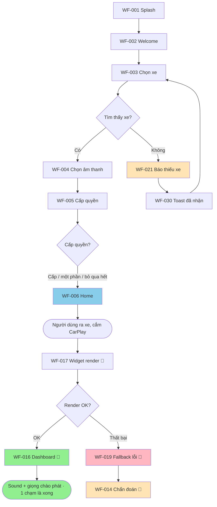

**Mô tả**: Người dùng đi qua 4 bước cấu hình (**không gặp paywall lần nào** — BR-001.1), rồi ra xe. Chuyến đầu tiên là khoảnh khắc chứng minh giá trị: widget render, sound phát trong ≤ 1,5s, giọng chào phát trong ≤ 2s. Nếu render thất bại, hành trình **không kết thúc ở ngõ cụt** mà rẽ sang J4.

**Screens**: WF-001, WF-002, WF-003, WF-004, WF-005, WF-006, WF-017, WF-016, WF-019, WF-021, WF-030, WF-014
**Đường phục hồi**: thiếu xe → WF-021 · render lỗi → WF-019 → J4 · thoát giữa luồng → vào lại đúng bước (FR-002)

---

### 2.2 J2 — Người dùng quen: chuyến đi hằng ngày, không chạm iPhone

**Persona**: Alex · **Task Flow nguồn**: TF-010 · **Thời lượng**: 0 giây thao tác

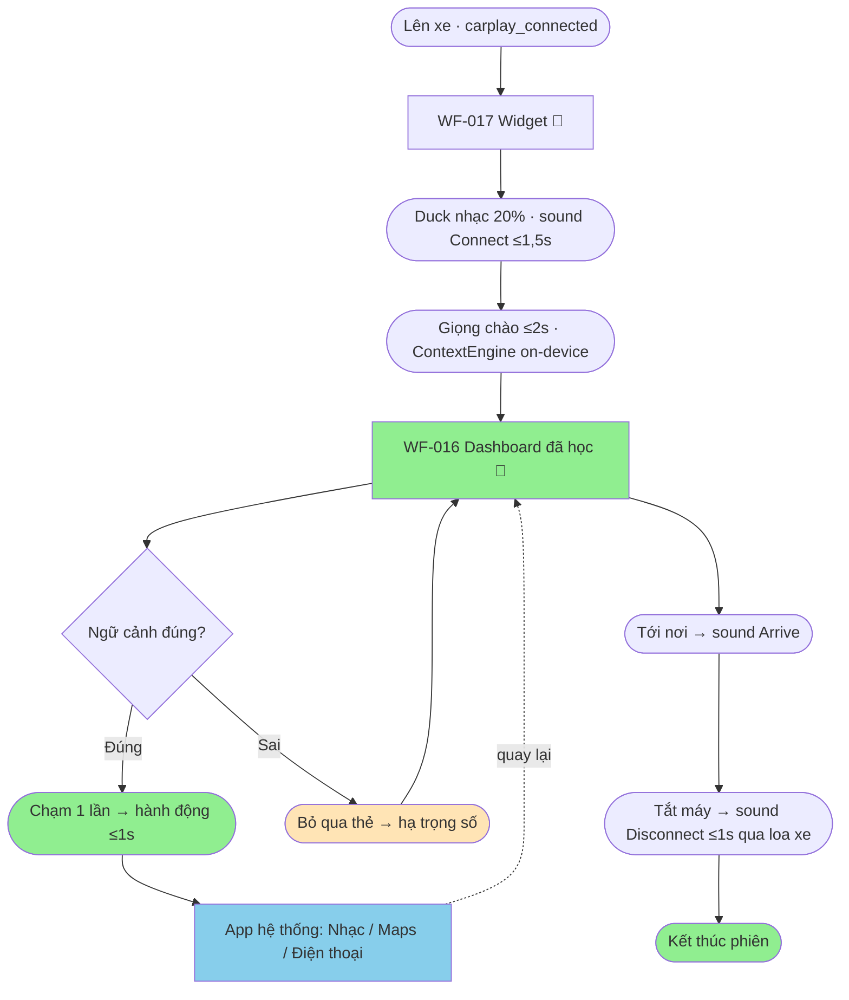

**Mô tả**: Hành trình xảy ra **2 lần mỗi ngày** và **không có bước nào trên iPhone**. Đây là hành trình mang lại giá trị hằng ngày, nên mọi ràng buộc hiệu năng khắt khe nhất đều nằm ở đây (NFR-003, NFR-004). Sửa ngữ cảnh sai là **bỏ qua thẻ**, không phải vào Settings.

**Screens**: WF-017, WF-016 (+ WF-018 nếu gói Free)
**Đường phục hồi**: cuộc gọi → bỏ lượt phát, không phát bù · mất mạng → thẻ dùng cache kèm thời điểm · một thẻ lỗi → báo trên thẻ, thẻ khác không ảnh hưởng

---

### 2.3 J3 — Từ gói Free đến quyết định trả tiền

**Persona**: Alex / Jordan · **Task Flow nguồn**: TF-007 · **Thời lượng**: ~12 ngày

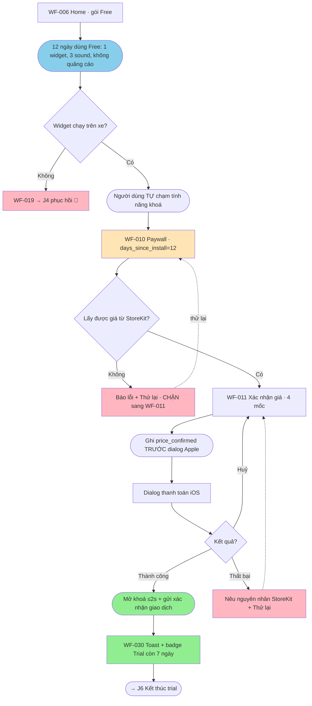

**Mô tả**: Nhánh rẽ ở `Q1` là **cơ chế lọc rủi ro** của gói Free (R-11, R-04): người dùng phát hiện app không tương thích **trước khi** có giao dịch, nên nhánh đó dẫn sang J4 chứ không dẫn tới refund và 1★. Paywall **chỉ** mở khi người dùng tự chạm và `days_since_install > 0`.

**Screens**: WF-006, WF-007/WF-008/WF-009 (điểm chạm tính năng khoá), WF-010, WF-011, WF-030
**Đường phục hồi**: StoreKit lỗi → chặn sang WF-011, không hiện giá đoán · huỷ ở dialog → về WF-011 giữ lựa chọn · thanh toán lỗi → nêu nguyên nhân + thử lại

---

### 2.4 J4 — Phục hồi khi widget không render được

**Persona**: mọi persona · **Task Flow nguồn**: TF-003 · **Rủi ro nguồn**: R-11

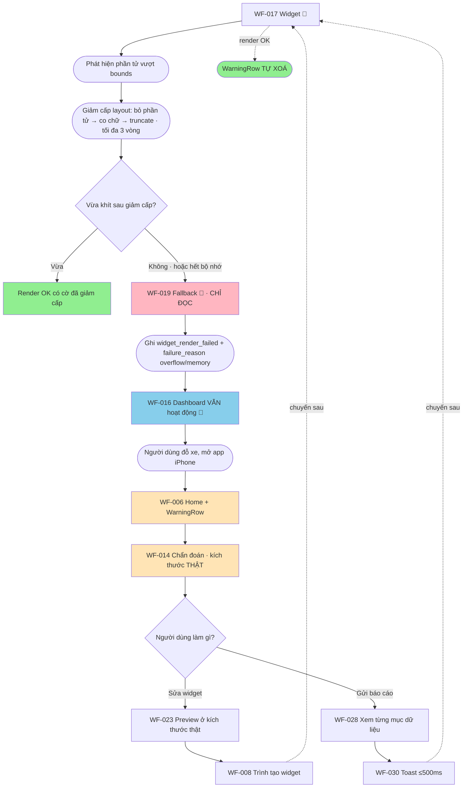

**Mô tả**: Hành trình này tồn tại vì R-11 là rủi ro `High/High`. Nguyên tắc chi phối: **không nhánh nào dẫn tới màn hình trắng**, và **không hành động nào diễn ra trên xe** — người dùng đang lái nên WF-019 chỉ để đọc. Mọi việc sửa xảy ra sau, trên iPhone.

**Screens**: WF-017, WF-019, WF-016, WF-006, WF-014, WF-023, WF-008, WF-028, WF-030
**Đường phục hồi**: lỗi tạm thời → WarningRow tự xoá · lỗi lặp ≥3 lần → ưu tiên cao trong telemetry · người dùng không muốn gửi → dữ liệu chỉ nằm trên máy

---

### 2.5 J5 — Người dùng từ chối toàn bộ quyền

**Persona**: người dùng quan tâm quyền riêng tư · **Task Flow nguồn**: TF-011

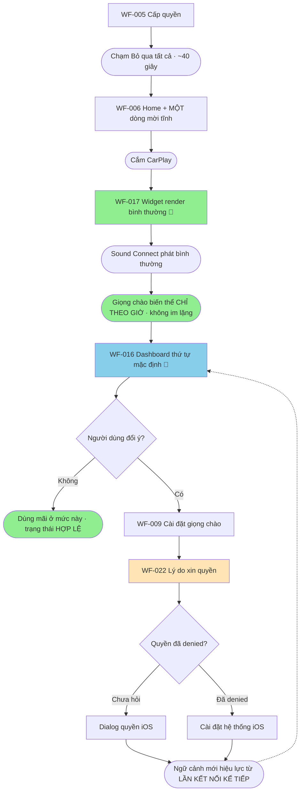

**Mô tả**: Hành trình này chứng minh app **dùng được thật** khi từ chối mọi quyền — không phải "dùng được trên giấy". Ở một niche mà rating trung bình 2,2/5, đây là tín hiệu tin cậy có giá trị hơn bất kỳ câu quảng cáo nào. Điểm kết `END` là **trạng thái hợp lệ**, không phải thất bại.

**Screens**: WF-005, WF-006, WF-017, WF-016, WF-009, WF-022
**Đường phục hồi**: mọi tổ hợp 9 trạng thái quyền đều hợp lệ · quyền `denied` → dẫn Cài đặt hệ thống thay vì gọi lại dialog

---

### 2.6 J6 — Kết thúc trial: đăng ký hoặc huỷ

**Persona**: mọi persona đã vào trial · **Task Flow nguồn**: TF-008

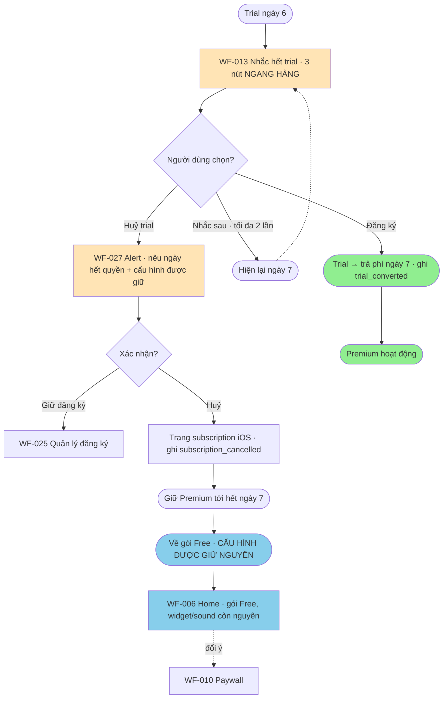

**Mô tả**: Ba nút ở WF-013 **ngang hàng thị giác**, gồm cả "Huỷ trial" — đây là biện pháp chống R-12 (chargeback do cảm giác bị mắc kẹt). Nhánh huỷ **không** làm mất cấu hình người dùng đã dựng, và điều đó được **nói ra** ở WF-027 chứ không để người dùng tự đoán.

**Screens**: WF-013, WF-027, WF-025, WF-006, WF-010
**Đường phục hồi**: không đọc được ngày hết trial → nêu rõ không xác định được, dẫn trang subscription iOS, **không đoán con số** · huỷ rồi đổi ý → WF-010 với cấu hình cũ nguyên trạng

---

### 2.7 J7 — Tuỳ biến widget cuối tuần và mua Lifetime

**Persona**: Sam (Car Enthusiast) · **Task Flow nguồn**: TF-004 + TF-009

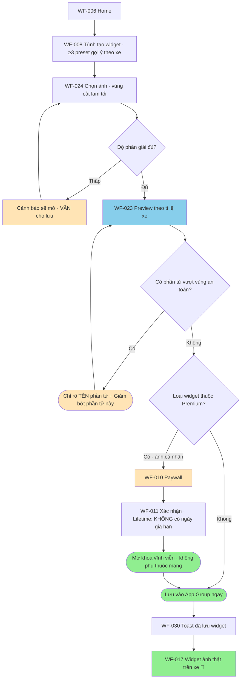

**Mô tả**: Bậc Lifetime tồn tại vì một yêu cầu trực tiếp trong dữ liệu review đối thủ: *"I would be willing to buy this app outright, but I'm not going to pay for the rest of my life"*. Cảnh báo độ phân giải là **cảnh báo, không phải chặn** — quyền quyết định thuộc người dùng, nhưng họ đã được báo trước.

**Screens**: WF-006, WF-008, WF-024, WF-023, WF-010, WF-011, WF-030, WF-017
**Đường phục hồi**: ảnh mờ → cảnh báo nhưng vẫn lưu được · phần tử vượt vùng → chỉ rõ tên + gợi ý sửa · thoát giữa lúc tạo → giữ bản nháp

---

## 3. Screen Navigation Flows

12 nhóm flow, gom theo cụm màn hình. Mỗi flow ghi rõ Entry · Actions · Exit · Error handling, đúng theo khối **User Flow** của từng màn ở `Wireframes.md` §3.

### 3.1 Khởi động và định tuyến (WF-001)

**Source**: WF-001 · **FR**: FR-009

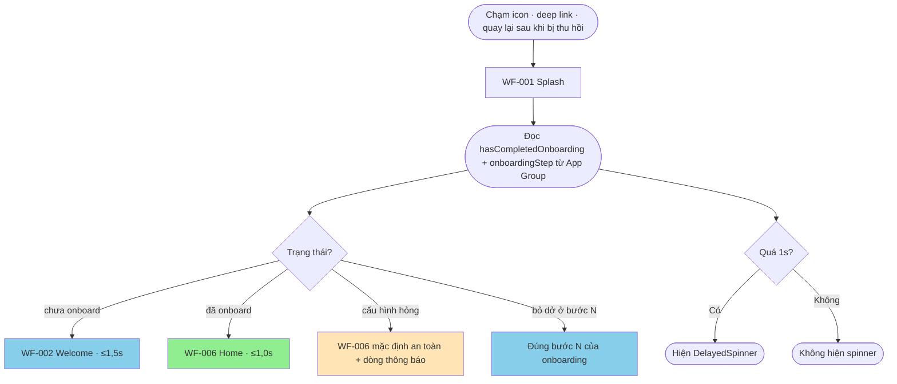

- **Entry**: icon app · deep link · quay lại sau khi hệ thống thu hồi app
- **Actions**: đọc cấu hình App Group · định tuyến · hiện spinner **chỉ khi > 1s**
- **Exit**: WF-002 · WF-006 · đúng bước onboarding đang dở
- **Error**: cấu hình hỏng → WF-006 ở mặc định an toàn + một dòng thông báo, **không** bắt onboard lại (ERR-009.1)

---

### 3.2 Chuỗi onboarding 4 bước (WF-002 → WF-005 + WF-021, WF-022)

**Source**: WF-002, WF-003, WF-004, WF-005, WF-021, WF-022 · **FR**: FR-001, FR-002, FR-003, FR-004, FR-005, FR-006, FR-007

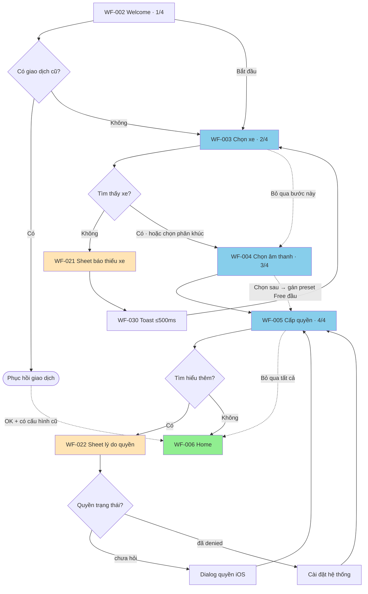

- **Entry**: WF-001 (lần đầu cài)
- **Actions**: 4 bước tuyến tính có `ProgressBar` 1/4→4/4 · mọi bước **bỏ qua được** · quay lại giữ nguyên lựa chọn · **cấm paywall ở mọi bước** (BR-001.1)
- **Exit**: WF-006
- **Error**: thoát giữa luồng → vào lại đúng bước N (AC-001.3) · thiếu asset ảnh xe → silhouette + nói rõ · dialog quyền không mở được → dẫn Cài đặt, nút "Tiếp tục" vẫn bấm được

---

### 3.3 Hub Home và bốn nhánh cấu hình (WF-006)

**Source**: WF-006 · **FR**: FR-009, FR-021, FR-031, FR-044, FR-051

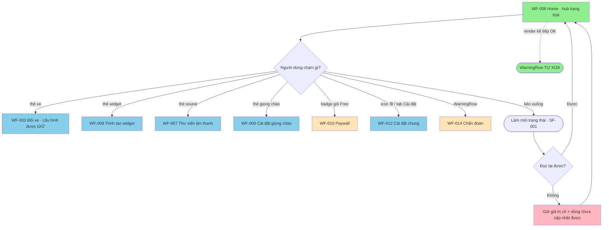

- **Entry**: WF-001 · hoàn tất WF-005 · tab Home · quay lại từ mọi màn con
- **Actions**: 7 lối ra · pull-to-refresh · đọc badge gói / badge trial
- **Exit**: WF-003, WF-007, WF-008, WF-009, WF-010, WF-012, WF-014
- **Error**: làm mới thất bại → giữ giá trị cũ, **không** hiện trạng thái rỗng · thiếu `selectedVehicle` → thẻ "Hoàn tất thiết lập"

---

### 3.4 Cấu hình âm thanh (WF-007 → WF-020)

**Source**: WF-007, WF-020 · **FR**: FR-010 → FR-015

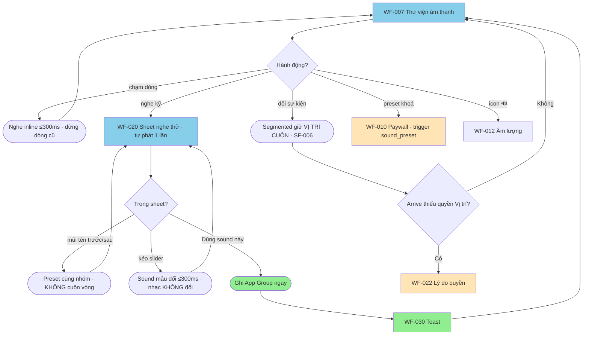

- **Entry**: tab Sounds · thẻ sound trên WF-006 · WF-004 (onboarding)
- **Actions**: nghe inline · nghe kỹ trong sheet · gán cho 3 sự kiện · đổi âm lượng · nghe thử preset khoá **đầy đủ**
- **Exit**: WF-020, WF-010, WF-012, WF-022, WF-030, WF-006
- **Error**: phiên audio bị chiếm → nêu lý do tại chỗ, **không** hiện waveform, danh sách vẫn duyệt được · asset thiếu → loại preset khỏi danh sách

---

### 3.5 Cấu hình widget (WF-008 → WF-023 → WF-024)

**Source**: WF-008, WF-023, WF-024 · **FR**: FR-021 → FR-028

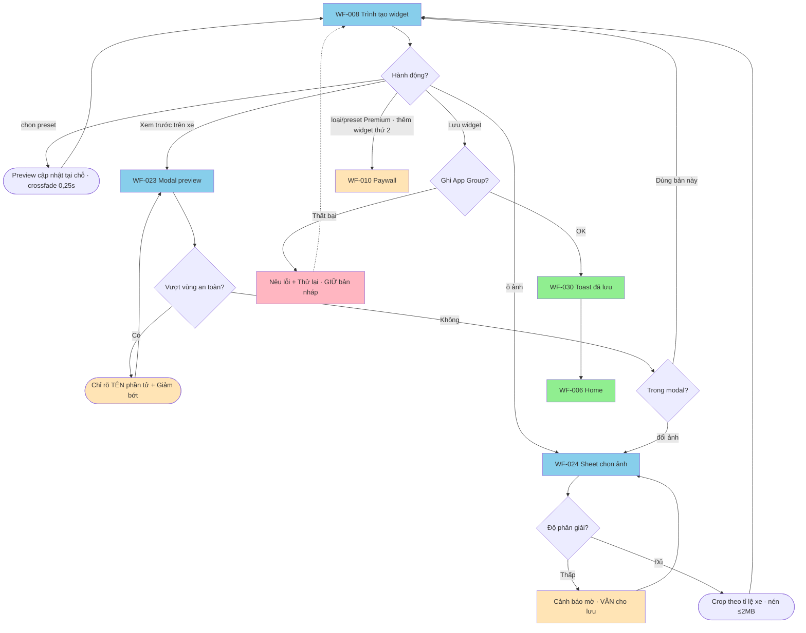

- **Entry**: tab Widget · thẻ widget trên WF-006 · WF-014 (sửa sau lỗi render, qua WF-023)
- **Actions**: chọn preset · chọn/crop ảnh · bật/tắt lớp thông tin · xem trước theo tỉ lệ xe · lưu
- **Exit**: WF-023, WF-024, WF-010, WF-030, WF-006
- **Error**: ghi App Group thất bại → giữ bản nháp + thử lại · iOS < 17.4 → `VersionNotice`, **vẫn cho lưu** · quyền ảnh bị từ chối → chỉ dùng ảnh theo model, luồng **không** bị chặn

---

### 3.6 Cấu hình giọng chào (WF-009 → WF-022)

**Source**: WF-009, WF-022 · **FR**: FR-033 → FR-036

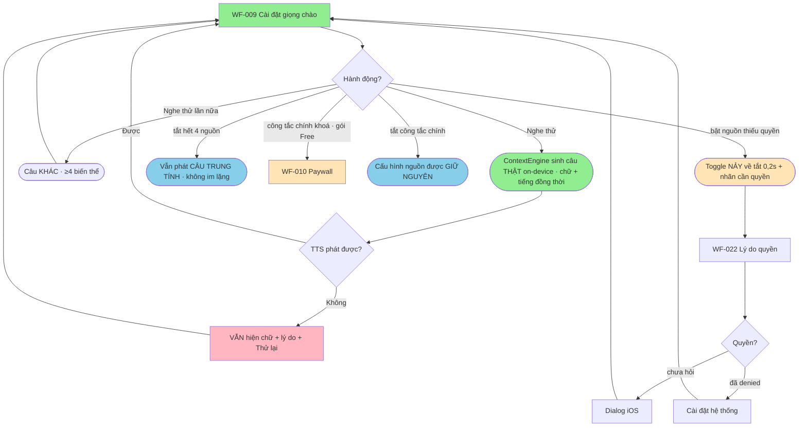

- **Entry**: tab Widget · thẻ giọng chào trên WF-006
- **Actions**: nghe thử (sinh thật, không phải câu mẫu) · bật/tắt 4 nguồn · bật/tắt công tắc chính
- **Exit**: WF-022, WF-010, WF-006, Cài đặt hệ thống
- **Error**: TTS lỗi → **vẫn hiện chữ** (nội dung vẫn kiểm chứng được) · nguồn thời tiết không lấy được dữ liệu → bỏ nguồn đó cho lượt này

---

### 3.7 Kiếm tiền: paywall → xác nhận → giao dịch (WF-010, WF-011)

**Source**: WF-010, WF-011 · **FR**: FR-045 → FR-050, FR-054

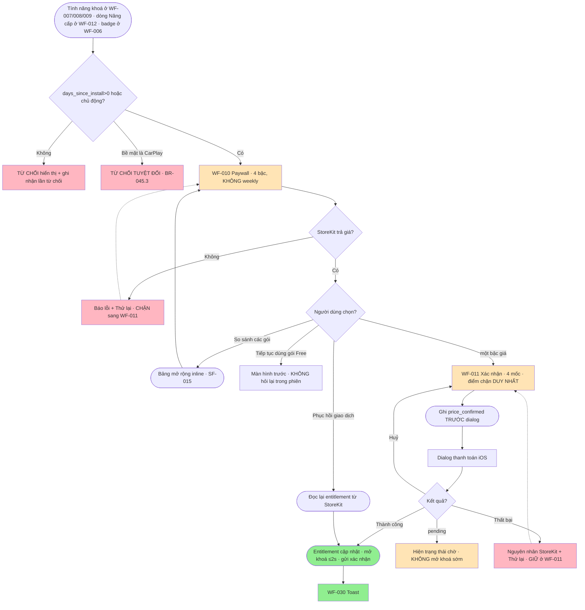

- **Entry**: 5 điểm chạm tính năng khoá trên iPhone. **Không có entry nào từ WF-016/017/018/019**
- **Actions**: xem 4 bậc · so sánh gói · phục hồi giao dịch · xác nhận giá · thanh toán
- **Exit**: WF-011 → màn hình trước paywall (thành công) · màn hình trước (đóng)
- **Error**: StoreKit không trả giá → **chặn** sang WF-011, **cấm** giá cache · huỷ ở dialog → giữ lựa chọn · thất bại → nguyên nhân cụ thể + thử lại · đổi storefront giữa lúc mua → đọc lại giá

---

### 3.8 Kết thúc trial và quản lý đăng ký (WF-013, WF-025, WF-027)

**Source**: WF-013, WF-025, WF-027 · **FR**: FR-051 → FR-054, FR-003

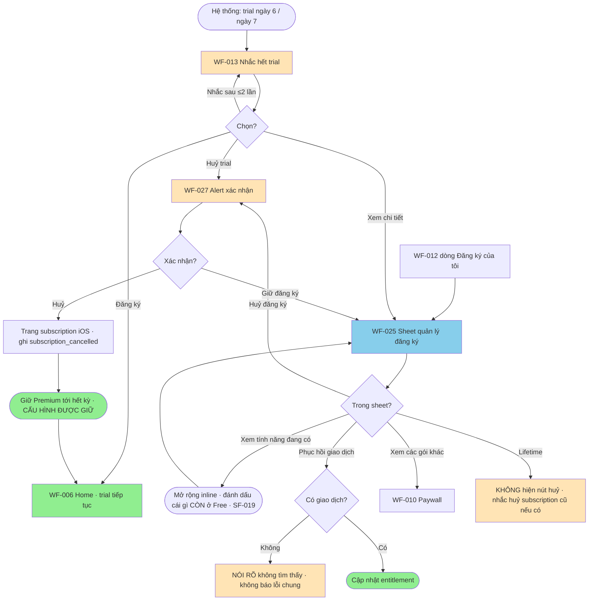

- **Entry**: hệ thống kích hoạt ngày 6/7 (WF-013) · dòng "Đăng ký của tôi" trên WF-012 (WF-025)
- **Actions**: nhắc sau (≤2 lần) · đăng ký · huỷ (≤3 chạm từ WF-012) · phục hồi giao dịch · xem tính năng đang có
- **Exit**: WF-006, WF-025, WF-027, WF-010, trang subscription iOS
- **Error**: không đọc được ngày hết trial → nêu rõ **không xác định được**, dẫn trang iOS, **không đoán con số** · không mở được trang iOS → hướng dẫn đường đi thủ công

---

### 3.9 Cài đặt và quyền riêng tư (WF-012, WF-026, WF-029, WF-015)

**Source**: WF-012, WF-026, WF-029, WF-015 · **FR**: FR-015, FR-055 → FR-062, FR-064, FR-065

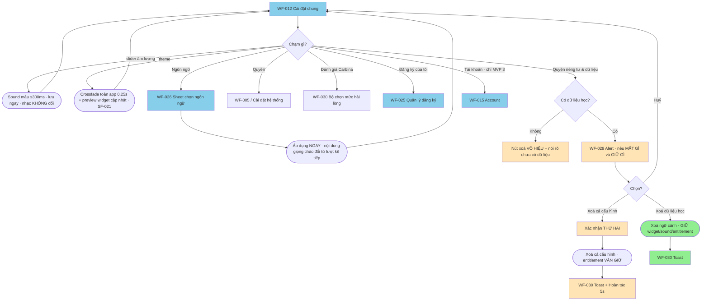

- **Entry**: tab Cài đặt · icon ⚙ trên WF-006 · badge gói trên WF-006
- **Actions**: âm lượng · theme · ngôn ngữ · quyền · đánh giá · đăng ký · xoá dữ liệu · tài khoản *(MVP 3)*
- **Exit**: WF-005, WF-010, WF-025, WF-026, WF-029, WF-030, WF-015, WF-028, Cài đặt hệ thống iOS
- **Error**: không đọc được trạng thái subscription → Zone A "chưa xác định" + phục hồi giao dịch, **các mục khác vẫn dùng được** · xoá thất bại một phần → nêu rõ phần nào chưa xoá, **cấm** báo "đã xoá xong"

---

### 3.10 Bề mặt CarPlay: dashboard, widget, trạng thái Free, fallback (WF-016 → WF-019)

**Source**: WF-016, WF-017, WF-018, WF-019 · **FR**: FR-016 → FR-020, FR-029 → FR-031, FR-037 → FR-042

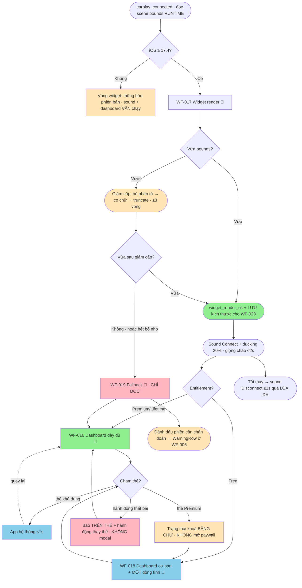

- **Entry**: `carplay_connected` → scene active · quay lại từ app hệ thống
- **Actions**: **tối đa một chạm** vào một thẻ. Không có hành động nào khác trên xe
- **Exit**: app hệ thống (nhạc/Maps/điện thoại) · WF-019 · kết thúc phiên khi tắt máy. **Không exit nào tới WF-010**
- **Error**: vượt bounds → giảm cấp → WF-019 · hết bộ nhớ → WF-019 với `failure_reason: memory` · một thẻ lỗi → báo trên thẻ, thẻ khác không ảnh hưởng · mất mạng → cache + thời điểm cập nhật. **0 trường hợp vùng trắng ở mọi nhánh**

---

### 3.11 Chẩn đoán và gửi báo cáo (WF-014, WF-028)

**Source**: WF-014, WF-028 · **FR**: FR-032, FR-060, FR-066

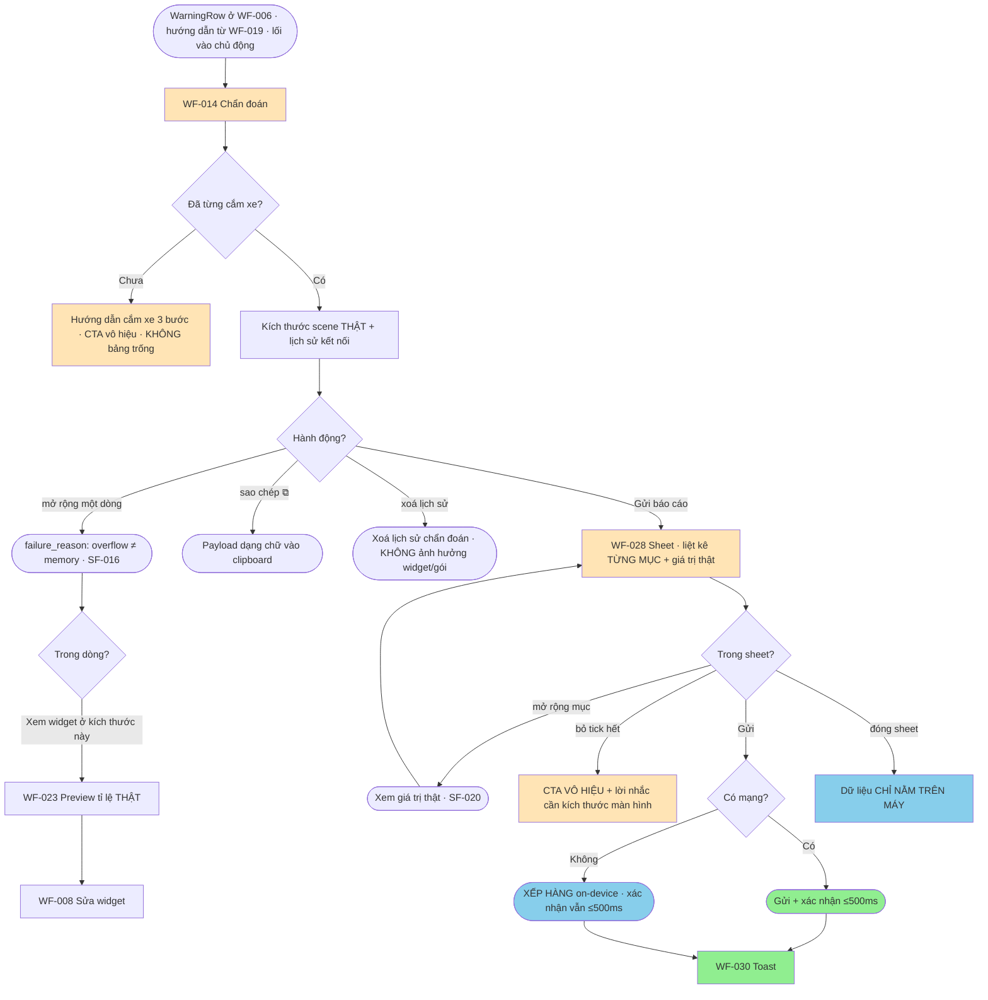

- **Entry**: `WarningRow` trên WF-006 · hướng dẫn từ WF-019 · lối vào chủ động từ WF-006 · nhánh "không hài lòng" từ WF-030
- **Actions**: xem kích thước thật · mở rộng dòng lịch sử · xem widget ở kích thước đó · sao chép payload · xoá lịch sử · gửi báo cáo có tick chọn
- **Exit**: WF-023, WF-008, WF-028, WF-030, WF-006
- **Error**: chưa từng cắm xe → hướng dẫn, **không** bảng trống · offline → xếp hàng, xác nhận vẫn ≤500ms · bỏ tick hết → CTA vô hiệu + lời nhắc

---

### 3.12 Phản hồi được phân luồng theo mức hài lòng (WF-030 → WF-028)

**Source**: WF-030, WF-028 · **FR**: FR-059, FR-060

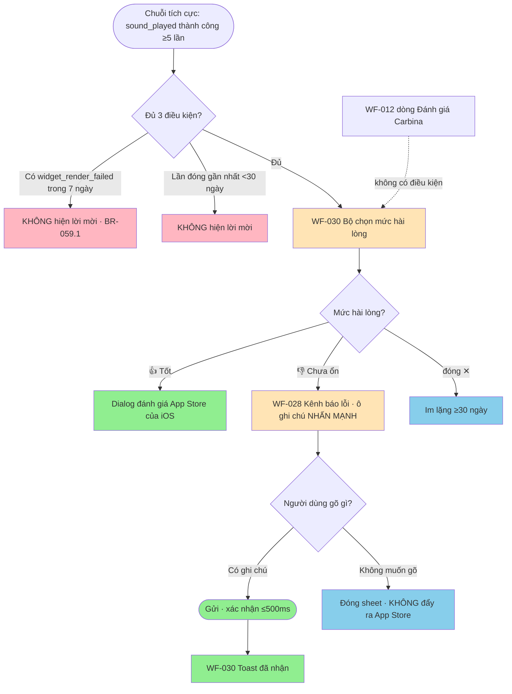

- **Entry**: hệ thống kích hoạt sau chuỗi tích cực · dòng "Đánh giá Carbina" trên WF-012 (không có điều kiện)
- **Actions**: chọn mức hài lòng · gõ ghi chú · đóng
- **Exit**: dialog đánh giá App Store (👍) · WF-028 (👎) · màn hình trước (đóng)
- **Error / chặn có chủ ý**: lỗi render trong 7 ngày → **không** hiện lời mời · người dùng không muốn gõ gì → đóng sheet, **cấm** đẩy ra App Store như đường lui

> **Đây là flow có giá trị kinh doanh cao nhất trong tài liệu**: nó bảo vệ KPI **Recent 1★ Ratio < 15%** bằng cách phân luồng, và bằng cách **không làm gì** ở đúng thời điểm (nhánh `BLOCK`).

---

## 3 bis. UX Enhancement Flows

Mỗi enhancement đã khai ở `Wireframes.md` §3 (mục **UX Enhancements** của từng màn) có một flow ở đây. **Đặc tả component-level của 12 pattern chuẩn nằm ở `ios-ui-ux` skill** — không nhân bản ở đây; phần dưới chỉ mô tả **trigger → action → response → resolution** trong ngữ cảnh Carbina.

### 3 bis.1 Pull-to-Refresh Flow
**Source**: WF-006, WF-014 · `composition.management.defaults` · sub-flow SF-001

1. **Trigger**: người dùng kéo xuống > 60pt ở đầu WF-006 hoặc WF-014
2. **Decision**: đọc lại được trạng thái kết nối / lịch sử chẩn đoán?
3. **Response**: `PullToRefreshIndicator` fade-in 0,15s · haptic `light` khi vượt ngưỡng · thẻ trạng thái **giữ giá trị cũ** trong lúc chờ (không skeleton)
4. **Resolution**: cập nhật + crossfade 0,25s; nếu có lỗi render mới → `WarningRow` slide-in 0,3s; nếu render kế tiếp OK → `WarningRow` **fade-out 0,4s tự động**
5. **Recovery**: thất bại → giữ giá trị cũ + dòng "chưa cập nhật được", **không** hiện trạng thái rỗng (ERR-009.2)

> **Không dùng ở**: WF-004, WF-007, WF-008, WF-012, WF-025 (nội dung tĩnh hoặc cục bộ) và **toàn bộ 4 màn CarPlay** (cử chỉ hai giai đoạn khi đang lái là rủi ro an toàn).

### 3 bis.2 Skeleton Loading Flow
**Source**: WF-003, WF-007, WF-010, WF-012, WF-013, WF-025

1. **Trigger**: nạp dataset xe lần đầu · nạp danh mục sound · truy vấn StoreKit
2. **Decision**: dữ liệu có sẵn trong bundle/cache?
3. **Response**: nếu **không** → skeleton khớp hình dạng thật (row 50pt ở WF-003/WF-007; 4 thẻ 88pt ở WF-010; card 72–160pt ở WF-012/WF-013/WF-025), shimmer `${color.palette.surfaceVariant}`
4. **Resolution**: crossfade sang nội dung thật 0,25s
5. **Quy tắc riêng**: WF-012 chỉ skeleton **Zone A**; nhóm TRÌNH BÀY dùng được ngay vì không phụ thuộc StoreKit. WF-013 skeleton **kèm vô hiệu 3 nút** — cấm cho quyết định khi chưa biết số tiền.

> **Không dùng ở**: WF-002, WF-004 (asset bundle — skeleton sẽ là chuyển động vô nghĩa) và 4 màn CarPlay (thẻ giữ cache + ghi thời điểm, tốt hơn shimmer trống).

### 3 bis.3 Empty State Flow
**Source**: WF-003, WF-014, WF-016, WF-017, WF-025, WF-028

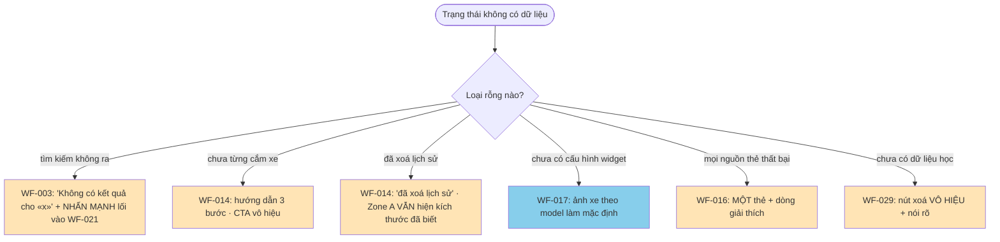

**Nguyên tắc**: mỗi loại rỗng có **thông điệp riêng và hành động tiếp riêng**. Cấm dùng một empty state chung. Trên CarPlay, empty **không bao giờ** là vùng trắng (NFR-020).

### 3 bis.4 Error + Retry Flow
**Source**: WF-002, WF-003, WF-004, WF-007, WF-008, WF-010, WF-011, WF-016, WF-019, WF-020, WF-024, WF-028, WF-029, WF-030

1. **Trigger**: phiên audio bị chiếm · ghi App Group thất bại · StoreKit lỗi · thanh toán thất bại · render thất bại · gửi báo cáo thất bại · xoá thất bại một phần
2. **Decision**: lỗi có đường thử lại không? Người dùng đang lái không?
3. **Response**: **iPhone** → nêu **nguyên nhân cụ thể** (không dùng "đã xảy ra lỗi") + `[Thử lại]` tại chỗ, giữ nguyên ngữ cảnh. **CarPlay** → báo **trên thẻ** hoặc `FallbackNotice`, **không** nút thử lại (hệ thống tự thử ở lần cắm kế tiếp)
4. **Resolution**: thành công → tiếp tục luồng cũ · vẫn thất bại → giữ trạng thái, không mất dữ liệu người dùng đã nhập
5. **Quy tắc cứng**: mọi lỗi phải kèm **một đường đi tiếp** (NFR-018 AC-NFR-018.2 — cấm lỗi chỉ ghi log rồi im lặng)

### 3 bis.5 Haptic Feedback Flow
**Source**: WF-002, WF-003, WF-004, WF-007, WF-008, WF-011, WF-012, WF-020, WF-023, WF-024, WF-028, WF-029

| Mức | Token | Khi nào |
|---|---|---|
| `light` | `${animation.haptics.light}` | Chọn preset · phát audio · xuống tầng picker xe · chuyển tỉ lệ preview · vượt ngưỡng pull-to-refresh · mở rộng dòng |
| `medium` | `${animation.haptics.medium}` | Hoàn tất: gán sound · lưu widget · xác nhận mua · gửi báo cáo · đủ 3 giá trị chọn xe · toggle bị chặn nảy về tắt |
| `heavy` | — | **Không dùng ở bất kỳ đâu** — không có hành động nào trong app xứng mức này |
| **CarPlay** | `none` | **Không haptic trên bề mặt xe** (`animation.haptics.carplay`) |

### 3 bis.6 Swipe Action Flow
**Source**: WF-006 (`WarningRow`), WF-020/021/022/024/025/026/028 (sheet), WF-023 (modal)

1. **Trigger**: vuốt xuống trên sheet/modal · vuốt ngang trên `WarningRow` · vuốt ngang trong `WF-023` để đổi tỉ lệ
2. **Response**: sheet/modal trượt xuống 0,3s và đóng **không** thay đổi trạng thái dữ liệu (SF-013: đóng WF-022 **không** ngầm cấp/từ chối quyền) · `WarningRow` ẩn cho phiên hiện tại · WF-023 chuyển tỉ lệ bằng spring 0,3s damping cao
3. **Resolution**: mọi hành động vuốt đều **không phá hủy** dữ liệu
4. **Cố ý KHÔNG có swipe-to-delete**: WF-012 và WF-014 là danh sách cài đặt/chẩn đoán — xoá ở đây là hành động **toàn bộ** (qua WF-029 hoặc nút "Xoá lịch sử"), không theo dòng. Vẽ swipe-to-delete ở đó sẽ tạo affordance không có FR.
5. **CarPlay**: **không có cử chỉ vuốt nào** — mọi cử chỉ khi đang lái là rủi ro an toàn và không có FR backing

### 3 bis.7 Onboarding Enhancement Flow
**Source**: WF-002 → WF-005 · chi tiết ở §9

1. **Trigger**: mở app lần đầu
2. **Response**: `ProgressBar` 1/4 → 4/4 animate cùng lúc với push màn hình · mỗi bước **bỏ qua được** · tầng picker xe ghim thành hàng 44pt thay vì biến mất (SF-002) · preset sound đầu **tự phát một lần** (SF-014)
3. **Resolution**: `hasCompletedOnboarding = true` · ghi `onboarding_completed`
4. **Recovery**: thoát giữa luồng → vào lại đúng bước N; **không** mất lựa chọn đã làm
5. **Ràng buộc cứng**: **cấm paywall ở mọi bước** (BR-001.1) — đây là điểm khác biệt hóa số 1, không phải chi tiết

### 3 bis.8 IAP Enhancement Flow
**Source**: WF-010, WF-011, WF-025, WF-013 · chi tiết ở §3.7 và §3.8

1. **Trigger**: người dùng **chủ động** chạm tính năng khoá (`days_since_install > 0`)
2. **Response**: 4 bậc giá lấy **trực tiếp từ StoreKit** · bảng so sánh mở rộng inline (SF-015) · điểm chặn **duy nhất** WF-011 với 4 mốc thời gian/số tiền
3. **Resolution**: ghi `price_confirmed` → dialog Apple → mở khoá ≤ 2s → gửi xác nhận giao dịch → `WF-030` toast
4. **Recovery**: StoreKit lỗi → **chặn** sang WF-011 · huỷ ở dialog → giữ lựa chọn · thất bại → nguyên nhân StoreKit + thử lại
5. **Chống dark pattern**: không weekly · không quy đổi "$0,48/tuần" · không discount sai thực tế · nút huỷ ngang hàng nút mua · đường huỷ ≤ 3 chạm

### 3 bis.9 Alert Flow
**Source**: WF-027, WF-029

1. **Trigger**: chạm hành động phá hủy hoặc không hoàn tác được (huỷ đăng ký · xoá dữ liệu)
2. **Response**: `AlertContainer` fade-in 0,2s + scale 0,97→1,0 · overlay `rgba(0,0,0,0.4)` · **đúng một câu hỏi**
3. **Resolution**: xác nhận → thực hiện + `WF-030` toast · huỷ → về màn trước, **không** thay đổi gì
4. **Quy tắc cứng**: **cấm** nội dung níu giữ (ưu đãi, giảm giá, danh sách "bạn sẽ mất…" dài dòng) trong alert huỷ · alert phải nêu **mất gì VÀ giữ gì** · hành động phá hủy mạnh hơn cần **alert thứ hai** (WF-029 "Xoá cả cấu hình")
5. **Chặn có chủ ý**: WF-027 **không hiện** nếu chưa đọc được ngày kết thúc — cấm hỏi xác nhận mà không nói được hậu quả

### 3 bis.10 Dialog Flow (dialog hệ thống)
**Source**: dialog quyền iOS (WF-005, WF-009, WF-022, WF-024) · dialog thanh toán StoreKit (WF-011) · dialog đánh giá App Store (WF-030)

1. **Trigger**: app yêu cầu quyền · xác nhận giao dịch · mời đánh giá
2. **Decision**: quyền ở trạng thái `notDetermined` hay `denied`?
3. **Response**: `notDetermined` → gọi dialog iOS · `denied` → **không** gọi dialog (iOS sẽ không hiện, tạo cảm giác nút không hoạt động) mà dẫn **Cài đặt hệ thống**
4. **Resolution**: cập nhật trạng thái và **tính lại tập nguồn ngữ cảnh khả dụng** (FR-008); ngữ cảnh mới hiệu lực từ **lần kết nối kế tiếp**
5. **Recovery**: dialog không mở được → nêu rõ + hướng dẫn đường đi thủ công; nút "Tiếp tục" **vẫn bấm được** (AC-004.5)

### 3 bis.11 Bottom Sheet Flow
**Source**: WF-020, WF-021, WF-022, WF-024, WF-025, WF-026, WF-028

1. **Trigger**: chạm một affordance cần tác vụ tập trung nhưng **không** rời ngữ cảnh
2. **Response**: sheet trượt lên 0,35s `${animation.spring.smooth}` · `dragIndicator` 36×5 · nội dung phía sau **mờ nhẹ nhưng vẫn thấy** để giữ ngữ cảnh · detent theo nhu cầu thao tác: **50%** (WF-020/021/022/025/026) hoặc **90%** (WF-024 cần chỗ crop, WF-028 cần chỗ bàn phím)
3. **Resolution**: hoàn tất → sheet đóng 0,3s **rồi** toast xuất hiện (không chồng lên nhau)
4. **Recovery**: vuốt xuống hoặc `[✕]` → đóng **không** thay đổi trạng thái · WF-020 và WF-021 **không** mất dữ liệu đã nhập/đang nghe
5. **Ngoại lệ có chủ ý**: WF-023 (modal) mở được WF-024 (sheet) — vi phạm `no-modal` nhưng có justification: sửa ảnh **tại nơi phát hiện vấn đề** (AF-013.2)

### 3 bis.12 Snackbar / Toast Flow
**Source**: WF-030 (dùng bởi WF-003, WF-007, WF-008, WF-011, WF-021, WF-028, WF-029, WF-012)

```mermaid
graph TD
    T(["Tác vụ kết thúc"]) --> Q{"Loại kết quả?"}
    Q -->|"thành công"| S1["ToastConfirm · 2s · tự đóng"]
    Q -->|"thành công có thể hoàn tác"| S2["ToastUndo · 5s · nút Hoàn tác"]
    Q -->|"thất bại"| S3["ToastError · 4s · nút Thử lại"]
    Q -->|"chuỗi tích cực + đủ điều kiện"| S4["RatingPromptOverlay · KHÔNG tự đóng"]
    S1 --> R(["Tự biến mất · KHÔNG chặn tương tác"])
    S2 --> Q2{"Chạm Hoàn tác?"}
    Q2 -->|"Có"| UNDO(["Phục hồi cấu hình từ bản sao tạm"])
    Q2 -->|"Không"| R
    S3 --> Q3{"Chạm Thử lại?"}
    Q3 -->|"Có"| RETRY(["Chạy lại tác vụ"])
    Q3 -->|"Không"| R
    S4 --> Q4{"Mức hài lòng?"}
    Q4 -->|"👍"| STORE["Dialog App Store"]
    Q4 -->|"👎"| WF028["WF-028"]

    style S1 fill:#90EE90
    style R fill:#90EE90
    style UNDO fill:#90EE90
    style STORE fill:#90EE90
    style S2 fill:#FFE4B5
    style S4 fill:#FFE4B5
    style S3 fill:#FFB6C1
```

**Bốn biến thể tách tên** (`Wireframes.md` §11.3-b): `ToastConfirm` · `ToastUndo` · `ToastError` · `RatingPromptOverlay`. Toast mới **thay** toast cũ, không xếp chồng. Không có overlay màu — **không chặn** tương tác phía sau. **Không dùng trên CarPlay.**

---

### Ba enhancement riêng của dự án (không thuộc 12 pattern chuẩn)

### 3 bis.13 Audio Ducking Flow 🚗
**Source**: WF-004, WF-007, WF-016, WF-020 · **FR**: FR-016, FR-017

```mermaid
graph TD
    T(["carplay_connected · hoặc nghe thử trên iPhone"]) --> Q1{"Nguồn audio đang chiếm?"}
    Q1 -->|"voiceCall"| SKIP["BỎ HẲN lượt phát · KHÔNG phát bù"]
    Q1 -->|"navigationPrompt"| WAIT["Nhường · chờ ≤3s"]
    WAIT --> Q2{"Chỉ dẫn xong trong 3s?"}
    Q2 -->|"Có"| PLAY
    Q2 -->|"Không"| SKIP2["Bỏ lượt"]
    Q1 -->|"music / podcast"| DUCK(["Giảm nguồn xuống 20%"])
    Q1 -->|"none"| PLAY
    DUCK --> PLAY(["Phát sound qua LOA XE ≤1,5s"])
    PLAY --> REST(["Phục hồi nguồn cũ ĐÚNG MỨC và ĐÚNG VỊ TRÍ"])
    REST --> LOG(["Ghi sound_played + sound_ducking_applied"])

    style PLAY fill:#90EE90
    style REST fill:#90EE90
    style LOG fill:#90EE90
    style DUCK fill:#87CEEB
    style WAIT fill:#FFE4B5
    style SKIP fill:#FFB6C1
    style SKIP2 fill:#FFB6C1
```

**Vì sao là enhancement riêng**: đây là phản ứng trực tiếp với complaint *"gets cancelled out if you have any music playing"* của đối thủ. Mọi quyết định bỏ lượt phải hoàn tất trong **≤ 100ms** (AC-NFR-003.3). **Cấm phát bù** — im lặng là hành vi đúng.

### 3 bis.14 Layout Degradation Flow 🚗
**Source**: WF-017, WF-023 · **FR**: FR-026, FR-030 · sub-flow SF-008

1. **Trigger**: tính layout từ scene bounds phát hiện phần tử vượt vùng an toàn
2. **Vòng 1**: bỏ phần tử **ưu tiên thấp nhất** theo `layoutSpec` (không tuỳ ý theo runtime) → tính lại
3. **Vòng 2**: co chữ theo Dynamic Type xuống **sàn 16pt** → tính lại
4. **Vòng 3**: truncate chữ **có ellipsis** (không cắt giữa chữ) → tính lại
5. **Resolution**: vừa khít → `widget_render_ok` **kèm cờ đã giảm cấp** (phân biệt với render đầy đủ) · sau 3 vòng vẫn vượt → WF-019
6. **Trên iPhone (WF-023)**: cùng logic nhưng **hiện cho người dùng thấy trước**: viền cảnh báo fade 0,2s (**không nhấp nháy**) + **tên phần tử** + gợi ý "Giảm bớt phần tử này" · **cấm** tự cắt âm thầm

**Vì sao là enhancement riêng**: đây là biện pháp giảm thiểu chính cho R-11 và là lý do màn WF-023 tồn tại.

### 3 bis.15 Context Reorder Crossfade Flow 🚗
**Source**: WF-016 · **FR**: FR-040 · sub-flow SF-017

1. **Trigger**: ContextEngine tính ra thứ tự thẻ mới trong lúc phiên đang chạy
2. **Guard 1**: nếu một thẻ **đang được chạm** → **hoãn** tới khi hành động kết thúc
3. **Guard 2**: throttle **tối đa 1 lần mỗi 30 giây**
4. **Guard 3**: nếu ContextEngine **không có kết luận chắc chắn** → **giữ nguyên** thứ tự hiện tại
5. **Response**: crossfade **tại chỗ 0,4s** — **cấm** positional-move, scale, bounce, blink
6. **Resolution**: thứ tự mới hiển thị; người dùng bỏ qua thẻ → hạ trọng số (phản hồi ngầm)

**Vì sao là enhancement riêng, và vì sao chậm hơn iPhone**: thẻ trượt qua nhau trên màn hình xe **kéo mắt người lái khỏi đường**. Đây là ràng buộc an toàn (BR-040.3), không phải lựa chọn thẩm mỹ. Thà thứ tự cũ còn hơn một thay đổi gây phân tán không có lý do rõ.

---

### Bảng phủ enhancement

| Enhancement khai ở Wireframes | Flow | Màn hình |
|---|---|---|
| `pull-to-refresh` | 3 bis.1 | WF-006, WF-014 |
| `skeleton-loading` | 3 bis.2 | WF-003, 007, 010, 012, 013, 025 |
| Empty state (6 loại) | 3 bis.3 | WF-003, 014, 016, 017, 025, 028, 029 |
| Error + retry | 3 bis.4 | 14 màn |
| Haptic (light/medium/none) | 3 bis.5 | 12 màn + CarPlay = none |
| Swipe (dismiss, đổi tỉ lệ) | 3 bis.6 | WF-006, 7 sheet, WF-023 |
| `progress-indicator` + onboarding | 3 bis.7, §9 | WF-002 → WF-005 |
| IAP | 3 bis.8 | WF-010, 011, 013, 025 |
| `destructive-needs-confirm` | 3 bis.9 | WF-027, WF-029 |
| Dialog hệ thống (quyền, thanh toán, đánh giá) | 3 bis.10 | WF-005, 009, 011, 022, 024, 030 |
| Bottom sheet | 3 bis.11 | 7 sheet |
| `success-feedback` · `undo` · snackbar | 3 bis.12 | WF-030 (8 màn dùng) |
| `inline-audio-preview` + ducking | 3 bis.13 | WF-004, 007, 016, 020 |
| `runtime-bounds-layout` + giảm cấp | 3 bis.14 | WF-017, WF-023 |
| `crossfade-only` + throttle 30s | 3 bis.15 | WF-016 |
| `inline-validation` | 3 bis.4 (nhánh validation) + §5.2 | WF-003, 005, 021, 024, 028 |
| `single-primary-cta` · `escape-route-always-visible` | §4.2, §4.3 (mẫu điều hướng) | mọi màn Action |
| `grouped-rows` · `inline-status-on-row` | §4.3 | WF-006, 008, 012, 014, 015, 025 |
| `full-bleed-media` · `sticky-key-info` · `scrim-for-text-over-image` | §10.2 | WF-001, 017, 020, 023 |
| `flat-no-shadow` · `high-contrast` · `min-16pt-text` · `no-modal` · `single-tap-only` | §4.4 (luật điều hướng CarPlay) | WF-016 → WF-019 |
| `section-grouping` | 3 bis.2 + §4.3 | WF-004, WF-007 |

**Kết quả**: 21/21 nhóm enhancement đã khai ở `Wireframes.md` đều có flow ⇒ **Pass**.

---

## 4. Navigation Patterns

> **Mục này là chủ sở hữu chính thức của nhóm chrome điều hướng** mà `Wireframes.md` §10.1 khai deferred: tab bar, nút back, nút đóng, drag indicator, lối tắt `⚙`, và hành vi chuyển màn.

### 4.1 Tab Navigation

**4 tab** theo canvas `Use_Cases.md` §0.3. Tab bar **chỉ tồn tại ở 2 màn root**: WF-006 và WF-012 — mọi màn con đều là push/sheet và **che** tab bar.

```mermaid
graph LR
    T1["Tab 1 Home"] -.-> T2["Tab 2 Sounds"]
    T2 -.-> T3["Tab 3 Widget"]
    T3 -.-> T4["Tab 4 Cài đặt"]
    T4 -.-> T1

    T1 --> WF006["WF-006 Home"]
    T2 --> WF007["WF-007 Thư viện âm thanh"]
    T3 --> WF008["WF-008 Trình tạo widget"]
    T3 -.-> WF009["WF-009 Cài đặt giọng chào"]
    T4 --> WF012["WF-012 Cài đặt chung"]

    style WF006 fill:#90EE90
    style WF007 fill:#87CEEB
    style WF008 fill:#87CEEB
    style WF009 fill:#87CEEB
    style WF012 fill:#87CEEB
```

| Quy tắc | Nội dung |
|---|---|
| Số tab | **Đúng 4**; thêm tab thứ 5 là vi phạm canvas UC §0.3 |
| Trạng thái tab | Chuyển tab **giữ nguyên** vị trí cuộn và trạng thái của tab cũ |
| Badge | Chỉ tab Home có badge — chấm cảnh báo tương thích (`${component.tabBar.badgeStyle}`) |
| Tab 3 chứa 2 màn | WF-008 là mặc định; WF-009 vào từ thẻ giọng chào ở WF-006 hoặc từ trong tab 3 |
| Lối tắt `⚙` trên WF-006 | Đường **thứ hai** tới WF-012, tương đương chạm tab 4 — có chủ ý, vì Cài đặt là đích hay dùng từ Home |
| Tab bar trên màn con | **Bị che** — mọi màn con là push hoặc sheet |
| **CarPlay** | **Không có tab bar** — xem §4.4 |

### 4.2 Modal Presentation

| Loại | Màn hình | Detent | Đóng bằng | Ảnh hưởng dữ liệu khi đóng |
|---|---|---|---|---|
| **Sheet** | WF-020, 021, 022, 025, 026 | 50% | vuốt xuống · `[✕]` | **Không** thay đổi gì (SF-013: đóng WF-022 không ngầm cấp/từ chối quyền) |
| **Sheet lớn** | WF-024, WF-028 | 90% | vuốt xuống · `[✕]` | Không mất dữ liệu đã nhập |
| **Modal toàn màn** | WF-023 | 90% | `[✕]` | Không mất cấu hình đang thử |
| **Sheet toàn màn** | WF-010, WF-013 | full | `[✕]` | Đóng WF-010 → **không hỏi lại trong cùng phiên** (BR-045.4) |
| **Alert** | WF-027, WF-029 | — | nút "Huỷ" / "Giữ" | Không thay đổi gì |
| **Overlay** | WF-030 | — | tự đóng · một chạm | Không chặn tương tác phía sau |
| **Dialog hệ thống** | quyền iOS · thanh toán StoreKit · đánh giá App Store | — | do iOS quản | Xem §3 bis.10 |

**Quy tắc chồng modal**: tối đa **2 lớp**. Chỉ có **hai** trường hợp hợp lệ và cả hai đều có justification: WF-023 (modal) → WF-024 (sheet) *(sửa ảnh tại nơi phát hiện vấn đề)*; WF-025 (sheet) → WF-027 (alert) *(xác nhận phá hủy)*. Mọi trường hợp khác là lỗi thiết kế.

### 4.3 Navigation Stack

```mermaid
graph TD
    WF006["WF-006 Home · root"] -->|push| WF003["WF-003 Chọn xe"]
    WF006 -->|push| WF007["WF-007 Âm thanh"]
    WF006 -->|push| WF008["WF-008 Widget"]
    WF006 -->|push| WF009["WF-009 Giọng chào"]
    WF006 -->|push| WF014["WF-014 Chẩn đoán"]
    WF006 -->|push| WF012["WF-012 Cài đặt"]
    WF008 -->|modal| WF023["WF-023 Preview"]
    WF023 -->|sheet| WF024["WF-024 Chọn ảnh"]
    WF008 -->|sheet| WF024
    WF007 -->|sheet| WF020["WF-020 Nghe thử"]
    WF012 -->|sheet| WF025["WF-025 Đăng ký"]
    WF025 -->|alert| WF027["WF-027 Xác nhận huỷ"]
    WF012 -->|alert| WF029["WF-029 Xoá dữ liệu"]
    WF014 -->|sheet| WF028["WF-028 Gửi báo cáo"]

    style WF006 fill:#90EE90
    style WF003 fill:#87CEEB
    style WF007 fill:#87CEEB
    style WF008 fill:#87CEEB
    style WF009 fill:#87CEEB
    style WF012 fill:#87CEEB
    style WF014 fill:#FFE4B5
    style WF027 fill:#FFE4B5
    style WF029 fill:#FFE4B5
```

| Quy tắc | Nội dung |
|---|---|
| Độ sâu tối đa | **3 tầng** (root → push → modal/sheet); khớp nguyên tắc §0.3 của UC |
| Nút back | `[<]` ở nav bar trái, luôn có ở màn push; **cấm** ẩn nút back |
| Onboarding | Là **stack riêng**, không có tab bar; nút back giữa các bước **giữ nguyên lựa chọn** |
| `grouped-rows` | Danh sách cài đặt/chẩn đoán gom theo nhóm, mỗi dòng có trạng thái **ngay trên dòng** — người dùng không phải mở ra mới biết |
| `single-primary-cta` | Mỗi màn Action có **đúng một** CTA, ở `safeAreaInset(bottom)`. Ba ngoại lệ có chủ ý: WF-010 (4 lựa chọn ngang hàng), WF-013 (3 nút ngang hàng chống dark pattern), WF-026 (chọn là áp dụng ngay, không cần CTA) |
| `escape-route-always-visible` | Mọi màn có ít nhất một đường thoát không phá hủy: nút back · `[✕]` · "Bỏ qua" · "Huỷ" |

### 4.4 CarPlay Navigation Laws 🚗

Bề mặt CarPlay có **bộ luật điều hướng riêng**. Đây không phải biến thể của §4.1–§4.3 mà là một mô hình khác.

| Luật | Nội dung | Nguồn |
|---|---|---|
| **Không có stack** | Không push, không pop, không back. Nội dung **thay tại chỗ** bằng crossfade | BR-040.3 |
| **Không có tab bar** | Không có điều hướng ngang cấp trên xe | `composition.carplay` |
| **Không có modal** | Không sheet, không alert, không dialog | BR-042.2, BR-031.3 |
| **Không nhập liệu** | Không text field, không picker, không slider | `composition.carplay.defaults` |
| **Tối đa một chạm** | Mỗi thẻ = một hành động hoàn chỉnh; chạm thẻ mới **huỷ** hành động cũ, không xếp hàng | BR-042.4 |
| **Không paywall** | **Không đường nào** mở WF-010 từ WF-016/017/018/019 | BR-045.3 |
| **Chỉ hai lối ra** | (1) app hệ thống — nhạc/Maps/điện thoại; (2) kết thúc phiên khi tắt máy | §3.10 |
| **Chuyển tiếp duy nhất** | Crossfade 0,4s, throttle 30s. Cấm positional-move/scale/bounce/blink | `animation.carplay` |
| **Fallback thay vì điều hướng** | Lỗi → thay **nội dung vùng widget** bằng `FallbackNotice`, không điều hướng đi đâu | BR-031.4 |
| **Không haptic** | `animation.haptics.carplay = none` | — |

---

## 5. Error Handling Flows

### 5.1 Network Error Flow

**Áp dụng cho**: WF-003 *(gửi yêu cầu xe)*, WF-010/WF-011 *(StoreKit)*, WF-016/WF-018 *(thẻ nhạc, thời tiết)*, WF-021, WF-025, WF-028, WF-015 *(MVP 3)*

```mermaid
graph TD
    A(["Hành động cần mạng"]) --> B{"Có mạng?"}
    B -->|"Không"| C{"Loại hành động?"}
    C -->|"gửi dữ liệu · WF-021/028"| D(["XẾP HÀNG on-device · xác nhận ≤500ms"])
    C -->|"đọc dữ liệu thẻ · WF-016/018"| E(["Dùng cache + GHI RÕ thời điểm cập nhật"])
    C -->|"đọc giá · WF-010"| F["BÁO LỖI + Thử lại · CHẶN sang WF-011 · CẤM giá cache"]
    C -->|"tìm kiếm xe · WF-003"| G(["Không ảnh hưởng — dataset trong bundle"])
    B -->|"Có"| H{"Yêu cầu thành công?"}
    H -->|"Không"| I{"Loại lỗi?"}
    I -->|"StoreKit"| J["Nêu NGUYÊN NHÂN từ StoreKit + Thử lại"]
    I -->|"gửi báo cáo"| D
    I -->|"thẻ dashboard"| K["Báo TRÊN THẺ + hành động thay thế · KHÔNG modal"]
    H -->|"Có"| L(["Thành công"])
    D -.->|"khi có mạng"| M(["Tự gửi lại · không mất dữ liệu"])

    style L fill:#90EE90
    style M fill:#90EE90
    style G fill:#90EE90
    style D fill:#87CEEB
    style E fill:#87CEEB
    style F fill:#FFB6C1
    style J fill:#FFB6C1
    style K fill:#FFB6C1
```

**Ba nguyên tắc**:
1. **Ghi dữ liệu** → luôn xếp hàng on-device, xác nhận ngay ≤ 500ms, người dùng **không cần biết** chuyện mạng
2. **Đọc dữ liệu hiển thị** → dùng cache **kèm nhãn thời gian**; cache không có nhãn thời gian là dữ liệu gây nhầm
3. **Đọc giá** → **tuyệt đối không** cache; hoặc có giá xác thực, hoặc báo lỗi (BR-047.1)

### 5.2 Validation Error Flow

**Áp dụng cho**: WF-003 *(3 tầng picker)*, WF-005 *(trạng thái quyền)*, WF-021 *(3 ô nhập)*, WF-024 *(độ phân giải ảnh)*, WF-028 *(tick dữ liệu, ghi chú)*, WF-009 *(toggle nguồn thiếu quyền)*

```mermaid
graph TD
    A(["Người dùng nhập / chọn"]) --> B{"Loại validation?"}
    B -->|"thiếu giá trị bắt buộc"| C["CTA VÔ HIỆU · bg surfaceVariant · fg textTertiary"]
    B -->|"giá trị ngoài dải · year WF-021"| D["Viền ô ĐỎ + lý do NGAY DƯỚI ô · CTA vô hiệu"]
    B -->|"điều kiện chưa đủ · toggle WF-009"| E["Toggle NẢY về tắt 0,2s + nhãn cần quyền + nút hành động"]
    B -->|"cảnh báo nhưng KHÔNG chặn · ảnh mờ WF-024"| F["Banner cảnh báo · CTA VẪN bật · quyền quyết định thuộc người dùng"]
    B -->|"bỏ tick hết · WF-028"| G["CTA vô hiệu + lời nhắc CỤ THỂ: cần ít nhất kích thước màn hình"]
    B -->|"hợp lệ"| H(["CTA bật"])
    C -.->|"điền đủ"| H
    D -.->|"sửa"| H
    E -.->|"cấp quyền"| H
    G -.->|"tick lại ≥1 mục"| H

    style H fill:#90EE90
    style F fill:#FFE4B5
    style C fill:#FFE4B5
    style E fill:#FFE4B5
    style D fill:#FFB6C1
    style G fill:#FFB6C1
```

**Phân biệt quan trọng**: **chặn** (thiếu dữ liệu bắt buộc, giá trị sai dải) vs **cảnh báo không chặn** (ảnh độ phân giải thấp — BR-028.2). Nhầm hai loại này sẽ vừa làm người dùng bí, vừa để lọt lỗi thật.

---

## 6. Loading States

### 6.1 Initial Load

| Màn hình | Ngưỡng | Hành vi |
|---|---|---|
| WF-001 Splash | ≤ 1,0s (đã onboard) / ≤ 1,5s (chưa) | Spinner **chỉ khi > 1s**; nếu đạt NFR-001 thì người dùng không bao giờ thấy nó |
| WF-006 Home | < 500ms | Đọc từ App Group nên **không có** trạng thái Loading |
| WF-016 Dashboard 🚗 | < 500ms | Dữ liệu chưa sẵn sàng → **thứ tự thẻ mặc định**, không chờ |
| WF-017 Widget 🚗 | — | Đang đọc App Group → hiện **ảnh xe theo model** (asset bundle) làm nền tạm; **không** vùng trắng |
| WF-010 Paywall | timeout StoreKit | Skeleton 4 thẻ giá; Zone A đã hiện đầy đủ |
| WF-009 Nghe thử | ≤ 1,0s (NFR-005) | CTA spinner; Zone A **giữ câu trước**, không để trống |

**Nguyên tắc chung**: nếu có dữ liệu cũ dùng được → **hiện dữ liệu cũ**, không hiện skeleton. Skeleton chỉ dùng khi **chưa từng** có dữ liệu.

### 6.2 Pull to Refresh

**Áp dụng cho**: WF-006, WF-014 — xem flow chi tiết ở **§3 bis.1**.

Tóm tắt: kéo > 60pt → haptic `light` → chỉ báo fade-in 0,15s → thẻ **giữ giá trị cũ** trong lúc chờ → crossfade 0,25s sang giá trị mới → nếu thất bại thì giữ giá trị cũ + dòng "chưa cập nhật được".

**Cố ý không dùng ở**: WF-004, WF-007, WF-008, WF-012, WF-025 (nội dung tĩnh/cục bộ) và **4 màn CarPlay** (cử chỉ hai giai đoạn khi đang lái).

### 6.3 Skeleton Loading

**Áp dụng cho**: WF-003, WF-007, WF-010, WF-012, WF-013, WF-025 — xem flow chi tiết ở **§3 bis.2**.

| Màn hình | Hình dạng skeleton | Phạm vi |
|---|---|---|
| WF-003 | 6 row × 50pt | Danh sách hãng; ô tìm kiếm **vô hiệu** |
| WF-007 | 8 row × 50pt | Danh sách preset; `SegmentedControl` **vô hiệu** |
| WF-010 | 4 thẻ × 88pt | Chỉ Zone B; Zone A đã đầy đủ |
| WF-012 | 1 card × 72pt | **Chỉ Zone A**; nhóm TRÌNH BÀY dùng được ngay |
| WF-013 | 1 card × 160pt | Kèm **vô hiệu 3 nút** — cấm quyết định khi chưa biết số tiền |
| WF-025 | 1 card × 120pt | Kèm **vô hiệu nút huỷ** — cấm huỷ khi chưa biết đang huỷ cái gì |

---

## 7. Offline Support

### 7.1 Offline Mode Flow

Carbina được thiết kế để **hoạt động đầy đủ ở các tính năng cốt lõi khi không có mạng** (NFR-016) — vì hầm gửi xe là tình huống phổ biến.

```mermaid
graph TD
    A(["Mất mạng"]) --> B{"Tính năng nào?"}
    B -->|"widget render · WF-017"| C(["HOẠT ĐỘNG ĐẦY ĐỦ · layout + ảnh đều on-device"])
    B -->|"sound · WF-016"| D(["HOẠT ĐỘNG ĐẦY ĐỦ · asset trong bundle"])
    B -->|"giọng chào · WF-016"| E(["HOẠT ĐỘNG ĐẦY ĐỦ · ContextEngine + TTS on-device · 0 lệnh gọi mạng"])
    B -->|"thư viện xe · WF-003"| F(["HOẠT ĐỘNG ĐẦY ĐỦ · dataset trong bundle · tìm kiếm ≤200ms"])
    B -->|"thẻ nhạc/thời tiết · WF-016/018"| G(["Cache + GHI RÕ thời điểm cập nhật cuối"])
    B -->|"gửi yêu cầu xe · WF-021"| H(["Xếp hàng on-device"])
    B -->|"gửi báo cáo · WF-028"| H
    B -->|"bảng giá · WF-010"| I["BÁO LỖI · cấm giá cache · chặn sang WF-011"]
    B -->|"entitlement Lifetime"| J(["Dùng cache ĐÃ XÁC THỰC · CẤM hạ xuống Free vì mất mạng"])
    H -->|"có mạng"| K(["Tự gửi lại · gộp request trùng"])
    G -->|"có mạng"| L(["Cập nhật + xoá nhãn thời gian cũ"])

    style C fill:#90EE90
    style D fill:#90EE90
    style E fill:#90EE90
    style F fill:#90EE90
    style J fill:#90EE90
    style K fill:#90EE90
    style L fill:#90EE90
    style G fill:#87CEEB
    style H fill:#87CEEB
    style I fill:#FFB6C1
```

| Quy tắc | Nội dung |
|---|---|
| Phát hiện | Theo trạng thái yêu cầu, **không** dùng banner "Offline" toàn app — banner toàn app là chuyện của app, không phải của người dùng |
| Ghi | Xếp hàng on-device + xác nhận ≤ 500ms; gộp request trùng |
| Đọc hiển thị | Cache **kèm nhãn thời gian**; không nhãn = dữ liệu gây nhầm |
| Đọc giá | **Cấm cache** (BR-047.1) |
| Entitlement | Dùng cache **đã xác thực**; **cấm** hạ Lifetime xuống Free vì mất mạng (BR-043.3) |
| Màn hình lỗi | **Cấm** màn hình lỗi toàn màn khi offline (AC-NFR-016.4) |
| CarPlay | Không nhánh nào bị chặn; thẻ dùng cache, shortcut vẫn hoạt động |

---

## 8. Accessibility Flows

### 8.1 VoiceOver Navigation

| Nhóm | Quy tắc điều hướng bằng VoiceOver |
|---|---|
| **Thứ tự đọc** | Theo thứ tự thị giác đã khai ở `Wireframes.md`: Zone A → Zone B → Zone C → Zone D. WF-011 đọc **Zone A liền mạch một câu** (bậc giá + số tiền + ngày hết trial + ngày trừ) để người dùng không phải ghép bốn ô rời |
| **Nhãn mô tả hành động** | `"Dùng cho lúc lên xe, sound Tiếng Máy Ấm"` — **không** dùng `"Chọn"` hay `"Button"` |
| **Phần tử trang trí** | `WaveformLive` bị **ẩn** khỏi VoiceOver; trạng thái phát được thông báo qua nhãn của dòng preset |
| **Thông báo thay đổi trạng thái** | Dùng `.accessibilityAnnouncement` khi: sound bắt đầu/kết thúc phát · widget lưu thành công · `WarningRow` xuất hiện hoặc **tự xoá** · entitlement đổi sau khi mua |
| **Custom action cho cử chỉ** | Vuốt đóng sheet → custom action "Đóng"; vuốt đổi tỉ lệ ở WF-023 → custom action "Tỉ lệ kế tiếp / trước" |
| **Toggle bị chặn (WF-009)** | Chuyển động nảy về tắt **không** truyền đạt được gì cho VoiceOver ⇒ phải kèm announcement: `"Cần quyền Vị trí để bật nguồn này"` |
| **Alert phá hủy** | WF-027 và WF-029 đọc **cả hai** phần "mất gì" và "giữ gì" trước khi tới nút |
| **CarPlay** 🚗 | Nhãn ngắn, ưu tiên nội dung trước trang trí; `CarPlayEdgeStatus` và `CarPlayStaticUpsellLine` là `.isStaticText` — **không** phải button (chúng cố ý không tương tác) |
| **Reduced Motion** | Bật → mọi spring chuyển thành crossfade tức thì; **crossfade 0,4s của CarPlay giữ nguyên** (nó đã là mức kiềm chế nhất và là ràng buộc an toàn, không phải hiệu ứng) |
| **Dynamic Type** | iPhone tới 1,6× · CarPlay 1,35× sàn 16pt; `PermissionCard` và `RowToggleContext` chuyển một hàng → hai hàng ở mức lớn |
| **Ngưỡng đạt** | Accessibility Inspector **0 lỗi mức error** trên WF-002, WF-006, WF-007, WF-008, WF-010 (AC-NFR-014.1) |

---

## 9. Onboarding & Tutorials

### 9.1 First-Time User Experience

**Nguồn**: WF-002 → WF-005 · Task Flow **TF-001** · xem thêm flow enhancement ở §3 bis.7

```mermaid
graph TD
    A["WF-002 Welcome · 1/4"] -->|"Bắt đầu"| B["WF-003 Chọn xe · 2/4"]
    B -->|"Đúng xe của tôi"| C["WF-004 Chọn âm thanh · 3/4"]
    B -.->|"Bỏ qua bước này"| C
    C -->|"Dùng sound này"| D["WF-005 Cấp quyền · 4/4"]
    C -.->|"Chọn sau"| D
    D -->|"Tiếp tục"| E["WF-006 Home · có widget sẵn dùng"]
    D -.->|"Bỏ qua tất cả"| E
    E --> F(["Hướng dẫn cắm xe · thẻ mời thử ở Zone C"])
    F --> G["WF-017 Chuyến đầu tiên 🚗"]

    style E fill:#90EE90
    style G fill:#90EE90
    style A fill:#87CEEB
    style B fill:#87CEEB
    style C fill:#87CEEB
    style D fill:#87CEEB
```

| Nguyên tắc | Nội dung |
|---|---|
| **Không paywall** | Cấm hiển thị WF-010 ở **mọi** bước (BR-001.1). Đây là điểm khác biệt hóa số 1, không phải chi tiết triển khai |
| **Không tài khoản** | Onboarding không yêu cầu đăng nhập hay email (BR-001.3) |
| **Mọi bước bỏ qua được** | Bỏ qua **luôn** có giá trị mặc định hợp lệ (BR-002.1): ảnh silhouette · preset Free đầu tiên · trạng thái quyền = từ chối |
| **Thứ tự có chủ ý** | Xin quyền là bước **cuối**, **sau** khi người dùng đã **nghe thấy** giá trị ở WF-004 — không phải trước |
| **Không tutorial overlay** | Không coach mark, không tooltip tour. Thay vào đó: **thẻ mời thử** ở WF-006 Zone C, bỏ qua được, tự biến mất khi đã dùng |
| **Phục hồi** | Thoát giữa luồng → vào lại đúng bước N; cài lại sau khi từng mua → dòng "Phục hồi giao dịch" ở WF-002 |
| **Ngưỡng đạt** | ≤ 120 giây nếu không bỏ qua gì (AC-001.2) · tỉ lệ hoàn tất ≥ 70% (AC-001.4) · ~40 giây nếu bỏ qua hết quyền |

**Onboarding lần hai (không có)**: app **không** có tutorial cho tính năng mới ở MVP 1. Khi thêm tính năng ở MVP 2, cách giới thiệu sẽ là **thẻ gợi ý ở WF-006 Zone C** — cùng cơ chế, không phải overlay mới.

---

## 10. Performance Considerations

### 10.1 Optimistic UI Updates

| Hành động | Optimistic? | Lý do |
|---|---|---|
| Gán sound (WF-007/020) | **Có** | Ghi App Group là cục bộ, gần như tức thì; toast hiện ngay. Thất bại → toast lỗi + thử lại, dòng "đang dùng" trả về preset cũ |
| Lưu widget (WF-008) | **Có, kèm xác minh** | Ghi App Group **rồi đọc lại**; nếu đọc lại không khớp → coi là **thất bại**, không báo thành công (VR-022.2) |
| Gửi yêu cầu xe (WF-021) / báo cáo (WF-028) | **Có** | Xếp hàng on-device + xác nhận ≤ 500ms **không chờ mạng**. Người dùng không cần biết chuyện mạng |
| Đổi âm lượng (WF-012/020) | **Có** | Lưu ngay khi nhả tay, không nút Lưu |
| Đổi ngôn ngữ (WF-026) / theme (WF-012) | **Có** | Áp dụng ngay bằng crossfade 0,25s; không có trạng thái trung gian |
| Xoá dữ liệu học (WF-029) | **Không** | Hành động phá hủy — alert **không tự đóng** cho tới khi biết kết quả; cấm báo "đã xoá xong" khi chưa xong |
| **Mua hàng (WF-011)** | **TUYỆT ĐỐI KHÔNG** | **Cấm** mở khoá trước khi `Transaction` được xác thực (BR-049.1). Optimistic ở đây là lỗ hổng nghiêm trọng |
| Huỷ đăng ký (WF-025/027) | **Không** | Do iOS thực hiện; app chỉ phản ánh trạng thái sau khi StoreKit xác nhận |
| Sắp xếp thẻ CarPlay (WF-016) | **Không** | Nếu ContextEngine không chắc chắn → **giữ nguyên** thứ tự cũ. Thà cũ còn hơn một thay đổi gây phân tán |

**Ba ràng buộc hiệu năng ảnh hưởng tới flow** (không chỉ tới code):
1. **Mô hình Core ML phải nạp sẵn (warm)** trong lúc chuẩn bị phiên CarPlay — nạp lười lúc scene active sẽ phá ngưỡng giọng chào ≤ 2s (AC-NFR-004.3). Đây là lý do flow §3.10 có bước đọc bounds **trước** khi phát audio.
2. **Widget extension ≤ 25MB** — vì vậy nó **không** nạp Core ML và **không** gọi mạng; mọi dữ liệu phải tính sẵn và ghi vào App Group từ phía app (BR-029.3).
3. **Ảnh nén ≤ 2MB trước khi ghi App Group** — vượt ngưỡng thì widget bị hệ thống kill và biểu hiện ra ngoài **giống hệt lỗi render**, làm chẩn đoán R-11 sai hướng. Đây là lý do `failure_reason` phải phân biệt `overflow` với `memory`.

---

## 11. Flow Summary

### 11.1 Critical Paths

| Flow | Chuỗi màn hình | Priority | KPI liên quan |
|---|---|---|---|
| **J1** Thiết lập lần đầu → chuyến đầu | WF-001 → 002 → 003 → 004 → 005 → 006 → 017 → 016 | **High** | Onboarding completion ≥ 70% · D1 ≥ 45% |
| **J2** Chuyến đi hằng ngày | WF-017 → 016 (2 lần/ngày, 0 thao tác) | **High** | D7 ≥ 30% · tap-through ≥ 30% · session 8–12 phút |
| **J3** Free → trả tiền | WF-006 → 007/008/009 → 010 → 011 → 030 | **High** | Trial→paid 12–18% · refund < 5% |
| **J4** Phục hồi lỗi render | WF-017 → 019 → 016 → 006 → 014 → 023/028 | **High** | **Widget Render Success ≥ 95%** · Recent 1★ < 15% |
| **J5** Từ chối mọi quyền | WF-005 → 006 → 017 → 016 | **High** | D1 · Recent 1★ (tín hiệu tin cậy) |
| **J6** Kết thúc trial | WF-013 → 027 → 025 → 006 | Medium | Trial→paid · refund rate · chargeback |
| **J7** Tuỳ biến + Lifetime | WF-006 → 008 → 024 → 023 → 010 → 011 → 017 | Medium | Lifetime buyers 300–500 |
| **Flow phản hồi phân luồng** | WF-030 → 028 (👎) hoặc App Store (👍) | **High** | **Recent 1★ Ratio < 15%** |

### 11.2 Screen Coverage

| Screen | Journeys | Nav flows | Enhancement flows | Tổng | Critical path |
|---|---|---|---|---|---|
| WF-001 Splash | J1 | 3.1 | 6.1 | 3 | **Có** |
| WF-002 Welcome | J1 | 3.1, 3.2 | 3 bis.4, 3 bis.5, 3 bis.7, §9.1 | 7 | **Có** |
| WF-003 Chọn xe | J1 | 3.2, 3.3 | 3 bis.2, 3 bis.3, 3 bis.4, 3 bis.5, 3 bis.12, §5.1, §5.2, §6.3, §9.1 | 12 | **Có** |
| WF-004 Chọn âm thanh | J1 | 3.2, 3.4 | 3 bis.4, 3 bis.5, 3 bis.13, §9.1 | 7 | **Có** |
| WF-005 Cấp quyền | J1, J5 | 3.2, 3.9 | 3 bis.7, 3 bis.10, §5.2, §9.1 | 9 | **Có** |
| WF-006 Home | J1, J3, J4, J5, J6 | 3.1, 3.3, 3.5, 3.9 | 3 bis.1, 3 bis.6, 3 bis.12, §6.1, §6.2, §9.1 | 15 | **Có** |
| WF-007 Thư viện âm thanh | J3 | 3.3, 3.4, 3.7 | 3 bis.2, 3 bis.3, 3 bis.4, 3 bis.5, 3 bis.13, §6.3, §10.1 | 11 | **Có** |
| WF-008 Trình tạo widget | J3, J4, J7 | 3.3, 3.5, 3.7, 3.11 | 3 bis.4, 3 bis.5, 3 bis.12, §10.1 | 11 | **Có** |
| WF-009 Cài đặt giọng chào | J3, J5 | 3.3, 3.6, 3.7 | 3 bis.4, 3 bis.5, 3 bis.10, §5.2, §6.1 | 10 | **Có** |
| WF-010 Paywall | J3, J6, J7 | 3.4, 3.5, 3.6, 3.7, 3.8, 3.9 | 3 bis.2, 3 bis.4, 3 bis.8, §5.1, §6.1, §6.3, §7.1 | 16 | **Có** |
| WF-011 Xác nhận giá | J3, J7 | 3.7 | 3 bis.4, 3 bis.5, 3 bis.8, 3 bis.10, §5.1, §8.1, §10.1 | 10 | **Có** |
| WF-012 Cài đặt chung | J6 | 3.3, 3.8, 3.9 | 3 bis.2, 3 bis.5, 3 bis.12, §6.3, §10.1 | 9 | Không |
| WF-013 Nhắc hết trial | J6 | 3.8 | 3 bis.2, 3 bis.8, §6.3 | 5 | **Có** |
| WF-014 Chẩn đoán | J1, J4 | 3.1, 3.3, 3.11 | 3 bis.1, 3 bis.3, 3 bis.6, §6.2 | 9 | **Có** |
| WF-015 Account *(MVP 3)* | — | 3.9 | §5.1, §7.1 | 3 | Không |
| WF-016 CarPlay Dashboard 🚗 | J1, J2, J4, J5 | 3.10 | 3 bis.3, 3 bis.4, 3 bis.13, 3 bis.15, §4.4, §6.1, §7.1 | 15 | **Có** |
| WF-017 CarPlay Widget 🚗 | J1, J2, J4, J5, J7 | 3.10 | 3 bis.3, 3 bis.14, §4.4, §6.1, §7.1, §10.1 | 13 | **Có** |
| WF-018 CarPlay Free 🚗 | J2, J3 | 3.10 | 3 bis.13, §4.4, §5.1, §7.1 | 7 | **Có** |
| WF-019 CarPlay Fallback 🚗 | J1, J4 | 3.10, 3.11 | 3 bis.4, 3 bis.14, §4.4 | 7 | **Có** |
| WF-020 Sheet nghe thử | — | 3.4 | 3 bis.4, 3 bis.5, 3 bis.6, 3 bis.11, 3 bis.13, §10.1 | 7 | Không |
| WF-021 Sheet thiếu xe | J1 | 3.2, 3.3 | 3 bis.4, 3 bis.6, 3 bis.11, 3 bis.12, §5.1, §5.2, §7.1, §10.1 | 12 | Không |
| WF-022 Sheet lý do quyền | J5 | 3.2, 3.4, 3.6 | 3 bis.6, 3 bis.10, 3 bis.11 | 7 | Không |
| WF-023 Modal preview | J4, J7 | 3.5, 3.11 | 3 bis.5, 3 bis.6, 3 bis.11, 3 bis.14 | 8 | **Có** |
| WF-024 Sheet chọn ảnh | J7 | 3.5 | 3 bis.4, 3 bis.5, 3 bis.10, 3 bis.11, §5.2 | 7 | Không |
| WF-025 Sheet đăng ký | J6 | 3.8, 3.9 | 3 bis.2, 3 bis.4, 3 bis.6, 3 bis.8, 3 bis.11, §5.1, §6.3, §10.1 | 11 | Không |
| WF-026 Sheet ngôn ngữ | — | 3.9 | 3 bis.6, 3 bis.11, §10.1 | 4 | Không |
| WF-027 Alert huỷ trial | J6 | 3.8, 3.9 | 3 bis.9, §8.1 | 5 | Không |
| WF-028 Sheet gửi báo cáo | J4 | 3.9, 3.11, 3.12 | 3 bis.3, 3 bis.4, 3 bis.5, 3 bis.11, §5.1, §5.2, §7.1 | 12 | **Có** |
| WF-029 Alert xoá dữ liệu | — | 3.9 | 3 bis.3, 3 bis.4, 3 bis.9, §8.1, §10.1 | 6 | Không |
| WF-030 Toast | J1, J3, J4, J7 | 3.2, 3.4, 3.5, 3.7, 3.9, 3.11, 3.12 | 3 bis.4, 3 bis.12, §10.1 | 15 | **Có** |

**Coverage check**: **30/30 màn hình** xuất hiện trong ≥ 1 flow ⇒ **không có màn hình mồ côi**. Số flow nhỏ nhất là **3** (WF-001, WF-015); lớn nhất là **16** (WF-010).

**Critical path check**: 20/30 màn nằm trên critical path. Mọi mục tiêu quan trọng đều có **cả đường thành công và đường phục hồi** — kiểm ở phần "Đường phục hồi" của từng journey §2.1–§2.7.

---

## 12. Future Enhancements

### 12.1 Planned Flows

Các flow **chưa** viết ở tài liệu này vì tính năng nguồn thuộc giai đoạn sau. Chúng được liệt kê để `Project_Implementation_Roadmap.md` (Step 7) biết cần bổ sung gì và khi nào.

| Flow dự kiến | Giai đoạn | Màn hình liên quan | Điều kiện tiên quyết |
|---|---|---|---|
| **Contacts favorites** — chọn 5 favorite trên iPhone → gọi 1 chạm trên xe | MVP 2 (12/2026) | Màn hình mới + WF-016 | FR-063 chuyển từ `Deferred` sang `Planned`; cần UC-034 có task flow |
| **Widget tương tác hai chiều** — chạm widget trên xe để đổi trạng thái | MVP 2 | WF-017 | Giải complaint *"Click on orders and nothing happens"*; cần FR mới + xem lại §4.4 (luật "tối đa một chạm") |
| **Coin IAP** — mua lẻ thay vì subscription | MVP 2 | WF-010, WF-011 | Câu hỏi mở ở PRD §14 phải được chốt trước |
| **Remote config** — tắt nhanh feature lỗi không cần App Review | MVP 2 | Xuyên suốt | Trả nợ kỹ thuật của `Project_Overview.md` §3.3 Quyết định 6 |
| **Android Auto** — port bề mặt xe | MVP 2 | Tương đương WF-016 → WF-019 | Luật §4.4 phải được viết lại cho Android Auto (mô hình khác) |
| **Cloud sync** — đăng nhập + đồng bộ cấu hình | MVP 3 (03/2027) | WF-015 | FR-064/065 chuyển sang `Planned`; cần flow xử lý xung đột cấu hình |
| **Trip history & Stats** — lịch sử chuyến đi | MVP 3 | Màn hình mới | Lược đồ SQLite đã chừa sẵn bảng chuyến đi từ MVP 1 |
| **Localize DE/FR/IT** | MVP 2 | WF-026 | Chỉ mở rộng dữ liệu, flow §3.9 không đổi |
| **AI nhận biết lịch nâng cao** | MVP 4 (06/2027) | WF-009, WF-016 | Cần prototype hành vi trước |
| **Voice input** | MVP 4 | WF-016 | Xem lại §4.4 — thêm kênh nhập liệu trên xe là thay đổi mô hình điều hướng |

**Một flow cố ý KHÔNG lên kế hoạch**: **AI Driving Coach**. PRD §14 ghi rõ đây là **giả thuyết chưa validate** — số liệu category cho thấy phiên trung bình ~23 giây, trái với giả định người dùng xem lại điểm lái xe sau mỗi chuyến. Phải prototype hành vi trước khi viết flow.

---

**Document Version**: 2.4
**Last Updated**: 2026-08-07 (snapshot bộ tài liệu; file tạo ngày 2026-08-17)
**Status**: Draft — chờ PO review
**Dependencies**: `PRD.md` v2.4 · `Use_Cases.md` v2.4 · `Functional_Requirements.md` v2.4 · `Wireframes.md` v2.4
**Thống kê**: 7 journey · 12 nhóm flow điều hướng · 15 UX enhancement flow · 21/21 enhancement được phủ · 30/30 màn hình có flow · 0 màn mồ côi
**Bước kế tiếp**: `gate-flows` → phê duyệt → **Step 7: `Project_Implementation_Roadmap.md`** (bước cuối của pipeline)
