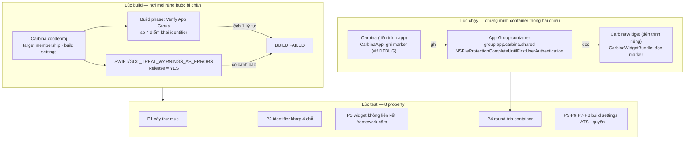
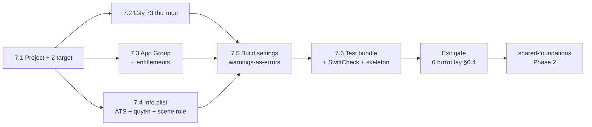

# project-structure — Technical Design

**Spec ID**: `project-structure` · **Phase**: 1 · **Type**: `infra` · **Priority**: 1
**Requirements**: [`requirements.md`](./requirements.md) — 6 REQ · 42 AC · 8 NFR-PS
**Implementation intent**: **logic-first** *(quyết định của bạn ngày 2026-08-18, phạm vi: chỉ spec này)*
**Project docs**: [`../carplay-ai/_INDEX.md`](../carplay-ai/_INDEX.md)

---

## 1. Overview

### Goals

1. Dựng `Carbina.xcodeproj` với **hai target** (`Carbina`, `CarbinaWidget`) và cây thư mục đầy đủ, để 26 spec sau có chỗ đặt file mà không phải tranh luận.
2. Cưỡng chế bốn ràng buộc kỹ thuật **ở tầng cấu hình**, không trông vào kỷ luật người viết code: ngưỡng bộ nhớ widget (qua cấm liên kết framework nặng), ngưỡng iOS, cấm secret trong bundle, cấm cảnh báo build.
3. Biến chế độ thất bại nguy hiểm nhất của App Group — **identifier lệch một ký tự làm widget đọc container rỗng mà không báo lỗi** — từ lỗi im lặng thành **lỗi chặn build**.
4. Dựng sẵn ba test bundle, trong đó `CarPlayLayoutTests` có skeleton cho property-based test của `widget-render` (Phase 3).

**Nguyên tắc thiết kế xuyên suốt spec này:** mỗi ràng buộc phải có **một điểm kiểm tự động**. Ràng buộc chỉ được ghi trong tài liệu mà không có chỗ nào fail được thì coi như chưa có. Đây là lý do §5 và §9 chiếm phần lớn tài liệu, còn §3 rất mỏng.

### In-scope / out-of-scope

**In-scope** — 6 nhóm việc, thi công theo thứ tự phụ thuộc kỹ thuật (xem §8.2):

| # | Nhóm | REQ | Đầu ra |
|---|---|---|---|
| 1 | Xcode project + 2 target + deployment target + availability policy | REQ-002 | `Carbina.xcodeproj`, `App/CarbinaApp.swift`, `App/AppDelegate.swift`, `App/CarPlaySceneDelegate.swift`, `CarbinaWidget/CarbinaWidgetBundle.swift` |
| 2 | Cây thư mục 7 gốc + `.gitkeep` | REQ-001 | **73 thư mục** (xem §4.1) |
| 3 | App Group + entitlements + Data Protection | REQ-003 | `App/Carbina.entitlements`, `CarbinaWidget/CarbinaWidget.entitlements`, build phase `Verify App Group` |
| 4 | Info.plist hai target: ATS, chuỗi quyền, CarPlay scene role | REQ-005 | `App/Info.plist`, `CarbinaWidget/Info.plist` |
| 5 | Build settings: warnings-as-errors, strict concurrency, coverage | REQ-004 | cấu hình Debug/Release trong `Carbina.xcodeproj` |
| 6 | 3 test bundle + SwiftCheck qua SPM + skeleton PBT | REQ-006 | `Tests/CoreTests/…`, `Tests/CarPlayLayoutTests/LayoutPropertyTests.swift`, `Tests/FeatureTests/…`, `Package.resolved` |

**Out-of-scope** — thuộc spec khác, spec này chỉ để chỗ trống:

| Không làm ở đây | Spec sở hữu | Ghi chú |
|---|---|---|
| `shared/Styles/App*.swift` (5 file token) | `shared-foundations` | Thư mục `shared/Styles/` được tạo rỗng + `.gitkeep` |
| `Core/Persistence/AppGroupBridge.swift`, `SQLiteStore.swift` | `shared-foundations` | Spec này chỉ chứng minh container đọc/ghi được, **không** dựng lớp truy cập |
| Nội dung 3 hàm test trong `LayoutPropertyTests.swift` | `widget-render` | Spec này tạo skeleton `XCTSkip` có lý do — xem §7.6 |
| Layout engine, `CarPlayLayoutTokens.swift` | `widget-render` | Thư mục `Core/CarPlay/` tạo rỗng |
| Mọi View, ViewModel, Service nghiệp vụ | 19 spec `feature` | Thư mục tạo rỗng |
| Firebase SDK, StoreKit config, Core ML model | `telemetry-core`, `entitlement-core`, `voice-runtime` | Spec này **không** thêm dependency nào ngoài SwiftCheck |
| Xử lý hành vi sau khi người dùng từ chối quyền | `onboarding-flow` (FR-008) | Spec này chỉ viết chuỗi mô tả quyền trong Info.plist |

**Giới hạn cố ý về accessibility:** spec này **không tạo bề mặt người dùng nào**, nên không có VoiceOver label, Dynamic Type hay contrast nào để thiết kế. Ràng buộc a11y áp dụng từ `shared-foundations` trở đi. Ghi rõ ở §7 từng nhóm việc để chứng minh đã cân nhắc chứ không bỏ sót — khớp NFR-PS-006 của requirements.

### AC Coverage Summary

42/42 AC của `requirements.md` đều được phủ. Bảng đối chiếu đầy đủ:

| REQ | AC | Phủ ở §7 | Property §9 | Failure mode §5 |
|---|---|---|---|---|
| REQ-001 | AC-001.1 | 7.2 | P1 | — |
| REQ-001 | AC-001.2 | 7.2 | P1 | — |
| REQ-001 | AC-001.3 | 7.2 | P1 | — |
| REQ-001 | AC-001.4 | 7.2 | P1 | — |
| REQ-001 | AC-001.5 | 7.2 | P1 | — |
| REQ-001 | AC-001.6 | 7.2 | P1 | — |
| REQ-001 | AC-001.7 | 7.2 | P1 | — |
| REQ-001 | AC-001.8 | 7.2 | P1 | ERR-PS-009 |
| REQ-001 | AC-001.9 | 7.2 | P1 | ERR-PS-008 |
| REQ-002 | AC-002.1 | 7.1 | — | — |
| REQ-002 | AC-002.2 | 7.1 | P3 | ERR-PS-002 |
| REQ-002 | AC-002.3 | 7.1 | P3 | ERR-PS-002 |
| REQ-002 | AC-002.4 | 7.1 | P3 | ERR-PS-002 |
| REQ-002 | AC-002.5 | 7.1 | P5 | — |
| REQ-002 | AC-002.6 | 7.1 | — | ERR-PS-010 |
| REQ-002 | AC-002.7 | 7.1 | — | — |
| REQ-002 | AC-002.8 | 7.1 | — | ERR-PS-007 |
| REQ-003 | AC-003.1 | 7.3 | P2 | ERR-PS-001 |
| REQ-003 | AC-003.2 | 7.3 | P2 | ERR-PS-001 |
| REQ-003 | AC-003.3 | 7.3 | P4 | ERR-PS-001 |
| REQ-003 | AC-003.4 | 7.3 | P4 | — |
| REQ-003 | AC-003.5 | 7.3 | — | ERR-PS-011 |
| REQ-003 | AC-003.6 | 7.3 | P2 | ERR-PS-001 |
| REQ-004 | AC-004.1 | 7.5 | P7 | ERR-PS-003 |
| REQ-004 | AC-004.2 | 7.5 | P7 | ERR-PS-003 |
| REQ-004 | AC-004.3 | 7.5 | — | ERR-PS-003 |
| REQ-004 | AC-004.4 | 7.5 | P7 | — |
| REQ-004 | AC-004.5 | 7.5 | P7 | — |
| REQ-004 | AC-004.6 | 7.5 | P7 | ERR-PS-012 |
| REQ-005 | AC-005.1 | 7.4 | P6 | ERR-PS-005 |
| REQ-005 | AC-005.2 | 7.4 | P6 | ERR-PS-005 |
| REQ-005 | AC-005.3 | 7.4 | — | ERR-PS-004 |
| REQ-005 | AC-005.4 | 7.4 | P4 | — |
| REQ-005 | AC-005.5 | 7.4 | P8 | ERR-PS-013 |
| REQ-005 | AC-005.6 | 7.4 | P8 | ERR-PS-013 |
| REQ-005 | AC-005.7 | 7.4 | P8 | — |
| REQ-006 | AC-006.1 | 7.6 | — | — |
| REQ-006 | AC-006.2 | 7.6 | — | — |
| REQ-006 | AC-006.3 | 7.6 | — | ERR-PS-014 |
| REQ-006 | AC-006.4 | 7.6 | — | — |
| REQ-006 | AC-006.5 | 7.6 | — | ERR-PS-006 |
| REQ-006 | AC-006.6 | 7.6 | P3 | ERR-PS-002 |

**Đếm lại:** 9 + 8 + 6 + 6 + 7 + 6 = **42 AC**, 0 AC không phủ.

---

## 2. Architecture

### 2.1 Runtime boundaries

`Project_Overview.md` §3.1 chốt **ba runtime, một lớp domain** (Quyết định 2). Spec này là spec dựng chính xác các đường biên đó ở tầng target, trước khi có lớp domain nào để chia sẻ:

| Runtime | Target | Tiến trình | Ngân sách bộ nhớ | Framework được liên kết |
|---|---|---|---|---|
| **App iPhone** (SwiftUI) | `Carbina` | tiến trình app | mức app thường | SwiftUI, UIKit (qua AppDelegate), CarPlay, + mọi framework spec sau cần |
| **CarPlay scene** (`CPTemplate*`) | `Carbina` — cùng tiến trình app | tiến trình app | dùng chung với app | CarPlay framework; scene delegate riêng, **cây điều hướng ngang hàng** với iPhone (Overview §3.2 điểm 3) |
| **Widget extension** (WidgetKit) | `CarbinaWidget` | **tiến trình riêng** | **≤ 25MB** *(AC-NFR-007.1)*; rỗng ≤ 5MB *(NFR-PS-004)* | **chỉ** WidgetKit + SwiftUI |

Ba hệ quả kiến trúc mà spec này phải cưỡng chế, chứ không chỉ ghi lại:

1. **CarPlay scene không phải target thứ ba.** Nó sống trong target `Carbina` qua `CarPlaySceneDelegate` + khai báo `CPTemplateApplicationSceneSessionRoleApplication` trong `Info.plist` (AC-002.6). Tách nó thành target riêng sẽ phá Quyết định 2 vì lớp domain phải nhân bản.
2. **Widget extension là tiến trình riêng ⇒ không chia sẻ bộ nhớ ⇒ App Group là kênh duy nhất** (Overview §3.2 điểm 2). Spec này biến "duy nhất" thành ràng buộc kiểm được (AC-003.5, ERR-PS-011).
3. **Ngân sách 25MB được bảo vệ bằng danh sách liên kết, không bằng đo lúc chạy.** Đo bộ nhớ chỉ phát hiện sau khi đã vượt; cấm liên kết `CoreML`/`AVFoundation`/`EventKit`/`CoreLocation`/framework mạng (AC-002.2) chặn nguyên nhân từ đầu. Đây là neo trực tiếp cho rủi ro thực thi A ở Overview §8 — widget bị kill vì bộ nhớ biểu hiện **giống hệt** lỗi render và sẽ bị đếm nhầm vào R-11.

### 2.2 Module responsibilities

Spec này **không tạo module logic nào**. Nó tạo **vỏ chứa** cho 8 module `Core/` và 9 module `Features/`, cộng ba loại tạo phẩm cấu hình. Trách nhiệm phân chia như sau:

| Tạo phẩm | Sở hữu ràng buộc nào | Ai đọc nó |
|---|---|---|
| `Carbina.xcodeproj` (target membership, build settings, build phase) | REQ-002, REQ-004, một nửa REQ-003 | Xcode, CI, mọi spec sau |
| `*.entitlements` × 2 | REQ-003 (App Group, Data Protection) | hệ thống ký ứng dụng |
| `Info.plist` × 2 | REQ-005 (ATS, chuỗi quyền), AC-002.6 (scene role) | hệ thống, App Review |
| Cây thư mục + `.gitkeep` | REQ-001 | người viết code, Structure Compliance Gate |
| 3 test bundle + `Package.resolved` | REQ-006 | `xcodebuild test`, `widget-render` (Phase 3) |
| 4 file Swift tối thiểu | không sở hữu ràng buộc nghiệp vụ nào — chỉ để project build và để chứng minh AC-003.3 | `shared-foundations` thay thế phần tạm |

**Chiều phụ thuộc** (Overview §3.3 Quyết định 7): `View → ViewModel → Service → Model`, một chiều. Spec này chưa có tầng nào trong đó, nhưng cây thư mục ở §4.1 là thứ làm cho chiều đó **nhìn thấy được** — và AC-001.9 (không thư mục lạ) là thứ giữ nó không bị bẻ.

### 2.3 Data flow

Luồng duy nhất tồn tại ở spec này là **luồng chứng minh App Group** (AC-003.3) và **luồng cưỡng chế lúc build**.

**Ba điều đọc ra từ sơ đồ:**

1. **Không có luồng dữ liệu người dùng nào.** Marker file ở khối RUN là dữ liệu tổng hợp phục vụ AC-003.3, không phải dữ liệu thật; container **rỗng là trạng thái đúng** khi spec này kết thúc (AC-003.3 States).
2. **Phần lớn ràng buộc bị chặn ở khối BUILD, không ở khối TEST.** Chủ ý: build fail thì không ai merge được, còn test fail thì có thể bị bỏ qua. Khối TEST là lớp kiểm thứ hai cho những thứ build không tự bắt được (cây thư mục, nội dung plist).
3. **Marker file là tạm.** `shared-foundations` thay hai literal identifier trong `CarbinaApp.swift`/`CarbinaWidgetBundle.swift` bằng `AppGroupBridge`, và xoá đường ghi/đọc marker. Điều kiện chuyển giao ghi ở §8.3.

### 2.4 Quyết định thiết kế và đánh đổi

**Quyết định A — App Group identifier là literal ở 4 chỗ, được canh bằng build phase, thay vì một file hằng số dùng chung.**
*Bối cảnh:* AC-003.6 nói lệch một ký tự làm widget đọc container rỗng **mà không báo lỗi**. Phản xạ tự nhiên là tạo một file hằng số cho cả hai target dùng chung.
*Vấn đề:* AC-002.3 giới hạn target `CarbinaWidget` chỉ được liên kết `WidgetKit`, `SwiftUI`, file thuộc `Core/CarPlay/` và `shared/Styles/`. Một file hằng số ở `Core/Persistence/` sẽ **vi phạm câu chữ AC-002.3** dù không vi phạm ý định của nó, và sẽ buộc phải sửa một requirement vừa được duyệt.
*Quyết định:* giữ literal ở 4 điểm khai (2 entitlements + 2 file Swift) và thêm **build phase `Verify App Group`** so khớp cả 4, fail build nếu lệch. Script sống trong `project.pbxproj` (inline), **không** tạo file mới nào ngoài cây — tránh vi phạm AC-001.9.
*Đánh đổi:* literal trùng lặp trong 4 chỗ là mùi code. Chấp nhận vì (a) nó tồn tại đúng một phase — `shared-foundations` gom hai literal Swift vào `AppGroupBridge`; (b) trùng lặp có canh tự động an toàn hơn trừu tượng hoá phải sửa requirement để hợp lệ hoá; (c) hai literal trong entitlements **buộc phải** trùng lặp dù có file hằng số hay không, nên build phase là cần thiết trong mọi phương án.

**Quyết định B — `SWIFT_TREAT_WARNINGS_AS_ERRORS` chỉ bật ở Release, không bật ở Debug.**
*Lý do:* AC-004.1/AC-004.2 chỉ đòi Release. Bật ở Debug làm mọi cảnh báo tạm (biến chưa dùng khi đang viết dở một hàm) chặn vòng lặp sửa–chạy, và người viết sẽ phản ứng bằng cách tắt cảnh báo — đúng thứ AC-004.6 muốn tránh. AC-004.3 vẫn đòi **0 cảnh báo ở cả Debug và Release**; ràng buộc đó được kiểm ở phase gate (`build_sim` cả hai cấu hình) chứ không bằng cách làm Debug build gãy.
*Đánh đổi:* cảnh báo có thể lọt qua vòng dev cục bộ và chỉ chặn ở Release/CI. Chấp nhận vì độ trễ phát hiện là một lần build, không phải một lần review.

**Quyết định C — bật warnings-as-errors ngay khi project còn rỗng, không đợi có code.**
Đây là lý do nhóm việc 5 nằm **sau** nhóm 1–4 nhưng **trước** mọi spec khác: bật trên project rỗng thì nợ cảnh báo bằng 0 và mọi file thêm vào sau đều phải sạch. Bật muộn thì phải dọn — chính điều REQ-004 user story nói muốn tránh.

**Quyết định D — ba test bundle được tạo cùng lúc ở Phase 1, dù hai trong ba sẽ rỗng nhiều tuần.**
*Lý do:* AC-006.4 đòi một lệnh chạy được cả ba. Thêm test bundle vào scheme sau này là thao tác sửa `.xcscheme` dễ làm lệch giữa các máy; làm một lần lúc dựng scheme thì mọi spec sau chỉ thêm file. AC-006.3 (`XCTSkip` có lý do) là thứ giữ cho "suite xanh" không đồng nghĩa với "đã kiểm gì".

---

## 3. Components and Interfaces

### 3.1 Views / ViewModels / Services / Repositories

**Không có, và đây là trạng thái đúng.** Roadmap §Project Structure ghi thẳng cho phase này: *"0 dòng code — chỉ thư mục và tên file"*. Spec này không tạo View, ViewModel, Service hay Repository nào; 19 spec `feature` và 6 spec `core-service`/`infra` còn lại làm việc đó.

Bốn file Swift dưới đây tồn tại vì **Xcode không build được target rỗng**, không vì chúng mang logic:

| File | Vai trò | Nội dung tối đa được phép | Ai thay thế / mở rộng |
|---|---|---|---|
| `App/CarbinaApp.swift` | `@main` entry của target `Carbina` | `App` struct + một `WindowGroup` rỗng; `#if DEBUG` ghi marker App Group (AC-003.3) | `app-shell` nối `AppRouter` |
| `App/AppDelegate.swift` | vòng đời app, cầu nối `UIApplicationDelegate` | khai báo scene configuration để CarPlay scene được tạo (AC-002.6) | `app-shell` |
| `App/CarPlaySceneDelegate.swift` | `CPTemplateApplicationSceneDelegate` | nhận `didConnect`/`didDisconnect`, thân hàm **rỗng có `// TODO(widget-render)`** | `widget-render`, `context-dashboard` |
| `CarbinaWidget/CarbinaWidgetBundle.swift` | `@main` entry của widget extension | `WidgetBundle` + một `Widget` placeholder; `#if DEBUG` đọc marker (AC-003.3) | `widget-render` thay bằng `CarPlayWidgetSurface` |

**Ràng buộc cứng lên bốn file này:** không import framework nào ngoài `SwiftUI`, `WidgetKit`, `CarPlay`, `UIKit`, `Foundation`. Không `URLSession`, không `CoreML`, không `AVFoundation`. `CarbinaWidgetBundle.swift` chỉ được import `WidgetKit`, `SwiftUI`, `Foundation` — P3 kiểm điều này.

### 3.2 Reuse Plan

**N/A — không có component nào để tái sử dụng hay tạo mới.** `shared/Components/` được tạo rỗng với 6 thư mục con (AC-001.5) và `.gitkeep`. Component đầu tiên xuất hiện ở `shared-foundations`; Reuse-First Gate của `ios-components` bắt đầu áp dụng từ đó. Ghi ở đây để chứng minh đã cân nhắc, không phải bỏ sót.

### 3.3 Public interfaces and contracts

Spec này không phát hành API Swift nào. Nó phát hành **bốn hợp đồng cấu hình** mà spec sau phụ thuộc vào — đây là "public interface" thật của một spec hạ tầng:

| # | Hợp đồng | Giá trị chốt | Ai phụ thuộc |
|---|---|---|---|
| C1 | **App Group identifier** | `group.app.carbina.shared` — khai ở đúng 4 điểm, canh bởi build phase | `shared-foundations` (`AppGroupBridge`), `widget-builder` (FR-022), `sound-library` (FR-013), `settings-presentation` (FR-061) |
| C2 | **Deployment target** | iOS **16.4** cho cả hai target; API từ 17.4 phải bọc `if #available(iOS 17.4, *)` | mọi spec; đặc biệt `widget-builder` (AC-NFR-022.2) và `widget-render` |
| C3 | **Cây thư mục** | 7 gốc / **73 thư mục** — §4.1 là bảng chuẩn | mọi spec khi đặt file |
| C4 | **Test scheme** | một lệnh chạy 3 bundle; SwiftCheck khả dụng **chỉ** cho test target | mọi spec có task `pbt` |

Ba tên định danh bị đóng băng bởi spec này và **không spec sau nào được đổi** mà không qua `spec-refine`: `group.app.carbina.shared`, target name `Carbina`, target name `CarbinaWidget`. Lý do đóng băng identifier: nó nằm trong cấu hình Apple Developer portal, đổi tên nghĩa là container cũ trở thành container khác và dữ liệu người dùng đã cài trở nên vô hình — chế độ thất bại im lặng ở AC-003.6, chỉ ở quy mô toàn bộ người dùng.

### 3.4 File plan by component

Đường dẫn theo cây thư mục thật ở roadmap §Project Structure.

| Nhóm việc (§1) | File | Trạng thái | REQ |
|---|---|---|---|
| 1 | `Carbina.xcodeproj` | tạo mới | REQ-002, REQ-004 |
| 1 | `App/CarbinaApp.swift` | tạo mới | REQ-002, AC-003.3 |
| 1 | `App/AppDelegate.swift` | tạo mới | AC-002.6 |
| 1 | `App/CarPlaySceneDelegate.swift` | tạo mới | AC-002.6 |
| 1 | `CarbinaWidget/CarbinaWidgetBundle.swift` | tạo mới | REQ-002, AC-003.3 |
| 2 | 73 thư mục + `.gitkeep` mỗi thư mục rỗng | tạo mới | REQ-001 |
| 3 | `App/Carbina.entitlements` | tạo mới | REQ-003, AC-005.4 |
| 3 | `CarbinaWidget/CarbinaWidget.entitlements` | tạo mới | REQ-003 |
| 3 | build phase `Verify App Group` (inline trong `project.pbxproj`) | tạo mới | AC-003.6 |
| 4 | `App/Info.plist` | tạo mới | REQ-005, AC-002.6 |
| 4 | `CarbinaWidget/Info.plist` | tạo mới | AC-005.7 |
| 5 | build settings Debug/Release (trong `project.pbxproj`) | tạo mới | REQ-004 |
| 6 | `Tests/CoreTests/ProjectStructureTests.swift` | tạo mới | AC-006.1, P1, P5, P6, P7, P8 |
| 6 | `Tests/CoreTests/AppGroupContainerTests.swift` | tạo mới | AC-006.1, P2, P4 |
| 6 | `Tests/CoreTests/TargetMembershipTests.swift` | tạo mới | AC-006.1, P3 |
| 6 | `Tests/CarPlayLayoutTests/LayoutPropertyTests.swift` | tạo mới (skeleton `XCTSkip`) | AC-006.2, AC-006.3 |
| 6 | `Tests/FeatureTests/FeatureTestsPlaceholder.swift` | tạo mới (skeleton `XCTSkip`) | AC-006.1, AC-006.3 |
| 6 | `Package.resolved` | tạo mới, **commit vào repo** | AC-006.5, NFR-PS-008 |

### 3.5 Sai lệch so với danh sách file của roadmap — cần bạn biết

Roadmap có **hai** danh sách file cho spec này và chúng không trùng nhau, nên tôi lấy **hợp** của cả hai rồi thêm phần requirements đòi:

| File | Bảng §Phase 1 | Registry JSON | Ghi chú |
|---|---|---|---|
| `Carbina.xcodeproj` | ✓ | ✓ | — |
| `App/CarbinaApp.swift` | ✓ | ✓ | — |
| `App/AppDelegate.swift` | ✓ | ✗ | Bảng có, registry thiếu |
| `App/CarPlaySceneDelegate.swift` | ✗ | ✓ | Registry có, bảng thiếu. **Bắt buộc phải có** vì AC-002.6 |
| `App/Info.plist` | ✓ | ✗ | Bảng có, registry thiếu |
| `App/Carbina.entitlements` | ✓ | ✓ | — |
| `CarbinaWidget/CarbinaWidgetBundle.swift` | ✓ | ✗ | Bảng có, registry thiếu |
| `CarbinaWidget/Info.plist` | ✓ | ✗ | Bảng có, registry thiếu |
| `CarbinaWidget/CarbinaWidget.entitlements` | ✓ | ✓ | — |

**5 file design này thêm, không có ở cả hai danh sách roadmap:** 3 file trong `Tests/CoreTests/`, `Tests/FeatureTests/FeatureTestsPlaceholder.swift`, và `Package.resolved`. Lý do: AC-006.1 đòi **ba** test bundle tồn tại, và Xcode không tạo được test bundle không có file nào; AC-006.5 đòi `Package.resolved` được commit.

`Tests/CarPlayLayoutTests/LayoutPropertyTests.swift` **có** trong roadmap §Project Structure bảng Files, đồng thời cũng nằm trong "Files Created" của `widget-render`. Không phải xung đột: spec này tạo skeleton 3 hàm rỗng `XCTSkip` (AC-006.2/AC-006.3), `widget-render` viết thân hàm. §8.3 ghi rõ điều kiện chuyển giao.

---

## 4. Data Models and Contracts

Spec này **không có entity nghiệp vụ nào** — nó cũng không có đầu vào người dùng nào (requirements: mọi REQ ghi `Validation Rules: N/A — no user input`). Thứ nó thực sự có, và thứ 26 spec sau đọc, là **bốn hợp đồng cấu hình ở mức khoá–giá trị**. Dưới đây là các hợp đồng đó ở mức field, vì đó là "data model" thật của một spec hạ tầng.

Cột **Maps to VR** ghi `N/A (no user input)` ở mọi dòng — nhất quán với requirements, không phải bỏ trống.

### 4.1 Cây thư mục — 73 thư mục (bảng chuẩn của hợp đồng C3)

| Cấp | Thư mục | Số con | Ràng buộc | Maps to VR |
|---|---|---:|---|---|
| gốc | `App/` | 0 | chứa 5 file entry/config | N/A (no user input) |
| gốc | `Core/` | 8 | đúng 8 con, không hơn không kém *(AC-001.2)* | N/A (no user input) |
| gốc | `Features/` | 9 | đúng 9 module *(AC-001.3)* | N/A (no user input) |
| gốc | `CarbinaWidget/` | 0 | chứa 3 file của widget target | N/A (no user input) |
| gốc | `shared/` | 3 | `Components/`, `Styles/`, `Modifiers/` *(AC-001.5)* | N/A (no user input) |
| gốc | `Resources/` | 7 | 4 asset + 3 `.lproj` *(AC-001.6)* | N/A (no user input) |
| gốc | `Tests/` | 3 | 3 test bundle *(AC-001.7, AC-006.1)* | N/A (no user input) |
| `Core/` | `CarPlay/` `ML/` `Audio/` `Entitlement/` `Analytics/` `Persistence/` `Extensions/` `Utilities/` | 0 mỗi | tạo rỗng + `.gitkeep` | N/A (no user input) |
| `Features/` | `Onboarding/` `SoundLibrary/` `WidgetBuilder/` | 4 mỗi | `Views/` `ViewModels/` `Models/` `Services/` *(AC-001.4)* | N/A (no user input) |
| `Features/` | `Home/` `VoiceGreeting/` `Paywall/` `Settings/` `Diagnostics/` `CarPlayDashboard/` | 3 mỗi | `Views/` `ViewModels/` `Models/` — **không** `Services/` *(AC-001.4)* | N/A (no user input) |
| `shared/Components/` | `Buttons/` `Cards/` `Rows/` `Inputs/` `Feedback/` `CarPlay/` | 0 mỗi | tạo rỗng + `.gitkeep` *(AC-001.5)* | N/A (no user input) |
| `Resources/` | `Assets.xcassets/` `Sounds/` `VehicleImages/` `GreetingVariants/` `en.lproj/` `es.lproj/` `pt-BR.lproj/` | 0 mỗi | tạo rỗng + `.gitkeep` *(AC-001.6)* | N/A (no user input) |
| `Tests/` | `CoreTests/` `CarPlayLayoutTests/` `FeatureTests/` | 0 mỗi | mỗi thư mục ≥ 1 file test *(AC-006.1)* | N/A (no user input) |

**Phép đếm:** 7 gốc + 8 (`Core`) + 9 (module `Features`) + 30 (thư mục con của 9 module: 3×4 + 6×3) + 3 (`shared`) + 6 (`Components`) + 7 (`Resources`) + 3 (`Tests`) = **73**.

> **Sai lệch trong roadmap cần bạn quyết — không phải lỗi của spec này.**
> Cây ở roadmap §Project Structure cho `Paywall/`, `Settings/`, `Diagnostics/`, `CarPlayDashboard/` **chỉ** `Views/ViewModels/Models/`. Nhưng §File Breakdown của chính roadmap lại giao cho các spec sau những file thuộc `Services/` của đúng bốn module đó:
> `Features/Paywall/Services/PaywallPolicyService.swift` (`paywall`) · `PriceProvider.swift` (`paywall`) · `PurchaseService.swift` (`purchase-confirm`) · `Features/Settings/Services/LocalizationService.swift` + `ThemeService.swift` (`settings-presentation`) · `DataDeletionService.swift` (`privacy-data`) · `RatingPromptPolicy.swift` + `FeedbackRouter.swift` (`feedback-channel`) · `Features/Diagnostics/Services/DiagnosticsStore.swift` + `ReportSubmitQueue.swift` (`widget-diagnostics`) · `Features/CarPlayDashboard/Services/CardActionRouter.swift` + `CardReorderThrottle.swift` (`context-dashboard`).
> **Thiết kế này theo đúng cây roadmap (73 thư mục), không tự thêm 4 thư mục `Services/`** — vì AC-001.9 cấm thư mục ngoài danh sách. Hệ quả phải chấp nhận: AC-001.9 chỉ đúng **tại thời điểm spec này kết thúc**; từ Phase 8 trở đi cây sẽ hợp lệ khi có thêm 4 `Services/`. Cách sửa gọn là patch roadmap §Project Structure ở lần `spec-refine` gần nhất. Tôi **không** tự sửa roadmap trong spec này vì nó là tài liệu tầng trên và đã được duyệt.

### 4.2 Entitlements — `App/Carbina.entitlements` và `CarbinaWidget/CarbinaWidget.entitlements`

| Khoá | Type | Giá trị / ràng buộc | Target | Maps to VR |
|---|---|---|---|---|
| `com.apple.security.application-groups` | `Array<String>` | đúng một phần tử: `group.app.carbina.shared`; **byte-identical** giữa hai file *(AC-003.1, AC-003.2, AC-003.6)* | cả hai | N/A (no user input) |
| `com.apple.developer.default-data-protection` | `String` | `NSFileProtectionCompleteUntilFirstUserAuthentication` *(AC-003.4, AC-005.4)* | `Carbina` | N/A (no user input) |
| *(không khoá nào khác)* | — | mọi capability khác **không** được khai ở phase này | cả hai | N/A (no user input) |

### 4.3 Info.plist — hai target

| Khoá | Type | Giá trị / ràng buộc | Target | Maps to VR |
|---|---|---|---|---|
| `UIApplicationSceneManifest` → `CPTemplateApplicationSceneSessionRoleApplication` | `Array<Dict>` | một entry, `UISceneDelegateClassName = CarPlaySceneDelegate` *(AC-002.6)* | `Carbina` | N/A (no user input) |
| `MinimumOSVersion` *(dẫn xuất từ build setting)* | `String` | `16.4` *(AC-002.5)* | cả hai | N/A (no user input) |
| `NSAppTransportSecurity` → `NSAllowsArbitraryLoads` | `Bool` | **khoá phải KHÔNG tồn tại** *(AC-005.1)* | cả hai | N/A (no user input) |
| `NSAppTransportSecurity` → `NSExceptionDomains` | `Dict` | **khoá phải KHÔNG tồn tại** *(AC-005.2)* | cả hai | N/A (no user input) |
| `NSLocationWhenInUseUsageDescription` | `String` | nêu lý do cụ thể, **không** câu chung; độ dài > 0 *(AC-005.5)* | `Carbina` | N/A (no user input) |
| `NSCalendarsUsageDescription` | `String` | nêu lý do cụ thể *(AC-005.5)* | `Carbina` | N/A (no user input) |
| `NSPhotoLibraryUsageDescription` | `String` | nêu lý do cụ thể *(AC-005.5)* | `Carbina` | N/A (no user input) |
| *bất kỳ khoá `NS*UsageDescription` nào khác* | `String` | **phải KHÔNG tồn tại** — khai quyền thừa là rủi ro R-02 *(AC-005.6)* | `Carbina` | N/A (no user input) |
| *mọi khoá `NS*UsageDescription`* | — | **phải KHÔNG tồn tại** *(AC-005.7)* | `CarbinaWidget` | N/A (no user input) |
| `NSExtension` → `NSExtensionPointIdentifier` | `String` | `com.apple.widgetkit-extension` | `CarbinaWidget` | N/A (no user input) |

**Ràng buộc nội dung ba chuỗi quyền** — AC-005.5 đòi "lý do cụ thể", nên nội dung phải kiểm được, không chỉ tồn tại. Quy tắc chấp nhận: chuỗi phải nêu **tính năng cụ thể** và **hệ quả nếu từ chối**; ba chuỗi dưới đây là bản chốt của spec này (bản dịch ES/PT-BR thuộc `settings-presentation`):

| Khoá | Chuỗi (EN) |
|---|---|
| `NSLocationWhenInUseUsageDescription` | Carbina learns your regular routes on your device so your greeting can mention your commute. Deny this and greetings simply skip route details — everything else keeps working. |
| `NSCalendarsUsageDescription` | Carbina reads your next event title on your device so your greeting can mention it. Deny this and greetings skip calendar details — everything else keeps working. |
| `NSPhotoLibraryUsageDescription` | Carbina needs your photo only when you pick a personal picture for your car widget. Deny this and you can still use the built-in vehicle images. |

Ba chuỗi này **không** dùng cụm "to improve your experience" — đúng thứ AC-005.5 loại. P8 kiểm chuỗi tồn tại, không rỗng, và không khớp danh sách cụm chung bị cấm.

### 4.4 Build settings

| Setting | Type | Giá trị | Cấu hình | Maps to VR |
|---|---|---|---|---|
| `IPHONEOS_DEPLOYMENT_TARGET` | `String` | `16.4` — **cả hai target** *(AC-002.5)* | Debug + Release | N/A (no user input) |
| `SWIFT_TREAT_WARNINGS_AS_ERRORS` | `Bool` | `YES` *(AC-004.1)* | **Release** *(§2.4 Quyết định B)* | N/A (no user input) |
| `GCC_TREAT_WARNINGS_AS_ERRORS` | `Bool` | `YES` *(AC-004.2)* | **Release** | N/A (no user input) |
| `SWIFT_STRICT_CONCURRENCY` | `Enum` | tối thiểu `targeted` *(AC-004.5)* | Debug + Release | N/A (no user input) |
| `SWIFT_VERSION` | `String` | bản cao nhất toolchain hỗ trợ *(AC-004.5)* | Debug + Release | N/A (no user input) |
| `CODE_COVERAGE_ENABLED` *(scheme)* | `Bool` | `YES`, phạm vi giới hạn ở target chứa `Core/` *(AC-004.4)* | test action | N/A (no user input) |
| *mọi setting `*_WARNINGS = NO`* | — | **cấm**, trừ khi có comment nêu lý do tại chỗ *(AC-004.6)* | mọi cấu hình | N/A (no user input) |

### 4.5 App Group marker — tạo phẩm tạm phục vụ AC-003.3

| Field | Type | Ràng buộc | Maps to VR |
|---|---|---|---|
| đường dẫn | `URL` | `containerURL(forSecurityApplicationGroupIdentifier: "group.app.carbina.shared")` + `/handshake.bin` | N/A (no user input) |
| payload | `Data` | nội dung tuỳ ý; P4 kiểm round-trip **byte-identical** với mọi payload sinh bởi SwiftCheck | N/A (no user input) |
| thuộc tính bảo vệ | `FileProtectionType` | `.completeUntilFirstUserAuthentication` *(AC-003.4)* | N/A (no user input) |
| vòng đời | — | chỉ tồn tại trong build `#if DEBUG`; **bị xoá bởi `shared-foundations`** cùng hai literal identifier | N/A (no user input) |

### 4.6 Mapping / derivation rules

1. **`IPHONEOS_DEPLOYMENT_TARGET` → `MinimumOSVersion`**: Xcode dẫn xuất khoá plist từ build setting; **không** khai tay `MinimumOSVersion`, nếu không hai giá trị sẽ lệch được. Nguồn chân lý duy nhất là build setting.
2. **App Group identifier → 4 điểm khai**: `Carbina.entitlements`, `CarbinaWidget.entitlements`, literal trong `CarbinaApp.swift`, literal trong `CarbinaWidgetBundle.swift`. Không có nguồn dẫn xuất; đây là lý do build phase `Verify App Group` tồn tại (§2.4 Quyết định A) và là lý do P2 so cả 4 chỗ chứ không so 2.
3. **`covers` của registry → Source của requirements**: `covers` rỗng ⇒ Source dùng NFR thay FR/UC (infra carve-out, xem `spec-creation-contract`). Không phải quy tắc dẫn xuất dữ liệu runtime, nhưng là quy tắc dẫn xuất tài liệu mà gate dựa vào.
4. **Không có DTO, không có ánh xạ DTO→domain nào** ở spec này. Ánh xạ đầu tiên xuất hiện ở `shared-foundations` (`AppGroupBridge` đọc/ghi `WidgetConfig`).

---

## 5. Error Handling

**Đọc cột "Hành vi thấy được" thế nào:** spec này không có người dùng cuối, nên "user" ở đây là **người viết code và CI** — mọi thất bại phải hiện ra dưới dạng build fail hoặc test fail có thông điệp đọc được, chứ không phải một dòng log. Đây là chỗ nguyên tắc ở §1 ("mỗi ràng buộc phải có một điểm kiểm tự động") được kiểm lại: bảng dưới có **14 chế độ thất bại**, và mỗi chế độ đều có một điểm phát hiện cụ thể.

| Failure mode | Detection | Hành vi thấy được (dev / CI) | Recovery / retry | Ref |
|---|---|---|---|---|
| **ERR-PS-001** — App Group identifier lệch giữa 4 điểm khai. **Chế độ nguy hiểm nhất của spec:** widget đọc container rỗng và **không phát ra lỗi nào** | Build phase `Verify App Group` so 4 chuỗi; P2 so lại trong test | `BUILD FAILED: App Group identifier mismatch` + in ra cả 4 giá trị tìm thấy và đường dẫn từng chỗ | Sửa cho khớp `group.app.carbina.shared`, build lại. **Không** có đường lui runtime — phải chặn ở build | AC-003.1, AC-003.2, AC-003.6 |
| **ERR-PS-002** — file bị thêm sai target membership: `Core/ML`, `Core/Audio`, `Core/Analytics`, `Core/Entitlement` vào `CarbinaWidget`; hoặc framework cấm bị liên kết; hoặc test target liên kết vào `CarbinaWidget` | P3 phân tích `project.pbxproj`: danh sách framework của widget target và tập file membership | Test fail, in tên file/framework vi phạm và target đang chứa nó | Gỡ khỏi membership. **Chặn merge** — không có ngoại lệ *(AC-002.4, AC-006.6)* | AC-002.2, AC-002.3, AC-002.4, AC-006.6 |
| **ERR-PS-003** — có cảnh báo Xcode | Release: `SWIFT/GCC_TREAT_WARNINGS_AS_ERRORS` làm build dừng. Debug: phase gate build cả hai cấu hình rồi đếm cảnh báo | Release: `BUILD FAILED` tại dòng cảnh báo. Debug: phase gate báo số cảnh báo > 0 | Sửa cảnh báo. Tắt cảnh báo chỉ được nếu kèm comment lý do *(AC-004.6 → ERR-PS-012)* | AC-004.1, AC-004.2, AC-004.3 |
| **ERR-PS-004** — secret / API key / token plaintext trong bundle, plist, hay hằng số code | Rà soát trước mỗi submit *(AC-005.3)*; quét chuỗi trong `Info.plist` + `*.swift` + `*.xcconfig` | Báo cáo rà soát liệt kê vị trí. **Lỗi chặn phát hành**, không phải cảnh báo | Gỡ secret, chuyển sang Keychain *(AC-NFR-010.1)*, **thu hồi key đã lộ**. Không đủ nếu chỉ xoá khỏi commit mới | AC-005.3 |
| **ERR-PS-005** — `NSAllowsArbitraryLoads` hoặc exception domain xuất hiện trong `Info.plist` | P6 đọc plist cả hai target | Test fail, in tên khoá và target | Gỡ khoá. Nếu một spec sau **thật sự** cần ngoại lệ mạng thì phải qua `spec-refine`, không tự thêm | AC-005.1, AC-005.2 |
| **ERR-PS-006** — SwiftCheck resolve thất bại (mất mạng, repo đổi, version yank) | `xcodebuild` báo lỗi resolve dependency | `error: could not resolve package dependencies` | Dùng `Package.resolved` đã commit *(NFR-PS-008)* → build offline chạy được. Nếu chính `Package.resolved` thiếu thì cần mạng **một lần** | AC-006.5 |
| **ERR-PS-007** — dùng API chỉ có từ iOS 17.4 mà không bọc `if #available` | Trình biên dịch báo lỗi availability khi deployment target là 16.4 | `BUILD FAILED: 'X' is only available in iOS 17.4 or newer` | Bọc `if #available(iOS 17.4, *)` kèm nhánh giảm cấp. **Không** nâng deployment target — sẽ phá C2 và cắt thị trường *(Overview §3.3 Quyết định 1)* | AC-002.8 |
| **ERR-PS-008** — có thư mục ngoài cây đã định | P1 so tập thư mục thực tế với bảng §4.1 | Test fail, in danh sách thư mục lạ | Gỡ hoặc chuyển vào cây. Nếu cây cần mở rộng thật thì patch roadmap §Project Structure trước *(xem ghi chú §4.1)* | AC-001.9 |
| **ERR-PS-009** — thư mục rỗng biến mất khỏi repo sau clone (git không theo dõi thư mục rỗng) | P1 chạy trên bản clone mới phát hiện thiếu thư mục | Test fail, in thư mục thiếu | Thêm `.gitkeep`. Đây là lý do AC-001.8 tồn tại — không phải chi tiết vụn | AC-001.8 |
| **ERR-PS-010** — thiếu `CPTemplateApplicationSceneSessionRoleApplication` hoặc `UISceneDelegateClassName` sai tên | Chạy trên CarPlay simulator: scene không bao giờ được tạo, `didConnect` không gọi | Không crash, **không có gì xảy ra** — chế độ thất bại im lặng thứ hai của spec. Kiểm bằng log của `CarPlaySceneDelegate` khi cắm CarPlay simulator | Sửa `Info.plist`; đối chiếu tên class chính xác *(chuỗi trong plist không được refactor theo tên Swift)* | AC-002.6 |
| **ERR-PS-011** — xuất hiện kênh chia sẻ thứ hai giữa hai target: `UserDefaults` chuẩn, Keychain sharing, Darwin notification chở dữ liệu, hoặc file ngoài container | Code review + quét import/API trong file thuộc cả hai target | Bị đánh dấu **lỗi kiến trúc chặn merge** | Chuyển về App Group container. Không có ngoại lệ ở MVP 1 | AC-003.5 |
| **ERR-PS-012** — cảnh báo bị tắt bằng pragma hoặc build setting mà không có lý do ghi kèm | P7 quét `*_WARNINGS = NO` trong `project.pbxproj` và `// swiftlint:disable` / `#pragma` trong `*.swift`, kiểm có comment lý do liền kề | Test fail, in vị trí tắt cảnh báo thiếu chú thích | Thêm một dòng lý do tại chỗ, hoặc bỏ việc tắt | AC-004.6 |
| **ERR-PS-013** — chuỗi mô tả quyền rỗng, dùng câu chung ("to improve your experience"), hoặc khai khoá quyền app không dùng | P8 kiểm 3 khoá bắt buộc tồn tại + không rỗng + không khớp danh sách cụm chung bị cấm; và không có khoá `NS*UsageDescription` thứ tư | Test fail, in khoá vi phạm và lý do (rỗng / chung / thừa) | Viết lại theo mẫu §4.3, hoặc gỡ khoá thừa. Khai quyền thừa là rủi ro **R-02** *(App Review từ chối)* | AC-005.5, AC-005.6, AC-005.7 |
| **ERR-PS-014** — ba hàm test trong `LayoutPropertyTests.swift` pass giả (không `XCTSkip`, thân rỗng) → suite xanh mà chưa kiểm gì | Chạy test và đọc kết quả: hàm phải báo **skipped**, không phải **passed** | Nếu báo passed → đây là lỗi: suite đang nói dối về độ phủ | Thêm `XCTSkip("chờ widget-render (Phase 3)")`. `widget-render` gỡ `XCTSkip` khi viết thân hàm | AC-006.3 |

**Hai chế độ thất bại im lặng cần chú ý riêng** — cả hai đều không phát ra lỗi và đều bị chặn bằng cách khác:

- **ERR-PS-001** (identifier lệch): chặn ở build phase, vì runtime không có cách phân biệt "container rỗng vì chưa ai ghi" với "container rỗng vì sai identifier".
- **ERR-PS-010** (thiếu scene role): không có điểm chặn tự động ở Phase 1 vì cần CarPlay simulator. Được kiểm bằng **một bước xác minh tay có ghi chép** ở §6.4, và sẽ có điểm chặn tự động từ `widget-render` (Phase 3) khi có test chạy trên CarPlay scene thật.

Hai điểm này là chỗ duy nhất trong spec mà nguyên tắc "mỗi ràng buộc có một điểm kiểm tự động" chưa đạt được hoàn toàn ở Phase 1. Ghi rõ ở đây thay vì để nó trôi.

---

## 6. Testing Strategy

**Điều làm test của spec này khác mọi spec sau:** không có logic nghiệp vụ nào để test. Đối tượng test là **chính cấu hình project** — `project.pbxproj`, hai `Info.plist`, hai `.entitlements`, và cây thư mục. Nên phần lớn test ở đây là test **đọc và phân tích tạo phẩm cấu hình**, chạy như XCTest bình thường trong bundle `CoreTests`.

Đây là lựa chọn có chủ ý thay cho script shell rời: test nằm trong scheme nên nó chạy ở mọi phase gate của mọi spec sau, và **hồi quy cấu hình bị bắt ngay** khi một spec Phase 7 vô tình thêm `CoreML` vào widget target.

### 6.1 Unit tests by component

| Test file | Bundle | Kiểm gì | AC | Property |
|---|---|---|---|---|
| `ProjectStructureTests.swift` | `CoreTests` | Cây 73 thư mục đúng và đủ; không thư mục lạ; `.gitkeep` ở mọi thư mục rỗng; build settings đúng giá trị; ATS không có khoá cấm; 3 chuỗi quyền hợp lệ | AC-001.1→001.9, AC-002.5, AC-004.1, AC-004.2, AC-004.4, AC-004.5, AC-004.6, AC-005.1, AC-005.2, AC-005.5, AC-005.6, AC-005.7 | P1, P5, P6, P7, P8 |
| `AppGroupContainerTests.swift` | `CoreTests` | Identifier khớp cả 4 điểm khai; ghi→đọc container round-trip; thuộc tính Data Protection đúng | AC-003.1, AC-003.2, AC-003.3, AC-003.4, AC-003.6, AC-005.4 | P2, P4 |
| `TargetMembershipTests.swift` | `CoreTests` | Widget target chỉ liên kết framework cho phép; không file `Core/ML`·`Audio`·`Analytics`·`Entitlement` trong widget; test target không liên kết widget | AC-002.2, AC-002.3, AC-002.4, AC-006.6 | P3 |
| `LayoutPropertyTests.swift` | `CarPlayLayoutTests` | **Skeleton** — 3 hàm `XCTSkip("chờ widget-render (Phase 3)")` | AC-006.2, AC-006.3 | — *(P của `widget-render`)* |
| `FeatureTestsPlaceholder.swift` | `FeatureTests` | **Skeleton** — 1 hàm `XCTSkip`, chỉ để bundle tồn tại | AC-006.1, AC-006.3 | — |

Ba AC còn lại không kiểm được bằng XCTest ở Phase 1 và được xử lý ở §6.4: AC-002.1 *(số target — kiểm bằng `list_schemes`)*, AC-002.6 *(scene role — cần CarPlay simulator)*, AC-002.7 *(minimum device trên App Store Connect — nằm ngoài repo)*, AC-005.3 *(rà secret trước submit)*, AC-003.5 *(kênh chia sẻ thứ hai — code review)*, AC-006.4 *(một lệnh chạy 3 bundle — chính việc chạy được là bằng chứng)*.

### 6.2 Integration test boundaries

Chỉ có **một** đường biên tích hợp thật ở spec này, và nó là đường biên quan trọng nhất của cả dự án:

> **`Carbina` (tiến trình app) → App Group container → `CarbinaWidget` (tiến trình riêng)**

Giới hạn phải nói rõ: `AppGroupContainerTests` chạy trong **test host của app**, nên nó chứng minh container *đọc/ghi được bằng identifier đó*, **không** chứng minh tiến trình widget đọc được. Phần sau chỉ chứng minh được bằng cách chạy widget thật — thuộc bước xác minh tay ở §6.4 bước 3. AC-003.3 đòi đúng điều đó ("ghi từ app rồi đọc lại từ widget extension"), nên không được coi test tự động là đã thoả.

Từ `shared-foundations` trở đi, đường biên này có `AppGroupBridge` và test tích hợp thật sự thay thế bước tay.

### 6.3 Property-based tests

SwiftCheck ≥ 0.12.0 qua SPM, khai **chỉ** cho test target *(AC-006.5)*; `Package.resolved` được commit *(NFR-PS-008)*. Chi tiết 8 property ở §9. Ánh xạ property → requirement:

| Property | Requirement | Vì sao PBT chứ không phải test ví dụ |
|---|---|---|
| P1 | REQ-001 | Sinh ngẫu nhiên đường dẫn thư mục hợp lệ/không hợp lệ để kiểm cả hai chiều: mọi thư mục trong bảng **phải có**, mọi thư mục ngoài bảng **phải không có**. Test ví dụ chỉ kiểm chiều thứ nhất |
| P2 | REQ-003 | So 4 chuỗi là bất biến, nhưng PBT sinh biến thể lệch (thiếu ký tự, sai hoa thường, thêm khoảng trắng) để chứng minh checker **thật sự bắt được** lệch — chứ không phải checker luôn trả true |
| P3 | REQ-002 | Sinh tập framework ngẫu nhiên rồi kiểm giao với tập cấm luôn rỗng; bắt được cả framework cấm chưa nghĩ tới |
| P4 | REQ-003 | Round-trip kinh điển: với **mọi** `Data` payload, ghi rồi đọc phải trả về byte-identical. Bắt lỗi mã hoá/encoding mà một payload ví dụ bỏ sót |
| P5 | REQ-002 | Bất biến trên mọi cặp (target × cấu hình): deployment target luôn `16.4` |
| P6 | REQ-005 | Bất biến trên mọi (target × khoá bị cấm): khoá không tồn tại |
| P7 | REQ-004 | Bất biến trên mọi cấu hình Release: warnings-as-errors bật; và trên mọi chỗ tắt cảnh báo: có lý do kèm |
| P8 | REQ-005 | Sinh chuỗi mô tả quyền hợp lệ/không hợp lệ để kiểm validator chuỗi bắt được câu chung và chuỗi rỗng |

**Ghi chú về AC-NFR-024.1 (coverage `Core/` ≥ 80%):** ở Phase 1 thư mục `Core/` **rỗng**, nên chỉ số coverage không có mẫu để đo và con số báo ra sẽ vô nghĩa (0/0). Spec này chỉ **bật thu thập coverage với phạm vi đúng** *(AC-004.4)*; ngưỡng 80% bắt đầu có ý nghĩa và được cưỡng chế từ `shared-foundations`, spec đầu tiên đặt file vào `Core/`. Không tuyên bố đã đạt 80% ở phase này.

### 6.4 Bước xác minh tay — 6 bước, phải ghi chép kết quả

Sáu AC dưới đây không có đường kiểm tự động ở Phase 1. Chúng **không được** đánh dấu done bằng suy luận:

| # | Bước | AC | Bằng chứng phải lưu |
|---|---|---|---|
| 1 | `discover_projs` → `list_schemes` → xác nhận đúng **hai** target sản phẩm | AC-002.1 | Ảnh/đoạn output liệt kê `Carbina` + `CarbinaWidget` |
| 2 | `build_sim` cả Debug và Release, đếm cảnh báo | AC-004.3 | Output có `** BUILD SUCCEEDED **` và `0 warnings` cho cả hai |
| 3 | Chạy app trên CarPlay simulator; app ghi marker; **mở widget** và xác nhận nó đọc được marker | AC-002.6, AC-003.3 | Log `CarPlaySceneDelegate.didConnect` + nội dung marker hiện trong widget placeholder |
| 4 | Chạy 3 bundle bằng **một** lệnh test | AC-006.4 | Output cho thấy 3 bundle, `LayoutPropertyTests` báo **skipped** không phải passed *(ERR-PS-014)* |
| 5 | Rà bundle sản phẩm tìm secret plaintext | AC-005.3 | Báo cáo rà: 0 hit |
| 6 | Đặt minimum device = **iPhone 12** trên App Store Connect | AC-002.7 | Ảnh cấu hình App Store Connect. *Nằm ngoài repo — dễ bị bỏ quên nhất trong 6 bước* |

### 6.5 Build/test checkpoints

Spec này là spec **duy nhất** mà phase gate không thể chạy trước khi nó xong — trước nó không có project để build. Nên checkpoint của nó là điều kiện vào của mọi phase gate về sau:

| Checkpoint | Khi nào | Nội dung | Điều kiện pass |
|---|---|---|---|
| **CP-1** | sau nhóm việc 1 (project + 2 target) | `discover_projs` → `list_schemes` → `build_sim` | build thành công với target rỗng; 2 target hiện diện |
| **CP-2** | sau nhóm việc 3 (App Group) | build + bước tay §6.4 #3 | build phase `Verify App Group` chạy và pass; widget đọc được marker |
| **CP-3** | sau nhóm việc 5 (build settings) | `build_sim` Debug **và** Release | 0 cảnh báo cả hai cấu hình; Release không dừng vì warnings-as-errors |
| **CP-4** | sau nhóm việc 6 (tests) | một lệnh test 3 bundle + `validate_traceability.py project-structure` | 3 bundle chạy; 8 property pass; skeleton báo skipped; traceability PASSED |
| **Exit gate** | cuối spec | 6 bước §6.4 + toàn bộ 8 property | roadmap Exit Criteria P1: *`xcodebuild` thành công 0 warning · App Group đọc/ghi được từ cả 2 target* |

---

## 7. Feature Breakdown (iOS-first)

**Cách đọc §7 cho một spec hạ tầng.** Template đòi mỗi mục 7.X nêu bốn trạng thái (Loading/Empty/Error/Success) và một dòng accessibility. Sáu mục dưới đây **không có bề mặt người dùng**, nên bốn trạng thái được diễn giải theo *trạng thái của tạo phẩm cấu hình*: Loading = trong lúc thi công, Empty = tạo phẩm rỗng, Error = cấu hình sai, Success = điều kiện nghiệm thu. Dòng accessibility ghi `N/A` **kèm lý do và kèm spec sẽ chịu trách nhiệm** — nhất quán NFR-PS-006 của requirements, không phải bỏ trống cho qua gate.

Thứ tự 7.1 → 7.6 là **thứ tự thi công thật** (logic-first, theo chuỗi phụ thuộc ở §8.2), không phải thứ tự số REQ.

### 7.1 Xcode project và hai target

- **ACs Implemented:** AC-002.1, AC-002.2, AC-002.3, AC-002.4, AC-002.5, AC-002.6, AC-002.7, AC-002.8
- **Source:** NFR-007 *(AC-NFR-007.1 ≤ 25MB · AC-NFR-007.4 widget không nạp Core ML, không gọi mạng)*, NFR-022 *(AC-NFR-022.1 không crash trên iOS 16.4–17.3 · AC-NFR-022.4 minimum device)* · **Enables (không thực thi):** FR-029, FR-030 *(`widget-render`)*
- **Visual structure:** không có màn hình. "Cấu trúc" ở đây là sơ đồ target ở §2.1 — hai target sản phẩm, ba runtime, một lớp domain dùng chung.
- **States:**
  - **Loading:** trong lúc dựng, project ở trạng thái chưa build được (thiếu file `@main`). Đây là trạng thái trung gian **không được commit** — commit đầu tiên phải build xanh.
  - **Empty:** cả hai target build thành công với thân hàm rỗng. **Đây là trạng thái đúng khi 7.1 xong** — không có tính năng nào, và không nên có.
  - **Error:** widget target liên kết framework cấm, hoặc deployment target lệch giữa hai target, hoặc dùng API 17.4 không bọc `#available` → ERR-PS-002, ERR-PS-007.
  - **Success:** `list_schemes` liệt kê đúng `Carbina` + `CarbinaWidget`; `build_sim` xanh; P3 và P5 pass; minimum device đặt iPhone 12 trên App Store Connect.
- **Accessibility & appearance:** N/A — không tạo bề mặt người dùng nào. VoiceOver / Dynamic Type / contrast ≥ 4,5:1 / target ≥ 44pt / dark mode bắt đầu áp dụng từ `shared-foundations` (component đầu tiên) và được cưỡng chế bởi UX Compliance Gate của `ios-ui-ux` từ đó.
- **Actions:** tạo project · thêm widget extension target · đặt deployment target 16.4 cả hai · rà và gỡ framework khỏi widget target · khai `CPTemplateApplicationSceneSessionRoleApplication` · đặt minimum device trên App Store Connect.
- **Files:**
  - `Carbina.xcodeproj`
  - `App/CarbinaApp.swift`
  - `App/AppDelegate.swift`
  - `App/CarPlaySceneDelegate.swift`
  - `CarbinaWidget/CarbinaWidgetBundle.swift`

> **Điểm dễ sai nhất của 7.1:** Xcode mặc định liên kết `AVFoundation` và một số framework khác vào widget extension khi tạo từ template. AC-002.2 đòi gỡ, và việc gỡ phải làm **ngay lúc tạo target** — nếu để sau, một spec Phase 5 (`sound-playback-connect`) sẽ thấy `AVFoundation` đã có sẵn ở widget và tưởng đó là hợp lệ.

### 7.2 Cây thư mục 73 thư mục

- **ACs Implemented:** AC-001.1, AC-001.2, AC-001.3, AC-001.4, AC-001.5, AC-001.6, AC-001.7, AC-001.8, AC-001.9
- **Source:** NFR-024 *(AC-NFR-024.2 build hygiene — cấu trúc là điều kiện để rà soát tự động)* · `ios-architecture` Structure Compliance Gate · `Project_Overview.md` §3.3 Quyết định 7 · **Enables (không thực thi):** toàn bộ 26 spec còn lại
- **Visual structure:** bảng chuẩn ở **§4.1**. Không nhân bản bảng ở đây để không tồn tại hai nguồn chân lý lệch nhau được.
- **States:**
  - **Loading:** N/A — tạo cây là thao tác đồng bộ, không có trạng thái chờ quan sát được *(khớp requirements REQ-001 States)*.
  - **Empty:** 73 thư mục tồn tại và **hầu hết rỗng** — đúng trạng thái mong đợi. Mỗi thư mục rỗng có `.gitkeep` để tồn tại sau clone *(AC-001.8, ERR-PS-009)*.
  - **Error:** thư mục lạ ngoài bảng *(ERR-PS-008)*, hoặc thư mục rỗng mất sau clone vì thiếu `.gitkeep` *(ERR-PS-009)*.
  - **Success:** P1 pass trên **bản clone mới**, không chỉ trên máy vừa tạo cây — đây là điều kiện thật, vì ERR-PS-009 chỉ hiện ra sau clone.
- **Accessibility & appearance:** N/A — thư mục không có bề mặt hiển thị. Xem lý do đầy đủ ở 7.1.
- **Actions:** tạo 73 thư mục theo §4.1 · thêm `.gitkeep` vào mọi thư mục rỗng · clone lại repo ở đường dẫn khác và chạy P1 để xác nhận · rà không có thư mục ngoài bảng.
- **Files:** 73 thư mục + `.gitkeep` tương ứng. Không file mã nguồn nào.

> **Việc phải làm ngay sau 7.2, đừng để trôi:** 4 module `Paywall/`, `Settings/`, `Diagnostics/`, `CarPlayDashboard/` sẽ cần `Services/` từ Phase 8 nhưng cây roadmap không liệt kê *(ghi chú ở §4.1)*. 7.2 **không** tạo trước 4 thư mục đó, vì AC-001.9 cấm. Cần patch roadmap §Project Structure trước Phase 8, nếu không AC-001.9 sẽ trở thành một ràng buộc sai mà mọi spec sau phải lách.

### 7.3 App Group — kênh giao tiếp duy nhất giữa hai target

- **ACs Implemented:** AC-003.1, AC-003.2, AC-003.3, AC-003.4, AC-003.5, AC-003.6
- **Source:** NFR-007 *(AC-NFR-007.2 ảnh ≤ 2MB trong container)*, NFR-010 *(AC-NFR-010.2 Data Protection cho file)* · `Project_Overview.md` §3.2 điểm 2 *"Widget extension là một tiến trình riêng"* · **Enables (không thực thi):** FR-022 *(`widget-builder`)*, FR-013 *(`sound-library`)*, FR-061 *(`settings-presentation`)*
- **Visual structure:** khối RUN của sơ đồ §2.3 — app ghi, container giữ, widget đọc. Một chiều dữ liệu, một container, không đường thứ hai.
- **States:**
  - **Loading:** N/A — truy cập container là đồng bộ ở tầng cấu hình.
  - **Empty:** container **rỗng khi spec này kết thúc là trạng thái đúng và mong đợi** *(requirements REQ-003 States)*. Dữ liệu thật do `widget-builder`, `sound-library`, `settings-presentation` ghi vào sau. Chỉ marker `handshake.bin` của build DEBUG tồn tại, và nó bị `shared-foundations` xoá.
  - **Error:** identifier lệch giữa 4 điểm khai → container rỗng **im lặng** *(ERR-PS-001, chế độ thất bại nguy hiểm nhất của spec)*; hoặc xuất hiện kênh chia sẻ thứ hai *(ERR-PS-011)*.
  - **Success:** build phase `Verify App Group` pass · P2 pass với cả biến thể lệch được sinh ra · P4 round-trip byte-identical · bước tay §6.4 #3 chứng minh **tiến trình widget** đọc được, không chỉ test host.
- **Accessibility & appearance:** N/A — App Group là capability tầng ký ứng dụng, không có bề mặt hiển thị và **không cần người dùng cấp quyền** *(requirements REQ-003 States: Permission-denied N/A)*. Xem lý do đầy đủ ở 7.1.
- **Actions:** bật capability App Group trên cả hai target · ghi identifier vào 2 `.entitlements` · đặt Data Protection · thêm build phase `Verify App Group` · ghi marker từ app + đọc từ widget để chứng minh · đối chiếu identifier với Apple Developer portal.
- **Files:**
  - `App/Carbina.entitlements`
  - `CarbinaWidget/CarbinaWidget.entitlements`
  - build phase `Verify App Group` *(inline trong `Carbina.xcodeproj/project.pbxproj`)*
  - phần `#if DEBUG` trong `App/CarbinaApp.swift` và `CarbinaWidget/CarbinaWidgetBundle.swift` *(tạm — xem §8.3)*

> **Đừng bỏ qua bước đối chiếu với Apple Developer portal (AC-003.6).** Identifier khớp giữa hai file trong repo mà lệch với App Group đã đăng ký trên portal cho ra **đúng cùng một triệu chứng**: container rỗng, không lỗi. Build phase không bắt được trường hợp này vì nó chỉ đọc file trong repo. Đây là lý do bước tay §6.4 #3 phải chạy trên **thiết bị/simulator đã ký**, không chỉ dựa vào P2.

### 7.4 Info.plist — bảo mật vận chuyển và chuỗi mô tả quyền

- **ACs Implemented:** AC-005.1, AC-005.2, AC-005.3, AC-005.4, AC-005.5, AC-005.6, AC-005.7
- **Source:** NFR-010 *(AC-NFR-010.2 Data Protection · AC-NFR-010.3 không API key plaintext trong bundle)*, NFR-013 *(AC-NFR-013.1 TLS ≥ 1.2 · AC-NFR-013.2 không `NSAllowsArbitraryLoads`, không exception domain)* · **Enables (không thực thi):** FR-066 *(`telemetry-core`)*, FR-057 *(`privacy-data`)*
- **Visual structure:** không có màn hình ở spec này. Ba chuỗi mô tả quyền **được người dùng đọc** trong dialog hệ thống, và bề mặt giải thích lý do là WF-005 + WF-022 thuộc `onboarding-flow`. Bảng chốt nội dung ba chuỗi ở **§4.3**.
- **States:**
  - **Loading:** N/A — cấu hình tĩnh.
  - **Empty:** danh sách chuỗi mô tả quyền của `CarbinaWidget` **rỗng là trạng thái đúng**, không phải thiếu sót *(AC-005.7)* — widget extension không yêu cầu quyền nào.
  - **Error:** có `NSAllowsArbitraryLoads` hoặc exception domain *(ERR-PS-005)* · chuỗi quyền rỗng/chung/thừa *(ERR-PS-013)* · secret plaintext trong bundle *(ERR-PS-004 — lỗi **chặn phát hành**, không phải cảnh báo)*.
  - **Success:** P6 và P8 pass · rà bundle 0 hit secret · đúng 3 khoá quyền ở app target, 0 khoá ở widget target.
- **Accessibility & appearance:** N/A cho tạo phẩm cấu hình. Nhưng có một điểm a11y thật đáng ghi: ba chuỗi ở §4.3 **là văn bản người dùng đọc**, nên chúng phải rõ nghĩa khi đọc bởi VoiceOver trong dialog hệ thống — điều này đạt được bằng cách viết câu hoàn chỉnh, không viết tắt, không dùng ký hiệu. Bản dịch ES/PT-BR thuộc `settings-presentation`.
- **Actions:** viết `Info.plist` hai target · gỡ mọi khoá ATS ngoại lệ do template sinh · viết 3 chuỗi quyền theo §4.3 · rà không có khoá quyền thừa · rà bundle tìm secret.
- **Files:**
  - `App/Info.plist`
  - `CarbinaWidget/Info.plist`

> **Về AC-005.6 (gỡ khoá quyền app không dùng):** ở Phase 1 app **chưa dùng** quyền nào cả — chưa có code gọi `CoreLocation` hay `EventKit`. Nhưng ba khoá vẫn phải khai ngay, vì `onboarding-flow` (Phase 4) cần chúng và vì để sau sẽ phải sửa `Info.plist` giữa lúc làm feature. Ranh giới đúng là: **ba khoá này** được khai trước có chủ ý; **khoá thứ tư** thì không, và P8 chặn. Đây không phải vi phạm AC-005.6 — nó là cách đọc AC đó theo dòng thời gian dự án.

### 7.5 Build settings — cảnh báo không lọt được

- **ACs Implemented:** AC-004.1, AC-004.2, AC-004.3, AC-004.4, AC-004.5, AC-004.6
- **Source:** NFR-024 *(AC-NFR-024.1 coverage ≥ 80% cho `Core/` · AC-NFR-024.2 **0 cảnh báo Xcode, chặn submission**)* · **Enables (không thực thi):** không FR nào — đây là ràng buộc chất lượng áp lên mọi spec
- **Visual structure:** bảng chốt giá trị ở **§4.4**. Quyết định Debug-vs-Release ở **§2.4 Quyết định B**.
- **States:**
  - **Loading:** N/A — cấu hình build là tĩnh.
  - **Empty:** project rỗng, 0 cảnh báo — **đây chính là lý do bật ngay bây giờ** *(§2.4 Quyết định C)*. Nợ cảnh báo bằng 0 là trạng thái ban đầu duy nhất mà mọi spec sau phải giữ.
  - **Error:** có cảnh báo → Release build **dừng** *(ERR-PS-003)*; hoặc cảnh báo bị tắt không kèm lý do *(ERR-PS-012)*.
  - **Success:** `build_sim` xanh 0 cảnh báo ở **cả Debug và Release** *(AC-004.3, bước tay §6.4 #2)* · P7 pass · coverage bật đúng phạm vi.
- **Accessibility & appearance:** N/A — build settings không có bề mặt hiển thị. Xem lý do đầy đủ ở 7.1.
- **Actions:** đặt `SWIFT/GCC_TREAT_WARNINGS_AS_ERRORS = YES` cho Release · đặt `SWIFT_STRICT_CONCURRENCY` ≥ `targeted` · đặt `SWIFT_VERSION` bản cao nhất · bật coverage trong scheme giới hạn phạm vi ở target chứa `Core/` · build cả hai cấu hình và đếm cảnh báo.
- **Files:** cấu hình Debug/Release và test action trong `Carbina.xcodeproj` *(không file mã nguồn mới)*
- **Ghi chú coverage:** ngưỡng 80% của AC-NFR-024.1 **chưa đo được** ở phase này vì `Core/` rỗng — xem §6.3. 7.5 chỉ chịu trách nhiệm **bật thu thập với phạm vi đúng** *(AC-004.4)*.

> **`SWIFT_STRICT_CONCURRENCY` là setting dễ bị nới về sau nhất.** Overview §3.1 chốt Swift Concurrency với `actor` cho lớp ML và lớp audio. Nếu để mức `minimal`, các cảnh báo data-race của `Core/ML` và `Core/Audio` sẽ chỉ xuất hiện ở Phase 5–7, đúng lúc áp lực lịch cao nhất, và phản ứng tự nhiên sẽ là hạ setting. Đặt `targeted` ngay từ project rỗng khiến việc hạ setting trở thành một thay đổi có thể thấy trong diff.

### 7.6 Hạ tầng test và skeleton property-based test

- **ACs Implemented:** AC-006.1, AC-006.2, AC-006.3, AC-006.4, AC-006.5, AC-006.6
- **Source:** NFR-021 *(AC-NFR-021.1 **0 hằng số kích thước màn hình xe** trong code layout)*, NFR-024 *(AC-NFR-024.3 property-based test với **mọi** cặp (width, height) hợp lệ)* · **Enables (không thực thi):** FR-029, FR-030 *(`widget-render` viết nội dung test; spec này chỉ dựng chỗ)*
- **Visual structure:** không có màn hình. Cấu trúc là 3 bundle × nội dung ở **§6.1**, và 8 property ở **§9**.
- **States:**
  - **Loading:** N/A.
  - **Empty:** `LayoutPropertyTests.swift` có 3 hàm **thân rỗng** và `FeatureTests` có 1 hàm rỗng — trạng thái đúng ở Phase 1. Điều quan trọng: chúng **bị skip có lý do**, không pass giả *(AC-006.3)*.
  - **Error:** skeleton báo **passed** thay vì **skipped** → suite đang nói dối về độ phủ *(ERR-PS-014)*; hoặc test target bị liên kết vào `CarbinaWidget` *(ERR-PS-002 / AC-006.6)*; hoặc SwiftCheck resolve thất bại *(ERR-PS-006)*.
  - **Success:** một lệnh chạy cả 3 bundle *(AC-006.4, bước tay §6.4 #4)* · 8 property của `CoreTests` **pass thật** · 3 hàm `LayoutPropertyTests` báo **skipped** kèm lý do `"chờ widget-render (Phase 3)"` · `Package.resolved` đã commit.
- **Accessibility & appearance:** N/A — test bundle không có bề mặt hiển thị. Xem lý do đầy đủ ở 7.1.
- **Actions:** tạo 3 test bundle · thêm SwiftCheck ≥ 0.12.0 qua SPM **chỉ cho test target** · commit `Package.resolved` · viết 8 property trong `CoreTests` · viết 3 hàm skeleton `XCTSkip` với **tên chính xác** theo AC-006.2 · cấu hình scheme chạy cả 3 bundle bằng một lệnh · xác nhận test target không liên kết widget.
- **Files:**
  - `Tests/CoreTests/ProjectStructureTests.swift`
  - `Tests/CoreTests/AppGroupContainerTests.swift`
  - `Tests/CoreTests/TargetMembershipTests.swift`
  - `Tests/CarPlayLayoutTests/LayoutPropertyTests.swift` — 3 hàm: `testNoOverflowForAnyBounds()`, `testTextNeverBelow16pt()`, `testNoHardcodedSizeConstants()`
  - `Tests/FeatureTests/FeatureTestsPlaceholder.swift`
  - `Package.resolved`

> **Ba tên hàm ở AC-006.2 là hợp đồng, không phải gợi ý.** `widget-render` (Phase 3) sẽ viết thân cho đúng ba tên này. Đổi tên ở Phase 1 nghĩa là Phase 3 phải đi tìm, hoặc tệ hơn là tạo hàm mới và để lại ba hàm skip mãi mãi — kiểu nợ khiến `AC-006.3` trở thành vĩnh viễn thay vì tạm thời. Nếu cần đổi, đổi qua `spec-refine` để `widget-render` thấy được.

> **Về AC-006.5 — SwiftCheck chỉ khai cho test target.** Nếu lỡ khai cho target sản phẩm, nó vào bundle phát hành và làm tăng kích thước app; nếu lỡ khai cho `CarbinaWidget`, nó ăn vào ngân sách 25MB *(AC-NFR-007.1)* — đúng loại lỗi mà cả REQ-002 dựng ra để chặn. AC-006.6 và P3 phủ trường hợp này.

---

## 8. Navigation and Integration

### 8.1 Điều hướng người dùng

**Không có.** Spec này không tạo màn hình nào, nên không có `NavigationStack` path, không có `CPInterfaceController` template stack, không có transition nào để thiết kế. Điều hướng thật bắt đầu ở `app-shell` (`AppRouter`, WF-001/WF-006/WF-030).

Điều spec này **quyết định trước** cho điều hướng về sau, và cần ghi lại vì nó là ràng buộc: hai cây điều hướng — iPhone (`NavigationStack`) và CarPlay (`CPInterfaceController`) — là **ngang hàng, không cái nào là con của cái nào** *(Overview §3.2 điểm 3)*. Cấu hình `CPTemplateApplicationSceneSessionRoleApplication` riêng biệt ở AC-002.6 là chỗ ràng buộc đó được đặt ở tầng cấu hình. Nếu Phase 1 khai CarPlay scene như một scene phụ thuộc vòng đời `WindowGroup` của app, `context-dashboard` (Phase 7) sẽ phát hiện CarPlay scene chết khi app vào background — sai đúng vào tình huống dùng chính của app.

### 8.2 Luồng thi công — thứ tự phụ thuộc kỹ thuật

Đây là "flow diagram" thật của spec này. Mỗi mũi tên là một phụ thuộc **cứng**: bước sau không làm được nếu bước trước chưa xong.

| Từ | Đến | Trigger | Dữ liệu / tạo phẩm chuyển giao |
|---|---|---|---|
| — | 7.1 | bắt đầu spec | roadmap §Project Structure bảng Files + §4.1 |
| 7.1 | 7.2 | 2 target build xanh *(CP-1)* | tên target `Carbina`, `CarbinaWidget` để gán membership thư mục |
| 7.1 | 7.3 | 2 target tồn tại | không bật được capability App Group trước khi có target |
| 7.1 | 7.4 | 2 target tồn tại | tên class `CarPlaySceneDelegate` để khai `UISceneDelegateClassName` |
| 7.3 | 7.5 | build phase `Verify App Group` pass *(CP-2)* | build phase phải chạy xanh trước khi bật warnings-as-errors, nếu không sẽ lẫn hai nguyên nhân fail |
| 7.2 + 7.3 + 7.4 | 7.5 | cây + entitlements + plist xong | project rỗng-nhưng-đủ để bật warnings-as-errors với nợ = 0 *(§2.4 Quyết định C)* |
| 7.5 | 7.6 | 0 cảnh báo Debug + Release *(CP-3)* | cấu hình sạch để test bundle không kế thừa cảnh báo có sẵn |
| 7.6 | Exit gate | 3 bundle chạy, 8 property pass *(CP-4)* | `Package.resolved`, scheme test |
| Exit gate | `shared-foundations` | 6 bước tay §6.4 có bằng chứng | 4 hợp đồng C1–C4 ở §3.3 |

**Vì sao 7.5 phải sau 7.3 chứ không song song:** bật `TREAT_WARNINGS_AS_ERRORS` cùng lúc thêm build phase mới làm hai nguyên nhân fail trộn vào nhau trong cùng một output — mất thời gian chẩn đoán đúng vào việc lẽ ra là mất 5 phút.

### 8.3 Hợp đồng chuyển giao cho `shared-foundations`

`shared-foundations` là spec duy nhất bị `project-structure` block trực tiếp *(roadmap: `blocks: ["shared-foundations"]`)*. Nó nhận 4 hợp đồng C1–C4 ở §3.3, và có **ba việc dọn dẹp bắt buộc** mà spec này cố ý để lại:

| # | Việc `shared-foundations` phải làm | Vì sao `project-structure` không tự làm |
|---|---|---|
| 1 | Gom 2 literal `group.app.carbina.shared` trong `CarbinaApp.swift` + `CarbinaWidgetBundle.swift` vào `Core/Persistence/AppGroupBridge.swift` | File hằng số dùng chung sẽ vi phạm **câu chữ** AC-002.3 *(§2.4 Quyết định A)*. `AppGroupBridge` là file mà roadmap đã giao cho `shared-foundations`, nên gom ở đó là đúng chỗ |
| 2 | Xoá đường ghi/đọc marker `handshake.bin` trong `#if DEBUG` | Marker tồn tại chỉ để chứng minh AC-003.3. Khi `AppGroupBridge` có test tích hợp thật thì marker thành rác |
| 3 | Giữ build phase `Verify App Group`, cập nhật để nó cũng so với hằng số trong `AppGroupBridge` | Build phase là điểm chặn duy nhất cho ERR-PS-001 và **không được xoá** khi refactor |

**Điều kiện nghiệm thu của việc chuyển giao:** sau `shared-foundations`, số điểm khai identifier giảm từ 4 xuống **3** (2 entitlements + 1 hằng số Swift), và build phase so đúng 3 điểm đó. Nếu số điểm khai *tăng*, đó là hồi quy.

### 8.4 Quy tắc đồng bộ dữ liệu giữa hai target

Spec này chưa có dữ liệu để đồng bộ, nhưng nó đặt **bốn quy tắc** mà 26 spec sau phải tuân, vì đây là chỗ duy nhất chúng có thể được cưỡng chế ở tầng cấu hình:

1. **Một kênh duy nhất.** App Group container `group.app.carbina.shared` là đường đi duy nhất giữa `Carbina` và `CarbinaWidget`. `UserDefaults` chuẩn, Keychain sharing, Darwin notification chở dữ liệu, file ngoài container — tất cả là **lỗi kiến trúc chặn merge** *(AC-003.5, ERR-PS-011)*.
2. **Ghi ngay, không ghi lúc đóng app.** Widget extension là tiến trình riêng và có thể được hệ thống dựng lên bất cứ lúc nào, kể cả khi app chưa từng vào foreground. Hệ quả từ Overview §3.2 điểm 2: *"mọi cấu hình widget phải được ghi xuống App Group ngay lúc người dùng thay đổi"*. Ràng buộc này thuộc `widget-builder` (FR-022) nhưng gốc của nó là đường biên tiến trình mà spec này dựng.
3. **Một chiều đọc.** Widget extension **chỉ đọc** container, không ghi. Nó không có UI tương tác *(Wireframes: WF-017 Template C, "không tương tác")* nên không có gì để ghi, và cho phép ghi sẽ mở ra tranh chấp ghi giữa hai tiến trình mà không có cơ chế nào giải quyết ở MVP 1.
4. **Ảnh vào container phải ≤ 2MB sau nén** *(AC-NFR-007.2)*. Đây là ràng buộc dữ liệu, không phải ràng buộc cấu hình, nên spec này không cưỡng chế được — nó thuộc `widget-media` (FR-028). Ghi ở đây vì nó là ràng buộc lên **kênh** mà spec này tạo, và vì vượt ngưỡng này là một trong hai nguyên nhân gốc của rủi ro thực thi A *(widget bị kill vì bộ nhớ)*.

---

## 9. Correctness Properties

Tám property, tất cả chạy trong bundle `CoreTests` bằng SwiftCheck ≥ 0.12.0 *(AC-006.5)*. Mỗi property đều **đọc tạo phẩm cấu hình thật** — `project.pbxproj`, `Info.plist`, `.entitlements`, hệ thống file — chứ không mock, vì đối tượng cần kiểm chính là cấu hình đó.

| Property | Type | Validates AC | Statement |
|---|---|---|---|
| **P1** | Invariant | AC-001.1, AC-001.2, AC-001.3, AC-001.4, AC-001.5, AC-001.6, AC-001.7, AC-001.8, AC-001.9 | Với **mọi** đường dẫn thư mục `p` sinh từ bảng §4.1: `p` tồn tại; và với **mọi** thư mục `q` tồn tại trong repo dưới 7 gốc: `q` thuộc bảng §4.1. Ngoài ra mọi thư mục rỗng chứa `.gitkeep`. *(Hai chiều — chiều thứ hai là chiều bắt thư mục lạ, ERR-PS-008)* |
| **P2** | Invariant | AC-003.1, AC-003.2, AC-003.6 | Với **mọi** cặp trong 4 điểm khai App Group identifier *(2 entitlements + 2 literal Swift)*, hai giá trị bằng nhau **byte-identical** và bằng `group.app.carbina.shared`. Đồng thời: với **mọi** biến thể lệch sinh bởi generator *(bớt ký tự, đổi hoa/thường, thêm khoảng trắng, đổi dấu chấm)*, checker phải trả về **fail** — chứng minh checker không phải hàm luôn-true |
| **P3** | Invariant | AC-002.2, AC-002.3, AC-002.4, AC-006.6 | Với **mọi** framework `f` trong tập cấm `{CoreML, AVFoundation, EventKit, CoreLocation, Network, CFNetwork, + mọi framework mạng}`: `f` ∉ danh sách liên kết của target `CarbinaWidget`. Với **mọi** file `x` thuộc `Core/ML`·`Core/Audio`·`Core/Analytics`·`Core/Entitlement`: `x` ∉ membership của `CarbinaWidget`. Với **mọi** test target `t`: `t` không liên kết `CarbinaWidget`. Và: danh sách liên kết của `CarbinaWidget` ⊆ `{WidgetKit, SwiftUI, Foundation}` |
| **P4** | Round-trip | AC-003.3, AC-003.4, AC-005.4 | Với **mọi** payload `d: Data` sinh bởi SwiftCheck *(gồm rỗng, 1 byte, nhiều MB, byte nhị phân bất kỳ)*: ghi `d` vào App Group container rồi đọc lại cho ra `d'` với `d' == d` byte-identical; và file kết quả có `FileProtectionType == .completeUntilFirstUserAuthentication` |
| **P5** | Invariant | AC-002.5 | Với **mọi** cặp (target ∈ {`Carbina`, `CarbinaWidget`} × cấu hình ∈ {Debug, Release}): `IPHONEOS_DEPLOYMENT_TARGET == "16.4"` |
| **P6** | Invariant | AC-005.1, AC-005.2 | Với **mọi** cặp (target × khoá ∈ {`NSAllowsArbitraryLoads`, `NSExceptionDomains`}): khoá **không tồn tại** trong `Info.plist` của target đó. *(Kiểm sự vắng mặt, không kiểm giá trị `false` — khoá có mặt với giá trị `false` vẫn là tín hiệu ai đó đã chạm vào ATS và cần review)* |
| **P7** | Invariant | AC-004.1, AC-004.2, AC-004.4, AC-004.5, AC-004.6 | Với **mọi** target ở cấu hình Release: `SWIFT_TREAT_WARNINGS_AS_ERRORS == YES` và `GCC_TREAT_WARNINGS_AS_ERRORS == YES`. Với **mọi** cấu hình: `SWIFT_STRICT_CONCURRENCY` ∈ {`targeted`, `complete`}. Với **mọi** setting khớp `*_WARNINGS = NO` hoặc mọi `#pragma`/`swiftlint:disable` trong `*.swift`: có comment lý do liền kề *(AC-004.6)*. Và: coverage bật với phạm vi giới hạn ở target chứa `Core/` |
| **P8** | Invariant | AC-005.5, AC-005.6, AC-005.7 | Với **mọi** khoá `k` ∈ {`NSLocationWhenInUseUsageDescription`, `NSCalendarsUsageDescription`, `NSPhotoLibraryUsageDescription`}: `k` tồn tại trong `Info.plist` của `Carbina`, giá trị không rỗng, và **không** khớp danh sách cụm chung bị cấm *(`to improve your experience`, `for a better experience`, `to enhance`, …)*. Với **mọi** khoá `NS*UsageDescription` khác: không tồn tại ở `Carbina` *(AC-005.6)* và **không khoá nào** tồn tại ở `CarbinaWidget` *(AC-005.7)*. Ngoài ra: với **mọi** chuỗi sinh bởi generator thuộc lớp "câu chung" hoặc rỗng, validator phải trả **fail** |

### 9.1 Ba AC không có property, và lý do

Không phải mọi AC đều property-hoá được. Ba AC dưới đây được phủ ở §5/§6.4 và **cố ý không** có property, vì viết một property cho chúng sẽ tạo ra test luôn-pass — tệ hơn là không có test:

| AC | Vì sao không property-hoá | Phủ ở đâu |
|---|---|---|
| AC-002.1 *(đúng 2 target)* | Đọc được từ `project.pbxproj` nhưng không có chiều "mọi" nào để sinh — nó là một phép đếm bằng 2. Test ví dụ đủ và trung thực hơn | §6.4 bước 1 + assert đơn trong `TargetMembershipTests` |
| AC-002.7 *(minimum device iPhone 12)* | Cấu hình nằm trên **App Store Connect**, không nằm trong repo. Không tạo phẩm nào để đọc | §6.4 bước 6 *(bước dễ bị bỏ quên nhất — nằm ngoài repo)* |
| AC-005.3 *(không secret plaintext)* | Property "với mọi chuỗi, chuỗi không phải secret" không quyết định được — nhận dạng secret là heuristic, và một property dựa trên heuristic sẽ pass trong khi secret vẫn nằm đó | §6.4 bước 5, rà soát trước mỗi submit *(ERR-PS-004, lỗi chặn phát hành)* |

AC-002.6 *(scene role)* và AC-003.3 *(chứng minh từ tiến trình widget)* có property **một phần**: P4 kiểm container round-trip trong test host, nhưng phần "đọc được từ tiến trình widget" và "CarPlay scene được tạo" chỉ chứng minh được bằng bước tay §6.4 #3. Giới hạn này đã nêu ở §6.2 và §5; nó biến mất từ Phase 3 khi `widget-render` có test chạy trên CarPlay scene thật.

### 9.2 Property này sẽ sống bao lâu

P1–P8 **không phải test dùng một lần cho Phase 1**. Chúng ở trong `CoreTests` và chạy ở mọi phase gate của cả 26 spec sau, nên chúng là lớp chống hồi quy cấu hình:

- P3 bắt được ngày một spec Phase 7 vô tình thêm `CoreML` vào widget target — đúng nguyên nhân gốc của rủi ro thực thi A.
- P1 bắt được thư mục lạ ngay khi ai đó tạo. **Cần patch** khi roadmap §Project Structure được sửa để thêm 4 `Services/` *(ghi chú §4.1)* — nếu không P1 sẽ fail đúng vào Phase 8. Đây là phụ thuộc thật giữa việc patch roadmap và P1, cần theo dõi.
- P6, P7, P8 bắt được ngày ai đó nới ATS, tắt cảnh báo, hay thêm khoá quyền thứ tư trước submit.
